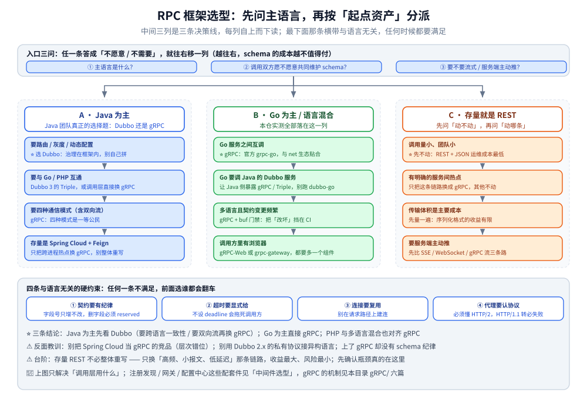
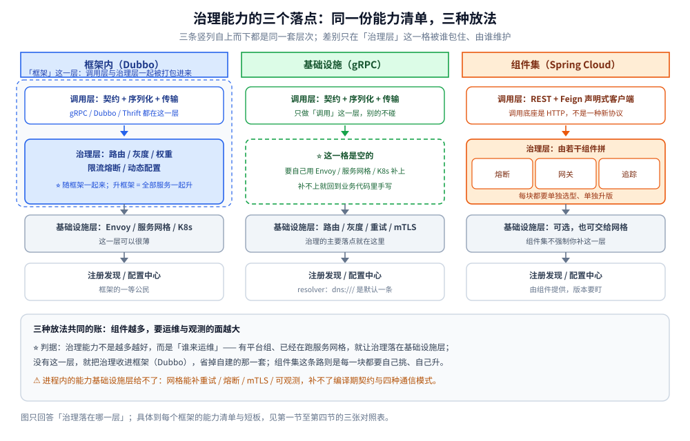

# RPC 框架选型对比

> 覆盖：RPC 与「用 HTTP 调接口」的分工、五类 RPC 框架（gRPC / Dubbo / Thrift / Spring Cloud / 云厂商与自研）的横向对照、「契合语言」维度、按主语言与起点资产分派的决策线，以及容易漏掉的两类**一票否决项**（许可与治理落点）。本目录其余篇目是各框架的深入篇。
>
> 不覆盖：**本篇只做横向选型**：框架各占一节对照表，不展开任何单个框架的机制 —— gRPC 的机制见 [gRPC/](gRPC/) 13 篇；应用层协议与序列化格式的横向选型见 [通信选型.md](../../../02-计算机基础/网络/选型/通信选型.md) 与 [数据序列化.md](../../../02-计算机基础/网络/选型/数据序列化.md)。
>
> 内容整理自个人学习笔记，素材见 [素材清单.md](../../../素材清单.md)。
>
> 📎 **实测口径**：本篇是**纯横向选型整理，本仓没有为它单独起过容器、也没有编译过代码**。正文引用的实测读数全部来自本目录 gRPC 那 13 篇已有的实测（Go 侧，运行环境与版本见各篇引语），本篇只做引用与汇总，**未新增任何读数**；第八节新增的代码块均为「落地写法骨架」，**未单独编译、未执行**。

---

## 一、RPC 和「用 HTTP 调接口」到底差在哪？

**本节要点**：这不是「谁更快」的问题，而是**调用端要不要持有一份契约**的问题。

「用 HTTP 调接口」通常指：`POST /api/orders` + JSON 体，调用方靠**文档**知道该传什么字段。
它的优点是**零构建**（curl 就能调、浏览器就能看、日志里就有人能读）；
代价是**契约只存在于文档里**——服务端改字段，调用方要等到线上报错才知道。

RPC 框架做的事，本质是把「契约」从文档搬进**编译期**：

| # | 维度 | HTTP + JSON（文档契约） | RPC 框架（IDL 契约） |
|---|---|---|---|
| ① | **契约形态** | 文档 / OpenAPI，人读为主 | `.proto` / `.thrift` / 接口定义，**机器可校验** |
| ② | **调用形态** | 手拼 URL、手解 JSON | **生成存根**，写起来像本地方法调用 |
| ③ | **出错时机** | 运行期（参数错了才报） | **编译期**（字段对不上直接编不过） |
| ④ | **附加能力** | 自己定约定（超时靠客户端库、重试靠手写） | deadline / metadata / 结构化状态码 / 拦截器**是框架的一部分** |
| ⑤ | **调用方向** | 请求-响应；服务端推要另找 WebSocket / SSE | ⭐ **四种通信模式是一等公民**（含双向流） |
| ⑥ | **跨语言成本** | 最低（JSON 到处都有） | 中（要装工具链、生成代码、提交生成物） |

⭐ **一句话判据**：**读端愿不愿意也持有一份 schema**。<br>
愿意 → RPC 框架的收益（编译期校验、四种模式、统一附加能力）能兑现；<br>
不愿意（第三方开发者、浏览器直连、结构运行时才知道）→ 老老实实 JSON。

## 二、五类 RPC 框架各自解决什么问题？

**本节要点**：先把「它们不在同一层」这件事说清，再谈谁替代谁。

| 框架 | 出身 / 协议底座 | 最擅长 | 明显短板 |
|---|---|---|---|
| **gRPC** | Google；HTTP/2 传输，IDL 用 Protobuf（**codec 可替换**，本仓实测过 JSON codec） | **跨语言一致性最好**；四种通信模式齐全；反射 / 健康检查 / 拦截器 / 网关转码生态完整 | 只提供**调用层**：注册发现、灰度、治理要靠外挂（K8s / Envoy / 服务网格） |
| **Apache Dubbo** | 阿里；2.x 是私有 TCP 协议 + Hessian2，3.x 引入 **Triple**（基于 HTTP/2、兼容 gRPC） | **服务治理能力最厚**（路由、灰度、动态配置、限流熔断、权重），且**与 Spring 生态原生贴合** | Java 侧最成熟；多语言 SDK 的成熟度与文档量低于 Java 侧 |
| **Apache Thrift** | Facebook；IDL + 可插拔传输与协议（TBinary / TCompact / TJSON） | IDL 设计灵活，**传输与协议可自由组合**（含非 HTTP 传输） | 治理、网关、可观测的周边生态薄弱；新项目采用度低 |
| **Spring Cloud** | 组件集（不是单个框架）；调用底座是 REST + `Feign` 声明式客户端 | 与 Spring Boot 一体化的**微服务全家桶**（发现、配置、网关、熔断、追踪） | ⚠️ **层次错位**：它管的是「微服务要的一整套东西」，不是「一种调用协议」 |
| **云厂商与自研** | 百度 brpc、字节 Kitex、腾讯 tRPC 等 | 与自家基础设施深度绑定，超大规模场景下的定制能力 | 出了自家生态就基本用不上；文档与社区远不如前两类 |

> ⚠️ **比较时的第一条纪律**：**Spring Cloud 不该和 gRPC / Dubbo 放在同一层比**。
> 前面两个是「调用框架」，Spring Cloud 是「组件集」——
> 它可以和 Dubbo 并存（Spring Cloud Alibaba 就是这种组合），也可以和 gRPC 并存。
> 真正该对比的是：**调用层用 gRPC 还是 Dubbo，还是就用 REST**。

## 三、横向对比要问哪七个维度？

**本节要点**：把「治理能力」拆成可问的问题，避免「都挺好」式的比较。

| 维度 | gRPC | Dubbo 3.x | Thrift | REST + Feign |
|---|---|---|---|---|
| **序列化** | Protobuf 默认，可换 codec | Hessian2（2.x）/ Protobuf（Triple） | 可插拔（二进制 / 紧凑 / JSON） | JSON 为主 |
| **传输** | HTTP/2（多路复用，一条连接跑多条流） | 私有 TCP（2.x）/ HTTP/2（Triple） | 可插拔（TCP / HTTP / 内存） | HTTP/1.1（Feign 默认）或 HTTP/2 |
| **通信模式** | 一元 + 服务端流 + 客户端流 + 双向流 | 一元为主，Triple 支持流 | 一元 + 部分流式 | 一元（请求-响应） |
| **服务治理** | ⚠️ 框架内只到拦截器 / LB；路由灰度要外挂 | ⭐ 路由、权重、灰度、动态配置、限流熔断都在框架内 | 基本没有 | 靠 Spring Cloud 组件拼 |
| **注册发现** | resolver（`dns:///` 默认；也可接 etcd / Consul / 自建） | 一等公民（Nacos / ZooKeeper / Consul） | 无（自己接） | Spring Cloud 组件提供 |
| **跨语言** | ⭐ 官方实现覆盖最广 | Java 最成熟，多语言 SDK 次之 | IDL 层面可跨语言 | 语言无关（本质是 HTTP+JSON） |
| **上手成本** | 中：要装工具链、提交生成物 | 低（Java 团队）：引依赖 + 注解即可 | 中 | 最低 |

⭐ **这张表怎么读**：**「治理能力」是 Dubbo 与 gRPC 最大的分野**——
gRPC 刻意只做「调用」这一层，把治理交给基础设施（Envoy / 服务网格 / K8s）；
Dubbo 把治理做进框架。所以问题不是「谁强」，而是
**你的团队有没有能力把治理那一层用基础设施补上**：
有 → gRPC 更干净；没有 → Dubbo 省事。

## 四、契合语言与团队栈？

**本节要点**：同一份能力清单落到不同语言上，客户端成熟度与生态工具差别极大 —— ⭐ **这条常常比技术对照表更早决定答案**。

| 语言 | gRPC | Dubbo | Thrift | 说明 |
|---|---|---|---|---|
| **Java** | 官方实现成熟；Netty 底座；与 Spring Boot 集成要走第三方 starter | ⭐ **主场**：Java 是 Dubbo 的第一等公民，治理能力、Spring 集成、资料量都在这一侧 | 有实现，但周边薄 | Java 团队真正的选择是 **Dubbo 还是 gRPC**，不是「要不要上 RPC」 |
| **Go** | ⭐ 官方 `grpc-go`，与 Go 的 `context` / `net` 生态贴合；本仓的实验就是 Go 侧做的 | 有 `dubbo-go`，⚠️ **主要价值是「与 Java 侧 Dubbo 互通」**，不是拿它做首选 | 社区实现可用，采用度低 | Go 团队默认 gRPC；只有「必须调 Java 的 Dubbo 服务」时才考虑 Dubbo-Go |
| **PHP** | 官方支持（`ext-grpc`），但**常驻连接与连接池的习惯要另学**，请求级模型与流式调用不匹配 | ⚠️ 基本不可用 | 有实现，采用度低 | PHP 侧的现实选择：**对外 JSON / 对内由网关转成 gRPC**，PHP 不直接当 RPC 客户端 |
| **多语言混合** | ⭐ **唯一不凑合的答案**：IDL 一份、各语言生成各语言的存根，契约不会漂 | 除非所有语言都退到 Triple / REST，否则互通要靠适配层 | IDL 可跨语言，但治理与工具链都要自己补 | 混合栈下「用 REST + JSON」也永远是合规答案，就看你愿不愿意为性能付 schema 的成本 |

⭐ **三条结论**：

1. **Java 为主的团队** —— 先看 Dubbo：治理能力开箱即用、与 Spring 一体、资料最多；
   只有当「跨语言一致性」或「四种通信模式」是硬需求时，才把调用层换成 gRPC（Triple 时代两者还能共存）。
2. **Go 为主的团队** —— 直接选 gRPC：`grpc-go` 是官方实现，本仓实测的四种模式、
   连接复用、拦截器、metadata、限额全部在 Go 侧跑通；Dubbo-Go 只在**必须与 Java 侧互通**时才有意义。
3. **PHP / 多语言混合团队** —— 也对齐 gRPC：跨语言契约一份就够，
   PHP 侧尽量只做「网关转码后的 JSON 调用方」，不要让它直接承担流式 RPC 客户端。

> ⚠️ **反面教训**：
> 
> ① **把 Spring Cloud 当成 gRPC 的竞品来选型** —— 层次错位，最后会把「组件集」和「调用协议」混成一锅；
> 
> ② **用 Dubbo 的私有协议去接异构语言** —— 2.x 的私有 TCP 协议没有对等的跨语言实现，
>    一旦有非 Java 调用方，就得退到 Triple 或 REST，等于把前面的选择推翻；
> 
> ③ **上了 gRPC 却没有 schema 纪律** —— 字段号被复用会**静默错乱**（不是报错），
>    详见 [Protobuf.md](gRPC/Protobuf.md) 的 `reserved` 一节；
> 
> ④ **把「注册中心」当成 gRPC 的必配件** —— K8s 里用 headless Service + 客户端负载均衡就够了，
>    再引一套注册中心是白多一个要运维、要观测的组件。

## 五、按「起点资产」怎么分派三条决策线？

**本节要点**：选型不是从空白开始，第一步永远是**先问主语言**，再问「手里已经有什么」。



图怎么读：最上面那一排是**入口问题**（主语言是什么、调用双方愿不愿意共同维护 schema、要不要流式）；
中间三列是三条决策线（Java / Go 与多语言 / 存量 REST），每列里的小盒按顺序读；
最下面那条横带是**四条反复出现的硬约束**——它们和语言无关，任何时候都要满足。

### 5.1 决策线 A：Java 为主

| 状况 | 首选动作 |
|---|---|
| 服务全是 Java、要路由 / 灰度 / 动态配置 | ⭐ **Dubbo**：治理能力在框架内，别自己去拼 |
| 服务全是 Java，但要和 Go / PHP 互通 | **Dubbo 3 的 Triple**，或把调用层直接换成 gRPC |
| 要四种通信模式（尤其双向流） | **gRPC**：四种模式是一等公民，Dubbo 侧只有 Triple 才跟上 |
| 存量是 Spring Cloud + Feign | 先把**跨进程调用里的热点**挑出来单独换 gRPC，别整体重写 |

### 5.2 决策线 B：Go 为主，或语言混合

| 状况 | 首选动作 |
|---|---|
| Go 服务之间互调 | ⭐ **gRPC**：`grpc-go` + Protobuf，本仓实证全在 Go 侧 |
| Go 要调 Java 的 Dubbo 服务 | 优先让 Java 侧**暴露一份 gRPC / Triple 接口**，而不是在 Go 里跑 `dubbo-go` |
| 多语言且契约变更频繁 | gRPC + `buf` 兼容性门禁（见 [Protobuf.md](gRPC/Protobuf.md)），把「改坏 schema」挡在 CI |
| 调用方里有浏览器 | gRPC **不直连浏览器**：上 gRPC-Web 或 `grpc-gateway` 转 JSON，两者都要多一个组件 |

### 5.3 决策线 C：存量就是 REST，要不要动

| 状况 | 首选动作 |
|---|---|
| 调用量小、团队小 | ⭐ **先不动**：REST + JSON 的运维成本最低，性能瓶颈通常不在这里 |
| 有明确的服务间热点（高频、小报文、低延迟） | 只把这条链路换成 gRPC，其他不动 |
| 传输体积是主要成本（弱网 / 移动端 / 大报文） | 先量一遍：序列化格式的收益见 [数据序列化.md](../../../02-计算机基础/网络/选型/数据序列化.md) |
| 要服务端主动推 | 先比 SSE / WebSocket / gRPC 流三条路，别默认上 gRPC（见 [HTTP与gRPC.md](../../../02-计算机基础/网络/应用层/HTTP与gRPC.md)） |

### 5.4 四条与语言无关的硬约束

1. **契约要有纪律**：字段号只增不改、删字段必须 `reserved`（[Protobuf.md](gRPC/Protobuf.md)）；
2. **超时要显式给**：不设 deadline 的调用在故障时会把调用方一起拖死（[基础概念.md](gRPC/基础概念.md)）；
3. **连接要复用**：RPC 的连接建立成本远高于一次调用，别在请求路径上建连（[生态与网关.md](gRPC/生态与网关.md)）；
4. **代理要认协议**：gRPC 后端前面必须放**懂 HTTP/2 的代理**，
   拿 HTTP/1.1 的 `proxy_pass` 去转是必然失败的（本仓实测，见 [生态与网关.md](gRPC/生态与网关.md)）。

## 六、除了能力对照，还有哪些一票否决项？

**本节要点**：能力对照表能筛掉「不合适」，但真正让选型作废的是另外几类硬约束：**许可、治理落点、跨语言运行时的成熟度、供应商边界**。它们与「谁性能好」无关，却常常先决定答案。

### 6.1 许可与开源协议：先确认能不能用、能不能改

选型表上一般看不到这一列，但它常常是**一票否决**：能不能商用、能不能闭源分发、有没有「开源核心 + 商业治理」的双轨。判据四条：

1. **宽松许可那一档可以放心选** —— Apache 2.0 / MIT / BSD 类的官方仓库，商用与闭源分发都不带附加义务；
2. **组件集合要逐个子项目看** —— [Spring Cloud](https://spring.io/projects/spring-cloud) 不是一个仓库，而是一组项目，许可要按每个 starter 与其上游组件分别确认（云厂商的托管组件尤其如此）；
3. **「开源核心 + 商业治理」要算退出成本** —— 如果把治理、控制台、在线备份这类能力放在商业版里，意味着哪天要搬走，得先把这部分自己补上；
4. **自研组件的对外开源部分未必覆盖你依赖的那一层** —— 选它等于与这家基础设施绑定，出了自家生态就没有对等替代品。

> ⚠️ **口径说明**：具体许可条款以**各项目官方仓库的 LICENSE 与 NOTICE 文件**为准（gRPC、Apache Dubbo、Apache Thrift 的官方仓库都是 Apache 2.0 一类）。本篇只给判据，不逐条断言版本与条款，避免拿着过期结论去做合规判断。

### 6.2 治理能力落在哪一层：框架内，还是基础设施？

**本节要点**：这是 Dubbo 与 gRPC 最大的分野 —— 同一套治理能力（路由、灰度、权重、限流、熔断、动态配置），**放进框架**还是**交给基础设施**，决定了你要额外维护几个组件、以及团队要具备什么技能。



图怎么读：三条竖列是**同一份能力清单的三种放法**。左边「框架内」那一列被一个大框包住 —— 能力随框架一起来；中间「基础设施」一列的中段是空的 —— 这块要靠 Envoy / 服务网格 / K8s 补上；右边「组件集」由若干小框拼成 —— 每一块都要单独选型、单独升版。最下面那一条横带是三种放法共同的账：组件越多，要运维与观测的面越大。

| 治理能力 | Dubbo（框架内） | gRPC（基础设施） | Spring Cloud（组件集） |
|---|---|---|---|
| 路由 / 灰度 / 权重 | 框架自带 | 交给 Envoy / 服务网格 / K8s | 由组件拼 |
| 限流 / 熔断 | 框架自带 | 基础设施层或自研拦截器 | 组件提供 |
| 动态配置 | 框架 + 配置中心 | 配置中心 / 网格控制面 | 配置中心 |
| 注册发现 | 一等公民 | resolver（`dns:///` 默认） | 组件提供 |
| 代价 | 框架厚重，升级牵动面大 | 多一套基础设施要运维与观测 | 组件多，版本兼容要盯 |

⭐ 判据：**治理能力不是越多越好，而是「谁来运维」的问题** —— 团队里有平台组、已经在跑服务网格 → gRPC + 基础设施更干净；没有这一层 → Dubbo 把治理收进框架，省掉自建的那一层。

### 6.3 跨语言支持度：要分「IDL 层」和「运行时层」看

跨语言支持度经常被压成一句话，但它其实是两层：**IDL 能不能跨**（现代框架基本都能），**运行时与治理能不能跨**（差别很大）。

| 方言 | IDL 跨语言 | 运行时与治理跨语言 | 结论 |
|---|---|---|---|
| gRPC | ✅ | ✅ 官方实现覆盖最广 | 多语言栈的默认答案 |
| Dubbo | ✅（Triple / Protobuf） | ⚠️ Java 侧最成熟 | 有非 Java 调用方时，要么退到 Triple / REST，要么调用层换 gRPC |
| Thrift | ✅ | ⚠️ 治理与工具链要自己补 | 只取「IDL + 传输可插拔」这一层时可用 |
| REST + JSON | ✅ | ✅（本质就是 HTTP） | 永远合规，代价是契约回到文档 |

### 6.4 云厂商托管 RPC 与自研 RPC 的边界

- **托管 RPC**（云厂商的微服务引擎、注册配置中心托管）：省掉运维，代价是**版本与控制面在别人手里**；适合「治理需求标准化、没有平台组」的团队。
- **自研 RPC**（大厂内部框架对外开源的那一档，如 brpc / Kitex / tRPC）：优势全在**与自家基础设施的深度绑定**（自家名字服务、监控、调度）；出了这个环境，工具链与文档的落差立刻显现。
- ⭐ 判据：**只有当业务已经在该厂商的云上、且治理需求落在它的能力范围内时，托管才划算**；跨云 / 混合部署、或治理需求特殊，就把**调用层选成中立的**（gRPC），治理自己搭。

### 6.5 什么时候不该用 RPC 框架

| 场景 | 为什么不用 | 用什么 |
|---|---|---|
| 调用方是第三方开发者 / 浏览器直连 | 对方不可能为你的 IDL 装工具链 | REST + JSON（确需原生接口就上 gRPC-Web / `grpc-gateway` 转码） |
| 调用少、报文大、结构不固定 | 编译期契约的收益兑现不了，反而多一层生成物要提交 | REST + JSON |
| 只需要「发出去、不必等回」 | 这不是调用，是消息投递 | MQ（见 [中间件选型.md](../中间件选型.md)） |
| 单机 / 同进程内 | 没有网络边界，存根是纯开销 | 本地函数调用 |
| 团队没有 schema 纪律 | 字段号乱用会**静默错乱**，比 JSON 的显式报错更难查 | 先练契约纪律，再谈框架 |

> ⭐ 一句话：**RPC 框架买的是「编译期契约 + 四种通信模式 + 统一的附加能力」**。这三样你一样都用不上时，它就是纯成本。

## 七、应用场景

**本节要点**：本篇的结论落到真实系统里，大致是下面这几种形态；先认自己属于哪一种，再回去看第二节与第三节的对照表。

| 场景 | 用到本篇哪一部分 | 说明 |
|---|---|---|
| **微服务内部调用（Java 为主）** | 第二节、5.1 | 服务全 Java、要路由灰度 → Dubbo；要与 Go / PHP 互通 → Triple 或 gRPC；接入分册见 [接入gRPC.md](../../../01-编程语言/java/工程实践/接入gRPC.md) |
| **微服务内部调用（Go 为主）** | 第二节、5.2 | `grpc-go` 是官方实现；本仓的工程布局与实证见 [gRPC/实战示例.md](gRPC/实战示例.md) 与 [不使用protoc的gRPC.md](../../../01-编程语言/go/网络编程/不使用protoc的gRPC.md) |
| **多语言混合栈** | 第四节、6.3 | IDL 一份、各语言各生成存根；契约变更用 `buf` 门禁挡在 CI（[Protobuf.md](gRPC/Protobuf.md)） |
| **对外 API / 浏览器直连** | 5.2、6.5 | 不直连原生 gRPC；用 `grpc-gateway` / gRPC-Web 转码，或干脆 REST |
| **服务端主动推 / 双向流** | 第三节通信模式行、5.1 | 四种模式是 gRPC 的一等公民；先与 SSE / WebSocket 比一遍（[HTTP与gRPC.md](../../../02-计算机基础/网络/应用层/HTTP与gRPC.md)） |
| **网关这一层的代理** | 5.4 硬约束 ④ | 必须是懂 HTTP/2 的代理，见 [网关选型对比.md](../网关与代理/网关选型对比.md) |

规模与形态差异：**三五个服务的团队**，最大成本是「多维护一个组件」，此时 Dubbo 或 REST 更省；**几十上百个服务、多语言并存**，最大成本变成「契约漂移与治理重复实现」，此时统一到 gRPC（治理交给基础设施）收益最大；**对外交付的接口**，不论内部用什么，都要在外层留一层 REST / JSON 的转码面。

## 八、具体使用

**本节要点**：这一节是「选完之后怎么落地」：本目录怎么读（8.1）、生成存根与兼容性门禁（8.2）、调用侧的连接与超时骨架（8.3）、上线前检查单（8.4）。8.2 / 8.3 的代码为**落地写法骨架，未单独编译、未执行**。

### 8.1 本目录怎么读（导读）

**本节要点**：本目录是「RPC 框架」的横向入口 + gRPC 的纵向深入，读法分两步。

**第一步（选型，就是本篇）**：先确定**调用层用什么**。
如果结论不是 gRPC，本篇到此为止，去对应框架的官方文档 —— 本仓暂时只把 gRPC 做深了。

**第二步（gRPC 的 13 篇，按顺序读）**：

| 顺序 | 篇目 | 读它解决什么 |
|---|---|---|
| ① | [README.md](gRPC/README.md) — gRPC 目录导读 | 13 篇的分工与阅读顺序、常见任务导航、与仓内其它篇目的边界 |
| ② | [基础概念.md](gRPC/基础概念.md) | gRPC 与 HTTP/2、Protobuf 的关系；一次调用在 wire 上长什么样；三件套与默认限额 |
| ③ | [HTTP2机制.md](gRPC/HTTP2机制.md) | 帧 / 流 / HPACK / 流控 / 流状态机 —— gRPC 原理的底座 |
| ④ | [四种通信模式.md](gRPC/四种通信模式.md) | 四种模式的写法、结束语义、使用场景与反例 |
| ⑤ | [Protobuf.md](gRPC/Protobuf.md) | 逐字节编码、`reserved` 纪律、schema 演进兼容矩阵、`buf` 门禁 |
| ⑥ | [连接与生命周期.md](gRPC/连接与生命周期.md) | 五态状态机、keepalive 判据、`GracefulStop` vs `Stop` |
| ⑦ | [拦截器与元数据.md](gRPC/拦截器与元数据.md) | 洋葱序、状态码全集、富错误 `errdetails`、metadata 约定 |
| ⑧ | [安全与认证.md](gRPC/安全与认证.md) | TLS / mTLS 的十种结局、凭据与「按 CN 授权」 |
| ⑨ | [生态与网关.md](gRPC/生态与网关.md) | 注册发现、负载均衡、过网关、DNS 首连 8 秒的坑 |
| ⑩ | [可观测性.md](gRPC/可观测性.md) | trace / metrics / log 三件套在 gRPC 里各落在哪 |
| ⑪ | [性能与调优.md](gRPC/性能与调优.md) | 收益从哪来、压测口径、并发模型与压缩取舍 |
| ⑫ | [实战示例.md](gRPC/实战示例.md) | 该不该上 gRPC、工程布局、上线前十条清单、Go / Java 分册索引 |
| ⑬ | [故障排查与调试.md](gRPC/故障排查与调试.md) | 五层定位、状态码速查、三类静默失效、`GOAWAY` 两种情况 |
| ⑭ | [gRPC-Web与Connect.md](gRPC/gRPC-Web与Connect.md) | 浏览器为什么说不了原生 gRPC、gRPC-Web 的边界、Connect |

**语言分册**（接入代码不在这 13 篇里重复）：

- Go：[不使用protoc的gRPC.md](../../../01-编程语言/go/网络编程/不使用protoc的gRPC.md)、[从零实现网关.md](../../../01-编程语言/go/网络编程/从零实现网关.md)
- Java：[接入gRPC.md](../../../01-编程语言/java/工程实践/接入gRPC.md)

**Dubbo 册**（3 篇，⚠️ 全册零实测）：[调用链路.md](Dubbo/调用链路.md) 一次调用穿过的九个角色与 `Invoker` 收敛；[通信协议.md](Dubbo/通信协议.md) 16 字节头与 Triple；[服务治理.md](Dubbo/服务治理.md) 路由、五类 LB、六种容错、tag 灰度。语言分册：[接入Dubbo.md](../../../01-编程语言/java/工程实践/接入Dubbo.md)。

### 8.2 生成存根与兼容性门禁（未执行）

> 落地写法骨架，**本篇未执行**：本机未安装 `protoc` / `buf`（AGENTS「不可用项」列有登记），命令只作形态示意，参数以官方文档为准。

```bash
# ① 由 IDL 生成各语言的存根（Protobuf 为例，工具链与插件名以官方文档为准）
protoc --go_out=. --go-grpc_out=. api/order.proto

# ② 把「改坏 schema」挡在 CI：lint 管规范、breaking 管兼容
buf lint
buf breaking --against '.git#branch=main'   # 字段号复用、类型变更这类会在这里被拦下
```

⭐ 这两条命令的位置很关键：**它们进 CI 之后，契约纪律才从「团队约定」变成「门禁」**；没有门禁的 IDL 与一本没校对过的字典等价（为什么字段号复用会静默错乱，见 [Protobuf.md](gRPC/Protobuf.md) 的 `reserved` 一节）。

### 8.3 调用侧的连接与超时骨架（未编译）

> 落地写法骨架，**未单独编译**；写它只为了固定两条纪律：**连接在进程级建一次**，**deadline 每次调用显式给**。

```go
// 进程启动处建一次；别放进请求处理函数里
conn, err := grpc.NewClient(target,
	grpc.WithTransportCredentials(insecure.NewCredentials()), // 生产环境换成 TLS / mTLS 凭据
)
if err != nil {
	log.Fatalf("dial %s: %v", target, err)
}
defer conn.Close()
client := orderpb.NewOrderServiceClient(conn)

// 每次调用：deadline 显式给，不设就等于把调用方挂在服务端上
ctx, cancel := context.WithTimeout(ctx, 800*time.Millisecond)
defer cancel()
resp, err := client.CreateOrder(ctx, req)
```

⚠️ 两条纪律的来处：连接建立成本远高于一次调用（[生态与网关.md](gRPC/生态与网关.md)）；不设 deadline 的调用在故障时会把调用方一起拖死（[基础概念.md](gRPC/基础概念.md)）。

### 8.4 上线前检查单

| 检查项 | 判据 | 不做的后果 |
|---|---|---|
| 契约有 `reserved` | 删过的字段号已登记 | 字段号复用 → 静默错乱 |
| CI 有兼容性门禁 | `buf breaking` 已进流水线 | 改坏 schema 到运行期才发现 |
| deadline 显式给 | 每个调用点都能指出超时值 | 一处慢调用拖死整条链路 |
| 连接进程级复用 | 请求路径上没有建连动作 | 高频调用把连接成本放大成瓶颈 |
| 代理认 HTTP/2 | 代理配置里能指出 HTTP/2 的开启项 | HTTP/1.1 反代必然失败 |
| 治理落点已确认 | 路由 / 灰度 / 限流各自在哪一层有明确答案 | 上线后才发现治理没人管（见 6.2） |

## 延伸追问

- **RPC 框架能解决「分布式事务」吗？** → 不能。它解决的是**调用**，事务要另找方案，
  见 [README.md](../../../04-架构与系统/分布式/分布式事务/README.md)。
- **gRPC 一定比 REST 快吗？** → 不一定。报文大、连接冷、调用次数少时差距会被摊薄；
  它稳定的优势在**高频小报文 + 连接复用**，以及四种通信模式和编译期契约。
- **服务网格能替代 RPC 框架的治理能力吗？** → 网络层能补一部分（重试、熔断、mTLS、可观测），
  但**编译期契约与四种通信模式是进程内的能力**，网格给不了；两者是互补。
- **Dubbo 3 的 Triple 和 gRPC 是什么关系？** → 都跑在 HTTP/2 上、都支持 Protobuf，
  差别主要在**治理能力放在哪一层**（Dubbo 放框架内，gRPC 放基础设施）。
- **为什么本仓的 gRPC 实验用 JSON codec？** → 为了证明
  「**gRPC 不等于 Protobuf**」：换掉 codec 之后传输层、四种模式、metadata、状态码全都不变，
  见 [基础概念.md](gRPC/基础概念.md) 第六节。
- **同一套治理能力，为什么有的团队宁愿在基础设施层再补一遍？** → 因为落点决定**升级方式**：
  治理在框架内，升框架就等于动每一个服务（版本必须整体推进）；治理在基础设施层，
  升一次代理 / 控制面就能覆盖全部服务，但代价是多维护一套组件、且进程内的能力（编译期契约、
  四种通信模式）它给不了。判据是**团队有没有人守那一层**（见 6.2）。
- **云厂商托管 RPC 与自研 RPC 的分界线在哪？** → 看**控制面在哪、能不能搬走**：
  托管方案省运维、但版本与控制面在厂商手里；自研方案与自家基础设施深度绑定，出了生态没有对等替代。
  判断方法是问一句「哪天要换掉它，我要改多少地方」——答案超出「换个 endpoint / 加一层网关」，
  就属于深度绑定，要把退出成本写进选型记录（见 6.4）。
- **许可为什么能构成一票否决？** → 因为它是**不可通过技术手段绕开**的约束：能力不足可以补代码，
  许可不合规只能换框架。合规判断必须回到各仓库的 LICENSE / NOTICE 原文，不要拿二手结论
  （见 6.1 的口径说明）。

## 关联

- **上游/总纲**：[README.md](gRPC/README.md) — gRPC 13 篇的目录导读（本目录的纵向深入入口）
- **对照/互补**：[README.md](Dubbo/README.md) — Dubbo 册导读（3 篇：调用链路 / 通信协议 / 服务治理，零实测）
- **对照/互补**：[通信选型.md](../../../02-计算机基础/网络/选型/通信选型.md) — 应用层协议与序列化格式的横向选型（同步 / 异步、HTTP/2 / gRPC / MQTT）
- **对照/互补**：[数据序列化.md](../../../02-计算机基础/网络/选型/数据序列化.md) — JSON 与 Protobuf 的四维对比与选型
- **下游机制**：[HTTP与gRPC.md](../../../02-计算机基础/网络/应用层/HTTP与gRPC.md) — HTTP/2 相对 HTTP/1.1 的五点改进（gRPC 的底座）
- **上游/总纲**：[中间件选型.md](../中间件选型.md) — 上一层的**族与子类级**选型（要不要引 RPC 子类、与网关 / MQ 怎么分工）
- **运维/配置**：[Nacos.md](../注册与配置中心/Nacos.md) — 注册与配置中心的具体实现（Dubbo 与 gRPC 都可接）
- **运维/配置**：[网关选型对比.md](../网关与代理/网关选型对比.md) — gRPC 后端前面那一层代理怎么选
- **上游/总纲**：[分布式与微服务.md](../../../04-架构与系统/分布式/分布式与微服务.md) — 微服务零件清单（RPC 只是其中一件）
- **对照/互补**：[接入gRPC.md](../../../01-编程语言/java/工程实践/接入gRPC.md) — Java 侧接入分册
- **对照/互补**：[不使用protoc的gRPC.md](../../../01-编程语言/go/网络编程/不使用protoc的gRPC.md) — Go 侧实证（codec 与 `ServiceDesc`）
- **上游/总纲**：[素材清单.md](../../../素材清单.md) — 素材来源登记
> 反向引用（本篇被下列文档引到）：[实战示例.md](gRPC/实战示例.md)、[性能与调优.md](gRPC/性能与调优.md)
