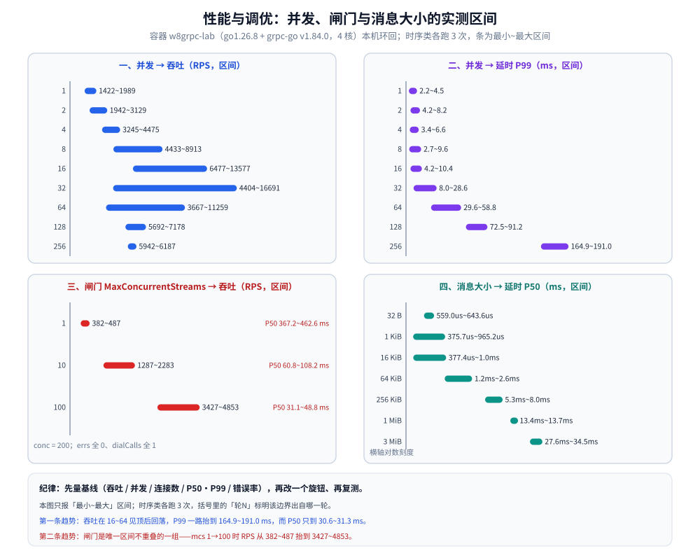
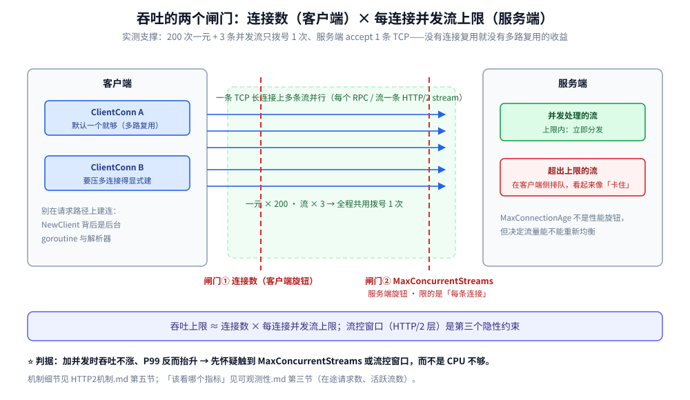

# gRPC 性能与调优

> 性能从哪来、该怎么量、哪些旋钮真的有用：连接复用与多路复用省的是建连、并发模型决定延迟分布、连接数与 `MaxConcurrentStreams` 是吞吐的两个闸门、压缩与批量的取舍，以及一份调优清单。
>
> 内容整理自个人学习笔记，**本篇的读数均来自本仓容器实测**。素材见 [素材清单](../../../../素材清单.md)。
>
> **实测口径（三段式）**：
> **归属**：本仓 `03-数据与中间件/中间件/RPC框架/gRPC/` 系列素材 + grpc-go / grpc-java 公开接口；
> **范围与边界**：只讲「gRPC 自身的性能旋钮与量法」，不讲机器规格、内核参数、业务代码优化；
> **✅ 实测口径**：本仓做过两批——①早前的连接复用计数与四种模式区间（容器 `grpclab`，来自 `out/reuse.txt`、`out/modes.txt`）；②本轮的六组压测（容器 `w8grpc-lab`，`go1.26.8` + grpc-go `v1.84.0`，4 核、本机环回）：并发扫描、连接数扫描、`MaxConcurrentStreams` 闸门、四种模式、消息大小、压缩，读数见第三节；
> **⚠️ 仍未实测**：**没跑 `ghz`**（压测用自写 bench，不生成 protobuf）、**没有 REST 基线**（因此给不出「比 REST 快多少」）、**没有跨机器 / 跨机房的端到端时延**。
> 第三节的时序读数各跑 3 次，只报 `最小~最大` 区间并标注该边界来自哪一轮；绝对吞吐受同机其它容器竞争影响，**只可断言趋势，不可引用绝对值**。

---

## 一、性能从哪来：先分清「省什么」

**本节要点**：gRPC 的收益主要在三处——**省建连**（连接长期复用）、**省序列化**（二进制载荷）、**省等待**（流式让首字节更早）；它**不**自动让业务更快。

| 收益 | 机制 | 本仓实测支撑 |
|---|---|---|
| 省建连 | 连接长期复用 + 多路复用 | ✅ 200 次一元 + 3 条流只拨号 **1** 次、服务端 accept **1** 条 TCP |
| 省序列化开销 | Protobuf 二进制 | 体积与速度的横向对比在 [数据序列化.md](../../../../02-计算机基础/网络/选型/数据序列化.md)（不在本篇） |
| 省等待 | 流式：不用等整批数据准备好 | ✅ 服务端流首字节 `16~17 ms`，总 `79~81 ms`（服务端每 15 ms 推一条） |
| ⚠️ **不省什么** | 业务逻辑、下游耗时、锁竞争、大消息的拷贝 | —— |

⭐ **最容易误判的一条**：把「首字节更早」读成「更快」。服务端流那条实测里，
**总耗时是由服务端的推送节奏决定的**（5 条 × 15 ms），不是被网络拖慢——
所以流式的价值是「边算边给」，不是「总时间变短」（[四种通信模式.md](四种通信模式.md) 第四节）。

---

## 二、该怎么量：四类数字，缺一不可

**本节要点**：只报 QPS 是没用的——**必须同时给出并发、连接数、延迟分布与错误率**，否则数字无法比较、也无法定位瓶颈。

### 2.1 一次压测要报的四个数

| 数 | 为什么要 |
|---|---|
| 吞吐（RPS） | 主指标，但它单独没有意义 |
| **并发数** | 决定「是延迟敏感还是一味堆并发」 |
| **连接数** | gRPC 的吞吐与连接数强相关（多路复用），不报连接数的 QPS 无法复现 |
| **延迟分布（P50/P90/P99）+ 错误率** | 长尾与错误是调优的真正目标；只报平均值会掩盖双峰 |

### 2.2 用 `ghz`

`ghz`（`github.com/bojand/ghz`，文档在 `ghz.sh`）是 gRPC 生态里最常用的压测工具，
关键参数就那几个（**参数名按工具的公开文档写，本仓未跑过**）：

```bash
# 无速率上限、固定并发：看「打满时能到多少」+ 延迟分布
ghz --insecure --proto ./demo.proto --call demo.Echo.Unary \
    -c 50 -n 20000 --connections 4 -d '{"seq":1,"body":"x"}' 127.0.0.1:50051

# 限速率、逐步加压：看「拐点在哪」（哪一档开始 P99 抬升）
ghz --insecure --proto ./demo.proto --call demo.Echo.Unary \
    -r 2000 --load-schedule step --load-start 200 --load-step 200 --load-end 4000 \
    -d '{"seq":1,"body":"x"}' 127.0.0.1:50051
```

三条使用要点：

- **`--connections` 是必调项**：gRPC 的吞吐与连接数耦合（多路复用），
  只报 `-c`（并发）不报连接数，结果没法复现；
- **先限速率找拐点，再满速测上限**：直接满速只会得到一个「哪里都卡」的结论；
- **`--skipTLS` / `--insecure` 要与被测服务一致**，否则测的是握手失败的重试。

### 2.3 自写基准的注意点

要测「自家代码路径」而不是「框架开销」时，自写 `testing.B` 更可控，但有三个坑：

- **连接要在 `b.ResetTimer()` 之前建好**（否则把建连算进被测路径）；
- **别在循环里创建 `ClientConn`**——`grpc.NewClient` 便宜但它背后是后台 goroutine 与解析器；
- **`b.RunParallel` 与连接数的关系要写清**：默认一个 `ClientConn` 被所有 goroutine 复用，
  这正是 gRPC 的常态；要压「多条连接」就得显式建多个。

---

## 三、本机实测：六个读数

**本节要点**：六组读数把「并发、连接数、闸门、通信模式、消息大小、压缩」各扫一遍；**一律给区间**——时序类各跑 3 次取 `最小~最大`，括号里注明该边界出自哪一轮。

### 3.1 实测台与读法

- **容器**：`w8grpc-lab`（`golang:1.26-alpine`），`go version go1.26.8 linux/amd64`；
  `nproc=4`（cgroup `cpu.max = max 100000`）、`MemTotal 6070868 kB`，宿主 `Linux 6.18.54.1-microsoft-standard-WSL2`；
- **客户端库**：`google.golang.org/grpc v1.84.0`（`golang.org/x/net v0.57.0`、`google.golang.org/protobuf v1.36.11`）；
- **压测台**：客户端与服务端同容器、走 `127.0.0.1` 环回；自写 bench 用手写 `ServiceDesc` + 自定义 codec，
  **不生成 protobuf**（只为一元 echo 与一条服务端流服务），计数由进程内自查，非抓包；
- **读法**：每档固定总次数（`per × conc`）；时序类各跑 3 次，下表一律 `最小~最大`，`（轮N）` 标明边界出处；
- ⚠️ **绝对吞吐不可复现**：测量期间同机还有其它容器在跑，`conc=16` 一档三轮分别是 `13577`（轮1）/`9276`（轮2）/`6477`（轮3）——
  **同一张表内只比较相对趋势**。

### 3.2 并发扫描（一元 echo、payload 64 B、单 ClientConn）

| 并发 | RPS 区间（轮） | P50 区间（轮） | P99 区间（轮） |
|---|---|---|---|
| 1 | 1422（轮3）~1989（轮2） | 390.0us（轮2）~528.4us（轮1） | 2.2ms（轮1）~4.5ms（轮3） |
| 2 | 1942（轮2）~3129（轮3） | 436.9us（轮3）~653.2us（轮1） | 4.2ms（轮3）~8.2ms（轮2） |
| 4 | 3245（轮2）~4475（轮1） | 600.3us（轮3）~860.4us（轮2） | 3.4ms（轮1）~6.6ms（轮2） |
| 8 | 4433（轮3）~8913（轮1） | 771.2us（轮1）~1.1ms（轮2） | 2.7ms（轮1）~9.6ms（轮3） |
| 16 | 6477（轮3）~13577（轮1） | 956.5us（轮1）~1.8ms（轮3） | 4.2ms（轮1）~10.4ms（轮3） |
| 32 | 4404（轮2）~16691（轮1） | 1.5ms（轮1）~5.8ms（轮2） | 8.0ms（轮1）~28.6ms（轮2） |
| 64 | 3667（轮2）~11259（轮3） | 3.7ms（轮3）~14.4ms（轮2） | 29.6ms（轮1/轮3）~58.8ms（轮2） |
| 128 | 5692（轮1）~7178（轮3） | 11.9ms（轮3）~18.0ms（轮1） | 72.5ms（轮2）~91.2ms（轮1） |
| 256 | 5942（轮1）~6187（轮3） | 30.6ms（轮1）~31.3ms（轮3） | 164.9ms（轮2）~191.0ms（轮1） |

三条趋势：**①** 三轮 `dialCalls` 各为 `9`（9 档各拨号 1 次）→ 全程单 `ClientConn` 复用，没有偷偷建连；
**②** 吞吐在 `16`~`64` 一带见顶后回落，`128`~`256` 档还稳在 `5692`~`6187` 附近；
**③** P99 从个位 ms 一路抬到 `164.9`~`191.0 ms`，而 P50 只到 `30.6`~`31.3 ms`——**长尾比均值先坏**。

### 3.3 连接数扫描（conc=64、一元 echo）

| 连接数 | RPS 区间（轮） | P50 区间（轮） | P99 区间（轮） |
|---|---|---|---|
| 1 | 6177（轮1）~8297（轮3） | 5.6ms（轮3）~8.1ms（轮1） | 36.7ms（轮2）~41.6ms（轮3） |
| 2 | 3404（轮1）~6113（轮2） | 7.7ms（轮2）~14.4ms（轮1） | 42.4ms（轮2）~82.2ms（轮1） |
| 4 | 6793（轮1）~7579（轮2） | 5.5ms（轮3）~6.4ms（轮2） | 35.0ms（轮2）~57.5ms（轮1） |
| 8 | 3679（轮1）~8203（轮3） | 5.5ms（轮3）~12.7ms（轮1） | 31.8ms（轮3）~78.4ms（轮1） |

`dialCalls` 在三轮里恒等于连接数（`1`/`2`/`4`/`8`），说明计数可信。结论：**多拨连接没有稳定增益**——
四档的 RPS 区间大面积重叠（最低 `3679` 与最高 `8297` 都出自同档不同轮），`conns=2` 那组反而最差，是撞上了宿主的竞争窗口而不是连接数本身的问题。

### 3.4 闸门对照：`MaxConcurrentStreams`（conc=200、一元 echo）

| `mcs` | RPS 区间（轮） | P50 区间（轮） | errs / dialCalls |
|---|---|---|---|
| 1 | 382（轮1）~487（轮3） | 367.2ms（轮2）~462.6ms（轮1） | 0 / 1 |
| 10 | 1287（轮1）~2283（轮3） | 60.8ms（轮3）~108.2ms（轮1） | 0 / 1 |
| 100 | 3427（轮2）~4853（轮1） | 31.1ms（轮3）~48.8ms（轮2） | 0 / 1 |

⭐ 这是六组里**唯一区间互不重叠**的一组：`mcs` 从 1 抬到 100，RPS 从 `382~487` 抬到 `3427~4853`，
P50 同步从数百 ms 掉到几十 ms，而错误率始终 `0`。
**「加并发吞吐不涨」在这里得到直接解释**：200 条并发流被 `mcs=1` 卡成串行队列，加并发只是加队列深度（第四节 4.3）。

### 3.5 四种模式（服务端流 `msgs=5`、服务端每 15ms 推一条）

| 读数 | 轮1 | 轮2 | 轮3 | 区间 |
|---|---|---|---|---|
| 服务端流首字节 | 16.7ms | 19.8ms | 17.3ms | 16.7~19.8 ms |
| 服务端流总耗时 | 85.1ms | 81.3ms | 80.4ms | 80.4~85.1 ms |
| 一元 ×5 总耗时 | 12.5ms | 10.3ms | 3.8ms | 3.8~12.5 ms |

与第一节那组 `16~17 ms` / `79~81 ms` 同量级，互为旁证；**流式并没有让总时间变短**——
服务端流的总耗时跟着服务端 `5 × 15ms` 的推送节奏走，首字节却早得多。

### 3.6 消息大小（一元 echo、单连接串行、n=200/档）

| 消息大小 | P50 区间（轮） |
|---|---|
| 32 B | 559.0us（轮3）~643.6us（轮2） |
| 1 KiB | 375.7us（轮3）~965.2us（轮2） |
| 16 KiB | 377.4us（轮3）~1.0ms（轮2） |
| 64 KiB | 1.2ms（轮3）~2.6ms（轮2） |
| 256 KiB | 5.3ms（轮3）~8.0ms（轮2） |
| 1 MiB | 13.4ms（轮2）~13.7ms（轮1） |
| 3 MiB | 27.6ms（轮1）~34.5ms（轮3） |

⭐ 只要消息够大，P50 就**线性**往上走：从 `559.0~643.6us` 一路到 `27.6~34.5 ms`；
而 3 MiB 一档的 P99 波动极大（`75.7ms`（轮2）~`189.4ms`（轮3））——
**大消息的延迟分布天生更差**（拷贝与 GC 都是线性的，第五节 5.2）。

### 3.7 压缩（n=200/档、一元 echo）

压缩值不值，只取决于载荷能不能压（下表均取第 1 轮）：

| 载荷 | 大小 | none B/call | gzip B/call | gzip/none |
|---|---|---|---|---|
| 随机（不可压） | 1 KiB | 2208.9 | 2267.2 | ×1.03 |
| 随机（不可压） | 64 KiB | 131390.5 | 131496.2 | ×1.00 |
| 随机（不可压） | 1 MiB | 2098710.5 | 2099471.9 | ×1.00 |
| 重复 ASCII（可压） | 1 KiB | 2209.0 | 355.1 | ×0.16 |
| 重复 ASCII（可压） | 16 KiB | 32973.0 | 465.4 | ×0.014 |
| 重复 ASCII（可压） | 64 KiB | 131383.2 | 747.5 | ×0.0057 |
| 重复 ASCII（可压） | 1 MiB | 2098705.7 | 6457.1 | ×0.0031 |

表中 `gzip/none` 一列是同轮 `gzip B/call ÷ none B/call` 的比值（如 `747.5 ÷ 131383.2 ≈ ×0.0057`），不是独立读数。

- **小消息一律不划算**：32 B 无论能不能压，gzip 都比不压更大（随机 `225.9` → `279.4`，重复 ASCII `225.2` → `275.1`）；
- **不可压的载荷 gzip 白干**：`1 KiB` 以上 gzip/none 全是 `×1.00`，却要多花 CPU——
  1 MiB 一档的 `us/call` 从 `29217.2`（轮1 的 none）涨到 `260424.2`（轮1 的 gzip），约 `×8.9`；
- **可压的载荷 gzip 很赚**：1 MiB 的 wire 从 `2098705.7` 掉到 `6457.1`（`×0.0031`），16 KiB 从 `32973.0` 掉到 `465.4`。

六组读数画成一张图（四条区间轴 + 一条纪律）：



---

## 四、并发模型：延迟分布是被它决定的

**本节要点**：Go 侧「每个流一个 goroutine」不贵，但**它会放大下游的阻塞**；Java 侧的 Netty event loop 有自己的线程模型——两侧的调优入口不同。

### 4.1 Go 侧

| 层 | 事实 | 调优含义 |
|---|---|---|
| 连接 | 后台 goroutine 负责读帧、分发到各流 | 连接数不用很多，多路复用已经给了并发 |
| 每条流 | 有独立的 goroutine 与缓冲区 | 流多了就多了 goroutine，**但要关注的是内存而不是调度** |
| `GOMAXPROCS` | 默认 = CPU 核数 | 容器里**必须核对**（cgroup 限额与宿主机核数不一致时会过配） |
| `GOGC` | 默认 100 | 高吞吐下 GC 抖动会体现在 P99，而不是平均值 |

⭐ **两个「只影响长尾」的旋钮**：`GOMAXPROCS` 过配、`GOGC` 太激进——它们几乎不动平均值，
所以只看平均延迟的压测发现不了。**这也是「必须报 P99」的理由**。

### 4.2 Java 侧

- Netty 的 event loop 负责 I/O，**业务 handler 跑在线程池里**——阻塞 handler 要看线程池大小，
  不是 event loop 数量；
- **JVM 预热是真实存在的**：本仓实测过 Java 一元首调 `751~1433 ms`、稳态流式首字节 `44~75 ms`，
  而 Go 侧同场景是 `4 ms` / `16~17 ms`——
  **这个差距主要是 JVM 预热与 Netty 建连的一次性成本，不是协议效率差异**
  （证据：两侧的 `streams=3 msgsIn=8 msgsOut=9` 三个计数**逐字一致**）；
- **所以压测必须丢掉冷启动那一段**，否则量的是 JIT 而不是被测代码。

### 4.3 连接池与连接数

| 侧 | 旋钮 | 说明 |
|---|---|---|
| 客户端 | `ClientConn` 数量 | 一个够用（多路复用）；要压多连接就得显式建多个 |
| 服务端 | `MaxConcurrentStreams` | **每条连接**的并发流上限；客户端侧超了就会被排队 |
| 服务端 | `MaxConnectionAge` | 不是性能旋钮，但影响 LB 均衡与流量分布 |

⭐ **判据**：如果「加并发时吞吐不涨、P99 反而抬升」，先怀疑**触到了 `MaxConcurrentStreams` 或流控窗口**
（[HTTP2机制.md](HTTP2机制.md) 第五节），而不是 CPU 不够。



---

## 五、压缩与消息大小

**本节要点**：压缩对小消息是**负收益**（压完更大还要 CPU）；真正该做的是**减少往返与消息条数**，并把消息大小记进指标。

### 5.1 压缩

- **服务端声明**支持的编码（响应头 `grpc-accept-encoding`），**客户端选择**用哪个（请求头 `grpc-encoding`）；
- **小消息别压**：几十字节的 payload 压完往往更大，还多了一次 CPU；
  **判据是「消息越大压缩越值」，不是「压了就快」**；
- gRPC 的 message 里那个「1 字节压缩标志」就是给这个用的（[基础概念.md](基础概念.md) 2.3）——
  它可以**逐消息**决定是否压缩，不必全流统一。

### 5.2 消息大小与批量

| 做法 | 收益 | 风险 |
|---|---|---|
| 把 N 次一元合并成 1 次（请求里放数组） | 省 N−1 次往返 | 消息变大，可能撞 **4 MiB 收限额** |
| 用客户端流批量上报 | 省往返，且不撞单条消息限额 | 需要自己处理半关闭与失败重试的粒度 |
| 只加大限额 | 让「大消息」能过 | **不是优化**：大消息会放大内存与 GC 压力 |

⚠️ 三条边界：4 MiB 是**收**方向限额、**收发各自独立、两端各自独立**（[HTTP2机制.md](HTTP2机制.md) 第七节）；
批量会把「失败粒度」变粗（一次失败整批重试）；
**大消息的延迟分布天生更差**（拷贝与 GC 都是线性的）。

---

## 六、Keepalive 与超时：别把「调优」做成「故障」

**本节要点**：keepalive 调太小会被服务端判违规断开；超时预算要在**每一跳**都留够，否则「看起来变快」只是错误变多了。

- **keepalive**：客户端 `Time` 有 **10 s 下限**、服务端默认 `MinTime` 是 **5 分钟**；
  调得太激进会拿到 `GOAWAY(too_many_pings)`——**这不是性能问题，是连接被断**
  （[连接与生命周期.md](连接与生命周期.md) 第二、三节）；
- **超时**：`DeadlineExceeded` 变多会让「平均延迟」看起来漂亮，
  但错误率已经把它吃掉了；**压测必须同时看错误率**（第二节 2.1）；
- **重试**：重试会吃最外层 deadline 的预算，配错就是「重试风暴」
  （[拦截器与元数据.md](拦截器与元数据.md) 第五节）。

---

## 使用：调优清单

**本节要点**：按「先量后调」的顺序走——没有基线不要动旋钮；下面每一项都标了「该看哪个指标」。

> ⚠️ 本清单的旋钮配对来自机制（第三、四、五节）与官方口径，**它本身不是读数**——
> 第三节给的是「基线长什么样」，清单给的是「按指标找旋钮」的对照，不是「改了就能快」的配方。

| 想改善 | 先看 | 再动的旋钮 | 常见误操作 |
|---|---|---|---|
| 吞吐上不去 | 活跃流数、连接数 | `MaxConcurrentStreams`、客户端连接数 | 无脑加并发（触到流控窗口后只是排队） |
| P99 抬升 | GC / 线程池、消息大小分布 | `GOGC`、`GOMAXPROCS`、消息大小 | 只看平均值说「没问题」 |
| 首字节慢 | 是否流式、下游耗时 | 改用服务端流，或先回一部分 | 以为「换语言」能解决 |
| 建连开销大 | 拨号次数（`dialCalls`） | 让连接复用（别在请求路径上建连） | 每次请求 `NewClient` |
| 偶尔被断 | `GOAWAY` 计数与 debug data | keepalive `Time` 与服务端 `MinTime` 配套 | 把 `Time` 调到 1 s（会被夹到 10 s，且可能被判违规） |
| 内存高 | 消息大小 / 在途流数 | 限制并发与单条消息大小 | 用「加大限额」当优化 |
| 部署后流量不均 | 每 Pod 的连接数 | `MaxConnectionAge`、headless Service | 以为「扩了 Pod 就该均衡」 |

**最前面一条纪律**：**先建立基线**（吞吐 / 并发 / 连接数 / P50·P99 / 错误率五个数），
再改**一个**旋钮，再复测。一次改三个旋钮的压测，结论一定是「不知道是哪个起作用」——
第三节那六组就是「同一张表内比趋势」的示范。

---

## 延伸追问

- **gRPC 比 REST 快多少？** → 本目录**没有 REST 基线**，给不出「快多少」；
  有读数的是 gRPC 自身：200 次调用只拨号 1 次，以及第三节那六组区间。横向对比见 [RPC框架选型对比.md](../RPC框架选型对比.md)。
- **流式是不是一定比一元快？** → 不是。实测里一元 `2~4 ms`，服务端流的总耗时由服务端推送节奏决定；
  流的收益是「首字节更早」，不是「总时间更短」（第一节）。
- **Java 的 gRPC 比 Go 慢几百倍？** → 那是 JVM 预热与 Netty 建连的**一次性**成本
  （首调 `751~1433 ms` vs 稳态 `44~75 ms`）；两侧计数逐字一致，说明差异不在协议层（4.2）。
- **并发加不上去、吞吐平了，先查什么？** → 先查 `MaxConcurrentStreams` 与流控窗口，
  再看 CPU；「加并发无效」几乎都是被闸门挡住（3.4、4.3）。
- **压缩开了会更慢吗？** → 小消息会。第三节 3.7 里 32 B 的 gzip 反而更大；判据看载荷能不能压，不是「压了就快」（5.1）。
- **为什么压测必须报连接数？** → gRPC 的吞吐与连接数强耦合（多路复用），
  不报连接数的 QPS 无法复现，也无法判断「是连接不够还是被限流」（2.1）。
- **`GOGC` / `GOMAXPROCS` 值不值得调？** → 它们只影响长尾；**只在 P99 有问题时才动它们**，
  并且要在容器限额下核对 `GOMAXPROCS`，别让 Go 以为核数更多（4.1）。
- **调优放在哪一层做？** → 先量出瓶颈在哪一层（序列化 / 并发模型 / 流控 / 下游），
  再动那一层的旋钮；跨层盲调是本目录最反对的做法（使用节的纪律）。

---

## 关联

- [README.md](README.md) — 本目录的目录导读（gRPC 知识库总纲）
- [基础概念.md](基础概念.md) — 连接复用与限额读数的最初出处
- [四种通信模式.md](四种通信模式.md) — 首字节与总耗时的那组区间实测
- [HTTP2机制.md](HTTP2机制.md) — 流控窗口、`MaxConcurrentStreams`、消息限额的机制
- [连接与生命周期.md](连接与生命周期.md) — keepalive 与连接寿命：性能旋钮同时也是故障源
- [可观测性.md](可观测性.md) — 上面每一项「该看哪个指标」的埋点位置
- [数据序列化.md](../../../../02-计算机基础/网络/选型/数据序列化.md) — 序列化的体积与速度对比（本篇不重复）
- [RPC框架选型对比.md](../RPC框架选型对比.md) — 与其他调用框架的横向对比
