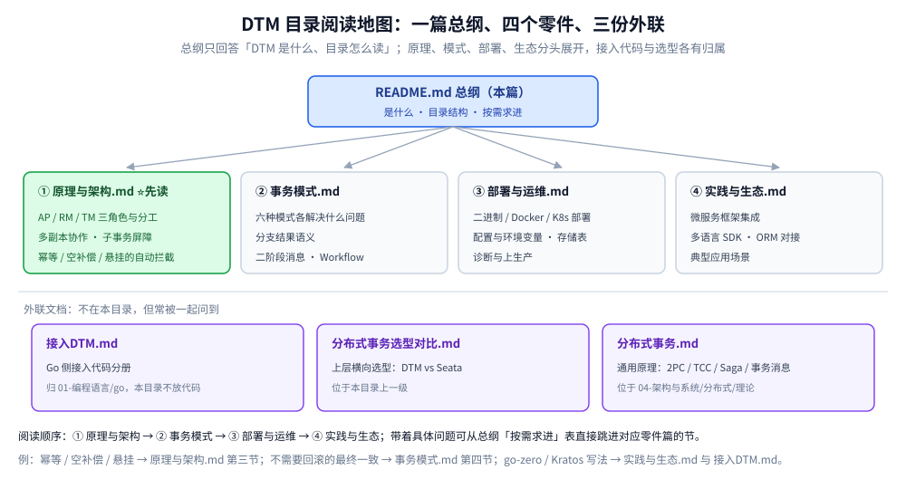

# DTM

> 本目录是 **DTM（Distributed Transactions Manager）** 这一分布式事务框架的专题入口：先给一张总览与阅读顺序，再由各篇分头展开原理、模式、部署、生态与设计示例。
> **横向选型（DTM vs Seata）见上层 [分布式事务选型对比.md](../分布式事务选型对比.md)；分布式事务的通用原理（2PC / TCC / Saga / 事务消息的来龙去脉）见 [README.md](../../../../04-架构与系统/分布式/分布式事务/README.md)，本篇不重复讲解。**
>
> 内容整理自个人学习笔记；DTM 相关内容来自 DTM 官方文档，版本口径以官方仓库为准。素材见 [素材清单.md](../../../../素材清单.md)。

---

## 一、DTM 是什么

**本节要点**：DTM 是一个用 Go 编写的分布式事务管理器，解决跨数据库、跨服务、跨语言栈的数据一致性问题；一组服务要么全部成功，要么全部回滚。

- **定位**：事务管理器（TM），业务只把「一组分支要么全成、要么全回滚」交给它，异常处理尽量收进框架。
- **六种模式**：SAGA、TCC、XA、二阶段消息、Workflow、Outbox（其中二阶段消息定位为「比 Outbox 更优雅」的方案），见 [事务模式.md](事务模式.md)。
- **双协议**：对外提供 HTTP 与 gRPC 接口（默认端口 36789 / 36790）。
- **跨语言**：SDK 很薄，官方提供 Go / Java / PHP / C# / Python / Node 的客户端，见 [实践与生态.md](实践与生态.md)。
- **易部署**：仅依赖 MySQL / Redis / Mongo 一类存储，多副本即可水平扩展，见 [部署与运维.md](部署与运维.md)。

## 二、本目录的结构

```text
原理与架构.md    ⭐ 先读：AP / RM / TM 三角色、多副本协作、子事务屏障（NPC 问题）
事务模式.md         六种模式各解决什么问题、分支结果语义、二阶段消息与 Workflow
部署与运维.md       二进制 / Docker / K8s 部署、配置与环境变量、存储表、诊断
实践与生态.md       微服务框架集成、多语言 SDK、ORM 对接、典型应用场景
转账场景.md      ⭐ 设计示例：跨行转账的 Saga / TCC 两条完整设计路线与实测
```

> Go 接入代码不放在本目录：按仓库约定，语言接入分册统一落在 `01-编程语言/` 下，见 [接入DTM.md](../../../../01-编程语言/go/工程实践/接入DTM.md)。



## 三、按需求进

| 你要解决的问题 | 从哪读 |
|---|---|
| 「DTM 和 Seata 到底选哪个」 | [分布式事务选型对比.md](../分布式事务选型对比.md) |
| 「DTM 的 AP / RM / TM 分工，为什么它不是单点」 | [原理与架构.md](原理与架构.md) 第一、二节 |
| 「幂等 / 空补偿 / 悬挂到底怎么被自动处理掉」 | [原理与架构.md](原理与架构.md) 第三节（子事务屏障） |
| 「我需要的是不需要回滚的最终一致，该用哪种模式」 | [事务模式.md](事务模式.md) 第四节（二阶段消息） |
| 「一个流程里想混用 Saga、TCC 和本地操作」 | [事务模式.md](事务模式.md) 第五节（Workflow） |
| 「怎么把 DTM 跑起来 / 上生产」 | [部署与运维.md](部署与运维.md) |
| 「go-zero / Kratos 里怎么写」 | [实践与生态.md](实践与生态.md)、[接入DTM.md](../../../../01-编程语言/go/工程实践/接入DTM.md) |
| 「跨行转账到底该用 Saga 还是 TCC」 | [转账场景.md](转账场景.md) 第三、四、五节 |
| 「转账要建哪些表、`trading_balance` 是干什么的」 | [转账场景.md](转账场景.md) 第二、4.3 节 |
| 「分布式事务的通用原理与方案对比」 | [README.md](../../../../04-架构与系统/分布式/分布式事务/README.md) |

## 关联

- [分布式事务选型对比.md](../分布式事务选型对比.md) — **本目录上层**：中间件产品粒度的横评（DTM vs Seata）
- [原理与架构.md](原理与架构.md) — DTM 三角色与子事务屏障
- [事务模式.md](事务模式.md) — 六种事务模式的能力与边界
- [部署与运维.md](部署与运维.md) — 部署、配置、存储表与诊断
- [实践与生态.md](实践与生态.md) — 框架集成、多语言 SDK 与典型场景
- [转账场景.md](转账场景.md) — ⭐ 跨行转账的完整设计示例（Saga / TCC 两条路线 + 容器实测）
- [接入DTM.md](../../../../01-编程语言/go/工程实践/接入DTM.md) — Go 侧接入代码分册
- [README.md](../../../../04-架构与系统/分布式/分布式事务/README.md) — 分布式事务通用原理与方案选型
- [素材清单.md](../../../../素材清单.md) — 素材来源登记
