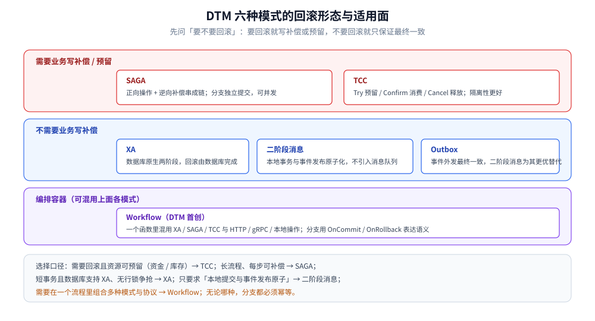
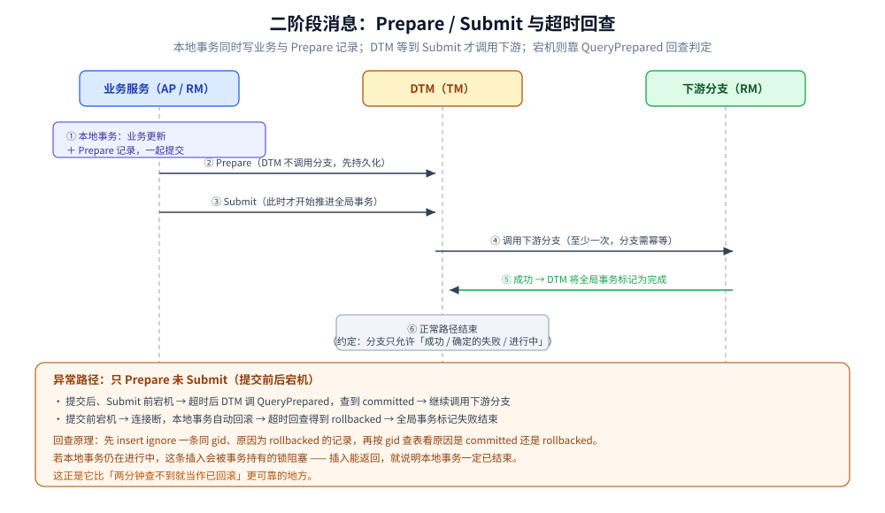
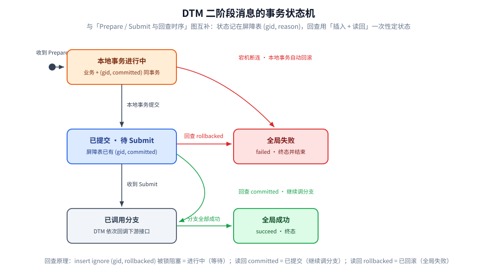

# DTM 事务模式

> 本篇按 DTM 的口径梳理它的六种事务模式（SAGA / TCC / XA / 二阶段消息 / Workflow / Outbox），重点在与通用方案不同之处：接口形态、分支结果、以及二阶段消息和 Workflow 的独有机制。
> 各方案本身的原理（2PC / TCC / Saga 的来龙去脉）见 [分布式事务.md](../../../../04-架构与系统/分布式/理论/分布式事务.md) 第三节，本篇不重复。
>
> 内容整理自个人学习笔记，素材来自 DTM 官方文档。素材见 [素材清单.md](../../../../素材清单.md)。

---

## 一、六种模式一览

**本节要点**：前三种（Saga / TCC / XA）是业界通用方案在 DTM 里的实现；后三种里，二阶段消息和 Workflow 是 DTM 的差异化能力。

| 模式 | 一句话 | 是否需要回滚补偿 | DTM 的形态 |
|---|---|---|---|
| **SAGA** | 正向操作 + 逆向补偿串成一条链 | 需要（补偿） | 接口式（非状态机），支持分支并发、可指定重试间隔 |
| **TCC** | Try 预留 / Confirm 消费 / Cancel 释放 | 需要（Cancel） | 三接口，配合子事务屏障处理乱序 |
| **XA** | 数据库原生两阶段提交 | 不需要（数据库回滚） | 复用数据库 XA，短事务 |
| **二阶段消息** | 本地事务提交与「事件发布」原子化 | 不需要 | DTM 首创，替代本地消息表 / 事务消息 |
| **Workflow** | 一个函数里混用多种模式与多种协议 | 视分支而定 | DTM 首创，分支可混用 XA / SAGA / TCC、HTTP / gRPC / 本地操作 |
| **Outbox** | 事件外发最终一致 | 不需要 | 官方列为一种模式，但定位上「二阶段消息是更优雅的替代」 |

> ⚠️ 官方首页常概括为「TCC / SAGA / XA / 二阶段消息」四种；Workflow 与 Outbox 见官方仓库 README 的模式列表。口径不一致时以官方仓库为准。

## 二、Saga 与 TCC

**本节要点**：DTM 里两者都靠子事务屏障兜住乱序问题，差别只在「预留 + 确认 + 取消」还是「正向 + 补偿」——前者更重但隔离性更好，后者更轻但中间态可能可见。

### 2.1 Saga 在 DTM 里的样子

- **接口式而非状态机**：用代码按顺序 `Add(正向 url, 补偿 url, 载荷)` 描述分支，不强制画状态机。
- **支持并发与重试间隔定制**：适合「某一步第三方要很久才有结果」的场景——业务可以先返回 `ONGOING`（HTTP 425 / gRPC `FailedPrecondition`），让 DTM 按固定间隔重试，见 [原理与架构.md](原理与架构.md) 第四节。
- **补偿语义**：全局失败时按逆序调用各分支的补偿操作；补偿操作不允许返回「确定的失败」。

### 2.2 TCC 在 DTM 里的样子

- 分支是三个接口：`Try`（校验 + 预留）、`Confirm`（消费预留）、`Cancel`（释放预留）。
- 全局提交 / 回滚由协调流程决定：所有 Try 成功则走 Confirm，任一 Try 失败或全局超时则走 Cancel。
- **乱序由子事务屏障处理**：Try / Confirm / Cancel 都经过屏障，幂等、空补偿、悬挂不需要业务自己写。
- 转账类场景的设计技巧：在 `balance` 之外引入 `trading_balance`（冻结额），Try 调 `trading_balance`、Confirm 同时调 `balance` 与 `trading_balance`、Cancel 只调 `trading_balance`。这样「用户看到余额扣减」就意味着对方一定能收到，避免了 Saga 里「扣款成功但对方收不到」的困扰。

## 三、XA

**本节要点**：DTM 的 XA 直接复用数据库原生两阶段提交，不需要业务写补偿；代价是持锁时间长，只适合短事务且没有行锁争抢的链路。

- 两个入口：全局侧 `XaGlobalTransaction`，分支侧在本地接口内调用 `XaLocalTransaction`。
- **不做补偿**：提交 / 回滚由数据库完成，因此不需要写 Confirm / Cancel。
- 适用与不适用：适合「不同订单锁不同行、并发互不影响」的创建订单类业务；**不适合扣库存**——同一商品会被大量订单争抢同一行锁，并发度低。
- 要求数据库与驱动支持 XA；`in-doubt` 悬挂事务的恢复必须监控，见 [部署与运维.md](部署与运维.md)。

## 四、二阶段消息（DTM 首创）

**本节要点**：二阶段消息保证「本地业务提交」与「全局事务提交」的原子性，用于**不需要回滚**的最终一致场景，替代本地消息表与事务消息，且不引入消息队列。

### 4.1 它解决什么

场景设定：A 跨行转 B，只有转出（A 扣款）可能失败，转入（B 到账）假定最终一定成功。要求「A 扣款」与「触发 B 到账」要么都发生、要么都不发生，且不能出现「扣了款但没触发」「没扣款却触发了」。

### 4.2 流程与两个阶段

- 阶段一：本地事务里既执行业务（如 A 扣款），又写入 Msg 的 Prepare 记录，一起提交。
- 阶段二：DTM 收到 Prepare 后**不会立刻调用分支**，而是等待 `Submit` 后再开始调用下游分支，最终完成全局事务。
- 关键点：**业务提交与消息提交被放进同一个本地事务**，从而获得原子性。

两阶段的边界很清楚：Prepare 只负责让 DTM 记住这件事，真正推动下游的是 Submit；而宕机后的走向，取决于本地事务到底提交了没有。

### 4.3 两种宕机分支

| 宕机时机 | 数据库行为 | DTM 的处置 |
|---|---|---|
| **本地事务提交后、发送 Submit 前** | 本地事务已提交 | 超时后取出「只 Prepare 未 Submit」的事务，调用回查服务；查到已提交 → 继续调用分支 |
| **收到 Prepare 后、本地事务提交前** | 连接断开，本地事务自动回滚 | 超时回查发现已回滚 → 全局事务标记失败并结束 |

### 4.4 回查原理（与 RocketMQ 事务消息的差别）

回查不是简单地「查 gid 在不在」，而是利用**屏障表的唯一键 + 锁等待**来区分「进行中」与「已回滚」：

1. 处理本地事务时，把 gid 连同原因 `committed` 插入屏障表。
2. 回查时，`insert ignore` 一条相同 gid、原因 `rollbacked` 的记录。
3. 再用 gid 查表：查到的原因是 `committed` 说明本地事务已提交；是 `rollbacked` 说明已回滚。

如果本地事务仍在进行中，第 2 步的插入会被进行中事务持有的锁**阻塞**——插入能返回，就说明本地事务**一定已经结束**（提交或回滚），从而干净地区分出「进行中」，不必像常见方案那样靠「两分钟查不到就当已回滚」来猜。

把 4.2 的两阶段与 4.3 的宕机分支收拢，一条二阶段消息事务只会处在下面三个可判定的状态之一，回查靠「插入 + 读回」一次定状态：

| 回查时刻本地事务状态 | `insert ignore (gid, rollbacked)` 的表现 | 按 gid 读回的 reason | DTM 的处置 |
|---|---|---|---|
| **进行中**（未结束） | 被其持有的锁阻塞，插入不返回 | —— | 回查自然等待，不用超时窗口去猜 |
| **已提交** | 唯一键冲突被 ignore | `committed` | 继续调用分支，向全局成功推进 |
| **已回滚**（含宕机断连） | 插入成功 | `rollbacked` | 全局事务标记失败并结束 |

### 4.5 与本地消息表 / 事务消息的取舍

| 对比项 | 本地消息表 | 事务消息（RocketMQ） | 二阶段消息 |
|---|---|---|---|
| 是否依赖消息队列 | 是 | 是（绑定 RocketMQ） | **否**，只依赖 DTM 与其存储 |
| 是否需要自己写轮询任务 | 需要 | 不需要 | **不需要** |
| 是否需要消费消息 | 需要 | 需要 | **不需要**（DTM 直接回调下游接口） |
| 同步 / 异步 | 异步 | 异步 | 默认异步，`WaitResult=true` 可同步等待 |
| 多下游 | 需自行编排 | 需自行编排 | 支持一次指定多个下游接口 |

> 同步模式、多个下游等细节见官方的「事务选项」；二阶段消息还能按 **topic** 投递（DTM 维护 `topic → API` 映射并载入内存），把调用方与分支接口解耦。

## 五、Workflow

**本节要点**：Workflow 是 DTM 首创的模式，把「编排」写成一个函数，函数里可混用 XA / SAGA / TCC 与 HTTP / gRPC / 本地操作，自由度最高，但对幂等的要求也更硬。

- **注册 + 执行**：启动后注册工作流函数，发起时执行；进程崩溃后 DTM 会回调业务服务，靠 SDK 从 DTM 读取进度、对已完成分支直接返回历史结果来续跑。
- **分支回调**：每个分支可有 `OnCommit` / `OnRollback` / `OnFinish`；只写 `OnRollback` 即为 Saga 语义，写 `OnCommit + OnRollback` 即为 TCC 语义，用 `DoXa` 即开启 XA 分支。
- **协议可混用**：同一事务里可以既有 gRPC 分支、又有 HTTP 分支、还有本地事务分支；分支结果通过拦截器自动记录到 DTM。
- **幂等是硬要求**：函数与分支都要可重复执行且结果一致；业务没自带幂等时用 `BranchBarrier` 辅助。
- **明确不支持**：暂不支持「超时回滚」与「重试达到上限后回滚」（这两类会被判定为非幂等），分支并发也在规划中。

## 延伸追问

- **Saga 和 TCC 在 DTM 里怎么选？** → 一致性要求高、涉及资金类资源且能接受改造为「预留 + 确认 + 取消」的用 TCC；只是长流程、允许中间态可见且每步可补偿的用 Saga。
- **二阶段消息既然是「消息」，为什么不用消息队列？** → 它只借用了「两阶段」的提交思想，实际由 DTM 直接回调下游接口，取消了消息队列、轮询任务与消费环节，因此比本地消息表 / 事务消息更少组件。
- **回查怎么区分「进行中」和「已回滚」？** → 靠第 2 步 `insert ignore` 与进行中事务的锁冲突：插入能被阻塞说明事务还没结束，插入能返回则说明事务已结束，再看记录里的 `committed / rollbacked` 原因。
- **Workflow 和直接用 Saga / TCC 有什么本质区别？** → Workflow 是「编排容器」：一个函数里可混用多种模式与协议，甚至本地操作；Saga / TCC 则各自是单一模式。
- **Outbox 还要单独学吗？** → 理解概念即可：它解决「事件外发最终一致」，而 DTM 认为二阶段消息是同一问题的更优雅解法，实际接入首选二阶段消息。

## 关联

- [README.md](README.md) — DTM 目录导读
- [原理与架构.md](原理与架构.md) — 子事务屏障与分支结果语义（本篇各模式共用）
- [部署与运维.md](部署与运维.md) — 各模式所需的存储表与监控点
- [转账场景.md](转账场景.md) — 跨行转账的完整设计示例：Saga 与 TCC 各一条路线怎么落表、怎么收场
- [实践与生态.md](实践与生态.md) — 各模式在 ORM 与微服务框架里的写法
- [接入DTM.md](../../../../01-编程语言/go/工程实践/接入DTM.md) — Saga / TCC / 二阶段消息的 Go 接入代码
- [分布式事务.md](../../../../04-架构与系统/分布式/理论/分布式事务.md) — TCC / Saga / 事务消息的通用原理与选型
- [消息队列选型对比.md](../../消息队列/消息队列选型对比.md) — 本地消息表与事务消息的完整方案
- [素材清单.md](../../../../素材清单.md) — 素材来源登记
