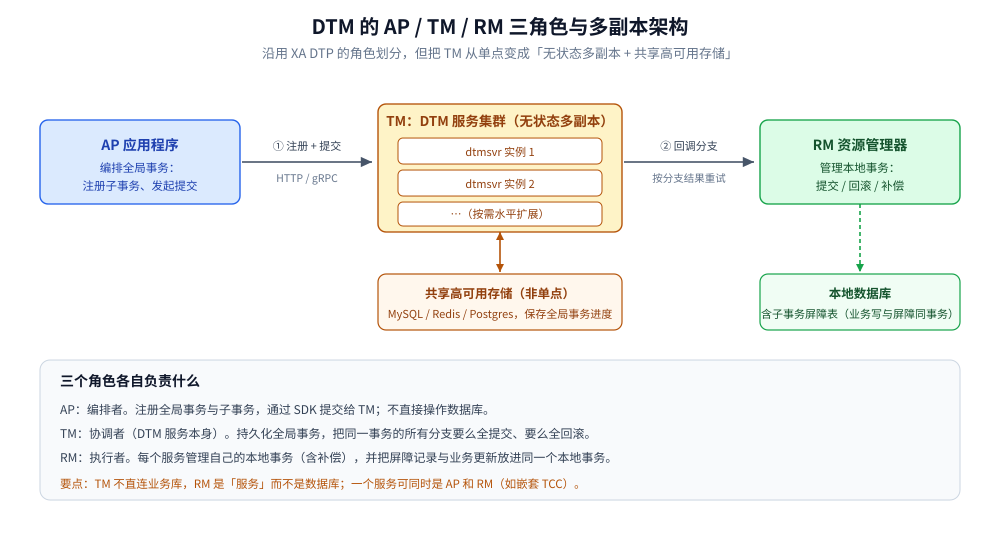
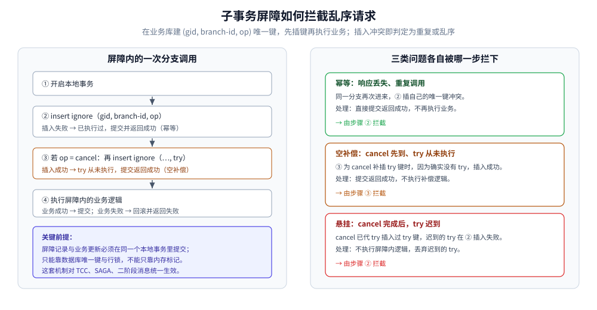

# DTM 原理与架构

> 本篇讲 DTM 的三个角色（AP / RM / TM）、它为什么不是单点，以及它最核心的机制——**子事务屏障**如何把幂等、空补偿、悬挂一次性收进框架。
> 六种事务模式见 [事务模式.md](事务模式.md)；通用原理（2PC / TCC / Saga）见 [README.md](../../../../04-架构与系统/分布式/分布式事务/README.md) 第三、四节。
>
> 内容整理自个人学习笔记，素材来自 DTM 官方文档。素材见 [素材清单.md](../../../../素材清单.md)。

---

## 一、三个角色：AP / RM / TM

**本节要点**：DTM 沿用 X/Open XA 的 DTP 角色划分，只是把这三个角色从「本地程序 + 数据库」扩展到了「服务 + 微服务」。

以一次跨行转账（A 转 B 30 元）为例，一个全局事务被拆成若干**事务分支**，每个分支由某个服务负责：

| 角色 | 全称 | 职责 | 在转账例子中 |
|---|---|---|---|
| **AP** | Application Program | 编排全局事务：注册全局事务、注册子事务、发起提交 | 发起转账、编排 TransOut + TransIn 的业务服务 |
| **RM** | Resource Manager | 管理本地事务：执行本地数据的修改、提交、回滚、补偿 | 转出服务、转入服务 |
| **TM** | Transaction Manager | 全局事务的管理者：协调所有 RM，要么全提交、要么全回滚 | **DTM 服务本身（dtmsvr）** |

几个容易记错的点：

- **AP 不直接操作数据库**，它通过 DTM 的 SDK 提交全局事务，由 TM 去回调各 RM。
- **一个服务可以同时是 AP 和 RM**（例如嵌套 TCC 场景），角色是相对某个全局事务而言的。
- **TM 与 RM 之间是网络调用**，TM 不会直接连业务库；这与 2PC 里 TM 直连数据库的形态不同。

三条链路要分清：AP 只和 TM 说话，是 TM 去回调 RM，RM 才碰自己的库——这正是它与「TM 直连数据库」的经典 2PC 在形态上最大的差异。

### 1.1 与 XA DTP 模型的异同

| 维度 | XA DTP | DTM |
|---|---|---|
| 角色划分 | AP / TM / RM | AP / TM / RM（一致） |
| TM 是否单点 | 经典 2PC 的 TM 是单点 | TM 是集群 + 共享高可用存储，**非单点** |
| RM 是什么 | 数据库等资源管理器 | **服务**，服务再与背后的数据库交互 |
| AP 怎么访问 RM | 本地 SDK 调用 | 通过网络 API 请求 |
| 协议接口 | XA（prepare / commit / rollback） | HTTP / gRPC（分支用状态码表达结果） |

> DTM 保留了 DTP 的角色划分，但用「集群化 TM + 云上高可用共享存储」替换了 2PC 里那个容易成为瓶颈和单点的协调者。

## 二、TM 为什么不是单点

**本节要点**：DTM 不靠复杂的选主，而是靠「无状态多副本 + 共享高可用存储 + 乐观锁取任务」来消除单点。

- **多副本**：多个 dtm 实例进程组成本集群，它们访问**同一个共享的高可用数据库**（Redis / MySQL / Postgres 之一）。实例本身无状态，可随意水平扩容。
- **超时任务轮询**：全局事务可能因网络错误无法一次完成，需要定时重试。每个实例都会轮询「超时需要处理的全局任务」，为避免同一任务被多个实例同时取出，DTM 用类似乐观锁的机制：
  - **DB 存储**：`update ... set owner=..., time=... where ...`，靠 `update` 的原子性保证一条记录只被一个实例更新。
  - **Redis 存储**：用 Lua 脚本原子操作，保证一条记录只被一个实例取出。
- **极端情况的兜底**：即使偶发两个实例取到同一任务，也**不影响最终正确性**——因为每个分支操作本身是幂等的。

> 这套设计把「协调者高可用」外包给了云厂商提供的高可用数据库（故障重新选举由存储层完成），DTM 自己不需要引入选举。

## 三、子事务屏障：把 NPC 问题收进框架

**本节要点**：网络延迟、进程暂停、时钟漂移（NPC）会让分支操作乱序到达，从而产生幂等、空补偿、悬挂三类问题；DTM 用一张本地表的唯一键把三者一次性解决。

### 3.1 NPC 会造成哪三类问题

| 问题 | 触发方式 | 后果 |
|---|---|---|
| **幂等** | 响应丢失，TM 重复调用同一分支 | 同一操作被执行多次，资金 / 库存重复变更 |
| **空回滚（空补偿）** | 正向操作还没到达，补偿操作先到 | 无中生有地对一个没做过的事做补偿 |
| **悬挂** | 补偿已经完成，迟到的正向操作才执行 | 已回滚的事务又被执行一遍，资源被二次占用 |

### 3.2 屏障原理

DTM 在**业务库所在实例**中建一张分支操作状态表：官方建表脚本 `sqls/dtmcli.barrier.mysql.sql` 建的是**库 `dtm_barrier`、表 `barrier`**，唯一键为 **`(gid, branch_id, op, barrier_id)`**。每次分支调用沿这条流程走（对应官方 `BranchBarrier.Call`）：

1. 开启本地事务。
2. 先按「**正向操作**」插入一条键：`cancel → try`、`compensate → action`、`rollback → action`。**若插入成功**，说明正向操作从未真正执行过，这是一次**空补偿**——直接提交并返回成功，不执行业务（**空补偿控制**）。
3. 再插入「**当前操作**」的键。**若插入失败**（唯一键冲突），说明该操作已执行过（**幂等控制**），或正向操作已被补偿抢先插入（**防悬挂控制**）——同样直接提交并返回成功，不执行业务。
4. 否则执行屏障内的业务逻辑：成功则提交事务返回成功，失败则回滚事务返回失败。

> ⚠️ 同一次调用里的两次插入共用同一个自增 `barrier_id`（从 `01` 起），所以「本次的 action 键」与「上一次补偿代插的 action 键」能撞上，幂等与防悬挂才成立。
> ⚠️ 第 4 步业务失败会**连同屏障键一起回滚**——因此后续补偿到达时，会因正向键不存在而被判为「空补偿」并跳过。

这套设计之所以能同时解决三个问题：

- **幂等**：任一操作都无法重复插入唯一键，重复请求被拦在屏障外。
- **空补偿**：cancel 先到时，它插入的 `try` 键会成功（因为 try 确实没来过），于是直接返回，补偿逻辑不执行。
- **防悬挂**：try 若在 cancel 之后才到，尝试插入 `try` 键会失败（cancel 已经代它插过了），于是不执行屏障内逻辑，迟到的 try 被丢弃。

注意判定都发生在业务逻辑之前：只要唯一键插不进去（或补偿时正向键能插进去），就直接返回成功，屏障内的业务代码根本不会被执行。

### 3.3 屏障对哪些模式生效

子事务屏障统一管理 TCC、SAGA、二阶段消息等模式的分支，理论上也可扩展到其他场景。区别只在调用方式：

- TCC / SAGA：在分支处理器里用 `BranchBarrier.Call(tx, busiCall)`（或 `CallWithDB(db, busiCall)`）包住业务逻辑。
- 二阶段消息：用 `QueryPrepared` 做回查，底层同样依赖屏障表的唯一键与锁等待，见 [事务模式.md](事务模式.md) 第四节。

> ⚠️ 屏障依赖**本地事务 + 唯一索引**，不能只靠内存标记。业务侧自己的幂等键（如 `orderId` 唯一约束）仍建议保留，屏障解决的是「协调层重复调用」，业务键解决的是「业务语义重复」。

## 四、分支结果语义

**本节要点**：DTM 把分支结果分成「成功 / 确定的失败 / 进行中 / 临时错误」四类，不同类型对应不同的重试策略，这是接入时最容易写错的地方。

| 结果 | HTTP | gRPC | DTM 的处理 |
|---|---|---|---|
| **成功** | 200 | `OK` | 更新事务进度，进入下一分支 |
| **确定的失败** | 409 | `Aborted` | 不再重试，全局事务转为回滚 |
| **进行中** | 425 | `FailedPrecondition` | **固定间隔**重试（适合需要长时间才有结果的第三方） |
| **其他** | 其他状态码 | 其他状态 | **指数退避**重试（当作临时故障或 bug） |

两条必须记住的纪律：

- ⚠️ **接口返回错误 ≠ 业务失败**。超时或 500 只是「暂时不可用」，不应据此回滚——否则会出现「红包已发出、余额没扣」这类事故。这一类错误应交给 DTM 重试。
- ⚠️ **不允许回滚的分支不应返回「确定的失败」**：二阶段消息的分支、Saga 的补偿操作、TCC 的 Confirm / Cancel，都必须在设计上保证能最终成功，返回 409 会让全局事务卡住。

> `ONGOING`（425 / `FailedPrecondition`）是 DTM 引入的特殊结果。典型场景：预订机票时第三方需要一小时才能确认结果，业务可以先返回「进行中」，让 DTM 按固定间隔重试而不是指数退避放大压力。

## 延伸追问

- **AP 和 RM 是同一个服务吗？** → 可以。角色是相对某个全局事务而言的；一个服务既编排事务（AP）又被别人的事务调用（RM）时，两者就重合，嵌套 TCC 是典型例子。
- **子事务屏障为什么能做到幂等和防悬挂？** → 靠业务库中一张表的唯一键：任何操作先 `insert ignore` 自己的键，冲突即视为重复；cancel 额外补插 try 键用于识别空补偿；try 迟到时插键失败即被丢弃。
- **DTM 的 TM 挂了会怎样？** → 单实例挂掉不影响整体：多副本中的其他实例继续轮询未完成事务，事务状态在同库中持久化，恢复后继续推进。
- **为什么 DTM 强调「接口返回错误不等于业务失败」？** → 因为分布式里「没收到响应」和「对方没执行」是两回事；把技术故障当业务失败去回滚，会造成不可逆的金额或库存错误。
- **子事务屏障表和业务库是一张还是一张独立表？** → 独立表，但必须在**业务库**里，才能与业务更新放进同一个本地事务；建表脚本见官方 `sqls/`。

## 关联

- [README.md](README.md) — DTM 目录导读
- [事务模式.md](事务模式.md) — 六种模式各解决什么问题，屏障在其中怎么用
- [部署与运维.md](部署与运维.md) — 多副本与存储部署、屏障表与全局事务表的准备
- [实践与生态.md](实践与生态.md) — 各语言 SDK 与 ORM 里的屏障调用
- [接入DTM.md](../../../../01-编程语言/go/工程实践/接入DTM.md) — Go 侧屏障与事务的完整接入代码
- [TCC.md](../../../../04-架构与系统/分布式/分布式事务/TCC.md) — TCC 三个必处理问题的通用表述（幂等 / 空回滚 / 悬挂）
- [素材清单.md](../../../../素材清单.md) — 素材来源登记
> 反向引用（本篇被下列文档引到）：[转账场景.md](转账场景.md)、[分布式事务选型对比.md](../分布式事务选型对比.md)、[Saga.md](../../../../04-架构与系统/分布式/分布式事务/Saga.md)
