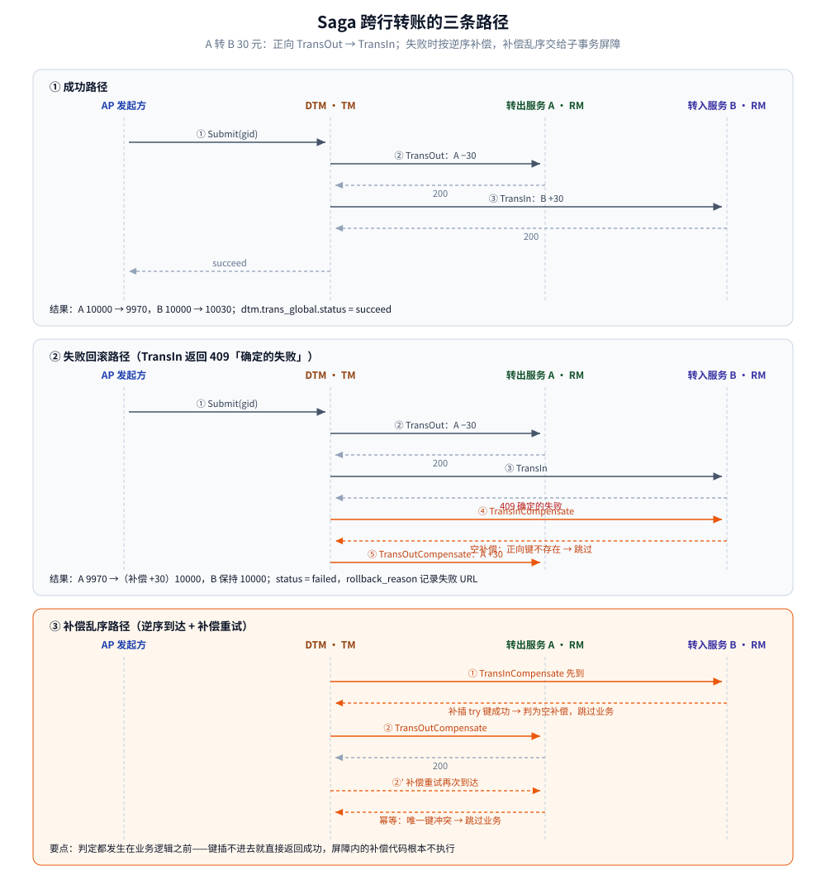
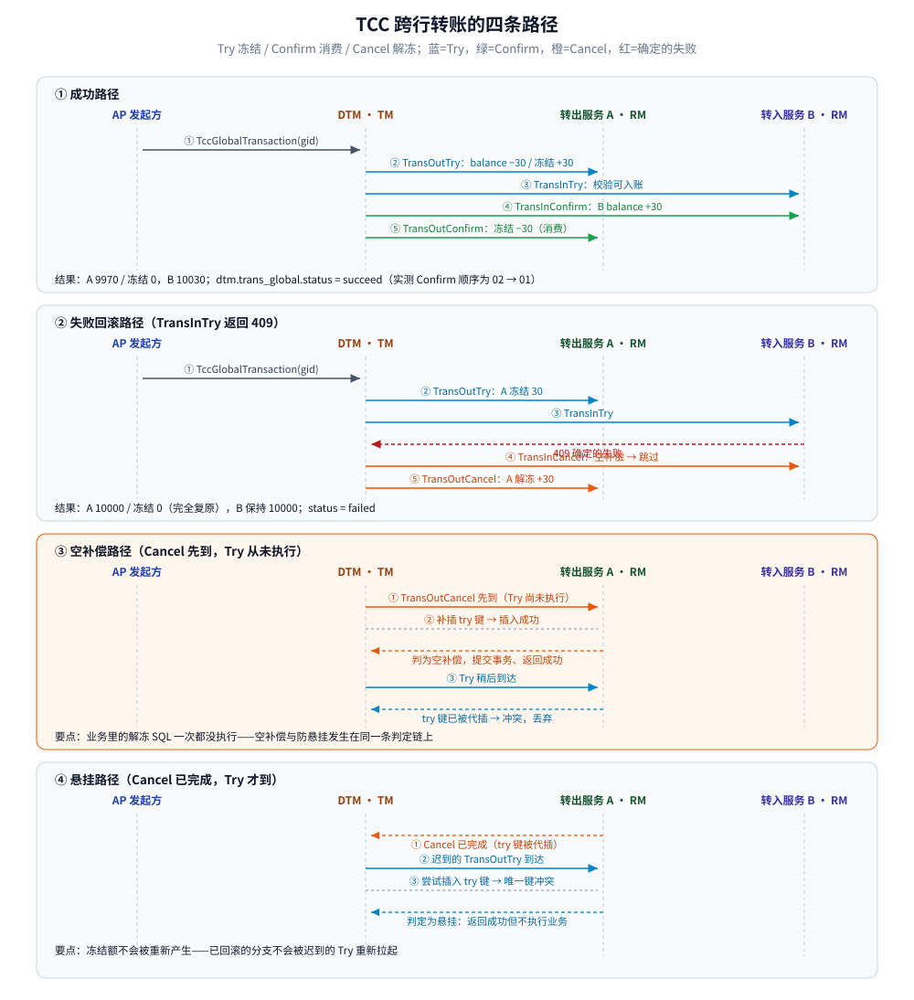
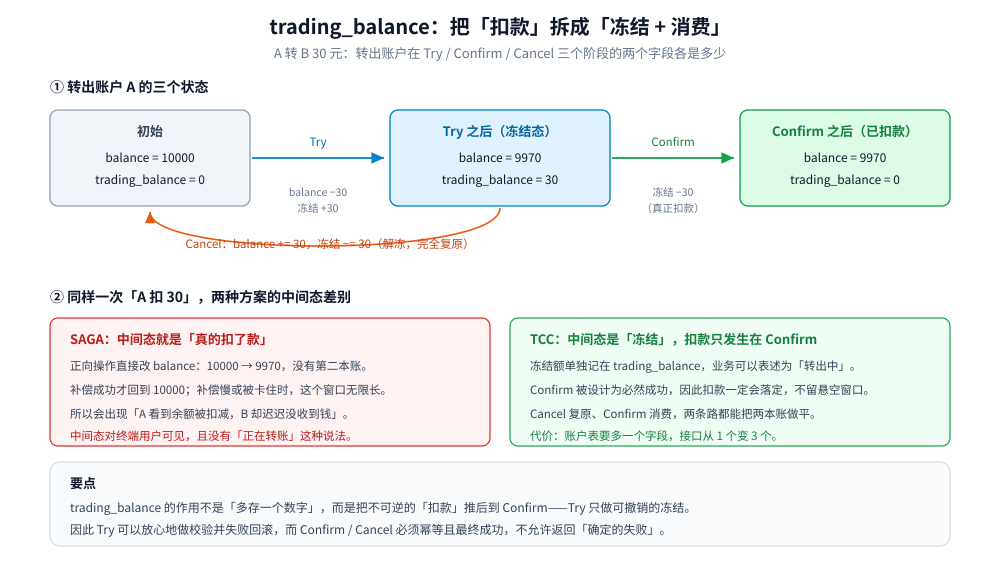

# 转账场景

> 覆盖：跨行转账（A 转 B 30 元，A、B 分属两个服务、两个库）的完整设计示例——表结构、Saga 与 TCC 两条路线的分支划分、正向与补偿各做什么、四条乱序路径怎么收场，以及两种方案的对比与常见坑。
> 不覆盖：2PC / TCC / Saga 的通用原理见 [README.md](../../../../04-架构与系统/分布式/分布式事务/README.md)；DTM 六种模式各自的边界见 [事务模式.md](事务模式.md)；子事务屏障的判定细节见 [原理与架构.md](原理与架构.md)；Go 接入代码见 [接入DTM.md](../../../../01-编程语言/go/工程实践/接入DTM.md)。
>
> 内容整理自个人学习笔记；场景设定与接口口径来自 DTM 官方文档，代码与读数来自本机容器实测。素材见 [素材清单.md](../../../../素材清单.md)。

> ✅ **实测口径**：`yedf/dtm:latest`（启动日志自报 `dtm version is: v1.19.0`）+ `mysql:8.0`（`8.0.46`）+ `go1.26.8 linux/amd64`；业务程序跑在 `alpine:3.21` 容器里，以 `http://app:8081` 作为 DTM 可回调的地址，屏障表与业务表同库同事务。
> ⚠️ **未实测**：本篇只用到 Saga 与 TCC；XA / Workflow / 二阶段消息不在范围内；补偿失败场景只观察到「持续重试 + `aborting`」，未做多副本实例切换与进程崩溃恢复。

---

## 一、场景

**本节要点**：转账是分布式事务里最小的完整样本——它同时具备「跨服务、跨库、有资金、可能失败」四个条件，只要这套链路能设计对，其他业务（扣库存、下单）都是同一套骨架换字段。

设定：**A 向 B 转 30 元**。A 的账户在 `account-service-a`（库 `db_a`），B 的账户在 `account-service-b`（库 `db_b`），两个服务各自管理自己的本地事务，谁也不许直连对方的库。

| 参与方 | 角色 | 手里的数据 |
|---|---|---|
| `account-service-a` | RM（转出方） | `db_a.user_account` 中 A 的余额与冻结额 |
| `account-service-b` | RM（转入方） | `db_b.user_account` 中 B 的余额 |
| DTM（dtmsvr） | TM（协调者） | 只存全局事务与分支的进度，不碰业务库 |
| 转账发起方 | AP（编排者） | 通过 SDK 把两个分支注册进同一个全局事务 |

这次转账必须同时满足三件事，缺一不可：

1. **原子性**：A 扣款与 B 入账要么都发生、要么都不发生，不允许只做一半。
2. **不能有悬空**：不允许出现「A 的钱已经扣了，B 却永远收不到」——这是转账场景里最不能接受的中间态。
3. **乱序安全**：网络重试会让同一个分支被重复调用、甚至让补偿先于正向到达；这些都必须不产生重复记账。

第 3 条是分布式事务与本地事务最大的差别：**本地事务里没有「调用方没收到响应」这件事**，而跨服务调用把它变成了常态。DTM 用子事务屏障统一兜住它，见 [原理与架构.md](原理与架构.md) 第三节。

## 二、表结构

**本节要点**：账户表需要两个金额字段（可用余额与冻结额），屏障表必须建在**业务库**里，才能与业务更新放进同一个本地事务。

### 2.1 账户表

```sql
CREATE TABLE dtm_busi.user_account (
  id              int(11) PRIMARY KEY AUTO_INCREMENT,
  user_id         int(11) UNIQUE,
  balance         DECIMAL(10,2) NOT NULL DEFAULT '0',  -- 可用余额
  trading_balance DECIMAL(10,2) NOT NULL DEFAULT '0',  -- 冻结额（TCC 用）
  create_time     datetime DEFAULT now(),
  update_time     datetime DEFAULT now()
) ENGINE=InnoDB DEFAULT CHARSET=utf8mb4;

INSERT INTO dtm_busi.user_account (user_id, balance) VALUES (1, 10000), (2, 10000);
```

两个字段的分工：

| 字段 | 含义 | 谁在用 |
|---|---|---|
| `balance` | 可用余额，用户真正能花的那部分 | Saga 与 TCC 都改它 |
| `trading_balance` | 冻结额，已经预留但还没被消费的钱 | **只有 TCC 用**；Saga 全程不碰 |

> ⚠️ `trading_balance` 不是「多记一个数字」的冗余字段。它是把「扣款」拆成「冻结 + 消费」的载体——第四节会说明为什么这笔钱必须单独放一本账。

### 2.2 屏障表（子事务屏障）

```sql
CREATE DATABASE IF NOT EXISTS dtm_barrier DEFAULT CHARACTER SET utf8mb4;
CREATE TABLE dtm_barrier.barrier (
  id          bigint(22) PRIMARY KEY AUTO_INCREMENT,
  trans_type  varchar(45)  DEFAULT '',
  gid         varchar(128) DEFAULT '',
  branch_id   varchar(128) DEFAULT '',
  op          varchar(45)  DEFAULT '',
  barrier_id  varchar(45)  DEFAULT '',
  reason      varchar(45)  DEFAULT '',
  create_time datetime DEFAULT now(),
  update_time datetime DEFAULT now(),
  UNIQUE KEY (gid, branch_id, op, barrier_id)
) ENGINE=InnoDB DEFAULT CHARSET=utf8mb4;
```

三条硬约束：

- **必须在业务库**（本例是 `db_a` / `db_b` 各自的实例），不能在 DTM 的库里——屏障记录要和业务 UPDATE 落在**同一个本地事务**里，否则回滚不同步，幂等就失效了。
- **唯一键是裁决并发的地方**：`(gid, branch_id, op, barrier_id)`。任何操作先 `INSERT IGNORE` 自己的键，插不进去就说明做过了。
- `trans_type` 区分 `saga` / `tcc`，`op` 的取值随模式不同：Saga 是 `action` / `compensate`，TCC 是 `try` / `confirm` / `cancel`。

### 2.3 TM 侧的两张表

DTM 自己在库 `dtm` 里维护 `trans_global`（全局事务进度）与 `trans_branch_op`（分支注册与结果），多副本恢复与超时重试都靠它们。建表脚本与字段含义见 [部署与运维.md](部署与运维.md) 第三节，本篇不重复。

## 三、SAGA 方案

**本节要点**：Saga 把转账拆成「正向 + 补偿」两两成对的分支，逐个推进；它的改造代价最小，但正向操作一旦落库就是真的落库——中间态对用户可见。

### 3.1 分支划分与正向 / 补偿各做什么

| 分支 | 正向操作 | 补偿操作 | 说明 |
|---|---|---|---|
| `01` TransOut | `balance − 30`（A 扣款） | `balance + 30`（A 退款） | 补偿必须是幂等的反向操作 |
| `02` TransIn | `balance + 30`（B 入账） | `balance − 30`（B 冲正） | 同样幂等 |

正向与补偿配对出现，DTM 按顺序推进正向分支，任一正向返回「确定的失败」（HTTP 409）就改为**按逆序**调用各分支的补偿。

```sql
-- 正向：A 扣款
UPDATE dtm_busi.user_account SET balance = balance - 30 WHERE user_id = 1;
-- 补偿：A 退款
UPDATE dtm_busi.user_account SET balance = balance + 30 WHERE user_id = 1;
```

三条设计纪律：

- **补偿语义是「反向操作」，不是「逆运算」**。它不是把变量改回旧值，而是在当时的状态上做一次相反方向的记账。
- **补偿必须幂等**。DTM 会重试补偿，重复执行不能多加或多减；本例靠子事务屏障的唯一键保证。
- **补偿不允许返回「确定的失败」**。补偿走不下去就等于钱永远回不来，只能返回成功或让 DTM 继续重试。

### 3.2 时序图：成功 / 失败回滚 / 补偿乱序



三条路径的共同点是：**所有判定都发生在业务逻辑之前**。只要唯一键插不进去（或补偿时正向键能插进去），屏障就直接返回成功，屏障内的 SQL 根本不执行。

实测（同一台容器，每轮开始前把账本复位为 A=10000、B=10000）：

```text
# 成功：POST /start?saga=ok
[recv] POST /api/TransOut  query="branch_id=01&gid=saga-1791974128563326154&op=action&trans_type=saga"
[ok] /api/TransOut
[recv] POST /api/TransIn   query="branch_id=02&gid=saga-1791974128563326154&op=action&trans_type=saga"
[ok] /api/TransIn
账本：A 10000 → 9970，B 10000 → 10030

# 失败：POST /start?saga=fail（TransIn 注入 409）
[recv] POST /api/TransOut           query="…branch_id=01…op=action…"      → [ok]
[recv] POST /api/TransIn            query="…branch_id=02…op=action…"      → [fail] 注入失败：转入账号被冻结
[recv] POST /api/TransInCompensate  query="…branch_id=02…op=compensate…"  → [barrier] 空补偿拦截 → [ok]
[recv] POST /api/TransOutCompensate query="…branch_id=01…op=compensate…"  → [ok]
账本：A 回到 10000，B 保持 10000
```

对账：成功场景屏障 2 行（`01/action`、`02/action`）；失败场景 3 行（多出 `01/compensate`），**空补偿不写行**——它判定成功后直接提交返回，不插自己的键。全局事务分别为 `succeed` / `failed`，后者 `rollback_reason = url:http://app:8081/api/TransIn return failed:  FAILURE`。

### 3.3 ⚠️ 已知弱点：中间态对用户可见

这是 Saga 用在资金场景时绕不开的问题，务必在选型阶段就说清楚：

**A 扣款成功、B 加款失败时，在补偿真正执行完之前，A 的钱是「已经扣了」的状态**——账本上 `balance` 就是 9970，没有任何字段标记这笔钱还在「转账中」。

由此产生的后果：

| 环节 | 实际发生的事 | 用户视角 |
|---|---|---|
| TransOut 成功 | `balance` 直接 −30，落库生效 | 「我的钱少了 30」 |
| TransIn 失败、补偿尚在途中 | 这里没有「冻结」这个概念 | 「钱扣了，但对方没收到」 |
| 补偿最终成功 | `balance` 回到 10000 | 「钱又回来了」——但用户已经慌过一次 |

更糟的情形是补偿本身走不下去（第三方接口持续故障）：全局事务会一直重试，而**这笔钱会以「已扣款」的形态挂着**，直到补偿成功或被人工介入。

> 结论：Saga 适合「长流程、每一步都有明确反向操作、且允许中间态可见」的场景。资金这类对中间态敏感的业务，用它就要接受这个窗口——或者改用下一节的 TCC。

## 四、TCC 方案

**本节要点**：TCC 把「扣款」拆成「冻结（Try）+ 消费（Confirm）」两步，中间态因为被显式记为冻结而不是扣款，所以对用户是可解释的；代价是账户表要多一个字段、接口从一个变三个。

### 4.1 三个接口各做什么

| 阶段 | 转出服务 A | 转入服务 B |
|---|---|---|
| **Try** | 校验余额充足 → `balance −30`、`trading_balance +30`（冻结） | 校验账户可入账，不预占任何资源 |
| **Confirm** | `trading_balance −30`（冻结被消费，不再动 `balance`） | `balance +30`（真正入账） |
| **Cancel** | `balance +30`、`trading_balance −30`（解冻，完全复原） | 空实现（没有预留可释放） |

```sql
-- TransOutTry：冻结（余额不足时 WHERE 不命中，影响行数为 0 → 业务失败）
UPDATE dtm_busi.user_account
   SET balance = balance - 30, trading_balance = trading_balance + 30
 WHERE user_id = 1 AND balance >= 30;

-- TransOutConfirm：冻结额被消费
UPDATE dtm_busi.user_account SET trading_balance = trading_balance - 30 WHERE user_id = 1;

-- TransOutCancel：解冻
UPDATE dtm_busi.user_account
   SET balance = balance + 30, trading_balance = trading_balance - 30
 WHERE user_id = 1;

-- TransInConfirm：真正入账
UPDATE dtm_busi.user_account SET balance = balance + 30 WHERE user_id = 2;
```

Try 里的 `balance >= 30` 不只是校验，它同时承担并发安全：并发转账时两个 Try 会争抢同一行的**行锁**，后到的那笔在拿到锁后重新求值条件，余额不足时直接不命中，天然不会超卖。

二阶段的两条纪律（与 Saga 的补偿纪律同源，但更硬）：

- ⚠️ **Confirm 与 Cancel 不允许返回业务失败**。DTM 收到失败会**持续重试直到成功**；只有技术故障（超时、500）才该走重试，逻辑上的「不能做」不该出现在这两个接口里。
- ⚠️ **Confirm 里只能做「不可能失败」的事**。既然它被重试到成功为止，就不能出现「依赖某个可能已失效的外部资源」的步骤。

### 4.2 时序图：成功 / 失败 / 空补偿 / 悬挂



四条路径都在同一台容器里跑过一遍，每轮开始前把账本复位为 A=10000、B=10000：

```text
# 成功：POST /start?tcc=ok
POST /api/TransOutTry      op=try      → [ok]      （A 冻结 30）
POST /api/TransInTry       op=try      → [ok]
POST /api/TransInConfirm   op=confirm  → [ok]      （B 入账）
POST /api/TransOutConfirm  op=confirm  → [ok]      （A 冻结被消费）
账本：A balance=9970 / trading_balance=0，B balance=10030；status = succeed

# 失败：POST /start?tcc=fail（TransInTry 注入 409）
POST /api/TransOutTry      op=try      → [ok]
POST /api/TransInTry       op=try      → [fail] 注入失败：转入账号被冻结
POST /api/TransInCancel    op=cancel   → [barrier] 空补偿拦截 → [ok]
POST /api/TransOutCancel   op=cancel   → [ok]      （A 解冻）
账本：A balance=10000 / trading_balance=0，B 保持 10000；status = failed

# 空补偿：Cancel 先到，Try 从未执行
POST /api/TransOutCancel   op=cancel   → [barrier] 空补偿拦截 → [ok]
账本：不动；屏障只留下 1 行 01/try（cancel 代插的正向键）

# 悬挂：Cancel 完成之后 Try 才到
POST /api/TransOutTry      op=try      → [barrier] 幂等/防悬挂拦截 → [ok]
账本：不动；屏障仍是 1 行
```

四个读数值得单独记下来：

| 现象 | 屏障表的变化 | 说明 |
|---|---|---|
| 空补偿 | 只新增 `01/try`，**不写 `01/cancel`** | 判定成功即提交返回，连自己的键都不插 |
| 悬挂 | 一行都不新增 | 迟到的 Try 撞上 cancel 代插的 `try` 键 |
| 成功路径 | 4 行（`01/try`、`02/try`、`02/confirm`、`01/confirm`） | 每个分支的正向与二阶段各一行 |
| 失败路径 | 3 行（`01/try`、`02/try`、`01/cancel`） | `02/cancel` 不写行，因为它是空补偿 |

> 一个容易忽略的细节：失败路径里 DTM 把**没有执行过的 confirm** 记为 `prepared` 状态留在 `trans_branch_op` 里（实测查表可见），而两个 `cancel` 都是 `succeed`。别把 `prepared` 误读成「执行失败」。

### 4.3 ⭐ 为什么 TCC 需要 trading_balance



核心就一句话：**把不可逆的「扣款」推后到 Confirm，Try 只做可撤销的「冻结」。**

| | SAGA | TCC |
|---|---|---|
| 中间态账本 | `balance = 9970`，没有第二本账 | `balance = 9970` + `trading_balance = 30` |
| 这笔钱的语义 | 已经扣掉了 | 被冻结，仍是用户的 |
| 什么时候不可逆 | 正向操作一落库就不可逆 | Confirm 落库才不可逆 |
| 走不下去时会怎样 | 钱挂在「已扣款」状态等补偿 | 钱挂在「冻结」状态等 Cancel |

两种失败收场都能把账做平：Confirm 消费冻结、Cancel 退回冻结，差额恒为 0。业务展示层可以据此把「转出中」和「已扣款」区分开——这正是 Saga 做不到的。

⚠️ 注意一个容易混淆的点：**不同实现对 `trading_balance` 正负号的约定不同**。本节用「冻结额为正、Try 时 `balance` 减而 `trading_balance` 增」的写法，因为它与 `balance >= 30` 的校验读起来最顺；官方文档把该字段解释为「业务上的冻结资金」，方向以各自实现为准。判定标准只有一条：**冻结额与可用余额分离，且扣款只发生在 Confirm**。

## 五、两种方案对比

**本节要点**：判断口径不是「哪个更好」，而是「这笔业务能不能接受中间态可见」——能接受就用 Saga，不能就上 TCC。

| 维度 | SAGA | TCC |
|---|---|---|
| 中间态可见性 | 可见（`balance` 已减，无冻结标记） | 不可见（钱在 `trading_balance`，可表述为「转出中」） |
| 改造代价 | 小（只加补偿接口） | 大（账户表要加冻结字段，接口 1 个变 3 个） |
| 隔离性 | 弱 | 强 |
| 编排位置 | DTM 服务端（分支列表提交给 TM） | 应用端（`TccGlobalTransaction` 的函数体里） |
| 补偿 / 二阶段失败后果 | 钱挂在「已扣款」状态，等补偿 | 钱挂在「冻结」状态，等 Cancel |
| 资源占用时长 | 补偿执行完才释放 | Try 到 Confirm 之间一直占着，所以只适合短事务 |
| 适用 | 长流程、允许中间态、每步都有反向操作 | 资金、库存类对中间态敏感的业务 |

选型口诀：**先问「中间态能不能被别人看见」，再看「每步有没有天然的反向操作」**。两个都过就用 Saga；中间态不能见，就必须付出 TCC 的改造代价。

> TCC 的「短事务」限制来自它的编排位置：分支有多少、顺序如何，这些信息在应用端，进程崩了就丢，只能整体回滚。所以一个跨越分钟级的长流程不适合 TCC——发布升级都会把它打断，详见 [TCC.md](../../../../04-架构与系统/分布式/分布式事务/TCC.md)。

## 六、常见坑

### 6.1 补偿接口返回 409 → 全局卡住

按 DTM 的协议，`Confirm` / `Cancel` 是**要求最终成功**的操作；返回 409（确定的失败）不会让事务结束，而是**持续重试**。本机实测（让 TransOutCancel 固定返回 409）：

```text
10:31:43 [recv] POST /api/TransOutCancel op=cancel → [fail] 注入失败：解冻接口故障
10:32:07 [recv] POST /api/TransOutCancel op=cancel → [fail] 同上          （约 24s 后重试）
…（退避重试，全程共 6 次调用）
```

期间的两个观测结果：

- `dtm.trans_global.status = aborting`（不是 `failed`），`next_cron_time` 指向下一次重试时刻；
- 账本停在 **A `balance=9970` / `trading_balance=30`**——**钱卡在冻结态，既没退回也没消费**。

故障恢复后 DTM 自动重试成功，事务才落到 `failed`、A 回到 10000。也就是说：

- 补偿 / 二阶段挂住不会「失败结束」，而是**一直重试 + 一并占着资源**；
- 因此必须对 `trans_global` 做监控，对重试次数过多的事务报警并人工兜底（官方也建议对重试超过 3 次的事务报警）。

### 6.2 忘记用子事务屏障

不用屏障就得自己实现幂等、空补偿、防悬挂三件事，而它们的正确性都依赖「判定与业务在同一个本地事务里」——自己写很容易退化成「先查后改」的检查，一旦并发就失效。

| 不用屏障会发生什么 | 触发条件 |
|---|---|
| 重复扣款 | 响应丢失后 DTM 重试同一分支 |
| 无中生有地加钱 | 正向未执行，补偿先到并真的执行了 |
| 已回滚的事务被重新拉起 | 补偿完成后迟到的正向到达，重新冻结/扣款 |

统一走屏障，三件事一次解决，见 [原理与架构.md](原理与架构.md) 第三节。

### 6.3 在 Confirm 里做了「可能失败」的事

Confirm 被重试到成功为止，任何「可能失败且不可重试」的步骤都不该放进去。典型反例：在 Confirm 里调用外部第三方接口、在 Confirm 里做幂等检查之外的业务校验、在 Confirm 里依赖一个刚刚可能被删除的资源。

判断口径很简单：**如果这一步失败了，重试一次能不能成功？** 不能，就说明它不该在二阶段。

## 延伸追问

- **Saga 的补偿为什么不能是「把余额改回原值」？** → 因为并发下原值可能已经被别的转账改动，改回去会覆盖别人的操作；补偿必须是在当前状态上做一次反向记账，并且幂等。
- **TCC 的 Try 里余额校验，为什么写成 `WHERE ... AND balance >= 30` 而不是先 SELECT 再判断？** → 条件写进 UPDATE 才能借行锁完成「读-判-写」的原子性；先查后改在并发下会超卖。
- **空补偿为什么连自己的键都不插？** → 它判定后直接提交返回，屏障表只留下代插的 `try` 键。这也正是**防悬挂**的机制来源：迟到的 Try 会撞上这个键。
- **`trans_branch_op` 里 confirm 显示 `prepared` 是失败了吗？** → 不是。回滚场景下未被调用的 confirm 就停在 `prepared`，说明它没执行；真正执行过的分支会是 `succeed`。
- **转账这类场景，Saga 和 TCC 到底怎么拍板？** → 看中间态能不能被用户看见：资金类不能见就用 TCC；跨系统的长流程（如机票预订）忍受得了中间态就用 Saga。
- **补偿一直失败怎么办？** → 事务会停在 `aborting` 并持续重试，资源一直挂着；必须靠监控 + 人工介入，不能指望它自己变成失败。

## 关联

- **上游/总纲**：[事务模式.md](事务模式.md) — Saga / TCC 在 DTM 里的接口形态与边界
- **上游/总纲**：[原理与架构.md](原理与架构.md) — 子事务屏障的判定链（本篇所有乱序路径的底层机制）
- **上游/总纲**：[README.md](../../../../04-架构与系统/分布式/分布式事务/README.md) — TCC / Saga 的通用原理与选型
- **对照/互补**：[接入DTM.md](../../../../01-编程语言/go/工程实践/接入DTM.md) — Saga / TCC / 二阶段消息的 Go 接入代码与实测
- **对照/互补**：[部署与运维.md](部署与运维.md) — 屏障表与全局事务表的准备、重试监控点
- **延伸**：[README.md](README.md) — DTM 目录导读
- **延伸**：[分布式事务选型对比.md](../分布式事务选型对比.md) — DTM vs Seata 的产品粒度横评
- [素材清单.md](../../../../素材清单.md) — 素材来源登记
> 反向引用（本篇被下列文档引到）：[Saga.md](../../../../04-架构与系统/分布式/分布式事务/Saga.md)、[TCC.md](../../../../04-架构与系统/分布式/分布式事务/TCC.md)
