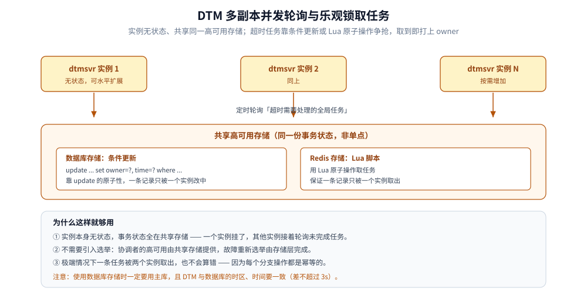

# DTM 部署与运维

> 本篇讲 DTM 服务端怎么部署（二进制 / Docker / K8s / Helm）、选什么存储、上线前要准备哪两张表，以及配置、多副本与排障的要点。
> DTM 的三角色与多副本协作原理见 [原理与架构.md](原理与架构.md) 第二节。
>
> 内容整理自个人学习笔记，素材来自 DTM 官方文档。素材见 [素材清单.md](../../../../素材清单.md)。

---

## 一、部署形态

**本节要点**：四种方式按复杂度递增；本机验证用 Docker，生产推荐 K8s 多副本，容器镜像与端口在所有方式里保持一致。

| 方式 | 适用 | 关键点 |
|---|---|---|
| **二进制** | 本机 / 裸机 | 需 Go 1.16+ 编译，或用包管理器安装后加 `-c` 指定配置 |
| **Docker** | 本机验证 / 单机 | 直接跑官方镜像，环境变量传存储配置 |
| **K8s** | 生产 | Deployment 多副本 + 共享存储；注意 gRPC 需 Ingress 侧额外配置 |
| **Helm** | 生产 | 用官方 chart 一键部署，支持弹性伸缩参数 |

- **端口**：HTTP `36789`、gRPC `36790`（v1.19.0 启动日志中另有 JSON-RPC `36791`）。
- **健康检查**：K8s 探针用 `GET /api/ping`（36789 端口）。

## 二、存储引擎怎么选

**本节要点**：存储决定 TM 的持久化方式与性能特征；本机开发可以用轻量存储，生产用高可用数据库或 Redis。

| 存储 | 定位 | 说明 |
|---|---|---|
| **MySQL（系列）** | 常用 | 含 MySQL / MariaDB / TiDB / TDSQL 等；最省心的默认选择 |
| **Redis** | 高性能 | 取任务用 Lua 原子操作；适合吞吐敏感场景 |
| **Postgres** | 常用 | 需在 SDK 侧声明数据库类型 |
| **BoltDB** | 开发与测试 | 本地文件，免额外组件，不要用于生产 |
| **MongoDB** | 规划 / 补充 | 不同版本文档口径不一，接入前确认当前版本是否支持 |

> ⚠️ **使用数据库时一定要用主库**：DTM 写多读少，读写分离对它帮助有限，而从库延迟会导致协调出错；此外 DTM 服务器与数据库的**时区要一致**、**时间差不要超过 3 秒**。

## 三、上线前要准备的两张表

**本节要点**：DTM 上线涉及两类表——RM 业务库里的**子事务屏障表**，和 TM 存储里的**全局事务状态表**；建表脚本都在官方仓库的 `sqls/` 下。

| 表 | 建在哪 | 作用 | 建表脚本 |
|---|---|---|---|
| **子事务屏障表** | 业务库所在实例，官方脚本建成 `dtm_barrier.barrier` | 记录 `gid - branch_id - op - barrier_id`，处理幂等 / 空补偿 / 悬挂 | `sqls/dtmcli.barrier.mysql.sql` |
| **全局事务状态表** | **TM 的存储库 `dtm`** | 保存全局事务与分支进度，供多副本恢复与轮询 | `sqls/dtmsvr.storage.mysql.sql`（含 `trans_global`、`trans_branch_op`、`kv`） |

> 官方还提供示例业务表脚本 `sqls/busi.mysql.sql`（`dtm_busi.user_account`），仅用于跑通示例，实际业务表按需自建。

两种存储模式的差别：

- **数据库存储**：需要建全局事务状态表；多副本用 `update ... set owner=... where ...` 争抢取任务。
- **Redis 存储**：用 Lua 脚本原子取任务；不需要关系型表。

## 四、配置与环境变量

**本节要点**：DTM 支持环境变量与 yml 文件两种配置，**同时存在时 yml 优先**；环境变量名由配置路径按「点号与驼峰转下划线大写」生成，方便容器化。

| 配置项（yml） | 环境变量 | 说明 |
|---|---|---|
| `Store.Driver` | `STORE_DRIVER` | 存储类型，如 `mysql` / `redis` |
| `Store.Host` | `STORE_HOST` | 存储地址 |
| `Store.Port` | `STORE_PORT` | 端口 |
| `Store.User` | `STORE_USER` | 用户名 |
| `Store.Password` | `STORE_PASSWORD` | 密码 |
| `MicroService.EndPoint` | `MICRO_SERVICE_END_POINT` | 微服务注册地址（示例，演示命名规则） |

- 命名规则：`MicroService.EndPoint` → `MICRO_SERVICE_END_POINT`，即**去掉点号、驼峰之间加下划线、整体大写**。
- 完整配置项与注释见官方 `conf.sample.yml`；使用 yml 时用 `dtm -c ./conf.yml` 指定。

## 五、多副本与高可用

**本节要点**：线上不要单副本；DTM 是无状态服务，多副本共享同一高可用存储即可，不需要额外选举。

- **为什么可以无脑多副本**：实例本身无状态，事务状态放共享存储；一个实例挂了，其他实例继续轮询未完成任务。
- **取任务不冲突**：多副本轮询靠乐观锁，一条记录只会被一个实例取出；即便极端情况被两个实例取到，分支幂等也能保证结果正确。
- **按部署形态给副本**：微服务（go-zero / Polaris 等）跟着框架的注册与多副本方案走；二进制 / Docker 参照其他无状态服务的多副本方式；K8s 直接设 `replicas`。



取任务是整个高可用设计的枢纽：它必须原子、也必须能被失败重试，所以条件更新与 Lua 脚本不是可选项，而是这两种存储各自的必备能力。

## 六、诊断与排障

**本节要点**：DTM 的问题大多出在存储、注册与网络三处；按「清旧数据 → 开日志 → 查注册 → 查连通 → 发事务」的顺序定位。

- **开日志**：服务端设 `LOG_LEVEL=debug` 或加 `-d` 参数；SDK 侧用 `logger.InitLog("debug")`。
- **清旧数据**：用数据库存储时，先 `truncate trans_global` 清掉历史全局事务，避免旧数据干扰。
- **查注册**：微服务协议下确认 DTM 与业务服务都成功注册到注册中心。
- **查连通**：确认能访问 DTM（默认 `localhost:36789`）；Docker 起步的场景最容易踩网络问题——容器里的地址不能写成只有容器自己可见的 `localhost`。
- **发事务**：从业务服务发起一个全局事务，对照 SDK 日志与 DTM 服务端日志找第一处报错。

## 使用：把 DTM 跑起来

**本节要点**：本机最快路径是 Docker 一条命令；下方命令与配置取自官方文档，未做本机实测。

Docker 单容器启动（以 MySQL 存储为例）：

```bash
docker run --name dtm -p 36789:36789 -p 36790:36790 \
  -e STORE_DRIVER=mysql -e STORE_HOST=localhost -e STORE_USER=root \
  -e STORE_PASSWORD=change-me -e STORE_PORT=3306 yedf/dtm:latest
```

docker-compose 片段：

```yaml
services:
  dtm:
    image: yedf/dtm
    environment:
      STORE_DRIVER: mysql
      STORE_HOST: mysql
      STORE_USER: root
      STORE_PASSWORD: change-me
      STORE_PORT: "3306"
    ports:
      - "36789:36789"
      - "36790:36790"
```

K8s 部署要点（完整清单见官方文档）：

```yaml
spec:
  replicas: 2
  template:
    spec:
      containers:
        - name: dtm
          image: yedf/dtm:latest
          ports:
            - containerPort: 36789
            - containerPort: 36790
          livenessProbe:
            httpGet: { path: /api/ping, port: 36789 }
          readinessProbe:
            httpGet: { path: /api/ping, port: 36789 }
```

> 生产做法：固定镜像版本、用 ConfigMap / Secret 管理 `config.yaml`、把存储指向集群内或集群外的高可用数据库；gRPC 走 Ingress 时要按 Ingress 控制器文档单独配置。业务侧的 Go 接入代码见 [接入DTM.md](../../../../01-编程语言/go/工程实践/接入DTM.md)。

## 延伸追问

- **DTM 用数据库存储，为什么必须用主库？** → DTM 写多读少且对一致性敏感，从库延迟会让它读到过期状态并做出错误协调；读写分离在这里收益很小。
- **子事务屏障表建在业务库还是 DTM 的存储库？** → 建在**业务库**：它必须与业务更新放进同一个本地事务，才能保证幂等判定和结果同批提交。
- **多副本会不会把同一个超时任务取两遍？** → 设计上用乐观锁（条件更新 / Lua）保证一条记录只被一个实例取出；即使极端情况重复取出，分支幂等也能保证最终正确。
- **K8s 上 gRPC 需要额外做什么？** → 端口暴露与 Service 的 `appProtocol` 之外，Ingress 侧还要按控制器文档为 gRPC 单独配置，否则 36790 会不通。
- **DTM 部署后第一次联调最常见的坑是什么？** → Docker 或其他容器环境下的可达性问题——DTM 必须能回调到业务分支的 URL，把业务地址写成容器内的 `localhost` 会导致回调失败。

## 关联

- [README.md](README.md) — DTM 目录导读
- [原理与架构.md](原理与架构.md) — 多副本为何不是单点、子事务屏障表的作用
- [事务模式.md](事务模式.md) — 不同模式所需的表与监控点
- [实践与生态.md](实践与生态.md) — 框架集成与 SDK
- [接入DTM.md](../../../../01-编程语言/go/工程实践/接入DTM.md) — Go 侧接入（业务库建屏障表）
- [分布式事务.md](../../../../04-架构与系统/分布式/理论/分布式事务.md) — 生产实践与坑（幂等 / 超时 / 补偿 / 对账）
- [素材清单.md](../../../../素材清单.md) — 素材来源登记
