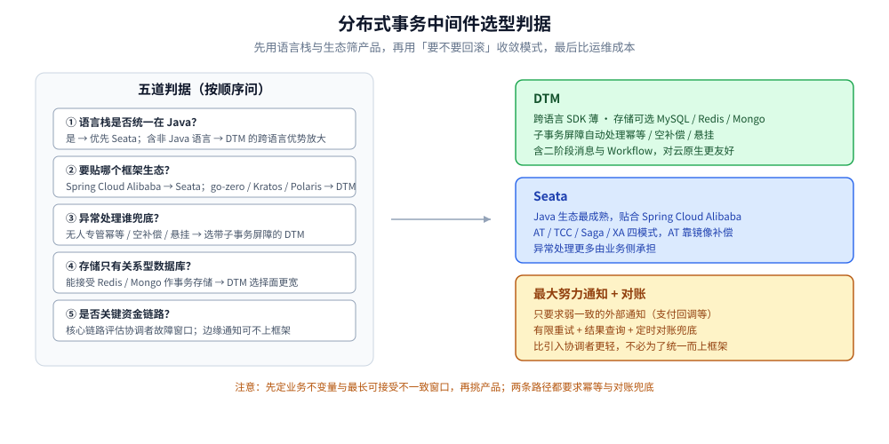

# 分布式事务选型对比

> 本目录是「分布式事务」这一中间件子类的**产品级横评入口**：跨服务、跨库的一致性该引哪个中间件，DTM 与 Seata 的能力边界在哪，什么情况下干脆不自研框架。
> **方案原理（2PC / TCC / Saga / 事务消息 / 最大努力通知）与通用选型决策不在本篇**，见 [分布式事务.md](../../../04-架构与系统/分布式/理论/分布式事务.md) 第三、四节；DTM 的深入内容见 [README.md](DTM/README.md)。
>
> ⭐ **上一层**（要不要引协调族、引哪一子类）见 [中间件选型.md](../中间件选型.md) 第四节；本篇是它的族内横评（产品粒度）。
>
> 内容整理自个人学习笔记；DTM 与 Seata 的对照口径来自 DTM 官方文档，可能更新不及时，以各自官方仓库为准。素材见 [素材清单.md](../../../素材清单.md)。

---

## 一、本篇管什么、不管什么

**本节要点**：中间件子类的选型分两层——「方案层」决定用哪种一致性模型，「产品层」决定用哪个组件去实现它；本篇只负责后者。

| 层 | 决定什么 | 归属 |
|---|---|---|
| **方案层** | 用 2PC / TCC / Saga / 事务消息 / 最大努力通知中的哪一类；隔离性、锁窗口、补偿语义 | [分布式事务.md](../../../04-架构与系统/分布式/理论/分布式事务.md) |
| **产品层** | 落地时选 DTM / Seata / 云厂商托管 / 自研；语言栈、存储、多语言、异常处理方式 | **本篇** |

> ⚠️ 顺序不能反：先按业务不变量确定方案与最长可接受不一致窗口，再挑产品。先挑产品再想方案，通常会在补偿和幂等上返工。

## 二、为什么「非 Java 栈」会先看 DTM

**本节要点**：DTM 的出现主要是为了补上 Java 之外没有成熟分布式事务管理器的空档，它的设计取向是「SDK 薄、逻辑全在服务端」，因此跨语言成本低。

- 现实起点：把订单支付一类逻辑塞进一个大本地事务，耦合与复杂度都会失控；微服务化后必须把这部分拆成分布式事务。
- 当时的市场情况：成熟的分布式事务框架基本只在 Java 生态（Seata 等）；Go / PHP / Python 等语言缺少对等选择。
- DTM 的三条设计取向：接口尽量简单、把「子事务屏障」这类异常处理放到框架内、SDK 只做 HTTP / gRPC 通信加 ID 生成这类薄逻辑。
- 直接收益：接入一门新语言的成本从「重写一套协调逻辑」降到「几十到几百行通信代码」。

> 子事务屏障（把幂等、空补偿、防悬挂统一在框架层解决）是 DTM 相对 Seata 最直接的差异点，原理见 [原理与架构.md](DTM/原理与架构.md)。

## 三、DTM 与 Seata 的能力对照

**本节要点**：下面这张表是 DTM 官方给出的对照，阅读时要带着「厂商自述」的自觉——它能说明两者的**设计差异**，但不能直接当作性能或稳定性的裁判。

| 特性 | DTM | Seata | 说明 |
|---|---|---|---|
| **支持语言** | Go / Java / PHP / C# / Python / Node | Java 为主（另有 seata-go，成熟度较低） | DTM 的 SDK 薄，接新语言成本低 |
| **存储引擎** | 数据库 / Redis / Mongo | 数据库 | DTM 的存储选择更多 |
| **异常处理** | 子事务屏障自动处理 | 需业务侧手动处理 | DTM 把幂等 / 空补偿 / 悬挂收进框架 |
| **Saga** | 接口式，支持并发 | 状态机编排 | 两者风格不同，不是能力强弱 |
| **二阶段消息** | ✅ | ❌ | DTM 用二阶段消息替代本地消息表 / 事务消息 |
| **TCC** | ✅ | ✅ | — |
| **XA** | ✅ | ✅ | — |
| **AT** | 建议用 XA 替代 | ✅ | AT 与 XA 类似、性能稍好，但有脏回滚风险 |
| **单服务多数据源** | ✅ | ❌ | 一个服务同时操作多个库的场景 |
| **通信协议** | HTTP / gRPC | Dubbo 等 | DTM 对云原生更友好 |

> ⚠️ 这张表是 DTM 官方口径（[对比其他框架](https://dtm.pub/other/opensource.html)），对 Seata 的描述可能滞后；Seata 的 AT 模式本身是业界成熟能力，「建议用 XA 替代」是 DTM 团队的观点，不是结论。
> ⚠️ 表中未列语言标记的 `✅ / ❌` 是原文符号，含义为「支持 / 不支持」。

## 四、产品选型的判据清单

**本节要点**：先把「谁能接进现有技术栈」筛掉一半，再用一致性要求收敛，最后才比较运维成本。

1. **语言栈是否统一在 Java？** 统一在 Java 且团队熟 Seata，优先 Seata；只要栈里有 Go / PHP / Python 等非 Java 语言，DTM 的跨语言优势就会放大。
2. **是否必须复用现有 ORM 与微服务框架？** DTM 对 go-zero / Kratos / Polaris 有现成集成，Seata 更贴合 Spring Cloud Alibaba 体系。
3. **异常处理要不要框架兜底？** 团队没人专门处理幂等 / 空补偿 / 悬挂时，DTM 的子事务屏障能显著降低业务负担。
4. **存储是否只有关系型数据库？** 若能接受 Redis / Mongo 作为事务存储，DTM 的选择面更宽；只用数据库作存储时两者差别不大。
5. **是否真的在关键链路上？** 核心资金链路要评估协调者在故障窗口内的行为；边缘通知类需求，最大努力通知加对账往往比引框架更轻。
6. **运维兜底是否就绪？** 无论选谁，都要有按全局事务 ID 查询 / 重试 / 补偿的入口与告警，见 [分布式事务.md](../../../04-架构与系统/分布式/理论/分布式事务.md) 第七节。

判据按顺序问下来：语言栈决定候选范围，框架生态决定顺手程度，异常处理的兜底能力决定团队负担，存储现状与链路重要性决定「值不值得引一个框架」。

## 五、不引框架时的边界

**本节要点**：并非所有一致性需求都值得引一个协调者；能在方案层用更轻的手段覆盖时，不要为了「统一」而上框架。

- **只需最终一致且可异步**：优先本地消息表 / 事务消息 / 二阶段消息这一族，其中二阶段消息由 DTM 提供，不必自建消息队列（见 [事务模式.md](DTM/事务模式.md)）。
- **只需弱一致**：支付回调一类的外部通知，用最大努力通知加结果查询与对账即可，见 [消息队列选型对比.md](../消息队列/消息队列选型对比.md)。
- **动作完全不可逆又无补偿**：问题不在框架选型，而在业务边界，应先把校验前置、不可逆动作后置，再谈方案。
- **单库单服务**：本地 ACID 足够，隔离级别与 MVCC 见 [事务与隔离级别.md](../../数据存储/关系型/MySQL/事务与隔离级别.md)。

## 延伸追问

- **DTM 和 Seata 最本质的区别是什么？** → 异常处理的位置：DTM 用子事务屏障把幂等 / 空补偿 / 悬挂收进框架层，Seata 更多要靠业务侧处理；此外 DTM 的 SDK 更薄、跨语言成本更低，Seata 的 AT 模式更贴合 Java ORM 生态。
- **为什么 DTM 建议用 XA 替代 Seata 的 AT？** → AT 靠前后镜像做反向补偿，在全局锁粒度或并发下可能产生脏回滚；XA 是数据库原生两阶段，语义更硬，代价是持锁时间更长。这是取向差异，不是谁绝对更好。
- **表里说 Seata 不支持二阶段消息，这算是短板吗？** → 只是能力覆盖不同：二阶段消息解决的是「本地事务与事件发布原子性」，Seata 生态里这类需求通常交给消息队列的事务消息，见 [消息队列选型对比.md](../消息队列/消息队列选型对比.md)。
- **选型时最容易被忽略的一步是什么？** → 先写清楚业务不变量（如「总账恒等」「库存不能为负」）和最长可接受不一致窗口，再挑产品；跳过这一步，后面一定会为补偿语义返工。

## 关联

- [README.md](DTM/README.md) — 本目录 DTM 子目录导读（总览 + 各篇阅读顺序）
- [原理与架构.md](DTM/原理与架构.md) — DTM 的 AP / RM / TM 三角色与子事务屏障
- [事务模式.md](DTM/事务模式.md) — DTM 六种事务模式的能力对照
- [分布式事务.md](../../../04-架构与系统/分布式/理论/分布式事务.md) — **原理与本目录上游**：七方案对比、选型顺序、Seata 与 dtm 的通用接入
- [中间件选型.md](../中间件选型.md) — 上一层：要不要引协调族、引哪一子类
- [消息队列选型对比.md](../消息队列/消息队列选型对比.md) — 事务消息 / 本地消息表 / 最大努力通知三种方案
- [事务与隔离级别.md](../../数据存储/关系型/MySQL/事务与隔离级别.md) — 本地 ACID 的边界在哪
- [素材清单.md](../../../素材清单.md) — 素材来源登记
