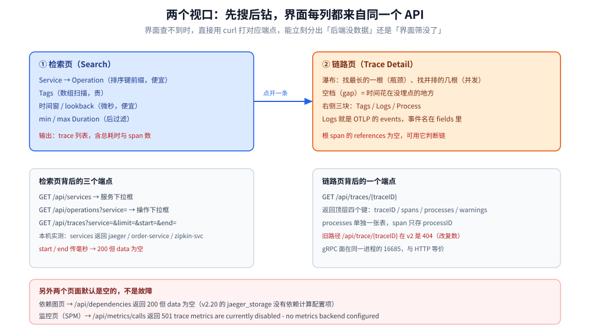
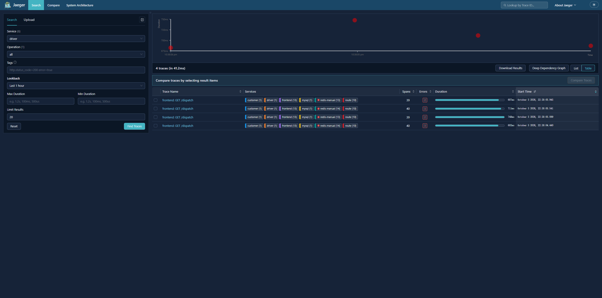
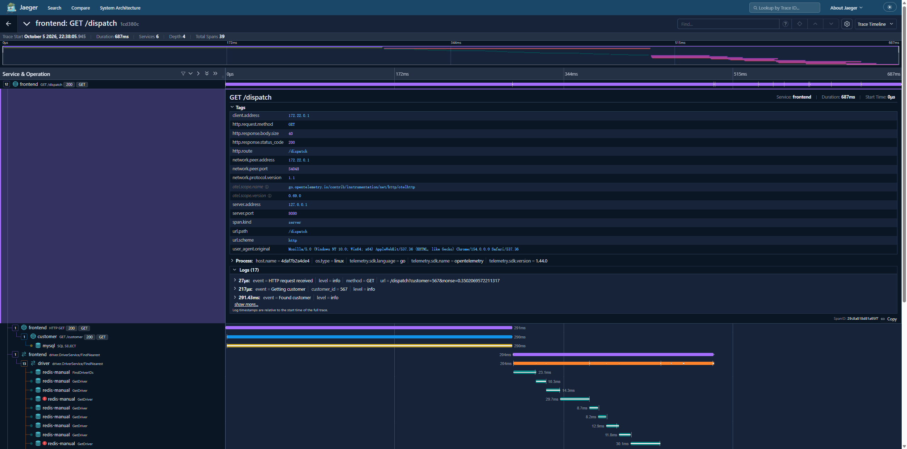
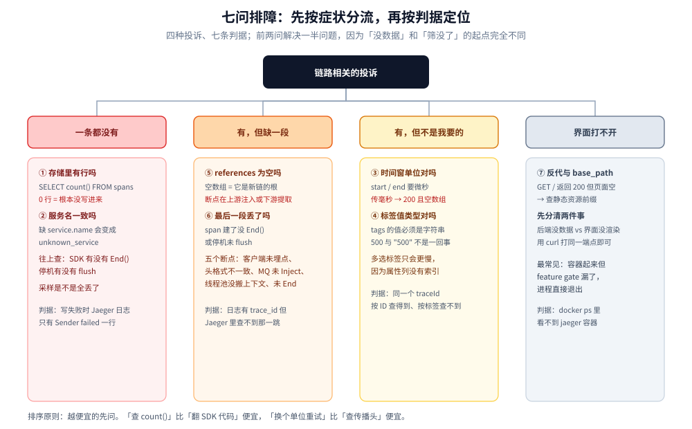

# UI与排障

> 本篇回答三件事：**Jaeger 的界面为什么只有两个视口**（先搜再钻，没有大盘）、**每一列的数据从哪来**（全部来自 [数据模型与查询.md](数据模型与查询.md) 里那几个 API）、**查不到数据时按什么顺序查**（七问，按「最可能、最便宜」排序）。
>
> 不覆盖：怎么把栈起起来（见 [架构与部署.md](架构与部署.md)）；span 在应用侧怎么产生与采样（见 [采集与传播.md](采集与传播.md)）；界面上没有的东西怎么补（见 [集成与生态.md](集成与生态.md)）。
>
> 实测环境：`jaegertracing/jaeger:2.20.0` + ClickHouse 26.3。**本轮只验证了页面可访问（`GET /` → 200，5975 字节）与全部查询 API 的返回**，未做浏览器交互；界面元素与 API 的对应关系由接口实测反推，涉及具体按钮/插件的描述按官方文档陈述。

---

## 一、两个视口：先搜后钻，没有「大盘」

**本节要点**：Jaeger 的界面结构是**检索页 → 链路页**的单向动线。它没有首页大盘、没有告警面板——**因为 span 是明细，明细只能「筛出来看」，不能「一眼看趋势」**。

| 视口 | 输入 | 输出 | 数据来源 |
|---|---|---|---|
| **检索页** | 服务、操作、标签、时间窗、耗时区间 | 一批 trace 的列表（含每条的总耗时与 span 数） | `/api/services`、`/api/operations`、`/api/traces?...` |
| **链路页** | 一条 `trace_id` | span 瀑布 + 每个 span 的 tags / logs / process | `/api/traces/{traceID}` |
| 依赖图页（System Architecture） | 时间窗 | 服务间调用边的权重 | `/api/dependencies` |
| 监控页（Monitor / SPM） | 服务 + 时间窗 | 调用量、错误率、P95 | `/api/metrics/calls` |

图里下半部分是本篇的主线：**同一个后端接口，既是界面的数据源，也是排障的入口**。界面查不到时，直接用 `curl` 打对应的端点，能立刻分出「后端没数据」还是「界面筛没了」。

⚠️ 依赖图页与监控页在**默认配置下是空的**：前者需要依赖计算写入者（v2.20 的 `jaeger_storage` 没有该配置项，本机 `/api/dependencies` 返回空），后者需要 metrics 后端（本机返回 `501 trace metrics are currently disabled`）。所以「打开是空白」不是故障，是没配。

## 二、检索页：五个维度，只有一个便宜

**本节要点**：检索页只有五个输入，但它们的代价差一个量级：**服务 + 时间窗是排序键前缀（便宜）**，标签过滤是数组扫描（贵），耗时区间只能后过滤（更贵）。

| 输入 | 传什么 | 代价 | 判据 |
|---|---|---|---|
| Service | `service=<name>` | 低（排序键首位） | 必填项，不选服务等于全表扫 |
| Operation | `operation=<name>` | 低 | 排序键第二位，选了更省 |
| Tags | `tags={"k":"v"}`（JSON 字符串） | 高 | ⚠️ 值要写成字符串，数字匹配不上 |
| Lookback / 时间窗 | `start` / `end`（**微秒**）或 `lookback=1h` | 低（分区裁剪） | 传毫秒会**静默返回空** |
| Min / Max Duration | `minDuration` / `maxDuration`（如 `500ms`、`1s`） | 中（后过滤） | 结果集小时可忽略，大时间窗下很贵 |
| Limit | `limit=20`（默认较小） | — | 只影响返回条数，不减少扫描量 |

⭐ 一个反直觉的结论：**「多选几个标签」不会更快，只会更慢**。因为每个标签都是一次数组匹配，而服务+时间是唯一能让扫描量下降的输入。

## 三、链路页：先看瀑布的两件事，再看详情

**本节要点**：链路页是「一棵树 + 一条时间轴」。读懂它只需两个动作：**找最长的那一根**（瓶颈）、**找并排的那几根**（并发还是串行）。

上图为检索结果页（截图取自 1.x 界面；v2 换了前端，但**检索维度与列表字段完全一致**，因为它们读的是同一组 API——本机 `curl` 已验证字段）。

| 看什么 | 怎么算 | 结论 |
|---|---|---|
| 总耗时 | 根 span 的 `duration` | 就是用户感知的延迟 |
| **Self time** | 本 span 耗时 − 所有子 span 耗时之和 | ⭐ 找出「耗在自己身上」的那一段，而不是一直往下钻 |
| 并排的 span | 时间轴上有重叠 | 并发调用；总耗时 ≈ 最长的那条子链 |
| 首尾相接的 span | 无重叠、依次排列 | 串行；总耗时 ≈ 各段之和 |
| 空档（gap） | 两个 span 之间的空白 | 时间花在了「没埋点的地方」——通常是没装 instrumentation 的客户端 |

上图是链路详情页（同样为 1.x 截图）。右侧三块对应三种数据，分别来自 `spans[].tags`、`spans[].logs`、`processes`——**界面上的「Logs」就是 OTLP 的 events**（本机实测：`exception` 事件落在 `logs[].fields` 里，`key="event"`）。

## 四、界面上的每一列，对应哪一行数据

**本节要点**：把界面元素和 API 字段对上，就能在「界面显示异常」时立刻定位是数据问题还是渲染问题。

| 界面元素 | 来源字段 | 本机实测值示例 |
|---|---|---|
| 服务下拉框 | `/api/services` → `data[]` | `["jaeger","order-service","zipkin-svc"]` |
| 操作下拉框 | `/api/operations?service=` → `name` | `GET /api/orders`、`SELECT orders` |
| 列表里的耗时 | `spans[0].duration`（微秒） | `120000` = 120 ms |
| 列表里的 span 数 | `spans.length` | `3` |
| 瀑布里 span 的起止 | `startTime` + `duration`（**都是微秒**） | `1792599526023170` + `120000` |
| 树的父子关系 | `references[].spanID`（`CHILD_OF`） | 根 span 的 `references: []` |
| 详情页 Tags | `spans[].tags[]`（带 `type`） | `http.response.status_code` / `int64` / `200` |
| 详情页 Logs | `spans[].logs[]` | `event=exception`、`exception.type=TimeoutError` |
| 详情页 Process | `processes[processID]` | `serviceName` + `service.instance.id` |

⭐ 由此得到一条排障捷径：**界面空白先看 `curl` 有没有数据**。有数据而界面空 → 前端/反代/`base_path` 问题；`curl` 也空 → 往下查第七节。

## 五、排障七问（按「最可能、最便宜」排序）

**本节要点**：链路相关的投诉只有四种：「一条都没有」「有但缺一段」「有但不是我要的」「有但界面打不开」。七问按排查成本从低到高排，**前两问能解决一半问题**。

| # | 现象 | 先查什么 | 判据（实测/原文） |
|---|---|---|---|
| ① | 服务列表就是空的 | 有没有数据进存储 | 直接查存储：`SELECT count() FROM spans` → `0` 说明根本没写进来，往上查 SDK/Collector |
| ② | 有数据，但列表里没有这个服务 | 服务名是否一致 | `service.name` 缺失会变成 `unknown_service`；改名等于换了一个服务 |
| ③ | 服务有了，点了没结果 | 时间窗单位 | `start`/`end` 传毫秒 → **200 + 空数组**；换成微秒立刻有 |
| ④ | 按 ID 查得到，按标签查不到 | 标签名/类型 | `{"k":"v"}` 的 `v` 必须是字符串；`500` 与 `"500"` 不是一个东西 |
| ⑤ | 链路有，但不是一整条 | `references` 是否为空 | 某个 span 的 `references: []` = 它就是新链的根，断点在上游（见 [采集与传播.md](采集与传播.md) 第五节） |
| ⑥ | 链路缺了最后一段 | 进程是否优雅退出 | span 未 `End()` 或停机未 flush，最后一批丢了 |
| ⑦ | 界面打不开 / 白屏 | 反代与 `base_path` | `GET /` 返回 200 但页面空 → 查静态资源前缀；`base_path` 与反代路径必须一致 |

## 六、服务列表里的三种「杂音」

**本节要点**：列表里冒出不该有的服务、或者同一个服务出现两次，都是**采集侧的副产物**，不是数据损坏。

| 杂音 | 原因 | 证据 | 处理 |
|---|---|---|---|
| 多出一个 `jaeger` 服务 | `jaeger_query` 默认 `enable_tracing: true`，**查询面自己的请求也被记成 span 写进同一份存储** | 本机实测：`SELECT name, service_name FROM spans` 里出现 `/api/services`、`/api/traces/{traceID}`，`service_name = jaeger` | 看业务数据时排除它；不需要就关掉查询面的自埋点 |
| 同一个服务出现两次 | 一个是 `service.name`，一个是资源属性里的旧名（改了名没清干净） | `services` 表由物化视图写入，历史行不会消失 | 按时间窗排除历史数据，或清表 |
| Zipkin 进来的服务「看不出前后端」 | Zipkin 模型没有 kind，落库 `kind` 为空 | `/api/operations?service=zipkin-svc` → `spanKind: ""` | 迁移完成后关掉 `zipkin` receiver |

⭐ 第一条特别值得记：**你在 UI 上点了多少次，就往存储里写了多少个 span**。数据量小的时候无所谓；trace 量大的集群里，这部分噪声足以影响「按服务统计」。

## 七、界面上没有的东西，怎么补

**要点**：Jaeger 的界面**故意只做链路**。缺的四块（趋势、告警、日志、拓扑）都不该在这里硬加，而是外部拼。

| 缺什么 | 为什么 Jaeger 不做 | 怎么补 |
|---|---|---|
| 指标趋势 / 错误率 | 它不做预聚合 | Prometheus + Grafana；或 `span_metrics` connector 产出指标 |
| 告警 | 没有规则引擎 | Prometheus Alertmanager；SkyWalking 有内置（见 [UI与排障.md](../Skywalking/UI与排障.md) 第七节） |
| 日志 | 只存 span | Loki / ELK；用 `trace_id` 双向跳转 |
| 拓扑 | 依赖计算未启用 | `/api/dependencies` 有数据后由 System Architecture 页画；或 Grafana 的 node graph |

判据见 [集成与生态.md](集成与生态.md) 第三节——**这四块要不要补，取决于你把它当「唯一后端」还是「链路专用后端」**。

---

## 校验口径

| 内容 | 状态 |
|---|---|
| 页面可访问（`GET /` → 200，5975 字节） | ✅ 本机实跑 |
| 六个查询 API 的返回结构与字段 | ✅ 本机逐一 curl 实测 |
| 「界面每一列 → API 字段」的对应表 | ✅ 由实测返回反推 |
| 微秒入参坑（毫秒静默返回空） | ✅ 本机实跑，两种单位都试过 |
| `tags` 必须是字符串值 | ✅ 本机实跑（JSON 字符串形式才命中） |
| `jaeger` 自埋点写进同一存储 | ✅ 本机 `SELECT` 实测（`/api/services` 等 span 的 `service_name = jaeger`） |
| Zipkin 的 `spanKind` 为空 | ✅ 本机实跑 |
| 依赖图页 / 监控页空白的原因（`/api/dependencies` 空、`/api/metrics/calls` 501） | ✅ 本机接口实测；⚠️ 页面表现按文档陈述 |
| 检索页控件、瀑布交互、Compare / System Architecture 页的具体行为 | ⚠️ **未做浏览器操作**，按官方文档与 1.x 截图陈述 |
| 截图与 v2 界面的一致性 | ⚠️ 截图为 1.x 界面；v2 前端已更换，**未逐页比对** |
| 「按标签过滤很贵」的量级 | ⚠️ 基于排序键的推断，**未做规模压测** |

---

## 延伸追问

- **为什么 Jaeger 不做首页大盘？** → 大盘需要预聚合（写时算好），而 Jaeger 的定位是「原始明细 + 灵活查询」。要做大盘就上 SkyWalking，或者用 `span_metrics` 把 trace 变成指标再交给 Prometheus。
- **`Self time` 怎么读才不误导？** → 它只减「已埋点的子 span」。如果某个下游没埋点，那段耗时会算在父 span 的 self time 里，看起来像「自己慢」——所以要对着 gap 看。
- **同一秒内多个 span 顺序乱，正常吗？** → 正常。ClickHouse 的排序键用 `toDateTime(start_time)`（秒级），同秒内不保证时序；需要严格顺序只能按 `start_time` 再排一次。
- **为什么界面里「日志」和「事件」混着叫？** → Jaeger 的老模型叫 Log，OTLP 叫 Event，v2 把 Event 映射进 `logs[]`，事件名塞进 `fields[].key="event"`。所以界面上看到的「Logs」实际是你的 `span.AddEvent`。
- **「一条都没有」和「有但缺一段」的排查起点一样吗？** → 不一样。前者从存储侧 `count()` 往上查（问题在写入）；后者从 `references` 往下查（问题在传播），两条线的判据完全不同。
- **要不要关掉 `enable_tracing`？** → 单机试玩可以不管；生产建议关或隔离到独立存储——否则你的「查询行为」本身会成为存储里的一类噪声数据，还会和业务服务抢写入。

---

## 关联

- **上游/总纲**：[README.md](README.md) — 本册导读；[数据模型与查询.md](数据模型与查询.md) — 界面每一列背后的表与单位
- **下游机制**：[集成与生态.md](集成与生态.md) — 缺的四块（指标/告警/日志/拓扑）怎么外部补齐
- **对照/互补**：[UI与排障.md](../Skywalking/UI与排障.md) — 「写时聚合」那套界面的大盘、拓扑与告警规则怎么读
- **落地代码**：[接入Jaeger.md](../../../../01-编程语言/go/可观测性/接入Jaeger.md) — 让 `trace_id` 出现在日志与响应头里，才能从这里跳回日志
