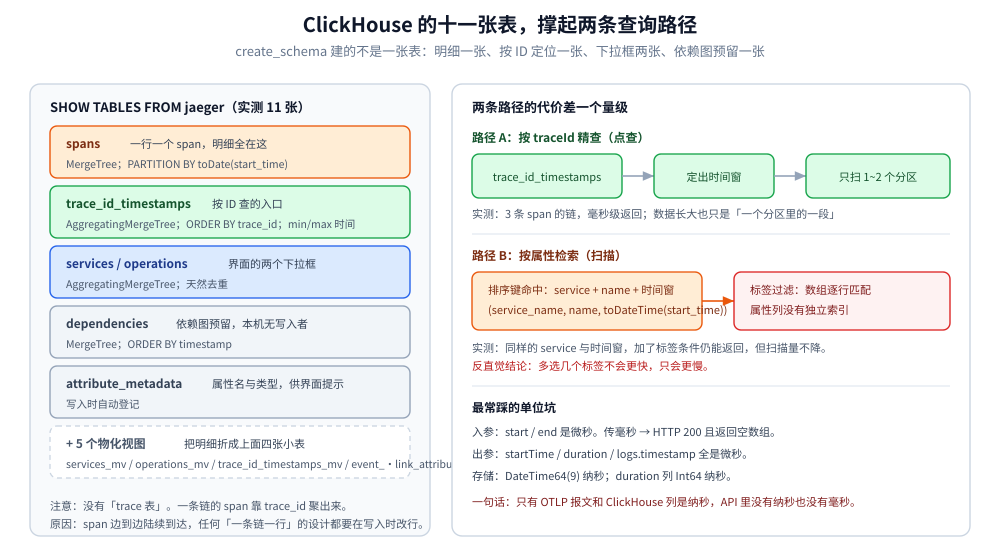

# 数据模型与查询

> 本篇回答三件事：**一条 OTLP span 落库后变成什么**（ClickHouse 里十一张表、`spans` 表的列设计与排序键）、**查询 API 用什么单位、返回什么结构**（微秒坑、`processes` 拆分、`events → logs` 的转换）、**哪些查询便宜哪些贵**（排序键决定一切）。
>
> 不覆盖：怎么把栈起起来（见 [架构与部署.md](架构与部署.md)）；span 在应用侧怎么产生（见 [采集与传播.md](采集与传播.md)）；界面怎么读（见 [UI与排障.md](UI与排障.md)）。
>
> 实测环境：`jaegertracing/jaeger:2.20.0` + `clickhouse/clickhouse-server:26.3-alpine`，`create_schema: true`。本篇所有表结构、列名、引擎、排序键、API 返回与单位，均来自本机实跑；ES / Cassandra 的 schema 按官方文档陈述并单独标注。

---

## 一、内部模型：Trace 是一棵树，落库是一张宽表

**本节要点**：Jaeger 的内存模型是**四层**（Trace → Span → Reference → Log），但落库前会被**拍平**：每个 span 一行，父子关系变成 `parent_span_id` 一列。理解这次「树变表」，才能理解为什么按 ID 查快、按子节点查慢。

| 概念 | 内部模型 | 落库形态 |
|---|---|---|
| **Trace** | 一组共享 `trace_id` 的 span | 没有「trace 表」，靠 `trace_id` 聚出来 |
| **Span** | 一次操作，含起止时间、状态、tags、logs | `spans` 表一行 |
| **Reference** | 指向父 span（`CHILD_OF` / `FOLLOWS_FROM`） | `parent_span_id` + `references[]`（可多个，用于重试/批量） |
| **Process** | 产生 span 的进程（`service.name` + 资源属性） | `spans` 表的 `service_name` + `resource_*_attributes`，查询时**再合并回 `processes`** |
| **Log / Event** | span 内的时间点事件 | `events.*` 嵌套列，查询时转回 `logs[]` |

⭐ 关键取舍：**Trace 这张表不存在**。所以「列出某条链的所有 span」在存储层是一次 `WHERE trace_id = ?` 的范围扫描——这就是为什么每套后端都要**给 trace_id 单独建索引或小表**（见第三节的 `trace_id_timestamps`）。

## 二、时间精度：输入纳秒、存储纳秒、API 微秒

**本节要点**：这条链路上**三个环节的精度不一样**，混用单位是「明明有数据却查不到」的头号原因。

| 环节 | 精度 | 本机实测 |
|---|---|---|
| OTLP 报文 | 纳秒（`startTimeUnixNano` 字符串） | 输入 `1792599526023170816` |
| ClickHouse 存储 | 纳秒（`DateTime64(9)`） | 存成 `2026-10-21 16:18:46.023170816`（**末三位保留**） |
| `duration` 列 | 纳秒（`Int64`） | `120000000` = 120 ms |
| **查询 API 返回** | ⚠️ **微秒** | `startTime: 1792599526023170`、`duration: 120000` |
| **查询 API 入参** | ⚠️ **微秒** | `start` / `end` 传毫秒 → **静默返回空**，200 但不报错 |

```bash
# 错：毫秒（会返回空数组，且 HTTP 200）
curl "http://127.0.0.1:16686/api/traces?service=order-service&start=1792596003000&end=1792599603000"
# {"data":[],"total":0,...}

# 对：微秒
curl "http://127.0.0.1:16686/api/traces?service=order-service&start=1792596019000000&end=1792599620000000"
# {"data":[{...}],...}
```

⭐ 判据：**Jaeger 的 API 里没有毫秒**。`Duration` 是微秒、`startTime` 是微秒、`logs[].timestamp` 也是微秒；只有 OTLP 报文和 ClickHouse 列是纳秒。

## 三、ClickHouse 的十一张表：一张宽表 + 五个物化视图

**本节要点**：`create_schema: true` 建的不是一张表，而是**一组**：`spans` 存明细，`trace_id_timestamps` 解决「按 ID 查」，`services` / `operations` 供下拉框，`dependencies` 预留给依赖图。

本机 `SHOW TABLES FROM jaeger` 实测（11 张）：

```text
spans                        ← 明细：一行一个 span
trace_id_timestamps          ← 按 trace_id 的时间范围（解决「按 ID 精查」）
services / operations        ← 服务与操作下拉框（AggregatingMergeTree 去重）
dependencies                 ← 依赖图（MergeTree，本机无写入者）
attribute_metadata           ← 属性名/类型元数据（供 UI 提示）
+ 5 个 _mv 物化视图          ← services_mv / operations_mv / trace_id_timestamps_mv
                              ← event_attribute_metadata_mv / link_attribute_metadata_mv
```

| 表 | 引擎 | 排序键 | 为什么这么建 |
|---|---|---|---|
| `spans` | `MergeTree`，`PARTITION BY toDate(start_time)` | `(service_name, name, toDateTime(start_time))` | ⭐ **按「服务→操作→时间」排序**，正好是 UI 检索的主路径 |
| `trace_id_timestamps` | `AggregatingMergeTree` | `trace_id` | 按 ID 查时**先用它定位时间窗**，再去 `spans` 里扫 |
| `services` | `AggregatingMergeTree` | `name` | `SHOW TABLES` 里看到的服务列表，天然去重 |
| `operations` | `AggregatingMergeTree` | `(service_name, span_kind)` | 操作名 + kind 的枚举，供 UI 下拉 |
| `dependencies` | `MergeTree`，`PARTITION BY toDate(timestamp)` | `timestamp` | 结构与「依赖图」吻合，但**本机没有写入者**（见第七节） |



图里两条路径是全篇的核心分歧点：**按 ID 查**走 `trace_id_timestamps` → 时间窗 → `spans`；**按属性查**直接在 `spans` 上按排序键扫分区。前者是点查，后者是扫描——量级差一到两个数量级。

## 四、`spans` 表的列设计：为什么属性要拆成五种数组

**本节要点**：`spans` 把 attributes 拆成**按类型分组的 key/value 数组**（bool / double / int / str / complex），而不是塞进一个 JSON 列——这是列式库的取舍：**同类型的值连续存放才能压缩**，代价是「查某个属性」要写 `has(str_attributes.key, 'x')` 这种数组操作。

本机 `DESCRIBE TABLE jaeger.spans` 的部分列：

| 列 | 类型 | 说明 |
|---|---|---|
| `id` | `String` | span_id（十六进制） |
| `trace_id` | `String` | 32 位十六进制 |
| `parent_span_id` | `String` | 根 span 为空 |
| `name` / `kind` | `String` | `kind` 存文本（`server` / `client`），不是数字 |
| `start_time` | `DateTime64(9)` | 纳秒 |
| `status_code` / `status_message` | `String` | `Unset` / `Error`（实测值） |
| `duration` | `Int64` | 纳秒 |
| `bool_attributes.key` / `.value` | `Array(String)` / `Array(Bool)` | 布尔属性 |
| `double_attributes.*` | `Array(Float64)` | 浮点属性 |
| `int_attributes.*` / `str_attributes.*` | `Array(Int64)` / `Array(String)` | 整数 / 字符串属性 |
| `complex_attributes.*` | `Array(String)` | 数组/嵌套属性（序列化后存） |
| `events.*` / `links.*` | 各 5 组 Nested 数组 | span 内事件与链接 |
| `service_name` | `String` | 从 `resource` 提升上来的列（排序键首位） |
| `resource_*_attributes.*` | 同五种类型 | 资源级属性，查询时还原成 `processes` |

⭐ 三个只有看过表结构才会想到的点：

- **`kind` 是字符串不是枚举**：所以 Zipkin 进来（模型没有 kind）就是**空字符串**，不是 `unspecified`（本机实测 `spanKind: ""`）。
- **`toDateTime(start_time)` 把秒级以下截掉了**：排序键用秒级时间，同一个服务同一秒内的 span 靠分区内的插入顺序，**不保证严格时序**。
- **`resource_*` 与 span 级属性分开存**：所以「按服务筛」是 `service_name` 这一列（快），「按资源属性筛」要动数组（慢）。

## 五、两类查询的代价：排序键决定一切

**本节要点**：所有查询都能归成两类——**按 traceId 点查**（走小表定位）与**按属性 + 时间检索**（扫分区）。搞混这两类，就会得出「Jaeger 很慢」或「Jaeger 不能查」的错觉。

| 查询 | 计划 | 代价 | 实测 |
|---|---|---|---|
| 按 `trace_id` 取整条 | `trace_id_timestamps` 定时间窗 → `spans` 按分区裁剪 | 低（一个分区内的一段） | ✅ 200，毫秒级返回 3 条 span |
| 按 `service` + 时间窗列表 | `spans` 排序键前缀命中 | 中（分区裁剪 + 顺序扫） | ✅ 200 |
| 按 `tags` 过滤（如 `http.response.status_code=500`） | 先按服务/时间缩小，再逐行做数组匹配 | 高（属性列没有独立索引） | ✅ 200（条件用 JSON 传） |
| 按子 span 名反查父链 | 只能先找到子 span 再按 `trace_id` 取整条 | 高（没有反向索引） | ⚠️ 本机未单独压测 |
| 全文搜 SQL 语句 | `str_attributes.key/value` 数组扫 | 很高 | ⚠️ 未测，不建议 |
| 跨服务统计（PV/耗时分布） | 需要 metrics 后端（SPM） | 取决于后端 | ❌ `/api/metrics/calls` 实测 **501** |

⭐ 判据：**能落到「服务 + 操作 + 时间窗」的查询都便宜**，因为那是排序键；落不到就得扫。这也解释了为什么 Jaeger 的 UI 检索框第一项一定是「选服务」。

## 六、Query API：八个端点与本机返回

**要点**：查询面是 HTTP `16686`（UI 与 API 同进程），另有 gRPC `16685`。端点不多，但**入参单位与错误码**各有脾气。

| 端点 | 用途 | 本机实测 |
|---|---|---|
| `GET /api/services` | 服务列表 | ✅ `{"data":["jaeger","order-service","zipkin-svc"],"total":3}` |
| `GET /api/operations?service=` | 操作列表 + `spanKind` | ✅ `[{"name":"GET /api/orders","spanKind":"server"},{"name":"SELECT orders","spanKind":"client"}]` |
| `GET /api/traces?service=&limit=&start=&end=` | 列表检索 | ✅ 需**微秒**；`tags` 用 JSON 传 |
| `GET /api/traces/{traceID}` | 整条链路 | ✅ 返回 `spans` + `processes` |
| `GET /api/dependencies?start=&end=` | 依赖图数据 | ✅ 200 但 `data: []`（见第七节） |
| `GET /api/metrics/calls?service=` | SPM 指标 | ❌ 501 `trace metrics are currently disabled` |
| `GET /api/trace/{traceID}` | 1.x 旧路径 | ❌ **404**（v2 改名为复数 `traces`） |
| `GET /` | 内置 UI | ✅ 200（5975 字节，前端 SPA） |

```bash
# 标签过滤：tags 是 JSON 字符串，值要带引号
curl -G 'http://127.0.0.1:16686/api/traces' \
  --data-urlencode 'service=order-service' \
  --data-urlencode 'tags={"http.response.status_code":"500"}' \
  --data-urlencode 'limit=5'
```

⚠️ 两个坑：**① `start` / `end` 省略时不报错**，走默认时间窗（`lookback`，本机实测能查到）；显式传毫秒则**静默返回空**。**② `tags` 的值必须写成字符串**，数字会被当作不匹配。

## 七、返回结构：`processes` 为什么要拆出去

**本节要点**：响应里 `processes` 是**独立的一张表**（默认 `p1`），span 只存 `processID`。这是为了在同一进程产生的多个 span 上**不重复传资源属性**——一条 10 个 span 的链，资源属性只出现一次。

本机 `/api/traces/{id}` 的顶层键：`traceID`、`spans`、`processes`、`warnings`。

| 结构 | 实测片段 | 说明 |
|---|---|---|
| `processes.p1` | `{"serviceName":"order-service","tags":[{"key":"deployment.environment.name",...},{"key":"service.instance.id",...}]}` | 资源属性原样带出 |
| `spans[].references` | `[{"refType":"CHILD_OF","traceID":"4bf9...","spanID":"00f067aa0ba902b7"}]` | 根 span 是**空数组**——判断「断链」就看这里 |
| `spans[].tags` | `otel.scope.name`、`span.kind`、`http.request.method`、`http.response.status_code` | OTel 语义约定与 Jaeger 自有 tag 混在一起 |
| `spans[].logs` | `[{"timestamp":1792599526123170,"fields":[{"key":"event","value":"exception"},{"key":"exception.type","value":"TimeoutError"},{"key":"exception.message","value":"pay gateway timeout"}]}]` | ⭐ **OTLP 的 event 转成了 log**，事件名落到 `event` 字段 |
| `spans[].warnings` | `null` | 存储侧「数据超限/字段丢弃」的提示位 |

## 八、OTLP → Jaeger 的字段映射：三处会丢信息

**本节要点**：OTLP 是**通用模型**，Jaeger 的 tag 体系是**自己的**。转换基本无损，但有三处会改写语义，排障时会误导判断。

| OTLP 字段 | 落成什么 | 实测 |
|---|---|---|
| `status.code = 2`（ERROR） | 三个 tag：`otel.status_code=ERROR`、`error=true`、`otel.status_description=<message>` | ✅ 实测三者同时出现 |
| `attributes`（任意类型） | 按类型分列存，查询时还原成 `tags`（带 `type`） | ✅ `http.response.status_code` 的类型是 `int64` |
| `events[]` | `logs[]`，事件名放 `fields[].key="event"` | ✅ 见上一节 |
| `links[]` | `references`（`refType` 非 `CHILD_OF` 时） | ⚠️ 本机未构造 links |
| `kind`（枚举 0–5） | 文本 `unspecified` / `internal` / `server` / `client` / `producer` / `consumer` | ✅ `server` / `client` 实测 |
| Zipkin 的 span | 同上，但 **`kind` 为空字符串** | ✅ 实测 `spanKind: ""` |

⚠️ 三处「不可逆」的差异：

- **`status.code` 的语义被摊成 tag**：想按「是否失败」筛，要查 `error=true` 或 `otel.status_code=ERROR`，而不是某个 status 列（存储里另有一列 `status_code`，值是 `Error`/`Unset`）。
- **事件名进了字段**：`exception` 不是独立列，只能 `logs[].fields` 里找 `key="event"` 的那条。
- **Zipkin 的 kind 丢失**：同样的服务，Zipkin 进来的 span 在 `operations` 接口里 `spanKind` 是空串，前后端区分不了——这是「迁移期混跑」看起来数据不全的直接原因。

## 九、gRPC 查询面：`16685` 与 HTTP 面等价

**本节要点**：v2 的查询面同时开 HTTP 与 gRPC（本机日志 `Query server started http_addr="[::]:16686" grpc_addr="[::]:16685"`）。**UI 走 HTTP，程序化集成可以用 gRPC**，两者读同一份存储。

| 面 | 端口 | 适用 |
|---|---|---|
| HTTP（`/api/*`） | `16686` | 脚本、curl、UI；JSON 友好 |
| gRPC（`jaeger.api_v3.QueryService` 等） | `16685` | 强类型客户端；大量/高频查询 |

⚠️ 两个面**都没有内置认证**（鉴权要自己在前面挂），且都读全量链路数据。

## 十、换个后端：schema 会变成什么样

**本节要点**：本篇的十一张表是 **ClickHouse** 的实现细节，不是 Jaeger 的公共契约。**API 与 UI 不变，凡是写到「表/排序键」的地方换后端就得重写**。

| 后端 | 明细存储 | 「按 traceId 查」怎么解决 |
|---|---|---|
| ClickHouse（本篇） | `spans` 单表 + 五个物化视图 | `trace_id_timestamps` 小表定位时间窗 |
| Elasticsearch | 每日索引（`jaeger-span-*`），mapping 由 `elasticsearch-mappings` 子命令生成 | 索引内 `traceID` 字段检索 |
| Cassandra | `jaeger_spans_v2` 等宽表 | 按 `(service_name, span_id)` 等复合主键设计；trace 查询要额外表 |
| Badger | 本地 KV，键前缀区分 | 直接按 key 前缀扫 |

---

## 校验口径

| 内容 | 状态 |
|---|---|
| 十一张表、表名、引擎、排序键、`PARTITION BY` | ✅ 本机 ClickHouse 实查（`SHOW TABLES` / `SHOW CREATE TABLE`） |
| `spans` 列设计（五种类型属性数组、events/links Nested） | ✅ 本机 `DESCRIBE TABLE` 实测 |
| 纳秒写入 / 微秒返回 / 毫秒入参静默返回空 | ✅ 本机实跑（三种单位都试过） |
| 六个查询端点的返回与状态码（含 501、404） | ✅ 本机逐一 curl 实测 |
| `processes` 拆分、`references` 结构、`events → logs`、`status.code → 三个 tag` | ✅ 本机 `/api/traces/{id}` 原始响应解析 |
| Zipkin 落库 `kind` 为空 | ✅ 本机实跑（`POST /api/v2/spans` → 202） |
| gRPC `16685` 与 HTTP 等价 | ⚠️ 仅日志证明 gRPC server 已启动（`Starting GRPC server port 16685`），**未发 gRPC 请求** |
| 各类查询的代价排序 | ⚠️ 基于排序键的推断 + 小数据量实测，**未做规模压测** |
| ES / Cassandra / Badger 的 schema | ⚠️ 按官方文档陈述，**本机只跑 ClickHouse** |
| `links[] → references` 的转换 | ⚠️ 本机未构造 links，按模型陈述 |

---

## 延伸追问

- **为什么没有「trace 表」？** → 一条链的 span 是**边到边陆续到达**的，任何「一条链一行」的设计都要在写入时改已有行（写放大且并发冲突）。按 span 存、按 ID 聚，写入永远只是 append。
- **`trace_id_timestamps` 是干什么的？** → 按 ID 查时先在这里拿到这条链的时间范围，从而把 `spans` 的扫描裁到 1–2 个分区；没有它就得扫全部分区。
- **为什么 `duration` 存纳秒、返回微秒？** → 存储要跨语言保真（Go 的 `time.Duration` 是纳秒），而 Jaeger 的旧 API 用微秒；v2 为了兼容 UI 不改单位，于是形成「存纳秒、报微秒」的错位。
- **属性用数组存，怎么查 `status_code=500`？** → 在 `str/int_attributes` 上用 `has(key, ...)` 配合下标对齐取出 value；代价是全表（分区内）逐行判断，这正是「按属性搜贵」的物理原因。
- **为什么 `dependencies` 表建好了却没数据？** → 依赖图需要写入者（从 span 里算服务间调用），v2.20 的 `jaeger_storage` **没有 `dependencies` 配置项**（实测报 `invalid keys: dependencies`），所以本机 `/api/dependencies` 一直空。
- **换 ES 后这些结论还成立吗？** → 「按 ID 快、按属性慢」这层仍成立，但**具体到表和排序键就全部失效**：ES 靠倒排索引，属性过滤反而不贵，贵在写入与磁盘。

---

## 关联

- **上游/总纲**：[README.md](README.md) — 本册导读；[架构与部署.md](架构与部署.md) 第五节 — 存储后端怎么选
- **下游机制**：[UI与排障.md](UI与排障.md) — 这些字段在界面上变成哪一列、查不到时怎么按表排查
- **对照/互补**：[协议与数据模型.md](../Skywalking/协议与数据模型.md) — 另一套模型（TraceSegment + GraphQL）与同一批问题的不同解法；[架构与存储引擎.md](../../../数据存储/列式数据库/ClickHouse/架构与存储引擎.md) — `MergeTree` 排序键与分区裁剪的原理
- **落地代码**：[接入Jaeger.md](../../../../01-编程语言/go/可观测性/接入Jaeger.md) — 采样率与上报配置决定了这里能查到什么
