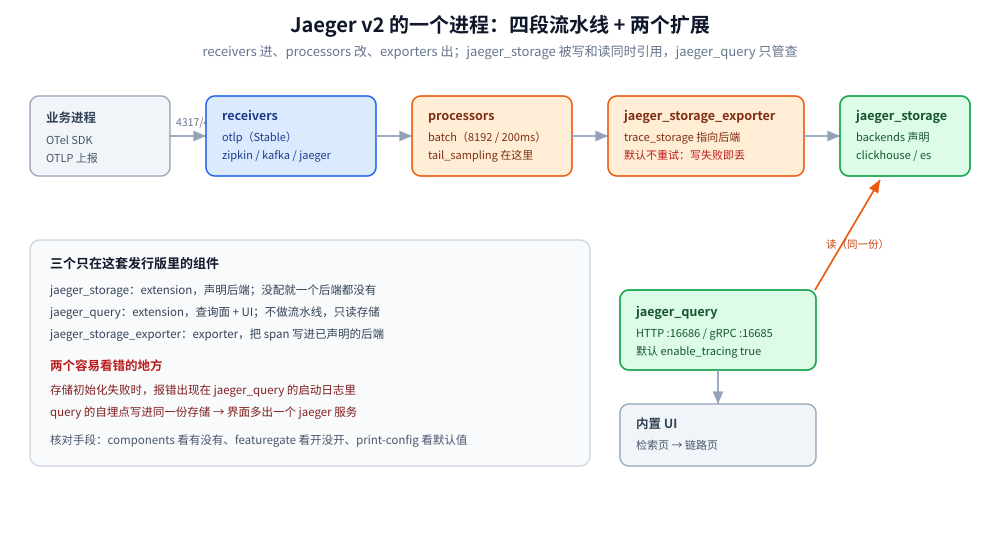
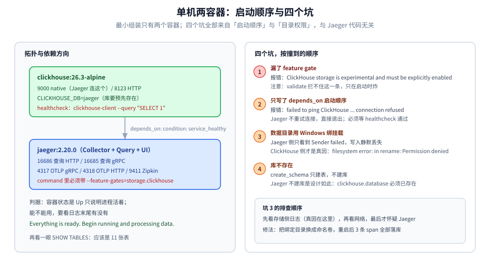

# 架构与部署

> 本篇回答两件事：**Jaeger v2 的一个进程里到底跑着什么**（Collector 运行时 + 查询扩展 + 存储扩展，配置就是 OTel Collector 的风格），以及**这套东西怎么装起来、装错了长什么样**（单机两容器实跑 + 四个坑、生产形态、容量口径、1.x 到 v2 的迁移）。
>
> 不覆盖：`traceparent` 怎么传、采样在哪一层做（见 [采集与传播.md](采集与传播.md)）；`spans` 表的排序键为什么决定查询代价（见 [数据模型与查询.md](数据模型与查询.md)）；面板怎么读、查不到怎么排（见 [UI与排障.md](UI与排障.md)）。
>
> 实测环境：Docker Desktop（Windows amd64）单机两容器——`jaegertracing/jaeger:2.20.0` + `clickhouse/clickhouse-server:26.3-alpine`，宿主端口 `16686` / `14317` / `14318` / `19411` / `19000` / `18123`。**本轮未起任何业务进程**，span 由手工构造的 OTLP/HTTP JSON 投递；启动、建表、写失败与修复都是本机日志原文。

---

## 一、一句话定位：v2 的一个进程干完三件事

**本节要点**：1.x 时代 Collector / Query / Agent 是三个独立二进制，各有各的端口；**v2 把它们合成一个进程**——同一份配置里既声明「怎么收」又声明「往哪存、怎么查」，`query` 与 `storage` 变成了两个 **extension**。

| 版本 | 进程形态 | 组件 | 应用怎么连 |
|---|---|---|---|
| 1.x | 三个二进制（可拆可合） | Agent（sidecar，UDP） + Collector + Query | 就近发 Agent，或直连 Collector 的 `14250` |
| **2.x（本篇）** | **一个** `jaeger` 进程 | Collector（`receivers`/`processors`/`exporters`）+ `jaeger_query` + `jaeger_storage` | 一律 OTLP `4317`/`4318`（Zipkin `9411` 兼容） |

⭐ 为什么 agent 没了：它当年解决的是「UDP 报文太长、客户端不会批处理」——这两件事现在由 OTel SDK 的 `BatchSpanProcessor` 和 gRPC 解决了。**升级 v2 时最先踩的坑就是「我的 `6831` 端口去哪了」**：它不在了，客户端要改发 OTLP。

## 二、运行时解剖：v2 就是发行版的 OTel Collector

**本节要点**：判断「Jaeger v2 里有哪些能力」，不用翻文档，**直接问镜像自己**——`components` 列出全部内置组件，`featuregate` 列出全部实验开关，`print-config` 把默认值摊开。

```text
receivers      jaeger(Thrift, Beta) · kafka · nop · otlp(Stable) · zipkin(Beta)
processors     adaptive_sampling · attributes · batch · filter · memory_limiter · tail_sampling
exporters      debug · jaeger_storage_exporter(Development) · kafka · nop · otlp_grpc · otlp_http · prometheus
connectors     forward · span_metrics（traces → metrics，SPM 的来源）
extensions     basicauth · expvar · healthcheckv2 · jaeger_query · jaeger_storage · pprof
               remote_sampling · remote_storage · sigv4auth · storage_cleaner · zpages
```

（以上为 `docker run --rm jaegertracing/jaeger:2.20.0 components` 的实测输出，稳定性一栏是它自报的。）

三个**只在这套发行版里**的组件，构成本册的主线：

| 组件 | 类型 | 作用 | 关键点 |
|---|---|---|---|
| `jaeger_storage` | extension | 声明存储后端（`backends`）与指标后端（`metric_backends`） | **存储不给默认值**，不配就没有任何后端 |
| `jaeger_query` | extension | 查询服务 + 内置 UI，HTTP `16686` / gRPC `16685` | 默认 `enable_tracing: true`，会把查询请求自己也记成 span |
| `jaeger_storage_exporter` | exporter | 把 span 写进某个已声明的后端 | 默认 `retry_on_failure.enabled: **false**`，写失败不重试 |

⭐ 那个 `retry_on_failure: false` 很关键：**存储抖动时 Jaeger 是「丢」而不是「等」**。本机把它配错（数据目录用 Windows 绑挂载）时，日志里只有一行 `Sender failed ... code: 1001, message: std::exception: std::exception`，报文就没了——见第六节坑 ③。

五条不进流水线但很好用的子命令（本机实测）：

| 子命令 | 干什么 | 什么时候用 |
|---|---|---|
| `version` | 打印 `{"gitVersion":"v2.20.0","buildDate":"2026-07-20T03:41:33Z"}` | 排查「线上到底哪个版本」 |
| `components` | 列出全部内置组件与稳定性 | 确认某个 receiver / processor 在不在这个发行版里 |
| `featuregate` | 列出全部开关、默认值与 Stage | 确认实验特性是否默认关闭 |
| `validate --config` | 只解析配置，不启动 | ⚠️ **它不检查 feature gate**，见第十节 |
| `print-config --config` | 打印归一化后的完整配置（含所有默认值） | 想知道「我没写的那项到底是什么」 |

## 三、配置五段：一份 yaml 顶掉一个部署单元

**本节要点**：v2 的配置就是 Collector 配置，**五段各管一件事**：`extensions` 声明能力、`receivers` 定入口、`processors` 改数据、`exporters` 定出口、`service` 把它们接成流水线。

```yaml
extensions:
  jaeger_storage:                      # ① 能力：存储
    backends:
      ch:
        clickhouse:
          addresses: ["clickhouse:9000"]   # native 协议端口，不是 8123
          database: jaeger                 # 库须预先存在
          auth: { basic: { username: root, password: root } }
          create_schema: true              # 首次启动自动建表
  jaeger_query:                        # ① 能力：查询 + UI
    storage: { traces: ch }
receivers:                             # ② 入口
  otlp:
    protocols:
      grpc: { endpoint: 0.0.0.0:4317 }
      http: { endpoint: 0.0.0.0:4318 }
  zipkin: { endpoint: 0.0.0.0:9411 }
processors:                            # ③ 加工
  batch: {}
exporters:                             # ④ 出口
  jaeger_storage_exporter:
    trace_storage: ch
service:                               # ⑤ 接线
  extensions: [jaeger_storage, jaeger_query]
  pipelines:
    traces:
      receivers: [otlp, zipkin]
      processors: [batch]
      exporters: [jaeger_storage_exporter]
```



图里的关键一条：**`jaeger_storage` 是唯一同时被「写」（exporter）和「读」（query）引用的东西**。所以它初始化失败时，报错出现在 `jaeger_query` 的启动日志里——第一次看会以为是查询组件坏了。

`print-config` 给出的默认值（本机实测，节选）：

| 位置 | 默认值 | 影响 |
|---|---|---|
| `processors.batch` | `send_batch_size: 8192`、`timeout: 200ms` | 单条 span 投递后约 200ms 内落库，短命容器要留 flush 时间 |
| `exporters.jaeger_storage_exporter` | `retry_on_failure.enabled: false` | 写失败直接丢 |
| `extensions.jaeger_query` | `grpc: :16685`、`http: :16686`、`base_path: /`、`enable_tracing: true`、`max_trace_size: 0` | `max_trace_size: 0` = 不限单条 trace 大小 |
| `extensions.jaeger_storage.backends.*.clickhouse` | `default_search_depth: 0`、`max_search_depth: 0`、`ttl: 0s`、`protocol: ""` | `ttl: 0s` = 不删数据，长期跑必须显式配 TTL 或用 `storage_cleaner` |

## 四、接收面：三个 receiver 各自的边界

**本节要点**：**新接入一律走 OTLP**，Zipkin 只是为了接存量，Kafka 是为了削峰；三者进流水线后是同一份内部模型，差别只在「转换时丢了什么」。

| receiver | 端口（本机） | 稳定性 | 进来的东西 | 转换时的损耗 |
|---|---|---|---|---|
| `otlp` | `4317` gRPC / `4318` HTTP | Stable | OTLP protobuf / JSON | 基本无损，字段一一对应 |
| `zipkin` | `9411`（`POST /api/v2/spans` 实测 **202**） | Beta | Zipkin v2 JSON / v1 | ⚠️ **Zipkin 模型没有 span kind**，落库 `kind` 为空字符串（实测 `spanKind: ""`） |
| `kafka` | — | Beta | 已序列化的 OTLP 报文 | 需要成对配置编码/解码，只在跨集群汇聚时值得 |
| `jaeger` | — | Beta | 1.x 的 Thrift（`6831`/`14268`） | **只为过渡期兼容**，`uber-trace-id` 与 `traceparent` 混跑会断链 |

⭐ 判据：**线上只留 `otlp` 一个 receiver，是「迁移完成」的标志**。留着 `zipkin` / `jaeger` 就等于承认还有存量客户端在发私有格式——这两条都会在某个时刻让你查不到链路（见 [采集与传播.md](采集与传播.md) 第五节）。

## 五、存储后端：五个候选，先看「按什么查」

**本节要点**：Jaeger 的存储只需支持两种访问模式——**按 traceId 取整条**、**按服务+时间+标签搜**。选型的分歧点全在第二种：数据量大了以后，谁能把「搜」做成索引而不是全扫。

| 后端 | 配置键 | 适用 | 代价 |
|---|---|---|---|
| **ClickHouse** | `clickhouse` | ⭐ 官方推荐的生产明细库（v2 原生集成，ADR-008） | 需 `--feature-gates=storage.clickhouse`；schema 仍标 experimental |
| **Elasticsearch / OpenSearch** | `elasticsearch` / `opensearch` | 已有 ES 集群、要复杂聚合 | 索引与副本吃掉大量磁盘；mapping 随版本变（有 `elasticsearch-mappings` 子命令专门生成） |
| **Cassandra** | `cassandra` | 超大规模写入、写入优先 | 运维门槛高，查询能力弱（只有窄表 + 手工建索引） |
| **Badger** | `badger` | 单机、CI、演示 | 本地磁盘，**不可多副本** |
| **memory** | `memory` | 只用于 `all-in-one` 试玩 | 重启即丢 |

⭐ 一句话判据：**「只按 traceId 查」任何后端都行；「按属性翻历史」只有列式库（ClickHouse）与倒排索引（ES）扛得住**。

## 六、部署一：单机两容器（含四个坑）

**本节要点**：最小组装是**两个容器**——存储 + Jaeger，`jaeger` 自带 Collector、Query 和 UI。四个坑全部来自「启动顺序」与「目录权限」，与 Jaeger 代码无关。

```yaml
services:
  clickhouse:
    image: clickhouse/clickhouse-server:26.3-alpine
    environment:
      CLICKHOUSE_DB: jaeger          # ⚠️ Jaeger 不建库，库必须预先存在
      CLICKHOUSE_USER: root
      CLICKHOUSE_PASSWORD: root
      CLICKHOUSE_DEFAULT_ACCESS_MANAGEMENT: 1
    ulimits: { nofile: { soft: 262144, hard: 262144 } }
    volumes:
      - ch-data:/var/lib/clickhouse  # ⚠️ 必须用命名卷，见坑 ③
    healthcheck:
      test: ["CMD", "clickhouse-client", "--user", "root", "--password", "root", "--query", "SELECT 1"]
      interval: 3s
      timeout: 3s
      retries: 20

  jaeger:
    image: jaegertracing/jaeger:2.20.0
    depends_on:
      clickhouse:
        condition: service_healthy  # ⚠️ 必须是 healthy，不能是「启动顺序」，见坑 ②
    command: ["--config", "/etc/jaeger/config.yaml", "--feature-gates=storage.clickhouse"]
    volumes:
      - ./config.yaml:/etc/jaeger/config.yaml:ro
    ports:
      - "16686:16686"   # Query HTTP + UI
      - "4318:4318"     # OTLP HTTP
      - "4317:4317"     # OTLP gRPC

volumes:
  ch-data:
```



四个坑，按「第一次部署一定会撞到」的顺序：

| # | 现象 | 根因 | 判据 / 修法 |
|---|---|---|---|
| ① | 启动即退，日志 `ClickHouse storage is experimental and must be explicitly enabled` | ClickHouse 存储是实验特性，**默认关闭** | 命令行加 `--feature-gates=storage.clickhouse`；⚠️ `validate` 拦不住这一条 |
| ② | 日志 `failed to ping ClickHouse: dial tcp ...: connect: connection refused`，进程退出 | `depends_on` 只保证**启动顺序**，不保证就绪；**Jaeger 不会重试连接** | 给 ClickHouse 加 `healthcheck` + `condition: service_healthy`（实测：加之前 100% 失败） |
| ③ | 栈起来了，但 span 一条也查不到；日志 `Sender failed ... code: 1001` | Windows 绑挂载（`./ch-data:/var/lib/clickhouse`）下 ClickHouse 提交分片 `rename` 被拒 | ClickHouse 错误日志原文 `filesystem error: in rename: Permission denied`；**改命名卷**后立即恢复（3 条 span 全部落库） |
| ④ | 库连上了，但写入报「表不存在」 | 库（database）要先存在，`create_schema` 只建表不建库 | ClickHouse 侧 `CLICKHOUSE_DB=jaeger`，或手工 `CREATE DATABASE jaeger` |

坑 ③ 值得多说一句：它**不报成 ClickHouse 的错误**，而是被 Collector 的 `batch` processor 吞成一行 `Sender failed`。看到这行时的排查顺序是「先看存储侧日志，再看网络」——本机正是靠 `filesystem error` 才定位到挂载方式。

## 七、部署二：生产形态

**本节要点**：生产不是「多开几个容器」，而是**四件事各自可选**：写路径可水平扩（无状态 Collector）、存储要能扛住按属性搜、查询与写入要能分开扩、数据要能被删。

| 需求 | 做法 | 注意 |
|---|---|---|
| 写入扩缩 | 多副本 `jaeger`，前面挂 L4/L7 负载，全部指向同一存储 | 无状态，随时可重启；`jaeger_query` 也可以只留在其中一个副本上 |
| 查询分离 | 一份配置只留 `jaeger_query`（不起 pipeline），另一份只留 pipeline | 两条命令同一个镜像，用不同 config 文件 |
| 数据到期删除 | ClickHouse 侧 `ttl`（配置项）或 `storage_cleaner` extension | 默认 `ttl: 0s` = 永不删，成本只涨不降 |
| 归档 | `jaeger_query.storage.traces_archive` 指向第二个后端 | 查询时可按需「再查归档」（本机未配，日志会打印 `Archive storage not configured`） |
| 多租户 | `jaeger_query.multi_tenancy`（默认 `enabled: false`，靠 header 区分租户） | 本机未验证；单租户场景别开 |
| 鉴权 / TLS | `basicauth` extension、`sigv4auth`（ES 用）、`jaeger_query.http.tls` | ⚠️ 查询 API 默认**无认证**，暴露到公网等于把全部链路公开 |
| SPM 指标 | `span_metrics` connector + `metric_backends` | 不配 metrics 后端时 `/api/metrics/calls` 返回 `501 trace metrics are currently disabled`（实测） |

## 八、容量口径：先算 span 条数，再谈存储

**本节要点**：Jaeger 的成本由 **span 条数 × 单 span 字节**决定，**没有聚合兜底**；所以容量规划的顺序是「先把采样定下来，再选磁盘」。

| 量 | 算法 | 说明 |
|---|---|---|
| 每天 span 条数 | `QPS × 每条链路的 span 数 × 86400 × 采样率` | 例：100 QPS、每链 8 个 span、采样 10% → `100 × 8 × 86400 × 0.1 = 691.2 万/天` |
| 每天原始字节 | 条数 × 单 span 字节（含 attributes） | ⚠️ 单 span 字节随 attributes 数量线性涨，**本机未实测均值**，不要凭感觉给一个数 |
| 压缩后落盘 | 原始字节 ÷ 压缩比 | ClickHouse 列式压缩对高重复的 `service_name`、`name` 很有效 |

⭐ 降成本的三处旋钮，按「先立后破」的顺序：**① 先做尾部采样**（错误与慢请求全留，正常请求抽样）→ **② 再砍 attributes**（大 body、SQL 全文、敏感字段都不该进 span）→ **③ 最后才调 TTL**。先砍 TTL 的后果是「三个月前的故障查不了」。

## 九、版本与迁移：1.x → v2 的五个变更

**本节要点**：这次升级**不是换镜像版本**，而是换运行时——配置格式、端口、环境变量全变。判据：**配置能不能用 `validate` 通过**，是迁移完成的起点，不是终点。

| 变更 | 1.x | v2 | 影响 |
|---|---|---|---|
| 配置格式 | `COLLECTOR_OTLP_ENABLED` 等环境变量 + flag | YAML（`receivers/processors/exporters`） | 老的环境变量基本失效，`--set` 可临时覆盖单点 |
| Agent | `6831`(UDP) / `14268` | ❌ 移除 | 客户端必须改发 OTLP，或经 Collector 转发 |
| 查询端口 | `16686`（Query） | `16686`（HTTP）/ `16685`（gRPC） | 多了 gRPC 查询面（实测 `Starting GRPC server port 16685`） |
| ClickHouse gate | 三方 grpc-plugin | 原生存储 + `storage.clickhouse`（2.20 为 Alpha） | 2.23 起转 Stable 并更名 `jaeger.clickhouse`，旧 ID 保留为别名 |
| 全量单机 | `all-in-one:1.x` | `jaeger:2.x` + 存储 | v2 没有「内存存储的单体镜像」等价物，最少两个容器 |

> ⚠️ 本机只在 **2.20.0** 上验证过；`storage.clickhouse` 在 2.20 是 `Alpha`（`featuregate` 实测输出），schema「subject to breaking changes」——**升级前先备份 ClickHouse 数据，或接受重建索引**。

## 十、验证与排查：三个探活点与一个盲区

**本节要点**：判断「这套栈到底好不好」，**看日志的三个锚点 + 查一次真实数据**，不要只看容器状态。

```bash
# ① 版本（镜像自己报的）
docker run --rm jaegertracing/jaeger:2.20.0 version
# {"gitCommit":"d65f951...","gitVersion":"v2.20.0","buildDate":"2026-07-20T03:41:33Z"}

# ② 配置能不能被解析（⚠️ 不校验 feature gate）
docker run --rm -v $PWD/config.yaml:/etc/jaeger/config.yaml:ro jaegertracing/jaeger:2.20.0 \
  validate --config /etc/jaeger/config.yaml

# ③ 归一化后的真实配置（默认值全在这）
docker run --rm -v $PWD/config.yaml:/etc/jaeger/config.yaml:ro jaegertracing/jaeger:2.20.0 \
  print-config --config /etc/jaeger/config.yaml --feature-gates=storage.clickhouse
```

本机启动成功时的日志锚点（原文节选）：

```text
Initializing storage 'ch'                                    ← 存储扩展开始初始化
Query server started   http_addr="[::]:16686" grpc_addr="[::]:16685"
Starting GRPC server   port=16685
Starting HTTP server   port=16686                            ← 查询面就绪
Starting GRPC server   endpoint="[::]:4317"                  ← OTLP gRPC
Starting HTTP server   endpoint="[::]:4318"                  ← OTLP HTTP
Everything is ready. Begin running and processing data.
```

故障速查：

| 症状 | 先查 | 判据 |
|---|---|---|
| 容器起不来 | 是否带 gate | 缺 `--feature-gates=storage.clickhouse` 时日志必有 `must be explicitly enabled` |
| 起来了但立刻退出 | `depends_on` 写法 | 日志 `connect: connection refused` + 进程退出 = 没等存储就绪，且**不重试** |
| 链路一条都查不到，存储侧有行 | 写入是否真成功 | 日志 `Sender failed` = 写失败；`filesystem error: in rename: Permission denied` 指绑挂载 |
| `/api/metrics/calls` 返回 501 | 有没有 metrics 后端 | 报错原文 `trace metrics are currently disabled - no metrics backend configured` |
| 服务列表里有莫名其妙的 `jaeger` | 是不是自埋点 | `jaeger_query.enable_tracing` 默认 true，见 [UI与排障.md](UI与排障.md) 第二节 |
| UI 打开是空白页 | 前端资源 / `base_path` | `/` 返回 200 但界面空 → 查 `jaeger_query.ui.assets_path` 与反代路径 |

---

## 校验口径

| 内容 | 状态 |
|---|---|
| 镜像版本、`version` / `components` / `featuregate` / `docs` 子命令输出 | ✅ 本机实跑（`jaegertracing/jaeger:2.20.0`） |
| `storage.clickhouse` 为 Alpha 且默认关闭 | ✅ `featuregate` 实测：`storage.clickhouse false Alpha` |
| 缺 gate 的启动失败原文 | ✅ 本机实跑，报错字符串为日志原文 |
| `validate` 不校验 feature gate | ✅ 实测：不带 gate 的 `validate` 退出码 0、无输出 |
| 单机两容器、四个坑（gate / 就绪竞态 / 绑挂载 / 建库） | ✅ 本机 Docker 实跑；坑 ③ 的 ClickHouse 报错与修复前后行为都是实测 |
| 自动建表 11 张、`create_schema: true` 生效 | ✅ 本机 `SHOW TABLES FROM jaeger` 实测 |
| 默认值（`batch` / `retry_on_failure` / `jaeger_query` / clickhouse 各项） | ✅ `print-config` 实测输出 |
| `zipkin` receiver 返回 202、`kind` 落库为空 | ✅ 本机实跑（`POST /api/v2/spans`） |
| 生产形态（多副本、查询分离、归档、多租户、鉴权、TLS、SPM） | ⚠️ 按官方文档与 `print-config` 字段陈述，**本机均未验证** |
| ES / Cassandra / Badger / memory 后端 | ⚠️ 按官方文档陈述，**本机只跑 ClickHouse** |
| 单 span 字节数、压缩比 | ⚠️ **未实测**，故本篇只给条数公式，不给磁盘容量 |
| 2.20 → 2.23 的 gate 更名 | ⚠️ 按官方 release note 陈述，**未跨版本实测** |

---

## 延伸追问

- **为什么 v2 要把 Query 做成 extension 而不是 receiver/exporter？** → extension 不参与数据流水线，但可以被多个组件引用并随 `service.extensions` 独立启停；查询面只需「读存储」，用 extension 才能和写路径解耦。
- **`jaeger_storage_exporter` 的稳定性为什么是 Development？** → 它只是把内部模型交给 `jaeger_storage`，接口随存储后端演进；真正的稳定性由后端（`jaeger_storage`，Beta）承担。
- **ClickHouse 存储还标 experimental，生产能用吗？** → 能，但要接受「schema 可能随版本破坏性变更」：升级前备份或重建，且把 `create_schema` 的自动建表当成「首次初始化」而不是「升级迁移」。
- **为什么 `batch` 的 `timeout` 是 200ms 而不是 5s？** → Jaeger 的查询体验要求「发完就能查到」；200ms 的代价是写入放大（更多小批次），在 ClickHouse 侧靠 `async_insert` 与分区合并吸收。
- **`depends_on: service_healthy` 够不够？** → 够让 Jaeger 起来，但不够保证「库里有表」：`create_schema` 只在启动时尝试一次，是否建成要看存储侧日志。所以首次部署后固定查一遍 `SHOW TABLES`（本篇实测是 11 张，见 [数据模型与查询.md](数据模型与查询.md) 第三节）。
- **为什么不建议直接暴露 `16686`？** → 查询 API 没有任何认证（`basicauth` 要自己挂），而它读的是**全量链路**——里面有 SQL、URL、请求头。放内网 + 反代鉴权是底线。

---

## 关联

- **上游/总纲**：[README.md](README.md) — 本册导读与实测坐标；[可观测性选型对比.md](../可观测性选型对比.md) — 存储与采样在选型里的权重
- **下游机制**：[采集与传播.md](采集与传播.md) — `traceparent`、三处采样点与断链；[数据模型与查询.md](数据模型与查询.md) — 十一张表与查询代价；[UI与排障.md](UI与排障.md) — 面板读法与七问排障
- **对照/互补**：[架构与部署.md](../Skywalking/架构与部署.md) — 写时聚合的 OAP 怎么把 trace 折成指标；[定位与适用场景.md](../../../数据存储/列式数据库/ClickHouse/定位与适用场景.md) — ClickHouse 本身的定位
- **落地代码**：[接入Jaeger.md](../../../../01-编程语言/go/可观测性/接入Jaeger.md) — Go 侧上报地址与初始化顺序；[接入Jaeger.md](../../../../01-编程语言/java/可观测性/接入Jaeger.md) — Java 侧 Agent 注入
