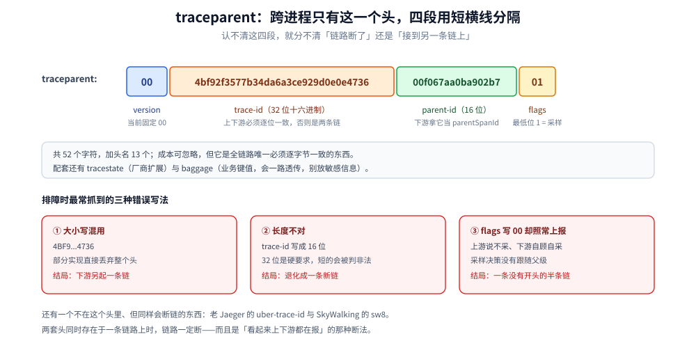

# 采集与传播

> 本篇回答三件事：**span 是谁产生的、凭什么能跨进程接上、为什么经常接不上**。前者决定你写多少代码，中间那件事只有一个头（`traceparent`）的四个字段，后者是排障里 80% 的「链路断成两段」。
>
> 不覆盖：Collector 里有哪几个 processor、怎么部署（见 [架构与部署.md](架构与部署.md)）；落库后的字段与表（见 [数据模型与查询.md](数据模型与查询.md)）。各语言的具体写法在 `01-编程语言/{go,java}/可观测性/接入Jaeger.md`。
>
> 实测环境：`jaegertracing/jaeger:2.20.0` + ClickHouse 26.3（单机两容器）。**本轮没有起业务进程**，链路是手工构造 OTLP/HTTP JSON 投递的；尾部采样的读写结果为本机实测，SDK 侧行为按 OTel 规范陈述。

---

## 一、谁产生 span：三条路，代价各不相同

**本节要点**：产生 span 只有三条路——**自己写（SDK）**、**让 Agent 替你写（Java Agent）**、**让基础设施替你写（Mesh）**。三者不互斥，但**同一个入口只能选一条**，否则同一次请求会出现两份 span。

| 路线 | 谁在埋点 | 覆盖范围 | 代价 |
|---|---|---|---|
| **OTel SDK 显式埋点** | 业务代码 / 中间件插件 | 你包了哪层就有哪层 | 要写代码、要管初始化顺序；但**语义最准**（能标业务属性） |
| **OTel Java Agent** | 字节码增强 | 常见框架（Spring、JDBC、Kafka…）开箱即用 | 几乎零改码；但版本矩阵敏感、自定义框架要写扩展 |
| **Mesh / eBPF** | Sidecar 或内核 | 进程间流量 | 应用内看不到；无业务语义（拿不到 `user_id`） |

⭐ 判据：**先问「这条链要回答什么问题」**。要回答「哪个接口慢」→ SDK 埋点 + 框架插件就够；要回答「上线后没改一行代码也得有链路」→ Agent；要回答「跨语言、跨老系统、连改配置都难」→ Mesh。

## 二、`traceparent` 的四个字段：跨进程只有这一个头

**本节要点**：跨进程接链靠 W3C Trace Context，只有一个头 `traceparent`，**四段用 `-` 分隔，小写十六进制**。认不清这四段，就分不清「链路断了」还是「接到了另一条链上」。

```text
traceparent: 00-4bf92f3577b34da6a3ce929d0e0e4736-00f067aa0ba902b7-01
             │  └────────────── 32 位 ──────────────┘ └─ 16 位 ─┘ │
             │              trace-id                    parent-id  │
             └ version                                          flags
```

| 字段 | 长度 | 含义 | 判据 |
|---|---|---|---|
| `version` | 2 位十六进制 | 当前固定 `00` | 读到 `ff` 是非法值；其它版本按「前向兼容」只解析已知部分 |
| `trace-id` | 32 位十六进制 | 整条链的 ID | **全 0 非法**；上下游必须完全一致，否则就是两条链 |
| `parent-id`（span-id） | 16 位十六进制 | 上游那个 span 的 ID | **全 0 非法**；下游新建 span 时用它当 `parentSpanId` |
| `flags` | 2 位十六进制 | 最低位 = sampled | `01` = 采样、`00` = 不采；⚠️ 这个位是**上游的采样决策**，下游要尊重 |



图里右侧三种错误写法是排障时最常抓到的：**大小写混用**（`4BF9...` 部分实现直接丢弃）、**长度不对**（32 位写成 16 位，退化成新链）、**flags 写 `00` 却照常上报**（下游全采、上游全丢，出现「半条链」）。

配套还有两个头，容易混：

| 头 | 作用 | 常见误用 |
|---|---|---|
| `tracestate` | 厂商扩展的键值列表，随链路透传 | 当成业务参数用；它**不是** Baggage，别塞 `tenant_id` |
| `baggage` | 业务键值，跨服务透传（如 `tenant_id=42`） | ⚠️ 会一路透传到所有下游与第三方，**敏感信息别放** |

⭐ 一段 `traceparent` 的实测样本（本机投递用的就是这一条）：`00-4bf92f3577b34da6a3ce929d0e0e4736-00f067aa0ba902b7-01` —— 52 个字符，加上头名 13 个，成本可以忽略；**它是唯一必须逐字节一致的东西**。

## 三、上下文在进程内怎么活下来

**本节要点**：`traceparent` 解决「跨进程」，进程内靠**上下文对象**（Go 的 `context.Context`、Java 的 `Context`/MDC）。**上下文不会自己跟着线程/协程走**——这是断链的第一大来源。

| 场景 | 会怎样 | 正确做法 |
|---|---|---|
| Go 起 goroutine 时没传 `ctx` | 新 goroutine 里 `SpanFromContext` 拿到 noop，**新起一条根链** | 把 `ctx` 作为第一个参数传进去，不要用闭包外的变量 |
| Java 用线程池 / `CompletableFuture` | `Context.current()` 在新线程里为空，`trace_id` 丢 | 用 `Context.wrap` / 上下文传播的执行器；日志侧用 MDC 也要手工搬 |
| 定时任务 / 消费者入口 | 没有上游，**不会有 span** | 入口手动建根 span（`tracer.Start` 后立刻 `defer span.End()`） |
| 中间件回调里取 context | 框架自建了 `context.Background()` | 用框架提供的 ctx（Gin 的 `c.Request.Context()`） |

⚠️ 有一类断链**日志看得见、链路看不见**：日志里 `trace_id` 有值，Jaeger 里查不到那条链——这通常是「span 建了但没 `End()`」，span 不上报（见第七节）。

## 四、三处采样点：先定「在哪丢」，再定「丢多少」

**本节要点**：采样可以在**三个位置**发生，语义完全不同：SDK（头部，父子一致）→ Collector 概率（也是头部，但换了决策者）→ Collector 尾部（看完整条链再决定）。**只有最后一种能保证「错误全留」**。

| 位置 | 配置 | 判据 | 代价 |
|---|---|---|---|
| ① SDK 头部 | `ParentBased(TraceIDRatioBased(0.05))` | 同一 trace 的父子决策一致，不会「上游有、下游无」 | 丢弃不可逆：被丢的那条链**永远**看不到错误详情 |
| ② Collector 概率 | `probabilistic_sampler`（`sampling_percentage` + `hash_seed`） | 多个服务把决策权集中到一处，改比例不用改应用 | 仍是头部语义；`hash_seed` 不一致会导致同一 trace 在不同实例上判定不同 |
| ③ Collector 尾部 | `tail_sampling`（按 `status_code` / `latency` / `string_attribute` …） | ⭐ **错误与慢请求 100% 保留**，正常请求抽样 | 要缓存整条 trace 等它到齐（`decision_wait`），内存与延迟都涨；多副本时**同一 trace 必须进同一个实例** |

⭐ 生产推荐组合：**SDK 层 `ParentBased(TraceIDRatioBased(1.0))` 全采 → Collector 尾部采样决定留不留**。这样 SDK 不做不可逆决策，比例调整只改 Collector。

本机对尾部采样的实测（`decision_wait: 2s`，策略 `status_code: [ERROR]`）：

```yaml
processors:
  tail_sampling:
    decision_wait: 2s
    num_traces: 100
    policies:
      - name: only-errors
        type: status_code
        status_code:
          status_codes: [ERROR]
```

```text
tail-ok  -> HTTP 200      ← 客户端侧一切正常
tail-err -> HTTP 200      ← 客户端侧同样正常
# 落库结果（ClickHouse 实查）
tail-err  bbbb1111222233334444555566667777  Error
# tail-ok 那条：0 行
```

⭐ 这张读数说明两件事：**① 尾部采样对客户端完全透明**（两端都 200，应用不知道自己被丢了）；**② 采样发生在 `exporters` 之前**，所以存储里根本不会有那行。

## 五、链路在哪断：五个断点与各自的特征

**本节要点**：链路断开只有两种结局——**变成两条独立 trace**（换了个 `trace_id`）或**明明同一条 trace 却缺一段**（少几个 span）。两者的排查方向完全不同。

| 断点 | 结局 | 特征 | 修法 |
|---|---|---|---|
| HTTP/RPC 客户端没装 instrumentation | 两条 trace | 下游有独立根 span（`references: []`） | 装 `otelhttp` / Agent；手写时 `Inject` 上下文 |
| 传播头格式不一致（`sw8` / `uber-trace-id` / `traceparent` 混跑） | 两条 trace | 上下游都在报，但 `trace_id` 不同 | 全链路统一一种头；过渡期两边都认 |
| MQ 生产端没 `Inject` | 两条 trace | 消费端是新根 span，且**时间上晚于**生产端 | 发消息前把当前上下文注入消息头（见第六节） |
| 线程池 / 异步没搬上下文 | 两条 trace | 缺的那段起点是个「凭空出现」的根 span | 见第三节 |
| span 建了没 `End()` | 缺一段 | 日志有 `trace_id`，Jaeger 里查不到那一跳 | `defer span.End()`；确认 `Shutdown` 前已结束 |

⭐ 一句话判据：**看「下游是不是根 span」**。`references: []` = 它没认到上游（断点在上游注入或下游提取）；有 `CHILD_OF` 但 `trace_id` 不同 = 不可能，说明你查的是两条链。

## 六、MQ 与异步任务：`Inject` / `Extract` 的位置决定接不接得上

**本节要点**：消息队列**不会自己传上下文**，必须由生产者把上下文写进消息头、消费者读出来。位置错了就是「生产端有 span、消费端另起一条」。

```go
// 生产端：在 Send 之前，用「发送这个动作」的上下文注入
ctx, span := tracer.Start(ctx, "publish order.created")
defer span.End()
msg := &nats.Msg{Subject: "order.created", Data: body, Header: nats.Header{}}
otel.GetTextMapPropagator().Inject(ctx, propagation.HeaderCarrier(msg.Header))
// ↑ 必须在 Send 之前；Send 之后再 Inject 就晚了

// 消费端：从消息头里 Extract 出父上下文，再 Start
parent := otel.GetTextMapPropagator().Extract(context.Background(),
    propagation.HeaderCarrier(msg.Header))
ctx, span := tracer.Start(parent, "consume order.created")
defer span.End()
```

| 场景 | 接线方式 | 注意 |
|---|---|---|
| 队列消费（有生产端） | 生产 `Inject` → 消费 `Extract` | 消费端 span 的父是生产端 span，**跨进程的边**靠这一对 |
| 定时任务（无上游） | 入口自建根 span | 不建的话，任务里的 SQL/HTTP 全是孤立 trace |
| 批量任务 | 每批一个根 span，批内 span 挂它 | 别把整批做成一个 span，耗时会糊成一段 |
| 重试 | 每次重试新 span，`links` 指向前一次 | 用 `Link` 而不是父子，否则重试会被算进同一次耗时 |

## 七、span 什么时候才离开进程

**本节要点**：span **结束时**才进队列，批量导出器再按「条数或时间」打包发出。所以「刚发的请求查不到」通常是正常的，而「进程被杀」会丢最后一批。

| 参数（OTel SDK 默认） | 值 | 影响 |
|---|---|---|
| `BatchSpanProcessor` 队列长度 | `2048` | 队列满时**丢弃**新 span（默认不阻塞业务） |
| 定时导出间隔 | `5000ms` | 最多晚 5s 才到 Collector |
| 单批最大条数 | `512` | 与间隔二者先到先发 |
| 导出超时 | `30s` | 超时即丢，不重试（除非配了重试） |

| 现象 | 原因 | 做法 |
|---|---|---|
| 刚打完日志就查，查不到 | 批处理未到刷新间隔 | 等 5s，或测试期调小 `schedule_delay` |
| 优雅停机后丢最后一批 | 停进程前没 `Shutdown` | `tp.Shutdown(ctx)` 会 flush；K8s 侧留够 `terminationGracePeriodSeconds` |
| 高峰期丢 span 且无报错 | 队列满 + 丢弃策略 | 看 SDK 内部指标 `dropped_spans`；或前置 Collector 削峰 |

⚠️ 与本册相关的另一侧默认值：**Jaeger v2 的 `jaeger_storage_exporter` 默认不重试**（`retry_on_failure.enabled: false`，`print-config` 实测）。所以「SDK 发出去了」≠「落库了」，中间还有一次可能静默丢弃的写入。

## 八、从 `jaeger-client` 迁过来：两套头不能混跑

**本节要点**：老 Jaeger 客户端用私有头 `uber-trace-id`，新 OTel 用 `traceparent`。**两套头同时存在于一条链路上时，链路一定断**——而且是「看起来都在报」的那种断法。

| 项 | `jaeger-client`（已归档） | OTel SDK |
|---|---|---|
| 传播头 | `uber-trace-id: {trace-id}:{span-id}:{parent-id}:{flags}` | `traceparent` + `tracestate` |
| 上报协议 | Thrift（UDP `6831` / HTTP `14268`） | OTLP（`4317`/`4318`） |
| 状态 | ❌ 归档，不再演进 | ✅ 事实标准 |
| 迁移难点 | 存量服务还在发旧头 | 过渡期要么全量切，要么在 Collector 侧同时挂 `jaeger` receiver 兼容 |

⭐ 迁移顺序（本册建议）：**① Collector 侧同时开 `otlp` 与 `jaeger` receiver**（新旧都能进）→ **② 逐个服务把客户端换成 OTel SDK** → **③ 传 `traceparent` 的服务占到多数后，再关掉 `jaeger` receiver**。跳步的后果是「迁移期查不到跨服务链路」，而这段时间恰好最容易出故障。

## 九、属性怎么精简：三处该砍的、两处必须留

**本节要点**：span 的成本几乎全在 attributes 与 events 上。**砍属性的判据不是「有没有用」，而是「能不能从别处补」**。

| 该砍 | 理由 | 替代 |
|---|---|---|
| 请求/响应 body 全文 | 单条 span 能到几十 KB，写爆存储 | 只留长度与哈希；详情进日志 |
| SQL 的参数值 | 高基数 + 敏感信息（手机号、身份证） | 留语句模板（`WHERE id=?`），参数进日志 |
| 大 JSON / 数组属性 | 序列化开销与基数双高 | 拆成少量标量属性，或只留 ID |

| 必须留 | 理由 |
|---|---|
| `http.response.status_code` / `rpc.grpc.status_code` / `db.system` | 尾部采样与检索全靠它们筛 |
| `service.name`（resource 级） | 缺了会变成 `unknown_service`，UI 里混成一坨 |

---

## 校验口径

| 内容 | 状态 |
|---|---|
| `traceparent` 四字段格式与实测样例 | ✅ 样例为本机投递用报文；格式按 W3C Trace Context 规范 |
| 尾部采样「错误留、正常丢、客户端都 200」 | ✅ 本机实跑（`tail_sampling` + `status_code: [ERROR]`，落库仅 1 行） |
| 采样发生在 exporter 之前（存储里看不到被丢的 span） | ✅ 同上，ClickHouse 实查 0 行 |
| SDK 默认值（队列 2048 / 间隔 5000ms / 单批 512 / 超时 30s） | ⚠️ 按 OTel SDK 规范陈述，**本机未起业务进程验证** |
| `BatchSpanProcessor` 队列满时丢弃、优雅停机需 `Shutdown` | ⚠️ 按规范与官方文档陈述，**未实测** |
| Go 的 `Inject` / `Extract` 代码片段 | ⚠️ 按 OTel Go API 写就，**本轮未编译运行**（可运行版本见 [接入Jaeger.md](../../../../01-编程语言/go/可观测性/接入Jaeger.md)） |
| 上下文丢失四场景、五个断点的特征 | ✅ 判据来自本仓多处接入实践；⚠️ 本轮未逐一复现 |
| `uber-trace-id` 格式与迁移顺序 | ⚠️ 按已归档客户端文档陈述，**未做混跑实测** |
| 属性精简的三砍两留 | ⚠️ 经验判据，未做字节对比实验 |

---

## 延伸追问

- **为什么采样决策要「父子一致」？** → 否则下游采了、上游没采，你在 UI 上看到的是**一条没有开头的链**（`references` 指向一个不存在的 span）。`ParentBased` 的意义就是让子 span 无条件跟随父决策。
- **尾部采样多副本时怎么保证同一 trace 进同一实例？** → 按 `trace_id` 做一致性哈希（常由前面的负载均衡器做），否则一条链的 span 散在多个实例的缓存里，每个实例都判不出全貌。
- **`decision_wait` 设多久？** → 要大于「一条链从第一个 span 到最后一个 span 的跨度」。设小了，晚到的 span 会独立成链；设大了，内存与「错误发现延迟」都涨。
- **为什么不建议 SDK 直接做尾部采样？** → SDK 只看得到本进程的 span，看不到整条链；而且决策要有状态缓存，放在进程里等于每个服务各存一份。
- **`baggage` 和 attributes 有什么区别？** → attributes 是「这次操作的事实」，留在本地；`baggage` 是「要带去下游的键值」，会一路透传。放错地方的结果是「该传的没传」或「不该传的泄了」。
- **如果两个服务中间隔着一层 Nginx，链路会断吗？** → 不会断，但**会缺一段**：Nginx 不做 `traceparent` 注入，上游把「调用 Nginx」结束掉、下游另起父链。要补齐就用带 OTel 的网关，或在 Nginx 侧透传并接受「这一段没有 span」。

---

## 关联

- **上游/总纲**：[README.md](README.md) — 本册导读；[架构与部署.md](架构与部署.md) — Collector 的 receiver / processor 怎么配
- **下游机制**：[数据模型与查询.md](数据模型与查询.md) — 这些字段落库后长什么样；[UI与排障.md](UI与排障.md) — 断链在界面上的表现与排查顺序
- **对照/互补**：[协议与数据模型.md](../Skywalking/协议与数据模型.md) — `sw8` 八字段与 `traceparent` 的对照（另一种「把父上下文塞进头里」的方案）
- **落地代码**：[接入Jaeger.md](../../../../01-编程语言/go/可观测性/接入Jaeger.md) — Go 侧 context 传播三条铁律与四类埋点；[接入Jaeger.md](../../../../01-编程语言/java/可观测性/接入Jaeger.md) — Java 侧跨线程传播与 MDC
- **协议侧**：[HTTP与gRPC.md](../../../../02-计算机基础/网络/应用层/HTTP与gRPC.md) — 请求头传播的载体
