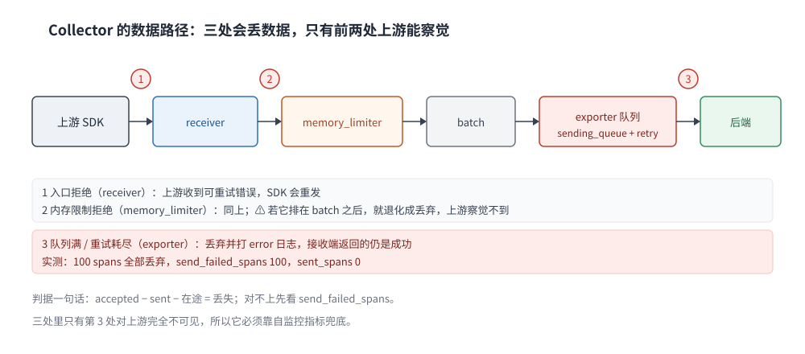
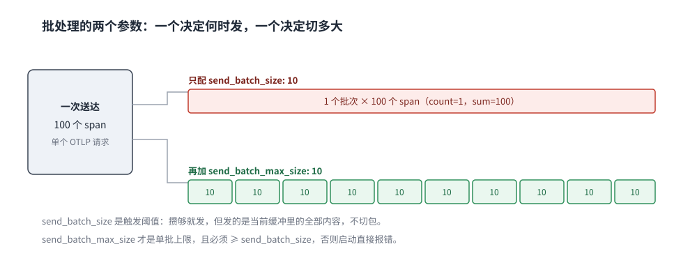

# Collector 配置与调优

> 覆盖：Collector 的配置结构（receiver / processor / exporter / connector 与 pipeline）、处理器顺序为什么决定语义、批处理的两个参数到底谁在切包、队列与重试耗尽后数据丢在哪一步，以及怎么用自监控指标判断「它到底工作没工作」。
>
> 不覆盖：三支柱怎么靠 `resource` / `trace_id` 缝合见 [OpenTelemetry与关联分析.md](OpenTelemetry与关联分析.md)；留哪条、留多少（头采样与尾采样的策略）见 [采样策略.md](采样策略.md)；指标本身的类型与基数控制见 [指标选型对比.md](../指标/指标选型对比.md)；告警规则与燃烧率见 [告警规则与阈值设计.md](../告警与响应/告警规则与阈值设计.md)。
>
> 内容整理自个人学习笔记。**实测环境**：`otel/opentelemetry-collector-contrib:0.157.0`（Docker Desktop，4 核），OTLP/HTTP JSON 注入，全部读数见第五至七节，校验范围见 `## 校验口径`。

---

## 一、一句话定位：Collector 不是转发器，是策略执行点

如果只需要「SDK 把数据送到后端」，中间放一个 Collector 是纯增加一跳。它值得存在的理由是**有些动作只能在这一层做**：

| 能力 | 为什么不能放在 SDK | 为什么不能放在后端 |
|---|---|---|
| **尾部采样**（按结果决定留不留） | SDK 在请求结束时还不知道整条链路的结果 | 后端只能决定「收下之后删掉」，带宽已经付过 |
| **属性清洗 / 脱敏** | 多个语言、多个版本的 SDK 要各改一遍 | 数据已经落库，删不掉 |
| **fanout**（一份数据送多个后端） | 每个 SDK 要配多个 exporter | — |
| **单点队列与重试** | 每个进程各有一份队列，容量不可控 | 后端不可达时没人兜底 |

⭐ **判据**：如果你的需求只有「A 送给 B」，直接 SDK → 后端更简单；只要涉及「按内容决定去哪、留不留、怎么改」，才需要 Collector。

⚠️ 版本坐标很重要：本篇所有读数来自 **0.157.0**。这个版本有两个容易踩的默认值变化——**内部指标不再默认监听 `:8888`**（要显式配 `telemetry.metrics.readers`），以及镜像基于 distroless（**容器里没有 `sh`**，`docker exec` 进不去）。

## 二、核心概念

**本节要点**：Collector 的配置只有一句话能概括——**把若干 receiver 和 exporter 用一条 pipeline 连起来，processor 按数组顺序串在中间**。难的不是语法，是「顺序」与「默认值」。

### 2.1 四种组件与 pipeline

| 组件 | 作用 | 关键约束 |
|---|---|---|
| **receiver** | 收数据（otlp / filelog / prometheus / kafka…） | 每个 receiver 有独立的传输与超时参数 |
| **processor** | 改数据、buffer、判断留不留 | **按 `processors` 数组顺序执行**，顺序即语义 |
| **exporter** | 送出去（otlp / otlphttp / debug / prometheus…） | 自带发送队列与重试，失败不一定冒泡给上游 |
| **connector** | 一条 pipeline 的出口接另一条的入口（如 spanmetrics） | 它在配置里同时出现为 exporter 和 receiver |

一条 pipeline 是 `receivers → processors → exporters` 的三段式，信号类型由 pipeline 名决定（`traces` / `metrics` / `logs`）。⭐ **同一份数据可以进多条 pipeline**（fanout），但每条 pipeline 的 processor 链是独立的。

### 2.2 顺序决定语义

同一个 processor 放前放后，行为完全不同：

| 处理器 | 应该放在 | 放错会怎样 |
|---|---|---|
| `memory_limiter` | **链首**（紧跟 receiver） | 放后面就拦不住入口，只能丢弃已经进入内存的数据 |
| `batch` | **尾端**（紧跟 exporter） | 放前面会让后续 processor 每次只看到一小块，尾采样的整条链路被切碎 |
| `tail_sampling` | `batch` 之前、`memory_limiter` 之后 | 放 `batch` 之后，一个批次里混着多条 trace，判决粒度失控 |
| `attributes` / `filter` | 视目标而定 | 改 `resource` 与改 span 属性用的是不同配置块，改错位置静默无效 |

⚠️ **放错顺序时 Collector 通常不报错**：本篇实测把 `memory_limiter` 放到 `batch` 之后，0.157.0 正常启动、没有任何 warn 日志（第六节）。

### 2.3 三处「背压」与三处「丢弃点」

数据在 Collector 里有三个缓冲位置，各自有独立的溢出行为：

| 位置 | 满了以后 | 谁会知道 |
|---|---|---|
| receiver → pipeline | 拒绝（`refused_spans`），SDK 收到可重试错误 | 上游 SDK 会重试 |
| memory_limiter 触发 | 拒绝后续数据 | 上游 SDK 会重试 |
| exporter 的 sending_queue | 入队失败或队列满后丢弃 | **上游不知道**，数据静默消失 |
| exporter 重试耗尽 | 丢弃并打 error 日志 | 上游不知道 |

⭐ 这张表的用途：**排查「数据少了」时，先判断它是被拒绝（上游有重试）还是被丢弃（上游以为成功）**。两者在 SDK 侧的观感完全不同。

## 三、整体架构：一条 trace 经过什么



图上从左到右是一条 pipeline：receiver 收下后交给 processor 链，最后进 exporter 的队列。三个红色标记是真正会丢数据的位置——入口拒绝、内存限制拒绝、队列与重试耗尽；只有前两处会让上游察觉。

### 3.1 fanout：一份数据进多条 pipeline

```yaml
service:
  pipelines:
    traces:
      receivers: [otlp]
      processors: [memory_limiter, batch]
      exporters: [otlphttp/primary, otlphttp/backup]
    traces/sampling:
      receivers: [otlp]
      processors: [memory_limiter, tail_sampling, batch]
      exporters: [otlphttp/cheap]
```

同一个 `otlp` receiver 可以被多条 pipeline 引用，Collector 会各送一份。⚠️ **多一条 pipeline 就多一份内存与 CPU**：尾采样那条要在内存里攒整条链路，fanout 到三条就是三份开销。

### 3.2 connector：把 traces 变成 metrics

`spanmetrics` 这类 connector 在 `traces` pipeline 里当 exporter，在 `metrics` pipeline 里当 receiver，一次配置同时改变两条 pipeline 的方向。它解决的是「不想为了 RED 指标另跑一套 agent」的问题，代价是**聚合键一旦设计错，指标基数立刻爆炸**（见 [指标选型对比.md](../指标/指标选型对比.md) 第一节）。

## 四、部署：最小可运行配置

**本节要点**：先跑通一条 debug pipeline，再谈调优；同时把自监控端点显式配上，否则出问题时什么都看不到。

### 4.1 最小配置

```yaml
receivers:
  otlp:
    protocols:
      http:
        endpoint: 0.0.0.0:4318

processors:
  memory_limiter:
    check_interval: 1s
    limit_mib: 400
  batch:
    send_batch_size: 10
    timeout: 2s

exporters:
  debug:
    verbosity: basic

service:
  telemetry:
    metrics:
      level: detailed
      readers:
        - pull:
            exporter:
              prometheus:
                host: 0.0.0.0
                port: 8888
  pipelines:
    traces:
      receivers: [otlp]
      processors: [memory_limiter, batch]
      exporters: [debug]
```

启动成功的判据是日志里两行：

```text
info  memorylimiter@v0.157.0/memorylimiter.go:109  Memory limiter configured  {"limit_mib": 400, "spike_limit_mib": 80, "check_interval": 1}
info  service@v0.157.0/service.go:282  Everything is ready. Begin running and processing data.
```

⚠️ **`spike_limit_mib` 不是你配的**：只给 `limit_mib: 400` 时，Collector 自动取 20% 即 80 MiB 作为「软限与硬限之间的余量」，日志里能直接读到。

### 4.2 自监控端点必须显式配

0.157.0 里 `service.telemetry.metrics.level` 只控制**指标详略**，不再顺带打开 `:8888`。不写 `readers` 时，端口根本没有监听——本机实测 `curl :18888/metrics` 返回 `status=000`，而加上上文的 `readers` 配置后立刻变成 `200`。

```text
$ curl -s http://127.0.0.1:18888/metrics | grep -E "^otelcol_receiver_accepted_spans"
otelcol_receiver_accepted_spans{receiver="otlp",transport="http"} 100
```

### 4.3 镜像形态

官方 contrib 镜像基于 distroless：**没有 `sh`、没有 `wget`、没有 `curl`**。本机实测 `docker exec otel-basic sh` 直接报 `exec: "sh": executable file not found in $PATH`。排查只能靠 `docker logs` 与 `:8888/metrics` 两个入口——这也是为什么 4.2 的自监控必须配。

## 五、使用一：批处理——`send_batch_size` 不负责切包

**本节要点**：`send_batch_size` 是「攒够这么多就发一次」的**触发阈值**，它不会把已经到达的一个大包切开；真正限制单批上限的是 `send_batch_max_size`。

### 5.1 实测：100 个 span 进，1 个批次出

配置只有 `send_batch_size: 10`、`timeout: 2s`，一次 POST 送入 100 个 span：

```text
$ curl -s -H 'Content-Type: application/json' --data-binary @traces-basic.json \
    http://127.0.0.1:14318/v1/traces
{"partialSuccess":{}}

$ curl -s http://127.0.0.1:18888/metrics | grep batch_send_size
otelcol_processor_batch_batch_send_size_sum{processor="batch"} 100
otelcol_processor_batch_batch_send_size_count{processor="batch"} 1
```

`count=1 / sum=100` 说明**一次就发出去了 100 个**，`send_batch_size: 10` 完全没起作用。debug exporter 的日志同样只有一行 `"spans": 100`。

### 5.2 加上 `send_batch_max_size` 才会切



图上两个批次的对比是同一份 100 span 输入：只配 `send_batch_size` 时攒够就整包发出（1 批 × 100），加上 `send_batch_max_size: 10` 后才被切成 10 批 × 10。注意这是「切包」而不是「攒包」的区别——`max_size` 不改触发时机，只改单批上限。

```text
$ curl -s http://127.0.0.1:18889/metrics | grep batch_send_size
otelcol_processor_batch_batch_send_size_sum{processor="batch"} 100
otelcol_processor_batch_batch_send_size_count{processor="batch"} 10
```

### 5.3 两个参数有大小约束

`send_batch_max_size` 必须 ≥ `send_batch_size`（默认 8192）。只写 `max_size: 100` 而不管 `send_batch_size` 会直接启动失败：

```text
Error: invalid configuration: processors::batch: send_batch_max_size must be greater or equal to send_batch_size
```

⭐ 实践口径：**`send_batch_size` 设成期望的批大小，`send_batch_max_size` 设成它的 1~2 倍**。只设前者，遇到上游一次推大包时仍然会发出巨包；只设后者，会先攒到默认的 8192 才触发。

## 六、使用二：内存保护——顺序错了不会报错

**本节要点**：`memory_limiter` 的价值在于「在数据进入 pipeline 之前就拒绝」，一旦它排在 `batch` 之后，拒绝动作发生在缓冲之后，保护就从「背压」退化成「丢数据」，而配置本身仍然合法。

### 6.1 它靠什么工作

`limit_mib` 是硬限，`spike_limit_mib`（默认 20%）是软限的余量：内存超过软限时开始拒绝新数据，给 GC 与在途请求留出回落空间。`check_interval` 决定采样频率——1s 意味着**尖峰可以在这 1 秒内冲过软限**。

### 6.2 放到 `batch` 之后：照常启动

把 pipeline 写成 `processors: [batch, memory_limiter]` 后，本机实测：

- 启动正常，日志里 `Memory limiter configured` 与 `Everything is ready` 都在；
- `docker logs | grep -iE "warn|error"` **没有任何输出**；
- 内存压力下它仍然会「限制」，只是限制的是已经进入 `batch` 缓冲的数据，表现为**丢弃**而不是让上游重试。

⚠️ 这类错误只能靠配置评审发现，不能指望启动日志。检查办法：对每条 pipeline 断言 `processors[0] == "memory_limiter"`。

### 6.3 参数怎么定

| 参数 | 定法 | 错了的后果 |
|---|---|---|
| `limit_mib` | 容器内存上限的 **80%**（留 20% 给 Go 运行时与 OS 页缓存） | 定太接近上限：OOMKill；定太低：频繁拒绝 |
| `spike_limit_mib` | 默认 20%，突发写入多时调大 | 太小：流量尖峰被成片拒绝 |
| `check_interval` | 1s；内存敏感场景可降到 500ms | 太大：尖峰穿过去才发现 |

## 七、使用三：队列与重试——数据丢在最后一跳

**本节要点**：exporter 的队列是**异步**的，接收端返回成功不代表数据已经落地。重试耗尽后数据被丢弃，而**上游收到的一直是成功**。

### 7.1 配置

```yaml
exporters:
  otlphttp:
    endpoint: http://127.0.0.1:9        # 不可达端口
    sending_queue:
      enabled: true
      queue_size: 10
    retry_on_failure:
      enabled: true
      initial_interval: 1s
      max_interval: 2s
      max_elapsed_time: 6s
```

### 7.2 实测：100 个 span 全部丢失

送入 100 个 span（被 `send_batch_max_size: 10` 切成 10 批），等待 12 秒后：

```text
$ curl -s http://127.0.0.1:18890/metrics | grep -E "^otelcol_exporter_(sent|send_failed|queue_size)"
otelcol_exporter_queue_size{data_type="traces",exporter="otlphttp"} 0
otelcol_exporter_send_failed_spans{error_permanent="false",error_type="_OTHER",exporter="otlphttp",...} 100
otelcol_exporter_sent_spans{exporter="otlphttp",...} 0
```

日志侧每批一行，10 行合计 100：

```text
error  internal/queue_sender.go:50  Exporting failed. Dropping data.
  {"error": "no more retries left: failed to make an HTTP request:
   Post \"http://127.0.0.1:9/v1/traces\": dial tcp 127.0.0.1:9: connect: connection refused",
   "dropped_items": 10}
```

⭐ **最该记住的一点**：整个过程里，客户端收到的响应是 `{"partialSuccess":{}}`——按 OTLP 语义这是**完全成功**（`partialSuccess` 的语义见 [OpenTelemetry与关联分析.md](OpenTelemetry与关联分析.md) 2.1 节）。数据在 Collector 内部消失，而 SDK 侧没有任何重试。

### 7.3 队列参数与取舍

| 参数 | 默认 | 调它的代价 |
|---|---|---|
| `queue_size` | 1000 | 调大：抗住更久的后端故障，但内存与恢复后的洪峰一起变大 |
| `retry_on_failure.initial_interval` | 5s | 调小：故障时打后端更狠 |
| `max_elapsed_time` | 5m | 调大：内存驻留更久；调小：短暂抖动就丢数据 |
| 持久化队列（`file_storage`） | 关闭 | 开启后进程重启不丢，但多一次磁盘 I/O，且要挂 volume |

⚠️ **队列不是「不丢」**：它只是把「后端不可达」转换成「内存里等一会儿」。真正的兜底要么是持久化队列，要么是「丢了要能被发现」——后者靠 `otelcol_exporter_send_failed_spans` 告警。

## 八、验证与排查

**本节要点**：先确认「数据真的走完了全程」，再按症状查。Collector 的大多数故障都是**静默的**，所以三组指标比日志更可靠。

### 8.1 三组必看指标

| 指标 | 含义 | 期望关系 |
|---|---|---|
| `otelcol_receiver_accepted_spans` | 收下的量 | ≈ 上游实际发送量 |
| `otelcol_receiver_refused_spans` | 被拒绝的量 | 长期 > 0 → 内存限制或 pipeline 堵塞 |
| `otelcol_exporter_sent_spans` | 送出的量 | 应接近 accepted；差值就是丢的量 |
| `otelcol_exporter_send_failed_spans` | 重试耗尽丢弃的量 | **> 0 必须告警** |
| `otelcol_processor_batch_batch_send_size_count` | 批次数 | 用它核对实际批大小 |

⭐ 判据一句话：**accepted − sent − 在途 = 丢失**。三者对不上，先查 `send_failed_spans` 和 exporter 日志。

### 8.2 故障速查

| 症状 | 先查什么 |
|---|---|
| 后端一条数据都没有，Collector 日志正常 | exporter 的 `endpoint` 是否可达；`send_failed_spans` 是否在涨 |
| 数据量只有预期的一小半 | 上游是否被 `refused_spans` 拒过；是否有第二条采样 pipeline 在生效 |
| 内存持续上涨 | 尾采样的 `num_traces` / `decision_wait` 是否过大；fanout 条数 |
| 改了配置但不生效 | 是否重启了进程（Collector 默认不热加载） |
| `:8888/metrics` 打不开 | 是否配了 `service.telemetry.metrics.readers`（4.2 节） |
| 容器里进不去 | distroless 镜像没有 shell（4.3 节） |

| 排查项 | 命令 |
|---|---|
| 看启动是否完整 | `docker logs <c> 2>&1 \| grep -E "Everything is ready\|Error"` |
| 看待发送积压 | `curl -s :8888/metrics \| grep otelcol_exporter_queue_size` |
| 看实际批大小 | `curl -s :8888/metrics \| grep batch_send_size_sum` |
| 看丢弃总量 | `curl -s :8888/metrics \| grep send_failed_spans` |

## 九、校验口径

> ✅ 本篇读数的校验方式与范围（`otel/opentelemetry-collector-contrib:0.157.0`，Docker Desktop 4 核）：

| 部分 | 状态 | 依据 |
|---|---|---|
| 最小配置启动（4.1） | ✅ 实跑 | 日志 `Everything is ready`；`spike_limit_mib: 80` 由日志读出 |
| 自监控端点（4.2） | ✅ 实跑 | 不配 `readers` 时 `status=000`，配后 `200` |
| distroless 无 shell（4.3） | ✅ 实跑 | `docker exec ... sh` 报 `executable file not found` |
| 批处理读数（5.1、5.2） | ✅ 实跑 | `batch_send_size_count` 1 → 10，`sum` 均为 100 |
| 参数约束报错（5.3） | ✅ 实跑 | 原文 `send_batch_max_size must be greater or equal to send_batch_size` |
| 顺序错不报错（6.2） | ✅ 实跑 | `[batch, memory_limiter]` 正常启动且无 warn/error |
| 队列耗尽丢数据（7.2） | ✅ 实跑 | `send_failed_spans 100`、`sent_spans 0`、10 行 `Dropping data` |
| 持久化队列、connector（3.2、7.3） | ⚠️ 未实测 | 需 volume 与后端配合，按官方文档陈述 |
| 参数定法（6.3） | 经验归纳 | 按官方推荐与容量口径整理 |

## 延伸追问

- **Collector 要不要每个节点部署一个，还是集中部署？** → 分层：节点侧 agent 负责协议转换、批处理与脱敏（就近，省带宽）；网关侧集中做尾采样与 fanout（需要看到整条链路）。两者用同一种配置语言，但职责不同。
- **`memory_limiter` 到底限制的是谁的内存？** → Collector 进程自身的堆内存。它不限制上游 SDK，也不限制下游后端——它只会拒绝，让上游慢下来。
- **为什么 `send_batch_size` 不切包？** → 它的语义是「攒够就发」，发的是当前缓冲里的全部内容；要限制单批上限得用 `send_batch_max_size`。实测见 5.1。
- **队列满了会怎样？** → `sending_queue` 入队失败会被计入发送失败并丢弃；上游看到的仍是成功。要感知必须给 `send_failed_spans` 配告警。
- **尾采样能不能放在网关外面？** → 需要同一 trace 的所有 span 到达同一个实例。要么用 `loadbalancing` exporter 按 traceID 路由，要么所有 span 走同一个后端实例。
- **Collector 支持热加载吗？** → 默认不支持，改配置要重启。需要热加载要靠 `confmap` 的 watch 能力或外部重载机制，版本间行为不一致，别把它当默认能力。

## 关联

- **上游/总纲**：[可观测性选型对比.md](../可观测性选型对比.md) — 三支柱的成本账与存储/可视化选型
- **上游/缝合**：[OpenTelemetry与关联分析.md](OpenTelemetry与关联分析.md) — `resource` 地基、三条缝合线与四个静默断点
- **下游/策略**：[采样策略.md](采样策略.md) — 头采样与尾采样各留多少、错误怎么保、日志与链路怎么对齐
- **对照/互补**：[日志采集管道.md](../日志系统/日志采集管道.md) — 同为采集侧，Fluent Bit 的管道分段与背压口径
- **下游机制**：[指标选型对比.md](../指标/指标选型对比.md) — connector 产出的 RED 指标受基数约束
- **运维/配置**：[VictoriaMetrics/运维与监控.md](../../../数据存储/时序数据库/VictoriaMetrics/运维与监控.md) — 后端侧的接入与自身监控
- **上游/资源**：[容器与编排选型.md](../../../../06-工程实践/部署/容器与编排选型.md) — Collector 的部署形态与资源限制
