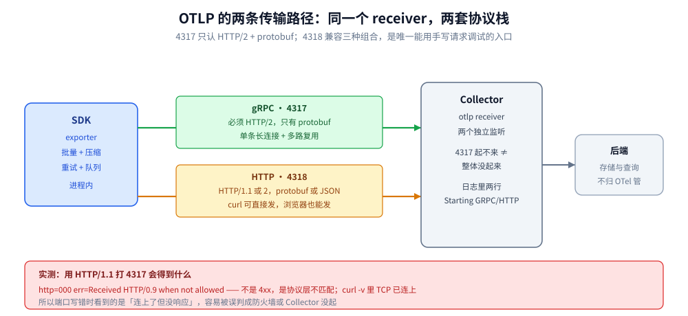
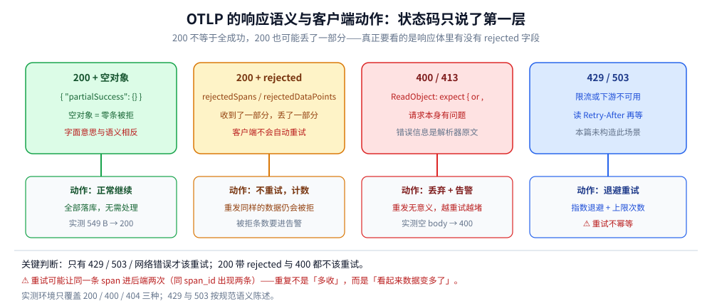

# OTLP 协议与传输机制

> 覆盖：数据怎么真正发出去——OTLP 的报文体三层结构、gRPC（4317）与 HTTP（4318）两条路径的实测差异、protobuf 与 JSON 的体积账、压缩能省多少、响应语义（`200` + `partialSuccess` 到底表示什么）、哪些状态码该重试、批量与连接复用怎么配，以及不写 SDK 用手写请求验证管道的方法。
>
> 不覆盖：数据的字段含义见 [数据模型与上下文传播.md](数据模型与上下文传播.md)；Collector 内部的批处理与队列见 [Collector配置与调优.md](Collector配置与调优.md)；`partialSuccess` 在缝合链路上的后果见 [OpenTelemetry与关联分析.md](OpenTelemetry与关联分析.md) 2.1。
>
> 内容整理自个人学习笔记，实测环境为 OTel Collector contrib **0.157.0**（宿主端口 14317/14318 → 容器 4317/4318）+ Go SDK **v1.46.0** + `curl 8.13.0`，逐项读数见第八节与「校验口径」。

---

## 一、OTLP 为什么不用 JSON 做主线？

OTLP 同时定义了 **protobuf 与 JSON** 两种编码，但规范推荐与各家 SDK 的默认都是 protobuf。原因不是「protobuf 更现代」，而是**同一个载荷的字节数差近三倍**。

### 1.1 体积账：同一份数据，两种编码

用 Go 构造标准的 `ExportTraceServiceRequest`（1 个 resource、1 个 scope、N 个 span，每个 span 带 3 个属性与 1 个事件），分别按 protobuf 与 protojson 序列化，并再各压一次 gzip：

| span 数 | protobuf | JSON | JSON/protobuf | gzip(protobuf) | gzip(JSON) | 压缩后比值 |
| --- | --- | --- | --- | --- | --- | --- |
| 1 | **318 B** | 883 B | **2.78×** | 309 B | 410 B | 1.33× |
| 10 | **2 055 B** | 5 977 B | **2.91×** | 346 B | 487 B | 1.41× |
| 100 | **19 517 B** | 57 007 B | **2.92×** | 651 B | 996 B | 1.53× |

⭐ 三条结论：

- **不压缩时约 2.9 倍**，且随批量增大稳定在 2.9×（不是样本噪声）；
- **gzip 把差距从 2.9× 压到 1.3~1.5×**——因为 JSON 的字段名重复度极高，压缩率远好于 protobuf；
- **但压缩不改变 CPU 账**：JSON 要先拼字符串再压，protobuf 是直接写二进制。带宽省下来的那部分，会在序列化侧花掉。

### 1.2 真正的理由不是体积

| 维度 | protobuf | JSON |
| --- | --- | --- |
| 体积 | 小（~1/2.9） | 大 |
| 序列化开销 | 低（无字段名、无转义） | 高（字符串拼接、浮点格式化） |
| **字段演进** | 加字段不影响旧客户端（字段号机制） | 靠约定，缺字段要靠默认值兜底 |
| 类型安全 | 强（`TraceId` 是 `bytes`，不是字符串） | 弱（数字可能被写成字符串，实测有后端因此解析失败） |
| 可调试性 | 差（要工具解码） | **好（curl 直接看）** |

⚠️ 注意最后一行：**JSON 不是没用，它是「排障用」的编码**。所有「收不到数据」的排查，最后都落在「用 curl 发一条 JSON，看有没有 200」上（第六节）。

---

## 二、一次 OTLP 请求的报文体长什么样？

三类信号各有自己的 `Export*ServiceRequest`，结构完全同构，只是最内层的元素不同：

| 信号 | 请求类型 | 路径（HTTP） | gRPC 方法 | 最内层元素 |
| --- | --- | --- | --- | --- |
| Traces | `ExportTraceServiceRequest` | `/v1/traces` | `TraceService/Export` | `Span` |
| Metrics | `ExportMetricsServiceRequest` | `/v1/metrics` | `MetricsService/Export` | `Metric`（含数据点） |
| Logs | `ExportLogsServiceRequest` | `/v1/logs` | `LogsService/Export` | `LogRecord` |

外层三层是所有信号共用的：

```text
Export*ServiceRequest
└── resource_spans[]        ← 一批「同一个产生者」的数据
    ├── resource            ← service.name / host.name 等（见数据模型篇）
    └── scope_spans[]       ← 一批「同一个库」的数据
        ├── scope           ← SDK 名与版本
        └── spans[]         ← 真正的记录
```

一份最小可用的 OTLP/HTTP JSON（实测 549 B，能成功投递）：

```json
{"resourceSpans":[{"resource":{"attributes":[
  {"key":"service.name","value":{"stringValue":"otel-core-lab"}},
  {"key":"deployment.environment.name","value":{"stringValue":"lab"}}]},
 "scopeSpans":[{"scope":{"name":"lab/manual","version":"1.0.0"},"spans":[{
  "traceId":"4bf92f3577b34da6a3ce929d0e0e4736",
  "spanId":"00f067aa0ba902b7",
  "name":"GET /orders",
  "kind":2,
  "startTimeUnixNano":"1761282000000000000",
  "endTimeUnixNano":"1761282000012000000",
  "attributes":[{"key":"http.request.method","value":{"stringValue":"GET"}}]
 }]}]}]}
```

⚠️ 四个字段是手写载荷最容易写错的地方：

| 字段 | 正确形态 | 写错会怎样 |
| --- | --- | --- |
| `traceId` | 32 位**小写** hex 字符串 | 大写或长度不对 → 被当作无效值接受（不报错） |
| `spanId` | 16 位 hex | 同上 |
| `startTimeUnixNano` | **字符串**形式的纳秒（JSON 里超过 2^53 不能用数字） | 用数字会被截断成科学计数 |
| `kind` | 数字枚举（`2` = SERVER） | 写成 `"SERVER"` 解析失败，返回 400 |

---

## 三、gRPC 与 HTTP 差在哪，该选哪个？



图上两条路径的服务端是**同一个 receiver**，差别在协议栈：左边 gRPC 固定 HTTP/2 + protobuf + 单一长连接；右边 HTTP 支持三种编码、可用 HTTP/1.1、可以是短连接。

| 维度 | gRPC（4317） | HTTP（4318） |
| --- | --- | --- |
| 传输层 | 必须 HTTP/2 | HTTP/1.1 或 HTTP/2 |
| 编码 | 只有 protobuf | protobuf **或** JSON |
| 连接 | 长连接 + 多路复用（一个连接跑多路请求） | 每次可新建；HTTP/2 下也能复用 |
| 独立调试 | 需要 gRPC 工具 | `curl` 直接发 |
| 穿透代理 | ⚠️ 需代理支持 HTTP/2（很多七层代理只到 1.1） | 最兼容 |
| 浏览器直发 | 不能 | 可以（需处理 CORS） |

### 3.1 实测：往 4317 发 HTTP/1.1 会得到什么

这不是「报 4xx」，而是**协议层直接不匹配**：

```text
$ curl -s --noproxy '*' --http1.1 -X POST http://127.0.0.1:14317/v1/traces \
    -H 'Content-Type: application/json' --data-binary @trace.json -w 'http=%{http_code} err=%{errormsg}\n'
http=000 err=Received HTTP/0.9 when not allowed
```

⭐ 判据：**`http_code=000` 且 `errormsg` 提到 HTTP/0.9**，说明对端说的是 HTTP/2（gRPC），而你在用 1.1 说话。这不是网络不通、也不是防火墙——`curl -v` 里能看到 TCP 已经连上。

⚠️ 这也是「端口写错」最常见的表现：把 4317 当成 4318 用，会得到一堆「连接成功但没响应」的假象。

### 3.2 怎么选

| 你的情况 | 选 | 理由 |
| --- | --- | --- |
| 服务端到 Collector，内网、量大 | **gRPC** | 长连接 + 二进制，开销最低 |
| 要过七层代理 / API 网关 / CDN | **HTTP** | 有些代理不支持 HTTP/2 端到端 |
| 浏览器 / 边缘函数直发 | **HTTP + JSON** | 唯一可行组合 |
| 排障、写脚本、做探针 | **HTTP + JSON** | `curl` 就够，不用装 gRPC 工具 |
| 混合环境 | 两条都开 | receiver 同时监听两个端口，互不影响 |

⚠️ 一个反直觉的坑：**同一个 Collector 的 4317 与 4318 是两个独立监听**，只开 4318 时 4317 的 `connection refused` 会被误读成「Collector 没起来」。看日志确认两行 `Starting GRPC server` / `Starting HTTP server`。

---

## 四、服务端说「收下了但有部分被拒」是什么语义？



图上把「HTTP 状态码」与「响应体内的信号」拆成两层——**只看状态码会误判**，这是 OTLP 与普通 REST 最大的一处不同。

### 4.1 实测四种响应的原文

| 请求 | HTTP | 响应体 | 说明 |
| --- | --- | --- | --- |
| 正常 JSON（549 B） | `200` | `{"partialSuccess":{}}` | 全部成功 |
| gzip 压缩后（323 B） | `200` | `{"partialSuccess":{}}` | 压缩不影响语义 |
| 空 body | `400` | `{"code":3,"message":"ReadObject: expect { or , or } or n, but found \u0000, …"}` | 解析失败，**错误信息暴露内部实现** |
| 错误路径 `/v1/trace`（少个 s） | `404` | `404 page not found` | Go 默认 mux 的纯文本 404 |

⭐ 三条判据：

- **`{"partialSuccess":{}}` 的空对象表示「零条被拒」**，不是「部分成功」。字面意思与语义相反，是 OTLP 里最容易误读的一处。
- 只有出现 `rejectedSpans` / `rejectedLogRecords` / `rejectedDataPoints` / `errorMessage` 时才是「收了一部分」。
- **`400` 的 message 是服务端的解析器原文**（`ReadObject: …`），排障时直接搜这段就能定位是 JSON 结构问题。

### 4.2 客户端该不该重试

| 服务端响应 | 客户端应做什么 | 为什么 |
| --- | --- | --- |
| `200` + 空 `partialSuccess` | 正常继续 | 全部落库 |
| `200` + 有 `rejected*` | **不重试**，把被拒条数计入指标 | 重发同样的数据仍会被拒（通常是超限或格式问题） |
| `400` / `413` | **不重试**，丢弃并告警 | 请求本身有问题，重发无意义 |
| `429` | 退避重试（读 `Retry-After`） | 限流，等窗口 |
| `502` / `503` / `504` | 退避重试（读 `Retry-After`） | 下游暂时不可用 |
| 网络错误 / 超时 | 退避重试 | 可能已成功（非幂等风险，见下） |

⚠️ **OTLP 的导出不是幂等的**：重试可能让同一条 span 进后端两次（表现为「同一 `span_id` 出现两条」）。所以重试必须有上限，且后端要能按 `span_id` 去重（多数后端会）。Collector 侧的队列与重试参数见 [Collector配置与调优.md](Collector配置与调优.md) 第七节。

⚠️ 本机的 429/503 未构造出真实环境（需要限流器或故障注入），上表这两行按规范语义陈述，**无本机读数**。

---

## 五、批量、压缩与连接复用怎么配？

这三件事在三个不同位置，各管一段，混起来就会互相抵消：

| 位置 | 参数 | 管什么 | 配错的后果 |
| --- | --- | --- | --- |
| SDK（进程内） | `WithBatcher` 的批量大小 / 间隔 | 什么时候把内存里的 span 打包发一次 | 太小 → 请求数暴涨；太大 → 退出时丢最后一批 |
| 传输层 | 压缩（gzip / zstd） | 单个请求的字节数 | 开在已经过压缩的链路上，纯耗 CPU |
| Collector | `batch` processor | 上游 N 个小请求合成 1 个大请求 | 顺序放错（在 `memory_limiter` 之后）会导致 OOM |

### 5.1 压缩实测

同一份 549 B 的 JSON，gzip 后 323 B（1.70×）；而 100 span 的载荷从 19.5 KB → 651 B（protobuf，**30×**）。

| 场景 | 建议 | 理由 |
| --- | --- | --- |
| 内网、同机房 | 可不压 | 带宽不是瓶颈，省 CPU |
| 跨可用区 / 跨地域 | gzip | 字节数省 30~70% |
| 已经走专线且 CPU 紧张 | 不压，改批量 | 加大批量比压缩更划算 |
| 超大批量（MB 级） | zstd | 压缩比与 CPU 都优于 gzip（⚠️ 本机未实测比值） |

### 5.2 连接复用：一条长连接胜过一切优化

| 做法 | 效果 |
| --- | --- |
| gRPC 复用单连接（默认） | 每进程一个 TCP + 多路复用，开销恒定 |
| HTTP 每次新建连接 | 每批一次 TCP + TLS 握手，跨地域时延被放大 |
| HTTP/2 + `keepalive` | 可复用，但要确认代理不拆连接 |

⚠️ 一个真实陷阱：**Collector 重启后，SDK 的长连接会进入重连退避**，此时数据在队列里排队但看起来「一切正常」。判据是看 SDK 侧的导出错误计数，而不是看进程存活。

---

## 六、不写 SDK 也能造一条合法请求吗？

能，而且这是排障的第一步：**先证明管道通，再怀疑 SDK**。

### 6.1 一条 curl 打通三种信号

```bash
# traces
curl -s --noproxy '*' -X POST http://127.0.0.1:14318/v1/traces \
  -H 'Content-Type: application/json' --data-binary @trace.json \
  -w '\nhttp=%{http_code} upload=%{size_upload} time=%{time_total}\n'

# gzip 后同一条
gzip -c trace.json > trace.json.gz
curl -s --noproxy '*' -X POST http://127.0.0.1:14318/v1/traces \
  -H 'Content-Type: application/json' -H 'Content-Encoding: gzip' \
  --data-binary @trace.json.gz -w '\nhttp=%{http_code} upload=%{size_upload}\n'
```

实测：

```text
http=200 upload=549 time=0.005358
resp={"partialSuccess":{}}

http=200 upload=323 time=0.011460
resp={"partialSuccess":{}}
```

⭐ `upload=549` 与 `upload=323` 就是压缩前后的真实字节数，可以直接用来估带宽（乘以每秒请求数）。

⚠️ **`--noproxy '*'` 不能省**：本机若走 HTTP 代理，`curl` 会把请求发给代理，你会得到 `Received HTTP/0.9`（第三节那种）或代理的 502，而误以为 Collector 有问题。

### 6.2 三步定位「谁的问题」

| 步骤 | 命令 | 通过判据 |
| --- | --- | --- |
| ① 端口通不通 | `curl -s -o /dev/null -w '%{http_code}' --noproxy '*' http://127.0.0.1:14318/v1/traces -X POST -d '{}'` | 不是 `000` |
| ② 载荷合不合法 | 6.1 的完整请求 | `200` + `{"partialSuccess":{}}` |
| ③ 数据到没到后端 | Collector 侧 `debug` exporter 输出 | 有 `ResourceSpans` / `ScopeSpans` / `Span` 打印 |

⭐ 三步的顺序不能反：**先验端口（网络）、再验载荷（协议）、最后验数据（语义）**。跳过第①步直接怀疑 SDK，会在代理、端口、协议三个方向上同时迷路。

---

## 七、应用场景

| 场景 | 关键配置 | 依据 |
| --- | --- | --- |
| 跨地域传输链路数据 | gRPC + gzip + 加大批量 | 1.1 的体积账 + 5.1 的压缩比 |
| 浏览器 / 前端埋点 | HTTP + JSON + CORS | 3.2 的选型表 |
| 过七层网关 | HTTP（可能只能 HTTP/1.1） | 3.1 的协议不匹配实测 |
| 边缘设备（内存小） | 小批量 + 不压缩 | 压缩缓冲会额外占内存 |
| 排障期临时旁路 | HTTP/JSON + `debug` exporter | 六节的三步法 |
| 多后端分流 | Collector 侧多 exporter | 与协议无关，见 [部署架构与最佳实践.md](部署架构与最佳实践.md) |

---

## 八、具体使用

### 8.1 抓一次真实的 gRPC 请求（看协议不匹配）

```bash
# 观察 4317 上到底是不是 HTTP/2
curl -v --noproxy '*' --http1.1 -X POST http://127.0.0.1:14317/v1/traces \
  -H 'Content-Type: application/json' -d '{}' 2>&1 | grep -E 'Connected|using HTTP|HTTP/'
```

实测输出（关键两行）：

```text
* Connected to 127.0.0.1 (127.0.0.1) port 14317
* using HTTP/1.x
```

随后 curl 报 `Received HTTP/0.9 when not allowed`——**TCP 通了、协议不通**，这就是 4317 与 4318 的边界。

### 8.2 用 Go 发一条最小 gRPC 请求

```go
exp, err := otlptracegrpc.New(ctx,
    otlptracegrpc.WithEndpoint("127.0.0.1:4317"),
    otlptracegrpc.WithInsecure(),          // 明文；生产要配 TLS
)
if err != nil {
    return err
}
tp := sdktrace.NewTracerProvider(sdktrace.WithBatcher(exp))
defer tp.Shutdown(context.Background())

_, span := tp.Tracer("probe").Start(ctx, "hello")
span.End()
if err := tp.ForceFlush(ctx); err != nil {
    log.Fatal(err)                          // ⚠️ 不 ForceFlush 就退出，最后一批会丢
}
```

### 8.3 排障三件套

| 症状 | 先查 | 判据 |
| --- | --- | --- |
| `200` 但后端没数据 | 响应体里有没有 `rejected*` | 空对象=全成功；非空=有拒绝 |
| `400` + `ReadObject` | JSON 结构 | 字段名大小写、`*UnixNano` 是否用了字符串 |
| `000` + `HTTP/0.9` | 端口是否 4317 | 换 4318 再试 |
| `502` / 超时 | 中间代理是否支持 HTTP/2 | 改用 HTTP/1.1 + 4318 |
| 数据重复 | 重试策略 | 同 `span_id` 出现两条即重试导致 |

---

## 校验口径

⚠️ 逐块标注真实性来源，不夸大覆盖范围。

| 结论 | 口径 | 读数 / 依据 |
| --- | --- | --- |
| JSON/protobuf 体积比约 2.9× | ✅ 真跑 | 同一 `ExportTraceServiceRequest`：1/10/100 span → 318/883、2055/5977、19517/57007 字节。⚠️ `protojson` 输出非严格确定，同一载荷两次运行为 859 与 883 字节（差 2.8%），比值不受影响 |
| gzip 后差距收窄到 1.3~1.5× | ✅ 真跑 | 309/410、346/487、651/996 字节 |
| HTTP/JSON 直投 200 + 空 `partialSuccess` | ✅ 真跑 | 549 B → `http=200 upload=549 time=0.005358`，响应 `{"partialSuccess":{}}` |
| gzip 请求体被接受 | ✅ 真跑 | `Content-Encoding: gzip`，323 B → `200` |
| 空 body 返回 400 且带解析器原文 | ✅ 真跑 | `{"code":3,"message":"ReadObject: expect { or , or } or n, but found \u0000, …"}` |
| 错误路径返回 404 纯文本 | ✅ 真跑 | `404 page not found` |
| 4317 不接 HTTP/1.1 | ✅ 真跑 | `http=000`，`errormsg=Received HTTP/0.9 when not allowed`；`curl -v` 显示 TCP 已连接 |
| Go SDK 经 gRPC 导出成功 | ✅ 真跑 | `-mode=sdk -endpoint=127.0.0.1:14317` 成功导出 3 条 span，root/child/link 结构正确 |
| `429` / `503` 的重试行为 | ⚠️ 未实测 | 未构造限流或故障注入环境；4.2 表按规范语义陈述 |
| zstd 压缩比 | ⚠️ 未实测 | 本机只跑了 gzip；5.1 结论按「通常优于 gzip」的机制陈述 |
| 浏览器直发 OTLP | ⚠️ 未实测 | 需 CORS 配置与前端环境，本篇只列可行性 |
| gRPC 与 HTTP 的延迟对比 | ⚠️ 未实测 | 只测了单次 HTTP 直投耗时（5.4~11.9 ms，含建连），未做同载荷双路径对照 |

**实测环境**：`dockerproxy.net/otel/opentelemetry-collector-contrib:0.157.0`（宿主 14317→4317、14318→4318，`debug` exporter + `batch` processor）；Go **1.26.5** + `go.opentelemetry.io/otel` **v1.46.0** + `otlptracegrpc` **v1.46.0**；编码对比用 `proto.Marshal` / `protojson.Marshal` 与 `compress/gzip`。实验代码见 `.workbuddy/tmp/otel-core-lab/`（`enc.go` 编码对比、`probe_otlp.sh` 五组探测）。

⚠️ **未覆盖**：TLS / mTLS、zstd、`429`/`503` 的真实退避曲线、浏览器 CORS、gRPC 与 HTTP 的延迟对照。

---

## 延伸追问

- **为什么 OTLP 不直接用 gRPC 一种？** → 因为浏览器发不了 gRPC（需要 HTTP/2 帧与 trailer 控制），而前端埋点是刚需。HTTP + JSON 是唯一能覆盖浏览器的组合。
- **`partialSuccess` 为空对象时，客户端还需要检查别的吗？** → 不需要，空对象就是全成功。但要把「有 `rejected*` 时不算失败」这条写进客户端逻辑，否则会把部分成功当失败重试，反而放大重复数据。
- **protobuf 更小，为什么压缩后差距只剩 1.5 倍？** → JSON 的字段名在同一批数据里高度重复，gzip 的字典几乎能全部命中；protobuf 本来就没有字段名，可压的冗余少。
- **OTLP 是唯一选择吗？** → 不是。Collector 还收 Jaeger / Zipkin / Prometheus 等格式，也能用 `otlphttp` 以外的 exporter 发出去。但「跨语言、跨后端」的通用层只有 OTLP。
- **重试会不会造成重复数据？** → 会。OTLP 导出不是幂等的，网络超时后重试可能让同一 span 进后端两次。后端按 `span_id` 去重是兜底，客户端限次是必须。
- **4317 和 4318 能只开一个吗？** → 能，但要想清楚谁在发。SDK 默认 gRPC，只开 4318 会让所有 SDK 连不上；只开 4317 则浏览器侧无路可走。
- **为什么 `400` 的错误信息里会出现 `ReadObject`？** → 那是 Collector 内部 JSON 解析器的原文（Go 实现），能直接定位到「第 0 字节就有非法字符」。这类原文比自定义错误码有用，排障时别急着格式化掉。

---

## 关联

- **上游/总纲**：[总体架构与核心概念.md](总体架构与核心概念.md) — 本篇对应四段边界里的第②段（首跳）
- **上游/总纲**：[数据模型与上下文传播.md](数据模型与上下文传播.md) — 报文体里那三层嵌套结构的字段定义
- **下游机制**：[Collector配置与调优.md](Collector配置与调优.md) — 收到之后怎么处理：batch、队列、重试与内存保护
- **对照/互补**：[OpenTelemetry与关联分析.md](OpenTelemetry与关联分析.md) — `partialSuccess` 与 `resource` 变形在缝合链路上的后果
- **下游机制**：[部署架构与最佳实践.md](部署架构与最佳实践.md) — 两级拓扑里这两条传输路径各自出现在哪一跳
- **对照/互补**：[HTTP与gRPC.md](../../../../02-计算机基础/网络/应用层/HTTP与gRPC.md) — HTTP/2 多路复用与 trailer 的底层机制
- **下游机制**：[网络分层与数据包旅程.md](../../../../02-计算机基础/网络/网络分层与数据包旅程.md) — 压缩与分片发生在哪一层
