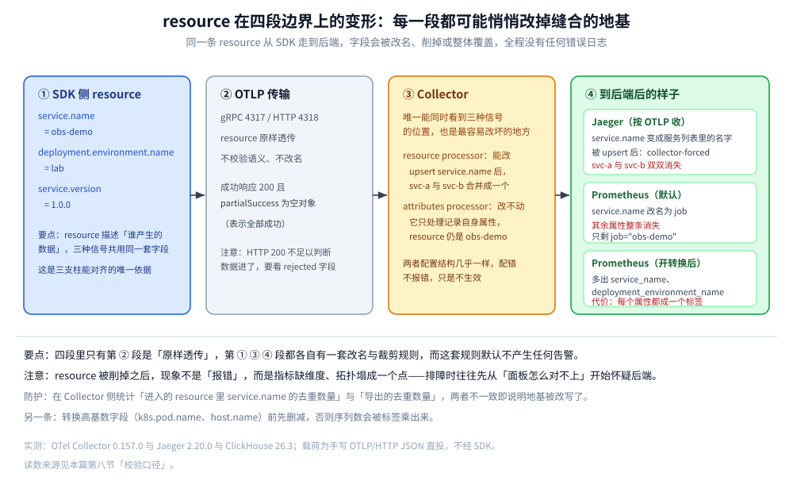
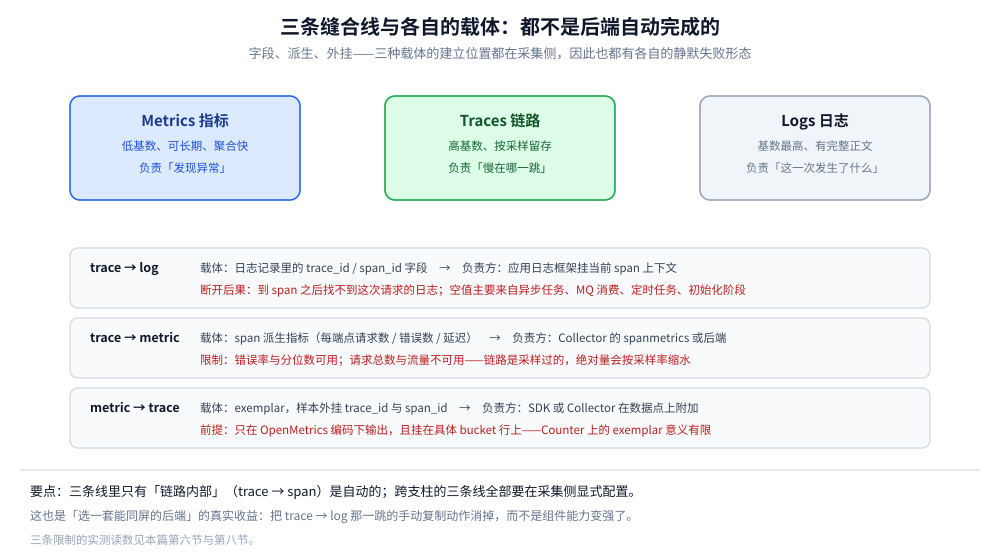
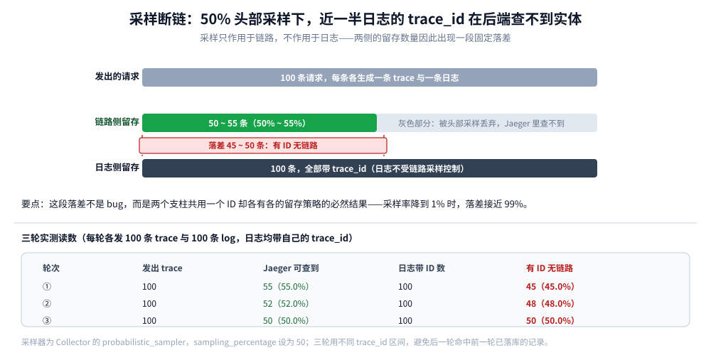

# OpenTelemetry 与跨信号关联分析

> 三支柱各自选完型之后，决定排障效率的**不是单个后端的强弱，而是它们之间那根缝线能不能用**。本篇讲这根线怎么缝：OTel 的分层模型与 OTLP 协议、`resource` 为什么是三条信号共用的地基、三条缝合线（trace→log、trace→metric、metric→trace）各自的载体，以及 **四个会让缝合静默失效的断点**——每个断点都带本机实测读数。
>
> 内容整理自个人学习笔记，实测环境为 OTel Collector **0.157.0** + Jaeger **2.20.0** + ClickHouse **26.3**，载荷用手写 OTLP/HTTP JSON 直投（不经 SDK），逐项读数见第八节。三大支柱各自的选型见 [可观测性选型对比.md](../可观测性选型对比.md)、[指标选型对比.md](../指标/指标选型对比.md)、[链路追踪选型对比.md](../链路追踪/链路追踪选型对比.md)、[日志系统选型对比.md](../日志系统/日志系统选型对比.md)。

---

## 一、三个孤岛：不缝合的代价

不缝合的系统能各自出图，但**排障动线走不通**。一条标准动线是六跳：

```text
告警 → 服务 → 端点 → 链路 → span → 业务日志
```

| 跳 | 靠哪个支柱 | 缝合失败时的症状 |
| --- | --- | --- |
| 告警 → 服务 | 指标 | 告警里只有一行「错误率超阈值」，不知道是哪个服务 |
| 服务 → 端点 | 指标 / 链路 | 知道服务慢，不知道慢在哪个接口 |
| 端点 → 链路 | 链路 | 只有聚合指标，捞不出「那一条」请求 |
| 链路 → span | 链路 | 有链路但缺中间那一跳（传播头断链） |
| span → 业务日志 | ⭐ **缝合** | 到了 span，却找不到这次请求打的那几行日志 |

⚠️ **每多一次手动复制 ID，就多一次复制错、查错时间窗、或者干脆放弃深挖的机会**。线上排障的失败大多发生在这里，而不是组件能力不够——这也是为什么「三个很强的后端 + 零缝合」的实际效果不如「三个中等后端 + 一根好缝线」。

⭐ 缝合的唯一纽带是 **`trace_id`**（以及配套的 `span_id`），而**产生并传递这个 ID 的责任在埋点与采集层**，不在存储层。所以本篇的重点是 OTel 与 Collector，而不是某个后端。

---

## 二、OTel 的分层模型：一条协议、三种信号

OpenTelemetry 的价值不在「又一个 SDK」，而在它把「产生数据」和「处理数据」拆开了：

| 层 | 职责 | 可替换性 | 谁维护 |
| --- | --- | --- | --- |
| **API** | 定义埋点接口（`Tracer`、`Meter`、`Logger`） | 几乎不换（换它等于改业务代码） | 各语言 SIG |
| **SDK** | 实现采样、上下文传播、批量导出 | 可换实现（如换 OTel Go 的 exporter） | 各语言 SIG |
| **OTLP** | 传输协议（gRPC 4317 / HTTP 4318） | ⭐ **这一层标准化，才让后端可替换** | 规范 |
| **Collector** | 接收、处理、路由、导出 | 完全可换（甚至不用） | 发行版（core / contrib / 各家 distro） |

⭐ **关键结构判断**：Collector 是**整个体系里唯一能同时看到三种信号的位置**。采样决策、属性清洗、跨信号派生（如 span → metrics）都只能在这里做——在 SDK 侧做，要改所有服务；在后端做，各家后端接口不同。

### 2.1 OTLP 的一个语义细节：`partialSuccess` 不等于成功

OTLP/HTTP 的成功响应是 **HTTP 200 + `{"partialSuccess":{}}`**。这个「空对象」表示**全部成功**；只有当有数据被拒时，里面才会出现 `rejectedSpans` / `rejectedLogRecords` / `errorMessage`。

```json
{"partialSuccess":{}}
```

⭐ 判据：**只看 HTTP 200 不足以判断数据进了**。本机四组实验的响应都是上面这一行，说明 Collector 全量接收（读数见第八节）。

⚠️ 反过来，`200` 且 `partialSuccess` 里有 `rejected*` 字段时，**客户端不会重试**——被拒的数据就此消失。这是「日志莫名少了」的常见成因之一。

---

## 三、`resource` 是缝合的地基，而它很脆

`resource`（资源属性）描述「**这批数据是谁产生的**」：`service.name`、`service.version`、`deployment.environment.name`、`host.name`、`k8s.pod.name`…… 它在 traces / metrics / logs 三种信号里是**同一套字段**，这就是三支柱能对齐的根本原因。

> 三条信号能「对上号」，靠的不是 ID，而是**同一个 `service.name`**。ID 只能对上「同一次请求」，`service.name` 才能对上「同一批数据属于谁」。

而这块地基在跨协议边界时会被改动，且**全程不报错**。下面四个现象都是本机实测。

### 3.1 resource 进 Prometheus 会被削成 `job`

同一条 OTLP 指标（`resource` 含 `service.name=obs-demo`、`deployment.environment.name=lab`、`service.version=1.0.0`），经 Collector 的 `prometheus` exporter 暴露后：

```text
lab_order_duration_seconds_count{job="obs-demo",otel_scope_name="lab.manual",...} 1
```

⭐ 只剩一个 `job="obs-demo"`：`service.name` 被**改名**成 `job`，而 `deployment.environment.name` 与 `service.version` **整条消失**。

打开 `resource_to_telemetry_conversion` 之后才恢复：

```yaml
exporters:
  prometheus:
    endpoint: 0.0.0.0:8889
    enable_open_metrics: true
    resource_to_telemetry_conversion:
      enabled: true
```

```text
lab_order_duration_seconds_count{deployment_environment_name="lab",job="obs-demo",
  service_name="obs-demo",service_version="1.0.0",...} 1
```

⚠️ **代价是每个 resource 属性都变成一个标签**——`k8s.pod.name`、`host.name` 这类高基数字段一开就会把序列数打上去。正确做法是**只在 Collector 侧保留需要的属性**（用 `resource` processor 先删再转），而不是全量转。

### 3.2 想改 resource，`attributes` processor 改不动

这是一个高频误用：想统一服务名，于是在 pipeline 里加 `attributes` processor 做 `upsert`。实测结果——**ResourceSpans 里的 `service.name` 纹丝不动**：

```text
ResourceSpans #0
Resource attributes:
     -> service.name: Str(obs-demo)      ← 期望变成 collector-forced，实际没变
```

⭐ 原因：`attributes` processor 处理的是 **span / log 记录自身的属性**，`resource` 是另一层，要用 `resource` processor：

```yaml
processors:
  resource/force_service:
    attributes:
      - key: service.name
        value: collector-forced
        action: upsert
```

⚠️ 两者名字接近、配置结构类似（都是 `key` / `value` / `action`），**配错了不报错，只是不生效**。

### 3.3 用对了 processor，也能把两个服务揉成一个

换成 `resource` processor 做 `upsert` 后，实测发两条**不同服务**的链路（`svc-a`、`svc-b`），Jaeger 的服务列表变成：

```text
["obs-demo", "jaeger", "collector-forced"]
```

⭐ `svc-a` 与 `svc-b` **都不见了**，两条链路合并成一个叫 `collector-forced` 的服务。这就是「地基被一行配置毁掉」的具体形态：**所有服务在拓扑图上塌成一个点，跨服务排障直接失效**。



图上从左到右是同一条数据经过的四段：SDK 侧的 resource、OTLP 传输时的原样、Collector 侧可被 `resource` processor 改写、到 Jaeger 与 Prometheus 后各自剩什么。注意 Prometheus 那一段的默认行为——`service.name` 变成 `job`，其余属性整条丢弃，**默认不报错也不告警**。

---

## 四、三条缝合线

三支柱之间不是「两两相连」那么简单，实际存在三条方向不同的线：

| 缝合线 | 载体 | 谁负责建立 | 断了会怎样 |
| --- | --- | --- | --- |
| **trace → log** | 日志记录里的 `trace_id` / `span_id` 字段 | 应用埋点（日志框架挂当前 span 上下文） | 到 span 之后找不到这次请求的日志 |
| **trace → metric** | span 派生指标（span metrics / RED） | Collector（spanmetrics connector）或后端 | 指标里没有「按端点」的延迟，只有整体值 |
| **metric → trace** | **exemplar**（样本外挂 `trace_id`） | SDK / Collector 在指标点上附加 | 从「错误率涨了」不能一步跳到「那条失败的链路」 |



图上是三条线的方向与载体：`trace → log` 靠字段、`trace → metric` 靠派生、`metric → trace` 靠 exemplar。三者都不是「后端自动完成」的，都要在采集侧显式配置，因此也都有各自的静默失败形态。

### 4.1 trace → log：字段有没有值是唯一判据

日志侧的 `trace_id` 有两种状态，**采集层不会替你补**：

```text
Body: Str(order created id=1001)
Trace ID: 4283fefc63f0cd0e873a0000c6d07ef7     ← 在 span 上下文里打的
Span ID: 122b598615dcbe81

Body: Str(log without valid trace context)
Trace ID:                                       ← 空
Span ID:
```

⭐ 只有 `Trace ID` 有值的那条日志能被链路串起来；为空的这条**在链路上永远找不到它**，只能靠时间窗与服务名硬猜。

⚠️ 四个高频丢失场景（`trace_id` 为空的主要原因）：**异步任务 / 线程池 / goroutine 里打印**（上下文没传过去）、**MQ 消费端**（消息头里的 `traceparent` 没 Extract）、**定时任务**（无入站请求，没有父上下文）、**初始化阶段**（TracerProvider 还没建好）。这四处的修法在语言分册里，见 [接入Jaeger.md](../../../../01-编程语言/go/可观测性/接入Jaeger.md)。

### 4.2 trace → metric：派生指标的绝对值不可信

从 span 派生指标（每个端点的请求数、错误数、延迟分布）能补上「按端点的 RED 指标」，但有一个**必须先说清的前提**：

| 派生指标 | 能不能用 | 说明 |
| --- | --- | --- |
| 错误率、P99 这类**比率 / 分位数** | ✅ | 与采样率无关（分子分母同比例缩小） |
| 请求总数、流量这类**绝对量** | ❌ | 链路是采样过的，派生出的计数会按采样率缩水 |
| 容量规划、SLO 的「完成了多少次」 | ❌ | 同上，必须用原生指标 |

⚠️ 这条约束决定了架构：**派生指标只能补充维度，不能替代原生指标**。拿采样链路算 QPS 是典型的错账（见 [链路追踪选型对比.md](../链路追踪/链路追踪选型对比.md) 第七节）。

### 4.3 metric → trace：exemplar 是唯一出口，而它藏在一个编码开关后面

exemplar 是「指标样本上挂一个 `trace_id`」的机制——Grafana 面板上点某个尖峰，能直接跳到那条链路。实测两段：

**① Collector 内部确实保留了 exemplar**（debug exporter 输出）：

```text
Exemplars:
Exemplar #0
     -> Trace ID: 4283fefc63f0cd0e873a0000c6d07ef7
     -> Span ID: 122b598615dcbe81
```

**② 但默认抓取方式看不到它**。同一个 `/metrics` 端点，普通请求只有数值：

```text
lab_order_duration_seconds_bucket{...le="+Inf"} 1
```

带上 OpenMetrics 的 `Accept` 头之后才出现：

```text
lab_order_duration_seconds_bucket{...le="0.5"} 0 # {trace_id="4283fefc...",span_id="122b598615dcbe81"} 0.12 1.792644857703201e+09
```

⭐ 结论有两条：**①** exemplar 必须走 **OpenMetrics 编码**才会输出（Prometheus 抓取侧还要开 exemplar 存储）；**②** exemplar 挂在**具体的 bucket 行**上，不是挂在指标名上——所以只有 Histogram 这类分桶指标能携带它，Counter 上的 exemplar 意义有限。

⚠️ 症状：面板上「exemplar 开关」打开了却没有点可点。原因通常不是没产生 exemplar，而是**文本编码退回了 Prometheus 格式**。

---

## 五、一次完整的关联查询：六跳里哪几跳是自动的

把三条线串起来，看标准动线每一跳的自动化程度：

| 跳 | 自动还是手动 | 依赖什么 |
| --- | --- | --- |
| 告警 → 服务 | 半自动 | 告警规则里带 `service` 标签 |
| 服务 → 端点 | 半自动 | 有按端点的指标（原生或派生） |
| 端点 → 链路 | ⚠️ **手动** | 靠 exemplar（有就一键，没有就按时间窗筛） |
| 链路 → span | 自动 | 同一条 trace 的结构化数据 |
| span → 日志 | ⚠️ **手动**（除非同一套 UI） | 复制 `trace_id` 去日志后端查；SkyWalking 的日志面板除外 |
| 全链路 → 成本 | 手动 | 三支柱各自的容量数据 |

⭐ 判据：**能自动走完的只有「链路内部」那一跳**。其余每一跳都要么靠配置（exemplar / 同源 UI）、要么靠人。所以「选一套能同屏的后端」的收益，本质是**把后两跳的手动动作消掉**——这正是 SkyWalking 这类一体化 APM 在中小团队里的真实优势（对照见 [可观测性选型对比.md](../可观测性选型对比.md) 第六节）。

---

## 六、四个静默断点：全都不会报错

这一节是本篇的核心。四个断点的共同特征：**采集链路一切正常、HTTP 全是 200、日志里没有 error，但缝合已经断了**。

### 6.1 断点一：采样丢掉的链路，日志里还留着 ID

这是最普遍、也最容易被误解的一条。头部采样 50% 的实测（三轮，各发 100 条 trace + 100 条 log，每条日志都带自己的 `trace_id`）：

| 轮次 | 发出 trace | Jaeger 可查到 | 日志带 ID 数 | **有 ID 无链路** |
| --- | --- | --- | --- | --- |
| ① | 100 | **55**（55.0%） | 100 | **45**（45.0%） |
| ② | 100 | **52**（52.0%） | 100 | **48**（48.0%） |
| ③ | 100 | **50**（50.0%） | 100 | **50**（50.0%） |

⭐ 读数解读：采样率 50% 时，**近一半的日志带着一个查不到实体的 `trace_id`**。这不是 bug——日志不受链路采样控制，采样只作用于链路。后果是：排障时从日志里的 ID 跳过去，一半概率是空页面。



图上左右两边是同 100 条请求：链路侧只剩 50~55 条，日志侧 100 条全在且都带着 `trace_id`。中间那条虚线就是「有 ID 无链路」的落差——它随采样率线性放大，采样率降到 1% 时落差接近 99%。

⚠️ **对这条断点的正确态度不是「提高采样率」**（成本会炸），而是：
- **错误请求强制保留**（尾部采样按 status / 耗时决策），保证最需要的那部分链路一定在；
- 从日志往链路跳时，**接受「查不到」并回落到日志本身**——日志有完整正文，很多时候已经够了；
- 若要「链路上一定查得到」，那就得让日志也按 trace 采样（按 `trace_id` 的哈希决定要不要打），保证两侧一致。

### 6.2 断点二：resource 被削掉或改写

见第三节实测。三种形态：**默认削成 `job`**（丢维度）、**用错 processor 改不动**（不生效）、**用对 processor 全揉成一个服务**（毁拓扑）。三者都无告警。

⚠️ 防护手段：在 Collector 加一条自检——统计「进入的 resource 里 `service.name` 的去重数量」与「导出的去重数量」是否一致。数量塌了就是被改写了。

### 6.3 断点三：无效 `trace_id` 被接受，落库成脏数据

OTLP 规范里全 0 的 `trace_id` 是无效值，按预期应当被拒绝。实测结果是**接受并落库**：

```text
POST /v1/traces  →  200  {"partialSuccess":{}}
```

回读这条「链路」时得到：

| 字段 | 期望 | 实际回读 |
| --- | --- | --- |
| `traceID` | 32 位十六进制 | **`0000000000000000`（只剩 16 位）** |
| `operationName` | `GET /orders` | **空字符串** |
| `duration` | 12 ms（12,000,000 ns） | **18444951428939004006 ns（约 584 年）** |
| 自定义 attributes | `http.request.method` / `url.path` | **丢失，只剩 `otel.scope.name`** |

⭐ 这条比「被拒绝」更危险：**它查得到，而且会进服务列表、进拓扑、进聚合统计**。一条 584 年的 span 足以把 P99 和「最慢链路」榜单彻底带偏，而没有任何一条错误日志。

⚠️ 防护：在 Collector 用 `filter` processor 显式丢弃无效 trace_id，别依赖上游 SDK 的自觉。同样的问题也会出现在「传播头解析失败但没报错」的场景——`traceparent` 格式错时，多数实现是**静默生成新 ID**，表现为「链路在这里另起一条」。

### 6.4 断点四：exemplar 的编码依赖

见 4.3 节实测。exemplar 在 Collector 里存在、在 OpenMetrics 里存在、在默认 Prometheus 文本里**不存在**。三处任何一处不通，面板上就没有可点的点。

### 6.5 四个断点汇总

| 断点 | 静默表现 | 一条可执行的验证 |
| --- | --- | --- |
| 采样 | 从日志跳链路查不到 | 抽样统计「带 trace_id 的日志中，后端能查到实体的比例」 |
| resource 改写 | 拓扑塌成一个点 / 指标缺维度 | 对比进出的 `service.name` 去重数 |
| 无效 trace_id | 出现超长 duration 的怪异链路 | 用 `filter` 丢弃全 0，并统计被丢条数 |
| exemplar 编码 | 面板上无点可点 | `curl -H 'Accept: application/openmetrics-text' /metrics` 看有无 `# {trace_id=...}` |

---

## 七、缝合放在哪一层做

| 做法 | 优点 | 缺点 | 适用 |
| --- | --- | --- | --- |
| **SDK 侧直接导出到各后端** | 少一跳，延迟低 | 采样与属性清洗要改所有服务；换后端要改所有服务 | 单服务、实验阶段 |
| ⭐ **SDK → Collector → 各后端** | 采样 / 清洗 / 派生集中在一处；后端可替换 | 多一跳；Collector 本身要 HA | 绝大多数生产环境 |
| **Collector 只做转发**（默认配置） | 最简单 | 浪费了唯一能跨信号处理的位置 | 不建议 |
| **Agent 模式**（每机一个 Collector） | 就近收敛，减少出网 | 全局决策（尾部采样）要再上一层 | 大规模、多机房 |

⭐ **一条硬建议**：把「采样率」与「resource 归一」放在 Collector，不要放 SDK。理由是这两件事**都要随着系统规模反复调整**，而 Collector 改一次配置就能全局生效，SDK 侧要发版。

---

## 八、校验口径

⚠️ 逐块标注本节的真实性来源，不夸大覆盖范围。

| 结论 | 口径 | 读数/依据 |
| --- | --- | --- |
| OTLP 三信号接收正常 | ✅ 真跑 | `/v1/traces`、`/v1/logs`、`/v1/metrics` 均 HTTP 200 + `{"partialSuccess":{}}`；Jaeger 按 `trace_id` 回读 1 条；`/metrics` 暴露 4 行（2 bucket + sum + count） |
| `service.name` 默认变成 `job`、其余 resource 属性丢失 | ✅ 真跑 | 默认配置下只有 `job="obs-demo"`；开 `resource_to_telemetry_conversion` 后出现 `service_name` / `deployment_environment_name` / `service_version` |
| `attributes` processor 改不动 resource | ✅ 真跑 | `upsert service.name` 后 debug 输出仍为 `Str(obs-demo)` |
| `resource` processor 会把多服务揉成一个 | ✅ 真跑 | 发 `svc-a` / `svc-b` 两条链路，Jaeger 服务列表出现 `collector-forced`，两者消失 |
| 50% 头部采样导致近半日志无链路 | ✅ 真跑 | 三轮 100 条：留 55 / 52 / 50 条，对应无链路 45 / 48 / 50 条 |
| 全 0 trace_id 被接受并落库成脏数据 | ✅ 真跑 | 200 + 空 `partialSuccess`；回读 `traceID` 16 位、`operationName` 空、`duration` 18444951428939004006 ns |
| exemplar 只在 OpenMetrics 编码下输出 | ✅ 真跑 | 带 `Accept: application/openmetrics-text` 时出现 `# {trace_id="...",span_id="..."}`，否则无 |
| 日志 `trace_id` 为空 / 有值两态 | ✅ 真跑 | 无上下文的日志 `Trace ID:` 为空（非全 0）；在 span 上下文里的与 span 的 ID 一致 |
| span metrics（spanmetrics connector） | ⚠️ 未实测 | 本机 distro 未包含该 connector，4.2 节按「采样导致绝对量失真」的机制陈述，无读数 |
| 尾部采样「错误留、正常丢」 | 📖 引用他篇 | 读数见 [采集与传播.md](../链路追踪/Jaeger/采集与传播.md) |
| 四层模型与部件职责 | 📖 官方文档 | 无本机读数，属概念陈述 |

**实测环境**：`otel/opentelemetry-collector:0.157.0`（含 contrib 组件）+ `jaegertracing/jaeger:2.20.0`（`--feature-gates=storage.clickhouse`）+ `clickhouse/clickhouse-server:26.3-alpine`，三容器同网络；载荷为手写 OTLP/HTTP JSON 直投 Collector 的 4318（宿主 14318/14319 两个实例，其一带 `resource` 与 `resource_to_telemetry_conversion` 的对照配置），不经任何语言 SDK。实验脚本与配置见 `.workbuddy/tmp/otel-lab/`。

⚠️ **未覆盖**：真实 SDK 的上下文传播（本篇全部用手写 JSON，绕过了 SDK 的传播逻辑）、spanmetrics connector、Loki/ES 侧的日志落库、Grafana 的 exemplar 渲染效果。

---

## 九、延伸追问

- **三支柱怎么关联起来？** → 唯一纽带是 `trace_id`：日志写进字段、指标挂 exemplar、跨进程用 W3C `traceparent` 传递。⚠️ 全链路头格式必须统一，混用 `sw8` / `uber-trace-id` / `traceparent` 会断链。
- **为什么缝合的责任在采集层而不是后端？** → 后端只能处理「已经到它这里的数据」；采样决策、resource 归一、跨信号派生都发生在数据到达后端之前。Collector 是唯一同时看到三种信号的位置，所以这些事集中在这里做。
- **`resource` 和 span attributes 有什么区别？** → `resource` 描述「谁产生的数据」（进程 / 服务 / 主机），三条信号共用、生命周期与进程一致；span attributes 描述「这一次操作做了什么」（HTTP 方法、状态码）。⚠️ 两者用错 processor 时**都不报错**，只是不生效。
- **采样率 50% 时日志里的 trace_id 还有用吗？** → 有，但只能当「去重键」与「弱关联键」：查不到链路时，仍可用它在日志后端把同一次请求的多个服务日志聚在一起（前提是日志都带 ID）。这也是「日志侧按 trace_id 聚合」比「链路侧」更抗采样的原因。
- **exemplar 能用在高基数指标上吗？** → 不能。exemplar 挂在具体样本上，而高基数指标本身就是问题（见 [指标选型对比.md](../指标/指标选型对比.md) 第一节）。它适合「低基数但关心个别慢请求」的指标，如按端点聚合的延迟直方图。
- **Collector 要不要 HA？** → 要，但它不是有状态组件：多副本 + 前置负载均衡即可。⚠️ **尾部采样除外**——尾采需要有状态地等整条链结束，多副本下必须按 `trace_id` 路由到同一副本，否则同一链路的 span 会被不同副本各自决策。
- **SkyWalking 的 OTel 兼容通道能替代 Collector 吗？** → 只能接收，不能替代。它的 OTLP 接收面复用 11800（不是 4317），且 `otlpTraceSampleRate` 的分母是**一万**，边界见 [集成与生态.md](../链路追踪/Skywalking/集成与生态.md) 第二节。

---

## 关联

- [可观测性选型对比.md](../可观测性选型对比.md) — 上游总纲：三支柱的成本结构、存储后端、可视化告警与三套推荐组合
- [指标选型对比.md](../指标/指标选型对比.md) — 指标侧的基数控制与 Pull/Push 取舍（exemplar 的宿主）
- [链路追踪选型对比.md](../链路追踪/链路追踪选型对比.md) — 链路的采样策略与探针成熟度
- [日志系统选型对比.md](../日志系统/日志系统选型对比.md) — 日志后端的索引模型，决定「按 trace_id 精查」顺不顺
- [日志采集管道.md](../日志系统/日志采集管道.md) — 采集端四种静默丢失：多行拼接、JSON 解析失效、背压暂停
- [采集与传播.md](../链路追踪/Jaeger/采集与传播.md) — `traceparent` 四字段、三处采样点与五个断点
- [集成与生态.md](../链路追踪/Skywalking/集成与生态.md) — 与 OTel 的边界四条结论、OTLP 兼容通道的真实限制
- [接入Jaeger.md](../../../../01-编程语言/go/可观测性/接入Jaeger.md) — Go 侧 TracerProvider 初始化、context 传播三条铁律、trace_id 关联日志
- [接入Skywalking.md](../../../../01-编程语言/java/可观测性/接入Skywalking.md) — Java 侧 `%tid` 日志关联与跨线程传递
- [HTTP与gRPC.md](../../../../02-计算机基础/网络/应用层/HTTP与gRPC.md) — `traceparent` 在请求头中的传播机制
