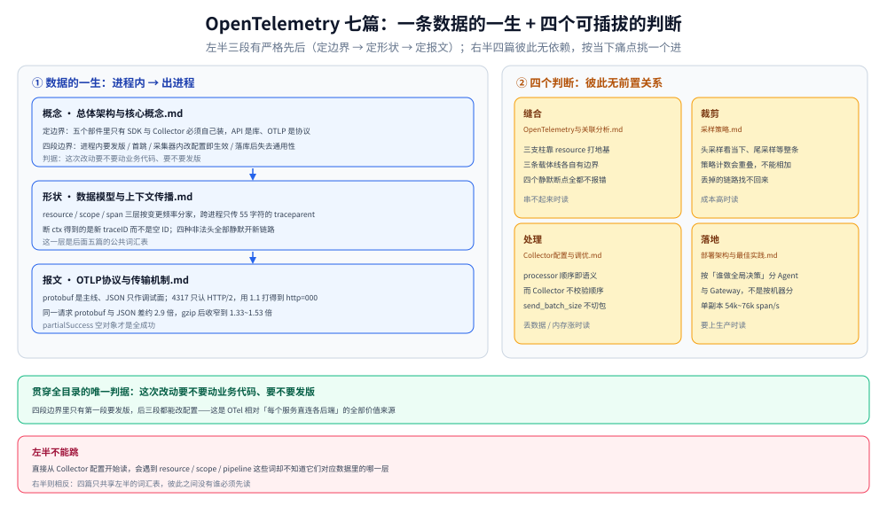

# OpenTelemetry

> 覆盖：OpenTelemetry 这一层本身——它由哪五个部件拼成、数据从进程内到落库要跨哪四段边界、一条 trace 在内存里长什么形状、跨进程靠哪几个字段传下去、数据用什么报文怎么发出去、发出去之后在 Collector 里被怎么处理与裁剪、Agent 与 Gateway 怎么分工。**七篇按「概念 → 数据 → 协议 → 缝合 → 采样 → 处理 → 落地」排，是一条从 What 走到生产的直线。**
>
> 不覆盖：三支柱怎么选型、跨支柱的成本账与后端对比见 [可观测性选型对比.md](../可观测性选型对比.md)（本目录的唯一决策入口）；指标数学（分位数、燃烧率）与日志管道形态分见 [指标选型对比.md](../指标/指标选型对比.md) 与 [日志系统选型对比.md](../日志系统/日志系统选型对比.md)；Go / Java 侧的接入代码在语言目录（`01-编程语言/go/可观测性/`），本目录只讲机制不讲 API 用法。
>
> 内容整理自个人学习笔记。**实测环境 Go 1.26.5 + OTel Go SDK v1.46.0 + OTel Collector contrib 0.157.0（Docker Desktop 29.7.2）**，实验代码在 `.workbuddy/tmp/otel-core-lab/`。七篇合计 2 370 行、15 张配图（本篇另有 1 张全景图，`images/` 共 16 张）；哪些跑了、哪些没跑见第七节。

---

## 一、这个目录回答什么问题

**一句话**：OTel 不采集、不存储、不展示，它只做一件事——**把「埋点」和「后端」解耦**。这个目录要回答的是这一层怎么拆、每一段的边界在哪、什么改动要发版什么改动不用发版。

三个必须先说清的边界，否则读下去会一直困惑「这事该归谁」：

| 常见困惑 | 归哪 | 本目录的态度 |
| --- | --- | --- |
| 该选 Jaeger 还是 SkyWalking、留多少天、花多少钱 | 总纲 | 不回答，只声明「换后端不改埋点」这条性质 |
| 埋点代码怎么写、`Tracer` 怎么初始化 | 语言目录 | 只给机制与最小可运行片段，不给框架封装 |
| 采样率调 10% 之后为什么日志有 trace_id 却查不到链路 | **本目录** | [采样策略.md](采样策略.md) 与 [OpenTelemetry与关联分析.md](OpenTelemetry与关联分析.md) 各答一半 |

⭐ 一条贯穿全目录的判据：**「这次改动要不要动业务代码、要不要发版」**。四段边界里只有第一段要发版，后面三段（首跳之后的采集器内、落库后）都能改配置——这是 OTel 相对「每个服务直连各后端」的全部价值来源，也是各篇反复回到的那把尺子。

---

## 二、七篇零件各管什么（本篇只导读，不重复内容）

| 篇目 | 回答什么问题 | 一句话记住 | 关键读数 |
| --- | --- | --- | --- |
| [总体架构与核心概念.md](总体架构与核心概念.md) | 它是什么、由谁组成、解决哪个问题、什么时候**不该**用 | 五个部件里只有 SDK 与 Collector 必须自己装，API 是库、OTLP 是协议、语义约定是约定 | 不装 SDK 时 100 万 span 仅 332 ns/个、`IsRecording=false`、ID 全 0 |
| [数据模型与上下文传播.md](数据模型与上下文传播.md) | 一条 trace 在内存里长什么样、ID 谁生成、跨进程到底传了几个字段 | 三层嵌套（resource / scope / span）按**变更频率**分家，跨进程只传 55 个字符 | 丢 ctx 得到的是**新 traceID** 而不是空 ID；四种非法 `traceparent` 全部静默开新链路 |
| [OTLP协议与传输机制.md](OTLP协议与传输机制.md) | 数据怎么发出去：报文长什么样、gRPC 还是 HTTP、压缩与重试怎么配 | protobuf 是主线，JSON 只是调试面；4317 只认 HTTP/2 | 同一请求 protobuf / JSON = 318/883、2 055/5 977、19 517/57 007 字节（约 2.9 倍） |
| [OpenTelemetry与关联分析.md](OpenTelemetry与关联分析.md) | 三支柱怎么缝合、缝合会从哪里静默断掉 | 缝合靠 `resource` 打地基 + 三条载体线，断点全都不报错 | 50% 采样下 45%~50% 日志有 ID 无链路；全 0 trace_id 被接受并落库 |
| [采样策略.md](采样策略.md) | 留哪条、留多少、在哪个时点决定 | 头采样只看当下、尾采样要等整条 trace，代价换的是**排障能力** | 同一份 200 条数据：尾采样留 36（错误 10/10）、头采样留 18（错误只剩 2/20） |
| [Collector配置与调优.md](Collector配置与调优.md) | 怎么把它跑稳：组件怎么接、参数怎么调、数据丢在哪 | processor 顺序即语义，而 Collector **不校验**顺序 | `send_batch_size` 不切包；只写 `max_size` 直接启动失败 |
| [部署架构与最佳实践.md](部署架构与最佳实践.md) | Agent 还是 Gateway、几级拓扑、一个副本能吃多少、怎么高可用 | 分界线是「谁做全局决策」，不是「部署在哪台机器」 | 单副本 1000 span 36.6~48.5 ms、20 000 span 262~370 ms（54k~76k span/s） |

⚠️ 表中读数只是索引，**口径与边界以各篇的 `## 校验口径` 或末节为准**——例如吞吐那组数是 4 vCPU + debug exporter 的产物，不能直接当后端容量用。

---

## 三、七篇的两种关系：一条链 + 四个可插拔的判断

七篇不是七个并列话题，而是「一条数据往前走」加上「走完之后四个可以独立插进去的决策点」：

图左半是数据的一生：概念定边界（谁能改什么）→ 数据模型定形状（内存里三层嵌套）→ OTLP 定报文（怎么出进程）。这三段有**严格先后**，跳过任何一段去读右边的四篇，都会撞上「`resource` / `scope` / `partialSuccess` 这些词到底对应数据里的哪一层」这个问题。

图右半的四个判断彼此**无依赖**，按你当下的痛点挑一个进：

| 组 | 篇目 | 在数据流的哪个位置 | 换掉它会影响什么 |
| --- | --- | --- | --- |
| **地基** | 总体架构与核心概念 → 数据模型 → OTLP | 进程内 → 出进程 | 换掉这一段等于换掉整套埋点 |
| **缝合** | [OpenTelemetry与关联分析.md](OpenTelemetry与关联分析.md) | 落库前，靠 `resource` 与三条载体 | 只影响「能不能串起来查」，不影响采集 |
| **裁剪** | [采样策略.md](采样策略.md) | SDK 出口或 Collector 内 | 直接影响成本与可查性，且**丢的数据找不回来** |
| **处理** | [Collector配置与调优.md](Collector配置与调优.md) | 两级拓扑的中间 | 顺序错了不报错，只是限流/批处理静默失效 |
| **落地** | [部署架构与最佳实践.md](部署架构与最佳实践.md) | 拓扑与容量 | 决定前三个判断跑在谁的机器上 |

⭐ 三条最容易踩反的关系，先记住结论再去读细节：

1. **`resource` 不是「越多越好」**——它是缝合的地基，但默认会被削成只剩 `job`，而 `resource_to_telemetry_conversion` 一开，每个属性都变成一个指标标签（见关联分析篇第三节）。
2. **采样位是唯一的跨进程协商手段**——`flags` 的 bit0 写在 `traceparent` 里，子进程读到 `-00` 就不记录，但它**仍然是父 trace 的一部分**（见数据模型篇第七节）。
3. **Collector 的四个 processor 顺序有语义**——`memory_limiter` 必须第一，写在 `batch` 之后照样能启动（见 Collector 篇第六节）。

---

## 四、按问题走阅读顺序

**路线 A：第一次接触，要建立完整认知（推荐，按序读前四篇）**

| 步 | 读什么 | 读完能回答 |
| --- | --- | --- |
| 1 | [总体架构与核心概念.md](总体架构与核心概念.md) | 为什么要多加这一层、五个部件谁必须装、我这种情况该不该用 |
| 2 | [数据模型与上下文传播.md](数据模型与上下文传播.md) | 一条 trace 在内存里是什么形状、跨进程靠什么串起来 |
| 3 | [OTLP协议与传输机制.md](OTLP协议与传输机制.md) | 一次导出到底发了多少字节、4317 和 4318 该选哪个 |
| 4 | [OpenTelemetry与关联分析.md](OpenTelemetry与关联分析.md) | 三支柱怎么缝、缝会在哪静默断 |

**路线 B：只为一件事来（单篇直达，按痛点挑）**

| 你遇到的问题 | 直接读 |
| --- | --- |
| 链路在中间断了，查不出断在哪 | [数据模型与上下文传播.md](数据模型与上下文传播.md) 第六节 + [OpenTelemetry与关联分析.md](OpenTelemetry与关联分析.md) 第六节 |
| 后端说收不到数据，日志里什么都没有 | [OTLP协议与传输机制.md](OTLP协议与传输机制.md) 第四节 + [部署架构与最佳实践.md](部署架构与最佳实践.md) 第三节 |
| 账单太高，要压成本 | [采样策略.md](采样策略.md) → [Collector配置与调优.md](Collector配置与调优.md) 第五节 |
| 日志里有 trace_id 却查不到链路 | [采样策略.md](采样策略.md) 第四节 + [OpenTelemetry与关联分析.md](OpenTelemetry与关联分析.md) 第六节 |
| Collector 内存涨到 OOM | [Collector配置与调优.md](Collector配置与调优.md) 第六节 → 第七节 |
| 要从单机 demo 上生产 | [部署架构与最佳实践.md](部署架构与最佳实践.md) 全文 |

**路线 C：已经在用，只想补齐短板**——按第三节那张五行分工表从上往下扫，哪一行说不清就读哪一组。

⚠️ 一条反例：**不要从 [Collector配置与调优.md](Collector配置与调优.md) 开始**。它是七篇里最容易「照着配置抄也能跑起来」的一篇，但也最容易在抄完之后不知道改哪个参数会影响什么——因为它的所有判断都建立在「数据里有 `resource` / `scope` / `span` 三层」这个前提上。

---

## 五、篇间依赖（谁要前置）

| 篇目 | 硬前置 | 软前置 | 为什么 |
| --- | --- | --- | --- |
| 总体架构与核心概念 | 无 | 无 | 逻辑起点（目录入口是本 README） |
| 数据模型与上下文传播 | 总体架构与核心概念 | 无 | 「三层嵌套」是四段边界里第一段的具体形态 |
| OTLP协议与传输机制 | 数据模型与上下文传播 | 无 | 报文体就是那三层结构的序列化结果 |
| OpenTelemetry与关联分析 | 数据模型与上下文传播 | OTLP（`partialSuccess` 语义） | 缝合的地基是 `resource`，载体是 trace_id / exemplar |
| 采样策略 | 数据模型与上下文传播（第七节 flags） | 关联分析（第四节日志侧影响） | 采样位写在 `traceparent` 里，丢的数据无法回溯 |
| Collector配置与调优 | OTLP（批量与压缩） | 关联分析（`resource` processor） | 它处理的正是 OTLP 报文里的三层结构 |
| 部署架构与最佳实践 | Collector配置与调优 | 采样策略（尾采样粘性） | 拓扑分工就是「哪些 processor 放哪一级」 |

⭐ 只有两条是**真硬依赖**：数据模型 → 之后全部，Collector → 部署。其余都是「读了更省事」。

---

## 六、与相邻目录的边界

| 相邻位置 | 那边管什么 | 本目录不重复什么 |
| --- | --- | --- |
| [可观测性选型对比.md](../可观测性选型对比.md)（根，兼总纲） | 三支柱各自回答什么、成本公式、五候选存储、五套 UI 对照、三套可照搬组合 | 后端选型与成本账；本目录只讲「换后端不改埋点」这条性质 |
| [指标选型对比.md](../指标/指标选型对比.md) | 基数、Pull/Push、指标类型陷阱、exemplar 是指标通往链路的唯一出口 | 指标侧的选型与基数治理 |
| [日志系统选型对比.md](../日志系统/日志系统选型对比.md) | 日志形态、采集管道、存储成本 | 日志管道形态；本目录只在「trace_id 怎么进日志字段」处出现 |
| [链路追踪选型对比.md](../链路追踪/链路追踪选型对比.md) | 写时聚合 vs 查时扫描、四种接入形态、迁移成本排序 | 后端路线对比 |
| [README.md](../链路追踪/Skywalking/README.md)（SkyWalking 册）、[README.md](../链路追踪/Jaeger/README.md)（Jaeger 册） | 两个具体后端的探针、存储、UI 与排障 | 产品实现细节；只在与 OTel 的生态位交界处引用 |
| [告警与响应/](../告警与响应/) | SLO 与错误预算、告警规则、事故响应 | 发现与响应链路，OTel 只供数据 |
| `01-编程语言/go/可观测性/`（[接入Jaeger.md](../../../../01-编程语言/go/可观测性/接入Jaeger.md)、[接入Skywalking.md](../../../../01-编程语言/go/可观测性/接入Skywalking.md)） | 具体语言的 SDK 初始化、导出器封装、单例写法 | 接入代码与框架封装 |

⚠️ 一处易混：**「OTel 与 Jaeger v2」不是两个并列产品**。Jaeger v2 的底座就是 OTel Collector，所以那部分内容在 [总体架构与核心概念.md](总体架构与核心概念.md) 第六节只讲定位关系，不讲 Jaeger 怎么部署。

---

## 七、实测坐标与已知缺口

| 项 | 值 |
| --- | --- |
| Go | 1.26.5 |
| OTel Go SDK | v1.46.0（`go.opentelemetry.io/otel` 及 `sdk`、`exporters/otlp/otlptrace`） |
| Collector | `otel/opentelemetry-collector-contrib:0.157.0`（distroless，无 shell） |
| 容器环境 | Docker Desktop 29.7.2，4 vCPU |
| 实验台 | `.workbuddy/tmp/otel-core-lab/`（`main.go` 多模式 + 三份 collector 配置 + 一个探测脚本） |
| 规模 | 七篇 2 370 行、15 张配图，加本篇全景图后 `images/` 共 16 张 |

**真跑过的**（读数散在各篇，此处只列项）：API noop 的零成本、父子 / Link / 断 ctx 三种关系、四种非法 `traceparent`、采样位读写、protobuf 与 JSON 体积对照（含 gzip）、4317 与 4318 的协议差异、`partialSuccess` 与 400/404 语义、Collector 的批处理与队列丢弃、两级拓扑的主机名写错与停机恢复、单副本吞吐三档。

**未实测的**（各篇已逐条标注，不要当成结论引用）：

| 缺口 | 卡在哪 | 在哪篇标注 |
| --- | --- | --- |
| K8s Operator / DaemonSet 真实部署 | 本机无集群 | 部署架构篇 |
| mTLS 与多租户 routing connector | 未搭 CA 与第二租户 | 部署架构篇 |
| 尾采样多副本粘性 | 需两个 Gateway 副本 + 负载均衡 | 部署架构篇、采样策略篇 |
| 429 / 503 的真实退避曲线 | 未构造限流后端 | OTLP 篇、Collector 篇 |
| zstd 压缩比 | 未接 zstd 编码 | OTLP 篇 |
| gRPC 与 HTTP 的延迟对照 | 只比了协议语义，没做同压测 | OTLP 篇 |
| 真实后端（ClickHouse / ES）写入容量 | 未接真实后端 | 部署架构篇 |
| W3C Baggage 的多语言互通 | 只做了单语言读写 | 数据模型篇 |

⚠️ 还有一条口径边界：**吞吐那组读数用的是 debug exporter**，它把数据打到 stdout，与真实后端写入不是同一件事。拿它估算 Collector 自身的处理能力可以，拿它算后端容量不行。

---

## 关联

- **上游/总纲**：[可观测性选型对比.md](../可观测性选型对比.md) — 三支柱的成本账与后端选型，本目录的唯一决策入口
- **对照**：[链路追踪选型对比.md](../链路追踪/链路追踪选型对比.md) — 写时聚合 vs 查时扫描、「用 OTLP 接收面而不是再挂 Agent」的过渡姿态
- **互补**：[指标选型对比.md](../指标/指标选型对比.md)（exemplar 是指标通往链路的唯一出口）、[日志系统选型对比.md](../日志系统/日志系统选型对比.md)（trace_id 写进日志字段的那一端）
- **下游机制**：[README.md](../链路追踪/Skywalking/README.md)（SkyWalking 册）、[README.md](../链路追踪/Jaeger/README.md)（Jaeger 册）— 两个具体后端如何消费 OTLP 数据
