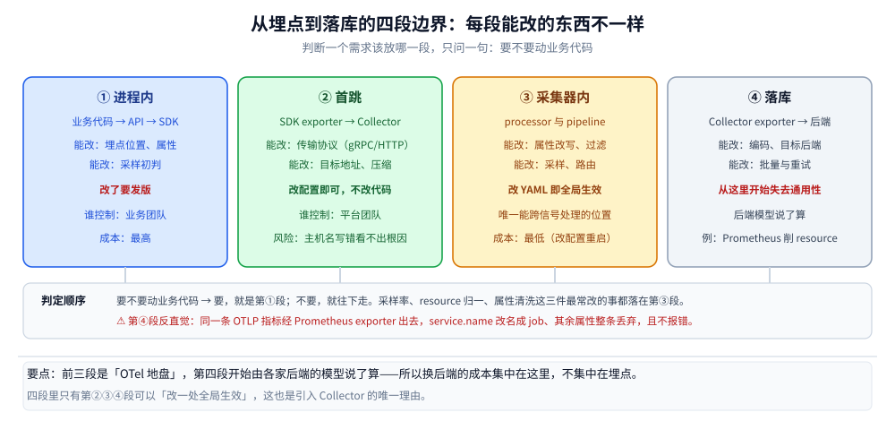
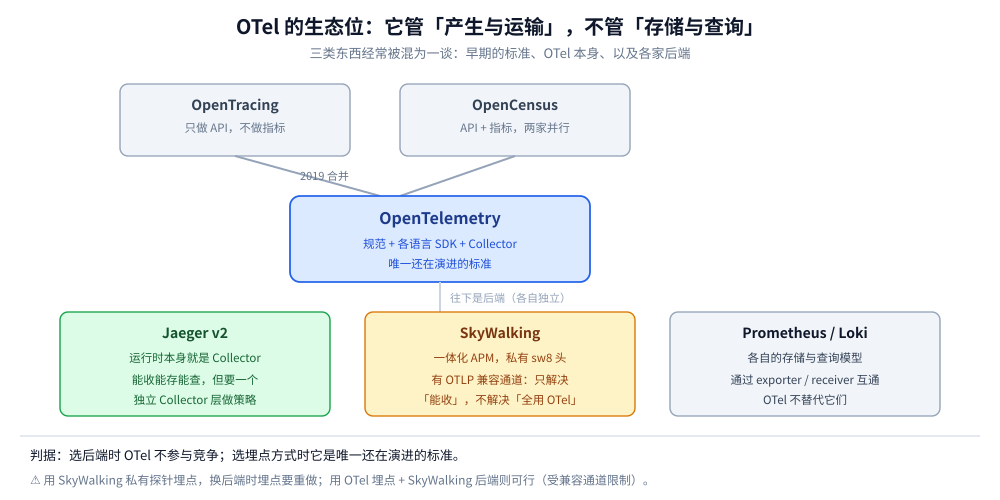

# OpenTelemetry 总体架构与核心概念

> 覆盖：OpenTelemetry 要解决的是「埋点与后端解耦」这一个问题——它由 API / SDK / OTLP / Collector / 语义约定五个部件拼成，数据从埋点到落库要跨四段边界，每段能改的东西不一样。本篇给部件全景、边界划分、信号家族与生态位，以及「什么情况下不该用它」。
>
> 不覆盖：三支柱怎么缝合、四个静默断点见 [OpenTelemetry与关联分析.md](OpenTelemetry与关联分析.md)；留哪条链路见 [采样策略.md](采样策略.md)；Collector 怎么跑稳见 [Collector配置与调优.md](Collector配置与调优.md)；报文体与传输细节见 [OTLP协议与传输机制.md](OTLP协议与传输机制.md)；Agent 与 Gateway 怎么落地见 [部署架构与最佳实践.md](部署架构与最佳实践.md)。
>
> 内容整理自个人学习笔记，实测环境为 Go **1.26.5** + OTel Go SDK **v1.46.0** + OTel Collector contrib **0.157.0**，逐项读数见第八节。

---

## 本目录怎么读

七篇的分工、三条读序路线与篇间依赖表见 [README.md](README.md)——它是本目录入口，本篇只负责 What & Why 这一段。

⚠️ 本篇是全目录的地基：**跳过本篇与 [数据模型与上下文传播.md](数据模型与上下文传播.md) 直接读 Collector 配置，会遇到大量 `resource` / `scope` / `pipeline` 词汇却不知道它们对应数据里的哪一层。** 与总纲的分工见 [可观测性选型对比.md](../可观测性选型对比.md)：那边只做跨支柱的成本账与后端选型，本目录只讲 OTel 这一层。

---

## 一、为什么三个后端都装好了，还要再加一层 OTel？

三个后端（指标 / 链路 / 日志）各自都能出图，问题出在**它们之间的接口是人手写的**。把这件事拆成三笔账，就能看出 OTel 到底在买什么。

### 1.1 第一笔账：N 个服务 × M 个后端

没有标准层时，埋点是「每个服务 × 每个后端」的笛卡尔积：

| 场景 | 要写几套埋点 | 后端换一次要动几处 |
| --- | --- | --- |
| 10 个服务、3 个后端 | 30 套（各自 SDK + 各自初始化） | 10 处（每个服务的初始化） |
| 50 个服务、3 个后端 | 150 套 | 50 处 |
| 50 个服务、换掉其中 1 个后端 | — | 50 处，且要 50 次发版 |

引入 OTel 之后，服务侧只认 OTel 一套 API，后端差异收敛到 exporter：

| 场景 | 要写几套埋点 | 后端换一次要动几处 |
| --- | --- | --- |
| 50 个服务、3 个后端 | 50 套（一套 API 打三种信号） | **1 处**（Collector 的 exporter） |
| 换掉 1 个后端 | — | 1 处，**不改业务代码、不发版** |

⭐ 这就是 OTel 的**唯一核心承诺**：把「埋点」和「后端」从乘法关系变成加法关系。所有其它特性（统一语义、自动注入、跨语言 SDK）都是为了这条服务的。

### 1.2 第二笔账：三支柱对不上号，是因为字段名都不一样

同一个服务，三种信号在三个后端里可能叫三个名字：

| 信号 | 换产品前 | 换产品后 | 后果 |
| --- | --- | --- | --- |
| 服务名 | `service` 标签 | `job` 标签 | 面板按 `service` 过滤，换后端后查不到 |
| 环境 | `env=prod` | `deployment.environment.name` | 生产与测试数据混在一起 |
| 请求耗时 | `duration_ms` | `duration`（秒） | 阈值算错 1000 倍 |

OTel 的答案是 **Semantic Conventions**（语义约定）：一个字段名、一个单位、一个类型，写在规范里，各语言 SDK 与各后端都认。⚠️ 注意它是**规范而不是代码**——没有任何运行时能强制你遵守，写错了也没人拦（这也是 [数据模型与上下文传播.md](数据模型与上下文传播.md) 里「`resource` 很脆」的根源）。

### 1.3 第三笔账：埋点是最难改的那部分代码

| 层 | 改动成本 | 迁移难度 |
| --- | --- | --- |
| 存储与查询后端 | 换一套服务、导一次历史数据 | 中 |
| 采集与处理（Collector 配置） | 改 YAML、重启 | 低 |
| **埋点（业务代码里的 SDK 调用）** | 改代码、走发版、跨团队协调 | **高** |

⭐ 所以「先把埋点标准化」是唯一划算的顺序：后端可以年年换，埋点换一次要动全部服务的发版窗口。这条也是总纲那句「新项目一律用 OTel 埋点，后端当可替换实现」的推导过程。

---

## 二、一次埋点到落库，数据要跨过哪几段边界？



图上四段从左到右是数据的实际行程，**每一段能改的东西和被谁控制都不一样**——记这张图比记「API/SDK/OTLP/Collector」四个名词有用得多。

| 段 | 位置 | 谁控制 | 这一段能改什么 | 改了要不要发版 |
| --- | --- | --- | --- | --- |
| ① 进程内 | 业务代码 → API → SDK | 业务团队 | 埋点位置、属性、采样初判 | **要**（改代码） |
| ② 首跳 | SDK exporter → 网络 → Collector receiver | 平台团队（配置） | 传输协议、目标地址、压缩 | 要（改 exporter 配置） |
| ③ 采集器内 | Collector 的 processor / pipeline | 平台团队（YAML） | 属性改写、过滤、采样、路由 | **不要**（改配置重启） |
| ④ 落库 | Collector exporter → 后端 | 平台团队（YAML） | 编码格式、目标后端、批量 | 不要 |

⭐ 判断一个需求该放哪一段，只需要问一句：**这件事要不要动业务代码？** 要，就是第①段；不要，就往下走。采样率、`resource` 归一、属性清洗这三件最常改的事都落在第③段，这就是「把采样放 Collector 而不是 SDK」的全部理由（对照见 [OpenTelemetry与关联分析.md](OpenTelemetry与关联分析.md) 第七节）。

⚠️ 第④段有一个反直觉的性质：**数据一旦交给后端，就失去通用性了**。同一条 OTLP 指标经 Prometheus exporter 出去，`service.name` 会被改名成 `job`、其余 `resource` 属性整条丢弃——而这一步不报错。四段里只有前三段是「OTel 地盘」，第四段开始由各家后端的模型说了算（实测见 [OpenTelemetry与关联分析.md](OpenTelemetry与关联分析.md) 第三节）。

---

## 三、API 与 SDK 为什么必须分成两个包？

这是 OTel 设计里最容易被跳过、但后果最直接的一处：同一个语言里有 `go.opentelemetry.io/otel`（API）和 `.../otel/sdk`（SDK）两个模块，**只引 API 不引 SDK 是合法的，且完全零开销**。

### 3.1 实测：不装 SDK 时，埋点是空操作

写一段最普通的埋点代码，只依赖 API、不初始化任何 SDK，跑 100 万次 `Start` + `SetAttributes` + `End`：

```text
spans=1000000 total=332.6885ms per_span=332ns
isRecording=false traceID="00000000000000000000000000000000" spanID="0000000000000000"
```

⭐ 两个读数各自说明一件事：

- **`332ns/span`**：不是零，但只够做一次接口分发与空对象分配。相比真实 span 的微秒级开销，可以说「不装 SDK 就没有成本」；
- **`isRecording=false` 且 ID 全 0**：`SpanContext` 是一个**无效值**，不是随机值。这一点很关键——它意味着「没装 SDK」和「采样丢弃」在代码里可以区分（前者 `IsValid()==false`，后者 `IsValid()==true` 而 `IsRecording()==false`）。

### 3.2 这个设计的三个实际用途

| 用途 | 机制 | 谁受益 |
| --- | --- | --- |
| **库作者**可以放心埋点 | 库只依赖 API；用的人不装 SDK 就没有开销 | 中间件、ORM、HTTP 客户端库 |
| **测试环境**默认不采集 | 不初始化 SDK 即静默 | 单元测试、CI |
| **灰度开关** | 只改初始化代码，不改埋点 | 平台团队 |

⚠️ 反过来的坑：**装了 API 却没装 SDK，是所有「埋点不生效」里最安静的一种**。没有日志、没有 warn，`IsRecording()` 一直是 `false`。判据只有一条——在初始化之后打印一次 `tp.Tracer("x").Start(...)` 的 `IsRecording()`，或者直接看导出端有没有数据（本机实测时用 Collector 的 debug exporter 数条数）。

---

## 四、五个部件里，哪几个必须自己装？

| 部件 | 形态 | 必须部署吗 | 不部署会怎样 |
| --- | --- | --- | --- |
| **API** | 各语言库 | 必须（埋点入口） | 无法埋点 |
| **SDK** | 各语言库 | 必须（要真采集） | 埋点是空操作（见第三节） |
| **OTLP** | 规范（无进程） | 无需部署 | 只能走各家私有协议，后端不可换 |
| **Collector** | 单个二进制 / 容器 | **可选** | SDK 直连后端，采样与清洗只能改代码 |
| **语义约定** | 规范（无进程） | 无需部署 | 字段名各写各的，跨信号对不上 |

⭐ **只有 Collector 是「可选但强烈建议」的那一个**。它不参与产生数据，却是整个体系里唯一同时能看到三种信号的位置——三条缝合线（trace→log、trace→metric、metric→trace）与四种属性清洗都只能在这里做（见 [OpenTelemetry与关联分析.md](OpenTelemetry与关联分析.md) 第二节与第七节）。

⚠️ 常见误解：「装了 Collector 就等于有了可观测性」。Collector 不做存储、不做查询、不做告警，它只是数据管道上的一个策略点。没有后端（Jaeger / Prometheus / Loki 之类）时，它唯一的输出是 `debug` exporter 打到 stdout。

---

## 五、信号家族有几种，各自的成本单位是什么？

规范里正式定义的是三种（traces / metrics / logs），另有两个「辅助信号」经常被混进来说：

| 信号 | 最小单位 | 成本随什么涨 | 典型量级（单服务） | 状态 |
| --- | --- | --- | --- | --- |
| **Traces** | span | 请求数 × 每请求 span 数 × 采样率 | 万级 span/分钟 | 稳定 |
| **Metrics** | 数据点（时间序列 × 采集间隔） | 序列数（基数）× 抓取频率 | 千级序列 | 稳定 |
| **Logs** | 日志记录（LogRecord） | 日志条数 × 平均字节数 | 十万级条/分钟 | 稳定 |
| **Baggage** | 键值对 | 跟随每条请求，占 header | — | 稳定，但**不落库** |
| **Profiles** | 采样栈 | CPU 采样频率 × 进程数 | — | 规范在演进，生态未统一 |

⭐ 三个判断：

- **成本单位完全不同**，所以「只留一个后端」这条路走不通——把 trace 塞进日志会放大字节数，把日志塞进 trace 会撑爆 span 属性；
- **Baggage 不是信号**，它是「随请求传递的键值对」，作用是把业务上下文（如 `tenant.id`）带到下游，本身不进任何后端；
- **Profiles 别急着上**：规范与后端支持都还在变，收益（火焰图）可以用持续的 CPU profile 采样替代，等生态稳定再评估。

---

## 六、OTel 和 SkyWalking、Jaeger、OpenCensus 是什么关系？



图上要看清的是**三类不同的东西**，它们经常被混为一谈：

| 名字 | 是什么 | 与 OTel 的关系 |
| --- | --- | --- |
| **OpenTracing / OpenCensus** | 两个早期的标准（前者只做 API，后者做 API + 指标） | 2019 年**合并**成 OTel，两者都已停止演进 |
| **OTel** | 规范 + SDK + Collector（本篇的主角） | — |
| **Jaeger** | 后端（存储 + 查询 + UI） | v2 起**运行时就是 OTel Collector**，用自己的发行版替换了「Collector + 专用 agent」 |
| **SkyWalking** | 一体化 APM（探针 + OAP + UI，私有 `sw8` 头） | 提供 **OTLP 兼容通道**，只解决「能收」，不解决「用 OTel 做全部」 |
| **Prometheus / Loki** | 各自的信号后端 | 通过 Collector 的 exporter / receiver 互通，各自模型仍是自己的 |

⭐ 一句话判据：**OTel 是「产生与运输」的标准，不是「存储与查询」的产品**。选后端时它不参与竞争；选埋点方式时，它是唯一还在演进的标准。

⚠️ 两个高频误解：

- 「用了 SkyWalking 就不需要 OTel」——如果你的探针是 SkyWalking 私有格式，换后端时埋点要重做；反之用 OTel 埋点 + SkyWalking 后端则可行（受兼容通道限制，见 [集成与生态.md](../链路追踪/Skywalking/集成与生态.md) 第二节）；
- 「Jaeger v2 就是 OTel Collector，那装 Jaeger 就够了」——它能收能存，但**采样、属性清洗、多后端路由**仍需要一个独立的 Collector 层来做，否则这些配置要写进 Jaeger 的同一个进程里，扩缩容粒度就绑死了。

---

## 七、什么情况下不该用 OpenTelemetry？

这一节比前面都重要：OTel 不是默认答案，它有明确的失效场景。

| 场景 | 为什么不该用 | 替代做法 |
| --- | --- | --- |
| **目标语言没有官方 SDK**（或只有社区半成品） | 手写 OTLP 请求能做，但要自己实现上下文传播、批量、重试 | 先用该语言已有的成熟探针，等 SDK 稳定再迁 |
| **只要「服务活着吗」**（3 个服务、1 台机器） | 一套 Collector + 后端 + 存储的复杂度远超收益 | 直接 Prometheus + `blackbox_exporter`，或云厂商的托管监控 |
| **强依赖厂商私有能力**（如某 APM 的代码级方法栈、特定数据库的慢查询钻取） | OTel 只标准化了通用的三类信号，私有能力不在规范里 | 保留厂商探针，用 OTel 补通用部分，两条并行 |
| **合规要求数据不出域、且不允许自建后端** | OTel 只解决传输，存储与留存仍需自建或采购 | 先定存储方案，再决定是否引入 OTel |
| **团队没有平台侧人力维护 Collector** | Collector 的采样、队列、内存保护都需要持续调参（见 [Collector配置与调优.md](Collector配置与调优.md)） | 用厂商托管采集（多为 OTel 兼容），把运维外推 |

⭐ 反过来的判据：**只要满足「服务数 ≥ 5」+「后端可能换」+「有三种信号要对齐」这三条中的两条，OTel 的收益就已经超过它的接入成本**。

---

## 八、应用场景

| 场景 | 用 OTel 的哪一层 | 收益 |
| --- | --- | --- |
| 多语言微服务（Go / Java / PHP 混布） | 各语言 SDK + 统一 OTLP | 三种语言的数据在同一条链路上 |
| 后端从自建迁到云厂商托管 | 只换 Collector 的 exporter | 业务代码零改动（本机实测两级拓扑穿透，见 9.3） |
| 一家公司多个团队各自埋点 | 语义约定 + Collector 侧统一 `resource` | 服务名、环境名不再各写各的 |
| 成本压降（链路太贵） | Collector 侧采样 | 改一处配置全局生效（见 [采样策略.md](采样策略.md)） |
| 需要「从日志跳到链路」 | 统一 `trace_id` 字段 + Collector 补齐 | 缝合线只在这里能建（见 [OpenTelemetry与关联分析.md](OpenTelemetry与关联分析.md)） |
| K8s 上的动态服务 | Operator + DaemonSet agent | 新 Pod 自动接入，不用逐个改配置（见 [部署架构与最佳实践.md](部署架构与最佳实践.md)） |

---

## 九、具体使用

### 9.1 最小可运行：一个 Collector + 一条 curl

不写任何 SDK，先用 OTLP/HTTP 直投验证「管道通了」。这是排查「到底是 SDK 没发、还是 Collector 没收」的第一刀。

```yaml
# collector.yaml
receivers:
  otlp:
    protocols:
      grpc:
        endpoint: 0.0.0.0:4317
      http:
        endpoint: 0.0.0.0:4318

exporters:
  debug:
    verbosity: detailed

service:
  pipelines:
    traces:
      receivers: [otlp]
      exporters: [debug]
```

```bash
docker run -d --name otel-core \
  -p 14317:4317 -p 14318:4318 \
  -v "$PWD/collector.yaml:/etc/otelcol-contrib/config.yaml:ro" \
  otel/opentelemetry-collector-contrib:0.157.0

# 一条最小 OTLP/HTTP JSON（字段含义见数据模型篇）
curl -s --noproxy '*' -X POST http://127.0.0.1:14318/v1/traces \
  -H 'Content-Type: application/json' \
  --data-binary @trace.json -w '\nhttp=%{http_code}\n'
```

实测响应（payload 549 B）：

```text
http=200
{"partialSuccess":{}}
```

⭐ `{"partialSuccess":{}}` 是**全部成功**的意思，不是「部分成功」。这个空对象的语义反直觉，判据见 [OpenTelemetry与关联分析.md](OpenTelemetry与关联分析.md) 2.1 与 [OTLP协议与传输机制.md](OTLP协议与传输机制.md) 第四节。

### 9.2 最小 SDK 接入（Go）

```go
exp, err := otlptracegrpc.New(ctx,
    otlptracegrpc.WithEndpoint("127.0.0.1:4317"),
    otlptracegrpc.WithInsecure(),
)
if err != nil {
    return err
}

res, err := resource.New(ctx, resource.WithAttributes(
    semconv.ServiceName("order-api"),
    semconv.ServiceVersion("1.2.3"),
    attribute.String("deployment.environment.name", "prod"),
))
if err != nil {
    return err
}

tp := sdktrace.NewTracerProvider(
    sdktrace.WithBatcher(exp),
    sdktrace.WithResource(res),
    sdktrace.WithSampler(sdktrace.ParentBased(sdktrace.AlwaysSample())),
)
otel.SetTracerProvider(tp)
otel.SetTextMapPropagator(propagation.NewCompositeTextMapPropagator(
    propagation.TraceContext{}, propagation.Baggage{},
))
defer tp.Shutdown(context.Background())
```

⚠️ 三处必须写对，否则前面所有设计都白做：

| 项 | 漏了会怎样 | 判据 |
| --- | --- | --- |
| `WithResource` | 后端里服务名是 `unknown_service:xxx`，三支柱对不上 | 看导出数据里的 `service.name` |
| `SetTextMapPropagator` | 跨进程不断链，但每次调用都开一条新链路 | 看下游 span 的 `Parent ID` 是否为空 |
| `Shutdown` | 退出时最后一批 span 丢失（batcher 未 flush） | 退出前打一条日志，看后端有没有它 |

### 9.3 验证「换后端不用改代码」

本机用两级拓扑验证这条承诺：SDK 只认 agent 的地址，agent 再转发到 gateway，gateway 换成什么后端对 SDK 不可见。

```text
SDK(14327) → agent → 172.21.0.2:4317 → gateway → debug exporter
```

实测 agent 日志零错误，gateway 侧收到完整三条 span，且 `resource` 三个属性原样保留：

```text
ResourceTraces #0 deployment.environment.name=lab service.name=otel-core-lab service.version=1.2.3
ScopeTraces #0 lab/sdk
GET /orders 9b2fb7ce85f1e21566c74426bc448166 7279552efe313fa4 http.request.method=GET url.path=/orders
```

⭐ 这就是「1.1 第二笔账」的落地形态：换后端只动 gateway 的 exporter 段，SDK 侧一行不改。拓扑细节与故障模式见 [部署架构与最佳实践.md](部署架构与最佳实践.md)。

### 9.4 判断「到底装没装 SDK」

```go
_, s := otel.Tracer("probe").Start(ctx, "probe")
log.Printf("recording=%v valid=%v traceID=%s",
    s.IsRecording(), s.SpanContext().IsValid(), s.SpanContext().TraceID())
s.End()
```

| 输出 | 含义 |
| --- | --- |
| `recording=false valid=false traceID=0000…` | **没装 SDK**（或 SDK 未设为全局 provider） |
| `recording=false valid=true traceID=<非 0>` | SDK 在，但被采样丢弃 |
| `recording=true` | 正常 |

---

## 延伸追问

- **OTel 的「标准化」到底覆盖到哪一层？** → 到「数据长什么样 + 怎么传」为止。存储模型、查询语言、UI、告警都不在规范里，所以后端仍然不可互换（迁后端要导数据、改面板）。
- **没有 Collector 能不能用 OTel？** → 能，SDK 直连后端。代价是三件事只能在代码里做：采样率、属性清洗、多后端分流。一旦这三件事需要「全局改一次」，就得补上 Collector。
- **为什么 SDK 要分 API 与 SDK 两个包？** → 让库作者可以安全埋点：不装 SDK 时调用是空操作（实测 332ns/span、`IsRecording=false`），装了才产生数据。这也是「测试环境默认不采集」的实现方式。
- **OTel 会替代 Prometheus 吗？** → 不会。OTel 管产生与运输，Prometheus 管存储与查询（含 PromQL）。两者是上下游关系，通过 OTLP receiver / exporter 对接。
- **语义约定写错了会报错吗？** → 不会。规范不是代码，`service_name` 与 `service.name` 的差别只有在下游查不到数据时才会暴露，而那时已经过了很久。这是「四个静默断点」里最隐蔽的一条。
- **Profiles 现在能用吗？** → 规范与后端支持都在演进，建议先按 CPU 采样（pprof / async-profiler）补齐火焰图，等 Profiles 稳定再统一。
- **OTel 版本号怎么理解？** → 各语言 SDK、Collector、语义约定**各自独立发版**，没有统一版本号。写文档与排查时必须分别标注三者版本（本篇实测环境即 Go SDK v1.46.0 + Collector 0.157.0 + 语义约定 v1.26.0）。

---

## 关联

- **上游/总纲**：[可观测性选型对比.md](../可观测性选型对比.md) — 三支柱的成本结构与后端选型，本目录的跨支柱判断都在那篇
- **下游机制**：[数据模型与上下文传播.md](数据模型与上下文传播.md) — 本篇说「有哪几段边界」，那篇说「边界上传的是什么结构」
- **下游机制**：[OTLP协议与传输机制.md](OTLP协议与传输机制.md) — 第二段（首跳）的报文细节：编码、压缩、响应语义
- **下游机制**：[Collector配置与调优.md](Collector配置与调优.md) — 第三段（采集器内）的组件与顺序
- **下游机制**：[采样策略.md](采样策略.md) — 第三段里最影响成本的一个决策
- **对照/互补**：[OpenTelemetry与关联分析.md](OpenTelemetry与关联分析.md) — 三支柱如何缝合，以及缝合会静默失效的四个位置
- **下游机制**：[部署架构与最佳实践.md](部署架构与最佳实践.md) — 本篇的四段边界在生产里怎么排成几级拓扑
- **对照/互补**：[链路追踪选型对比.md](../链路追踪/链路追踪选型对比.md) — OTel 与 SkyWalking / Jaeger 两条路线各自的取舍
- **对照/互补**：[集成与生态.md](../链路追踪/Skywalking/集成与生态.md) — SkyWalking 的 OTLP 兼容通道能做到什么、做不到什么
