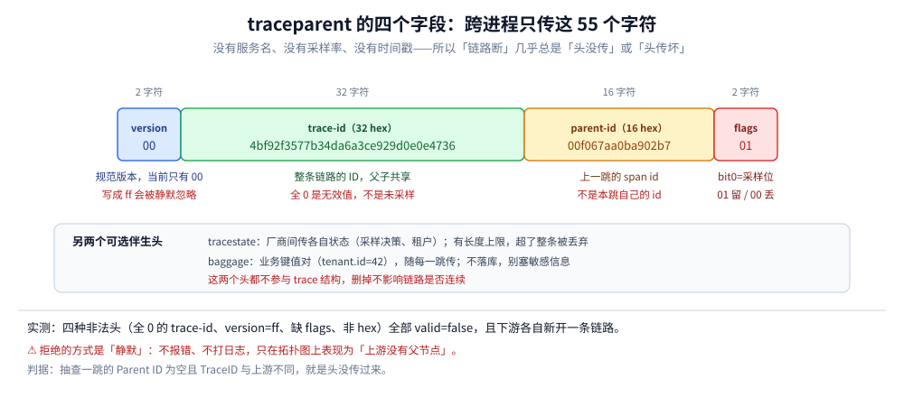
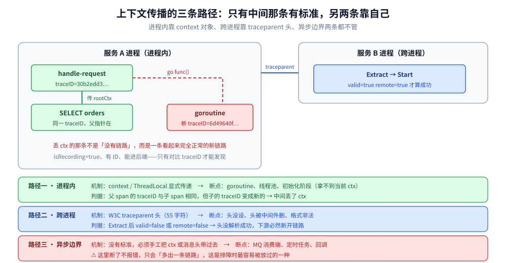

# 数据模型与上下文传播

> 覆盖：一条 trace 在内存里到底是什么形状——`Resource` → `Scope` → `Span` 三层为什么不能合并、事件与链接怎么表达「发生过什么」与「跟谁有关」、`TraceID` / `SpanID` 谁生成、跨进程只传 55 个字符的 `traceparent`、进程内靠 `context` 传递而异步边界必断、以及采样位在数据里的准确位置。
>
> 不覆盖：报文怎么编码与发出去见 [OTLP协议与传输机制.md](OTLP协议与传输机制.md)；留哪条链路见 [采样策略.md](采样策略.md)；`resource` 到后端后的四种变形见 [OpenTelemetry与关联分析.md](OpenTelemetry与关联分析.md) 第三节。
>
> 内容整理自个人学习笔记，实测环境为 Go **1.26.5** + OTel Go SDK **v1.46.0** + Collector contrib **0.157.0**（debug exporter 输出原始结构），逐项读数见第九节。

---

## 一、一条 trace 在数据模型里到底是什么形状？

大多数人以为 trace 是「一条带子」，实际它是一个**三层嵌套的容器 + 一棵 span 树**。Collector 的 debug exporter 打印的是线上真实结构，照抄一段实测输出：

```text
ResourceSpans #0
Resource SchemaURL:
Resource attributes:
     -> deployment.environment.name: Str(lab)
     -> service.name: Str(otel-core-lab)
     -> service.version: Str(1.2.3)
ScopeSpans #0
ScopeSpans SchemaURL:
InstrumentationScope lab/sdk
Span #0
    Trace ID       : 4bc58b7bf495635d0f377981e9b8f579
    Parent ID      : 603221d73d372278
    ID             : c5a7922c4935c0c2
    Name           : SELECT orders
    Kind           : Client
    Start time     : 2026-10-24 05:04:38.5484827 +0000 UTC
    End time       : 2026-10-24 05:04:38.5484827 +0000 UTC
    Status code    : Unset
    DroppedAttributesCount: 0
    DroppedEventsCount: 0
    DroppedLinksCount: 0
Attributes:
     -> db.rows: Int(3)
Events:
SpanEvent #0
     -> Name: retry
     -> Timestamp: 2026-10-24 05:04:38.5484827 +0000 UTC
     -> Attributes::
          -> attempt: Int(2)
```

⚠️ 这段输出里有三个容易读错的细节：

| 现象 | 含义 | 为什么会这样 |
| --- | --- | --- |
| `Start time` 与 `End time` **完全相同** | 这个 span 的实际耗时小于时间精度 | 没有 `time.Sleep` 的代码段，纳秒级已完成 |
| `Dropped*Count` 全是 0 | 没丢，不代表没上限 | 超过属性条数上限时这里才涨，**不会报错** |
| `Link` 段没打印 | 本篇这条 span 没有 link | 有 link 时 debug 才输出该段 |

⭐ **记住这个形状比记四个名词有用**：外面两层（`Resource` / `Scope`）是「谁产生的」，里面一层（`Span`）才是「发生了什么」。

---

## 二、`resource` / `scope` / `span` 三层为什么必须分开？

三层不是「随手分」的，它们的**变更频率差三个数量级**：

| 层 | 描述什么 | 变更频率 | 典型内容 | 能否在 Collector 改 |
| --- | --- | --- | --- | --- |
| **Resource** | 数据是**谁**产生的（进程 / 服务 / 主机 / Pod） | 进程启动时定一次 | `service.name`、`service.version`、`deployment.environment.name`、`host.name` | ✅ 用 `resource` processor |
| **Scope**（InstrumentationScope） | 数据是**哪个库**产生的 | 随依赖版本 | SDK 名与版本、自动注入库名 | ⚠️ 一般不动 |
| **Span** | **这一次操作**做了什么 | 每请求 | `http.request.method`、`db.rows` | ✅ 用 `attributes` processor |

⭐ 分工的判据是**「同一批数据里，哪些字段的值一定相同」**：1000 条 span 里 `service.name` 只有一个值，所以提到资源层存一次；`url.path` 有 20 个值，只能留在 span 上。

⚠️ 这直接决定了两类 processor 的适用范围，也是最高频的误用：

| 想改的东西 | 该用的 processor | 用错了会怎样 |
| --- | --- | --- |
| `service.name` / `service.version` | `resource` | 用 `attributes`：**不生效，也不报错** |
| `http.request.method` / `url.path` | `attributes` | 用 `resource`：改的是资源层，span 上仍留着旧值 |

⚠️ 更危险的是反过来——用对了 `resource` processor 却做了全量 `upsert`：本机实测把 `svc-a` 与 `svc-b` 两个服务的 `service.name` 都改成 `collector-forced` 后，Jaeger 的服务列表里两个服务**都消失**，两条链路合并成一个服务（读数见 [OpenTelemetry与关联分析.md](OpenTelemetry与关联分析.md) 3.3）。**资源层被改，等于把「谁产生的」这条信息抹掉，而它是三支柱唯一的对齐依据。**

---

## 三、`TraceID` 和 `SpanID` 是谁生成的，会撞吗？

| 项 | 长度 | 表示 | 生成者 | 唯一性依据 |
| --- | --- | --- | --- | --- |
| `TraceID` | 16 字节 = **32 个十六进制字符** | 128 位 | **链路起点**的 SDK（或收到合法 `traceparent` 时沿用） | 128 位随机 |
| `SpanID` | 8 字节 = **16 个十六进制字符** | 64 位 | 每个 span 自己 | 同一 trace 内不重复 |

实测一条链路的三行输出，三点事实一目了然：

```text
root   traceID=4bc58b7bf495635d0f377981e9b8f579 spanID=603221d73d372278 sampled=true
child  traceID=4bc58b7bf495635d0f377981e9b8f579 spanID=c5a7922c4935c0c2 parent=603221d73d372278
linked traceID=aeb1bb3760678970c2220daecf2604ff spanID=f8c6593aa8a4ac95 links=1
```

⭐ 三点：

- **父子共享 `TraceID`**，靠 `Parent ID` 连成树；
- **link 那条是另一个 `TraceID`**（`aeb1…` ≠ `4bc5…`），它不属于原来那棵树，只是「带了一条指向旧链路的引用」；
- **`sampled=true` 是独立的第三维**，不是 ID 的一部分（第七节展开）。

### 3.1 「会不会撞」的准确回答

| 维度 | 结论 |
| --- | --- |
| 同一进程内 | 不会。`SpanID` 由 SDK 的随机源生成，且需在 trace 内唯一 |
| 跨进程 | 128 位随机，碰撞概率可忽略（生日界下约 2^64 条链路才到 50%） |
| **但**「不撞」不等于「可读」 | ID 全随机，无法从中看出服务、时间、机房——**别把业务信息编码进 ID** |
| **真正的碰撞风险在别处** | 无效值不拒（全 0 的 `trace_id` 会被接受并落库，见 [OpenTelemetry与关联分析.md](OpenTelemetry与关联分析.md) 6.3）、链路重启后复用 ID、日志里复制粘贴错 |

⚠️ 一个实操判据：**`trace_id` 全 0 是「无效」，不是「未采样」**。全 0 表示「没有上下文」（`IsValid()==false`），未采样的合法上下文则是「非 0 但 `sampled=false`」——这两者在代码里能区分，在日志里长得很像。

---

## 四、span 之间除了父子还有别的表达吗？

模型给了三种关系表达，选错会让链路图骗人：

| 表达 | 语义 | 结构表现 | 什么时候用 |
| --- | --- | --- | --- |
| **父子**（`Parent ID`） | 「我在它的调用栈里」 | 同一个 `TraceID`，`Parent ID` 指向父 | 同步调用、同一请求内的处理 |
| **Link**（`Link`） | 「我跟它有关，但不在它的调用栈里」 | **自己的 `TraceID`**，附一组 `Link{SpanContext}` | 批处理消费、fan-in 聚合、消息队列消费 |
| **Event**（`SpanEvent`） | 「这一刻发生了一件事」 | span 内部的时间点，带属性 | 重试、状态变更、异常记录 |

实测证据（同一条命令的三行输出）：`linked` 那条的 `traceID` 与 root 不同，`links=1`：

```text
linked traceID=aeb1bb3760678970c2220daecf2604ff spanID=f8c6593aa8a4ac95 links=1
```

### 4.1 为什么批处理必须用 Link 而不是父节点

假设一个消费者一次拉 100 条消息，每条消息来自不同 trace：

| 写法 | 结果 | 后果 |
| --- | --- | --- |
| 把每条消息的 span 都当子节点 | 一条 trace 里出现 100 个兄弟，分别属于 100 个上游 | 链路图变成「多父」的怪物，上游链路被错误合并 |
| 用一个新 trace + 100 个 Link | 消费链路独立，可反查 100 条上游 | 图上清晰，且能双向跳 |

⭐ 一句话判据：**「调用栈关系」用父子，「因果关系」用 link**。同步调用是前者，异步消息是后者——MQ 消费端的 `traceparent` 从消息头 Extract 出来后，正确做法是 `WithLinks` 而不是当父节点。

⚠️ 常见副作用：某些后端在 UI 上把 link 渲染成「相关链路」而不是树的一部分，看到「链路断在这里」先确认是 link 还是丢头（判据在第五节）。

---

## 五、跨进程传播到底传了哪几个字段？

跨进程只传一个 HTTP 头（W3C Trace Context），55 个字符：

```text
traceparent: 00-4bf92f3577b34da6a3ce929d0e0e4736-00f067aa0ba902b7-01
             │  │                                │                │
             │  │                                │                └─ flags（2 hex）：bit0 = sampled
             │  │                                └────────────────── parent-id（16 hex）
             │  └─────────────────────────────────────────────────── trace-id（32 hex）
             └────────────────────────────────────────────────────── version（2 hex，当前 00）
```



图上按字符位置切开这 55 个字符，注意**没有分隔符之外的任何元数据**——没有服务名、没有采样率、没有时间戳。这也解释了为什么「跨进程链路断」几乎总是「头没传」或「头传坏了」。

| 字段 | 长度 | 语义 | 常见坑 |
| --- | --- | --- | --- |
| `version` | 2 hex | 规范版本，当前 `00` | 写成 `ff` 会被**静默忽略**（实测见 5.1） |
| `trace-id` | 32 hex | 整条链路的 ID | 全 0 是无效值 |
| `parent-id` | 16 hex | **上一跳**的 span id（即本跳的父） | 不是本跳自己的 id |
| `flags` | 2 hex | `01`=采样，`00`=未采样 | 只读 bit0，其余位保留 |

另有两个可选的伴生头：

| 头 | 作用 | 注意 |
| --- | --- | --- |
| `tracestate` | 厂商间传递各自状态（如采样决策、租户） | 有长度上限，**超了会被丢弃整条** |
| `baggage` | 业务键值对（`tenant.id=42`） | 会出现在每一跳请求里，**别塞敏感信息** |

### 5.1 传坏了会怎样：四种非法头的实测

用同一个 SDK，只改 `traceparent` 的内容，看 Extract 的结果：

| 传入的头 | `IsValid()` | 提取到的 `traceID` | 随后 `Start` 的结果 |
| --- | --- | --- | --- |
| `00-<32hex>-<16hex>-01`（合法） | ✅ true | `4bf92f35…4736` | 继承父，`isRecording=true` |
| `00-00000000000000000000000000000000-0000000000000000-00`（全 0） | ❌ false | 全 0 | **新建一条链路** `50e1b742…` |
| `ff-4bf92f35…-00f067aa0ba902b7-01`（版本 ff） | ❌ false | 全 0 | **新建一条链路** `b02fd5ea…` |
| `00-4bf92f35…-00f067aa0ba902b7`（缺 flags） | ❌ false | 全 0 | **新建一条链路** `664567c4…` |
| `00-zzzz2f35…-00f067aa0ba902b7-01`（非 hex） | ❌ false | 全 0 | **新建一条链路** `e3279f5f…` |

⭐ 这张表最重要的不是「非法被拒」，而是**拒绝的方式**：`Extract` 不报错、不打日志，`Start` 照常返回一个可记录的 span，只是 `TraceID` 换成了新的。

> **「链路断了」的表现不是报错，而是「每条请求各自开一条新链路」。**

⚠️ 这条在线上有两种典型症状，且都不指向根因：

- 拓扑图上「上游服务没有下游的父节点」，看起来像「调用没发生」；
- 链路总数突然等于请求数（每条都成了独立链路），看起来像「流量涨了」。

判据：抽查一跳的 `Parent ID`，为空且 `TraceID` 与上游不同，就是头没传过来。

---

## 六、上下文在进程内靠什么传，为什么会断？

跨进程靠 header，**进程内靠 `context` 对象**。这是两套完全不同的机制，断链也发生在两个不同位置。



图上三条路径：绿色是「同一次请求内顺着函数调用传」，蓝色是「跨进程靠头」，红色是「异步边界」——**红色那一段不会报错，只会换一条 trace**。

### 6.1 实测：不传 `ctx` 的 goroutine

```go
rootCtx, root := tr.Start(ctx, "handle-request")

go func() {
    _, s := tr.Start(context.Background(), "goroutine-no-ctx") // 错误：用了 Background
    fmt.Println(s.SpanContext().TraceID())
}()

go func() {
    _, s := tr.Start(rootCtx, "goroutine-with-ctx")            // 正确：传 rootCtx
    fmt.Println(s.SpanContext().TraceID())
}()
```

实测输出：

```text
parent traceID=30b2edd3c3247e29eec0c6f90783604d
goroutine(no-ctx) traceID="6d49640fa3cf74ec9c57b536125d89ea" isRecording=true
goroutine(with-ctx) traceID=30b2edd3c3247e29eec0c6f90783604d
```

⭐ 关键：**丢上下文的那条不是「没有 trace」，而是一条全新的、看起来完全正常的 trace**。`isRecording=true`、有 ID、能进后端——所以在链路列表里搜不到问题时，你会以为「这个异步任务本来就不该被关联」。

### 6.2 五个必断的位置

| 位置 | 为什么断 | 修法 |
| --- | --- | --- |
| goroutine / 线程池 | 新线程拿到的是空 `ctx` | 显式把 `ctx` 传进闭包 |
| 定时任务 | 没有入站请求，没有父上下文 | 接受「新链路」，或从业务 ID 建 link |
| MQ 消费端 | 上下文在消息头里，没 Extract | 消费前 `propagator.Extract(ctx, headers)` |
| 初始化阶段 | `TracerProvider` 还没设成全局 | 埋点放在初始化之后 |
| 中间件顺序错 | 认证/限流中间件在 tracing 之前，span 已结束 | tracing 中间件放最外层 |

⚠️ 这类问题的共同特征：**链路图上「少了一跳」，而不是「出现一条错误的链路」**——因为那条新链路看起来完全合法，只有对比 `TraceID` 才能发现。

---

## 七、采样位放在哪，谁读谁写？

`traceparent` 的 `flags` 只有 2 个十六进制字符，但它的 bit0 是整个采样体系的物理载体：

```text
flags = 0x01  → bit0=1 → sampled（本条链路要保留）
flags = 0x00  → bit0=0 → not sampled（不保留，但上下文继续传）
```

实测两种取值的完整链条：

| 传入 flags | Extract 后 `IsSampled()` | 本进程 `Start` 的子 span | 结果 |
| --- | --- | --- | --- |
| `-01` | `true`（`remote=true`） | `isRecording=true`，`traceID` 沿用父 | 正常导出 |
| `-00` | `false`（`remote=true`） | **`isRecording=false`**，`traceID` 仍沿用父 | 不导出，但下游还能拿到同一个 `traceID` |

⭐ 两个判断：

- **`sampled` 位是「继承」的，不是「重新掷骰子」**：`ParentBased(AlwaysSample)` 在遇到 `-00` 时不会改判，因为父已经决定了；
- **未采样 ≠ 断链**：`traceID` 仍然是父的，所以下游还能用它做日志关联（只是后端查不到这条链路）。这正是「采样率 50% 时近半日志的 `trace_id` 查不到实体」的机制来源（读数见 [OpenTelemetry与关联分析.md](OpenTelemetry与关联分析.md) 6.1）。

| 谁写这个位 | 什么时候 | 影响 |
| --- | --- | --- |
| 链路起点 SDK | 新建 trace 时按采样器决定 | 决定整条链路是否保留 |
| 中间服务 | 一般不写（`ParentBased` 只读） | 写了会造成「下游有、上游没有」 |
| 网关 / Collector | 尾部采样在链尾决定，但**位已在头里** | 尾采样不靠这个位，靠缓存整条链路 |

⚠️ 所以「采样策略」与「数据模型」的交界只有一句话：**头采样只能写一次位、之后全链路继承；尾采样不看位、改为在链尾裁决**。策略怎么选见 [采样策略.md](采样策略.md)。

---

## 八、应用场景

| 场景 | 用数据模型的哪一部分 | 常见错法 |
| --- | --- | --- |
| 排查「链路断在中间」 | `Parent ID` + `traceparent` 四字段 | 只看有没有 trace，不看父 ID 是否为空 |
| 多租户隔离 | `resource` 加 `tenant.id`，或放 baggage | 放 baggage 又落库，导致基数爆炸 |
| 异步消息链路 | `Link` + 消息头 Extract | 当父节点，把 100 条上游合成一条链路 |
| 记录重试 | `SpanEvent`（不新建 span） | 每次重试建一个 span，链路图刷屏 |
| 从日志跳链路 | 日志里的 `trace_id` 字段 | 在异步线程里打日志，ID 为空 |
| 服务名归一 | `resource` processor（Collector 侧） | 用 `attributes` processor，静默不生效 |

---

## 九、具体使用

### 9.1 取当前 `trace_id` 写进日志（Go）

```go
func TraceIDFromCtx(ctx context.Context) string {
    sc := trace.SpanContextFromContext(ctx)
    if !sc.IsValid() {
        return ""          // 不要返回全 0，那会和「无效」混淆
    }
    return sc.TraceID().String()
}

// 在请求处理里
log.Printf("trace_id=%s msg=order created", TraceIDFromCtx(ctx))
```

| 返回值 | 含义 |
| --- | --- |
| 32 位 hex | 有上下文 |
| 空字符串 | 没有上下文（异步 / 初始化 / 未 Extract） |
| 全 0（32 个 0） | 一般不该出现；出现说明有人手工拼了无效值 |

### 9.2 手工构造一个合法的 `traceparent`

```bash
TRACE_ID=$(openssl rand -hex 16)      # 32 hex
SPAN_ID=$(openssl rand -hex 8)        # 16 hex
echo "traceparent: 00-${TRACE_ID}-${SPAN_ID}-01"
curl -s --noproxy '*' -H "traceparent: 00-${TRACE_ID}-${SPAN_ID}-01" \
  http://127.0.0.1:8080/orders
```

⚠️ 三处容易错：`SPAN_ID` 只要 8 字节（16 hex，写成 16 字节会超长被拒）、`flags` 只用 `01`/`00`、`version` 用 `00`。

### 9.3 验证 Extract 是否成功（不依赖后端）

```go
carrier := propagation.MapCarrier{"traceparent": header}
parentCtx := otel.GetTextMapPropagator().Extract(context.Background(), carrier)
sc := trace.SpanContextFromContext(parentCtx)
fmt.Printf("valid=%v traceID=%s sampled=%v remote=%v\n",
    sc.IsValid(), sc.TraceID(), sc.IsSampled(), sc.IsRemote())
```

实测四种非法头的输出（与 5.1 表一致）：

```text
header=00-00000000000000000000000000000000-0000000000000000-00
extracted valid=false traceID=00000000000000000000000000000000 spanID=0000000000000000 sampled=false remote=false
```

⭐ `remote=false` 是关键判据：**合法的 Extract 一定带 `remote=true`**。看到 `valid=false, remote=false` 就是「头没解析成功」，此时下游的 `Start` 会新开链路。

### 9.4 一条链路的三段自检

| 检查点 | 命令 / 代码 | 期望 |
| --- | --- | --- |
| 上游发出了头 | 抓包看请求头有没有 `traceparent` | 有，且 55 字符 |
| 下游解析成功 | 9.3 的 `valid/remote` | `true/true` |
| 导出后的父指针 | Collector debug exporter 的 `Parent ID` | 非空，且等于上游 span id |

---

## 延伸追问

- **`resource` 和 span attributes 到底差在哪？** → 差在「谁」与「什么」：`resource` 描述产生数据的进程/服务（一批 span 共享一个值），attributes 描述这一次操作（每条都不同）。用错 processor 都不报错，只是不生效（[OpenTelemetry与关联分析.md](OpenTelemetry与关联分析.md) 3.2 有实测）。
- **为什么 trace 是三层嵌套而不是扁平列表？** → 因为三层的取值分布完全不同：资源层是常量、scope 层随依赖版本变、span 层每请求都变。嵌套存储省带宽（资源属性每条记录只存一次），也让批量改写有了明确的层。
- **`trace_id` 能看出服务名或时间吗？** → 不能，也不该。ID 是纯随机的 128 位，任何「编码业务信息」的做法都会在跨系统时失效。
- **link 和父节点的最终判据是什么？** → 看一眼链路图：如果子节点的出现会让上游「多出一个父」，那就是该用 link 的场景（异步消息、批处理）。
- **`baggage` 和 `resource` 都能放租户 ID，选哪个？** → `baggage` 随请求走、可跨服务，但不落库；`resource` 落库、可查询，但一个进程只有一个值。多租户 SaaS 通常两个都放：`baggage` 用于路由，`resource` 用于查询。
- **为什么异步边界一断就是「新链路」而不是「空 ID」？** → 因为 SDK 在 `Start` 时发现没有有效的父上下文，就按「链路起点」处理：新生成 `TraceID` 并自行决定采样。这与「显式传了无效头」的表现完全一致，所以两者要靠 `remote` 标志区分。
- **`tracestate` 到底要不要用？** → 只有一个场景必须用：需要与厂商的采样决策或其他私有状态协同时。自己实现一套跨服务状态传递，请用 `baggage`，别动 `tracestate`（它有格式与长度约束，写错会导致整条被丢弃）。

---

## 关联

- **上游/总纲**：[总体架构与核心概念.md](总体架构与核心概念.md) — 本篇的结构处在四段边界的第①段（进程内）
- **下游机制**：[OTLP协议与传输机制.md](OTLP协议与传输机制.md) — 同样的结构怎么序列化上线：protobuf 字段、压缩、响应语义
- **下游机制**：[采样策略.md](采样策略.md) — 第七节的 `flags` 位由谁来写、头采样与尾采样的分工
- **对照/互补**：[OpenTelemetry与关联分析.md](OpenTelemetry与关联分析.md) — `resource` 走到后端后的四种变形，以及「无效 `trace_id` 被接受」的实测
- **下游机制**：[Collector配置与调优.md](Collector配置与调优.md) — 用哪类 processor 改哪一层（第二节的分工在配置里的落点）
- **对照/互补**：[HTTP与gRPC.md](../../../../02-计算机基础/网络/应用层/HTTP与gRPC.md) — `traceparent` 作为请求头在 HTTP/2 与 gRPC 里的承载方式
- **下游机制**：[接入Jaeger.md](../../../../01-编程语言/go/可观测性/接入Jaeger.md) — Go 侧 `TracerProvider` 初始化与跨协程传递的三条铁律
- **下游机制**：[接入Skywalking.md](../../../../01-编程语言/java/可观测性/接入Skywalking.md) — Java 侧 `ThreadLocal` 与 `%tid` 日志关联的写法
