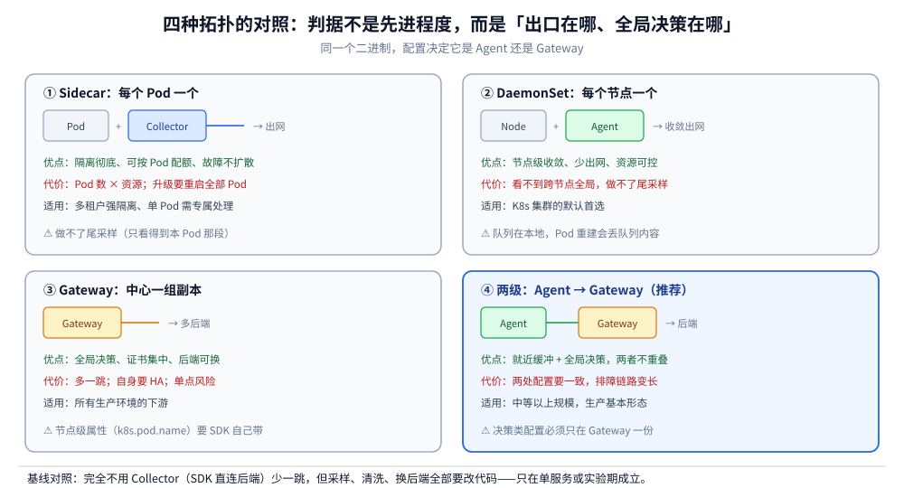
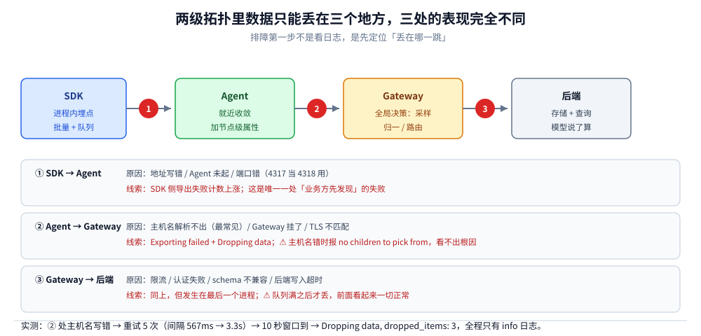

# 部署架构与最佳实践

> 覆盖：从单机 demo 走到生产的这一段——Agent 与 Gateway 的分界线在哪、四种拓扑（Sidecar / DaemonSet / Gateway / 两级）各自解决什么问题、两级拓扑里一条数据经过哪三个失败点、单副本能吃多少量、高可用与尾采样的冲突、多租户与 mTLS 的落点，以及三个可观测的自监控指标。
>
> 不覆盖：Collector 内部组件与参数调优见 [Collector配置与调优.md](Collector配置与调优.md)；采样算法见 [采样策略.md](采样策略.md)；协议与编码见 [OTLP协议与传输机制.md](OTLP协议与传输机制.md)。
>
> 内容整理自个人学习笔记。本篇代码与配置在 `otel/opentelemetry-collector-contrib:0.157.0` + Docker（4 vCPU）+ Go SDK v1.46.0 下实跑，读数见第五节与「校验口径」；K8s Operator、mTLS、多租户三项未实测。

---

## 一、一句话定位：Agent 与 Gateway 的分界是「谁做全局决策」

两者跑的是**同一个二进制**，配置文件才是区别所在。所以「Agent 还是 Gateway」不是选软件，是选**把哪类决策放在哪一级**：

| 决策 | 放 Agent（每机/每 Pod） | 放 Gateway（中心） |
| --- | --- | --- |
| 第一跳缓冲（后端抖动时不丢） | ✅ 就近吸收 | ❌ 太远，缓冲没意义 |
| 加上 `k8s.pod.name` / `host.name` 这类本地信息 | ✅ 只有它知道 | ⚠️ 需要上游先传上来 |
| 尾部采样（等整条链结束再判） | ❌ 单条链路可能跨多机 | ✅ 全局视角 |
| `service.name` 归一 / 属性清洗 | ⚠️ 能改，但要每台配一次 | ✅ 一处生效 |
| 多后端路由（A 团队→Jaeger，B→SkyWalking） | ❌ 无法知道租户 | ✅ 集中路由 |
| 出口 TLS / 认证 | ❌ 每台都要配证书 | ✅ 证书只在一处 |

⭐ 判据一句话：**「只跟本机有关」的放 Agent，「要跨机器看全局」的放 Gateway**。

⚠️ 反面典型：把尾部采样放 Agent。单条链路可能跨 5 台机器，每台的 Agent 只看到自己那段，各自判断「留/丢」→ 同一链路的 span 一半留一半丢，后端得到一条残缺且无告警的链路。

---

## 二、核心概念：三种角色与四种拓扑



图上四列是同一份数据在不同拓扑里的行程长度。判据不是「哪个先进」，而是**出口在哪里、全局决策在哪里**。

| 拓扑 | 部署单位 | 优点 | 代价 | 适用 |
| --- | --- | --- | --- | --- |
| **无 Collector**（SDK 直连后端） | — | 少一跳、延迟最低 | 采样/清洗/换后端都要改代码 | 单服务、实验期 |
| **Sidecar** | 每 Pod 一个 | 隔离彻底、资源可精确配额 | Pod 数 × 资源开销；升级要重启全部 Pod | 多租户强隔离、单 Pod 需要专属处理 |
| **DaemonSet（Agent）** | 每节点一个 | 节点级收敛、少出网、资源可控 | 看不到跨节点全局 | K8s 集群（最常见） |
| **Gateway** | 中心一组副本 | 全局决策、证书集中、后端可换 | 多一跳；自身要 HA | 所有生产环境的下游 |
| ⭐ **两级（Agent → Gateway）** | 两者都有 | 就近缓冲 + 全局决策 | 两处配置要一致，排障链路变长 | 中等以上规模（推荐） |

⭐ 为什么生产几乎都是两级：**Agent 解决「近」，Gateway 解决「全局」**，两者不重叠。单级 Gateway 在节点故障时会丢一批数据（SDK 的重试窗口有限），单级 Agent 做不了尾采样与多租户路由。

---

## 三、整体架构：两级拓扑里一条数据经过三个失败点



图上三个红点是数据唯一可能消失的位置。**它们的失败表现完全不同**，这也是排障要先定位「丢在哪一跳」的原因。

| 失败点 | 典型原因 | 数据表现 | 日志线索 |
| --- | --- | --- | --- |
| ① SDK → Agent | 地址写错、Agent 未起、端口错 | SDK 侧报导出失败 | SDK 错误计数上涨 |
| ② Agent → Gateway | **主机名解析不出**、Gateway 挂了、TLS 不匹配 | Agent 侧重试，超窗口后丢弃 | `Exporting failed` + `Dropping data` |
| ③ Gateway → 后端 | 后端限流、认证失败、schema 不兼容 | Gateway 侧重试/丢弃 | 同 ② |

### 3.1 实测：主机名写错时的错误信息完全看不出根因

把 Agent 的 exporter 指向一个不存在的容器名 `gateway:4317`（实际容器叫 `otel-gw`），发 3 条 span，得到：

```text
Exporting failed. Will retry the request after interval.
  error: rpc error: code = Unavailable desc = no children to pick from
  interval: 567.695942ms
...
Exporting failed. Dropping data.
  error: no more retries left: rpc error: code = Unavailable desc = no children to pick from
  dropped_items: 3
```

⭐ 三个要点：

- **`no children to pick from` 是 gRPC 负载均衡器的报错，不是「主机名不存在」**。它真正的含义是「解析器没有返回任何可用地址」——第一反应应该是查主机名，而不是查网络；
- **重试是自动的**（间隔从 567ms 涨到 3.3s，指数退避），共 5 次；
- **`max_elapsed_time: 10s` 一到就丢弃**，`dropped_items: 3` 是这一批的条数，**没有任何指标默认会告警**。

⚠️ 这类配置错误的共同特征：**Collector 进程健康、端口在听、日志只有 info 级**。判据是把 `otelcol_exporter_send_failed_spans` 与 `otelcol_exporter_queue_size` 接进告警（第八节）。

### 3.2 实测：Gateway 停机再恢复，数据能补发

停掉 Gateway，发一条链路（Agent 侧报 `connection error` 并重试），然后启动 Gateway：

```text
# Gateway 恢复后的第一条输出
Traces  {"resource spans": 1, "spans": 3}
ResourceTraces #0 deployment.environment.name=lab service.name=otel-core-lab service.version=1.2.3
GET /orders 62a9517103d315bd70df94f431365c1f 8e421050485866e5 http.request.method=GET url.path=/orders
```

⭐ 结论：**停机期间的数据在 `max_elapsed_time` 窗口内能补发**，且 `resource` 三个属性原样保留（说明 Agent 转发不会动资源层）。

⚠️ 补发的边界就是 `max_elapsed_time`：超过窗口的数据被丢弃，**不会进死信队列**（Collector 没有内置 DLQ）。想要「一条都不丢」，就得把窗口放大并接受内存占用，或者接受丢失——这是一个必须显式决定的取舍。

---

## 四、部署：最小可运行的两级拓扑

```yaml
# agent.yaml —— 每节点一个，只做三件事：收、加本地属性、转发
receivers:
  otlp:
    protocols:
      grpc:
        endpoint: 0.0.0.0:4317
      http:
        endpoint: 0.0.0.0:4318

processors:
  batch:
    send_batch_size: 8192

exporters:
  otlp/gateway:
    endpoint: 172.21.0.2:4317      # ⚠️ 见下方说明：固定地址比主机名可靠
    tls:
      insecure: true
    sending_queue:
      enabled: true
      queue_size: 100
    retry_on_failure:
      enabled: true
      initial_interval: 1s
      max_interval: 5s
      max_elapsed_time: 10s

service:
  telemetry:
    metrics:
      level: none
  pipelines:
    traces:
      receivers: [otlp]
      processors: [batch]
      exporters: [otlp/gateway]
```

```yaml
# gateway.yaml —— 中心一组副本，做全局决策与后端对接
receivers:
  otlp:
    protocols:
      grpc:
        endpoint: 0.0.0.0:4317

processors:
  batch:

exporters:
  debug:
    verbosity: normal

service:
  pipelines:
    traces:
      receivers: [otlp]
      processors: [batch]
      exporters: [debug]
```

```bash
docker network create otelnet
docker run -d --name otel-gw --network otelnet -p 14337:4317 \
  -v "$PWD/gateway.yaml:/etc/otelcol-contrib/config.yaml:ro" \
  otel/opentelemetry-collector-contrib:0.157.0
docker run -d --name otel-agent --network otelnet -p 14327:4317 -p 14328:4318 \
  -v "$PWD/agent.yaml:/etc/otelcol-contrib/config.yaml:ro" \
  otel/opentelemetry-collector-contrib:0.157.0
```

⚠️ **`endpoint` 用主机名还是固定地址**，是本篇最容易踩的一处：

| 写法 | 什么时候可用 | 风险 |
| --- | --- | --- |
| 容器名 / Service 名（`otel-gw:4317`） | 同一 Docker 网络、K8s 同 namespace | 名字写错时错误信息是 `no children to pick from`，**看不出是名字问题** |
| 固定 IP | 单机实验、固定拓扑 | 容器重建后 IP 会变，配置失效 |
| K8s Service DNS（`otel-gw.observability.svc:4317`） | K8s 生产 | 拼错同样只报 `no children` |

⭐ 本机实测的教训很具体：**第一次配置写 `gateway:4317`，容器名却是 `otel-gw`**，报错 `no children to pick from`，重试 5 次后丢弃。改成 IP 后立刻通。所以排障顺序应该是「先确认名字能解析，再怀疑网络」。

---

## 五、容量：一个副本能吃多少

在本机 4 vCPU 容器上，用 Go SDK 经 gRPC 向 Gateway 发 span，测「从开始 `Start` 到 `ForceFlush` 返回」的墙钟时间，三轮重复：

| 批量 | `enqueue`（仅本地入队） | `flush_total`（端到端） | 折算吞吐 |
| --- | --- | --- | --- |
| 1 000 span | 4.5 / 6.5 / 5.7 ms | **48.5 / 42.3 / 36.6 ms** | 20.6k ~ 27.3k span/s |
| 20 000 span | 111 / 71 / 90 ms | **370 / 262 / 304 ms** | 54k ~ 76k span/s |

⭐ 三条读数解读：

- **小批量时固定开销占主导**：1 000 条里 `enqueue` 只占 5 ms，其余 30~43 ms 是打包 + 传输 + 服务端接收。所以「压测出 2 万 span/s」不等于「生产也是」，要看批量大小；
- **吞吐随批量上升**（54k~76k vs 20k~27k），这是批处理的典型曲线，不是线性；
- ⚠️ **这批数字只代表「管道 + debug exporter」的上限，不能当后端容量用**：本机 exporter 是 `debug`（打印到 stdout），真实后端（写入 ClickHouse / ES）才是瓶颈。**估容量必须用目标后端跑一遍**。

| 估算方式 | 做法 | 误差来源 |
| --- | --- | --- |
| 按 span 数 | 峰值 QPS × 每请求 span 数 × 采样率 | span 数估不准（异步、重试会放大） |
| 按字节数 | 峰值 span/s × 平均 span 字节（本篇实测 100 span≈19.5 KB protobuf） | 属性多时偏大 |
| ⭐ 按目标后端压 | 用真实后端 + 真实采样率跑一轮 | 最接近真实，但要环境 |

---

## 六、高可用：无状态怎么扩，尾采样为什么不能随便扩

| 组件 | 是否有状态 | 怎么扩 | 注意 |
| --- | --- | --- | --- |
| Agent（DaemonSet） | 无状态（本地队列除外） | 随节点自动扩 | 队列在本地磁盘/内存，Pod 重建会丢队列内容 |
| Gateway（常规 pipeline） | 无状态 | 水平扩 + 前置 LB | 多副本要确认 LB 是轮询还是按连接 |
| Gateway（**尾部采样**） | **有状态** | 必须按 `trace_id` 路由到同一副本 | 否则同一链路的 span 被不同副本各自裁决 |
| Gateway（`servicegraph` 等聚合 connector） | 有状态 | 同样要按维度粘性 | 聚合结果会分裂 |

⭐ 尾采样的粘性有三种解法：

| 做法 | 机制 | 代价 |
| --- | --- | --- |
| **单副本** | 不扩 | 有容量上限，故障即全丢 |
| **按 `trace_id` 哈希到固定副本** | LB 层用一致性哈希（如 envoy 的 ring hash） | 扩容时会有一次重分布 |
| **两层尾采样**（Agent 预筛 + Gateway 终裁） | Agent 只丢弃明显无价值的，终裁在 Gateway | 配置复杂，但扩展性最好 |

⚠️ 反模式：把尾采样放在「无状态 + 轮询 LB」的 Gateway 后面。表现是**链路残缺但采样率看起来正常**——因为每条链路的 span 被分散裁决，各自都按概率留了一部分。这类问题在采样率统计上看不出来，只能抽查单条链路的 span 数。

---

## 七、安全与多租户

| 关注点 | 落点 | 做法 | 备注 |
| --- | --- | --- | --- |
| 传输加密 | Agent → Gateway、Gateway → 后端 | mTLS | ⚠️ 本机未实测；证书轮换是主要运维成本 |
| 认证 | Collector 的 receiver | `auth` extension（Bearer / OIDC） | SDK 侧要能加 header |
| 租户隔离 | Gateway 的 `routing` connector | 按 `tenant.id` 分 pipeline | 租户 ID 要在 `resource` 或 `baggage` 里（见数据模型篇第五节） |
| 敏感字段 | Gateway 的 `attributes` / `transform` processor | 删除或哈希 `http.request.header.authorization` | ⚠️ 放 Agent 改要每台配一次 |
| 出网收敛 | Agent | 只允许访问 Gateway 的地址 | 节点被打了也出不去 |

⭐ 一条硬建议：**认证与脱敏放 Gateway，不要放 Agent**。理由与采样相同——它们要随合规要求反复调整，且必须「一处生效」。Agent 只做「收、加本地属性、转发」。

⚠️ 多租户的常见错误是「按租户分 Collector 实例」：隔离彻底但资源利用率极差（每实例都要预留峰值）。正确做法是 **单组 Gateway + `routing` connector 分 pipeline**，共享进程资源。

---

## 八、验证与排查

### 8.1 三个必须接进告警的自监控指标

Collector 自己也是一条链路，它的问题必须能被自己发现：

| 指标 | 含义 | 告警条件（示例） | 不接会怎样 |
| --- | --- | --- | --- |
| `otelcol_exporter_send_failed_spans` | 发送失败条数 | 5 分钟内 > 0 | 数据静默丢失，业务侧无感知 |
| `otelcol_exporter_queue_size` / `queue_capacity` | 队列水位 | 持续 > 80% 容量 | 队列打满后新数据直接丢 |
| `otelcol_processor_dropped_spans` | processor 丢弃条数（如 `memory_limiter`） | > 0 | 内存保护触发，表现为「数据莫名变少」 |

⚠️ 本篇实验里 `telemetry.metrics.level: none` 关掉了自监控（为了少噪音），**生产必须打开**，否则上面三个指标一个都拿不到。

### 8.2 故障速查

| 症状 | 先查 | 判据 |
| --- | --- | --- |
| Agent 日志刷 `no children to pick from` | **主机名能否解析** | 换成 IP 试一次（本篇实测的坑） |
| Agent 日志 `Dropping data` | `max_elapsed_time` 与下游是否在跑 | 窗口内恢复能补发（3.2 实测） |
| Gateway 收到但后端没有 | Gateway 的 exporter | 换 `debug` exporter 看有没有数据 |
| 链路残缺但采样率正常 | 尾采样是否多副本 + 轮询 LB | 抽查单条链路的 span 数是否完整 |
| 内存持续上涨 | `memory_limiter` 是否在 `batch` **之前** | 顺序错了不报错，只涨内存 |
| 数据重复 | 重试与超时配置 | 同 `span_id` 出现两次 |

### 8.3 判据：怎么确认「两级都在工作」

```bash
# 1) 两级容器都在跑
docker ps --filter name=otel- --format '{{.Names}} {{.Status}}'

# 2) Agent 侧无导出失败
docker logs otel-agent 2>&1 | grep -c "Exporting failed"   # 期望 0

# 3) Gateway 侧收到了（normal 详细度）
docker logs otel-gw 2>&1 | grep -E "Traces|ResourceTraces" | tail -3
```

实测通过时的输出形如 `Traces {"resource spans": 1, "spans": 3}` + `ResourceTraces #0 deployment.environment.name=lab service.name=otel-core-lab service.version=1.2.3`。

---

## 九、校验口径

⚠️ 逐块标注真实性来源。

| 结论 | 口径 | 读数 / 依据 |
| --- | --- | --- |
| 两级拓扑可打通，`resource` 原样保留 | ✅ 真跑 | SDK→agent(14327)→172.21.0.2:4317→gateway→debug；gateway 输出 `resource spans: 1, spans: 3` 与三属性完整 |
| 主机名写错时报 `no children to pick from` 并最终丢弃 | ✅ 真跑 | endpoint 写 `gateway:4317`（实际容器 `otel-gw`）：重试 5 次，间隔 567ms→3.3s，`Dropping data. dropped_items: 3` |
| Gateway 停机期间的数据在窗口内可补发 | ✅ 真跑 | 停 gateway → 发链路（agent 报 `connection error`）→ 启 gateway → 数据到达，`resource spans: 1, spans: 3` |
| 单副本吞吐 | ✅ 真跑 | 4 vCPU 容器 + `debug` exporter：1 000 span 36.6~48.5 ms（20.6k~27.3k span/s）；20 000 span 262~370 ms（54k~76k span/s），三轮重复 |
| 队列与重试参数的行为 | ✅ 真跑（部分） | `queue_size: 100`、`max_elapsed_time: 10s` 生效；未压到队列打满的边界 |
| `memory_limiter` 顺序错了会 OOM | 📖 引用他篇 | 读数见 [Collector配置与调优.md](Collector配置与调优.md) 第六节 |
| 尾采样多副本必须粘性 | 📖 机制陈述 | 本篇未搭多副本尾采样环境；结论来自「尾采样需缓存整条链路」的结构 |
| K8s Operator / DaemonSet 部署 | ⚠️ 未实测 | 本机只有 Docker；Operator 的 CRD 与自动注入无读数 |
| mTLS / 认证 / 多租户 routing | ⚠️ 未实测 | 未构造证书与多租户环境 |

**实测环境**：`dockerproxy.net/otel/opentelemetry-collector-contrib:0.157.0` 三容器（`otel-core` 单级 + `otel-agent`/`otel-gw` 两级，自定义网络 `otelnet`，gateway 固定 IP 172.21.0.2）、Go **1.26.5** + OTel Go SDK **v1.46.0**（`otlptracegrpc`）、Docker Desktop 4 vCPU。配置与代码见 `.workbuddy/tmp/otel-core-lab/`（`agent.yaml`、`gateway.yaml`、`throughput.go`）。

⚠️ **未覆盖**：K8s Operator、mTLS、多租户 routing connector、尾部采样多副本粘性、真实后端（ClickHouse/ES）写入容量。

---

## 延伸追问

- **能不能只用 Agent 不用 Gateway？** → 小规模可以（3~5 台），但你会失去三件事：尾采样、多后端路由、证书集中。规模一上来就得补。
- **能不能只用 Gateway 不用 Agent？** → 能，SDK 直连 Gateway。代价是①每台机器的出网流量都到中心，②节点级属性（`k8s.pod.name`）要靠 SDK 自己带，③Gateway 抖动时没有本地缓冲。
- **Agent 和 Gateway 的配置怎么保持一致？** → 只共享「不该有分歧」的部分（receiver、通用 processor），决策类配置（采样、路由、exporter）**必须只在 Gateway**。让两边都能配同一件事，是配置漂移的根源。
- **`queue_size` 设多大？** → 从「下游最长故障时间 × 每秒 span 数」估。本篇 100 的队列在 20k span/s 下只够 5 毫秒，纯属实验值；生产通常按 10 秒以上缓冲配。
- **Collector 挂了会不会拖垮业务？** → 不会，SDK 的导出是异步的，队列满时丢数据而不是阻塞业务。但这意味着**它挂了你看不到**，所以自监控指标必须接出去（第八节）。
- **`debug` exporter 能用在生产吗？** → 不能。它把每条数据打印到 stdout，I/O 是瓶颈且日志量惊人（本篇吞吐读数就受它限制）。生产用真实后端，排障时临时切换。
- **要不要为每种信号各起一组 Collector？** → 不需要。同一个进程可以跑多条 pipeline，按信号分别配置 processor 与 exporter；分进程仅在「资源隔离要求极高」或「不同信号的采样/保留策略由不同团队负责」时才值得。

---

## 关联

- **上游/总纲**：[总体架构与核心概念.md](总体架构与核心概念.md) — 本篇把四段边界排成生产拓扑
- **上游/总纲**：[Collector配置与调优.md](Collector配置与调优.md) — 单个 Collector 内部怎么配：四种组件、processor 顺序、批处理两个参数
- **上游/总纲**：[采样策略.md](采样策略.md) — 尾采样为什么有状态，直接决定本篇第六节的拓扑
- **下游机制**：[OTLP协议与传输机制.md](OTLP协议与传输机制.md) — 三个失败点上跑的到底是什么协议
- **对照/互补**：[数据模型与上下文传播.md](数据模型与上下文传播.md) — Agent 加本地属性时改的是哪一层
- **对照/互补**：[OpenTelemetry与关联分析.md](OpenTelemetry与关联分析.md) — 多一跳之后，缝合线在各段边界上的断点
- **运维/配置**：[可观测性选型对比.md](../可观测性选型对比.md) — 后端选型与三套推荐组合，决定 Gateway 的 exporter 指向
- **运维/配置**：[日志采集管道.md](../日志系统/日志采集管道.md) — 同为「采集代理」的部署取舍，可对照 Fluent Bit 的 DaemonSet 形态
