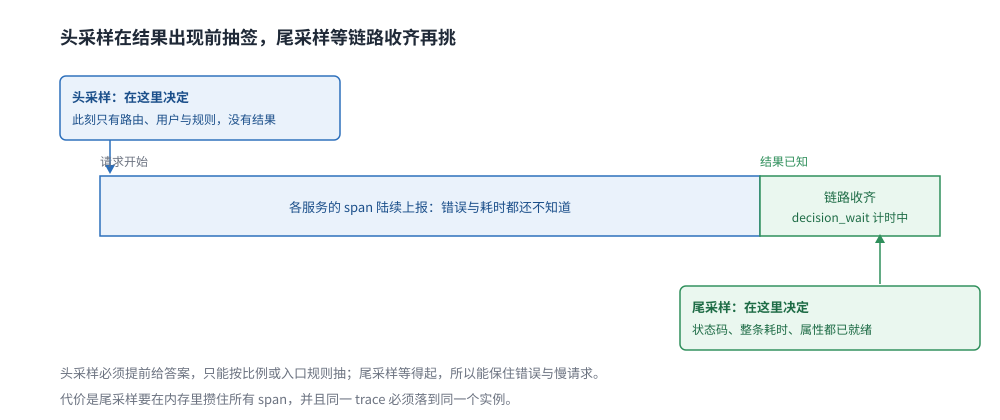
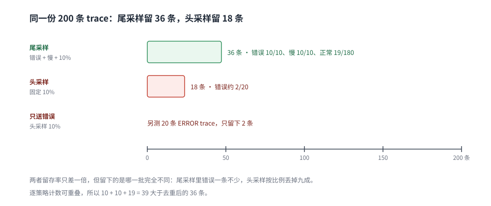

# 采样策略

> 覆盖：链路数据该留多少、在哪里决策、错误与慢请求怎么保证不丢。头采样（SDK 端）与尾采样（Collector 端）的决策时点、代价与实测留存率，以及采样与日志、指标之间的三角矛盾。
>
> 不覆盖：Collector 的配置结构、批处理与队列见 [Collector配置与调优.md](Collector配置与调优.md)；采样造成的静默断点见 [OpenTelemetry与关联分析.md](OpenTelemetry与关联分析.md) 第六节；采样后的数据能不能算 SLI 见 [SLO与错误预算.md](../告警与响应/SLO与错误预算.md) 1.4 节。
>
> 内容整理自个人学习笔记。**实测环境**：`otel/opentelemetry-collector-contrib:0.157.0`（Docker Desktop 4 核），以 OTLP/HTTP JSON 注入 200 条合成 trace（10 条 ERROR、10 条 800ms 慢请求、180 条正常），读数见第二至四节，校验范围见 `## 校验口径`。

---

## 一、采样到底在决定什么？

**本节要点**：采样不是「随机扔掉一部分数据」，而是**在成本与可查性之间选一个留存规则**。选错的代价不是多花钱，而是「出事时正好没有那条链路」。

### 1.1 三个采样位置

| 位置 | 能做决定的信息 | 典型手段 |
|---|---|---|
| **SDK（进程内）** | 请求开始时的上下文：路由、用户、是否命中规则 | `TraceIDRatioBased`、父级采样标记、自定义 sampler |
| **Collector（网关）** | **整条链路的结果**：耗时、状态码、属性 | 尾部采样（`tail_sampling`） |
| 后端 | 已经收下并计费的数据 | 保留期、降采样、TTL |

⭐ 判据：**要知道「结果」才能做的决定，只能放在 Collector**。头部采样在请求开始时就必须给出答案，那时错误还没发生。

### 1.2 采样率是唯一线性的成本旋钮

链路成本 ≈ QPS × 每请求 span 数 × 采样率 × 保留期。其余三项都由业务形态决定，只有采样率能在一个数量级内自由调。⚠️ 这也是为什么**降本第一板斧永远是采样**，而不是换存储。

## 二、头采样与尾采样差在哪？

**本节要点**：差别不在「留多少」，而在**决策时点**——头采样在结果未知时抽签，尾采样在结果已知后按规则挑。



图上两条时间线是同一个请求：头采样的判定发生在第一行之前，那时状态码与耗时都还不存在；尾采样要等 span 结束、链路收齐、`decision_wait` 到期后才做判定，因此能「错误全留、正常抽样」。

### 2.1 实测：同样的 200 条 trace，两种采样的留存

数据构成：10 条 ERROR（50ms）、10 条慢请求（800ms、状态正常）、180 条正常（50ms）。

| 采样方式 | 配置 | 实际留下 | 错误 trace 留存 |
|---|---|---|---|
| **尾采样** | `status_code=ERROR` + `latency>500ms` + `probabilistic 10%` | **36 条（18%）** | **10/10（100%）** |
| **头采样** | `probabilistic_sampler 10%` | **18 条（9%）** | 约 10%（单测见下） |

尾采样的 36 条构成可以逐项核对（Collector 内部指标，⚠️ 同一条 trace 可同时命中多条策略，所以三个策略计数相加 39 大于去重后的 36）：

```text
$ curl -s http://127.0.0.1:18891/metrics | grep -E "tail_sampling_(global_)?count_traces_sampled"
...{decision="sampled",policy="errors",sampled="true"} 10
...{decision="sampled",policy="slow",sampled="true"}   10
...{decision="sampled",policy="sample",sampled="true"} 19
...{decision="sampled",sampled="true"}                 36     # global
...{decision="not_sampled",sampled="false"}           164
```

头采样对错误一无所知：另跑一组只含 20 条 ERROR trace 的数据，10% 采样只留下 **2 条**。

```text
--- head sampling, 20 error traces ---
batches=1, spans=2
```

### 2.2 头采样的两个硬限制

| 限制 | 后果 | 缓解 |
|---|---|---|
| 不知道结果 | 90% 的错误链路被随机丢掉（实测 2/20） | 错误在 SDK 侧强制 `record and sample`（要业务代码配合） |
| 多进程判定不一致 | 同一条 trace 在不同服务上被判成不同结果，链路断裂 | 用 **traceID 一致性哈希**判定，不掷骰子 |

⚠️ 第二条是头采样最常见的坑：每个服务各自 `TraceIDRatioBased(0.1)`，看似一致，实际上父子 span 的采样决定由父级 `sampled` 标志传递才成立——只有**根节点**掷一次骰子、子节点继承，链路才是完整的。

### 2.3 尾采样的代价

| 代价 | 具体表现 | 调法 |
|---|---|---|
| **内存** | 所有 span 在 `decision_wait` 内必须留在内存 | `decision_wait` 从 30s 起步，别按「越大越准」调 |
| **必须按 traceID 路由** | 同一 trace 的 span 要落到同一个实例 | 前置 `loadbalancing` exporter，按 `traceID` 做一致性哈希 |
| **状态有 TTL** | `num_traces` 满了以后，旧 trace 被提前驱逐 | 按 `QPS × 每请求 span 数 × decision_wait` 估算 |

⭐ 估算口径：`num_traces ≈ QPS × decision_wait × 1.5`。1000 QPS、30s 窗口，就是 4.5 万条 trace 常驻。

## 三、策略怎么配：错误、慢请求、正常流量

**本节要点**：尾采样是**多条策略取并集**——任一条命中就留。三条策略分别覆盖「出错」「变慢」「正常抽样」三类，缺一条就会有一类故障在事后查不到。

### 3.1 三条策略

```yaml
processors:
  tail_sampling:
    decision_wait: 2s
    num_traces: 1000
    expected_new_traces_per_sec: 100
    policies:
      - name: errors
        type: status_code
        status_code:
          status_codes: [ERROR]
      - name: slow
        type: latency
        latency:
          threshold_ms: 500
      - name: sample
        type: probabilistic
        probabilistic:
          sampling_percentage: 10
```

| 策略 | 保什么 | 参数怎么定 |
|---|---|---|
| `status_code` | 所有 ERROR / UNSET 的链路 | 只留 ERROR；UNSET 是否算错误取决于 SDK 是否设置了状态 |
| `latency` | 慢请求 | 阈值取 SLO 的延迟线（如 P99 目标），不是拍脑袋 |
| `probabilistic` | 正常链路的抽样 | 10% 起步，按成本倒推 |

### 3.2 实测留存结构



图上是同一份 200 条 trace 的两种结果：尾采样留下 36 条（逐策略命中错误 10、慢 10、抽样 19，去重后 36），头采样留下 18 条且错误只剩约一成。差别不在总数，而在**留下的是哪一批**。

⚠️ **`latency` 用的是整条 trace 的耗时**（第一个 span 开始到最后结束），不是单个 span 的耗时。单 span 慢但整条快（并行调用）的链路不会被它命中。

### 3.3 三个配置错误

- **`decision_wait` 太小**：晚到的 span 被当成新 trace，尾部链路缺失；日志里会出现大量「第二段」trace。
- **没有 `loadbalancing` 却开了多个 Collector 副本**：同一 trace 的 span 被分到不同实例，每条都只有片段。
- **只开 probabilistic**：等于把头采样搬到后端，既花了内存又没保住错误。

## 四、采样之后：日志与指标怎么办

**本节要点**：三支柱必须用**同一套采样决策**，否则「按 trace_id 查日志」会在最需要的时候失效。

### 4.1 三角矛盾

| 信号 | 通常是怎样 | 采样后的现象 |
|---|---|---|
| 链路 | 尾采样后只剩 10~20% | 大部分请求没有 trace |
| 日志 | **不打折**，全量写入 | 日志里有 `trace_id`，但链路上查不到 → 静默断点 |
| 指标 | 聚合后与采样无关 | 指标正常，链路缺失，两边的「错误率」对不上 |

⭐ 这不是配置错误，而是**三者采样率不同的必然结果**。机制与排查见 [OpenTelemetry与关联分析.md](OpenTelemetry与关联分析.md) 6.1 节。

### 4.2 三个可行做法

| 做法 | 代价 | 适用 |
|---|---|---|
| 日志与链路用**同一决策**（SDK 侧把 `sampled` 写进日志字段） | 要改日志框架 | 排障强依赖 trace→log |
| 被丢弃的链路记一条**摘要 span**（只留根 span） | 额外规则 | 想要「有没有这条请求」的最小证据 |
| 只对**错误与慢请求**保证双写 | 存储不均衡 | 成本敏感、又不愿丢关键证据 |

⚠️ **指标不受采样影响**，但用 trace 派生的指标（`spanmetrics`）会受影响：它统计的是「被留下的 span」，绝对值不可用，比率在采样与结果无关时才成立（详见 [SLO与错误预算.md](../告警与响应/SLO与错误预算.md) 1.4 节）。

## 五、留存量与成本怎么算

| 步骤 | 算法 | 例（1000 QPS、每请求 10 span） |
|---|---|---|
| 1. 全量 span | QPS × 每请求 span 数 × 86400 | 8.64 亿 / 天 |
| 2. 尾采样留存 | 错误率 + 慢请求率 + 正常流量 × 10% | 约 10~20% |
| 3. 每日 span | 步骤 1 × 留存率 | 1.7 亿 / 天 |
| 4. 存储 | span 数 × 平均字节 × 副本 × 保留天数 | 按后端压缩比折算 |

⭐ 结论：**采样率决定了账单的量级，策略决定了账单花得值不值**。同样留 10%，只按比例抽和「错误全留 + 正常抽 8%」的成本几乎一样，后者在故障时的信息量高一个数量级。

## 应用场景

| 场景 | 建议策略 | 理由 |
|---|---|---|
| 核心交易链路 | 错误 100% + 慢请求 100% + 正常 20% | 出问题必须能查全链路 |
| 一般业务接口 | 错误 100% + 慢请求 50% + 正常 5% | 成本优先，错误仍保全 |
| 高 QPS 健康检查 / 静态资源 | 直接丢弃（filter） | 没有排障价值，纯噪声 |
| 调试期 / 新上线服务 | 临时 100% | 有时间窗，别长期开 |
| 合规要求留证 | 错误与关键业务链路 100%，不抽样 | 采样不能用于「必须留证」的数据 |

## 具体使用

### 6.1 头采样（SDK 侧）

```go
// 根节点掷一次骰子，子节点继承
sampler := sdktrace.ParentBased(sdktrace.TraceIDRatioBased(0.1))
tp := sdktrace.NewTracerProvider(sdktrace.WithSampler(sampler))
```

### 6.2 尾采样（Collector 侧）

完整配置见 3.1 节；多副本时必须加一层按 traceID 的路由：

```yaml
exporters:
  loadbalancing:
    routing_key: traceID
    protocol:
      otlp:
        tls:
          insecure: true
    resolver:
      static:
        hostnames: [collector-1:4317, collector-2:4317]
```

### 6.3 验证采样真的生效

| 判据 | 看哪里 |
|---|---|
| 留存率是否接近预期 | `otelcol_processor_tail_sampling_global_count_traces_sampled` 的 sampled / not_sampled 比 |
| 错误是否全留 | `{policy="errors",sampled="true"}` 是否等于上游错误 trace 数 |
| 是否有被拆断的 trace | 抽查 `new_trace_id_received` 与上游 trace 总数的比 |

⚠️ 用合成数据测试时，**traceID 要用随机值**。本机第一次用连续编号的 traceID（`0x3000+i`）测概率策略，命中 0/200；换成随机 traceID 后同配置命中 19/200。合成数据的编号方式本身就会影响抽样的统计行为。

## 校验口径

| 部分 | 状态 | 依据 |
|---|---|---|
| 尾采样留存 36/200（2.1、3.2） | ✅ 实跑 | Collector 内部指标逐策略读出 10 / 10 / 19，global 36 |
| 头采样 18/200（2.1） | ✅ 实跑 | `probabilistic_sampler 10%`，debug 输出 18 个 span |
| 头采样对错误 2/20（2.1） | ✅ 实跑 | 单独送入 20 条 ERROR trace，输出 2 个 span |
| `decision_wait` / `num_traces` 口径（2.3） | 经验归纳 | 按内存与 QPS 估算，未做容量压测 |
| 日志/指标三角矛盾（四） | 按机制推导 | 沿用 [OpenTelemetry与关联分析.md](OpenTelemetry与关联分析.md) 6.1 的实测结论 |
| 多副本 `loadbalancing`（3.3、6.2） | ⚠️ 未实测 | 本机无法建多容器网络，按官方文档陈述 |
| 成本估算（五） | 估算口径 | 公式与量级推算，非实测账单 |

## 延伸追问

- **采样率 10% 够不够排障？** → 看故障形态。单点错误有 `status_code` 策略兜底，够；「偶发慢」这类没有错误码的问题，只能靠 `latency` 阈值覆盖。想靠随机抽样碰运气，10% 往往不够。
- **为什么尾采样要在 Collector 做，不能在后端做？** → 后端做等于先把带宽与入库成本付掉，再删数据；Collector 是在数据出机房之前就做决定。
- **头采样能不能也保错误？** → 只有在 SDK 侧能判断「这次请求失败了」时才行（如 HTTP 中间件在结束时手工 `SetStatus` 并强制采样），本质上是把一部分尾采样逻辑前移。
- **`decision_wait` 设 30s 会不会太短？** → 短链路够；跨异步调用（MQ、定时任务）的链路可能几分钟才收齐，要么拉长窗口，要么用「根 span 先到、后续 span 追加」的关联方式，后者依赖后端支持。
- **采样后指标还准吗？** → 用服务端计数器算的指标完全不受影响；由 span 派生的指标只反映「留下的那部分」，只能看比率，不能看绝对值。
- **能不能只采样日志、不采样链路？** → 会加剧 4.1 的静默断点：日志里全是 ID，链路上查不到。要么两边同决策，要么接受「日志按 ID 回捞」这条排障路径不可用。

## 关联

- **上游/总纲**：[可观测性选型对比.md](../可观测性选型对比.md) — 三支柱成本账，采样是链路的唯一线性旋钮
- **下游/配置**：[Collector配置与调优.md](Collector配置与调优.md) — `tail_sampling` 的处理器顺序、队列与自监控
- **上游/缝合**：[OpenTelemetry与关联分析.md](OpenTelemetry与关联分析.md) — 采样造成的静默断点与 `resource` 地基
- **对照/互补**：[日志采集管道.md](../日志系统/日志采集管道.md) — 日志侧的采样与多行拼接，和链路采样的口径差异
- **下游/度量**：[SLO与错误预算.md](../告警与响应/SLO与错误预算.md) — 采样数据能不能算 SLI、比率何时仍然成立
- **下游/告警**：[告警规则与阈值设计.md](../告警与响应/告警规则与阈值设计.md) — 告警依赖指标而非链路，正是为了绕开采样
