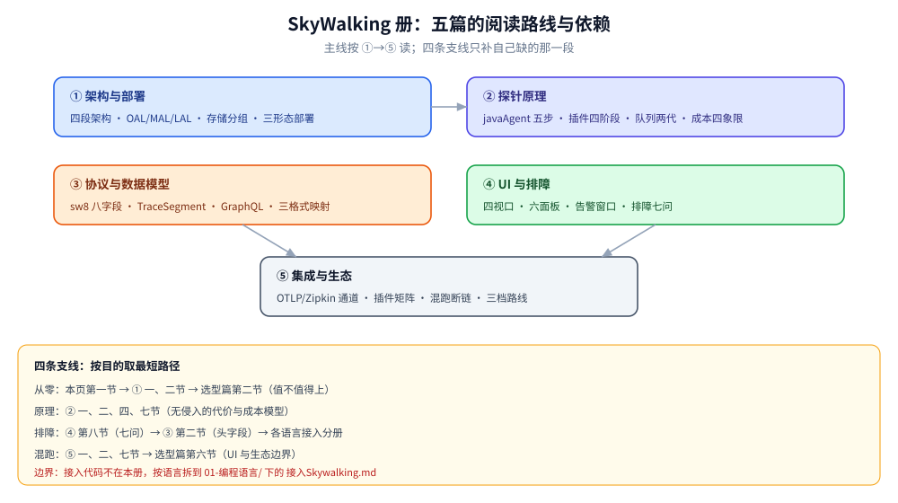

# Skywalking 目录导读

> 本册把 SkyWalking 拆成 **5 篇零件 + 1 篇导读**：从零（它替你省了哪一步）→ 架构与部署（数据被谁加工、怎么装起来）→ 探针原理（无侵入怎么做到、代价多大）→ 协议与数据模型（上报的字节与查询报文）→ UI 与排障（面板怎么读、读不出来怎么查）→ 集成与生态（与 OTel / Prometheus / K8s 怎么拼）。
>
> 不覆盖：三支柱分工、五层选型与三套组合见 [可观测性选型对比.md](../可观测性选型对比.md)（唯一决策入口）；OTel 路线的完整落地见 [README.md](../Jaeger/README.md)；指标数学（分位数、燃烧率）只在选型篇；各语言接入代码按语言拆到语言目录（见第三节末表）。
>
> 内容整理自个人学习笔记。**当前参考版本 11.0.0**，本册带一组本机容器实测：`apache/skywalking-oap-server:11.0.0` + `apache/skywalking-banyandb:0.11.0`（`standalone`）+ `apache/skywalking-ui:latest`（Horizon），单机 Docker Desktop。各篇逐处标注读数，哪些跑了、哪些没跑见第四节。

---

## 一、一句话定位与它凭什么

**本节要点**：SkyWalking 是**探针式 APM**——它的价值不在「能看链路」（Jaeger 也能），而在**探针替你做掉了埋点的那六件事**，并且在**写入时就把 span 折成指标与拓扑**，所以打开面板就有大盘。

| 维度 | SkyWalking | Jaeger / OTel SDK |
|---|---|---|
| 数据怎么来 | 自研 Agent（字节码增强 / 编译期注入 / 扩展 / patch） | 手工埋点或 auto-instrumentation |
| 传播头 | `sw8`（8 字段） | W3C `traceparent`（4 段） |
| 写时聚合 | ⭐ 有：OAL 边写边算指标与拓扑边 | 无：只存原始 span |
| 打开 UI 第一眼 | 大盘 + 拓扑 + Apdex | 先要有 trace 才有内容 |
| 想查新维度 | 改 OAL 脚本并重启 OAP | 直接对 span 检索 |
| 绑定 | 与自家 Agent / 存储生态绑定 | 后端可替换（任意 OTLP 后端） |

⭐ 一条分水岭：**「大盘优先」选 SkyWalking，「临时问题优先」选存原始 span 的路线**。两者都收 OTLP，但收进来的数据走的是「只存」通道，不走 OAL 的指标链（见 [集成与生态.md](集成与生态.md) 第一节）。

⚠️ 它**不是方法级诊断系统**：能追到方法级 span，但抓方法参数要单独评估开销（Profile 是另一条路，见 [UI与排障.md](UI与排障.md) 第五节）。

---

## 二、核心概念速览

**本节要点**：先记住「三个实体 + 一条链 + 三个引擎」，剩下的名词都是它们的修饰。

| 概念 | 一句话 | 详见 |
|---|---|---|
| **Service / Instance / Endpoint** | 指标永远挂在这三个实体上：服务 → 实例 → 接口 | [架构与部署.md](架构与部署.md) 第二节 |
| **Layer** | 计算机科学的抽象层（`GENERAL` / `K8S` / `MESH`），用于组织面板与筛选 | 同上 |
| **Trace / TraceSegment / Span** | 完整链路 / 单服务实例内的采集单元 / 一次操作 | 同上 |
| **Span 类型** | **Entry**（入口）/ **Exit**（出口）/ **Local**（内部方法）；拓扑的边由 Entry + Exit 配对产生 | [协议与数据模型.md](协议与数据模型.md) 第四节 |
| **`sw8`** | 跨进程传播头，8 字段、`-` 分隔、< 2 KB、字符串 Base64 | [协议与数据模型.md](协议与数据模型.md) 第二节 |
| **OAL / MAL / LAL** | 三类流式分析引擎：trace 与 mesh 日志 / meter / 日志 | [架构与部署.md](架构与部署.md) 第四节 |
| **OAP** | 接收 + 分析 + 查询的后端（`Observability Analysis Platform`） | [架构与部署.md](架构与部署.md) 第三节 |
| **MQE** | 指标查询表达式，v10+ 告警规则的默认语法 | [UI与排障.md](UI与排障.md) 第七节 |
| **DataCarrier / BatchQueue** | 探针与 OAP 侧的队列内核（10.4 起换代，语义不变） | [探针原理.md](探针原理.md) 第四节 |

⭐ 层级关系一句话：**一条 trace = 多个 segment（每服务一段）= 每段里多棵 span 树**；segment 之间靠 `refs[]` 接，跨进程那一跳靠 `sw8`。

---

## 三、阅读路线

**本节要点**：四条路线对应四种人：**从零了解 / 要原理 / 要排障 / 要混跑**。每篇的知识点描述见 [目录.md](../../../../目录.md)，此处只给顺序与依赖。

| 顺序 | 篇 | 视角 | 什么时候读 |
|---|---|---|---|
| ① | [架构与部署.md](架构与部署.md) | ⭐ **主线** | 想知道「数据从探针到 UI 被谁加工过」，或者正要装一套起来 |
| ② | [探针原理.md](探针原理.md) | 原理 | 关心「无侵入到底怎么做到、开销多大」，或要评估接入成本 |
| ③ | [协议与数据模型.md](协议与数据模型.md) | 字节层 | 链路断在半路、要抓包核对，或要自己做客户端/适配器 |
| ④ | [UI与排障.md](UI与排障.md) | 排障 | 面板看不懂，或「查不到 / 缺边 / 只有半条」要找原因 |
| ⑤ | [集成与生态.md](集成与生态.md) | 边界 | 要和 OTel / Prometheus / K8s 拼，或规划三档接入路线 |

### 3.1 四条路线

| 目的 | 按这个顺序读 |
|---|---|
| **从零了解它值不值得上** | 本页第一节 → [架构与部署.md](架构与部署.md) 一、二节 → [可观测性选型对比.md](../可观测性选型对比.md) 第二节 |
| **搞懂「无侵入」的代价** | [探针原理.md](探针原理.md) 一、二、四、七节 → 选型篇「契合语言」小节 |
| **链路断在半路** | [UI与排障.md](UI与排障.md) 第八节（七问）→ [协议与数据模型.md](协议与数据模型.md) 第二节 → 对应语言的 `接入Skywalking.md` |
| **要和现有栈拼起来** | [集成与生态.md](集成与生态.md) 一、二、七节 → [可观测性选型对比.md](../可观测性选型对比.md) 第六节 |

### 3.2 依赖关系（谁要前置）

| 本篇 | 建议先读 | 为什么 |
|---|---|---|
| 架构与部署.md | 本页一、二节 | 不先有实体与 segment 的概念，「分析引擎吃什么」看不懂 |
| 探针原理.md | 架构与部署.md 第二、三节 | 探针产出的是 segment，不知道 segment 就没法理解队列里装的是什么 |
| 协议与数据模型.md | 架构与部署.md 第二、三节 | 报文里的字段全对应那三个实体 |
| UI与排障.md | 架构与部署.md（至少第一、三节） | 面板显示的是聚合结果，不知道口径会把口径差当故障 |
| 集成与生态.md | 协议与数据模型.md 第七节 | 混跑断链的本质是头格式不一致 |

### 3.3 语言分册（接入代码不在本册）

| 语言 | 篇 | 覆盖内容 |
|---|---|---|
| Go | [接入Skywalking.md](../../../../01-编程语言/go/可观测性/接入Skywalking.md) | 编译期注入（`-toolexec`）、`toolkit/trace` 手动埋点、跨 goroutine 快照、OTel SDK + OTLP 备选、两条路线对比 |
| Java | [接入Skywalking.md](../../../../01-编程语言/java/可观测性/接入Skywalking.md) | `-javaagent` 接入、配置优先级、插件目录、Spring Boot / Dockerfile / K8s、日志与跨线程关联、优雅停机 |
| PHP | [接入Skywalking.md](../../../../01-编程语言/php/接入Skywalking.md) | 扩展安装、php.ini、三种 reporter、容器化四坑、PSR-3 日志上报 |

---

## 四、本轮实测坐标

**本节要点**：本册的实测只覆盖「后端起得来、查得通」这一层；**没有挂任何语言探针**，所以链路、面板、Profile 都没有真实读数——相关结论按官方口径陈述，逐篇在文末「校验口径」标状态。

| 项 | 状态 | 读数 / 说明 |
|---|---|---|
| 三容器冷启动 | ✅ 实跑 | 约 4~6 分钟到就绪，schema 安装日志约 5.5k 行 |
| `{ version }` | ✅ 实跑 | `11.0.0-6f1fd78` |
| `{ listServices }` | ✅ 实跑 | `[]`（无 Agent，属正常） |
| UI 首页 | ✅ 实跑 | `http://127.0.0.1:8080/` → 200 |
| UI 登录进面板 | ⚠️ 未验证 | Horizon 无默认账号，需 `HORIZON_AUTH_LOCAL_USERS` + argon2id 哈希 |
| OAL 引擎 | ✅ 实跑 | `OAL Engine V2`，生成 296 个指标类、5 个 dispatcher 类 |
| OAP 容器线程数 | ✅ 实跑 | 稳态 58（容器内 OS 线程口径） |
| 语言探针（Java / Go / PHP / Node） | ⚠️ **全部未跑** | 各篇结论按官方文档与源码结构陈述 |
| OTLP / Zipkin 双路同发 | ⚠️ 未跑 | 接收器配置取自发行包，未实发 |
| Profile / 告警触发 / webhook | ⚠️ 未跑 | 告警规则原文取自容器内出厂配置 |
| 集群与 K8s 形态 | ⚠️ 未跑 | 按官方组件划分与配置项陈述 |

版本矩阵与本机口径的完整读数见 [架构与部署.md](架构与部署.md) 第十节。

---

## 五、本册的边界

| 本册收 | 不收（在哪） |
|---|---|
| 探针式 APM 的定位、与 OTel / Jaeger 的分水岭 | **五层选型与三套组合** → [可观测性选型对比.md](../可观测性选型对比.md) |
| OAP 的四段架构、三类分析引擎、存储分组、部署三形态 | **各语言接入代码与配置项** → 三篇 `接入Skywalking.md`（见 3.3） |
| 探针无侵入原理、队列内核两代、跨进程载体 | **OTel 埋点本身** → [采集与传播.md](../Jaeger/采集与传播.md) |
| `sw8` / TraceSegment / GraphQL 的字节与结构 | **指标数学**（分位数、燃烧率）→ 选型篇第八节 |
| 六个面板的读法 + 七类症状的排障剧本 | **主机侧观测**（perf / eBPF / 火焰图）→ [性能排查.md](../../../../02-计算机基础/linux/性能排查.md) |
| 与 Prometheus / 日志 / K8s 的拼装与三档接入路线 | **告警处置流程 / SRE 值班** → 无（属流程而非知识） |

⚠️ 一个刻意的不收：**不建议并行双报**（两套探针同时上报）。这件事的判断依据写在 [集成与生态.md](集成与生态.md) 第一节，但「怎么争取团队资源」不属本册。

---

## 延伸追问

- **SkyWalking 和 Jaeger 到底该选哪个？** → 看「谁产生数据」与「要不要写时聚合」：探针成熟、要多语言零改码、要开箱大盘 → SkyWalking；要后端可替换、要自由检索、Go 为主 → OTel + Jaeger。完整判据在 [可观测性选型对比.md](../可观测性选型对比.md) 第二节。
- **11.0.0 和我在网上看到的教程对不上，谁过时了？** → 大概率是教程。四个断点：H2 移除（10.2）、BanyanDB 配置挪到 `bydb.yaml`（10.2）、BatchQueue 替代 DataCarrier（10.4）、UI 换 Horizon + MQE 告警（11.x）。逐条见 [架构与部署.md](架构与部署.md) 第九节。
- **链路断了，先看哪一层？** → 先看「头有没有传到」（拓扑缺边 / traceId 变新），再看「字段填没填对」，最后才怀疑 OAP。七步顺序在 [UI与排障.md](UI与排障.md) 第八节。
- **采样设多少合适？** → 用条数上限而不是比例：先按容量预算定「每 3 秒 N 条」，再给关键接口配 `force_sample`。条数换算公式见 [架构与部署.md](架构与部署.md) 第八节。
- **能不能只上 SkyWalking 的存储和 UI，探针还用 OTel？** → 能（OTLP 收得下），但会丢掉 segment 语义与 Profile，链路还要求传播头端到端统一。三种混跑结局见 [集成与生态.md](集成与生态.md) 第七节。
- **本地开发有必要上三容器吗？** → 有。H2 已在 10.2 移除，没有「轻量单进程」这个选项了；好在 `standalone` 的 BanyanDB 一个容器就够。

---

## 关联

- [可观测性选型对比.md](../可观测性选型对比.md) — **唯一决策入口**：三支柱分工、五层选型、三套组合
- [README.md](../Jaeger/README.md) — **直接对照面**：OTel 路线（Jaeger 册导读：概念、五篇零件、实测坐标）
- [目录.md](../../../../目录.md) — 全仓知识点索引
- [素材清单.md](../../../../素材清单.md) — 本目录素材出处登记
- [接入Skywalking.md](../../../../01-编程语言/java/可观测性/接入Skywalking.md) — 三篇语言分册之一（Java 侧最完整），另两篇见 3.3

