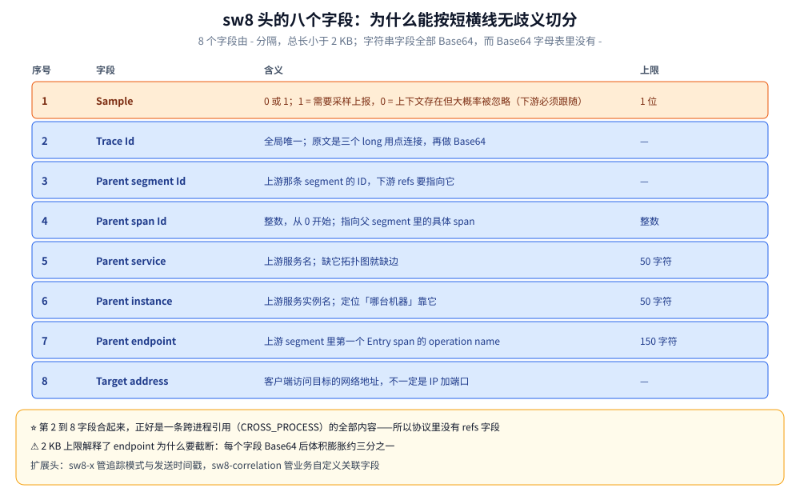
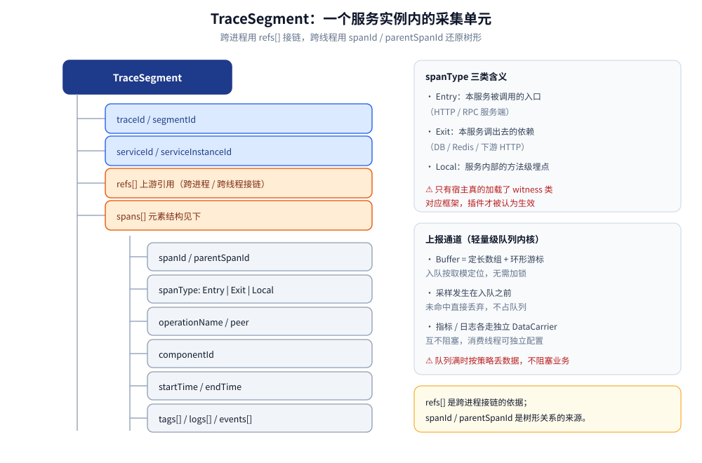
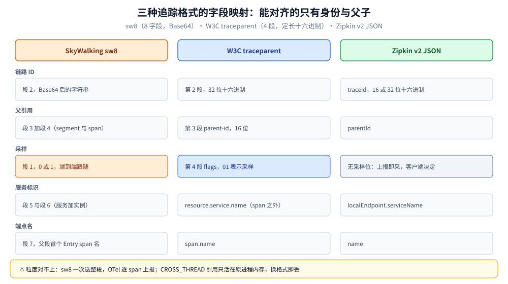

# 协议与数据模型

> 本篇拆四样东西的字节与结构：跨进程传播头 **`sw8`**（八个字段的布局、Base64 与长度上限的由来、两个扩展头）、**TraceSegment / Span** 的数据模型（`refs[]` 怎么接链）、**上报通道**（gRPC 服务与批量语义）、**查询接口**（GraphQL 高频 query 与原样的 `Duration` 参数）。
>
> 为什么单独成篇：面板上的每个结论都能追到这几层字节——「拓扑缺边」追到 `sw8` 里少了哪个字段，「查不到数据」追到 `Duration.step` 与 `coldStage`。把它塞进探针篇或 UI 篇，两篇都会变厚且互相打架。
>
> 实测环境：`{ version }` 与 `{ listServices { name } }` 在本机 OAP 11.0.0 上实跑（返回 `11.0.0-6f1fd78` 与 `[]`）；其余 query 与上报报文**未实测**，按官方 Query Protocol 与 v3 传播协议文档陈述。逐项见文末「校验口径」。

---

## 一、一句话定位：为什么看字节比看面板更能定位问题

**本节要点**：面板是**结论的展示层**，字节是**因果的发生层**。同一条断链，面板只会告诉你「拓扑缺边」，而 `sw8` 的八个字段能告诉你**是在哪一跳少写了哪一个字段**。

| 现象（面板） | 追到的字节层 | 一句话判断 |
|---|---|---|
| 拓扑图缺一条边 | `sw8` 的 Parent service / Parent endpoint 为空 | 上游 Exit span 建了但没注入服务标识 |
| 下游 trace 是新的 traceId | `sw8` 整头丢失 | 中间件/网关裁掉了 header |
| 一次请求拆成两条毫不相干的 trace | 头格式不一致（`traceparent` vs `sw8`） | 载体换了、语义没换 |
| 日志面板查不到这条请求的日志 | 日志里没有 traceId 字段 | LAL 没提取 `traceId`，或业务日志没打 |
| 查询返回空但数据明明有 | GraphQL 的 `Duration.step` / 时间窗 | 时间粒度不对，桶里没值 |

⭐ 判据：**先确认「头有没有传到」，再确认「字段有没有填对」，最后才看 OAP 算得对不对**。顺序反了就会在 OAP 里找半天，而问题在第 1 跳的 header。

---

## 二、`sw8`：八个字段的布局

**本节要点**：`sw8` 是 **8 个字段**、用 `-` 分隔、总长 **< 2 KB**；字符串字段全部 Base64——这不是为了加密，而是为了让「按 `-` 无歧义切分」成立。

### 2.1 字段表

| # | 字段 | 类型 | 含义 | 上限 |
|---|---|---|---|---|
| 1 | **Sample** | `0` / `1` | `1` = 本次 trace 需要采样并上报；`0` = 上下文存在但**大概率被忽略** | — |
| 2 | **Trace Id** | Base64 字符串 | 全局唯一链路 ID；原文是「三个 long 用 `.` 连接」再 Base64 | — |
| 3 | **Parent trace segment Id** | Base64 字符串 | 上游那条 segment 的 ID（下游的 `refs[]` 要指向它） | — |
| 4 | **Parent span Id** | 整数 | 上游 span 的编号，**从 0 开始**；指向父 segment 内的具体 span | — |
| 5 | **Parent service** | Base64 字符串 | 上游服务名 | ≤ 50 个 UTF-8 字符 |
| 6 | **Parent service instance** | Base64 字符串 | 上游服务实例名 | ≤ 50 个 UTF-8 字符 |
| 7 | **Parent endpoint** | Base64 字符串 | 上游 segment 里**第一个 Entry span** 的 operation name | < 150 个 UTF-8 字符 |
| 8 | **Target address** | Base64 字符串 | 客户端访问目标用的网络地址（**不一定是 IP:PORT**，也可能是域名/逻辑名） | — |

官方示例（字段值只写形状）：

```text
sw8: 1-TRACEID-SEGMENTID-3-PARENT_SERVICE-PARENT_INSTANCE-PARENT_ENDPOINT-IPPORT
```



上图是字段顺序的视觉版；真正值得记的是下面三处「按字节读才会想到」的细节，它们决定这条头在网关与长域名场景里会不会被截断。

### 2.2 三个只有看字节才会想到的点

**① 为什么可以按 `-` 无歧义切分？** 因为所有字符串字段都做了 Base64，而 Base64 的字母表（`A–Z` `a–z` `0–9` `+` `/` `=`）里**没有 `-`**。traceId 原文里那个 `.` 分隔符也因此不会与分隔符打架。这是「编码方式服务于解析方式」的典型设计——不是随手选的编码。

**② 第 2~8 字段正好是一条跨进程引用的全部内容。** 下游拿这 7 个字段就能还原出一条 `CROSS_PROCESS` 类型的 `refs[]`：父 segment ID、父 span ID、父服务、父实例、父端点、网络地址，加上 traceId 对齐。所以**协议里没有 `refs` 字段**——refs 是下游根据头自己造出来的；只有 `CROSS_THREAD`（同进程跨线程）的引用才完全活在本进程内存里。

**③ 2 KB 上限解释了 endpoint 为什么要截断。** 第 7 字段限 150 字符，Base64 后约 200 字节；再叠加服务名、实例名、地址，8 个字段合起来逼近上限时，只能从最长的字段下手。**这条限制在网关/长域名场景下会真的撞上**：撞上时头被截断，表现就是下游解析失败或字段错位。

### 2.3 Sample 位是「下游跟随」的锚

第 1 字段不只是「这次要不要采」：下游**必须跟随上游的决策**（上游 `1`，下游也只能采），否则会出现「上游有 trace、下游没有」的半条链路。这也是为什么混用两套探针时最容易出问题的地方之一是采样——两套采样器各按各的规矩决定，链就断在中间。

---

## 三、两个扩展头：`sw8-x` 与 `sw8-correlation`

**本节要点**：`sw8-x` 管「这条链路怎么被处理」（跳过分析、异步耗时），`sw8-correlation` 管「业务自定义关联字段」——两者都是**可选**的，缺了不影响接链，但缺了会影响判定与检索。

| 头名 | 字段 | 作用 | 缺失后果 |
|---|---|---|---|
| `sw8-x` | Tracing Mode（空 / `0` / `1`） | `1` 表示该上下文里生成的所有 span 都跳过分析（`skipAnalysis=true`） | 该跳过的请求仍进 OAL，白算指标 |
| `sw8-x` | Send Timestamp（客户端发送时间） | 供**异步 RPC**（典型是 MQ）算「发送到接收」的耗时，自动打 `transmission.latency` 标签 | 消息链路只能看到消费侧耗时，看不到排队时长 |
| `sw8-correlation` | 自定义键值对 | 业务关联字段（租户、订单号等），供检索与串联 | 只能靠 traceId 反查，跨系统关联缺抓手 |

⭐ `sw8-x` 的第二个字段是**异步链路的唯一真相来源**：MQ 场景里「生产者发出」与「消费者开始处理」之间隔了多久，探针自己是不知道的，只能靠生产者把发送时间写进头里带过去。

> ⚠️ `sw8-correlation` 的精确分隔符与字段编码细节本篇**未逐字核对官方协议页**（语义按官方文档口径），要用到具体字节时以官方 v3 协议页为准。

---

## 四、TraceSegment 与 Span 的形态

**本节要点**：segment 是「一个服务实例内的采集单元」，span 是它内部的操作节点；**`refs[]` 是 segment 级别的字段，不是 span 级别的**——这是它和 OTel 模型最大的结构差异。

```text
TraceSegment                        // 一次请求在「一个服务实例内」的采集单元
 ├─ traceId / segmentId             // 全局链路 ID / 本次 segment 的 ID
 ├─ serviceId / serviceInstanceId   // 服务与实例标识（来自探针配置）
 ├─ refs[]                          // 上游引用：CROSS_PROCESS / CROSS_THREAD
 └─ spans[]
      ├─ spanId / parentSpanId      // 树形关系的来源
      ├─ spanType: Entry|Exit|Local // 入口 / 出口 / 本地
      ├─ operationName / peer       // 操作名（HTTP 路径、SQL），peer 为对端地址
      ├─ componentId                // 组件标识（对应 OAP 的 component-libraries.yml）
      ├─ startTime / endTime        // 瀑布图的原始数据
      └─ tags[] / logs[] / events[] // 标签、日志、事件（异常等）
```



图中的 `refs[]` 在段头、`spans[]` 在段内——这个层级差异决定了「接链」与「还原树形」是两件独立的事，也决定了 OAP 拼装整条 trace 的成本是 O(段数) 而不是 O(span 数)。

### 4.1 三种 span 类型决定了「谁能产生边」

| span 类型 | 语义 | 与拓扑的关系 |
|---|---|---|
| **Entry** | 本服务的入口（收到的请求） | 与上游的 Exit 配对 → **产生一条边** |
| **Exit** | 调出去（HTTP client / DB / MQ 生产） | 负责注入上下文；对端没探针时它是链路终点 |
| **Local** | 服务内部方法 | 不产生边，只影响瀑布图的 Self Duration |

⭐ 一条边的成立条件可以精确到字段：**上游 Exit span + 下游 Entry span + 中间 `sw8` 完整**，三者缺一，边就不出现。这也解释了为什么「两端都接了探针却没有边」——多数情况是中间那一跳把 header 吃掉了（网关、Nginx、框架自定义的 header 白名单），而不是探针没增强。

### 4.2 `refs[]` 为什么挂在 segment 上而不是 span 上

- 语义上：**一个 segment 只对应一个入口**，所以「上游是谁」这件事对整段唯一，挂在 segment 上不必在每个 span 里重复。
- 工程上：接链成本从「扫全量 span 找父」降到「读段头一个字段」。OAP 拿到一段就知道父段是谁，拼装整条 trace 的复杂度是 O(段数)，而不是 O(span 数)。
- 代价：表达力弱于 OTel 的 span link（多条链路交织的场景表达不了）。这是「为分析性能优化」在数据模型上的具体体现——协议文档自己也这么写：头比通用追踪系统复杂，是为了 OAP 的分析性能。

---

## 五、上报通道：gRPC 批量与服务端安全阀

**本节要点**：上报走 gRPC，**语义是批量、尽力而为、不落盘重发**；OAP 侧 `maxMessageSize` 默认 50 MB 是单条消息的安全阀，不是「批量上限」。

| 项 | 值 | 说明 |
|---|---|---|
| 通道 | gRPC，核心端口 **11800**（`SW_CORE_GRPC_PORT`） | 与 JVM 指标、meter 共用同一端口 |
| 服务 | `TraceSegmentReportService` 的 `collect` | agent 侧客户端类为 `TraceSegmentReportServiceClient` |
| 批量 | 从队列按批取出后一次发送 | 批量大小由队列消费批决定（见 [探针原理.md](探针原理.md) 第四节） |
| 单条消息上限 | **50 MB**（`SW_CORE_GRPC_MAX_MESSAGE_SIZE` 默认 `52428800`） | 超限是「一条 gRPC 消息装不下」，不是「一批太多」 |
| 失败处理 | 该批次按队列策略丢弃，**不落盘、不重发** | 与「宁可丢数据也不拖慢业务」同一取向 |

⚠️ 最后一行是理解很多现象的关键：**OAP 挂了 5 分钟，这 5 分钟的数据不会「补上来」**。所以「数据有个洞」不一定是查询的问题，也不一定是采样，可能只是上报窗口里 OAP 不可用。该行为按设计取向与官方说明陈述，**本机未做 OAP 停机-恢复的数据补发实测**。

---

## 六、查询接口：GraphQL 的六个高频 query

**本节要点**：UI 的所有面板都走同一个 `POST /graphql`（GET 会 405），看懂六个 query 就够覆盖「服务列表 → 链路 → 拓扑 → 指标 → 告警」全部面板；最容易踩的是 `Duration`。

### 6.1 六个 query

| Query | 关键参数 | 干什么 | 对应面板 |
|---|---|---|---|
| `version` | — | 查 OAP 版本（**探活首选**，不依赖存储） | 页脚版本号 |
| `listServices(layer)` | `layer` 可空 | 列出已注册服务；`[]` 表示**没有任何 Agent 上报** | 全局服务下拉、Dashboard |
| `queryBasicTraces(condition)` | `TraceQueryCondition`（服务/实例/端点/时间/状态/关键词） | 查链路**摘要列表**（按耗时排序的那一栏） | Trace 左栏 |
| `queryTrace(traceId, duration)` | traceId 必填；`duration` **可选**（BanyanDB 下不传只查最近 1 天） | 取某条 trace 的 segment 与 span | Trace 瀑布图 |
| `getGlobalTopology(duration, layer)` | 时间窗、层 | 全局拓扑（节点 + 边） | 拓扑图 |
| `execExpression(expression, entity, duration)` | MQE 表达式 + 实体 | 指标/MQE 查询，告警规则的同一套表达式 | Dashboard 图表、告警验证 |
| `getAlarm(duration, scope, keyword, paging)` | 时间窗 + 范围 + 分页 | 告警记录列表 | 告警面板 |

另有 `hasQueryTracesV2Support`（能力探测）与 `queryTraces`（Trace V2）——**客户端要先用前者问一句支不支持**，再决定走 V1 还是 V2，这是升级期兼容的标准做法。

### 6.2 原样的 GraphQL 请求与实测返回

```bash
curl -s -XPOST http://127.0.0.1:12800/graphql \
  -H 'Content-Type: application/json' \
  -d '{"query":"{ version }"}'
# → {"data":{"version":"11.0.0-6f1fd78"}}

curl -s -XPOST http://127.0.0.1:12800/graphql \
  -H 'Content-Type: application/json' \
  -d '{"query":"{ listServices { name } }"}'
# → {"data":{"listServices":[]}}   ← 空数组 = 还没有 Agent 上报，属正常
```

### 6.3 `Duration` 是查询返回空的第一嫌疑

```graphql
input Duration {
    start: String!
    end: String!
    step: Step!
    coldStage: Boolean   # 仅 BanyanDB：是否查冷阶段，默认 false
}
enum Step { MONTH DAY HOUR MINUTE SECOND }
```

- **`step` 决定时间字符串的格式**：`SECOND` → `yyyy-MM-dd HHmmss`；`MINUTE` → `yyyy-MM-dd HHmm`；`HOUR` → `yyyy-MM-dd HH`；`DAY` → `yyyy-MM-dd`；`MONTH` → `yyyy-MM`。格式与 step 不匹配，轻则空结果，重则解析报错。
- **`step` 也决定桶的粒度**：分钟级指标用 `SECOND` 查会得到「大部分桶没值」的图。UI 会自动按时间窗选 step，手写 curl 不会。
- **`coldStage` 只对 BanyanDB 有效**：数据已下沉到冷节点而没开这个标志，查不到，但数据其实还在。
- **`queryTrace` 的 `duration` 在 BanyanDB 下不传就只查最近 1 天**——这是个会让人误判成「数据丢了」的默认值。

---

## 七、与 OTLP / Zipkin 的字段映射

**本节要点**：三种格式能互转的只有「身份」与「父子关系」；**粒度与语义对不上**的部分（segment、refs、采样跟随）必须靠适配层补，这就是混跑会断的根。



| 语义 | SkyWalking `sw8` | W3C `traceparent` | Zipkin v2 JSON |
|---|---|---|---|
| 链路 ID | 段 2（Base64） | 第 2 段，**32 位十六进制** | `traceId`（16 或 32 位十六进制） |
| 父引用 | 段 3 + 段 4（segmentId + spanId） | 第 3 段 `parent-id`（16 位十六进制） | `parentId` |
| 采样 | 段 1（`0` / `1`） | 第 4 段 `flags`（`01` = sampled） | 无采样位（**上报即采**，采样在客户端做） |
| 服务标识 | 段 5 / 段 6（服务 + 实例） | `resource.service.name`（span 之外） | `localEndpoint.serviceName` |
| 端点名 | 段 7（父段首个 Entry span） | `span.name` | `name` |
| 目标地址 | 段 8 | 无直接对应（靠 `peer.service` 等属性） | `remoteEndpoint` 或 tag |

`traceparent` 的形状（W3C 规范给的示例，四段）：

```text
traceparent: 00-4bf92f3577b34da6a3ce929d0e0e4736-00f067aa0ba902b7-01
             │  └─ trace-id (32 hex) ─────────┘ └─ parent-id ─┘ └ flags
             └ version
```

### 7.1 三处不可逆的差异

1. **上报粒度**：SkyWalking 一次 RPC 送**整段**（含多个 span）；OTel 是逐 span 进 BatchSpanProcessor。所以 OTLP 数据进 SkyWalking 后是「按 span 重建 segment」，链路的原始分段结构会变。
2. **refs 的两种类型**：`CROSS_PROCESS` 能从头上还原，**`CROSS_THREAD` 还原不了**——它只活在原进程内存里。跨格式迁移时，跨线程那一段的父子关系会塌成平级。
3. **采样语义**：`sw8` 的 sample 位是**端到端跟随**；Zipkin 没有采样位（客户端决定报不报）。两套混跑时「上游采了、下游没采」无法从协议层发现，只能看链路缺段。

> ⚠️ 混跑的具体配置与断链复现放在 [集成与生态.md](集成与生态.md)，本篇只做字段对齐。

---

## 校验口径

| 内容 | 状态 |
|---|---|
| `sw8` 八字段顺序、`-` 分隔、< 2 KB、字符串字段 Base64、各字段长度上限 | ✅ 与官方 v3 传播协议文档逐条对齐（文档原文：Header Value: 8 fields split by `-`，长度 < 2k） |
| traceId 原文为「三个 long 用 `.` 连接」再 Base64 | ✅ 官方中文文档原文口径 |
| `sw8-x` 两字段（tracing mode / send timestamp → `transmission.latency`） | ✅ 官方协议文档原文 |
| `sw8-correlation` 语义 | ⚠️ 语义按官方口径，**分隔符与编码细节未逐字核对**，使用时以协议页为准 |
| TraceSegment / Span 字段与 `refs[]` 类型 | ✅ 字段与官方数据结构一致；⚠️ **未抓过真实上报的 protobuf 报文字节**，「段 2~8 = 一条 CROSS_PROCESS 引用」为按字段语义推导 |
| gRPC 服务名 `TraceSegmentReportService.collect`、50 MB 上限、不落盘重发 | ✅ 服务名与端口/上限取自发行包与文档；⚠️ 停机后不补发**未做实测** |
| GraphQL 六个 query 名称与参数 | ✅ 与官方 Query Protocol 逐条对齐（`listServices(layer)` / `queryBasicTraces` / `queryTrace(traceId, duration)` / `getGlobalTopology` / `execExpression` / `getAlarm`） |
| `{ version }` 与 `{ listServices }` 实测 | ✅ 本机 OAP 11.0.0 实跑（`11.0.0-6f1fd78` / `[]`） |
| 其余 query（Trace / 拓扑 / MQE / 告警） | ⚠️ **未实测**（无 Agent 上报，库里没有 trace 可查） |
| `Duration` 字段、step 格式、`coldStage`、`queryTrace` 默认最近 1 天 | ✅ 官方 Query Protocol 原文口径；⚠️ 未实测冷阶段查询 |
| OTLP / Zipkin 字段映射表、三处不可逆差异 | ⚠️ 按各格式规范整理，**未做双路同发比对实测** |

---

## 延伸追问

- **为什么 `sw8` 要把字段做 Base64，而 `traceparent` 直接用十六进制？** → 目的不同：`traceparent` 只承载身份与父子（定长十六进制足够），`sw8` 还要塞服务名、实例名、端点名这些**变长字符串**——Base64 既避开分隔符，又能把这些任意字符放进单个 header。
- **为什么 `sw8` 里没有「自己的 spanId」？** → 上报单位是 segment，一段只对应一个入口；下游要的是「父是谁」，自己的 ID 由 segment/span 在数据模型里给出，不必占 header 空间。
- **`refs[]` 为什么不放 span 上？** → 一段只有一个上游，放段上是去重；工程收益是接链从「扫 span」变成「读段头」，O(段数) 而非 O(span 数)。
- **`sw8-x` 的发送时间戳为什么必要？** → 异步链路里消费者无法知道消息在路上排了多久；只有生产者把发送时间带过去，消费侧才能算出 `transmission.latency`。
- **`queryTrace` 明明有数据却返回空，最常见的原因？** → `duration` 没传（BanyanDB 默认只查最近 1 天），或 `step` 与时间字符串格式不匹配。
- **OTLP 数据进 SkyWalking 后，为什么有些父子关系看起来是平的？** → `CROSS_THREAD` 引用还原不了；跨线程那段的父子关系只存在于原进程内存，转格式时丢失。

---

## 关联

- **上游/总纲**：[可观测性选型对比.md](../可观测性选型对比.md) — 协议标准与后端可替换性在选型里的权重
- **本册导读**：[README.md](README.md) — 五篇的阅读路线与实测坐标
- **对照/互补**：[采集与传播.md](../Jaeger/采集与传播.md) — `traceparent` 一侧的完整落地；[HTTP与gRPC.md](../../../../02-计算机基础/网络/应用层/HTTP与gRPC.md) — header 与 metadata 的传输层语义
- **下游机制**：[探针原理.md](探针原理.md) — 谁在写这些头、队列怎么批量送出；[UI与排障.md](UI与排障.md) — 字段缺一个时面板上具体长什么样；[架构与部署.md](架构与部署.md) — 接收器如何同时接住三种格式
- **落地代码**：[接入Skywalking.md](../../../../01-编程语言/go/可观测性/接入Skywalking.md) — Go 侧手动埋点时如何构造与透传上下文
