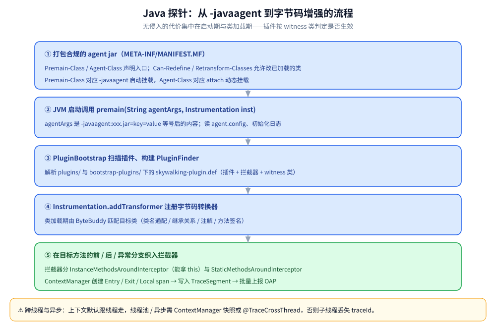
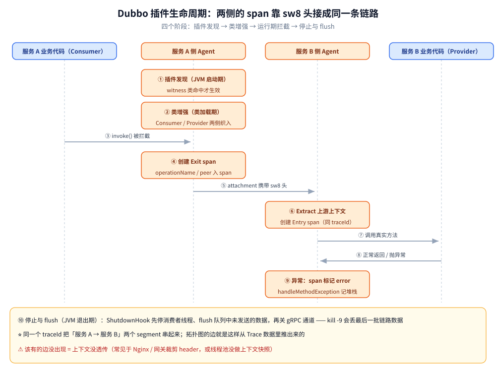
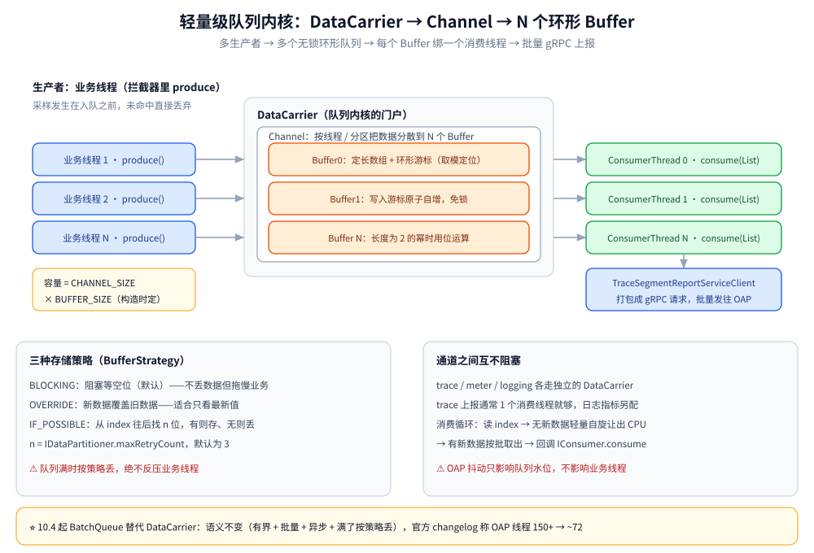
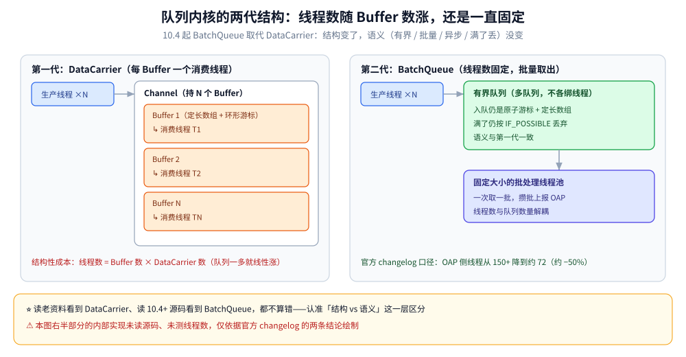
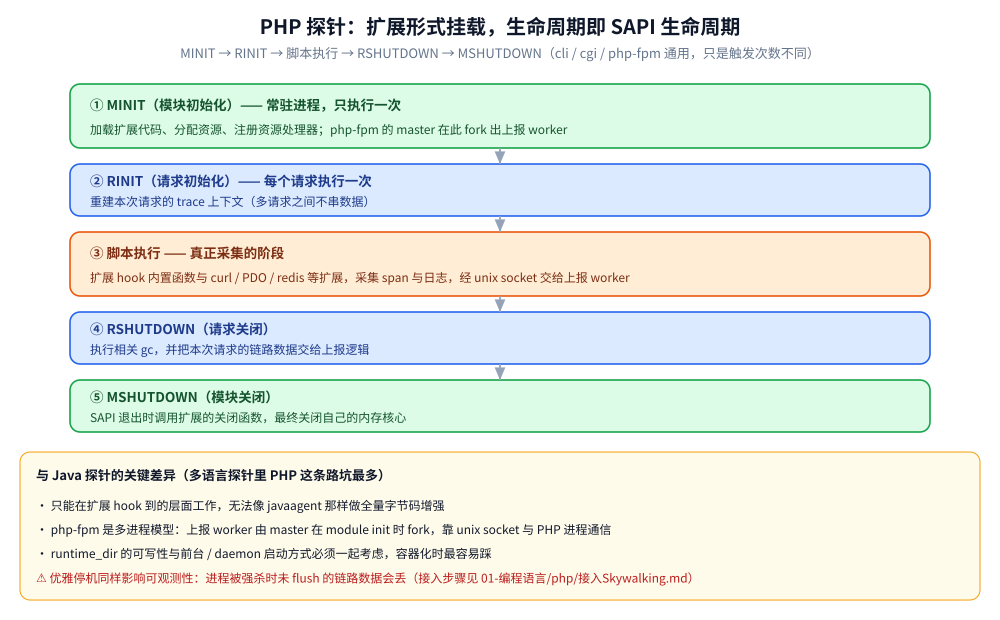
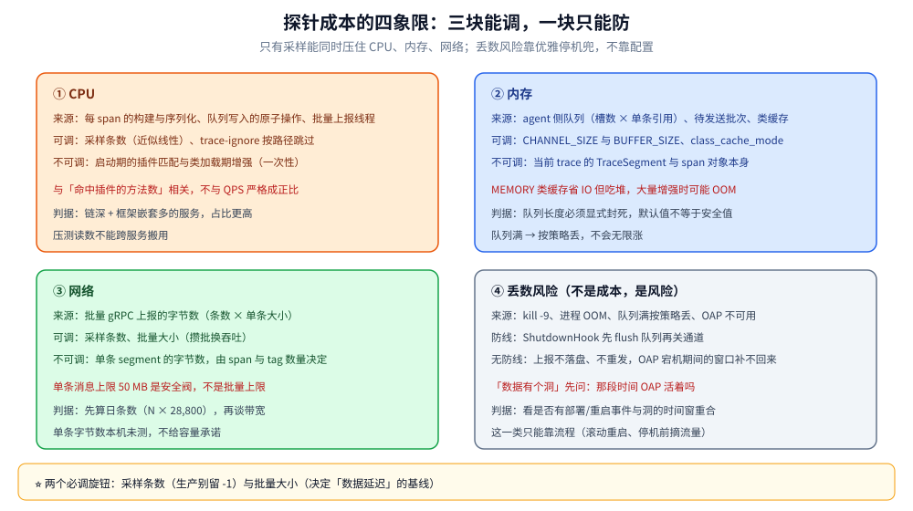

# 探针原理

> 本篇回答「无侵入」具体怎么做到、代价有多大：Java 的 `javaAgent` 五步与插件生命周期、探针侧的队列内核（DataCarrier 到 BatchQueue 的两代）、跨进程上下文传播的三条铁律、Go / PHP / Node.js 三种「做不到全量增强」时的替代路径，最后收敛成一张成本模型。
>
> 不覆盖：sw8 字段布局与 GraphQL 报文见 [协议与数据模型.md](协议与数据模型.md)；各语言的接入步骤与配置项见语言目录的 `接入Skywalking.md`；OAL / MAL / LAL 与部署形态见 [架构与部署.md](架构与部署.md)。
>
> 实测环境：Java 侧结论来自 OpenJDK 运行时行为与发行包中 agent 的目录结构（`agent/config/agent.config`、`plugins/`、`bootstrap-plugins/`），**未在本机运行 `-javaagent` 接入 demo**；队列语义以官方源码与文档为准，10.4 的线程数变化按官方 changelog 陈述。逐项标注见文末「校验口径」。

---

## 一、为什么「无侵入」值得付出代价

**本节要点**：无侵入买到的是**覆盖广度**（框架自带的方法级 span 一次性到手），付出的是**绑定**（版本、语言、启动方式都要顺着 agent 的规矩来）。判断值不值，只看一个问题：你要的是「全栈默认有」，还是「我说的那几处才准」。

### 1.1 手埋点到底要改多少处

以一次「HTTP 入口 → Redis → MySQL → 下游 HTTP」的请求为例，手埋点（OTel SDK / toolkit）至少要回答六个问题：

1. 入口处从请求头取出上下文，没有就新建 trace（**每个入口一处**）。
2. 每个出口（Redis / MySQL / HTTP client）注入上下文到对端（**每种客户端一处，含异步回调**）。
3. 起止时间、异常、状态码要手工打点到 span 上（**每个业务块一处**）。
4. 线程池 / goroutine 切换时把上下文带过去（**每个并发点一处**）。
5. 采样决策要在入口就定，且下游跟随（**一处，但写错就前后不一致**）。
6. 进程退出前 flush（**一处，漏了丢最后一批**）。

探针替你做的正是这六件事的**通用形态**：入口由框架插件拦（Spring MVC、Gin 中间件、php-fpm 的 RINIT）、出口由中间件插件拦（Jedis、`database/sql`、curl）、线程池有专门的跨线程包装、采样与 flush 内置。代价是**只有插件覆盖到的框架版本才有这层**。

### 1.2 绑定的三处代价

| 代价 | 具体表现 | 躲不过的原因 |
|---|---|---|
| **版本绑定** | 插件按框架版本区间适配；升级 Spring Boot / Dubbo 大版本可能要先升 agent | 字节码增强依赖具体类名与方法签名 |
| **启动方式绑定** | Java 必须走 `-javaagent`；Go 必须走 `-toolexec` 重新编译；Node 必须在业务代码之前 `--require` | 增强的时机窗口只有「类/模块加载时」 |
| **生态绑定** | 上报格式是 `sw8` + 自有 gRPC；换后端要换格式 | OAP 的分析链是按自家语义设计的（segment / refs） |

⭐ 一句话判据：**框架栈稳定、要多语言统一看大盘 → 探针划算；框架栈高频变动、或只要几处关键埋点 → 埋点 SDK 更省**。

---

## 二、Java：`javaAgent` 五步

**本节要点**：Java 能做到「改一行启动参数就有全链路」，靠的是 `java.lang.instrument`（拿 `Instrumentation`）+ ByteBuddy（改字节码）+ 插件定义（改哪里）+ BootService（装什么）四件事凑齐。

### 2.1 什么是 javaAgent

JDK 1.5 引入 `java.lang.instrument`，允许外部程序在**类加载时拿到 `Instrumentation` 实例并修改字节码**。两种挂载形态：

- **启动挂载**：`java -javaagent:/path/skywalking-agent.jar -jar app.jar`，JVM 在 `main` 之前调用 agent 的 `premain`。
- **动态挂载（attach）**：运行期通过 Attach API 挂上去，调用 agent 的 `agentmain`。

### 2.2 五步流程

**① 打包成合规的 agent jar**：核心是 `META-INF/MANIFEST.MF`，必须声明入口类与能力：

```text
Premain-Class: org.apache.skywalking.apm.agent.SkyWalkingAgent
Agent-Class: org.apache.skywalking.apm.agent.SkyWalkingAgent
Can-Redefine-Classes: true
Can-Retransform-Classes: true
```

`Premain-Class` 对应 `-javaagent` 启动挂载，`Agent-Class` 对应 attach 动态挂载；两个 `Can-*` 声明允许对**已加载**的类做重定义 / 重转换——没有它们，那些在 agent 之前就加载好的核心类就补不了增强。

**② `premain` 被调用**，签名固定：

```java
public static void premain(String agentArgs, Instrumentation inst)
// 或 public static void premain(String agentArgs)  // 拿不到 inst 时退化
```

`agentArgs` 是 `-javaagent:xxx.jar=key=value` 里等号后面的内容；`inst` 是改写字节码的唯一入口。

**③ 初始化 agent**：解析 `agentArgs` 并读 `agent.config` → 初始化日志（`logging.dir`、`logging.level`）→ `PluginBootstrap` 扫描 `plugins/`、`bootstrap-plugins/` 下所有 jar 里的 `skywalking-plugin.def`，构建 `PluginFinder`（插件定义 + 拦截器 + **witness 类**）→ 建立到 OAP 的 gRPC 通道（`collector.backend_service`）、注册服务与实例、拉动态配置与 Profile 任务 → `inst.addTransformer(...)` 注册转换器。

**④ 字节码增强（ByteBuddy）**：transformer 里用 `AgentBuilder` 匹配目标类，在目标方法的**前、后、异常**三个位置织入回调：

| 织入点 | 回调 | 典型用途 |
|---|---|---|
| `beforeMethod` | 进方法前 | 创建 Entry / Exit span，记录开始时间 |
| `afterMethod` | 出方法后 | 结束 span、写 status、把上下文注入下游请求头 |
| `handleMethodException` | 抛异常 | span 标 error、记异常堆栈 |

拦截器分两种：`InstanceMethodsAroundInterceptor`（能拿到 `this`）与 `StaticMethodsAroundInterceptor`。它们内部通过 `ContextManager` 在**当前线程的 `TraceSegment`** 上开 span——这就是「一个进程只造自己进程内 span」的实现方式。

**⑤ 运行期**：类加载 → transformer 匹配 → 织入 → 拦截器采 span → 写入队列内核 → 消费者批量上报。为不影响启动性能，已加载的核心类通过 `retransformClasses` 补增强。



图中从启动参数到 `addTransformer` 是一条直线，实际最容易出错的是第 ⑤ 步的**补增强**：`retransformClasses` 只能改「方法体」，不能加字段、不能改签名，这也是为什么有些「需要往类里塞字段」的增强 agent 做不到。

### 2.3 与其他 javaAgent 共存

ByteBuddy 每次生成**随机名**的辅助类，与其他 javaAgent（APM、热部署、Mock 框架）同用时，retransform 可能撞上已被改过的类定义。开关是类缓存：

```bash
-Dskywalking.agent.is_cache_enhanced_class=true
-Dskywalking.agent.class_cache_mode=MEMORY
```

⚠️ `MEMORY` 模式省 IO 但吃堆，大量类增强时有 OOM 风险；落盘模式（`FILE`）适合类多但启动时间不敏感的场景。

---

## 三、插件生命周期：以 Dubbo 为例

**本节要点**：Java 插件的行为可以完整拆成**发现 → 增强 → 拦截 → 停机 flush** 四段，读懂了 Dubbo 这一个，其余框架插件只是「匹配规则 + 拦截点」不同。

1. **插件发现（JVM 启动期）**：扫描插件 jar 里的 `skywalking-plugin.def`，构建 `PluginFinder`。插件除了声明「要增强哪些类」，还声明 **witness 类**（Dubbo 插件是 `org.apache.dubbo.rpc.Invoker` 这类宿主核心类）——**只有宿主真的加载了 witness 类，插件才算生效**，避免为一个没用的框架白白增强、平白增加启动开销。
2. **类增强（类加载期）**：协议类 / 调用入口类被加载时命中匹配，ByteBuddy 在方法前后织入拦截器。拦截点分两侧：**Consumer 侧**（发起调用的一方，建 Exit span）与 **Provider 侧**（被调用的一方，建 Entry span）。
3. **运行期拦截**：Consumer 发起调用前建 Exit span，并把上下文以 `sw8` 的形式写进 Dubbo 的隐式参数（attachment）；Provider 读到 attachment 建 Entry span，于是两个 segment 用同一个 `traceId` 串起来——**拓扑图的边就是这一步的副产物**。抛异常走 `handleMethodException`，span 标 error。
4. **停止与 flush（JVM 退出期）**：启动时注册了 ShutdownHook，JVM 退出时先停消费者线程并 **flush 队列中还没发出去的数据**，再关 gRPC 通道。**这也意味着 `kill -9` 会丢掉最后一批链路数据**。



第 3 段是全部插件里唯一「业务无关、语义相关」的地方：attachment / header / metadata 是同一件事在不同协议里的载体，载体一处被裁剪，链路就在那里断。

---

## 四、队列内核：DataCarrier 到 BatchQueue

**本节要点**：两代实现换了线程模型，但**语义没变**——有界、批量、异步、满了按策略丢。判断一段老资料还算不算数，就看它讲的是结构还是语义。

### 4.1 第一代：DataCarrier 的三层结构

- **Buffer**：定长数组（`Object[]`）+ 环形游标。写入时游标原子自增，按数组长度**取模**定位槽位（长度为 2 的幂时可用位运算），所以**入队不加锁**。
- **Channel**：持有一组 Buffer，按写入线程（或分区）把数据分散开，降低写竞争。
- **DataCarrier**：对外的门户，一个 `DataCarrier` 对应一个 `Channel`，`Channel` 持 N 个 `Buffer`，每个 `Buffer` 绑一个消费线程——形成「多生产者 → 多个环形队列 → 多消费者」的并行结构。



图里三层的关系决定了一个关键取舍：**生产端只跟 DataCarrier 打交道，消费端只跟 Buffer 打交道**，所以「扩队列」与「扩消费者线程」是两件独立的事。三个参数决定全部行为：

```java
carrier = new DataCarrier<TraceSegment>(CHANNEL_SIZE, BUFFER_SIZE);
carrier.setBufferStrategy(BufferStrategy.IF_POSSIBLE);
carrier.consume(this, 1);   // 第二个参数 = 消费者线程数
```

### 4.2 三种写入策略：成本就在这里分流

| 策略 | 行为 | 代价 |
|---|---|---|
| **BLOCKING** | 循环等待槽位空出来（框架默认值） | 保证不丢，但**会阻塞业务线程** |
| **OVERRIDE** | 新数据覆盖旧数据 | 不阻塞、不 OOM，但丢的是「旧的那条」 |
| **IF_POSSIBLE** | 从当前 index 往后找 n 个槽位，有空位就放，没有就丢 | 不阻塞、可预测；**SkyWalking 自己用的是这个** |

n 由 `IDataPartitioner` 的 `maxRetryCount` 决定，默认 **3**。⚠️ 「框架默认值是 BLOCKING，而 SkyWalking 显式设成 IF_POSSIBLE」这件事值得记住：**默认值不是产品取向，代码里的显式设置才是**——它对应那句「宁可丢数据，也不拖慢业务」。

### 4.3 第二代：10.4 起的 BatchQueue

官方 10.4.0 的 changelog 明确写着 **BatchQueue 取代 DataCarrier**，并给出一个可验证的副作用：**OAP 侧线程数从 150+ 降到约 72（约 −50%）**。线程数下降的来源很直接——第一代是「每个 Buffer 一个消费线程」，队列一多线程就线性涨；批量队列把消费收敛成固定数量的批处理任务，队列数量与线程数量解耦。



上图左边是「线程数随 Buffer 数涨」的结构性成本，右边是「线程数固定、批量取出」的结构。**语义层不变的四条**：

1. 有界——内存上限必须在配置里封死，否则高峰期就是 OOM。
2. 批量——攒批上报换吞吐，代价是延迟（也是「数据有几十秒延迟」的根因之一）。
3. 异步——生产与发送解耦，OAP 抖动只影响水位，不影响业务线程。
4. 满了按策略丢——丢数据是设计选择，不是 bug。

⚠️ BatchQueue 的内部字段与实现细节本篇**没有逐行读源码**，只按官方 changelog 的两条结论（替代关系、线程数变化）与「语义不变」的判据陈述；读到具体类名/方法名的老资料时，先确认它对应哪一代。

### 4.4 采样发生在入队之前

Java 侧先按 `agent.sample_n_per_3_secs` 做采样决策，**未命中的请求根本不进队列**——所以采样不只是「少发一点」，还把队列压力按比例降下来。这也是为什么「压测时把采样关掉（`-1`）」很容易把队列打满。

---

## 五、跨进程传播：`sw8` 与三条铁律

**本节要点**：传播只有三条铁律，sw8 的字节细节单独成篇——这里只留判据，因为**断链的现场九成不是字段写错，而是「载体被裁掉了」**。

| 场景 | 载体 | 判据 |
|---|---|---|
| HTTP | `sw8` 请求头（可加 `sw8-x` / `sw8-correlation`） | 中间有 Nginx / 网关裁剪 header，链路在这里断成两段 |
| gRPC | metadata | 与 HTTP 同源，但 key 大小写与 `-`/`_` 规则要对 |
| Dubbo | attachment（隐式参数） | 跨版本时 attachment 传递规则会变，老版本可能不透传自定义 key |
| MQ | 消息属性 / header | 生产者不写、消费者不读 = 必然断；异步链路的延迟要靠 `sw8-x` 的时间戳算 |
| DB / 缓存 | 无（Exit span 到此为止） | 它们不参与传播，只在 Exit span 上留 peer |

三条铁律：

1. **跨进程**：Exit span 结束时注入，Entry span 开始时取出；中间任何一跳丢头就是断点。
2. **跨线程**：上下文默认跟线程走，线程池 / 异步需要 `ContextManager` 快照机制或 `@TraceCrossThread`——这是接入后**最常见**的问题（现象是子线程的日志没有 traceId）。
3. **优雅停机**：ShutdownHook 先 flush 再关通道；`kill -9` 丢最后一批（见第三节第 4 段）。

---

## 六、其他语言：做不到全量增强时的三条路

**本节要点**：只有 JVM 有 `Instrumentation` 这个官方后门。其他语言要么**在编译期改代码**（Go），要么**在扩展层 hook**（PHP），要么**在模块加载层打补丁**（Node）——三者都不如 Java 彻底，但覆盖了各自生态的常规用法。

### 6.1 Go：编译期 AST 注入

⚠️ **Go 没有 classloader，「运行时无侵入」在 Go 上不成立**。SkyWalking Go 走的是编译期 AST 注入：

```bash
go build -toolexec="/path/go-agent" -a -o demo .
```

`-toolexec` 让编译过程的每一步都先过 agent，于是可以在 AST 里插探针代码。代价有三条：

- 配置在**编译期写死进二进制**，运行期改不了也摘不掉（想换采样率要重新编译）。
- 插件只覆盖官方列出的框架版本区间，区间外就是没有 span。
- 需要 Go ≥ 1.18，module 路径不能含空格 / 中文。

⭐ 正因为「改一次配置就要重编译」，Go 团队更常见的选择是 OTel SDK + OTLP——判据在 [可观测性选型对比.md](../可观测性选型对比.md) 第二节，机制与落地见 [接入Skywalking.md](../../../../01-编程语言/go/可观测性/接入Skywalking.md)。

### 6.2 PHP：扩展 + SAPI 五阶段

PHP 探针是 **PHP 扩展（.so）**，所以它的生命周期就是 SAPI 的生命周期：**MINIT → RINIT → 脚本执行 → RSHUTDOWN → MSHUTDOWN**。

1. **MINIT**（模块初始化）：php-fpm 启动时加载扩展、分配资源、注册资源处理器——**常驻进程，只执行一次**。
2. **RINIT**（请求初始化）：每个请求执行一次，相当于把扩展的「请求态」重置。
3. **脚本执行**：业务代码运行，扩展在此阶段采集 span 与日志。
4. **RSHUTDOWN**（请求关闭）：脚本结束，把本次请求的链路数据交给上报逻辑。
5. **MSHUTDOWN**（模块关闭）：关闭 SAPI 时释放扩展资源。



与 Java 的差异要点：PHP 扩展**只能在扩展能 hook 到的层面工作**（内置函数、curl / PDO / redis 等扩展，加 SDK 适配框架层），无法像 javaagent 那样全量增强；且 php-fpm 是多进程模型，上报 worker 由 master 在 module init 时 fork、靠 unix socket 通信，因此 `runtime_dir` 的可写性与前台/daemon 启动方式必须一起考虑（见 [接入Skywalking.md](../../../../01-编程语言/php/接入Skywalking.md) 的容器化四坑）。

### 6.3 Node.js：monkey patch

1. **加载时机**：必须在业务代码之前——`node --require skywalking-node app.js`，或入口文件第一行 `require(...)`。**时机错过就劫持不到**：框架模块若已被 require 过，后挂的探针抓不到它。
2. **劫持**：对 `Module._load` / `require` 做 hook，在 http/https、express/koa、mysql/pg/redis 等模块被加载时把原始实现包一层。
3. **上下文传播**：用 `AsyncLocalStorage`（旧方案是 Async Hooks）维护异步上下文，让回调、定时器、`await` 之后都还能拿到 trace。
4. **上报与停止**：请求结束批量上报，退出前 flush。

> ⚠️ Node 段的包名与 API 形态按社区常见写法描述，**本机未实测 Node 探针**；以官方 `skywalking-nodejs` 仓库当前 README 为准。浏览器探针 `skywalking-client-js` 属于同一路「在能 hook 的层面采集」，本篇不展开。

---

## 七、成本模型：四处开销与两个必调旋钮

**本节要点**：探针的成本可以拆成 CPU、内存、网络、丢数四块，其中**只有采样能线性砍掉前三块**；「丢数」不是成本而是风险，靠优雅停机兜。



四个象限里，前三个是「成本」，第四个是「风险」；把它们分开看，才不会用「调采样」的方式去解决「丢数据」的问题——那是两个不同性质的旋钮。

### 7.1 四块成本各自的来源

| 成本 | 来源 | 可调旋钮 | 不可调的部分 |
|---|---|---|---|
| **CPU** | 每 span 的构建与序列化、队列写入的原子操作、批量上报线程 | 采样条数（近似线性）、`trace-ignore` 按路径跳过 | 插件匹配与类加载期增强（一次性，启动时） |
| **内存** | agent 侧队列（槽数 × 单条引用）+ 待发送批次；`class_cache_mode=MEMORY` 还额外吃堆 | 队列 `CHANNEL_SIZE × BUFFER_SIZE`、类缓存模式 | 当前 trace 的 `TraceSegment` 与 span 对象本身 |
| **网络** | 批量 gRPC 上报的字节数 | 采样条数、批量大小 | 单条 segment 的字节数（由 span/tag 数量决定） |
| **丢数风险** | `kill -9`、OOM、队列满 | 优雅停机、队列容量、`IF_POSSIBLE` 策略 | 「满了就丢」的设计取向 |

### 7.2 两个必调旋钮

1. **采样**：`agent.sample_n_per_3_secs`。生产不要留默认值——`-1`（全采）只适合压测定位。条数换算公式见 [架构与部署.md](架构与部署.md) 第八节。
2. **批量大小**：攒批换吞吐，代价是延迟。**「面板上数据有延迟」的第一嫌疑就是批量 + 队列**，不是数据库慢。

### 7.3 一个反直觉的结论

⚠️ **探针的开销与「命中插件的方法数」相关，不与「业务 QPS」严格成正比**：一次请求里被增强的方法越多（例如框架层层嵌套、ORM 每个 getter 都命中），span 越多；反过来，QPS 高但链路短的服务可能比 QPS 低但链深的服务更省。所以压测时看到的「探针开销占比」不能直接搬到另一个服务上。

---

## 校验口径

| 内容 | 状态 |
|---|---|
| javaAgent 五步、MANIFEST 四项、`premain` 签名、ByteBuddy 三个织入点、拦截器两类 | ✅ 按 JDK `java.lang.instrument` 规范与发行包 agent 结构核对；⚠️ 本机**未运行 `-javaagent` demo**，无运行时读数 |
| 类缓存两个参数（`is_cache_enhanced_class` / `class_cache_mode`） | ✅ 按官方文档与 agent 配置项核对；⚠️ 未实测冲突复现 |
| Dubbo 插件四阶段与 witness 类机制 | ✅ 按官方文档与插件 `skywalking-plugin.def` 结构陈述；⚠️ 未做 Dubbo 链路实测 |
| DataCarrier 三层结构、三种策略、`maxRetryCount` 默认 3、`consume(consumer, n)` | ✅ 按官方文档与源码口径；⚠️ 未在本机跑队列水位实验 |
| 10.4 BatchQueue 替代 DataCarrier、OAP 线程 150+ → 约 72 | ⚠️ **仅按官方 changelog 陈述**，内部实现未读源码、未测 |
| sw8 载体表与三条铁律 | ✅ 载体形态与官方协议文档一致；字节细节见 [协议与数据模型.md](协议与数据模型.md) |
| Go `-toolexec` 三条代价 | ✅ 官方文档口径；⚠️ 本机未跑 Go agent 编译注入 |
| PHP SAPI 五阶段 | ✅ 按 PHP 扩展生命周期与官方文档；⚠️ 本机无 php-fpm 探针环境 |
| Node.js 四步 | ⚠️ **未实测**，包名与 API 按社区常见写法，未核对当前仓库 README |
| 成本模型四象限 | ⚠️ 属结构性归纳（来源与旋钮均为已知机制），**不含本机 benchmark 读数**；单条 segment 字节数未测 |

---

## 延伸追问

- **为什么探针「宁可丢数据」？** → 业务线程被阻塞的代价（超时、雪崩）远高于丢几条链路数据；`IF_POSSIBLE` + 有界队列把最坏情况封顶成「丢数据」而不是「拖垮服务」。
- **`retransformClasses` 能做什么、不能做什么？** → 只能改方法体，不能加字段、不能改签名；所以「要往目标类里塞状态」的增强只能靠其他手段（如外部 Map）。
- **witness 类为什么必要？** → 避免为宿主没加载的框架做增强：没有宿主类就没有调用点，增强上去只是白花启动时间。
- **采样在入队前还是入队后？** → 入队前。未命中的请求不产生队列压力，所以「关采样压测」很容易把队列打满——这也是压测环境的常见误判来源。
- **Go 为什么做不到运行时无侵入？** → 没有 classloader，二进制在编译期就固化了调用点；`-toolexec` 是唯一的注入窗口，代价是配置也固化进二进制。
- **一次请求里 span 越多越慢吗？** → 是，但成本与「命中插件的方法数」相关而非 QPS；链深且框架嵌套多的服务，探针开销占比更高。

---

## 关联

- **上游/总纲**：[可观测性选型对比.md](../可观测性选型对比.md) — 探针成熟度与语言契合度这条横切维度
- **本册导读**：[README.md](README.md) — 五篇的阅读路线与实测坐标
- **对照/互补**：[采集与传播.md](../Jaeger/采集与传播.md) — 手埋点路线的成本结构（三类埋点路径与代价）与「无侵入」正好互补
- **下游机制**：[协议与数据模型.md](协议与数据模型.md) — sw8 八字段、TraceSegment 形态与 GraphQL；[架构与部署.md](架构与部署.md) — 分析引擎、部署形态与采样容量
- **落地代码**：[接入Skywalking.md](../../../../01-编程语言/java/可观测性/接入Skywalking.md)（`-javaagent`、配置优先级、K8s 注入）、[接入Skywalking.md](../../../../01-编程语言/go/可观测性/接入Skywalking.md)（编译期注入与 OTel 备选）、[接入Skywalking.md](../../../../01-编程语言/php/接入Skywalking.md)（扩展安装与 reporter）
