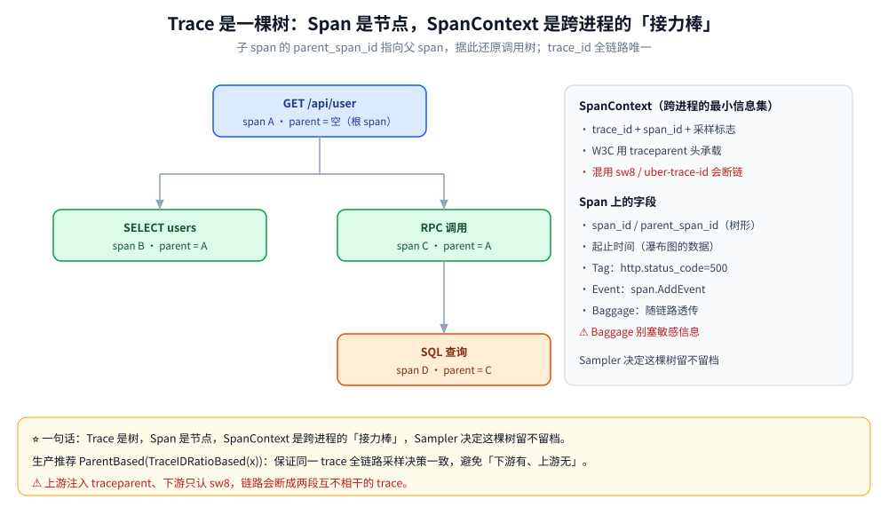
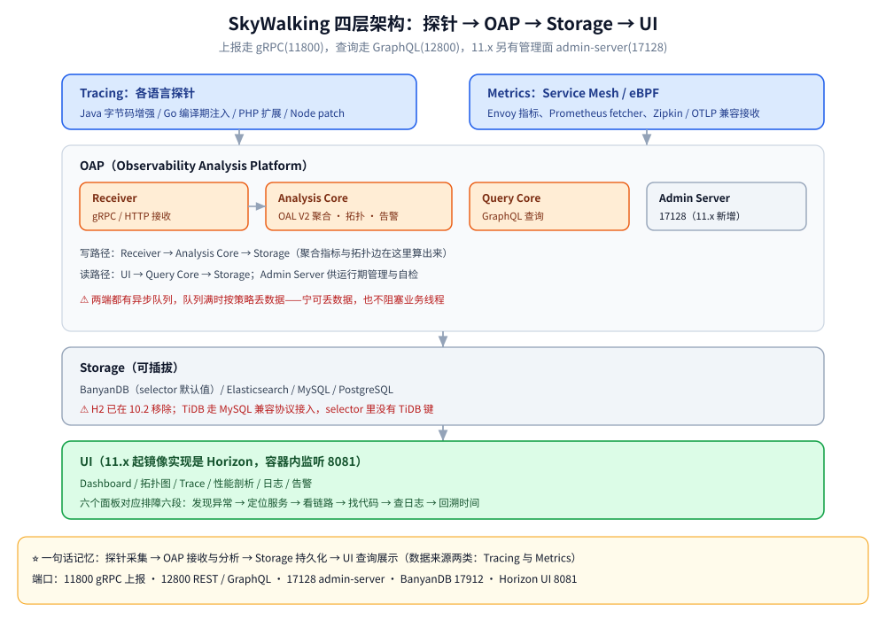
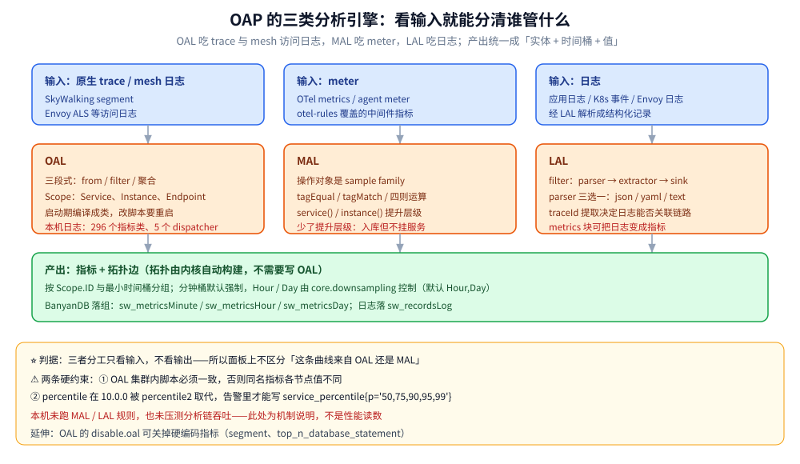
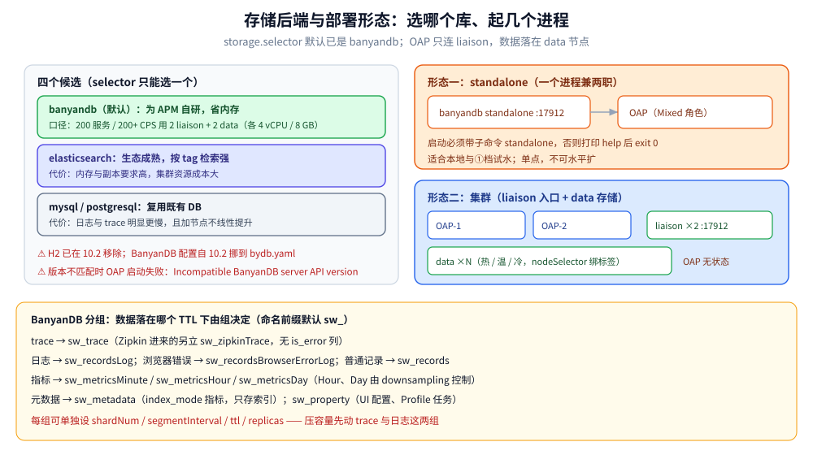

# 架构与部署

> 本篇回答两件事：**数据从探针走到 UI 时被谁加工过**（Receiver → OAL / MAL / LAL 三类分析引擎 → Storage → Query → UI），以及**这套东西怎么装起来、装错了长什么样**（单机三容器 / 集群 / K8s 三种形态、采样与容量口径、10.x 到 11.x 的升级陷阱）。
>
> 不覆盖：探针内部怎么改字节码、队列内核怎么缓冲（见 [探针原理.md](探针原理.md)）；上报字节与 GraphQL 报文（见 [协议与数据模型.md](协议与数据模型.md)）；面板怎么读、读不出来怎么查（见 [UI与排障.md](UI与排障.md)）。
>
> 实测环境：Docker Desktop（Windows amd64）单机三容器——`apache/skywalking-oap-server:11.0.0` + `apache/skywalking-banyandb:0.11.0`（`standalone`）+ `apache/skywalking-ui:latest`（Horizon），宿主端口 11800 / 12800 / 17128 / 17912 / 8080。**本轮未挂任何语言探针**，所以没有真实业务链路读数；配置默认值一律取自 11.x 发行包的 `application.yml` 而非旧教程，启动与查询读数见第十节。

---

## 一、一句话定位：OAP 在链路里承担哪一段

**本节要点**：探针只产出「本进程内发生了什么」的原始事实，**把事实变成可查询的指标与拓扑边的是 OAP**——这层「写时聚合」正是它和 Jaeger 那种「存原始 span、查询时再算」的分水岭。

| 对比项 | SkyWalking（写时聚合） | Jaeger / Tempo（写时只存） |
|---|---|---|
| 入库的数据 | 原始 segment **+** 聚合后的指标（`service_cpm`、`service_resp_time`、`endpoint_percentile`…）**+** 拓扑边 | 原始 span，基本不做预聚合 |
| 打开 UI 第一眼 | 直接有大盘、拓扑、Apdex | 先要有 trace，再看单条链路 |
| 想查一个「没人预定义过」的问题 | 得**改 OAL 脚本重启 OAP**（编译期生成类） | 直接对 span 做检索，条件随便拼 |
| 存储压力 | 低（分钟级聚合先行压缩） | 高（全量 span 落盘） |

⭐ 判据一句话：**「大盘优先」选写时聚合，「临时问题优先」选存原始 span**。两者不是替代关系，SkyWalking 也收 OTLP / Zipkin 格式，只是那部分数据进的是「只存」通道，不走 OAL 的指标链路。

---

## 二、核心概念：Service / Instance / Endpoint 与 TraceSegment

**本节要点**：OAP 里所有指标都挂在三个**实体**上（Service / Instance / Endpoint），所有链路数据都以 **TraceSegment** 为单位上报——实体决定「指标怎么分组」，segment 决定「链路怎么接」。

| 概念 | 说明 | 在 OAP 里的作用 |
|---|---|---|
| **Service** | 一组提供相同能力的实例，按 `serviceId` 区分 | `service_*` 系列指标的分组键；拓扑图的节点 |
| **Instance** | 单个进程/实例，含 `serviceInstanceId` | `instance_*` 指标（JVM、CLR、进程级）；定位「哪台机器坏了」 |
| **Endpoint** | 具体操作，如 `GET /api/user`、`SELECT users` | `endpoint_*` 指标；慢接口排行的最小粒度 |
| **Layer** | 计算机科学的抽象层（`OS_LINUX` / `K8S` / `MESH` / `GENERAL`） | 按角色组织服务与面板，`listServices(layer)` 靠它筛 |
| **Service Hierarchy** | 10.x 引入，跨层的同一个逻辑服务（K8s Service ↔ Pod ↔ 进程） | 支持从容器指标跳到应用链路 |
| **Trace** | 一条完整调用链，`traceId` 全局唯一 | Trace 查询的主键 |
| **TraceSegment** | ⭐ 一次请求在**一个服务实例内**的采集单元，靠 `refs[]` 接链 | 上报的最小单位；OAL 的输入 |
| **Span** | 一次操作，Entry / Exit / Local 三类 | 瀑布图、Duration / Self Duration |

⭐ 为什么非要多出 segment 这一层：**一个进程只能可靠地知道自己进程内的调用树**，跨进程的部分交给 `refs[]` 事后拼装，才不会被并发写坏（多实例同时写同一条 trace 时，谁也不需要锁另一方的内存）。



图里只有一棵树；补上 segment 这层之后，整条 trace 实际是「多棵本进程内的树，用 refs 首尾相接」——跨进程处一定会断一次，断点就是 refs。

---

## 三、整体架构：Agent → Receiver → 分析引擎 → Storage → Query

**本节要点**：OAP 内部是**四个可插拔段**——接收（多种格式）→ 分析（三类引擎并行）→ 存储（可换实现）→ 查询（GraphQL）——任何一段都能单独替换，这是「换框架不用改内核」的根。

```text
Agent（各语言探针）
   │ gRPC :11800（trace / JVM 指标 / meter）
   │ HTTP :9411（Zipkin，默认关闭）· OTLP（复用 11800 的 gRPC）
   ▼
┌──────────────────────────────────────────────────────────────────┐
│ OAP                                                              │
│  Receiver ──┬─→ OAL   （trace + mesh access log → 指标 / 拓扑）   │
│             ├─→ MAL   （meter：OTel / Prometheus / agent meter）  │
│             └─→ LAL   （日志 → records，可再生成 meter）           │
│                            │                                     │
│                       Storage Implementor（写）                   │
│                            │                                     │
│  Query Core（GraphQL :12800） ← Storage                          │
│  Admin Server（:17128 HTTP / :17129 gRPC，11.x）                  │
└──────────────────────────────────────────────────────────────────┘
   │
   ▼
Storage：BanyanDB（默认）/ Elasticsearch / MySQL / PostgreSQL
   │ GraphQL
   ▼
UI：Horizon（容器内 8081）
```



上图的四层划分是**部署视角**；本节要补的是 OAP 盒子里那三个分析引擎的位置——同一份数据可能同时进多条链路，例如一个 HTTP 请求既产出 trace（进 OAL 算 CPM），也可能被 LAL 抽成日志记录。

### 3.1 组件职责与端口

| 组件 | 职责 | 默认端口 / 配置键 |
|---|---|---|
| **Agent** | 采集 span 与指标，批量上报 | 上报地址 `collector.backend_service`（Java 侧配置项） |
| **Receiver** | 接收 trace / JVM 指标 / OTel / Zipkin | 核心 gRPC **11800**（`SW_CORE_GRPC_PORT`） |
| **Analysis Core** | OAL / MAL / LAL 流式聚合、拓扑、告警判定 | 11.0.0 默认 **OAL Engine V2** |
| **Query Core** | 对外 GraphQL | 核心 REST **12800**（`SW_CORE_REST_PORT`） |
| **Admin Server** | 运行期规则、按需写入、自检状态 | **17128** HTTP / **17129** gRPC，⚠️ 无内置认证 |
| **Storage** | 持久化，可插拔 | `storage.selector`，默认 `banyandb` |
| **UI** | 展示 | Horizon 容器内 **8081**，需 `HORIZON_OAP_QUERY_URL` / `HORIZON_OAP_ADMIN_URL` |

⚠️ 两个容易记错的端口：**admin-server 是 17128 而不是 12800 加一**；Zipkin 接收器默认 `selector: -`（**默认关闭**），要显式 `SW_RECEIVER_ZIPKIN=default` 才会在 **9411** 上听。

### 3.2 写路径与读路径是两条独立链路

- **写路径**（Agent → Receiver → 分析 → Storage）：追求的是一次写入尽量多算——一个 segment 进来，同时更新 CPM、延迟分位、成功率、拓扑边的调用计数。算不出来的就不存。
- **读路径**（UI → Query Core → Storage）：只读聚合结果，所以 UI 打开快；代价是「聚合粒度以外的问题查不到」——想按某个 tag 拆分延迟，得先有对应的 OAL 指标。
- 两条路径**共享 Storage 但不共享内存**：OAP 重启不影响已入库数据，只影响「重启窗口内没算完的内存态聚合」。

### 3.3 两条设计取向

- **面向插件化**：接收哪些格式、用哪些分析规则、落哪个存储，全是扩展点。
- **不以大数据栈为地基**：OAP 自己做流式聚合，不需要先部署 Flink / Kafka 才有 APM 能力；11.0.0 单机实测 OAP 容器内 OS 线程数稳态 **58**（见第十节），量级上就是一个 Java 服务。

---

## 四、分析引擎：OAL / MAL / LAL 各吃什么、产出什么

**本节要点**：三者的分工只看**输入**——trace 与 mesh access log 进 OAL，meter 进 MAL，日志进 LAL；产出都收敛成「带实体标签的指标」，因此面板上看起来是同一套指标。

| 引擎 | 输入 | 定义位置 | 输出 | 何时编译 |
|---|---|---|---|---|
| **OAL** | SkyWalking 原生 trace、Service Mesh access log | `config/oal/*.oal` | Service / Instance / Endpoint / 三类 Relation 的指标 **+ 拓扑边** | **启动期**编译成 Java 类 |
| **MAL** | meter-system 收到的 meter（OTel metrics、Prometheus 抓取、agent meter） | `config/meter-analyzer-config/*.yaml`、`config/otel-rules/*.yaml`、`envoy-metrics-rules`、`zabbix-rules` | `meter_<name>` 指标 | 启动期加载，配错则 OAP 起不来 |
| **LAL** | 日志（含 Envoy ALS、K8s 事件等非应用日志） | `config/lal/*.yaml`（`SW_LOG_LAL_FILES` 激活） | `records` 日志记录；可再用 `log-mal-rules` 生成指标 | 启动期加载 |



图看着是三条并行管线，实际收敛到一个出口：不管数据从哪来，落到面板上都是「实体 + 时间桶 + 值」，所以服务、实例、端点三个视图都不需要知道数据来自哪个引擎。

### 4.1 OAL：三段式脚本与小例子

语法只有三段，任何一条指标都是这三段的组合：

```text
METRICS_NAME = from(CAST SCOPE.(* | [FIELD][,FIELD ...]))
[.filter(CAST FIELD OP [INT | STRING])]
.AGGREGATION([PARAM][, PARAM ...])
```

- **from**：数据源。主 Scope 有 `Service`、`ServiceInstance`、`Endpoint`、`ServiceRelation`、`ServiceInstanceRelation`、`EndpointRelation`。
- **filter**：条件，支持 `==` / `!=` / `in [...]` / `like "serv%"` / `tags contain "http.method:GET"`。
- **聚合函数**：`longAvg`、`doubleAvg`、`count`、`cpm`、`percent`、`rate`、`histogram`、`apdex`、`percentile2`、`labelCount`、`labelAvg`。

几条真实的规则（来自发行包与官方文档，语义逐条可读）：

```text
service_resp_time   = from(Service.latency).longAvg()
service_cpm         = from(Service.*).cpm()
endpoint_success    = from(Endpoint.*).filter(status == true).percent()
service_heatmap     = from(Service.latency).histogram(100, 20)
service_percentile  = from(Service.latency).percentile2(10)
```

三个只有踩过才知道的点：

1. **OAL 是编译型 DSL**：启动期生成 Java 类（本机日志 `OAL Engine V2 started successfully. Generated 296 metrics classes, 5 dispatcher classes`）。改 `.oal` 必须重启 OAP，**不能指望挂载文件热生效**；集群里各节点脚本必须一致，否则同名指标算出的值不一样。调试可设 `SW_DYNAMIC_CLASS_ENGINE_DEBUG=Y` 把生成的 `.class` 落盘。
2. **`percentile` 在 10.0.0 被 `percentile2` 取代**：前者是「一条多值指标」，靠 `getMultipleLinearIntValues` 查（已下架）；后者是带 `p` 标签的单值序列，所以告警里能直接写 `service_percentile{p='50,75,90,95,99'}`。
3. **有些指标是硬编码的**（如 `segment`、`top_n_database_statement`），只能通过 `oal/disable.oal` 里的 `disable(...)` 关掉，不能改写。

### 4.2 MAL：把外来的 meter 折成 SkyWalking 指标

MAL 的操作对象是 **sample family**（同名、不同 tag 的一组样本），所以写法长得像 PromQL：

```text
instance_trace_count{region="us-west",az="az-1"} 100
instance_trace_count{region="us-east",az="az-3"} 20
```

规则文件是 YAML，一条规则由 `name` 与 `exp` 组成，前面还能加 `filter` / `expPrefix` / `expSuffix` / `metricPrefix`：

```yaml
expSuffix: instance(['host'], ['service'], Layer.GENERAL)
metricsRules:
  - name: device_battery_percentage
    exp: iot_device_battery_level.tagAverage(['service'], ['host'])
```

⭐ 关键在 `service()` / `instance()` / `endpoint()` / `serviceRelation()` 这几个**指标级函数**：它们把样本的 tag 提升成 SkyWalking 的实体层级。少了这一步，数据能入库，但**面板上不会挂在任何服务下面**——这是「OTel 指标接进来了却看不到」的最常见原因。

### 4.3 LAL：日志的解析管道

LAL 的结构固定为 `filter { parser → extractor → sink }`，一个 filter 处理一条日志，多个 filter 串行执行：

```yaml
rules:
  - name: my-rule
    layer: MYSQL
    outputType: SlowSQL
    dsl: |
      filter {
        text {
          regexp "(?<timestamp>\\d{8}) (?<thread>\\w+) (?<level>\\w+) (?<traceId>\\w+) (?<msg>.+)"
        }
        extractor {
          tag level: parsed.level
          traceId parsed.traceId
        }
        sink {}
      }
```

- **parser** 三选一：`json` / `yaml` / `text`（`text` 下再用 `regexp` 或 `grok` 抓组）。
- **extractor** 是重点：`traceId parsed.traceId` 这一句把日志和链路**按 traceId 绑起来**，面板上「日志 → 追溯 ID → 链路」的跳转就是它撑起来的；`metrics { ... }` 则能从日志里直接造指标（如 `log_count{level}`），再用 `log-mal-rules` 聚合。
- **sink** 决定落到哪张表/哪种记录，`outputType` 可指定内置构建器（`SlowSQL`、`SampledTrace` 等）。

---

## 五、存储后端：BanyanDB 的分组模型 vs ES 的索引模型

**本节要点**：`storage.selector` 默认就是 `banyandb`（不再是 ES），四个候选各有硬边界；BanyanDB 的分组名决定了「什么数据落在哪个 TTL 下」，升级与排障都要认它。



上图左侧是四种存储的取舍，右侧是 BanyanDB 的两种形态——OAP 只连 `liaison`（入口），实际数据落在 `data` 节点，`standalone` 一个进程兼两职。

### 5.1 四个候选的边界

| selector | 定位 | 适用规模 | 硬边界 |
|---|---|---|---|
| **banyandb**（默认） | 官方自研、专为 APM 设计 | 官方口径：约 200 服务 / 200+ CPS，**2 liaison + 2 data**（各 4 vCPU / 8 GB）稳定运行 | 生态新，运维经验少 |
| **elasticsearch** | 生态成熟、按 tag 检索强 | 大规模 | 资源成本高（内存 + 副本要求） |
| **mysql** / **postgresql** | 复用既有 DB | 中小规模、低采样率 | 日志与 trace 性能明显低于前两者，且**加节点不能线性提升** |

⚠️ 两个版本事实：**H2 已在 10.2 移除**，本地试用也得上 BanyanDB；**BanyanDB 的配置自 10.2 起从 `application.yml` 挪到独立的 `bydb.yaml`**，照着老教程在 `application.yml` 里改 `storage.banyandb.*` 会毫无效果。

### 5.2 BanyanDB 的分组：数据落在哪个 TTL 下

OAP 会按「数据类型 + 聚合粒度」建组，命名格式是 `{namespace}_{group}`，默认 namespace 为 `sw`：

| 分组 | 存什么 | 备注 |
|---|---|---|
| `sw_trace` | SkyWalking 原生 trace（segment） | 默认查询只回 20 行 |
| `sw_zipkinTrace` | Zipkin 进来的 trace | schema 无 `is_error` 列 |
| `sw_records` | 普通记录数据集 | |
| `sw_recordsLog` | 日志记录 | LAL 产出落这里 |
| `sw_recordsBrowserErrorLog` | 浏览器错误日志 | |
| `sw_metricsMinute` / `sw_metricsHour` / `sw_metricsDay` | 指标三档粒度 | 由 `core.downsampling` 决定，默认 **`Hour,Day`** |
| `sw_metadata` | `index_mode` 指标（如 `service_traffic`） | 只存索引不存值列，需 BanyanDB 0.8.0+ |
| `sw_property` | UI 配置、Profile 任务等键值 | |

每组可单独设 `shardNum`、`segmentInterval`（分段天数）、`ttl`、`replicas`，也能用 `nodeSelector`（如 `type=warm` / `type=cold`）把温冷数据赶到指定 data 节点——这就是「分层存储」在配置里的落点。

### 5.3 版本握手：连不上时的报错长什么样

`bydb.yaml` 里有 `compatibleServerApiVersions`（默认 `"0.11"`）。OAP 与 BanyanDB Server 的 API 版本不匹配时**OAP 直接启动失败**，报 `Incompatible BanyanDB server API version`。所以「OAP 起不来又没看出配置错」时，先对这两个版本号。

---

## 六、部署一：单机三容器（含四个坑）

**本节要点**：单机三容器能跑，但有四个「照旧文档抄就起不来」的点：BanyanDB 必须给子命令、UI 换成 Horizon 且监听 8081、Horizon 没有默认账号、readiness 是指数退避。

### 6.1 最小可运行 compose

```yaml
services:
  banyandb:
    image: apache/skywalking-banyandb:0.11.0
    # ⚠️ 默认 entrypoint 只打印 help 然后 exit 0，必须显式给 standalone 子命令
    command: standalone
    ports:
      - "17912:17912"

  oap:
    image: apache/skywalking-oap-server:11.0.0
    environment:
      - SW_STORAGE=banyandb
      - SW_STORAGE_BANYANDB_TARGETS=banyandb:17912
    ports:
      - "11800:11800"   # gRPC：Agent 上报
      - "12800:12800"   # REST / GraphQL：UI 查询
      - "17128:17128"   # admin-server（11.x 新增）
    depends_on:
      - banyandb

  ui:
    image: apache/skywalking-ui:latest
    environment:
      # 11.x 的 ui 镜像是 Horizon，配置项全部是 HORIZON_*，旧版 SW_OAP_ADDRESS 无效
      - HORIZON_OAP_QUERY_URL=http://oap:12800
      - HORIZON_OAP_ADMIN_URL=http://oap:17128
    ports:
      - "8080:8081"
    depends_on:
      - oap
```

### 6.2 四个坑

1. **BanyanDB 秒退**：`docker run apache/skywalking-banyandb:0.11.0` 不带子命令时打印 usage 后以 **exit 0** 退出——`docker ps` 看起来像「起过又没了」，不是崩，是它本来就这么设计。必须 `command: standalone`。
2. **UI 镜像已换成 Horizon，监听 8081**：镜像内 `/app/horizon.yaml` 写明配置项全是 `HORIZON_*`（`server.port` 默认 **8081**、`oap.queryUrl` 默认 `http://127.0.0.1:12800`、`oap.adminUrl` 默认 `http://127.0.0.1:17128`）。端口照抄 `8080:8080` 时宿主机连接会被 **`ECONNRESET`**，容器内 `wget 127.0.0.1:8080` 也是 `Connection refused`——很容易被误读成「UI 起不来」。改 `8080:8081` 后宿主机返回 200。
3. **Horizon 没有默认账号**：`HORIZON_AUTH_LOCAL_USERS` 配好之前不存在 admin/admin；认证后端默认 `local`，用户列表默认 `[]`，密码字段要 **argon2id 哈希**。所以「打开 UI 看大盘」还差一步自备账号（本机只验证到返回 200，**登录进面板未验证**）。
4. **readiness 有指数退避**：OAP 未就绪时 UI 持续输出 `OAP admin unreachable — retrying readiness check`（4 s → 8 s → … 封顶 60 s），OAP 就绪后自动接上，**不用重启 UI**。

---

## 七、部署二：集群形态与 K8s 注入

**本节要点**：OAP 是无状态的，扩缩容不涉及数据搬迁；但「无状态」只对 OAP 成立——BanyanDB / ES 是有状态的，集群设计的大头在那里。

### 7.1 OAP 集群：先分角色，再谈扩容

`core.role` 三档（`SW_CORE_ROLE`，默认 `Mixed`）：

| 角色 | 干什么 | 什么时候用 |
|---|---|---|
| `Mixed` | 接收 + 分析都做 | 默认；中小规模够用 |
| `Receiver` | 只接收，把数据转给 Aggregator | 上报量大、想让接收面独立扩容 |
| `Aggregator` | 只做分析聚合 | 与 Receiver 拆开，避免 GC 互相拖累 |

三条集群约束：

- **OAL 脚本与 MAL / LAL 规则必须各节点一致**，否则同一指标在不同节点算出不同值。
- **storage 必须共享**（同一个 BanyanDB 集群 / ES 集群），OAP 本身不落盘。
- **admin-server 不要暴露到公网**（无内置认证），内部走 17128 / 17129。

### 7.2 BanyanDB 集群：liaison 是入口，data 才是存储

- `standalone`：一个进程兼 liaison + data，配 `targets` 指向它即可（默认 **17912**）。
- 集群：`targets` 填**多个 liaison 节点**（逗号分隔），OAP 只跟 liaison 打交道；数据实际落在 data 节点。
- 温冷分层靠 data 节点打标签（`nodeSelector: "type=cold"`），组级别指定。
- 官方给的起步口径：**200 服务 / 200+ CPS → 2 liaison + 2 data，各 4 vCPU / 8 GB**。

### 7.3 K8s 侧：探针注入的三种形态

| 形态 | 做法 | 适合 | 代价 |
|---|---|---|---|
| **initContainer 拷贝** | initContainer 把 agent 目录 `cp` 到 `emptyDir`，业务容器挂同一卷并加 `-javaagent` | 最常见，镜像不用改 | 每个 Pod 多一个容器、启动多几百毫秒 |
| **sidecar** | 独立容器跑一个「代理型」上报端 | 非 JVM 语言、或想集中管控上报出口 | 多一跳网络，上下文传播照样要业务侧配合 |
| **Operator（SWCK）** | CRD 管 OAP / UI / Storage，并带 Java agent 注入 | 平台团队统一治理 | 引入 CRD 与准入链，排查链路变长 |

⚠️ 三者里只有第一种在本仓有对应落地代码（[接入Skywalking.md](../../../../01-编程语言/java/可观测性/接入Skywalking.md) 的 Dockerfile / K8s 一节）；Operator 形态**本机未实测**，仅按官方组件划分陈述。集群生命周期的一般规律另见 [K8s部署与生命周期面试题.md](../../../../06-工程实践/部署/k8s/K8s部署与生命周期面试题.md)。

---

## 八、采样与容量：先算条数，再谈存储

**本节要点**：SkyWalking 的采样是**头部采样 + 条数上限**（不是比例），所以容量估算的第一步是把条数固定下来，而不是猜 QPS。

### 8.1 三个旋钮

| 旋钮 | 取值 | 语义 |
|---|---|---|
| `agent.sample_n_per_3_secs` | `-1` | 全采（开发 / 压测定位） |
| 同上 | `N` | 每 3 秒最多 N 条 segment，**与 QPS 波动无关** |
| `agent.force_sample` | `true` | 强制采样，排障时临时开 |

- **条数上限而不是比例**的好处：采样量可预测、成本可预算；坏处：**错误请求不一定被采到**——最需要看的那条可能在限额之外被丢掉。
- 想只盯某类请求，Java 侧还有 `trace-ignore` 插件（按路径直接不采集），比降采样更省：不采集就不产生 span、不占队列（该插件本机未实测）。
- 头部采样与尾部采样的成本权衡见 [采集与传播.md](../Jaeger/采集与传播.md) 第四节（尾部采样要先把整条 trace 攒在内存里），本篇不重述。

### 8.2 条数口径（可算，不含猜测）

设 `sample_n_per_3_secs = N`，则单实例每天上报的 **segment 条数**：

```text
每秒 = N ÷ 3
每天 = N ÷ 3 × 86,400 = N × 28,800
```

举例：`N = 100` → 每天 **288 万**条 segment；若平均一条 segment 含 8 个 span，span 量级约 **2,300 万**。多实例再乘以实例数。

⚠️ **再往下的字节数本机没测**：一条 segment 序列化后的平均大小取决于 span 数、tag 数与字符串长度，需要有探针实际上报后抓 gRPC 帧才准；官方给的是集群规模口径（200 服务 / 200+ CPS）而非单条字节数。所以本篇只给条数，不编存储容量。

### 8.3 TTL 与下采样

- **下采样**：`core.downsampling` 默认 `Hour,Day`，意味着分钟级之外还额外保留小时、天级聚合；关掉可以省空间但会失去长周期图表。
- **TTL**：指标与记录的保留期分别有配置（GraphQL 里也有 `getMetricsTTL` / `getRecordsTTL` 可查）。trace 与日志占比最大，先压这两处。
- **BanyanDB 另有 trace retention pipeline**（`bydb.yaml` 里，默认 `enabled: false`）：开启后在 data 节点 LSM 合并阶段按整条 trace 判定并丢弃已写入的 trace，属于「用磁盘换采样」的手段。

---

## 九、升级与版本陷阱：从 10.x 到 11.x

**本节要点**：跨大版本升级时，**存储与 UI 的变更比 OAP 本身更容易绊人**——四条必须逐条对：H2 移除、BatchQueue、MQE 告警、Horizon UI。

| 变更 | 版本 | 影响面 | 处理 |
|---|---|---|---|
| **H2 存储移除** | 10.2 | 本地试用、单测 | selector 换 `banyandb`；H2 数据无法迁移，试用库直接重建 |
| **BanyanDB 配置挪到 `bydb.yaml`** | 10.2 | 部署脚本、Helm values | `application.yml` 里的 `storage.banyandb.*` 失效，逐项搬到 `bydb.yaml` |
| **BatchQueue 替代 DataCarrier** | 10.4 | 探针与 OAP 的队列实现 | 语义不变、线程模型变了（OAP 线程 150+ → 约 72）；自定义探针插件若直接依赖 DataCarrier API 要跟着改 |
| **告警默认规则改 MQE** | 10.x 起 | `alarm-settings.yml` | 规则从「指标 + 阈值 + 周期」改成 `expression`；新增 `recovery-observation-period` |
| **UI 换 Horizon** | 11.x | 部署、登录、配置项 | 端口 8081、配置项全 `HORIZON_*`、无默认账号（见 6.2） |

升级顺序建议：**先升存储兼容面（BanyanDB Server 与 `compatibleServerApiVersions` 对齐）→ 再升 OAP → 最后换 UI**。这样任一步失败时，前面两层都还能用旧 UI 查数据，回滚成本最低。⚠️ 本机没有做过跨大版本的真实升级（只有单版本冷启动），四条按官方 changelog 与发行包比对得出，**未做升级实测**。

---

## 十、验证与排查：就绪探针、GraphQL 探活、schema 安装读数

**本节要点**：判断「这套东西到底起没起」不看容器状态，看**三处**：OAP 的 schema 安装日志、GraphQL 的 `version`、UI 的 200。

### 10.1 本机实测读数（Docker Desktop，一次冷启动）

| 项 | 实测值 | 说明 |
|---|---|---|
| OAP 镜像 | `apache/skywalking-oap-server:11.0.0` | `{ version }` 返回 **`11.0.0-6f1fd78`** |
| BanyanDB 镜像 | `apache/skywalking-banyandb:0.11.0` | `standalone` 角色 |
| 首次启动到就绪 | 约 **4~6 分钟**（受宿主机磁盘影响） | 期间日志刷 `install measure schema <表名>`，一次运行累计约 **5.5k 行** |
| OAL 引擎 | `OAL Engine V2 started successfully. Generated 296 metrics classes, 5 dispatcher classes` | 11.0.0 默认 OAL V2 |
| OAP 容器内 OS 线程数 | 稳态 **58**（`ls /proc/1/task \| wc -l`；启动中 34） | 与「OAP 工作线程」不同口径，不可直接比 |
| GraphQL 探活 | `POST /graphql {"query":"{ version }"}` → 200；`{ listServices { name } }` → `[]` | 空数组=还没挂 Agent，属正常 |
| 端口行为 | 宿主机 `:12800` 根路径 → 404；`/graphql` 用 GET → 405 | REST 面在听，GraphQL 只收 POST |
| UI | `http://127.0.0.1:8080/` → **200**，返回 Horizon 的 HTML | 需 `8080:8081` + 两个 `HORIZON_OAP_*_URL`；**登录未验证** |
| OAP 重启（表已存在） | 不再出现 `install measure schema` | schema 安装是一次性的 |

### 10.2 健康检查三条（可直接抄）

```bash
# 1) OAP 版本与查询面
curl -s -XPOST http://127.0.0.1:12800/graphql \
  -H 'Content-Type: application/json' \
  -d '{"query":"{ version }"}'

# 2) 有没有服务注册上来（空数组 = 没有任何 Agent 上报）
curl -s -XPOST http://127.0.0.1:12800/graphql \
  -H 'Content-Type: application/json' \
  -d '{"query":"{ listServices { name } }"}'

# 3) UI 是否拿到 HTML（不是 200 也可能返回登录页，要一起看 body）
curl -s -o /dev/null -w '%{http_code}\n' http://127.0.0.1:8080/
```

### 10.3 故障速查

| 症状 | 先查 | 判据 |
|---|---|---|
| `docker ps` 里 BanyanDB 没了 | 是否带子命令 | 不带子命令 = 打印 help 后 exit 0 |
| UI 连接被重置 | 端口映射 | 容器听 8081，映射必须 `8080:8081` |
| UI 一直转圈 / 日志 `OAP admin unreachable` | OAP 是否就绪 | 指数退避重试，OAP 好了会自动接上 |
| OAP 启动失败、日志有 `Incompatible BanyanDB server API version` | `compatibleServerApiVersions` 与 Server 版本 | 两者主次版本必须对得上 |
| OAP 起来了但 `listServices` 一直空 | Agent 上报地址 / 端口 / 采样 | 11800 通不通、`collector.backend_service` 指对没、`sample_n_per_3_secs` 是否为 0 |
| 面板有数据但拓扑没边 | 上下文是否透传 | 见 [UI与排障.md](UI与排障.md) 第八节「拓扑缺边」 |
| 指标查不到 / 刚加的规则无效 | OAL 是否重启 | OAL 启动期编译，改脚本必须重启 OAP |

---

## 校验口径

| 内容 | 状态 |
|---|---|
| 单机三容器 compose、四个坑（子命令 / 8081 / 无默认账号 / 退避） | ✅ 本机 Docker 实跑（OAP 11.0.0 + BanyanDB 0.11.0 + `skywalking-ui:latest`） |
| 端口与默认值（11800 / 12800 / 17128 / 17129 / 9411 / 17912 / `downsampling` / `storage.selector` 默认 `banyandb` / `receiver-zipkin` 默认关闭） | ✅ 取自 11.x 发行包 `application.yml` 与官方配置文档，与旧教程不一致处以发行包为准 |
| OAL 语法、聚合函数、`disable.oal`、编译期生成类、`SW_DYNAMIC_CLASS_ENGINE_DEBUG` | ✅ 官方 OAL 文档；`Generated 296 metrics classes` 为本机日志原文 |
| MAL 语法与配置目录、指标级函数 | ⚠️ 按官方文档陈述，**本机未跑 MAL 规则** |
| LAL 结构与 `traceId` 提取 | ⚠️ 按官方文档陈述，**本机未跑 LAL 规则**（日志面板链路未验证） |
| BanyanDB 分组名 / `bydb.yaml` / 版本握手报错 / 官方容量口径 | ✅ 分组与配置取自官方存储文档；`Incompatible BanyanDB server API version` 为文档原文，**未人为制造过该失败** |
| 集群形态（`core.role` 三档、liaison/data、温冷分层、K8s 三注入） | ⚠️ 按官方文档与组件划分陈述，**本机未起集群、未在 K8s 验证** |
| 采样三个旋钮、条数公式 | ✅ 公式为本篇算术；⚠️ 单条 segment 字节数**未实测**，故不给存储容量 |
| 10.x → 11.x 五条变更 | ⚠️ 按官方 changelog 与发行包比对，**未做跨版本升级实测** |

---

## 延伸追问

- **为什么 OAP 要做写时聚合，而不是查询时算？** → 面板要「一打开就出图」，而 trace 的量级比指标大两个数量级；先把 trace 折成分钟级指标，查询只扫指标表。代价是「OAL 里没定义的维度查不到」，改维度要改脚本重启。
- **OAL、MAL、LAL 三者的边界靠什么划？** → 只看输入：原生 trace 与 mesh 访问日志进 OAL，meter 进 MAL，日志进 LAL。产出都是「实体 + 时间桶 + 值」，所以面板不区分来源。
- **为什么 `storage.selector` 的默认值从 ES 换成了 BanyanDB？** → BanyanDB 是官方为「trace + 指标 + 日志」这三类数据专门做的库，省内存也省副本；但生态与运维经验不如 ES，大规模团队仍可能选 ES。
- **OAP「无状态」到底无到什么程度？** → 进程本身不落盘，重启只丢内存里未算完的聚合窗口；但**分析规则的状态在启动期编译**，所以「无状态」不等于「随便改配置」。
- **采样为什么用条数上限而不是比例？** → 比例会随 QPS 波动导致成本不可控；条数上限让容量可预算。代价是错误请求可能被限额挡掉，得靠 `force_sample` 兜。
- **升级时最容易忽略哪一步？** → BanyanDB 的配置从 `application.yml` 挪到 `bydb.yaml`（10.2 起）。只升镜像不改配置，OAP 会用默认值连 `localhost:17912`，表现是「起来了但写不进数据」。

---

## 关联

- **上游/总纲**：[可观测性选型对比.md](../可观测性选型对比.md) — 为什么选这条路线、存储与采样在选型里的权重
- **本册导读**：[README.md](README.md) — 五篇的阅读路线与实测坐标
- **对照/互补**：[README.md](../Jaeger/README.md) — 「只存原始 span」的另一条路线，查询灵活性与存储代价正好相反
- **下游机制**：[探针原理.md](探针原理.md) — Agent 侧队列与无侵入原理；[协议与数据模型.md](协议与数据模型.md) — 上报字节与 GraphQL 报文；[UI与排障.md](UI与排障.md) — 面板读法与七类故障的排障剧本
- **落地代码**：[接入Skywalking.md](../../../../01-编程语言/java/可观测性/接入Skywalking.md) — `-javaagent`、Dockerfile / K8s 注入与优雅停机
