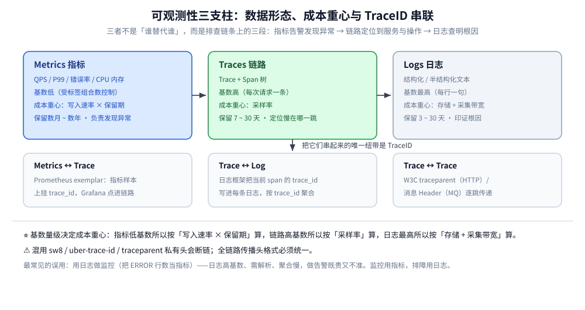

# 可观测性技术选型

> 三大支柱（Metrics / Logs / Traces）各自的定位与**成本重心**，以及把它们缝在一起的机制。本篇是 `可观测性/` 目录的总纲：先给三支柱的分工与成本账单，再给子篇的入口（指标 / 链路 / 日志各自的选型、三支柱如何按 `trace_id` 缝合、采样与 Collector、SLO 与告警响应），最后是跨支柱的存储后端、可视化告警与三套可直接照搬的组合。
>
> 内容整理自个人学习笔记。单技术的落地细节见 SkyWalking 册（[README.md](链路追踪/Skywalking/README.md)）与 Jaeger 册（[README.md](链路追踪/Jaeger/README.md)），各语言接入分册见 [go/](../../../01-编程语言/go/)、[java/](../../../01-编程语言/java/)、[接入Skywalking.md](../../../01-编程语言/php/接入Skywalking.md)；上下文传播机制见 [HTTP与gRPC.md](../../../02-计算机基础/网络/应用层/HTTP与gRPC.md)。

---

## 本目录怎么读

`可观测性/` 是「一篇总纲 + 三个支柱子目录 + 两个专题目录（OTel 全链、发现与响应）+ 两个册」的结构。**总纲只做跨支柱的判断**，单个支柱内部与单个专题的细节一律在子篇，避免同一张选型表出现两份。

### 三个支柱、两个专题目录与两个册的分工

> 本表只给**入口级**判断：「这个组管什么、什么时候读」。组内各篇的分工表放在各组的入口篇里（`OpenTelemetry/README.md`、`日志系统选型对比.md` 第一节），这里不再抄一遍。

| 篇目 | 回答什么 | 读它的时机 |
| --- | --- | --- |
| **本篇**（`可观测性选型对比.md`） | 三支柱各花多少钱、存储后端与可视化告警怎么选、三套组合怎么照搬 | 先读，建立全局成本概念 |
| [指标选型对比.md](指标/指标选型对比.md) | 指标放哪、怎么采、怎么控基数（Pull 与 Push、五种后端、扩容三条路） | 要接监控时 |
| [合成监控与拨测.md](指标/合成监控与拨测.md) | 外部视角怎么补：五段探测、模块配置、证书到期、拨测怎么接告警 | 服务端指标全绿但用户投诉时 |
| [README.md](指标/Prometheus/README.md) | ⭐ **Prometheus 一册的入口**（6 篇零件 + 导读）：四件事为什么互相锁死、样本怎么落成块、抓取七步、PromQL 五段求值、告警状态机、运维五故障。**全册零实测**，只做机制解读 | 已经选定了 Prometheus，要把它讲透时 |
| [链路追踪选型对比.md](链路追踪/链路追踪选型对比.md) | 五条追踪路线怎么选、探针在目标语言上够不够用 | 要接链路时 |
| [日志系统选型对比.md](日志系统/日志系统选型对比.md) | 日志放哪个后端、三种索引模型各能干什么、四板斧降本；⭐ 兼 `日志系统/` **全目录入口**（13 篇唯一分工表 + 三条按处境选的读序 + 实测坐标与未实测清单） | 要接日志时，从这里进 |
| [日志采集管道.md](日志系统/日志采集管道.md) | 日志怎么进去、哪一段会静默丢（多行拼接 / JSON 失效 / 背压）；本组**机制主篇**，`采集器/` 三册只讲产品配置 | 选完后端之后 |
| 日志系统的三个子目录：`采集器/`、`治理与规范/`、`日志后端/`（合计 10 篇） | 落地三段：采集器配置（Fluent Bit / Vector / Filebeat）→ 治理（SDK 规范 / 脱敏 / 风暴限流）→ 后端（`Elasticsearch/` 的 ILM 与 Kibana 查询、`Loki/` 的存储与 Compactor 与 LogQL 查询）；各篇分工不重复列出，见上一条的入口 | 后端选定、要真正落地时 |
| [README.md](OpenTelemetry/README.md) | ⭐ **OTel 专题入口**：七篇分工表（各篇一句话 + 关键读数）、三组关系（地基 / 缝合 / 裁剪 / 处理 / 落地）、三条读序路线、篇间依赖与相邻目录边界、实测坐标与八条未实测 | 进 OTel 组之前先看一眼 |
| [总体架构与核心概念.md](OpenTelemetry/总体架构与核心概念.md) | OTel 是什么、由五个部件拼成、数据跨四段边界、什么时候不该用 | 第一次接触 OTel 时 |
| [数据模型与上下文传播.md](OpenTelemetry/数据模型与上下文传播.md) | 一条 trace 的形状、ID 谁生成、`traceparent` 四字段、上下文在哪断 | 埋点写不对、链路断在中间时 |
| [OTLP协议与传输机制.md](OpenTelemetry/OTLP协议与传输机制.md) | 数据怎么发出去：报文结构、gRPC 与 HTTP、压缩、响应语义与重试 | 要压带宽、要排查收不到时 |
| [OpenTelemetry与关联分析.md](OpenTelemetry/OpenTelemetry与关联分析.md) | ⭐ 三支柱怎么缝合、四个静默断点、OTel 的分层与 OTLP 语义 | 任意时候，越早越好 |
| [采样策略.md](OpenTelemetry/采样策略.md) | 留哪条、留多少：头采样与尾采样的决策时点、留存率与代价 | 决定成本与可查性时 |
| [Collector配置与调优.md](OpenTelemetry/Collector配置与调优.md) | 怎么把它跑稳：处理器顺序、批处理两个参数、队列与重试丢在哪 | 要部署或排查 Collector 时 |
| [部署架构与最佳实践.md](OpenTelemetry/部署架构与最佳实践.md) | Agent 还是 Gateway、四种拓扑、容量与高可用、三个自监控指标 | 要从单机 demo 走到生产时 |
| [告警规则与阈值设计.md](告警与响应/告警规则与阈值设计.md) | 规则怎么设计：三种形态、燃烧率怎么算、窗口语义、40 条怎么压成 1 条 | 指标接完、要配告警时 |
| [SLO与错误预算.md](告警与响应/SLO与错误预算.md) | 目标定多少、预算怎么记账、烧完怎么冻结发布 | 写告警规则之前 |
| [事故响应与复盘.md](告警与响应/事故响应与复盘.md) | 告警之后：分级、升级、止损、复盘与行动项验收 | 收到告警之后 |
| [README.md](链路追踪/Skywalking/README.md)（1 导读 + 5 零件） | 探针式 APM 主线：架构、字节码增强、`sw8`、UI 排障、生态 | 决定走 SkyWalking 之后 |
| [README.md](链路追踪/Jaeger/README.md)（1 导读 + 5 零件） | OTel 主线：v2 运行时、`traceparent`、数据模型、UI 排障、生态 | 决定走 OTel 之后 |

⭐ **本目录刻意没有 `README.md`**，总纲由本篇兼任——这是与 `消息队列/` 相同的一处约定，不要再补建。

### 阅读顺序

```text
本篇（成本与总账）
  ├─ 只做监控        → 指标/指标选型对比.md → 指标/合成监控与拨测.md（要讲透 Prometheus 本身则进 指标/Prometheus/README.md）
  ├─ 只做链路        → 链路追踪/链路追踪选型对比.md → 选定一个册 → 该册导读 → 零件
  ├─ 只做日志        → 日志系统/日志系统选型对比.md（13 篇分工与三条读序）→ 日志系统/日志采集管道.md → 采集器/ → 治理与规范/ → 日志后端/ 对应那一侧（引擎篇 + 查询篇）
  ├─ 要落 OTel       → OpenTelemetry/README.md（分工与读序）→ 总体架构 → 数据模型 → OTLP → 关联分析 → 采样 → Collector → 部署
  ├─ 指标之后要告警  → 告警与响应/SLO与错误预算.md → 告警与响应/告警规则与阈值设计.md
  ├─ 告警之后的事    → 告警与响应/事故响应与复盘.md
  └─ 三个都要        → 先读 OpenTelemetry/OpenTelemetry与关联分析.md，再并行三个子篇
```

⚠️ **「三个都要」时不要从子篇开始读**：三条裂缝（采样、resource 改写、exemplar 编码）都是跨支柱的，先建全局概念能省掉一轮返工。

### 版本坐标与实测边界

本篇的对比结论不随小版本变化，但下表的**具体断言**有版本前提：

| 组件 | 版本坐标 | 本篇引用的实测/官方事实 |
| --- | --- | --- |
| SkyWalking | OAP **11.0.0** + BanyanDB **0.11.0** + Horizon UI | `version` 返回 `11.0.0-6f1fd78`、UI `:8080` 返回 200；`storage.selector` 只有 banyandb / elasticsearch / mysql / postgresql，**H2 于 10.2 移除** |
| Jaeger | **2.20.0** + ClickHouse **26.3** | v2 运行时即 OTel Collector；跑通 7 项、未跑 5 项（清单见 [README.md](链路追踪/Jaeger/README.md)） |
| OpenTelemetry | Collector **0.157.0**、OTLP/HTTP JSON | 采样断链 55% / 52% / 50%，resource 被削成 `job`，exemplar 仅 OpenMetrics 编码输出，逐条见 [OpenTelemetry与关联分析.md](OpenTelemetry/OpenTelemetry与关联分析.md) 第八节；尾采样 36/200、头采样 18/200，批处理 `send_batch_size` 不切包，见 [采样策略.md](OpenTelemetry/采样策略.md) 与 [Collector配置与调优.md](OpenTelemetry/Collector配置与调优.md) |
| Prometheus / promtool | **3.15.0** | SLO 规则与单测、拨测告警规则均 `check rules` / `test rules` 通过，见 [SLO与错误预算.md](告警与响应/SLO与错误预算.md) 第七节 |
| Blackbox Exporter | **0.27.0** | `probe_success` / 状态码 / 证书到期逐项读出；`http.tls_verify` 字段在 0.27 已不存在，见 [合成监控与拨测.md](指标/合成监控与拨测.md) 第四节 |
| Fluent Bit | **3.2.10** | 镜像自带 0 个 `MULTILINE_PARSER`；多行拼接 13 行 → 3 条 → 1 条，见 [日志采集管道.md](日志系统/日志采集管道.md)；`Mem_Buf_Limit` 在 filesystem 下静默失效、重试间隔 6~21s 带抖动，见 [FluentBit配置与调优.md](日志系统/采集器/FluentBit配置与调优.md) |
| Vector | **0.44.0** | VRL 编译期校验（`!` 用在不会失败的函数上报 E620）、三道校验退出码 78 / 0 / 78、`??` 兜不住 null，见 [Vector配置与VRL.md](日志系统/采集器/Vector配置与VRL.md) |
| Filebeat | **8.19.0** | registry 是 append-only 事务日志（10 行 = 5 个事务）、续读 offset 9 890 → 12 872 无重读、`close.on_state_change.inactive` 实际约为配置值的 2~2.3 倍、三个启动坑，见 [Filebeat配置与模块化.md](日志系统/采集器/Filebeat配置与模块化.md) |
| Elasticsearch（日志侧） | **8.19.0**（基础许可） | ILM rollover 与 forcemerge（10 段 78 991 B → 1 段 29 077 B，−63.2%）、`term`/`match`/`wildcard` 三形态耗时、`redact` processor 报 `license.expired.feature`，见 [ES_ILM与索引调优.md](日志系统/日志后端/Elasticsearch/ES_ILM与索引调优.md) |
| Loki | **3.5.0** | 4 MB/s → 429、单行 256 KB → 400、`/query` 拒绝日志查询、`detected_level` 是展示标签选不中；**retention 配 2m 仍一条没删**（五道闸门、`apply_retention_interval` 默认 45s），见 [Loki_存储架构与Compactor调优.md](日志系统/日志后端/Loki/Loki_存储架构与Compactor调优.md) |

⚠️ **未实测的部分**：Zipkin、Grafana Tempo、云厂商托管这四类**全目录未做本机实测**，对比内容整理自官方文档与版本说明；日志侧本机只到**单节点、单进程、filesystem 存储**（Loki）与**单节点基础许可**（ES），所以「写入吞吐上限」「集群容量」「对象存储后端」「data stream 路径」都还没有读数。凡本篇给出的算例都是**估算口径**，已在正文标注。

### 边界与已知缺口

- **不收接入代码**：各语言 SDK / Agent 的写法在 `01-编程语言/{go,java,php}/可观测性/` 下（PHP 在语言根目录）。
- **不收部署步骤**：容器拓扑与容量口径在两个册的「架构与部署」篇。
- **不收主机侧观测**：`perf` / eBPF / 火焰图在 [性能排查.md](../../../02-计算机基础/linux/性能排查.md)。
- **不收指标数学**：PromQL 的求值语义、`rate` 与分位数的边界在 [PromQL求值机制.md](指标/Prometheus/PromQL求值机制.md)；四种类型的选型判据在 [指标选型对比.md](指标/指标选型对比.md) 第五节；导出器侧的桶选择在 [手写Prometheus导出器.md](../../../01-编程语言/go/可观测性/手写Prometheus导出器.md)。
- **不收 RUM**：浏览器 / 移动端真实用户体验监测不在本目录，服务端 SLO 与拨测只覆盖到「请求能不能被正确应答」。
- 已知缺口：**eBPF 自动埋点**（Pixie / OBI）只在原理层面提及、无实测；**日志采样**无实测；**跨云采样协同**未覆盖；**多地域 / 多运营商拨测**只写了规则与 Prometheus 侧抓取，没有分布式探针集群的实测；**Collector 持久化队列（`file_storage`）与多副本 `loadbalancing` 尾采样**未实测，只写了单进程内存队列的丢弃读数。

---

## 一、先分清三个支柱各自解决什么

选型的第一原则：**先定「谁来看、看什么、留多久」，再选组件**。三支柱回答的是不同问题，成本重心也完全不同。

| 支柱 | 回答的问题 | 典型数据 | 基数量级 | 成本重心 | 保留期 |
| --- | --- | --- | --- | --- | --- |
| **Metrics 指标** | 系统整体健康吗？ | QPS、P99 延迟、错误率、CPU/内存 | **低**（受标签组合数控制） | 写入速率 × 保留期 | 长（数月~数年） |
| **Traces 链路** | 慢在哪一跳？跨服务怎么走的？ | Trace + Span 树 | **高**（每次请求一条） | **采样率** | 中（7~30 天） |
| **Logs 日志** | 这次请求究竟发生了什么？ | 结构化/半结构化文本 | **最高**（每行一句） | 存储 + 采集带宽 | 短（3~30 天） |

⭐ 三者的分工不是「谁替代谁」，而是**排查链条上的三段**：指标告警发现异常 → 链路定位到具体服务与操作 → 日志查明根因。把它们串起来的唯一纽带是 **TraceID**。

| 串联方式 | 做法 |
| --- | --- |
| Trace ↔ Log | 日志框架把当前 span 的 `trace_id` 写进每条日志字段，日志系统按 `trace_id` 聚合 |
| Metrics ↔ Trace | Prometheus 的 **exemplar**：指标样本上挂一个 `trace_id`，Grafana 面板可直接点进那条链路 |
| Trace ↔ Trace | W3C `traceparent` 头（HTTP）/ 消息 Header（MQ）逐跳传递，混用私有头会断链 |



图上三块分别是三种信号的数据形态与成本重心，下半部分是三种串联方式各自的载体。注意它们都不是后端自动完成的，三条串联线都要在采集侧显式建立——具体机制与四个静默断点见 [OpenTelemetry与关联分析.md](OpenTelemetry/OpenTelemetry与关联分析.md)。

⚠️ **最常见的误用**：用日志做监控（把 ERROR 行数当指标）。日志是高基数、需要解析、聚合慢的，做告警既贵又不准——**监控用指标，排障用日志**。

### 1.1 三个支柱的成本账单 ⭐

选型时最常被问「这套可观测性一年多少钱」。答案要按支柱拆开算，因为三者的**成本随规模的增长方式完全不同**：

| 支柱 | 成本公式 | 增长由什么驱动 | 压缩手段 | 压缩的代价 |
| --- | --- | --- | --- | --- |
| **指标** | 活跃序列数 × 采样间隔的倒数 × 保留期 | **标签组合数**（与服务数、端点数、状态码档数相乘） | 砍维度、预聚合、降采样 | 排障维度永久变少 |
| **链路** | QPS × 每请求 span 数 × **采样率** × 保留期 | ⭐ **采样率**是唯一线性旋钮 | 尾采样（错误全留、正常抽样） | 采样掉的链路永久查不到 |
| **日志** | QPS × **每请求行数** × 平均行长 × 副本 × 保留期 | **每请求打印行数**（随迭代悄悄翻倍） | 分级保留、结构化裁剪、冷热分层 | 缺 INFO 上下文 |

⭐ **同一套 1000 QPS 系统的粗算**（**估算口径，非实测**，仅用于说明量级差异）：

| 支柱 | 假设 | 日均原始量 | 备注 |
| --- | --- | --- | --- |
| 指标 | 5 万活跃序列、15s 间隔 | 约 2.9 亿个样本点 | 体积小、压缩好 |
| 链路 | 每请求 10 span、**1% 采样** | 864 万条 span | 全采会是 86.4 亿条 |
| 日志 | 每请求 8 行、每行 400 B | **约 276 GB** | 再乘副本与索引膨胀 |

⚠️ 这张表的用途只有一个：**说明「日志最贵」不是感觉，而是「每请求行数」这个乘数的必然结果**。指标量级小但增长隐式（基数爆炸在线性之外还有常数跳变）；链路贵但有一个干净的旋钮；日志贵且**降本手段都带信息损失**。

⭐ **降本四板斧的优先级**（跨支柱通用）：① 分级保留与采样（先砍量）→ ② 降基数与字段裁剪（再砍维度）→ ③ 冷热分层（换更便宜的介质）→ ④ 缩短保留期（最后才动）。**顺序反了就是「更便宜地存垃圾」**。

### 1.2 四个真实痛点（为什么要做）

**本节要点**：选型判据不是从功能表里读出来的，是从下面四条扯皮场景倒推的——每条都能落到某一支柱上。

1. **25% 的 BUG 并不知道原因**。异常抛出时只有那一行栈，当时在调哪个服务、参数是什么、卡在哪一跳，事后无从还原。
2. **跨组问题必须资深工程师来兜**。典型场景：PHP 侧传了一个很长的请求头，Nginx 把它截断了，后端收不到完整请求——PHP、Java、运维三方各自看自己那截日志，互相推诿，谁也拿不出「在哪一跳丢的」证据。
3. **日志在业务组手里，链路在平台侧**。业务日志必须由业务组打印，可跨组调用时「这次请求经过了谁」需要另有一套记录，两边对不上号就等于没有。
4. **慢 SQL 只能按整个 DB 或实例推**。没有 span 粒度，就说不清「是哪一条调用链上的哪次查询慢」，告警只能发给一大群人。

⭐ 这四条痛点分别指向：**① 链路（保留现场）② 逐跳可见（拓扑边 + 每跳的头处理）③ TraceID 缝合日志与链路 ④ span 级依赖耗时**。

对应地，分布式 / 微服务里最常问的七个问题——这七问**就是 Traces 支柱要回答的全部内容**：

1. 一次调用到底穿越了几个服务？
2. 处理这次请求时，每个服务到底做了什么操作？
3. 如果请求变慢了，瓶颈在哪里？
4. 如果请求失败了，是哪个服务、服务中的哪个部分出了问题？
5. 异常请求与正常请求的区别是什么？
6. 一次请求中，经常调用的服务为什么不调用了？不常见的服务为什么被调用了？
7. 调用的关键路径是什么？

> ⚠️ 这七问没有一条能靠「把日志写进文件再 grep」回答——**这就是链路追踪不是「锦上添花」的原因**。
> 反过来，凡是七问之外的需求（容量规划、成本核算、SLA 度量）都该由 Metrics 承担，别拿链路数据硬算。

各痛点的落地位置：

| 痛点 | 靠什么解决 | 在哪一节展开 |
| --- | --- | --- |
| ① 现场丢失 | 采样 + 错误请求强制采样 | 本文第七节的三套组合、[架构与部署.md](链路追踪/Skywalking/架构与部署.md) 第八节 |
| ② 跨组扯皮 | 拓扑图 + 上下文透传 | [协议与数据模型.md](链路追踪/Skywalking/协议与数据模型.md) 第二节、[UI与排障.md](链路追踪/Skywalking/UI与排障.md) 第三节 |
| ③ 日志与链路对不上 | traceId 写进日志字段 | ⭐ [OpenTelemetry与关联分析.md](OpenTelemetry/OpenTelemetry与关联分析.md) 第四节、[接入Skywalking.md](../../../01-编程语言/java/可观测性/接入Skywalking.md) |
| ④ 慢依赖说不清 | Exit span 的方法级耗时 | [UI与排障.md](链路追踪/Skywalking/UI与排障.md) 第四节、[观测与诊断.md](../../数据存储/关系型/MySQL/观测与诊断.md) |

---

## 二、链路追踪：结论与入口

⭐ **一句话结论**：**新项目一律用 OpenTelemetry 埋点，后端当可替换实现**。因为埋点是最难迁移的部分（代码侵入、跨团队协调），协议要先标准化。

| 团队画像 | 走哪条 | 一句话理由 |
| --- | --- | --- |
| Java 为主 + 要开箱即用 APM | SkyWalking | 字节码增强最成熟，`-javaagent` 一行上线 |
| Go 为主 / 多语言 / 已用 OTel | Jaeger 或 Tempo + OTel | ⚠️ SkyWalking 在 Go 侧只能编译期注入 |
| 小规模内部工具 | Zipkin | 轻量、上手最快 |
| 已用 Grafana LGTM | Tempo | 只索引 TraceID，成本极低但只能按 ID 查 |

⚠️ **两者不要并行双报**（双份探针、两套 traceId、断链风险翻倍）。完整对比（五条路线 + 四种接入形态 + 迁移成本）见 [链路追踪选型对比.md](链路追踪/链路追踪选型对比.md)。

---

## 三、指标监控：结论与入口

⭐ **一句话结论**：判断依据是**活跃时间序列数**，不是功能表。单 Prometheus 实例的舒适区在**百万级以内**；超过就先降基数，再考虑 VictoriaMetrics / Thanos / Mimir。

| 起点资产 | 走哪条 |
| --- | --- |
| 已有 Prometheus + Grafana | 保留抓取，只加长期化（`remote_write`） |
| 全新且规模不大 | Prometheus 单机 + 明确保留期 |
| 高基数 / 多租户 | VictoriaMetrics 或 Mimir（PromQL 兼容） |
| 已全面用 OTel | OTel SDK → Collector → prometheus exporter / remote write |

⚠️ **指标不要为了「统一」迁到日志存储上**：指标是高频、短窗口、大量小查询，日志是低频、大范围扫描，负载方向相反。完整对比（五种后端 + Pull/Push + 四种指标类型 + 扩容三条路）见 [指标选型对比.md](指标/指标选型对比.md)。

---

## 四、日志收集：结论与入口

⭐ **一句话结论**：选型的真正分水岭是**索引模型**——「排障时你是先知道服务名和时间窗，还是要在一堆日志里搜一个词？」前者 Loki 够（成本低一个量级），后者必须 ES，要做统计报表则 ClickHouse。

| 索引模型 | 代表 | 一句话 |
| --- | --- | --- |
| 全文倒排 | Elasticsearch / OpenSearch | 什么都能搜，成本最高 |
| 标签索引 + 正文扫描 | Loki | 成本最低，**没有标签的字段查不动** |
| 列式 + 分区裁剪 | ClickHouse | 聚合最快，缺现成 UI |

⚠️ **别被「日志成本占比」骗了**：成熟系统里日志往往是可观测性成本的最大头（常占 50%+）。降本靠**分级保留**——ERROR 全留、WARN 短期、INFO 采样或降级为指标。完整对比见 [日志系统选型对比.md](日志系统/日志系统选型对比.md)，采集端怎么建见 [日志采集管道.md](日志系统/日志采集管道.md)。

---

## 五、存储后端怎么选？

存储要按**查询模式**选，不是按「哪个名气大」选。

| 存储 | 优点 | 缺点 | 最适合承载 |
| --- | --- | --- | --- |
| **Elasticsearch** | 成熟、聚合强、生态完整（Jaeger / SkyWalking / Loki 都能接） | 资源消耗大、成本高；高基数下分片与写入压力明显 | Trace 按 tag 检索、日志全文检索 |
| **BanyanDB** | SkyWalking 官方自研，专为链路 + 时序模型设计，比 ES 更省资源、可分层存储 | 生态小、外部工具支持少 | SkyWalking 的默认推荐存储 |
| **ClickHouse** | 高基数下**按 ID 精查**最优；写入吞吐与压缩比极高；Jaeger v2 官方原生支持 | 列式，不适合频繁点更新；需理解 MergeTree 调优 | Trace 明细、日志分析、大宽表聚合，Jaeger v2.18.0 后默认推荐存储 |
| **Prometheus TSDB / VictoriaMetrics** | 为指标模型量身定制，压缩好、查询快 | 只服务指标（其余数据不适用） | Metrics |
| **对象存储**（S3 / OSS / MinIO） | 单位成本最低、容量无上限 | 延迟高，只能做冷数据 | Tempo 的 Span 正文、Loki 的日志正文、归档层 |

⭐ **分层保留**是控制成本的通用手段：热数据（7 天，SSD + 可检索）→ 温数据（30 天，普通盘）→ 冷数据（对象存储，只保索引可回捞）。

⚠️ **一个存储吃三种信号的路线存在，但要看清楚它替代的是哪一层**：GreptimeDB 这类方案替换的是**存储与查询层**，采集端（Collector / Fluent Bit）与消费端（Grafana）都不必换，边界见 [可观测性集成方案.md](../../数据存储/时序数据库/GreptimeDB/可观测性集成方案.md)。

---

## 六、可视化与告警怎么选？

| 组件 | 优点 | 缺点 | 适用 |
| --- | --- | --- | --- |
| **Grafana** | 多数据源统一面板（Prometheus / Loki / Tempo / ES / CH）；仪表盘生态大、模板可复用 | 告警能力相对分散（依赖各数据源） | 事实标准，几乎必选 |
| **Kibana** | 与 ES 深度绑定，Discover 检索体验好 | 只服务 ES | 用 ELK 的团队 |
| **SkyWalking UI** | APM 专用视图（拓扑、服务指标、链路），开箱即用 | 定制能力弱，无法统一纳入其他数据源 | 用 SkyWalking 的团队，与 Grafana 分工（APM 看 SW，指标看 Grafana） |
| **Alertmanager** | 分组、抑制、静默、多通道（钉钉/飞书/邮件/Webhook）；与 Prometheus 天然配套 | 规则语法（PromQL）有学习成本；无 UI 配置 | 指标告警的标准选择 |

⚠️ 这一节只回答「选哪个产品」。**规则该怎么写、阈值怎么算、40 条告警怎么压成 1 条**属于设计面，见
[告警规则与阈值设计.md](告警与响应/告警规则与阈值设计.md)——那篇的第五、七节用的就是这里的 Alertmanager 与 Prometheus。

### 6.1 按「排障动作」对照：各套 UI 实际能做到什么 ⭐

**本节要点**：选型表上那句「UI 友好」无法量化，落到具体排障动作上才看得清差别。⚠️ 注意 **11.0.0 起 SkyWalking 官方 UI 镜像已换成 Horizon**（容器内监听 8081，旧 `SW_OAP_ADDRESS` 失效，改用 `HORIZON_OAP_QUERY_URL` / `HORIZON_OAP_ADMIN_URL`）。

| 排障动作 | SkyWalking UI（Horizon） | Jaeger UI | Grafana + Tempo + Loki | Kibana（ELK） | 云厂商控制台 |
| --- | --- | --- | --- | --- | --- |
| **看服务拓扑（谁在调谁）** | ✅ 内置，边由链路数据推出 | ⚠️ 只有依赖图（service dependencies），粒度粗 | ⚠️ Service Graph 需在 Collector / metrics-generator 侧额外开启并落指标 | ❌ | ✅ |
| **按条件检索链路**（服务 / 端点 / tag / 耗时） | ✅ | ✅，但**能力跟着存储走**——换 ClickHouse 后按 tag 检索明显变弱 | ❌ Tempo 只能按 TraceID 精查 | ⚠️ 只能查落到 ES 的原始文档，没有链路专用视图 | ✅ |
| **Span 瀑布 + 自身耗时** | ✅ `Duration` / `Self Duration` 双列 | ✅ 有 exclusive duration | ✅（Tempo 面板） | ❌ | ✅ |
| **代码级剖析**（线程栈采样定位到方法） | ✅ Profile 任务（对目标端点短时开启） | ❌ | ❌ | ❌ | ⚠️ 部分产品有（如 ARMS 持续剖析） |
| **按 TraceID 回捞业务日志** | ✅ 日志面板（日志由探针上报到同一套存储） | ❌ 只有 span 内嵌的 log rows，业务日志要另查 | ✅ Loki 用 `derived field` 提 traceId（要自己配） | ✅ 日志侧最强，但要先有 traceId | ✅ |
| **告警规则改在哪里** | 服务端 `config/alarm-settings.yml`，UI 只展示与订阅 | ❌ 无告警能力 | ✅ Grafana / Alertmanager 规则（UI 可配） | ✅ Kibana rule | ✅ |
| **自建大盘、混接多数据源** | ❌ 只吃自家 OAP | ❌ | ✅ 这是 Grafana 的本职 | ⚠️ 只服务 ES | ❌ |

> ⭐ 三条结论：
> **① 「要不要再加一套 Grafana」取决于要不要同屏**。SkyWalking UI 与 Jaeger UI 都是**单一后端的排障台**，不是大盘：容量趋势、SLO、业务指标一律要 Grafana，两者与它**分工并存**而非二选一。
> **② 告警规则存放的位置，决定了谁能调阈值**。SkyWalking 的规则在 OAP 配置文件里（改阈值要改文件、要重启，UI 只能订阅），Grafana / Prometheus 系有 UI 与规则文件两条路。团队没有权限分层时，前者会收敛成「只有 SRE 敢动阈值」。
> **③ 「按 ID 精查」与「按条件检索」是两个量级的能力**。Tempo 走前者换取成本极低，ES / SkyWalking 存储走后者——**选型前先问自己：排障时是「已知 traceId」还是「先要捞出那条请求」**。

### 6.2 一条排障动线，看谁会在第几跳断掉

标准动线是六跳：**告警 → 服务 → 端点 → 链路 → span → 业务日志**。

```text
SkyWalking UI   ：✅ ✅ ✅ ✅ ✅ ✅   全程在同一套 UI 里点到底（日志由探针上报，天然带 traceId）
Jaeger + Grafana：✅ ⚠️ ⚠️ ✅ ✅ ❌   最后一跳要手动复制 traceId 去 Loki / Kibana
Grafana LGTM    ：✅ ✅ ⚠️ ✅ ✅ ⚠️   端点检索与日志缝合都要自己配（exemplar + derived field）
Kibana          ：❌ ❌ ❌ ⚠️ ❌ ✅   日志侧强，链路侧基本靠原始文档
```

⚠️ **动线断点的代价不是「少点两下」**：每多一次手动复制 traceId，就多一次复制错、查错窗口、或者干脆放弃深挖的机会——线上排障的失败往往发生在这里，而不是组件能力不够。

各面板具体看什么字段、怎么用（Dashboard 三 Tab、拓扑节点颜色语义、Profile 的 `Dump Count`、告警文本的读法），只在 [UI与排障.md](链路追踪/Skywalking/UI与排障.md) 第二至七节展开，本篇不重复。

⚠️ **告警设计比告警工具更重要**：优先用**多窗口多燃烧率（multi-window burn rate）**的 SLO 告警替代「单点阈值告警」，否则告警疲劳会让团队直接忽略。

---

## 七、三套推荐组合（可直接照搬）

### 7.1 小团队起步（< 10 个服务）

```text
埋点：SkyWalking Agent（无侵入，改启动参数即可）
存储：BanyanDB（单容器起步）
UI：  SkyWalking UI（APM 大盘 + 拓扑）
日志：云日志服务（不自建，避免运维负担）
```

**理由**：一周内可上线，人力投入最小。⚠️ 老教程里的「先用内置 H2 试用」已经不适用——**H2 存储实现于 10.2 移除**，11.0.0 起步就得带一个 BanyanDB（或 ES）实例；BanyanDB 容器必须显式给 `command: standalone`，否则打印 usage 后 `exit 0`（本机实测，见 [架构与部署.md](链路追踪/Skywalking/架构与部署.md) 第六节）。⚠️ 这套组合的前提是**团队以 Java 为主**；Go 为主的团队请改走 7.2 的 OTel 路线（原因见 [链路追踪选型对比.md](链路追踪/链路追踪选型对比.md) 第五节）。

### 7.2 标准微服务（10 ~ 100 个服务）

```text
埋点：OpenTelemetry SDK → OTLP
链路：OTel Collector（含 tail sampling）→ Jaeger → ClickHouse
指标：Prometheus + Alertmanager
日志：Loki（或云日志）
面板：Grafana（统一查询 Prom / Loki / Tempo）
```

**理由**：埋点标准化、后端可替换、成本可控；Collector 集中做采样与属性清洗。⚠️ 这套组合的缝合质量取决于三件事——`resource` 归一、`trace_id` 注入日志、exemplar 的编码，逐条见 [OpenTelemetry与关联分析.md](OpenTelemetry/OpenTelemetry与关联分析.md) 第三、四、六节。

### 7.3 大规模高基数（> 100 个服务，日增 TB 级）

```text
埋点：OTel SDK / eBPF（自动埋点）→ Collector（聚合 + 尾部采样）
链路：OTel Collector → ClickHouse（按 ID 精查）
指标：VictoriaMetrics（集群版，降基数 + 长保留）
日志：ClickHouse 或对象存储归档；ERROR 走 Loki 短期留存
面板：Grafana；告警：Alertmanager（SLO 燃烧率）
```

**理由**：把「查询模式」拆开——低基数长期指标走 TSDB，高基数按 ID 精查走 CH，冷数据下沉对象存储。

---

## 八、延伸追问

- **三支柱怎么关联起来？** → 唯一纽带是 `trace_id`：日志写进字段、指标挂 exemplar、跨进程用 W3C `traceparent` 传递。⚠️ 全链路头格式必须统一，混用 `sw8` / `uber-trace-id` / `traceparent` 会断链。机制与四个静默断点见 [OpenTelemetry与关联分析.md](OpenTelemetry/OpenTelemetry与关联分析.md)。
- **为什么指标要严格控基数？** → 每个标签组合都算一条独立时间序列，`user_id` / `request_id` / 完整 URL 做标签会造成「基数爆炸」，直接打爆 TSDB 内存。标签只放**低基数**维度（服务名、接口路由模板、状态码），高基数维度放日志或链路。判据见 [指标选型对比.md](指标/指标选型对比.md) 第一节。
- **采样率怎么定？** → 头部采样（SDK 端按比例）简单但可能丢弃错误链路；**尾部采样**（Collector 侧按结果决策）能做到「错误与慢请求 100% 保留、正常请求抽样」，是成本与信息量的最优解。
- **无侵入 Agent 的代价是什么？** → 字节码增强带来 CPU/内存开销；与 JDK 版本、Glibc 版本、其他 agent 存在兼容风险；探针异常理论上可能影响业务进程——所以生产要灰度、要能一键摘除。
- **SkyWalking 对 Go 友好吗？** ⭐ → 这是选型最容易踩的坑。Go 没有 classloader，**「运行时无侵入」在 Go 上不成立**，skywalking-go 走的是编译期 AST 注入（`go build -toolexec=… -a`）：配置在编译期写死进二进制、运行期改不了也摘不掉、插件只覆盖官方列出的框架版本区间。所以 **Java 侧的「零改码 + 灵活」体验在 Go 侧会打折**，Go 为主的项目更该走 OTel SDK。参见 [接入Skywalking.md](../../../01-编程语言/go/可观测性/接入Skywalking.md)。
- **为什么不用日志做监控告警？** → 日志基数最高、需要解析、聚合慢且贵；监控需要的是低基数、可长期保存、能快速聚合的指标。
- **ES 和 ClickHouse 都能存 Trace，怎么选？** → 看查询模式：**按标签过滤 + 全文检索**选 ES；**按 TraceID 精查、高基数写入、要控成本**选 ClickHouse。Jaeger v2 对 CH 是一等公民。
- **可观测性成本怎么降？** → 四板斧：①尾部采样（链路）；②降基数（指标）；③分级保留 + 分层存储（日志与冷数据）；④把「只增不减」的 INFO 日志降级或采样。优先级与代价见 1.1 节。
- **告警怎么设计才不会被忽略？** → 用 SLO + 多窗口燃烧率替代单点阈值；设置抑制与静默规则（同一根因只告一条）；告警必须**可行动**——没有明确处置动作的告警直接删掉。

---

## 关联

- [指标选型对比.md](指标/指标选型对比.md) — 指标侧：基数控制、Pull 与 Push、五种后端、四种指标类型、扩容三条路
- [链路追踪选型对比.md](链路追踪/链路追踪选型对比.md) — 链路侧：五条路线、四种接入形态、探针成熟度与迁移成本
- [日志系统选型对比.md](日志系统/日志系统选型对比.md) — 日志侧入口：三种索引模型、五个后端、四板斧降本，兼 13 篇的分工表与三条读序
- [日志采集管道.md](日志系统/日志采集管道.md) — 选完日志后端之后的另一半：五段管道、多行拼接、JSON 静默失效、背压与丢日志策略
- [SLO与错误预算.md](告警与响应/SLO与错误预算.md) — 告警之前的目标定义：SLI 三要素、目标分档、预算记账与烧完之后的发布政策
- [告警规则与阈值设计.md](告警与响应/告警规则与阈值设计.md) — 指标接完之后的下一步：三种规则形态、燃烧率换算、窗口语义与抑制聚合
- [事故响应与复盘.md](告警与响应/事故响应与复盘.md) — 告警之后的动作：分级与升级、两个时钟、on-call 交接、无责复盘与行动项闭环
- [合成监控与拨测.md](指标/合成监控与拨测.md) — SLO 的外部视角：拨测链路五阶段、Blackbox 模块化配置、证书到期与多目标抓取
- [README.md](OpenTelemetry/README.md) — ⭐ OTel 专题入口：七篇分工表、三组关系、三条读序路线、篇间依赖与实测坐标（含八条未实测）
- [总体架构与核心概念.md](OpenTelemetry/总体架构与核心概念.md) — What/Why 篇：五个部件、四段边界、信号家族与「什么情况下不该用 OTel」
- [数据模型与上下文传播.md](OpenTelemetry/数据模型与上下文传播.md) — 数据为什么长成 Resource/Scope/Span 三层，跨进程只传 `traceparent` 的四个字段
- [OTLP协议与传输机制.md](OpenTelemetry/OTLP协议与传输机制.md) — 报文体结构、gRPC 与 HTTP 两条路径、protobuf 与 JSON 的体积账（实测 2.9 倍）
- [OpenTelemetry与关联分析.md](OpenTelemetry/OpenTelemetry与关联分析.md) — ⭐ 三支柱如何缝合：resource 地基、三条缝合线、四个静默断点（全篇带实测读数）
- [采样策略.md](OpenTelemetry/采样策略.md) — 缝合之后的取舍：头采样与尾采样的决策时点、策略组合的重叠、留多少才够排障
- [Collector配置与调优.md](OpenTelemetry/Collector配置与调优.md) — 把它跑稳：四种 pipeline 组件、processor 顺序、批处理两个参数、队列丢弃的读数
- [部署架构与最佳实践.md](OpenTelemetry/部署架构与最佳实践.md) — 落地：Agent 与 Gateway 的分界、四种拓扑、单副本吞吐读数、尾采样的粘性
- [README.md](链路追踪/Skywalking/README.md) — SkyWalking 册导读：定位、五篇阅读路线与实测坐标
- [README.md](链路追踪/Jaeger/README.md) — OTel 路线主线（Jaeger 册导读）：Trace/Span 概念、五篇零件与实测坐标
- [接入Skywalking.md](../../../01-编程语言/go/可观测性/接入Skywalking.md) — Go 侧编译期注入路线与 OTel 备选路线
- [接入Jaeger.md](../../../01-编程语言/go/可观测性/接入Jaeger.md) — Go 侧 OTel SDK + OTLP 落地
- [接入Skywalking.md](../../../01-编程语言/java/可观测性/接入Skywalking.md) — Java 侧 `-javaagent` 无侵入接入
- [接入Jaeger.md](../../../01-编程语言/java/可观测性/接入Jaeger.md) — Java 侧 OTel Agent / Micrometer Tracing
- [接入Skywalking.md](../../../01-编程语言/php/接入Skywalking.md) — 多语言探针在 PHP-FPM 侧的实际接入步骤
- [K8s部署与生命周期面试题.md](../../../06-工程实践/部署/k8s/K8s部署与生命周期面试题.md) — 采集组件（OAP / Collector）的部署形态与生命周期
- [性能排查.md](../../../02-计算机基础/linux/性能排查.md) — 主机与内核侧的另一半观测面（perf / eBPF / `ss` / 火焰图），与本目录的应用埋点互补
- [观测与诊断.md](../../数据存储/关系型/MySQL/观测与诊断.md) — DB 侧自己的观测面，可对照「应用侧 span」与「数据库内部统计」两套视角
- [HTTP与gRPC.md](../../../02-计算机基础/网络/应用层/HTTP与gRPC.md) — trace 上下文在 HTTP / gRPC 请求头中的传播
- [消息队列选型对比.md](../消息队列/消息队列选型对比.md) — 同属「多技术选型」的另一篇，可对照选型表的写法
- [README.md](../../数据存储/时序数据库/VictoriaMetrics/README.md) — VictoriaMetrics 目录导读：当长期存储还是整体替代 Prometheus、与 Thanos / Mimir 的路线差异
- [README.md](../../数据存储/时序数据库/GreptimeDB/README.md) — GreptimeDB 目录导读：用一个列式引擎承载 Metrics / Logs / Traces 三信号，以及它与 Prometheus / Loki / Jaeger 的替代关系
- [时序数据库选型对比.md](../../数据存储/时序数据库/时序数据库选型对比.md) — ⭐ 时序存储后端的中立横向选型：五族划分、选型前必须量化的五个数、按「起点资产」分派的决策线

> 反向引用（本篇被下列文档引到）：[手写Prometheus导出器.md](../../../01-编程语言/go/可观测性/手写Prometheus导出器.md)、[日志与错误规范.md](../../../01-编程语言/go/工程实践/日志与错误规范.md)、[从零实现网关.md](../../../01-编程语言/go/网络编程/从零实现网关.md)、[runtime调试与trace.md](../../../01-编程语言/go/运行时/runtime调试与trace.md)、[可观测性.md](../RPC框架/gRPC/可观测性.md)、[中间件选型.md](../中间件选型.md)、[README.md](../消息队列/Pulsar/README.md)、[观测与诊断.md](../../数据存储/关系型/MySQL/观测与诊断.md)、[定位与适用场景.md](../../数据存储/列式数据库/ClickHouse/定位与适用场景.md)、[列式数据库选型对比.md](../../数据存储/列式数据库/列式数据库选型对比.md)、[搜索与分析选型对比.md](../../数据存储/搜索与分析/搜索与分析选型对比.md)、[数据库选型对比.md](../../数据存储/数据库选型对比.md)、[Flow流计算引擎.md](../../数据存储/时序数据库/GreptimeDB/Flow流计算引擎.md)、[PromQL兼容查询.md](../../数据存储/时序数据库/GreptimeDB/PromQL兼容查询.md)、[SQL查询与跨信号关联.md](../../数据存储/时序数据库/GreptimeDB/SQL查询与跨信号关联.md)、[写入协议与数据接入.md](../../数据存储/时序数据库/GreptimeDB/写入协议与数据接入.md)、[可观测性集成方案.md](../../数据存储/时序数据库/GreptimeDB/可观测性集成方案.md)、[定位与适用场景.md](../../数据存储/时序数据库/GreptimeDB/定位与适用场景.md)、[选型对比与落地案例.md](../../数据存储/时序数据库/GreptimeDB/选型对比与落地案例.md)、[MetricsQL查询.md](../../数据存储/时序数据库/VictoriaMetrics/MetricsQL查询.md)、[与Prometheus生态的关系.md](../../数据存储/时序数据库/VictoriaMetrics/与Prometheus生态的关系.md)、[定位与适用场景.md](../../数据存储/时序数据库/VictoriaMetrics/定位与适用场景.md)、[性能调优与基准测试.md](../../数据存储/时序数据库/VictoriaMetrics/性能调优与基准测试.md)、[索引设计与查询优化.md](../../数据存储/时序数据库/VictoriaMetrics/索引设计与查询优化.md)、[运维与监控.md](../../数据存储/时序数据库/VictoriaMetrics/运维与监控.md)、[选型与落地案例.md](../../数据存储/时序数据库/VictoriaMetrics/选型与落地案例.md)、[高可用与集群部署.md](../../数据存储/时序数据库/VictoriaMetrics/高可用与集群部署.md)、[审计与应急响应.md](../../../06-工程实践/安全/安全工程/审计与应急响应.md)、[数字证书与PKI.md](../../../06-工程实践/安全/密码学与密钥/数字证书与PKI.md)、[K8s部署流程.md](../../../06-工程实践/部署/k8s/K8s部署流程.md)、[容器与编排选型.md](../../../06-工程实践/部署/容器与编排选型.md)
