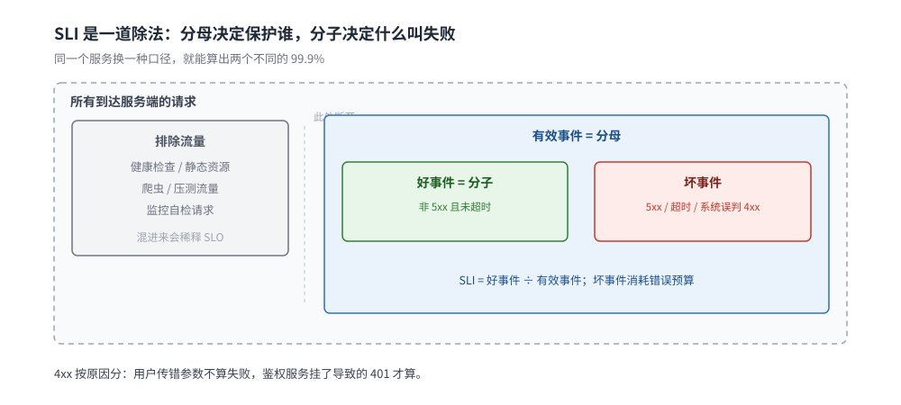
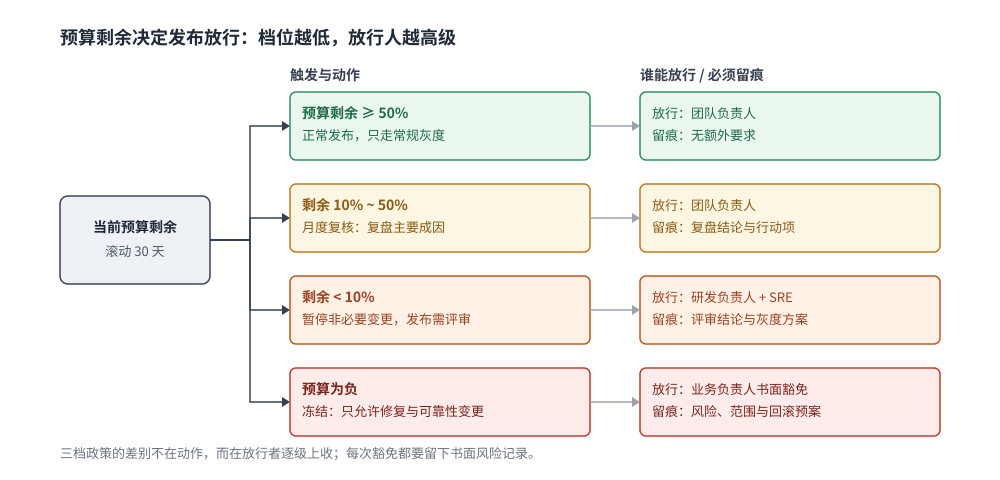
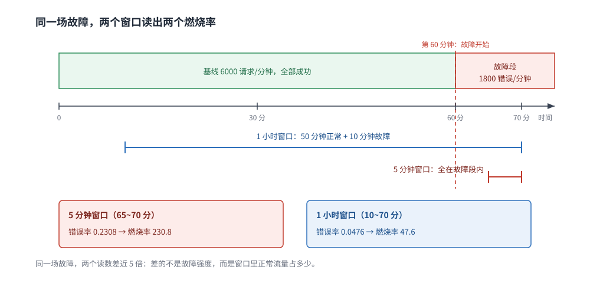

# SLO 与错误预算

> 覆盖：在写告警规则之前必须先回答的四件事——SLI 怎么定义、SLO 目标定多少、错误预算怎么记账、预算烧完之后发布要不要停。以及这三者怎么和燃烧率告警、灰度发布、容量规划、事故响应接上。
>
> 不覆盖：燃烧率的公式推导、窗口语义与抑制聚合见 [告警规则与阈值设计.md](告警规则与阈值设计.md)；告警之后的分级、on-call 与复盘见 [事故响应与复盘.md](事故响应与复盘.md)；SLO 的外部视角（拨测）见 [合成监控与拨测.md](../指标/合成监控与拨测.md)；指标类型与基数控制见 [指标选型对比.md](../指标/指标选型对比.md)；三支柱怎么缝合见 [OpenTelemetry与关联分析.md](../OpenTelemetry/OpenTelemetry与关联分析.md)。
>
> 内容整理自个人学习笔记。**实测口径**：本篇第 5.2 节的规则与单测在 Prometheus **v3.15.0** 的 `promtool` 下 `check rules` 与 `test rules` 均通过；停机预算表是 30 天窗口的算术结果；SLO 目标怎么定、预算政策怎么落地属于组织实践，无本机读数，已在 `## 校验口径` 标明。

---

## 一、SLI 到底该测什么？

**本节要点**：SLI 是一个**比率**，由「好事件 / 有效事件」定义。定义不清的 SLI 会让「99.9%」变成一句无法验证的口号——分母里放什么，决定了这个数在保护谁。

### 1.1 四类 SLI

| 类型 | 好事件 | 有效事件 | 常见坑 |
|---|---|---|---|
| **可用性** | 非 5xx 且未超时的请求 | 所有到达服务端的请求 | 把用户参数错误的 4xx 也算失败，SLO 会被客户端 bug 拖垮 |
| **延迟** | 在阈值内完成的请求 | 所有成功请求 | 用平均延迟；平均 200ms 可能藏着 10% 的 5 秒请求 |
| **正确性** | 返回结果与预期一致 | 所有成功响应 | 只测「有没有报错」，不测「结果对不对」，数据写错发现不了 |
| **覆盖率 / 新鲜度** | 数据在承诺时间内可用 | 时间窗口或批次 | 批处理、报表、缓存同步类系统用可用性 SLI 会失真 |

⭐ **延迟 SLI 要用「阈值内比例」，不是分位数**：`P99 < 500ms` 与「99% 的请求 < 500ms」在数学上接近，但后者能直接当预算记账，也能和可用性 SLI 复合成同一个比率。

### 1.2 比率型 SLI 的三要素

| 要素 | 要写清楚什么 | 写错的后果 |
|---|---|---|
| **好事件** | 哪个状态码、哪个耗时阈值、哪个业务结果算成功 | 口径随人变化，同一个 SLO 两个团队算出两个数 |
| **有效事件** | 哪些请求进分母：是否含健康检查、静态资源、爬虫、压测流量 | 分母混入无关流量，SLO 被稀释 |
| **统计窗口** | 滚动 30 天还是自然月；窗口多长 | 月初与月末的预算剩余差异巨大 |

⚠️ **4xx 的归属要按原因分，不按状态码分**：

- 用户传错参数、未登录 → 不算服务失败；
- 鉴权服务挂了导致全站 401、限流误伤正常用户 → 算服务失败；
- 区分不了就先排除 4xx，另建一个「鉴权与限流错误率」单独看。



这张图要读出的是「同一批请求被切成三份」：灰色的排除流量一旦混进分母，SLO 就被稀释；好事件与坏事件之和才等于有效事件，所以口径换一处，99.9% 这个数就换一个含义。

### 1.3 服务端 SLI 不等于用户体验

服务端指标全绿，用户仍然可能打不开：DNS 解析错、证书过期、CDN 回源失败、LB 健康检查误摘、跨城链路丢包。这些环节**不经过你的进程**，不会出现在 `http_requests_total` 里。

| 观测位置 | 能看到什么 | 看不到什么 |
|---|---|---|
| 服务端指标 | 进程处理了多少、错了多少 | 请求有没有到达、用户有没有拿到 |
| 边缘 / LB 日志 | 到达边缘的请求与状态码 | 客户端渲染、DNS 之前的失败 |
| **拨测** | 从外部能否完成一次真实请求 | 真实用户分布与长尾 |
| RUM（本篇不做） | 真实用户的加载与交互 | 服务端内部原因 |

⭐ 结论：**SLO 至少要有一路外部视角**。只有服务端 SLI 的团队，会在「服务端 99.99%、用户投诉不断」时找不到北。拨测怎么做见 [合成监控与拨测.md](../指标/合成监控与拨测.md)。

### 1.4 SLI 必须可计算

| 数据源 | 成本 | 适合算什么 | 限制 |
|---|---|---|---|
| 指标 | 最低 | 可用性、延迟比例 | 需要提前埋点，标签基数受限 |
| 日志 | 中 | 业务正确性、特定错误码 | 解析成本高，采样会漏 |
| 链路 | 高 | 按端点的延迟与错误 | 采样过的数据不能算绝对量 |

⚠️ **别用采样链路算「失败请求数」**：采样率一变，绝对值就变。比率类指标（错误率、阈值内比例）在分子分母同比例采样时仍然成立，但前提是**采样与结果无关**——尾部采样按错误保留，这个前提就不成立了。机制见 [OpenTelemetry与关联分析.md](../OpenTelemetry/OpenTelemetry与关联分析.md) 第六节。

## 二、SLO 目标定多少？

**本节要点**：SLO 不是越高越好，它是**可靠性与变更速度之间的兑换率**。目标定到 100%，等于宣布永远不发布。

### 2.1 从历史数据反推

| 步骤 | 做法 |
|---|---|
| 1 | 取过去 4~12 周的真实 SLI，按周看波动 |
| 2 | 目标设在「当前水平 + 一档」，例如现在 99.85%，先定 99.9% |
| 3 | 连续两个季度稳定达标，再考虑提高一档 |
| 4 | 如果当前只有 99.5%，不要直接定 99.99%——先把预算花在消除主要故障源上 |

⭐ **一次提高一档**：从 99.9% 到 99.99%，允许的不可用时间缩短到原来的十分之一，需要的架构改动（多活、自动切流、无状态化）是数量级的，不是调参能到的。

### 2.2 30 天窗口的停机预算

| SLO | 允许不可用时长（30 天） | 直观感受 |
|---|---|---|
| 99% | 7 小时 12 分 | 每个月可以有一个完整的半天故障 |
| 99.9% | 43 分 12 秒 | 一次中等故障就用完 |
| 99.95% | 21 分 36 秒 | 两次发布回滚就超 |
| 99.99% | 4 分 19 秒 | 基本要求自动发现与自动切流 |
| 99.999% | 25.92 秒 | 人工响应来不及，必须系统自愈 |

⚠️ 这张表是**按 30 天 = 720 小时**算的算术结果，不含「部分用户受影响」的折算。真实记账要按请求比例或影响用户数加权，不能只看墙钟时间。

### 2.3 按链路分档，不要一个 SLO 管全站

| 档位 | 典型对象 | 建议起点 | 理由 |
|---|---|---|---|
| 核心交易链路 | 登录、下单、支付 | 99.95% 起 | 直接关联收入与资损 |
| 一般业务接口 | 列表、详情、搜索 | 99.9% 起 | 可降级、可重试 |
| 内部工具 / 后台 | 运营后台、报表 | 99.5% 起 | 影响面小，可用性要求低 |
| 异步任务 | 消息消费、批处理 | 按「新鲜度」定 | 不适用请求可用性 |

### 2.4 SLO 与 SLA 不是一回事

| | SLO | SLA |
|---|---|---|
| 对象 | 内部团队 | 外部客户 / 合同 |
| 作用 | 指导发布与告警 | 约定赔偿与法律责任 |
| 严格度 | **必须严于 SLA** | 通常比 SLO 低一档 |
| 违反后果 | 冻结发布、复盘、改架构 | 赔钱、信用损失 |

⭐ **SLO 必须严于 SLA**：如果对外承诺 99.9%，内部 SLO 也定 99.9%，那么每次内部「刚好达标」都意味着对外在违约边缘。内部目标要留出缓冲，例如对外 99.9%、对内 99.95%。

### 2.5 为什么不能定 100%

- 错误预算为 0，任何一次发布、任何一次依赖抖动都「违约」；
- 高可用没有终点，追求 100% 的成本指数上升；
- 团队会学会忽略 SLO，因为它永远不可能达标。

## 三、错误预算怎么记账？

**本节要点**：错误预算是「这段时间内允许坏多少」的额度。记账方式只有两种：**按请求**或**按时间**，选错会让 SLO 在高流量或低流量场景下失真。

### 3.1 按请求 vs 按时间

| 方式 | 预算定义 | 适合 | 不适合 |
|---|---|---|---|
| **按请求** | 总请求数 × (1 − SLO) | 高 QPS、请求分布均匀的在线服务 | 低流量服务（几个失败就超） |
| **按时间** | 窗口时长 × (1 − SLO) | 低 QPS、批处理、基础设施 | 高 QPS（一次 1 分钟故障就烧掉大量预算） |

⭐ **在线服务默认按请求记账**：1000 QPS 下 43 分钟的 99.9% 预算约等于 258 万个失败请求；同样是 43 分钟，低流量服务可能只有几百个请求，按时间记账更合理。

### 3.2 多 SLI 怎么复合

一个接口同时有可用性与延迟 SLO 时，有两种做法：

| 做法 | 定义 | 结果 |
|---|---|---|
| **独立记账** | 可用性、延迟各算各的预算 | 两个预算都可能烧完，发布冻结条件取「任一为负」 |
| **复合好事件** | 只有「成功且快」才算好事件 | 一个预算，口径简单，但看不出是错还是慢 |

建议：**告警用独立 SLI（能分辨错与慢），发布冻结用复合预算（一个数好决策）**。

### 3.3 滚动窗口 vs 自然月

| 窗口 | 优点 | 缺点 |
|---|---|---|
| 滚动 30 天 | 预算平滑，不会月初重置 | 查询成本高，需要长期数据 |
| 自然月 | 与财务报表对齐，好解释 | 月初「预算满血」，容易诱发冒险发布 |

⚠️ 无论选哪个，**必须写进 SLO 文档**。同一个团队用两种窗口，复盘时会得出两个「预算是否烧完」的结论。

### 3.4 预算不是配额

错误预算不是「这个月可以随便坏 43 分钟」的许可证：

- 预算消耗来自**真实故障**，不是主动制造；
- 预算剩余多，不代表可以降低测试与灰度标准；
- 预算烧完，说明可靠性投入不足，而不是「这个月的额度用完了」。

## 四、预算烧完怎么办？

**本节要点**：预算政策必须在**事故发生前**写进发布流程。事后临时决定「要不要停发布」，一定会在业务压力下让步。

### 4.1 三档政策

| 预算状态 | 触发 | 动作 | 谁有权豁免 |
|---|---|---|---|
| 剩余 < 50% | 月度复核 | 复盘主要原因，排入可靠性行动项 | 团队负责人 |
| 剩余 < 10% | 自动提醒 | 暂停非必要变更；新功能发布需可靠性评审 | 研发负责人 + SRE |
| 预算为负 | 立即 | **冻结功能发布**，只允许修复类、可靠性类变更 | 业务负责人书面豁免，并记录风险 |

### 4.2 「冻结」冻的是什么

| 允许 | 不允许 |
|---|---|
| 修复当前故障的变更 | 新功能、重构、依赖升级 |
| 提升可靠性的变更（扩容、加监控、加降级） | 配置调优类「可能影响面」变更 |
| 安全补丁（按紧急流程） | 营销活动带来的流量变更（需容量评审） |

⚠️ **冻结不是惩罚研发**：它的作用是防止「在系统已经不稳时继续加变量」。政策要提前和业务方对齐，否则事故中会变成政治谈判。

### 4.3 决策树



这张图的读法是「预算剩余 → 谁能放行 → 放行必须留下什么」：三档政策的关键差别不是动作，而是**豁免权限逐级上收**，并且每次豁免都要留下书面风险记录。

## 五、SLO 怎么和告警、发布、容量联动？

**本节要点**：SLO 不是一个报表数字，它要同时驱动三条链路——**告警阈值、发布门禁、容量冗余**。三者用的都是同一个预算。

### 5.1 燃烧率告警：阈值从预算率来

燃烧率 = 当前错误率 ÷ 预算率。SLO 99.9% 时预算率是 0.001，14.4 倍燃烧率对应 1.44% 错误率。

⭐ 公式推导、三档倍数（14.4 / 6 / 1）与窗口语义**不在本篇重复**，见 [告警规则与阈值设计.md](告警规则与阈值设计.md) 第三节。本篇只强调一件事：**燃烧率的分母来自 SLO，改 SLO 必须同步改所有告警规则**，否则阈值会静默失准。

### 5.2 多窗口：同一场故障的两个读数

下面的读数来自 `promtool` 单测：基线 6000 请求/分钟全部成功；从第 60 分钟起叠加 1800 错误/分钟（总流量 7800/分钟，错误占 23.08%）。

| 窗口 | 读数 | 为什么 |
|---|---|---|
| 5 分钟错误率 | 0.2308 | 窗口内全是故障流量（1800 / 7800） |
| 5 分钟燃烧率 | 230.8 | 0.2308 ÷ 0.001 |
| **1 小时燃烧率（第 70 分钟）** | **47.62** | 1 小时窗口里有 50 分钟是干净的（18000 / 378000） |

```text
$ promtool check rules slo_rules.yml
Checking slo_rules.yml
  SUCCESS: 3 rules found

$ promtool test rules slo_test.yml
SUCCESS
```

⭐ **第一次跑单测时我按 5 分钟读数折算，估成 38.5，实际是 47.6**——差的这一截来自「故障时段的请求量更大」：5 分钟窗口的 23.08% 是 1800 / 7800，1 小时的 4.76% 是 18000 / 378000，而干净时段的每分钟只有 6000 个请求。这解释了为什么多窗口告警要「短窗口抓突发、长窗口抓持续」：短窗口对稀释不敏感，长窗口能过滤毛刺，两者同时满足才触发。



图上两条横条是同一段时间的两种读法：5 分钟窗口看到 230.8 倍燃烧，1 小时窗口只看到 47.6 倍。读数差不是误差，而是窗口长度的数学结果。

### 5.3 发布门禁

| 阶段 | 看什么 | 不达标怎么办 |
|---|---|---|
| 灰度 1% | 错误率、延迟比例与基线差异 | 停止放量，回滚 |
| 灰度 10% | 预算消耗速率（burn rate） | 暂停，排查后再放 |
| 全量前 | 当前预算剩余 | 剩余 < 10% 时只允许修复类发布 |

⚠️ **灰度阶段看的是「增量」不是「绝对值」**：新版本错误率 0.2%，基线也是 0.2%，说明没有退化；不能因为绝对值超过 SLO 就误判。

### 5.4 容量规划

SLO 决定冗余度，不是反过来：

| SLO | 容量要求 |
|---|---|
| 99.9% | 单机房多实例，故障时能摘除 |
| 99.95% | 跨可用区，自动切流 |
| 99.99% | 多地域 / 多活，容量要能承接整机房切换 |
| 99.999% | 系统自愈，人工介入来不及 |

⚠️ **预算允许你坏 43 分钟，不代表可以省掉冗余**：一次 43 分钟的故障可能正好发生在业务高峰，损失远高于「预算内」的算术值。预算管的是发布节奏，不是容量下限。

### 5.5 与事故响应的接口

预算政策决定事故中「要不要冻结发布」，事故分级决定「要不要叫人」。两篇的分工：

- 本篇：预算剩余 → 发布能不能继续；
- [事故响应与复盘.md](事故响应与复盘.md)：事故等级 → 谁到场、多久升级、怎么复盘。

## 六、SLO 文档与治理

**本节要点**：SLO 只有写下来、有人负责、定期复核，才是可执行的约定；口头说的「我们要 99.9%」不算。

### 6.1 一份 SLO 文档的六项

| 项 | 内容 |
|---|---|
| SLI 定义 | 好事件、有效事件、数据源、查询语句 |
| 目标与窗口 | 99.9%，滚动 30 天 |
| 预算政策 | 50% / 10% / 负值各触发什么 |
| Owner | 谁对这个 SLO 负责（团队而非个人） |
| 复核周期 | 每月看趋势，每季度评估目标 |
| 变更记录 | 目标、口径、数据源改了都要留痕 |

### 6.2 谁定、多久复核

| 角色 | 职责 |
|---|---|
| 业务负责人 | 确认目标与用户影响的兑换关系 |
| 研发 / SRE | 定义 SLI、实现查询、维护预算 |
| 值班团队 | 消费燃烧率告警，反馈误报 |
| 管理层 | 批准预算政策与豁免 |

复核节奏：**月度看趋势，季度调目标**。频繁改目标会让预算失去意义。

### 6.3 三个反模式

- **把 SLO 写成 SLA**：内部目标对外承诺，赔偿压力会逼团队隐藏故障；
- **只定不测**：没有查询语句和看板，SLO 只是文档里的一句话；
- **一个 SLO 管所有接口**：核心链路与内部工具共用 99.9%，要么核心不够、要么内部过度投入。

## 应用场景

| 场景 | 建议的 SLI | 目标起点 | 备注 |
|---|---|---|---|
| 电商下单 / 支付 | 可用性 + 延迟比例 | 99.95% | 资损类错误单独建正确性 SLI |
| API 网关 | 可用性 + 延迟 | 99.9% | 要排除健康检查与压测流量 |
| 消息消费 | 新鲜度（积压时长） | 按业务定 | 不用请求可用性 |
| 报表 / 批处理 | 按时产出比例 | 99% | 按天/批次记账，不按请求 |
| 内部后台 | 可用性 | 99.5% | 避免过度投入 |
| 强依赖第三方 | 外部可用性 + 自身兜底成功率 | 99.9% | 拨测与降级要一起设计 |

## 具体使用

### 7.1 记录规则

```yaml
groups:
  - name: slo
    interval: 30s
    rules:
      - record: job:http_error_ratio:rate5m
        expr: |
          sum by (job) (rate(http_requests_total{code=~"5.."}[5m]))
          /
          sum by (job) (rate(http_requests_total[5m]))
      - record: job:slo_burn_rate:1h
        expr: |
          (
            sum by (job) (rate(http_requests_total{code=~"5.."}[1h]))
            /
            sum by (job) (rate(http_requests_total[1h]))
          ) / (1 - 0.999)
      - alert: SLOBurnRateHigh
        expr: job:slo_burn_rate:1h > 14.4
        for: 5m
        labels:
          severity: page
        annotations:
          summary: "{{ $labels.job }} 一小时燃烧率 {{ $value | printf \"%.1f\" }}，超过 14.4"
```

### 7.2 单测

```yaml
rule_files:
  - slo_rules.yml
evaluation_interval: 1m
tests:
  - interval: 1m
    input_series:
      - series: 'http_requests_total{job="api",code="200"}'
        values: '0+6000x90'
      - series: 'http_requests_total{job="api",code="500"}'
        values: '0+0x60 0+1800x30'
    promql_expr_test:
      - expr: job:http_error_ratio:rate5m
        eval_time: 70m
        exp_samples:
          - labels: 'job:http_error_ratio:rate5m{job="api"}'
            value: 0.23076923076923078
      - expr: job:slo_burn_rate:1h
        eval_time: 70m
        exp_samples:
          - labels: 'job:slo_burn_rate:1h{job="api"}'
            value: 47.61904761904757
```

`promtool test rules` 通过，说明规则语法、标签与表达式在给定序列上按预期求值。⚠️ 单测证明的是**规则会按这个公式算**，不证明真实环境的 SLI 口径正确——口径要靠第 1.2 节的三要素写清楚。

### 7.3 预算剩余查询

```promql
# 滚动 30 天的错误预算剩余比例（0 表示刚好用完，负数表示超支）
1 - (
  sum(rate(http_requests_total{code=~"5.."}[30d]))
  /
  sum(rate(http_requests_total[30d]))
) / (1 - 0.999)
```

⚠️ 30 天窗口的 `rate` 查询很重，生产上通常用记录规则按天聚合，或用支持长期窗口的 TSDB；直接在大盘上跑会拖慢查询。

### 7.4 面板四块

| 面板 | 读什么 |
|---|---|
| 当前 SLI | 滚动 30 天的实际值 vs 目标线 |
| 预算剩余 | 百分比 + 趋势 |
| 燃烧率 | 5m / 1h / 6h 三条线，标出 14.4 / 6 / 1 阈值 |
| 故障贡献 | 按服务/接口拆错误来源，回答「预算被谁烧的」 |

## 校验口径

| 部分 | 状态 | 依据 |
|---|---|---|
| 停机预算表（2.2） | ✅ 算术 | 30 天 = 720 小时，按 1 − SLO 计算，Node 脚本核对 |
| 记录规则语法（7.1） | ✅ 实跑 | `promtool check rules`：SUCCESS，3 rules found |
| 单测与读数（5.2、7.2） | ✅ 实跑 | `promtool test rules`：SUCCESS；失败一次后按实际值修正 |
| 预算剩余查询（7.3） | ⚠️ 未实跑 | 30 天窗口需要长期数据，本篇未起长时间序列 |
| 发布门禁、容量要求（5.3、5.4） | 经验归纳 | 按公开 SRE 实践整理，未在本机验证 |
| 组织治理（六） | 经验归纳 | 无运行时读数 |

## 延伸追问

- **SLO 定 99.9%，但业务要求 99.99%，听谁的？** → 先把「99.99% 需要什么」算出来：多活、自动切流、容量冗余、值班强度。让业务方在成本与目标之间做选择，而不是研发单方面承诺。
- **错误预算能不能「攒着」？** → 不能跨窗口累积。预算是「这段时间允许坏多少」，不是可以存起来一次花掉的额度。
- **低流量服务怎么定 SLO？** → 按时间记账，或把多个接口合并成一个 SLI；单个接口一天几十个请求，按请求记账会被一次失败打穿。
- **4xx 到底算不算失败？** → 按原因分：用户输入错误不算，系统误判（鉴权、限流、路由）算。分不清就先排除，另建一个错误率指标。
- **新系统没有历史数据怎么定目标？** → 先按链路重要性给起点（核心 99.95%、一般 99.9%），跑一个季度再用实际数据校准。
- **SLO 达标了但用户还在投诉，为什么？** → 大概率是 SLI 口径漏了外部视角（DNS、证书、CDN、客户端），或者只统计了成功到达服务端的请求。补拨测与边缘日志。
- **预算烧完但业务坚持要发版怎么办？** → 走书面豁免：记录风险、限定范围、加强灰度与回滚预案。豁免不是取消政策，是把决策责任显式化。
- **多团队共用一条链路，SLO 怎么分？** → 按「用户可感知的端到端 SLI」定总目标，再按依赖关系拆分量；不要让每个团队各自 99.9%，乘起来只剩 99%。
- **SLO 和告警阈值的关系是什么？** → 告警阈值从预算率反推（燃烧率），SLO 一改，所有相关规则都要重算。公式见 [告警规则与阈值设计.md](告警规则与阈值设计.md) 第三节。

## 关联

- **上游/总纲**：[可观测性选型对比.md](../可观测性选型对比.md) — 三支柱与告警工具的全景，本篇是「告警之前」的目标定义
- **下游/规则**：[告警规则与阈值设计.md](告警规则与阈值设计.md) — 燃烧率公式、窗口语义、抑制与聚合；本篇不重复推导
- **下游/响应**：[事故响应与复盘.md](事故响应与复盘.md) — 预算政策决定事故中是否冻结发布，分级决定谁到场
- **对照/互补**：[合成监控与拨测.md](../指标/合成监控与拨测.md) — 外部视角的 SLI，补服务端指标看不见的故障
- **上游/指标**：[指标选型对比.md](../指标/指标选型对比.md) — SLI 依赖的计数器与直方图类型，以及基数控制
- **对照/互补**：[OpenTelemetry与关联分析.md](../OpenTelemetry/OpenTelemetry与关联分析.md) — 采样链路不能算绝对量，SLI 的数据源选择要避开这个坑
- **下游机制**：[灰度发布与流量路由.md](../../../../06-工程实践/部署/灰度发布与流量路由.md) — 发布门禁的执行位置
- **下游机制**：[稳定性/README.md](../../../../04-架构与系统/分布式/稳定性/README.md) — 熔断、降级、限流是守住 SLO 的技术手段
- **对照/互补**：[全链路压测设计.md](../../../../04-架构与系统/系统设计/全链路压测设计.md) — 容量型 SLO 的冗余度要从压测读数来
