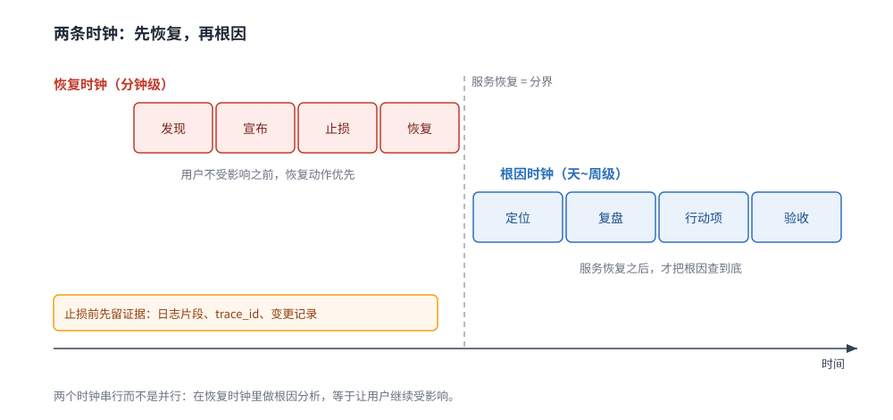
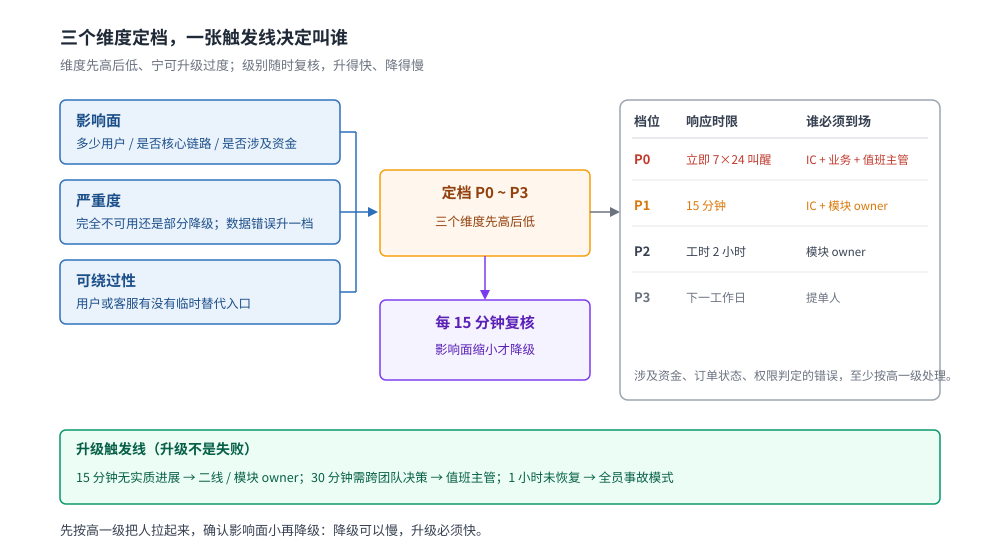
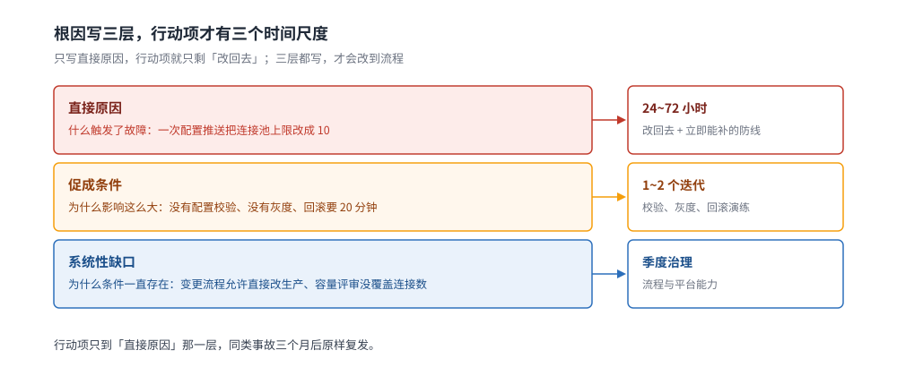

# 事故响应与复盘

> 覆盖：告警确认之后到复盘收尾的完整动作——前五分钟先做什么、P0~P3 怎么分、事故指挥与 on-call 升级、runbook 按症状怎么写、战时沟通的唯一事实源、复盘的时间线与根因分层、行动项怎么不烂尾。
>
> 不覆盖：规则与阈值怎么设见 [告警规则与阈值设计.md](告警规则与阈值设计.md)；SLO、错误预算与「预算烧完该不该冻结发布」见 [SLO与错误预算.md](SLO与错误预算.md)；熔断、降级、限流这些技术止损手段见 [稳定性/README.md](../../../../04-架构与系统/分布式/稳定性/README.md)；安全事件的六阶段响应、取证与泄露通知见 [审计与应急响应.md](../../../../06-工程实践/安全/安全工程/审计与应急响应.md)；故障注入实验怎么设计见 [混沌工程.md](../../../../06-工程实践/部署/混沌工程.md)。
>
> 内容整理自个人学习笔记。本篇是流程篇，**没有运行时读数**——模板、时间盒与角色分工整理自公开的事故管理实践，`## 校验口径` 逐项说明哪些是通用做法、哪些尚未在本机验证。

---

## 一、告警响了，前五分钟做什么？

**本节要点**：前五分钟的目标不是「找到根因」，而是**框住影响面、决定要不要叫人、选一个最快恢复的动作**。止损和定位是两条并行的时间线，混在一起做就会让用户一直受影响。

### 1.1 两个时钟：恢复时钟与根因时钟

| 时钟 | 从哪一刻开始 | 目标 | 典型动作 | 什么时候停 |
|---|---|---|---|---|
| **恢复时钟** | 用户开始受影响（不一定等于告警时间） | 让服务先可用 | 回滚、切流、降级、扩容、摘除实例 | 指标回到 SLO 允许范围 |
| **根因时钟** | 服务稳定之后 | 同类问题不再发生 | 查日志与链路、复现、改代码、补检测 | 行动项全部验收 |

⭐ **最常见的错误是在恢复时钟里做根因分析**：一边让用户继续报错，一边在日志里找「为什么」。正确的顺序是先用最快的动作恢复，再回头查原因——回滚会销毁现场，所以**恢复动作执行前先留证据**（保存日志片段、链路 ID、变更记录）。

### 1.2 第一个动作是「宣布」，不是「先查一下」

一个人默默查了四十分钟，是事故响应里代价最高的行为：没有人知道他在查什么、影响有多大、谁该配合。

| 什么时候宣布 | 判据 |
|---|---|
| 立即宣布 | 核心链路不可用、影响面在扩大、或已持续超过 5 分钟 |
| 观察后宣布 | 单一非核心接口报错、有明确 workaround、指标已回落 |

宣布的成本是一条消息，不宣布的成本是**所有人各自为战**。消息里必须回答四件事：

```text
【事故声明】
我在看什么：<指标 / 用户反馈 / 告警名>
影响谁：<接口 / 地域 / 用户群 / 大致比例>
我正在做：<回滚 / 切流 / 查哪一段>
下一次更新：<HH:MM>
```

⭐ **15 分钟硬规则**：单人排查 15 分钟没有实质进展，必须叫人。这条规则的作用是防止「沉没成本」——查得越久越不愿意承认需要帮助。

### 1.3 五分钟检查单

| 顺序 | 问题 | 看哪里 |
|---|---|---|
| 1 | 影响面有多大，还在扩大吗 | 错误率、延迟分位、影响用户数、地域分布 |
| 2 | 最近改了什么 | 发布记录、配置变更、开关、依赖升级、证书与 DNS |
| 3 | 哪个动作恢复最快 | 回滚、切流、降级、扩容 |
| 4 | 谁必须知道 | 事故指挥、业务负责人、客服、状态页 |
| 5 | 下次什么时候同步 | 定一个具体时刻，不要写「稍后」 |

### 1.4 先止血的四种手段

| 手段 | 适用判据 | 代价 | 机制篇 |
|---|---|---|---|
| **回滚** | 故障与最近一次发布时间吻合 | 丢掉本次发布的功能，可能触发数据兼容问题 | [灰度发布与流量路由.md](../../../../06-工程实践/部署/灰度发布与流量路由.md) |
| **切流** | 故障集中在单地域 / 单可用区 / 单集群 | 另一侧容量要扛得住 | [跨地域多活.md](../../../../04-架构与系统/系统设计/IM系统/跨地域多活.md) |
| **降级** | 非核心功能拖垮核心链路 | 功能缺失，需产品确认口径 | [降级.md](../../../../04-架构与系统/分布式/稳定性/降级.md) |
| **扩容** | 容量型故障且资源池还有余量 | 冷启动慢，可能来不及 | [容量规划](../../../../04-架构与系统/系统设计/全链路压测设计.md) |

⚠️ **止血动作本身也会造成事故**：切流切到容量不足的一侧、降级降掉了鉴权、回滚回退了不兼容的库表变更。每个动作执行前先确认「最坏会怎样」。



这张图要读出的是两个时钟的串并行关系：恢复动作要抢在根因分析之前，但留证据的动作必须插在恢复之前，否则回滚一执行现场就没了。

## 二、事故怎么分级？

**本节要点**：分级不是为了定责，而是**决定投多少人和多快的响应**。判据只有三个维度，先高后低，宁可升级过度也不要漏报。

### 2.1 三个维度

| 维度 | 问什么 | 高分特征 |
|---|---|---|
| **影响面** | 多少用户、多少钱、是否核心链路 | 全站不可用、支付/登录/下单主链路、影响付费用户 |
| **严重度** | 是完全不可用还是部分降级 | 无 workaround、数据错误、持续扩大 |
| **可绕过性** | 用户或客服有没有临时办法 | 没有替代入口、没有补偿方案 |

⭐ **数据错误比不可用更严重**：服务挂了用户知道重试，数据写错用户不知道，事后修复成本高一个量级。凡是涉及资金、订单状态、权限判定的错误，至少按高一级处理。

### 2.2 P0 ~ P3 判据

| 级别 | 判据 | 响应时限 | 谁必须到场 | 对外沟通 |
|---|---|---|---|---|
| **P0** | 核心链路全量不可用，或数据错误在扩散 | 立即，7×24 叫醒 | 事故指挥 + 业务负责人 + 值班主管 | 状态页 + 客服话术，30 分钟内首次更新 |
| **P1** | 核心链路部分不可用，或非核心链路全量不可用 | 15 分钟内响应 | 事故指挥 + 模块 owner | 状态页，按需通知客服 |
| **P2** | 有明确 workaround，影响有限 | 工作时间 2 小时内 | 模块 owner | 一般不需要 |
| **P3** | 内部工具、单用户、无业务影响 | 下一个工作日 | 提单人 | 不需要 |

⚠️ **级别会升也会降**：每 15 分钟复核一次影响面。先按 P1 拉起人，确认只影响一个内部账号再降 P3，比反过来安全——**降级的速度可以慢，升级的速度必须快**。



从图里要读出的是「定档」与「升级」是两件事：左边三个维度决定这一刻的级别，底部的三条触发线决定什么时候把人叫得更大——级别可以降，触发线只能到点就执行，不能等「再看一下」。

### 2.3 分级的三个误区

- **按「谁的系统」分级**：核心团队的小故障定 P2，边缘团队的大故障定 P0，用户只感知影响，不感知组织架构；
- **按「能不能修」分级**：修不了不代表不严重，反而要拉更多人；
- **按「是不是我们的错」分级**：第三方故障、云厂商故障、用户误操作，只要影响我们的用户，就按影响面分级。

## 三、谁在指挥，谁在修？

**本节要点**：事故里最稀缺的不是技术能力，而是**一个明确做决定的人**。角色可以兼任，但必须在声明里写清楚谁是谁。

### 3.1 三个角色

| 角色 | 负责什么 | 不负责什么 |
|---|---|---|
| **事故指挥（IC）** | 定优先级、拍板止损动作、控制节奏、对外代表事故 | 不亲手排障，不陷入日志细节 |
| **操作者（Ops）** | 执行回滚、切流、扩容、改配置，回报结果 | 不自行决定「要不要再等等看」 |
| **沟通者（Comms）** | 维护状态页、同步业务方与客服、记录时间线 | 不猜测根因，不承诺恢复时间 |

小团队可以一人兼两个角色，但**必须显式声明**：「我现在是 IC，同时在操作，沟通由 A 负责」。没有声明的兼任，等于三个角色都没人负责。

### 3.2 on-call 轮值与噪音预算

| 项 | 建议 |
|---|---|
| 轮值周期 | 一周一轮，交接必须包含未闭环的告警与近期变更 |
| 一线 / 二线 | 一线先响应 15 分钟，无进展升级二线，不要在深夜让一个人硬扛 |
| 噪音预算 | 每班需要人介入的 P0/P1 控制在 5~15 条；超了先修告警质量 |
| 补偿 | 夜间被叫醒的次日调休，否则值班会被当成惩罚 |

⭐ **告警质量决定轮值能不能持续**：误报多了，值班的人会静音、会拖延、会不看——这比没有告警更危险。规则怎么压噪音见 [告警规则与阈值设计.md](告警规则与阈值设计.md) 第一、五节。

### 3.3 升级不是失败

| 触发条件 | 升级到谁 | 时限 |
|---|---|---|
| 一线 15 分钟无实质进展 | 二线 / 模块 owner | 立即 |
| 需要改架构或跨团队决策 | 值班主管 / 架构负责人 | 30 分钟 |
| 涉及资损、合规、对外公告 | 业务负责人 + 法务 / 公关 | 立即 |
| 影响持续超过 1 小时 | 全员事故模式，指定 IC | 立即 |

升级的正确说法是「我需要 X 帮忙看 Y」，不是「我搞不定了」。把「升级」和「能力不足」解绑，团队才敢在第一时间叫人。

## 四、runbook 怎么写才有人用？

**本节要点**：runbook 按**症状**组织，不按原因组织——值班的人先看到的是「下单接口 502」，不是「连接池耗尽」。每条命令必须能直接复制执行，并且写清预期输出。

### 4.1 按症状组织

| 组织方式 | 例子 | 为什么不行 / 行 |
|---|---|---|
| 按原因 | 「连接池耗尽怎么办」 | 值班的人还不知道是连接池，查不到这一页 |
| 按服务 | 「订单服务手册」 | 手册太长，翻到具体症状要几分钟 |
| **按症状** | 「下单接口 502」「支付回调延迟 > 5s」 | ✅ 与告警名、用户反馈直接对上 |

⭐ **告警文本里的标题就是 runbook 的目录项**：告警叫「订单服务 P99 > 2s」，runbook 里就应该有一节叫这个名字。两边对不上，值班的人就要临场翻译。

### 4.2 每条 runbook 的四段

```text
【症状】下单接口 5xx 比例 > 1%，持续 3 分钟
【判据】先确认不是探针误报：curl -s -o /dev/null -w '%{http_code}' https://api.example.com/healthz
【命令】
  1. kubectl -n prod rollout history deploy/order-api
  2. kubectl -n prod logs deploy/order-api --since=10m | grep -c 'context deadline exceeded'
【预期】第 2 条输出持续增长 → 下游超时，走「下游依赖」分支
【回滚】kubectl -n prod rollout undo deploy/order-api；回滚前先保存上一版日志
【升级】回滚后 5 分钟未恢复 → 升级到二线 + DBA
```

四段的判据是：**没有「预期输出」的 runbook 只是一串命令**，值班的人不知道看到什么才算对；没有「回滚」的 runbook 会在错误方向上越走越远。

### 4.3 陈旧 runbook 比没有更危险

- 命令里的命名空间、服务名、端口会随重构变化，但 runbook 不会自动更新；
- 半年没执行过的 runbook，大概率已经跑不通；
- 给每条 runbook 标「最后验证时间」，超过一个季度未验证的降级为「草稿」，不能作为值班依据。

⚠️ **验证 runbook 的方式是演练**，不是读一遍：桌面推演（给定故障场景，让值班的人照着跑）与混沌实验（真实注入故障）都能暴露断链。见 [混沌工程.md](../../../../06-工程实践/部署/混沌工程.md)。

## 五、战时沟通：群里越热闹，恢复越慢

**本节要点**：事故期间的信息必须收敛到**一个频道 + 一个时间线**。多个群、私聊、口头同步会制造互相矛盾的版本，让指挥者无法判断。

### 5.1 一个频道，一个事实源

| 载体 | 用途 | 规则 |
|---|---|---|
| 事故频道 | 所有技术讨论与决定 | 只发事实与决定，不发「我觉得」 |
| 状态页 | 对外可见的影响与进展 | 由 Comms 维护，Ops 不改 |
| 时间线文档 | 记录每个动作的时刻与结果 | 与频道同步更新，复盘直接用 |

### 5.2 对内节奏

- 固定更新时间（如每 15 分钟），到点必须发一条，哪怕内容是「仍在处理，无新进展」；
- 未到下次更新时间就发消息，视为**有新事实**，否则不刷屏；
- 关键决定（回滚/切流）发出后，Ops 回复「收到，开始执行」，执行完回复结果——**指令要有回执**。

### 5.3 对外口径

对外只讲四件事：**事实、影响、规避方案、下次更新时间**。

| 不说 | 改说 |
|---|---|
| 「可能是数据库问题」 | 「部分用户下单失败，我们正在切换备用链路」 |
| 「马上就好」 | 「预计 30 分钟内给出下一次更新」 |
| 「已全部恢复」 | 「核心链路已恢复，我们仍在观察错误率」 |
| 内部服务名、IP、堆栈 | 用户能理解的影响描述 |

### 5.4 沟通反模式

- **@所有人 轰炸**：真正需要行动的人反而会屏蔽；
- **未经确认的结论**：一句「是 Redis 挂了」会让所有人朝错误方向查；
- **在事故群里追责**：当场找责任人会让信息立刻消失；
- **只报进展不报决定**：指挥者需要知道「现在选了哪条路」，不是「又看了哪些日志」。

## 六、复盘：不是追责，是修系统

**本节要点**：复盘的价值在于**把一次事故变成一组可验收的改动**。没有行动项的复盘只是故事会；根因写到「人为失误」的复盘等于没写。

### 6.1 时间线用证据还原

| 证据 | 能还原什么 |
|---|---|
| 告警触发与恢复记录 | 发现时间、确认延迟、恢复时间 |
| 发布与配置变更记录 | 诱因是否与变更吻合 |
| 日志与链路 | 第一条错误、错误扩散路径、哪一跳先慢 |
| 工单与聊天记录 | 谁在什么时候做了什么决定 |

⚠️ **不要用记忆补时间线**：人对时间的记忆误差以十分钟计，而事故复盘常常要精确到分钟。时间线里的每一行都应能指回一条记录。

### 6.2 根因分三层

| 层 | 回答 | 例子 |
|---|---|---|
| **直接原因** | 什么触发了这次故障 | 一次配置推送把连接池上限改成了 10 |
| **促成条件** | 为什么这个触发能造成这么大影响 | 没有配置校验、没有灰度、回滚要 20 分钟 |
| **系统性缺口** | 为什么促成条件一直存在 | 变更流程允许直接改生产、容量评审没有覆盖连接数 |

⭐ **只写直接原因，行动项就只会是「改回去」**；写到促成条件，才会有校验、灰度、回滚演练；写到系统性缺口，才会改流程。三层都写，行动项才有层次。



图里左边的每一层都直接连到右栏的一个时间尺度：这就是「为什么必须写三层」的实操理由——层数决定行动项能排到哪个周期，只留一层就只剩当天能做的改动。

### 6.3 行动项的三条硬标准

| 标准 | 反例 | 正例 |
|---|---|---|
| **可验证** | 「加强监控」 | 「对连接池使用率 > 80% 增加告警，规则进 CI」 |
| **有 owner** | 「团队跟进」 | 「张三，下周五前」 |
| **有期限** | 「尽快」 | 「本迭代内（10 月 31 日前）」 |

没有这三条的行动项，三个月后一定还在「进行中」。

### 6.4 复盘的三个反模式

- **根因写成「人为失误」**：人会犯错是常量，复盘要问的是「为什么这个错误能直达生产」；
- **行动项写成「加强培训」**：不可验证、不可验收，等于没做；
- **报告归档即结束**：没有跟踪机制，行动项会静默烂尾。

### 6.5 blameless 的边界

blameless 指的是**不追责个人**，不是**不追责决策**。可以且应该追问：

- 为什么这个变更没有经过评审？
- 为什么告警 20 分钟后才有人看到？
- 为什么回滚需要 20 分钟？

这些是系统与流程的问题，不是某个人的品格问题。把讨论停留在「谁点的按钮」，下一次还会有人点。

## 七、行动项怎么不烂尾

**本节要点**：复盘的质量不看报告写得多好，看**行动项的按期完成率与同类事故的复发率**。

### 7.1 行动项分级

| 级别 | 内容 | 时限 | 载体 |
|---|---|---|---|
| **立即修复** | 直接原因、以及能马上补的防线 | 24~72 小时 | 当前迭代 |
| **本迭代** | 促成条件（校验、灰度、回滚演练） | 1~2 个迭代 | 团队 backlog |
| **季度治理** | 系统性缺口（流程、平台能力） | 季度规划 | 部门 OKR / 专项 |

### 7.2 给行动项留固定容量

⭐ 如果行动项只能「有空再做」，它就永远不会做。可行做法是每个迭代固定留出一部分容量（例如 10%~20%）给可靠性工作，并把复盘行动项排在最前面。

### 7.3 复发检测

给同类事故建一个「指纹」：**同一个服务 + 同一个机制 + 同一类影响**。再次发生时：

- 直接关联上次复盘，检查行动项是否完成；
- 如果完成了仍然复发，说明根因分析停在表面；
- 如果没完成，问题在优先级与容量，不在技术。

### 7.4 用演练替代等待

| 方式 | 成本 | 能验证什么 |
|---|---|---|
| 桌面推演 | 低，1 小时 | 角色分工、runbook 是否可执行、沟通路径 |
| 依赖故障注入 | 中 | 降级与切流是否真的生效 |
| 混沌实验 | 高 | 系统在真实故障下的行为与恢复时间 |

演练是**在没有用户受影响时暴露同样问题**的唯一手段。实验设计见 [混沌工程.md](../../../../06-工程实践/部署/混沌工程.md)。

### 7.5 两个可度量指标

- **行动项按期完成率** = 按期关闭数 / 本期到期数；
- **同类事故复发率** = 有相同指纹的事故数 / 总事故数。

这两个数比「复盘报告数量」有意义得多。

## 应用场景

| 场景 | 重点用到哪几节 | 说明 |
|---|---|---|
| 小团队（无专职 SRE） | 1.2、2.2、3.1 | 角色可兼任，但事故声明与分级不能省 |
| 中型业务（多团队共用链路） | 三、五 | 跨团队时 IC 与唯一事实源是刚需 |
| To C 大促 / 直播 | 1.4、2.2、5.3 | 止损动作要提前演练，对外口径要提前准备 |
| 强依赖第三方 | 2.1、6.2 | 第三方故障也要按影响面分级，复盘要写清「为什么没有兜底」 |
| 安全事件 | 仅 1.2、五 | 取证、定级与泄露通知走 [审计与应急响应.md](../../../../06-工程实践/安全/安全工程/审计与应急响应.md)，不要用可用性事故流程替代 |

## 具体使用

### 8.1 事故时间线模板

```text
| 时刻 | 事件 | 证据来源 | 谁 |
|---|---|---|---|
| 10:03 | 首条错误日志 | 日志平台 trace_id=... | 系统 |
| 10:05 | 告警触发（P99 > 2s） | Alertmanager | 系统 |
| 10:07 | 值班确认，宣布 P1 | 事故频道 | 张三 |
| 10:09 | 决定回滚 v1.8.3 | 事故频道 | 李四（IC） |
| 10:12 | 回滚完成，错误率回落 | 监控面板 | 王五 |
| 10:30 | 影响面清零，转 P3 观察 | 事故频道 | 李四 |
```

### 8.2 runbook 模板

```markdown
## <告警名 / 用户症状>

**判据**：<怎么确认不是误报，一条可执行命令>
**前提**：<环境、权限、需要的工具>

### 步骤
1. <命令> —— 预期：<输出特征>
2. <命令> —— 预期：<输出特征>

### 分支
- 若 <条件 A> → <动作 / 另一篇 runbook>
- 若 <条件 B> → <升级>

### 回滚
<一条可执行命令 + 回滚前必须保存的证据>

### 升级
<超过 N 分钟未恢复 → 找谁>
```

### 8.3 复盘报告骨架

```text
1. 摘要：影响面、持续时长、最终级别
2. 时间线：证据驱动的表格（8.1）
3. 根因：直接原因 / 促成条件 / 系统性缺口
4. 发现与响应评估：MTTD、MTTR、告警是否及时、runbook 是否可用
5. 做对了什么：可复用的动作
6. 行动项：可验证 + owner + 期限 + 级别
7. 附录：日志、链路、变更记录
```

### 8.4 升级矩阵

| 情况 | 一线动作 | 15 分钟未恢复 | 60 分钟未恢复 |
|---|---|---|---|
| 单接口 5xx | 查变更、必要时回滚 | 升级模块 owner | 升级值班主管 + 业务负责人 |
| 核心链路不可用 | 宣布 P0、启动 IC | 全员事故模式 | 对外公告 + 客服话术 |
| 数据错误 | 停止写入、保留现场 | 升级 DBA / 业务负责人 | 评估资损与合规上报 |

## 校验口径

| 部分 | 状态 | 说明 |
|---|---|---|
| 分级判据、时间盒、角色分工（二、三） | 经验归纳 | 整理自公开的事故管理实践，未在本机做对照实验 |
| runbook 四段结构（4.2） | 经验归纳 | 模板已在个人项目中使用，未做 A/B 对照 |
| 时间线、复盘骨架、升级矩阵（八） | 经验归纳 | 模板类内容，无需运行时验证 |
| 演练与混沌实验（7.4） | ⚠️ 未实测 | 本机未执行故障注入，实验方法见 [混沌工程.md](../../../../06-工程实践/部署/混沌工程.md) |
| 与安全事件 IR 的边界（应用场景） | 对照既有篇目 | 以 [审计与应急响应.md](../../../../06-工程实践/安全/安全工程/审计与应急响应.md) 的六阶段为准 |

## 延伸追问

- **值班总被误报吵醒，先改告警还是先改流程？** → 先改告警。噪音会让值班的人形成「先忽略再看」的习惯，流程再好也会被这个习惯抵消。规则怎么压噪音见 [告警规则与阈值设计.md](告警规则与阈值设计.md) 第五节。
- **事故中能不能直接改生产？** → 可以，但要走 break-glass：双人确认、记录命令与理由、事后补审。不允许的是「为了让告警消失」而改监控。
- **小团队没有专职 IC 怎么办？** → 由值班人兼任，但必须在事故声明里写明「我是 IC，操作由谁执行、沟通由谁负责」。角色可以合并，责任不能模糊。
- **根因只有一个吗？** → 至少分三层：直接原因、促成条件、系统性缺口。只写直接原因，行动项就只剩「改回去」。
- **复盘会要开多久？** → 控制在 60 分钟内，材料提前异步发。会议的目标是对齐行动项，不是重新讲一遍故事。
- **复盘要不要公开？** → 对内默认公开（脱敏后），对外按影响与合规决定。公开能阻止同类错误在别的团队重演。
- **信息不足时怎么对外沟通？** → 只讲已确认的事实、已知影响、当前规避方案和下一次更新时间，明确说「根因仍在确认」。
- **行动项总是排不进迭代怎么办？** → 给可靠性工作留固定容量，并把「同类事故复发」作为不进容量的代价摆到台面上。
- **MTTD 和 MTTR 哪个更值得优化？** → 先看 MTTD。发现得晚，恢复再快也已经在影响用户；但 MTTD 的优化手段是告警质量与拨测，不是值班更努力。

## 关联

- **上游/总纲**：[可观测性选型对比.md](../可观测性选型对比.md) — 三支柱与告警工具的全景，本篇是其「告警之后」的流程展开
- **上游/前置**：[SLO与错误预算.md](SLO与错误预算.md) — 分级中的「影响」最终要落到 SLO 上，预算政策决定发布冻结与否
- **上游/前置**：[告警规则与阈值设计.md](告警规则与阈值设计.md) — 告警质量决定值班可持续性，告警文本是 runbook 的目录项
- **对照/互补**：[审计与应急响应.md](../../../../06-工程实践/安全/安全工程/审计与应急响应.md) — 安全事件的定级、取证与泄露通知，与可用性事故流程分工
- **对照/互补**：[稳定性/README.md](../../../../04-架构与系统/分布式/稳定性/README.md) — 熔断、降级、限流、重试、幂等这些技术止损手段
- **下游机制**：[混沌工程.md](../../../../06-工程实践/部署/混沌工程.md) — 用注入故障验证 runbook 与恢复时间
- **下游机制**：[灰度发布与流量路由.md](../../../../06-工程实践/部署/灰度发布与流量路由.md) — 降低「一次变更造成大面积故障」的概率，是复盘行动项的常见落点
- **对照/互补**：[全链路压测设计.md](../../../../04-架构与系统/系统设计/全链路压测设计.md) — 容量型事故的判据与恢复动作依赖压测读数
