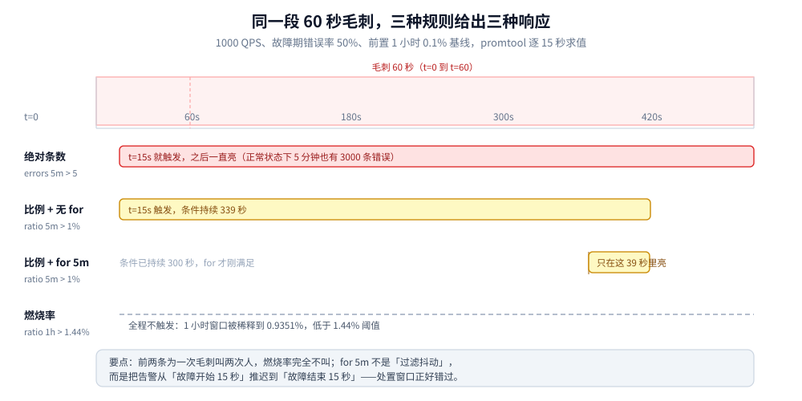
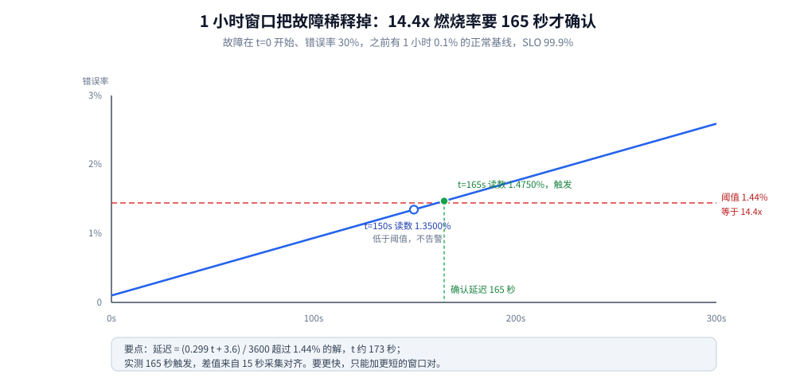
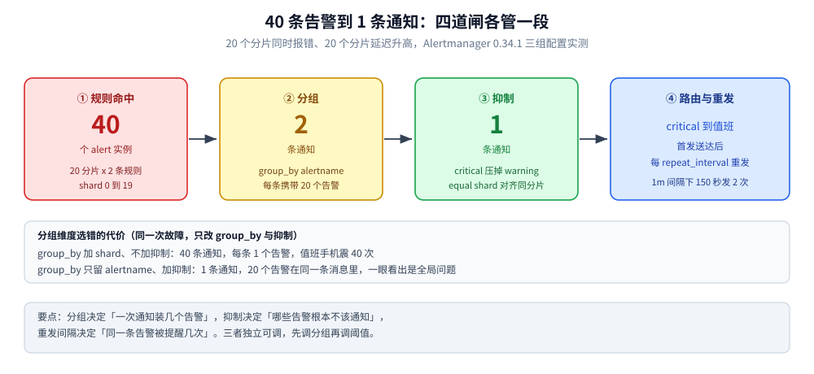

# 告警规则与阈值设计

> 告警为什么会疲劳 → 三种规则形态怎么选 → 燃烧率怎么算出来 → 窗口语义的四个坑 →
> 分级路由与抑制怎么把 40 条压成 1 条 → 一条能行动的告警长什么样 → 规则怎么进 CI。
>
> 内容整理自个人学习笔记。**MQE 规则的 `period` 语法**见
> [UI与排障.md](../链路追踪/Skywalking/UI与排障.md) 第七节，**`vmalert` 怎么挂规则文件**见
> [运维与监控.md](../../../数据存储/时序数据库/VictoriaMetrics/运维与监控.md) 第六节，
> **用哪个可视化 / 告警产品**见 [可观测性选型对比.md](../可观测性选型对比.md) 第六节——本篇只讲规则本身怎么设计。
> 多窗口燃烧率的三个档位（14.4x / 6x / 1x）取自 Google SRE Workbook 讲「按 SLO 告警」的那一章，档位换算为本篇重算。
>
> ✅ **本篇的触发时刻、分组条数、抑制条数均为本机实跑**：Prometheus 3.15.0 + promtool 规则单测
> （5 组时间线、444 步 × 15s），Alertmanager 0.34.1 四容器（prometheus / alertmanager / exporter / webhook）
> 三组配置对照。**钉钉/飞书/邮件等真实出口、PagerDuty 升级策略、SkyWalking 的 webhook 重试未实测**，
> 按官方文档陈述并在「校验口径」逐条标注。

## 一、告警疲劳的三个根因

**本节要点**：告警没人看，不是因为阈值调得不够准，而是三条结构性问题——阈值与流量脱钩、缺抑制层、告警文本里没有可执行动作。这三条各自有可量化的症状。

### 1.1 根因一：阈值和流量脱钩

所有「数量型」阈值都有这个问题：`5 分钟内错误数 > 5` 这条规则，在 1000 QPS 的网关和在 10 QPS 的后台任务上，含义完全不同。本机实测两个场景，同一个阈值给出完全相反的结论：

| 场景 | 流量 | 错误率 | 5 分钟错误条数 | 按 SLO 该不该告 | `errors > 5` 实际 |
|---|---|---|---|---|---|
| T1 | 1000 QPS | 0.1%（预算消耗 1x，正常） | **3000 条** | 不该 | 持续告警 |
| T2 | 10 QPS | 1%（预算消耗 10x，异常） | **30 条** | 该 | 告警 |

T1 是**每天都在发生的误报**：1000 QPS 下 0.1% 错误率属于 SLO 允许范围，但 5 分钟攒出 3000 条错误，任何「大于几」的阈值都会亮。值班的人第一天就会把这条规则静音，然后真正的问题再也进不来。

反方向也一样：10 QPS 的服务里 300 条错误就是一小时的数据全错，但按条数看它「才 300 条」。

**判据**：阈值里出现「条数」「个数」「次数」时，必须同时限定流量区间，或者干脆换成比值。

### 1.2 根因二：没有抑制层，一个根因炸出 40 条

二十个分片同时报错时，二十条告警是同一件事。实测（第五节有配置与读数）：`group_by` 里如果带上 `shard`，四十条告警会变成**四十条通知**；只按 `alertname` 分组是两条；再加上抑制规则，只剩**一条**。

同一条告警持续存在时，`repeat_interval` 还会让它反复重发——本机 `repeat_interval: 1m` 下，150 秒窗口里同一条告警发了两次。一场 30 分钟的故障，单条告警至少重发 30 次。

### 1.3 根因三：告警文本里没有动作

「CPU 使用率过高」不可行动。收到它的人需要自己去查：哪台机器、影响了谁、要不要现在处理、上一班有没有人动过。第六节给一份六项模板，判定标准很简单——**把这条告警发给一个不熟悉这个系统的人，他能不能在五分钟内做出第一个动作**。

## 二、规则的三形态：静态阈值、比例、燃烧率

**本节要点**：三种形态不是「精度递进」，而是回答三个不同的问题。同一个故障曲线上，它们的响应时刻和响应强度完全不同，实测可以精确到秒。

| 形态 | 表达式示意 | 回答的问题 | 依赖 | 典型误用 |
|---|---|---|---|---|
| 静态阈值 | `error_total > 5` | 「绝对量到红线了吗」 | 无 | 不随流量缩放（1.1 节） |
| 同比环比 | `today / last_week_same_hour > 1.5` | 「比往常异常吗」 | 要有周期稳定的历史 | 大促、发版后基线全变 |
| 燃烧率 | `err_ratio_1h > 14.4 * 预算率` | 「预算在快速烧吗」 | 要有 SLO | 没有 SLO 时无从下手 |

### 2.1 同一段故障，三种规则的响应时刻

造一段 60 秒的毛刺（1000 QPS、50% 错误率，故障前有 1 小时 0.1% 的正常基线），跑 promtool 规则单测，逐秒看谁先亮：

| 规则 | 首次触发时刻 | 说明 |
|---|---|---|
| `err_total_5m > 5` | 故障发生后 **15 秒内** | 绝对数，15 秒就攒够 5 条 |
| `err_ratio_5m > 1%`，`for: 0m` | 故障发生后 **15 秒内** | 5 分钟窗口里 15 秒的 50% → 2.73% |
| `err_ratio_5m > 1%`，`for: 5m` | 故障开始后 **315 秒**（毛刺已结束 255 秒） | 见 4.1：`for` 压不住被窗口拉长的条件 |
| 燃烧率 `err_ratio_1h > 1.44%` | **始终不触发** | 1 小时窗口里 60 秒毛刺只占 0.9351% |

这张表是整个告警设计的缩影：

- **前两条对 60 秒毛刺过度反应**——用户可能只感受到一次抖动，值班的人被叫起来两次。
- **燃烧率对毛刺完全不反应**——这正是设计意图：60 秒的毛刺消耗 0.026% 的月预算，不值得半夜叫人。
- **`for: 5m` 的规则最尴尬**：它比 `for: 0m` 晚 300 秒告警，但结果一样是「为一次毛刺告警」，还错过了处置窗口。



横轴是故障开始后的秒数，红色竖带是那 60 秒毛刺本身。四条横条分别是绝对条数、比例无 `for`、比例加 `for: 5m`、燃烧率四种规则的「条件为真」区间：前两条从第 15 秒就开始亮并且拖了将近 6 分钟，第三条要等到第 315 秒才亮且只亮 39 秒，燃烧率那条全程没有出现过。这张图的读法是「谁在什么时候叫人、叫了几次」，而不是「谁更准确」。

### 2.2 形态选择的判据

```text
有 SLO 且被用户感知的接口  → 燃烧率（多窗口）
没有 SLO 但有关键资源       → 静态阈值 + 流量区间限定（如磁盘剩余 < 10%）
周期性业务（订单量、支付量）→ 同比环比，且必须能一键切换到绝对值（大促期间）
```

⚠️ **不要三种混着上**：同一指标既有绝对值规则又有燃烧率规则，等于把 2.1 表里前两行的过度反应和第四行的不反应同时留着。

## 三、SLO 与错误预算：燃烧率怎么算

**本节要点**：燃烧率不是拍出来的系数，是从「多长时间烧掉多少预算」反推的。三个经典档位（14.4x / 6x / 1x）背后的含义是「2% 预算 1 小时烧完」「5% 预算 6 小时烧完」「10% 预算 3 天烧完」。

### 3.1 从预算倒推阈值

以 SLO 99.9% / 30 天为例，错误预算率 `B = 1 - 0.999 = 0.001`，30 天换算成小时是 `720h`。

```text
燃烧率 = (故障期间消耗的预算比例) × (SLO 总时长 / 观察窗口时长)

2% 预算 / 1 小时  → 0.02 × 720 / 1  = 14.4
5% 预算 / 6 小时  → 0.05 × 720 / 6  = 6
10% 预算 / 3 天   → 0.10 × 720 / 72 = 1
```

阈值就是 `燃烧率 × B`：`14.4 × 0.001 = 1.44%`。也就是说 1 小时窗口内的错误率超过 1.44%，就等价于「按这个速度，两天半烧光整月预算」。

```yaml
- alert: BurnFast
  expr: sli:error_ratio1h > 0.0144 and sli:error_ratio5m > 0.0144
  labels:
    severity: critical
```

### 3.2 为什么要两个窗口同时满足

长窗口（1h）保证「量级够大、不是噪声」，短窗口（5m）保证「故障还在继续、不是刚刚结束」。只用长窗口，故障恢复后还会继续告警很久；只用短窗口，噪声就能触发。

代价是**确认延迟**：第四节实测，14.4x 这条规则在故障开始后 **165 秒**才触发，而不是 0 秒——因为 1 小时窗口里前 57 分钟都是正常数据，把错误率稀释了。

### 3.3 档位怎么分

| 档位 | 燃烧率 | 窗口 | 消耗预算 | 响应 | 出口 |
|---|---|---|---|---|---|
| 快速燃烧 | 14.4x | 1h + 5m | 2% / 1h | 立即 | 电话 / 值班群 |
| 中速燃烧 | 6x | 6h + 30m | 5% / 6h | 工作时间内 | 工单 / 群消息 |
| 慢速燃烧 | 1x | 3d + 6h | 10% / 3d | 排期 | 周报 / 待办 |

## 四、窗口语义的四个坑

**本节要点**：`for`、滑动窗口、分钟桶计数是三套不同的语义，混用会出现「以为压住了抖动实际没压住」「以为立即告警实际晚了两分半」「窗口没满还在算」三类错误。

### 4.1 `for` 压不住被窗口拉长的条件

直觉是「`for: 5m` 能过滤掉 60 秒的抖动」，实测不是。60 秒毛刺进入 5 分钟滑动窗口后，条件为真的持续时间是：

```text
毛刺 60s → 窗口内错误率 = 0.5 × (重叠秒数 / 300)
只要重叠 > 6 秒，比例就 > 1%
即条件从故障开始一直真到故障结束后 294 秒，共 339 秒 > 300 秒
```

所以 `for: 5m` 会**照常触发**，只是晚了 300 秒——从「毛刺开始 15 秒后告警」变成「毛刺结束 15 秒后告警」。真正能压住毛刺的是短窗口 + 燃烧率组合，或者把窗口本身缩短到 `2m`。

### 4.2 长窗口的确认延迟是数学结果

故障在 t=0 开始、错误率 30%，正常基线 0.1%，`SLO 99.9%`：

```text
1h 窗口错误率(t) = (0.3 × t + 0.001 × (3600 - t)) / 3600
要求 > 1.44%  →  0.299 t > 51.84  →  t > 173s
```

实测（15 秒采集间隔）在 `t = 150s` 时读到 **1.3500%**（不告警），`t = 165s` 时读到 **1.4750%**（告警）—— 与公式的 173 秒吻合，误差来自采集对齐。

**结论**：任何「1 小时窗口 + 14.4x」的规则，最快也要 2 分半才能确认一次真实故障。这不是配置问题，是窗口的固有权衡；要更快只能加更短的窗口对（如 5m + 1m 的双短窗口）。



纵轴是 1 小时滑动窗口算出来的错误率，横轴是故障持续的时间。曲线从 0.1% 的基线缓慢爬升，与 1.44% 的红色阈值线在 165 秒附近相交——交点之前的两分多钟里，真实的错误率已经是 30%，但规则一点反应都没有。曲线上标了两个真实读数：150 秒时 1.3500%（还不告警）、165 秒时 1.4750%（触发）。

### 4.3 窗口没填满时不算零

新服务上线、规则刚加、Prometheus 刚重启时，1 小时窗口里只有 10 分钟数据。实测：只有 10 分钟数据时，`rate(...[1h])` 算出来是 **50%**，和 5 分钟窗口的值一模一样——Prometheus 在可用区间内计算，不会因为「窗口不满」返回 0，也不会自动延后。

后果是**上线首小时误报**。规避方式：规则里加一个「数据覆盖度」前置条件，或者给新服务头一天只开慢速燃烧档。

### 4.4 `for`、滑动窗口、桶计数三套语义

| 参数 | 语义 | 谁在用 | 典型误解 |
|---|---|---|---|
| `for: 5m` | 条件**连续**为真 5 分钟才触发 | Prometheus / 多数规则引擎 | 以为它能压掉任何短于 5 分钟的抖动（4.1） |
| `[5m]` 滑动窗口 | 表达式的作用域 | PromQL | 当成「持续时长」 |
| `period: 10` + `count >= 3` | 最近 10 个**分钟桶**里有 3 个满足 | SkyWalking MQE | 当成「连续 3 分钟」 |

SkyWalking 的桶计数语义与 Prometheus 的连续语义**不等价**：桶计数允许中间断开。语法细节见 [UI与排障.md](../链路追踪/Skywalking/UI与排障.md) 第七节，这里只给判据——**要表达「连续」，用 `for`；要表达「最近 N 个周期里有 M 次」，用桶计数**。

## 五、分级、路由与聚合

**本节要点**：一条告警从规则命中到人看到，中间要过「分组 → 抑制 → 路由 → 重发」四道闸，每一道都能把数量降一个量级。实测四十条告警最终只剩一条通知。

### 5.1 分级只分三档

| 级别 | 判据 | 响应时效 | 出口 | 反例 |
|---|---|---|---|---|
| P0 | 用户可感知、预算快速燃烧 | 立即 | 电话 / 值班 | 「磁盘 85%」不是 P0 |
| P1 | 单副本故障、容量吃紧 | 工作时间内 | 工单 / 群 | 「CPU 70%」不是 P1 |
| P2 | 趋势性、慢速燃烧 | 排期 | 周报 / 待办 | 「证书 60 天到期」不是 P2 |

⚠️ **判定标准是「响应动作」而不是「严重程度形容词」**。「严重」这个词没有对应动作，就不该有级别。

### 5.2 四道闸的实测读数

二十个分片同时报错、二十个分片延迟同时升高（共四十个 alert），三组 Alertmanager 配置对照：

| 配置 | `group_by` | 抑制 | 通知条数 | 每条携带告警 |
|---|---|---|---|---|
| A | `[alertname]` | 有 | **1 条**（critical 组里 20 个告警） | 20 |
| C | `[alertname]` | 无 | 2 条（critical 1 + warning 1） | 各 20 |
| B | `[alertname, shard]` | 无 | **40 条** | 各 1 |

从 B 到 A，通知条数 40 → 1，降了 97.5%。两处配置差异各管一半：

- `group_by` 里**列的是「同一组」的判定维度**，加了 `shard` 就等于宣布「每个分片都值得单独通知」。
- 抑制规则 `source_matchers: severity="critical"` + `target_matchers: severity="warning"` + `equal: [shard]`，把「同一分片的 warning」压掉——因为 critical 已经在告它了。



四个方块依次是规则命中、分组、抑制、路由与重发，每段标注了实测数量：40 个 alert 实例经 `group_by: [alertname]` 收成 2 条通知，抑制再压掉整个 warning 组，最后只剩 1 条进值班渠道。下方那行对照是同一次故障只改 `group_by` 与抑制规则后的结果差异——40 条、2 条、1 条，全部来自本机 Alertmanager 0.34.1 的实际 webhook 投递记录。

### 5.3 重发间隔决定疲劳程度

`repeat_interval: 1m` 下，150 秒窗口里同一条告警通知了 2 次（首发 + 60 秒重发）：

```text
一场 30 分钟的故障，单条告警重发 ≈ 30 次
若同时有 20 条告警未分组，通知总量 = 30 × 20 = 600 条
```

三档常用值：`repeat_interval` P0 用 1h~4h（不是 1m），P1 用 4h~12h，P2 用 24h。**重发的作用是提醒「还没处理」，不是催更**。

### 5.4 抑制、静默、过期三者的区别

| 机制 | 触发条件 | 生效范围 | 适用 |
|---|---|---|---|
| 抑制（inhibit） | 另一条告警存在 | 自动，随源告警消失而解除 | 同根因的上游/下游告警 |
| 静默（silence） | 人手工创建 | 按 matcher 匹配，有截止时间 | 计划内变更、已知问题 |
| 过期（`for`/`keep_firing_for`） | 时间 | 单条规则 | 抖动过滤、恢复观察 |

⚠️ 静默是**最容易被滥用**的机制：静默一条规则只需要点两下，而它会把这类告警的所有实例全部压掉。管理方式是给静默加强制过期时间与工单号，并统计「长期静默」占比。

## 六、一条能行动的告警长什么样

**本节要点**：六项模板。缺任何一项，收到的人都要先去查资料，5 分钟的响应就变成 30 分钟。

```yaml
- alert: OrderCreateErrorBudgetFastBurn
  expr: sli:order_error_ratio1h > 0.0144 and sli:order_error_ratio5m > 0.0144
  labels:
    severity: critical
    team: trade
    runbook: "https://example.com/runbook/order-create-5xx"
  annotations:
    summary: "下单接口 1 小时内错误率 3.2%，消耗 2.2% 月预算"
    impact: "受影响：下单主流程，预计每分钟 320 单失败"
    since: "首次触发 {{ $activeAt }}"
    action: "1) 看 /dashboard/order 的 5xx 分布 2) 若为下游超时，切备用支付通道 3) 回滚最近一次发版"
```

| 项 | 内容 | 缺失后果 |
|---|---|---|
| ① 现象（可量化） | 哪个 SLI、什么值、对比阈值 | 收到的人先去查数 |
| ② 影响面 | 哪些用户/业务、量级多少 | 无法判断要不要现在起床 |
| ③ 判据 | SLO 名称与预算消耗 | 无法判断是不是误报 |
| ④ 动作 | 前三步做什么 | 从「响应」退化成「围观」 |
| ⑤ 责任 | team + 值班表 | 群里互相 @ |
| ⑥ 自动动作 | runbook 链接 / 自动回滚开关 | 每次靠人肉记忆 |

## 七、规则即代码：单测怎么跑

**本节要点**：规则的正确性可以离线验证，不需要等故障发生。`promtool test rules` 能精确到「第几秒触发、第几秒恢复」，这是把规则纳入 CI 的唯一实用手段。

### 7.1 两阶段写法

直接写断言很容易写错（窗口外推、采集对齐都会让结果和手算差几秒）。实践中的做法是先探底、再回填：

```text
① 按「流量 + 错误率」时间线生成两条 counter 序列（15s 间隔）
② 所有告警先声明 exp_alerts: []，跑一次，从输出里读出实际触发的 (告警名, 时刻)
③ 按读到的结果回填 exp_alerts，重跑，要求 EXIT=0
④ 把第 ② 步的表与手算公式对照，不一致的地方优先怀疑「窗口没填满」
```

第 ④ 步是本篇 4.2 节读数的来源：第一次跑 T3 时数据只有 61 分钟，1 小时窗口没填满，燃烧率规则被外推成 4.5% 误报；补足 1 小时基线后降到 0.9351%，与手算一致。

### 7.2 进 CI 的三条判据

| 判据 | 做法 | 为什么 |
|---|---|---|
| 规则编译通过 | `promtool check rules` | 语法错误会导致整批规则不加载 |
| 断言可复现 | `promtool test rules` 进流水线 | 改阈值不改断言，CI 直接红 |
| 变更可追溯 | 规则文件走 MR，附「为什么是这个数」 | 半年后没人记得 14.4 哪来的 |

⚠️ 一个必须写进 MR 模板的字段：**阈值来源**。是「按 SLO 反推」「按压测读出的容量 80%」还是「按历史 P99 的 3 倍」，决定了下次该不该改。

## 校验口径

| 部分 | 状态 | 依据 |
|---|---|---|
| 三种形态触发时刻（2.1） | ✅ 实跑 | promtool 3.15.0，T3 时间线 444 步 × 15s |
| 高/低流量对照（1.1） | ✅ 实跑 | T1 / T2 各 1460 步（6h05m） |
| 燃烧率档位换算（3.1） | ✅ 手算 + 实跑核对 | 14.4 / 6 / 1 三档公式；1.44% 阈值在 T4 中触发时刻吻合 |
| 长窗口确认延迟（4.2） | ✅ 实跑 | T4：150s → 1.3500%，165s → 1.4750% |
| 窗口未满（4.3） | ✅ 实跑 | T5：仅 10 分钟数据，1h 窗口读数 50% |
| 分组/抑制/重发（5.2、5.3） | ✅ 实跑 | Alertmanager 0.34.1，20 分片 × 2 规则，三组配置 |
| 六项模板（六） | 经验归纳 | 无对应实测，按运维实践整理 |
| 钉钉/飞书/邮件出口 | ⚠️ 未实测 | webhook 只验收到本地接收端，真实出口的重试与限流未验证 |
| PagerDuty 升级策略 | ⚠️ 未实测 | 按官方文档陈述 |
| SkyWalking webhook 重试 | ⚠️ 未实测 | 沿用 [UI与排障.md](../链路追踪/Skywalking/UI与排障.md) 第七节的结论 |

⚠️ 本机另记一个环境事实：Alertmanager **0.34.1 没有 `--web.enable-lifecycle` 参数**（加了会启动失败，报 `unknown long flag`），切换配置要么重启进程，要么发 `SIGHUP`。

## 延伸追问

- **Q：只有 3 个 9 的 SLO，燃烧率阈值要改吗？**
  公式只依赖预算率 `B`：`B = 0.001` 时 14.4x 对应 1.44%，`B = 0.01` 时 14.4x 对应 14.4%。**燃烧率倍数不变，阈值随 SLO 缩放**——这正是比值型规则相对绝对阈值的优势。

- **Q：5 分钟窗口配 `for: 5m` 是不是重复了？**
  不是，但会双重延迟。`for` 计的是「条件连续为真」的时长，而条件本身已经被 5 分钟窗口平滑过。两者相加，最快也要 5 分钟窗口填满 + 5 分钟 for，接近 10 分钟才能确认。

- **Q：为什么不用 `keep_firing_for` 代替 `for`？**
  方向相反。`for` 是**延迟开始**，`keep_firing_for` 是**延迟结束**（恢复观察）。实测 60 秒毛刺在 `keep_firing_for: 10m` 下，告警在毛刺结束后还保持约 10 分钟——用来避免「告警闪断，值班的人刚打开面板就好了」。

- **Q：告警条数应该控制在多少？**
  可行动的判据是「每班多少次需要人介入」。经验区间是每班（8~12 小时）5~15 条 P0/P1。超过这个量级，先查 `group_by` 和抑制，而不是调阈值。

- **Q：多窗口为什么是 1h + 5m，不是 1h + 10m？**
  短窗口的作用是「确认故障仍在继续」，它要明显短于响应时间才有效。响应时间如果是 5 分钟，10 分钟的确认窗口本身就超过了可接受延迟。常见组合是长窗口的 1/12：`1h+5m`、`6h+30m`、`3d+6h`。

## 关联

- **上游/总纲**：[可观测性选型对比.md](../可观测性选型对比.md) — 三支柱成本与告警产品的选型对照，本篇是其第六节的机制展开
- **上游/总纲**：[指标选型对比.md](../指标/指标选型对比.md) — 规则表达式依赖的指标类型（counter 才能算 rate，gauge 不能）
- **对照/互补**：[UI与排障.md](../链路追踪/Skywalking/UI与排障.md) — MQE 的 `period` 桶计数语义，与 Prometheus 的连续语义不同（4.4 节有对照表）
- **对照/互补**：[日志系统选型对比.md](../日志系统/日志系统选型对比.md) — 日志类告警（关键字命中）适合做「兜底」，不适合做主告警
- **对照/互补**：[运维与监控.md](../../../数据存储/时序数据库/VictoriaMetrics/运维与监控.md) — `vmalert` 的规则语法与 `-rule` 参数，属产品层接入
- **下游机制**：[全链路压测设计.md](../../../../04-架构与系统/系统设计/全链路压测设计.md) — 阈值里「容量」那一半要从压测读数来，不能拍
- **下游机制**：[稳定性/README.md](../../../../04-架构与系统/分布式/稳定性/README.md) — 熔断、降级、限流的触发阈值同样来自这条链路
