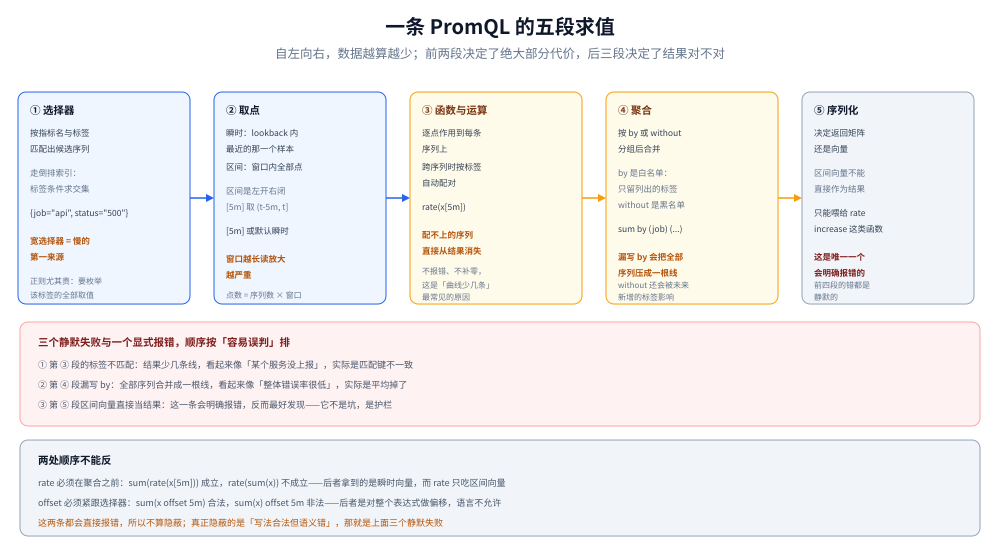

# PromQL 求值机制

> 覆盖：PromQL 算的是向量不是行、四种值类型的形状约束、一条表达式的求值顺序、⭐ **区间为什么是左开右闭**、`rate` 的四个前提、`lookback delta` 与 stale marker 的分工、聚合与向量匹配，以及五个必踩的坑。
>
> 不覆盖：四种指标类型的业务语义与选择判据（Counter 还是 Histogram、桶怎么定）见 [指标选型对比.md](../指标选型对比.md) 第五节；指标怎么从应用里暴露出来见 [手写Prometheus导出器.md](../../../../../01-编程语言/go/可观测性/手写Prometheus导出器.md) 第三、四节；告警规则怎么用这些表达式见 [告警与规则.md](告警与规则.md)。
>
> 内容整理自个人学习笔记。⚠️ **本篇未做本机实测**：求值语义（`lookback` 默认 `5m`、区间左开右闭、`stale` 行为）取自官方 Querying basics 文档，**没有跑过任何一条查询**，因此不含耗时与返回条数。

---

## 一、一句话定位：PromQL 算的是「向量」，不是「行」

**本节要点**：SQL 的运算单位是行，PromQL 的运算单位是**向量**——一次运算自动作用到「所有匹配的序列」上，而「哪些序列算同一条」由**标签全集精确匹配**决定。这个隐式 JOIN 是 PromQL 最大便利，也是最大误解源。

```promql
# 两边的序列按「除 method 外的全部标签」对齐，逐条相除
sum by (job, status) (rate(http_requests_total[5m]))
  /
sum by (job)         (rate(http_requests_total[5m]))
```

⭐ 三句话概括它的世界观：

| 世界观 | 含义 |
|---|---|
| **运算是批量的** | 写一次运算，作用到所有序列；不需要循环 |
| **对齐是隐式的** | 两边的序列按标签自动配对，配不上的直接消失（⚠️ 不是报错） |
| **时间是参数** | 同一个表达式在不同时间点求值，得到不同结果；没有「当前时间」的隐含概念 |

⚠️ 第二条最容易出事：**除法两边标签不匹配时，结果会静默变少**，而不是报错或补零。这就是「面板上某几条线莫名消失」的常见原因。

---

## 二、四种值类型与它们的形状

**本节要点**：PromQL 只有四种类型，其中两种是向量——**它们的区别不是「多个点 vs 一个点」，而是「能不能被大多数函数接受」**。

| 类型 | 形状 | 能出现在哪 |
|---|---|---|
| **Instant vector**（瞬时向量） | 每条序列**一个**样本，全部同一时间戳 | 绝大多数函数、聚合、二元运算、画图 |
| **Range vector**（区间向量） | 每条序列**一段**样本（带时间戳序列） | ⚠️ **只能作为特定函数的输入**，不能直接画图 |
| **Scalar** | 一个浮点数 | 算术、比较、`scalar()` 的产物 |
| **String** | 字符串 | 目前**未被使用** |

⭐ 一条硬约束：**区间向量不能作为表达式的最终结果直接返回**。`http_requests_total[5m]` 单独查会报错，因为它既不能画成曲线（它是每序列一段），也不能参与常规运算——它的唯一用途是喂给 `rate` / `increase` / `irate` / `delta` / `*_over_time` 这类函数。

⚠️ 每个点上的样本可以是**浮点样本或直方图样本**（native histogram），所以同一个选择器可能返回混合类型的向量——这也是 native histogram 相关函数用起来要额外小心的原因。

---

## 三、求值顺序：一条表达式怎么被算出来

**本节要点**：求值是**自底向上**的五段，每一段都在缩小或改写数据集；搞清楚自己在哪一段，就知道表达式慢在哪。



图里从下往上：选择器决定「碰哪些序列」，取点决定「每序列拿几个点」，函数决定「逐点算什么」，聚合决定「按哪组标签合并」，序列化决定「返回什么形状」——**越往上数据越少，但代价往往在下两层就定了**。

| 段 | 做什么 | 出问题的典型症状 |
|---|---|---|
| **① 选择器** | 按指标名与标签匹配，从 TSDB 取候选序列 | 序列太多 → 查询慢、内存高 |
| **② 取点** | instant 取 lookback 内最近一点；range 取窗口内全部点 | 窗口太长 → 读放大 |
| **③ 函数/运算** | 逐点作用，涉及跨序列时按标签匹配 | 标签不匹配 → **结果静默变少** |
| **④ 聚合** | `by` / `without` 分组后合并 | 写反了 → 图上一根线 |
| **⑤ 序列化** | 决定返回矩阵还是向量 | 类型不合法 → 直接报错 |

⭐ 一个必须记住的顺序结论：**`rate` 要在聚合之前**。`rate(sum(x))` 不成立（`sum` 出来是瞬时向量，`rate` 要区间向量），正确写法是 `sum(rate(x[5m]))`。这条顺序错了会直接报错，不算隐蔽；真正隐蔽的是**反过来的 `sum` 之后忘了加 `by`**。

---

## 四、区间是左开右闭：`rate` 的四个前提

**本节要点**：⭐ 官方原话是「区间为**左开右闭**（left-open and right-closed）」。这一句决定了 `rate()` 能不能算出东西，也是「为什么同样的窗口有时有数、有时是空」的根源。

`[5m]` 在时刻 `t` 求值时，取到的是 `(t-5m, t]` 这段——**左边界那个样本被排除，右边界那个样本被包含**。

`rate()` 能算出结果需要同时满足四个前提：

| 前提 | 不满足时 | 说明 |
|---|---|---|
| ① 窗口内**至少 2 个样本** | 返回**空**（不是 0） | 1 个点无法算速率 |
| ② 首尾样本覆盖了可测跨度 | 值不可靠 | `rate` 用「差值 ÷ 实际跨度」而非「差值 ÷ 窗口长度」 |
| ③ 单调性（Counter） | Gauge 会算出无意义的数 | 值下降时按「重置」处理，把下降量补回去 |
| ④ 右边界有样本 | 该时间点无结果 | 与左开右闭配合，正好是「最新那个点」 |

⭐ 由此得到一条**实用判据**：**`rate()` 的窗口至少取抓取周期的 4 倍**。

| 抓取周期 | `[1m]` 窗口 | `[5m]` 窗口 | 建议 |
|---|---|---|---|
| `15s` | 4 个点，勉强 | 20 个点，稳 | `[1m]` 起 |
| `30s` | 2 个点，边界 | 10 个点，稳 | `[2m]` 起 |
| `60s` | 1~2 个点，⚠️ 常空 | 5 个点，可用 | `[5m]` 起 |

⚠️ 三个函数的分工，别混：

| 函数 | 用几个点 | 特点 | 什么时候用 |
|---|---|---|---|
| `rate` | 窗口内全部，**首尾外推** | 平滑，适合画图与告警 | 默认选它 |
| `irate` | **只用最后两个点** | 敏感、抖动大 | 看瞬时变化，⚠️ 不适合告警（抖动会误报） |
| `increase` | 同 `rate`，结果 **× 窗口秒数** | ⚠️ **是外推值不是精确增量** | 只想看「涨了多少」时 |

⭐ `increase` 的外推性质值得单独记：窗口与样本不对齐时它会外推出小数，于是可能出现 `increase(http_requests_total[1m])` 返回 `3.7` 这种「半个请求」的值。要精确计数就不要用 `increase`，直接取两次 `... offset` 的差值。

---

## 五、瞬时向量的取点规则：`lookback` 与 stale marker 的分工

**本节要点**：⭐ 瞬时向量不是「取当前时刻的样本」，而是「取**最近一个不早于 lookback 的样本**」。默认 `5m`。这一条带来两个反直觉后果：**目标停了曲线不会立刻断**，以及**必须靠 stale marker 才能让序列立刻消失**。

两个机制的职责完全不同：

| 机制 | 什么时候生效 | 效果 |
|---|---|---|
| **`lookback delta`**（默认 `5m`） | 查询当下找不到该时刻的样本时，向前回溯最多 5 分钟 | ⚠️ 让「旧值」继续冒充当前值，最多 5 分钟 |
| **stale marker** | target 抓取成功且该指标**不再出现**、或 target 被移除 | 写入一个特殊标记，使该序列**立刻**在查询中消失，不再走 lookback |

⭐ 所以「服务停了」的表现分两种：

| 场景 | 现象 |
|---|---|
| target 整体消失（被 SD 摘掉、进程退出但抓取仍成功应答） | 有 stale marker，序列**立即**从查询里消失 |
| 数据不再更新但没人告诉 Prometheus（网络断、中间层丢了） | 无 stale marker，**旧值继续显示最多 5 分钟** |

⚠️ 第二个场景是告警最容易翻车的地方：业务指标「卡住不动」时，`rate()` 会慢慢归零，而**瞬时值类查询会一直显示最后那个数**，看起来一切正常。要检测「停止上报」，用 `absent()`、`... offset 5m` 比对，或者 `up`。

⚠️ 对**自带时间戳的导出器**，官方说明还有另一种行为：序列停止导出后，最后的值会保留（默认）5 分钟才消失，可用 `track_timestamps_staleness` 改变。这类导出器（比如某些批量任务 push 上来的）必须单独评估。

`--query.lookback-delta` 可以改全局值，单次查询也能用 `lookback_delta` 参数覆盖——但**改了会影响全部瞬时查询语义**，只在明确知道后果时改。

---

## 六、聚合与向量匹配

**本节要点**：聚合决定「按哪组标签合并」，向量匹配决定「两边的序列怎么配对」。前者写反了图会少线，后者写错了两边根本配不上——两者都不报错。

### 6.1 聚合：`by` 与 `without` 不是同义词

| 写法 | 保留什么 | 风险 |
|---|---|---|
| `sum by (job) (...)` | **只保留** `job` | 新增标签时不会带进来，安全但可能不够 |
| `sum without (instance) (...)` | **去掉** `instance`，其余全留 | ⚠️ 未来新增的任何标签都会自动参与分组，图可能突然分裂成多条 |

⭐ 判据：**「我只关心这几个维度」用 `by`；「我只要去掉这一个维度」用 `without`**。绝大多数场景该用 `by`——它是白名单，不会因为目标新增标签而悄悄改变结果。

### 6.2 向量匹配：一对一与多对一

| 修饰符 | 作用 |
|---|---|
| `on(...)` | 只用列出的标签作为匹配键 |
| `ignoring(...)` | 用「除列出的标签外」全部标签作为匹配键 |
| `group_left(...)` | 左侧多、右侧少（多对一），右侧序列的信息**广播**给左侧 |
| `group_right(...)` | 反过来（一对多，较少用） |

⚠️ 两个最常见错误：**① 不写 `on` / `ignoring` 时按标签全集匹配**，两边只要有一个标签不同就配不上，结果为空；**② `group_left` 后面必须列出「要额外带过来的标签」**，否则即使配上了也带不出想要的维度。

⚠️ 配不上时的行为是**结果里直接没有这些序列**（内连接语义），不是报错、不是补 0。所以「除法的结果只有部分曲线」几乎总是匹配键的问题。

---

## 七、五个必踩的坑

**本节要点**：下面五个坑的共同点是——**都能算出数、都不报错**，只有对照原始数据才能发现不对。

| # | 坑 | 现象 | 正确做法 |
|---|---|---|---|
| ① | `rate()` 用在 Gauge 上 | 值有正有负、跳变夸张 | Gauge 只看瞬时值或 `avg_over_time`；速率只对 Counter 有意义 |
| ② | 窗口小于 2 个采样点 | 结果**空**，而不是 0 | 窗口 ≥ 4 × `scrape_interval` |
| ③ | `histogram_quantile` 桶边界不含目标值 | P99 永远「贴着」某个桶边界 | 桶边界必须包含 SLO 阈值（要监控 200ms 就必须有 `le="0.2"`） |
| ④ | 用平均值代表延迟 | 曲线平滑好看，但慢请求被稀释 | 用 `histogram_quantile(0.99, ...)`，不要用 `sum(_sum)/sum(_count)` |
| ⑤ | 聚合漏了 `by` | 全部序列合成一根线 | 先写 `sum by (...)` 再填函数 |

⚠️ 还有两个语法层面的坑，顺带记：

- **`offset` / `@` 必须紧跟选择器**：`sum(x offset 5m)` 合法，`sum(x) offset 5m` 非法。
- **`offset` 与 `@` 可以同时用且顺序无关**，`@` 决定基准时刻、`offset` 相对它偏移。`@` 还能写成 `start()` / `end()`，在 range query 里分别表示区间两端。

⭐ 第 ③ 条值得展开一句话：`histogram_quantile` 是在**桶边界之间线性插值**估算分位数。如果 P99 落在最后一个桶之外（`+Inf` 之前的最大桶仍小于真实值），结果只能等于那个桶的上界——**看起来「P99 一直不变」，其实是桶不够**。

---

## 八、查询代价：什么让一条查询变慢

**本节要点**：查询代价 ≈ **候选序列数 × 时间窗内的点数**，两者任何一个放大都会拖垮它；而记录规则是在**写入侧**把这件事提前做掉。

| 因素 | 为什么贵 | 怎么降 |
|---|---|---|
| 选择器太宽（`{__name__=~".+"}`、只有一个弱标签） | 候选序列数爆炸，交集前的 posting list 就很大 | 加等值标签条件，能用 `=` 不用 `=~` |
| 时间窗太长（`[30d]`） | 读放的样本数随时间线性增长 | 缩短窗口 + 用 recording rule 出低精度长期序列 |
| range query 的 `step` 太小 | 返回点数 = 序列数 × 步数 | `step` 与面板宽度匹配，别用 1s 步长画 30 天 |
| 在表达式里做多次全量聚合 | 每一步都要遍历全部序列 | 拆成 recording rule 预计算 |
| 正则匹配中间部分（`.*foo.*`） | 索引要枚举该标签**全部取值**逐个匹配 | 改前缀匹配，或把维度改成等值 |

⭐ 一条判据：**如果一条查询「平时很快、偶尔很慢」，先看基数有没有涨**（新上线的服务带了新标签），而不是怀疑 Prometheus 本身。基数涨了，索引与内存同时变大，所有查询一起变慢——这与单条 SQL 写得差是完全不同的形态。

⚠️ 不要用 `query_range` 去「拉全量数据做分析」。它是给画图用的，`step` 与点数都有隐含约束；真要导数据用 `remote_read` 或直接读块。

---

## 校验口径

| 内容 | 状态 |
|---|---|
| 四种值类型与「区间向量不能作根表达式」 | ⚠️ 官方 Querying basics 文档原话，**未实测报错文本** |
| 区间**左开右闭**语义 | ⚠️ 官方文档原话（`left-open and right-closed`），**未构造边界样本验证** |
| `lookback` 默认 `5m`、`--query.lookback-delta` 与 `lookback_delta` 参数 | ⚠️ 官方文档原话 |
| stale marker 的触发条件与「立即消失」效果 | ⚠️ 官方文档陈述，**未制造过 stale 场景** |
| 自带时间戳导出器的 5 分钟保留行为与 `track_timestamps_staleness` | ⚠️ 官方文档陈述 |
| `rate` / `irate` / `increase` 的取点与「首尾外推」 | ⚠️ 按官方函数文档归纳，**未用真实 Counter 对照过三种函数的差值** |
| `by` / `without`、`on` / `ignoring` / `group_left` 语义 | ⚠️ 按官方运算符文档陈述，**未实跑多对一匹配** |
| `offset` / `@` 的位置约束与先后无关 | ⚠️ 官方文档原话（含 `sum(x) offset 5m // INVALID` 示例），**未跑** |
| 「窗口 ≥ 4 × 抓取周期」这条建议 | ✅ **本篇判据**（由「至少 2 个样本」推出并留一倍余量），非官方规定 |
| 查询代价的五个因素 | ⚠️ 机制归纳，**不含任何耗时读数** |

---

## 延伸追问

- **为什么 `rate` 返回空而不是 0？** → 因为「算不出来」与「算出来是 0」是两件事。返回 0 会让面板显示「速率为零」（看起来是服务停了），返回空则如实表示「这段窗口没数据」。同理 `NaN` 表示「无效值」，都会在聚合时被特殊处理。
- **`rate` 是怎么处理计数器重置的？** → 检测到值下降时，认为发生了重置，把「重置后的值」当作增量累加，而不是当负增长。所以进程重启不会在曲线上留下一个深坑——代价是**重置附近的速率偏低**（丢掉了重置瞬间到 0 的那一段）。
- **两个 Counter 相除要注意什么？** → 先各自 `rate` 再相除，标签要能对上；⚠️ 分母为 0 时结果是 `NaN` 或 `+Inf`，面板上表现为断线，需要 `clamp_min` 或加 `and` 过滤。
- **为什么 `sum without (instance)` 有风险？** → 它是黑名单语义：目标以后新增任何标签，都会自动变成新的分组维度，同一张图从一条线变成多条。用 `by` 的白名单语义就没有这个问题。
- **能不能用 `offset` 做同比？** → 能，`rate(x[5m]) / rate(x[5m] offset 1d)` 是常见的日同比。但要注意历史数据必须还在保留期内——`offset 30d` 在 15 天保留期下**永远返回空**，且不报错。
- **recording rule 和查询时聚合有什么区别？** → 记录规则在写入侧把结果算成新序列，查询时直接读；代价是**序列数可能变多**（每组一个新序列），而且只能预计算「确定要反复查」的那几种。选型判据见 [指标选型对比.md](../指标选型对比.md) 第六节。

---

## 关联

- [README.md](README.md) — 本册导读：六篇分工与读序
- [数据模型与存储.md](数据模型与存储.md) — **上游**：序列身份与倒排索引，决定了本篇选择器的代价
- [抓取与目标发现.md](抓取与目标发现.md) — **上游**：抓取周期决定 `rate()` 窗口该取多大
- [告警与规则.md](告警与规则.md) — **下游**：规则就是定时跑本篇的表达式，`for` 与求值周期都在那篇
- [定位与架构.md](定位与架构.md) — **上游**：查询路径在五模块里的位置
- [指标选型对比.md](../指标选型对比.md) — **对照**：四种类型的业务选择与「平均延迟为什么不能用」的结论摘要
