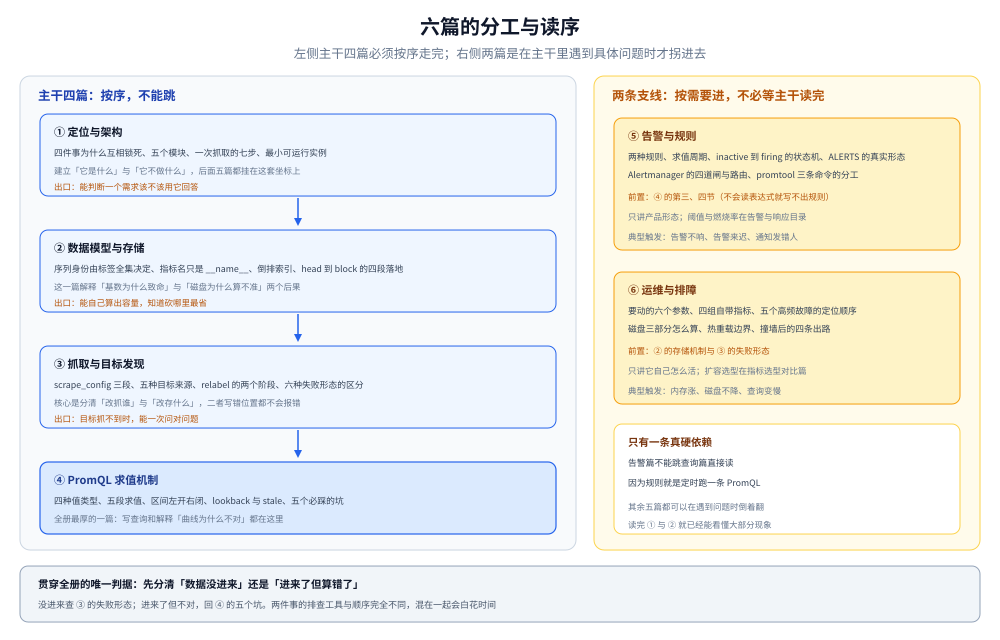

# Prometheus 目录导读

> 本册把 Prometheus 拆成 **6 篇零件 + 1 篇导读**：定位与架构（它是什么、四件事怎么互相锁死）→ 数据模型与存储（样本怎么变成磁盘上的块）→ 抓取与目标发现（数据怎么进来）→ PromQL 求值机制（数据怎么被算出来）→ 告警与规则（算出来之后怎么响）→ 运维与排障（它自己怎么活、怎么坏）。
>
> 不覆盖：跨产品选型与基数控制见 [指标选型对比.md](../指标选型对比.md)；Go 侧导出器怎么写见 [手写Prometheus导出器.md](../../../../../01-编程语言/go/可观测性/手写Prometheus导出器.md)；告警阈值的方法论与燃烧率见 [告警规则与阈值设计.md](../../告警与响应/告警规则与阈值设计.md)；`remote_write` 协议与高基数后端见 [与Prometheus生态的关系.md](../../../../数据存储/时序数据库/VictoriaMetrics/与Prometheus生态的关系.md)。
>
> 内容整理自个人学习笔记。**参考版本 3.13 LTS**（截至 2026-10，最新发布为 3.15.x，Alertmanager 0.34.x）。⚠️ **本册未做任何本机实测**：默认值、目录结构与行为描述全部取自官方文档与发行说明，逐篇在文末 `## 校验口径` 标注来源页面；凡标「未实测」的结论都不要当读数用。

---

## 一、一句话定位与它凭什么

**本节要点**：Prometheus 不是「一个能存指标的数据库」，而是**四件事的组合**——Pull 抓取、多维标签、本地 TSDB、向量查询语言。抽掉任何一件，剩下的三件都不再成立。

| 组成 | 它换来的能力 | 抽掉这一件会怎样 |
|---|---|---|
| **Pull 抓取** | 抓不到就是 `up == 0`，⭐ **「服务不存在」本身成为一条信号** | 换成纯推送，「服务死了」与「服务暂时没数据」再也分不开 |
| **多维标签** | 同一条指标可按任意维度切片、聚合、再聚合 | 换成层级命名（`a.b.c.d`），想换个维度看就得改指标名重新埋点 |
| **本地 TSDB** | 单个二进制、无外部依赖、写入路径短、部署成本极低 | 换成集群存储，运维面立刻变大——这也正是它的边界所在 |
| **PromQL** | 向量运算 + 速率 + 分位数，时间对齐语义由语言承担 | 换成 SQL，`rate` 与 `histogram_quantile` 那套语义要自己在应用层补 |

⭐ 一句话概括：**它把「监控」压缩成一个可以单机跑起来的二进制**，代价是它**天生不集群**——不是没做好，是设计上就把集群留给了别人。

它解决的问题与不解决的问题，边界比能力更需要记住：

| 你想回答的问题 | 归谁 | 为什么 |
|---|---|---|
| 整体是否健康、错误率涨了没有 | ✅ 本册 | 低基数、可长期、聚合快 |
| 哪个实例挂了、多久了 | ✅ 本册（`up`） | Pull 的副产品 |
| 容量趋势、磁盘还能撑几天 | ✅ 本册 | 长期序列 + `predict_linear` |
| 这一次请求为什么慢、慢在哪一跳 | ❌ 链路 | 指标把单次请求的身份聚合掉了 |
| 这次报错的具体参数与堆栈 | ❌ 日志 | 指标没有正文 |
| 哪个函数占了多少 CPU | ❌ 剖析（profiling） | 指标是采样聚合，不是调用栈 |

⚠️ 一个常见误解：**Prometheus 不是「什么都能存」的监控平台**。它只存数值型时间序列——没有字符串、没有事件、没有日志行。想存「谁在什么时候做了什么」，那是日志的事。

---

## 二、核心概念速览

**本节要点**：先记住下面这句话，剩下的名词都是它的展开。

⭐ **一个 target 被一个 job 按固定周期抓一次，抓回来的每个 sample 落到一条由「指标名 + 全部标签值」唯一确定的 series 上，series 攒进 block，PromQL 在 block 上算，规则每个周期算一次 PromQL，命中了就把告警交给 Alertmanager。**

| 层 | 概念 | 一句话 | 详见 |
|---|---|---|---|
| 数据 | **metric / label / sample** | 指标名 + 标签对 = 身份；sample 是 `(时间戳, 数值)` | [数据模型与存储.md](数据模型与存储.md) |
| 数据 | **series** | ⭐ 身份的唯一性来自「指标名 + 全部标签值」，不是指标名 | 同上 |
| 数据 | **block / WAL / head** | 落盘单位 2 小时一块；内存里的当前块靠 WAL 兜底 | 同上 |
| 拓扑 | **job / instance / target** | job 是一组同构目标；instance 由 `__address__` 决定；target 是待抓的端点 | [抓取与目标发现.md](抓取与目标发现.md) |
| 拓扑 | **`__meta_*` / relabel** | 服务发现给的临时标签，只在抓取前可用 | 同上 |
| 查询 | **instant / range vector** | 一个点 vs 一段窗口；四个值类型里的两个主角 | [PromQL求值机制.md](PromQL求值机制.md) |
| 查询 | **lookback delta** | 5 分钟内最近的样本都算「当前值」，超过就当作没有 | 同上 |
| 运行 | **rule / recording / alerting** | 定时把 PromQL 结果存成新指标 / 送进告警队列 | [告警与规则.md](告警与规则.md) |
| 运行 | **Alertmanager** | 去重、分组、抑制、静默、路由——**不负责算** | 同上 |

⚠️ 有两组概念最容易被混为一谈，先分清：**`relabel_configs` 改的是「抓谁」，`metric_relabel_configs` 改的是「抓到的东西」**；**recording rule 是「预计算」，不是「降采样」**。

---

## 三、阅读路线

**本节要点**：六篇不是线性依赖，而是「一条主干 + 三条支线」。主干必须按序走完才能建立完整认识。

图里左侧是主干四篇（定位 → 数据模型 → 抓取 → 查询），右侧两篇是支线（告警依赖查询，运维依赖存储与抓取）；箭头方向就是「谁必须在前」。

| 顺序 | 篇 | 视角 | 什么时候读 |
|---|---|---|---|
| ① | [定位与架构.md](定位与架构.md) | ⭐ **主线起点** | 想知道它到底是什么、上手跑一个最小实例、看懂一次抓取的完整路径 |
| ② | [数据模型与存储.md](数据模型与存储.md) | 存储层 | 关心「一条样本最后变成磁盘上的什么」，或者容量算不出来 |
| ③ | [抓取与目标发现.md](抓取与目标发现.md) | 采集层 | 要接一群目标、要按标签重新组织目标，或者 target 抓不到 |
| ④ | [PromQL求值机制.md](PromQL求值机制.md) | 计算层 | 要写查询、要解释「为什么这条曲线看着不对」 |
| ⑤ | [告警与规则.md](告警与规则.md) | 响应层 | 要落一组规则、要接 Alertmanager、要解释告警为什么迟了 |
| ⑥ | [运维与排障.md](运维与排障.md) | 操作层 | 已经在跑了，要看容量、查内存、定位五种高频故障 |

### 3.1 四条路线

| 目的 | 按这个顺序读 |
|---|---|
| **从零开始，先跑起来** | 本页一、二节 → [定位与架构.md](定位与架构.md) 三、四、七节 |
| **查不到数据 / 面板是空的** | [抓取与目标发现.md](抓取与目标发现.md) 第五节 → [PromQL求值机制.md](PromQL求值机制.md) 第七节 → [运维与排障.md](运维与排障.md) 第四节 |
| **要落一套告警** | [PromQL求值机制.md](PromQL求值机制.md) 三、四节 → [告警与规则.md](告警与规则.md) 全篇 → [告警规则与阈值设计.md](../../告警与响应/告警规则与阈值设计.md)（阈值怎么定） |
| **要评估能不能扛住** | [数据模型与存储.md](数据模型与存储.md) 第六节（容量公式）→ [运维与排障.md](运维与排障.md) 二、三节 → [指标选型对比.md](../指标选型对比.md) 第六节（扩容三条路） |

### 3.2 依赖关系（谁要前置）

| 本篇 | 建议先读 | 为什么 |
|---|---|---|
| 数据模型与存储.md | 本页第二节 | 不知道 series 的唯一性来自标签，就看不懂「基数为什么会爆」 |
| 抓取与目标发现.md | 数据模型与存储.md 第一节 | `job` / `instance` 最后都变成标签写进序列，先知道标签怎么回事 |
| PromQL求值机制.md | 数据模型与存储.md 第一、二节 | 区间向量为什么是「左开右闭」、`rate` 为什么要有两个点，都取决于样本怎么落 |
| 告警与规则.md | PromQL求值机制.md 第三、四节 | 规则就是定时跑一条 PromQL，不会读表达式就写不出规则 |
| 运维与排障.md | 数据模型与存储.md + 抓取与目标发现.md | 告警里的 `prometheus_tsdb_*` 与 `scrape_*` 指标，名字就是前两篇的概念 |

⭐ 只有一条真硬依赖：**告警篇不能跳查询篇直接读**。其余篇可以在需要时倒着翻。

---

## 四、未实测坐标

**本节要点**：⭐ **本册零实测**。所有结论来自官方文档与发行说明，没有任何一条是本机读数——这是本轮主动选择的写法，不是遗漏。

| 内容 | 状态 | 依据 |
|---|---|---|
| 磁盘布局（`2h` 块、WAL `128MB` 分段、最少保留 3 个 WAL、默认保留 `15d`、压缩后单块上限 `31d`） | ⚠️ 未实测 | 官方 Storage 文档 |
| 求值语义（`lookback` 默认 `5m`、区间**左开右闭**、stale marker、`track_timestamps_staleness`） | ⚠️ 未实测 | 官方 Querying basics |
| 抓取默认值（`scrape_interval 1m`、`scrape_timeout 10s`、`honor_labels false`、`honor_timestamps true`、`metrics_path /metrics`） | ⚠️ 未实测 | 官方 Configuration 文档 |
| relabel 两阶段与 `__meta_*` 生命周期 | ⚠️ 未实测 | 官方 Configuration 文档 |
| 规则求值、`pending`/`firing` 状态机、Alertmanager 四道闸 | ⚠️ 未实测 | 官方 Alerting rules 与 Alertmanager 文档 |
| `prometheus_tsdb_*` / `scrape_*` 指标名与含义 | ⚠️ 未实测 | 官方 Metrics reference |
| 版本与支持周期（3.13 LTS 支持至 2027-07；最新 3.15.x） | ✅ 已核对 | prometheus.io/download 与 endoflife.date，2026-10-24 查 |

⚠️ 因此本册**不给任何性能数字**（抓取耗时、内存占用、压缩比、查询延迟）。这些要么本机跑，要么不写——按既有的仓库规约，不伪造 stdout，也不把别人的 benchmark 当自己的读数。

---

## 五、本册的边界

| 本册收 | 不收（在哪） |
|---|---|
| 四件事为什么互相锁死、它解决与不解决什么 | **五个后端怎么选、基数怎么控** → [指标选型对比.md](../指标选型对比.md) |
| 一次抓取的完整路径、五个内部模块的职责 | **导出器代码怎么写** → [手写Prometheus导出器.md](../../../../../01-编程语言/go/可观测性/手写Prometheus导出器.md) |
| series 的唯一性、倒排索引、block/WAL/compaction | **时序引擎的横向对比** → [时序数据库选型对比.md](../../../../数据存储/时序数据库/时序数据库选型对比.md) |
| `scrape_config` 字段语义、SD、relabel 两阶段 | **K8s 里的 SD 细节与 Pod 注解** → 归 K8s 目录（本册只讲机制） |
| PromQL 的求值顺序、速率与分位数的边界 | **阈值怎么定、燃烧率怎么算、告警怎么不疲劳** → [告警规则与阈值设计.md](../../告警与响应/告警规则与阈值设计.md) |
| 规则与 Alertmanager 的配置形态、状态机 | **通知渠道接入**（钉钉 / 企微 / PagerDuty）→ 属集成，不在本册 |
| 容量公式、五个高频故障、自带指标怎么读 | **`remote_write` 协议与长期存储** → [与Prometheus生态的关系.md](../../../../数据存储/时序数据库/VictoriaMetrics/与Prometheus生态的关系.md) |

⚠️ 一处刻意的不收：**本册不写「Prometheus 与 VictoriaMetrics 谁更好」**。那是选型判断，本册只负责把 Prometheus 这一侧讲清楚，好让对比有依据。

---

## 延伸追问

- **Prometheus 能不能做成集群？** → 原生不做。官方立场是「不解决集群，只给接口」：要么双跑 + 去重，要么 `remote_write` 到远端存储，要么按业务分片再上层聚合。三条路的判断依据见 [指标选型对比.md](../指标选型对比.md) 第六节，`remote_write` 的协议细节见 [与Prometheus生态的关系.md](../../../../数据存储/时序数据库/VictoriaMetrics/与Prometheus生态的关系.md)。
- **为什么它是 Pull，不是 Push？** → 因为 Pull 让「抓不到」变成一条可告警的事实，而 Push 里「服务挂了」和「服务没数据」在语义上无法区分。代价是它必须能主动连到被监控方；连不到时的补法见 [抓取与目标发现.md](抓取与目标发现.md) 第六节。
- **3.13 和 3.15 该用哪个？** → 生产跟 **3.13 LTS**（支持到 2027-07），新特性验证用 3.15。Prometheus 每 6 周一个 minor，只有部分版本被标为 LTS，跟着 minor 走等于每 6 周评估一次升级。
- **它和 OpenTelemetry 是什么关系？** → 互补，不是替代。OTel 负责「怎么产生与传输」，Prometheus 负责「怎么存与怎么算」；OTel 有 `prometheus` exporter 和 receiver 两条接线，方向搞反会得到「起来了但没数据」。见 [指标选型对比.md](../指标选型对比.md) 2.1 节。
- **为什么说「指标不要存日志」？** → 不是技术不行，是负载方向相反：指标是高频、短窗口、大量小查询；日志是低频、大范围扫描。混在一体会让两边都变差。详见 [指标选型对比.md](../指标选型对比.md) 第四节。
- **只学 PromQL 够不够？** → 不够。PromQL 的坑一大半不在语法，在数据形状：区间是左开右闭、`rate` 要两个点、计数器会重置、分位数靠插值。这些在 [PromQL求值机制.md](PromQL求值机制.md) 第七节集中列了五个。

---

## 关联

- [指标选型对比.md](../指标选型对比.md) — **上游选型**：成本两个变量、Pull 与 Push、五个后端、扩容三条路；本册是它的「Prometheus 那一格」展开
- [手写Prometheus导出器.md](../../../../../01-编程语言/go/可观测性/手写Prometheus导出器.md) — **上游生产端**：指标怎么从应用里暴露出来；本册只讲怎么把它抓进来
- [告警规则与阈值设计.md](../../告警与响应/告警规则与阈值设计.md) — **下游方法论**：阈值、燃烧率、窗口语义与告警疲劳；本册只讲规则与 Alertmanager 的配置形态
- [与Prometheus生态的关系.md](../../../../数据存储/时序数据库/VictoriaMetrics/与Prometheus生态的关系.md) — **下游长期化**：`remote_write` 协议、字节布局与三条替代路线
- [可观测性选型对比.md](../../可观测性选型对比.md) — 跨支柱总纲：三大支柱的成本结构与组合方式
- [目录.md](../../../../../目录.md) — 全仓知识点索引
