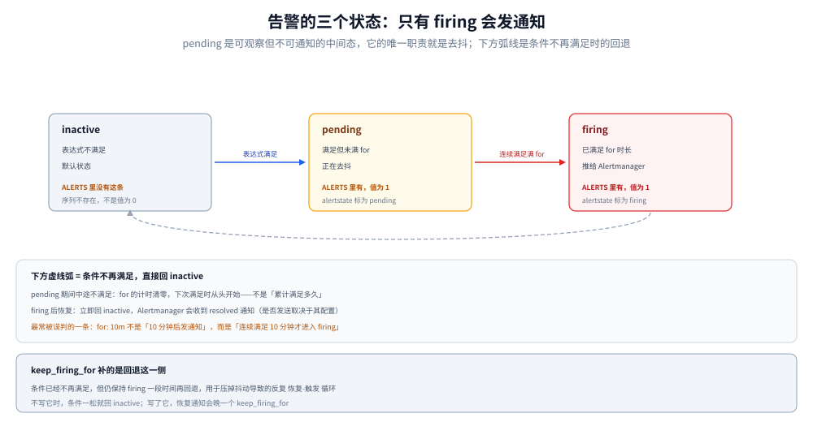

# 告警与规则

> 覆盖：Prometheus 的规则引擎只做「算与判」、`recording` 与 `alerting` 两种规则、一个求值周期里发生了什么、⭐ **`inactive → pending → firing` 状态机与 `ALERTS` 指标的真实形态**、Alertmanager 的四道闸与路由、以及三条 `promtool` 命令各自管什么。
>
> 不覆盖：阈值怎么定、燃烧率怎么算、告警怎么不疲劳见 [告警规则与阈值设计.md](../../告警与响应/告警规则与阈值设计.md)（**方法论主篇**，本篇只讲产品形态）；通知渠道接入属集成范围，不在本册；表达式本身见 [PromQL求值机制.md](PromQL求值机制.md)。
>
> 内容整理自个人学习笔记。⚠️ **本篇未做本机实测**：规则文件字段、状态机、`ALERTS` 指标形态与 Alertmanager 默认值取自官方 Alerting rules / Alertmanager 文档，**没有跑过任何一条规则**，因此不含触发时刻与通知延迟读数。

---

## 一、一句话定位：Prometheus 只算，不发

**本节要点**：告警链路上有两个进程，职责被一条线切开——**Prometheus 判断「这条规则命中了没有」，Alertmanager 决定「命中了之后要不要发、发给谁、发几次」**。把两者混为一谈，就会去找「Prometheus 为什么重复发通知」这种不存在的答案。

| 环节 | 归谁 | 具体做什么 |
|---|---|---|
| 求值 | Prometheus（rule manager） | 每个周期跑一遍 `expr`，得到命中集合 |
| 去抖 | Prometheus | `for` 持续满足才升级为 firing |
| 推送 | Prometheus（notifier） | 把 firing 的告警批量推到 Alertmanager |
| 去重、分组、抑制、静默、路由、重发 | **Alertmanager** | 全部 |
| 送达 | 接收方（webhook / 邮件 / IM） | Alertmanager 只管发出去 |

⭐ 一条判据：**「为什么没收到通知」先看 Alertmanager 的 UI，不要先看 Prometheus 的规则页**。规则页显示 firing 只能证明「算出来了」，不能证明「发出去了」。

⚠️ 一个例外要记住：`--web.enable-lifecycle` 没开时，改了规则文件**不会自动生效**，必须重启或开热重载。这时规则页显示的还是旧规则的求值结果——看起来像「规则没生效」。

---

## 二、规则文件的两种形态

**本节要点**：同一个文件里可以放两种规则，它们的区别不是「告警 vs 记录」，而是**输出去了哪里**——一个写回 TSDB 变成新指标，一个送进告警队列。

| 类型 | 字段 | 输出 | 副作用 |
|---|---|---|---|
| **recording rule** | `record` + `expr` | 一条**新的时间序列** | ⚠️ 会增加序列数（每组一个新序列） |
| **alerting rule** | `alert` + `expr` + `for` | 一个告警实例，推给 Alertmanager | 不写业务序列；但会产生 `ALERTS` 系列 |

```yaml
groups:
  - name: api.rules
    interval: 30s                 # 覆盖全局 evaluation_interval
    rules:
      # 记录规则：把「按 job 的错误率」预计算成一条新指标
      - record: job:http_errors:rate5m
        expr: sum by (job) (rate(http_requests_total{status=~"5.."}[5m]))

      # 告警规则：消费上面那条记录规则
      - alert: HighErrorRate
        expr: job:http_errors:rate5m > 0.05
        for: 10m
        labels:
          severity: warning
        annotations:
          summary: "{{ $labels.job }} 错误率 {{ $value | humanizePercentage }}"
```

⭐ 记录规则的命名按官方推荐的三段式：**`level:metric:operation`**（如 `job:http_errors:rate5m`）。这不是风格问题——冒号开头的名字在 PromQL 里不是合法指标名，**用它来标记「这是算出来的」**，一眼能和人写的指标区分开。

⚠️ 记录规则是**双刃剑**：它把查询时的计算挪到写入时，但每条输出都是新序列。给 20 个 job 各算一个记录规则，就多 20 条序列；如果 `by` 里带上下标的维度，会成倍放大——**记录规则自己也会推高基数**。

---

## 三、求值：一个周期里发生了什么

**本节要点**：规则求值有**独立的时钟**（`evaluation_interval`，默认 `1m`），与抓取周期没有同步关系。这个「不同相」是所有「规则读到旧数据」问题的根源。

| 概念 | 默认 | 说明 |
|---|---|---|
| `global.evaluation_interval` | `1m` | 规则求值频率，与 `scrape_interval` 是两个独立参数 |
| `groups[].interval` | 继承全局 | 单个组可覆盖，**组内规则串行求值** |
| 求值时间戳 | 对齐到 interval 的整数倍 | 不是「现在几点就在几点算」 |

一个周期内的顺序：

1. 按组取规则列表（组内**串行**，组间可并行）
2. 对每条规则求值表达式（这一步就是跑一条 PromQL）
3. 记录规则：结果写成新序列，追加进 head
4. 告警规则：把命中结果与上一次状态比较，推进状态机
5. 把状态变化的告警推给 notifier

⚠️ 第 2 步与抓取的关系：**`evaluation_interval` 与 `scrape_interval` 互不感知**。如果两者都是 `1m` 但相位错开，规则可能读到「上一次抓取」的数据——最多差一个抓取周期。3.x 提供了 `rule_query_offset`（全局）让规则晚一点求值，等抓取落定后再算，这是官方对「不同相」的补偿手段。

⭐ 求值太慢的后果不是报错，而是**告警延迟且不可控**：一条规则跑 40s、组内 10 条规则，这个周期就永远跑不完，下一周期紧接着开始。表现为「告警总是慢几分钟」，而不是「规则报错」。

---

## 四、告警的状态机

**本节要点**：⭐ 告警有三个状态，**只有 `firing` 会发通知**；`pending` 是可观测但不可通知的中间态，它的存在意义就是「去抖」。



图里三个状态与两条边：命中进 `pending`，`for` 期满进 `firing`，条件不再满足回 `inactive`；`keep_firing_for` 是右侧那条回退缓冲。

| 状态 | 条件 | 会发通知吗 | 在 `ALERTS` 里能看到吗 |
|---|---|---|---|
| **inactive** | 表达式不满足 | 否 | ⚠️ **看不到**（序列不存在） |
| **pending** | 满足，但持续时长 < `for` | 否 | ✅ 能看到，`alertstate="pending"` |
| **firing** | 满足且持续 ≥ `for` | ✅ 是 | ✅ 能看到，`alertstate="firing"` |

三个字段的语义：

| 字段 | 作用 | 坑 |
|---|---|---|
| `for` | 持续满足多久才 firing | ⚠️ 计时按「求值次数 × interval」推进，不是精确墙钟；`for: 0` 直接 firing |
| `keep_firing_for` | 条件**不再满足**后仍保持 firing 一段时间 | 用于压掉抖动导致的反复恢复；不写则条件一松就回 `inactive` |
| `labels` / `annotations` | 告警实例的标签与文本 | ⚠️ `labels` 参与 Alertmanager 的分组与路由，`annotations` 不参与 |

⚠️ 最常见的误判：**以为 `for: 10m` 是「10 分钟后发通知」**。它实际是「连续满足 10 分钟才进入 firing」，如果这期间有一次求值不满足，计时**清零重来**。

---

## 五、`ALERTS` 与 `ALERTS_FOR_STATE`

**本节要点**：⭐ `ALERTS` 是规则引擎产生的**普通时间序列**，但它有个反直觉特性——**只有在 pending / firing 时才存在，inactive 时整条序列消失**。这直接决定了「用 `ALERTS == 0` 查未触发」这种写法永远是空的。

| 指标 | 标签 | 值 | 存在条件 |
|---|---|---|---|
| `ALERTS` | `alertname` + 规则的 `labels` + `alertstate` | 恒为 `1` | 仅 pending / firing 期间 |
| `ALERTS_FOR_STATE` | 同上（不含 `alertstate`） | `for` 计时的起始时间戳 | 仅 pending / firing 期间 |

三个正确用法与一个错误用法：

| 写法 | 结果 |
|---|---|
| `ALERTS{alertstate="firing"}` | ✅ 当前在 firing 的告警 |
| `ALERTS{alertstate="pending"}` | ✅ 正在去抖的告警（预判「马上要响」） |
| `count by (alertname) (ALERTS)` | ✅ 各告警当前有几个实例 |
| `ALERTS == 0` | ❌ **永远空** —— 不触发时序列根本不存在 |

⭐ `ALERTS_FOR_STATE` 的用处：它是 `for` 计时的持久化载体，**进程重启后靠它恢复计时**，避免「重启即重新等 10 分钟」。要查「这条告警已经持续多久」，用它减去当前时间即可。

⚠️ 因为 `ALERTS` 本身是序列，**它也会占基数**：告警规则里如果 `labels` 用了高基数标签（比如把 `instance` 全带上），`ALERTS` 系列数会跟着涨。

---

## 六、Alertmanager 的四道闸与路由

**本节要点**：四道闸都只影响「什么时候发、发几次」，不影响到「发不发」的判定——判定在 Prometheus 那边已经做完了。

| 参数 | 默认 | 语义 | 调大之后 |
|---|---|---|---|
| `group_by` | `[alertname]` | 按哪些标签把告警聚成一组 | 组更粗，同类告警合成一条通知 |
| `group_wait` | `30s` | ⭐ **首批**发送前的等待（等同组告警聚齐） | 首次通知更晚，但一条通知里更全 |
| `group_interval` | `5m` | 同组**有新变化**时的重发间隔 | 变化传得更慢 |
| `repeat_interval` | `4h` | 同组**无变化**时的重复提醒间隔 | 提醒更稀疏 |

⭐ 最关键的一条：**`group_wait` 只作用于「首批」**。一旦某组已经发过通知，后续变化走 `group_interval`，新告警**不会**再等 `group_wait`。这解释了「同一起故障里，第一条告警来得慢、后面几条来得快」。

三个「不发」的机制，语义完全不同：

| 机制 | 什么时候用 | 持续多久 | 与告警状态的关系 |
|---|---|---|---|
| **抑制**（`inhibit_rules`） | 源告警 firing 时压掉目标的同类告警 | 源告警 firing 期间 | 目标告警**仍然是 firing**，只是不通知 |
| **静默**（silences） | 计划内维护、已知问题 | 有明确到期时间 | 同上，不改变状态 |
| **路由丢弃**（`route` 里 `receiver: null` 一类） | 某类告警永远不发 | 永久（配置级） | 同上 |

⚠️ 三者都不改变告警状态，所以「Alertmanager 里看不到」与「Prometheus 里没触发」是两件事，排查要分开。

路由是**树形**匹配：从根节点往下，按 `matchers` 匹配、可 `continue: true` 继续匹配兄弟节点。判据只有一条：**`continue` 不写，命中第一个子节点就停**——这是「告警发到了错误的接收方」最常见的原因。

---

## 七、规则怎么验证：三条命令分工不同

**本节要点**：`promtool` 的校验能力分三层，**混用会导致「以为验过了其实没验」**；而热重载是唯一一个「不校验就生效」的入口。

| 命令 | 查什么 | 不查什么 |
|---|---|---|
| `promtool check config` | 主配置语法、引用的规则文件是否存在 | 规则内容对不对 |
| `promtool check rules` | 规则文件语法、`record`/`alert` 字段完整性、表达式**能否解析** | 表达式**语义**是否正确（能不能查出东西） |
| `promtool test rules` | 用给定的输入序列跑规则，断言输出 | 真实数据的分布 |

⚠️ 两个必须知道的边界：

1. **`check rules` 只保证「能解析」，不保证「算得对」**。`rate(x)`（漏了区间）这种写法在某些情况下能通过静态检查，但运行期永远报错。
2. **热重载不等价于校验**。开了 `--web.enable-lifecycle` 后，`POST /-/reload` 会重新加载规则文件——**语法错误会导致整次重载失败并保留旧配置**（这是好的），但语义错误会被接受（这是坏的），表现是「规则加载成功但没有输出」。

⭐ 规则单测的两阶段写法（先声明空断言探触发时刻，再回填期望值）在 [告警规则与阈值设计.md](../../告警与响应/告警规则与阈值设计.md) 第七节有完整示例与读数，本篇不重复。

---

## 校验口径

| 内容 | 状态 |
|---|---|
| `recording` / `alerting` 两类规则的字段与输出 | ⚠️ 官方 Alerting rules 文档陈述，**未跑过规则** |
| `evaluation_interval` 默认 `1m`、组内串行、时间戳对齐 | ⚠️ 官方文档口径，**未观察过求值时间戳** |
| `rule_query_offset` 的作用与 3.x 引入 | ⚠️ 按发行说明陈述，**未配置验证** |
| `inactive / pending / firing` 状态机与 `for` 计时规则 | ⚠️ 官方文档陈述，**未制造过状态迁移** |
| `ALERTS` 仅在 pending/firing 存在、`ALERTS_FOR_STATE` 承载计时 | ⚠️ 官方文档陈述，**未查询过 `ALERTS`**；「`ALERTS == 0` 永远空」为机制推断 |
| Alertmanager 四个参数默认值（`30s` / `5m` / `4h` / `[alertname]`） | ⚠️ 官方 Alertmanager 文档原话，**未改过配置** |
| `group_wait` 仅作用于首批 | ⚠️ 官方文档语义，**未用 webhook 观察过分组行为** |
| 抑制 / 静默 / 路由丢弃的区别 | ⚠️ 官方文档陈述 |
| 三条 `promtool` 命令的分工与热重载行为 | ⚠️ 按官方文档与 `promtool` 用法陈述，**未执行过任何一条命令** |
| **全篇** | ⚠️ **未实测**：本篇零本机读数，规则文件字段、状态机与 Alertmanager 默认值均取自文档 |

---

## 延伸追问

- **为什么告警会「迟」几分钟？** → 三个叠加因素：`for` 的持续时长、`evaluation_interval` 的求值粒度、`group_wait` 的首批等待。三者都是设计选择，不是故障——排查「迟」之前先算清这三个数之和与预期的差距。
- **重启会不会让告警重新计时？** → 不会，`ALERTS_FOR_STATE` 把 `for` 的起始时刻持久化成序列，重启后恢复。⚠️ 但如果这次重启同时导致数据中断，`expr` 先变成「无数据」，计时照样会被打断。
- **记录规则和 `metric_relabel_configs` 都能减负，该用哪个？** → 方向相反：`metric_relabel_configs` 是**在入口丢弃**（序列更少、但信息永久丢失），记录规则是**在入口增加**（预计算的结果变成新序列）。要减基数用前者，要减查询耗时用后者。
- **抑制和静默到底怎么选？** → 抑制是**自动的因果压制**（源告警在，目标就不响），静默是**人工的临时屏蔽**（有到期时间）。⚠️ 用静默替代抑制会在到期后瞬间被一堆陈旧告警淹没。
- **告警规则能引用另一条告警规则的结果吗？** → 不能直接引用（告警不是序列），但可以引用它产生的 `ALERTS` 序列——这通常是在搭「告警的告警」，需谨慎，容易形成环路与噪音。
- **`for: 0` 什么时候是对的？** → 只在你确实要「一发生就通知」时（如数据丢失、证书已过期）。⚠️ 用它做常规告警会把抖动直接变成通知，去抖的责任就全落到 Alertmanager 的 `group_wait` 上了。

---

## 关联

- [README.md](README.md) — 本册导读：六篇分工与读序
- [PromQL求值机制.md](PromQL求值机制.md) — **前置**：规则就是定时跑一条 PromQL，不读那篇写不出规则
- [运维与排障.md](运维与排障.md) — **排障**：规则求值慢、通知不通的定位顺序
- [告警规则与阈值设计.md](../../告警与响应/告警规则与阈值设计.md) — **方法论主篇**：阈值三形态、燃烧率、窗口语义、规则单测的两阶段写法
- [SLO与错误预算.md](../../告警与响应/SLO与错误预算.md) — **上游**：告警阈值从预算倒推的依据
- [定位与架构.md](定位与架构.md) — **上游**：rule manager 与 notifier 在五模块里的位置
