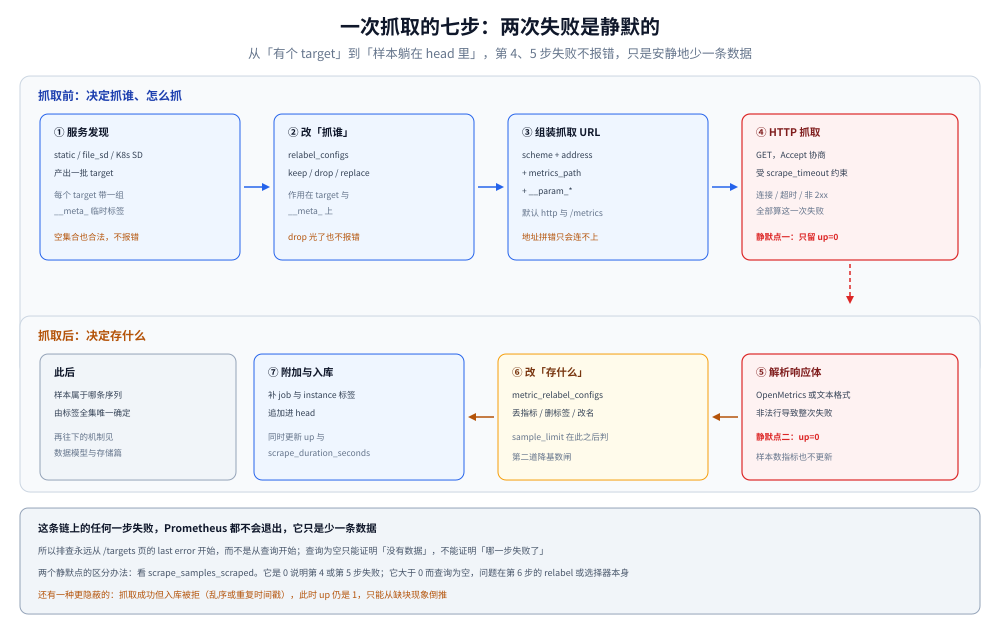

# 定位与架构

> 覆盖：Prometheus 到底是什么（不是一个时序库，而是四件事的组合）、四个必建对象、五个内部模块、**一次抓取从发现到入库的完整七步**、最小可运行实例、以及单机形态的三条硬边界。
>
> 不覆盖：跨产品选型与基数控制见 [指标选型对比.md](../指标选型对比.md)；导出器怎么写见 [手写Prometheus导出器.md](../../../../../01-编程语言/go/可观测性/手写Prometheus导出器.md)；存储格式细节见 [数据模型与存储.md](数据模型与存储.md)；扩容的三条路见 [指标选型对比.md](../指标选型对比.md) 第六节。
>
> 内容整理自个人学习笔记。⚠️ **本篇未做本机实测**，默认值与模块划分取自官方文档（Storage / Configuration / Querying basics 三页）与 3.x 发行说明，逐条在文末 `## 校验口径` 标注；不含任何性能读数。

---

## 一、一句话定位：它和「时序数据库」差在哪

**本节要点**：Prometheus 的价值不在「能存时序数据」——能存的系统很多——而在**它把「抓取 + 存储 + 计算 + 告警」四件事装进了同一个二进制**，并且让这四件事共享同一套数据模型。

| 能力 | Prometheus | 单纯时序库（如 InfluxDB） | 传统监控平台（如 Zabbix） |
|---|---|---|---|
| 数据怎么来 | ⭐ **内建抓取**，定时拉 `/metrics` | 只收写入，采集靠外部 | 私有 agent 上报 |
| 数据模型 | 指标名 + 任意标签，**身份由标签全集决定** | 类似，但查询语言各异 | 主机 / 监控项 / 触发器，维度弱 |
| 查询 | PromQL（向量运算 + 速率 + 分位数） | Flux / InfluxQL / SQL | 阈值表达式 |
| 告警 | 内建规则引擎，**但不负责通知编排** | 多数无 | ⭐ 内建，含动作与升级 |
| 集群 | ❌ 无（设计取舍） | 商业版或另购 | 天然 CS 架构 |
| 部署 | 单二进制 / 单容器 | 单机或集群 | Server + Proxy + Agent |

⭐ 判断它值不值得上，只看一个问题：**你的目标能不能被「定时拉一个文本端点」覆盖**。能，它就是最短路径；不能（比如要收一批推来的事件流），一开始就该换模型。

⚠️ 三个常见误解，先说清：

| 误解 | 事实 |
|---|---|
| 「Prometheus 是数据库，数据该长期存这儿」 | 它是**单机本地存储**，官方立场是不解决集群；长期化靠 `remote_write` 外挂 |
| 「告警是 Prometheus 发的」 | Prometheus 只**算**规则，通知的去重、分组、抑制、静默全在 Alertmanager |
| 「标签随便加，反正能筛」 | 每个标签取值都乘出一条新序列，**基数是它唯一会突然死掉的原因** |

---

## 二、核心概念：四个对象与一条链

**本节要点**：Prometheus 的拓扑只有三个对象（target / job / instance），数据侧只有三个对象（metric / label / sample），它们靠「抓取」这一个动作连起来。

| 对象 | 由谁决定 | 抓回来后变成什么 |
|---|---|---|
| **target** | 服务发现或静态配置产出的一条待抓记录 | 不落库；它的 `__address__` 变成 `instance` 标签 |
| **job** | `scrape_config` 的 `job_name` | 直接写成 `job` 标签，**同一次抓取的所有样本都带它** |
| **instance** | 默认取 target 的 `__address__`（`host:port`） | 写成 `instance` 标签；relabel 可以改 |
| **metric** | 目标自己暴露的名字 | 写成 `__name__` 标签 |
| **label** | 目标暴露 + 服务端附加（`job` / `instance` / `__meta_*` 转来的） | 原样写入 |
| **sample** | 每次抓取的一个数值 | `(timestamp, float64)`，落在某条 series 上 |

⭐ 一句话串起来：**job 是一组同构的 target，target 抓回来的每条样本都盖上 `job` 与 `instance` 两个章，此后它属于哪条 series 就由标签全集唯一确定**。

⚠️ 一个反直觉的点：**指标名本身也是标签**（`__name__`）。所以 `up` 与 `{__name__="up"}` 是同一个查询，而 `sum by (__name__)` 这种写法能成立——这是后面理解倒排索引的前提。

---

## 三、整体架构：五个模块与两条路径

**本节要点**：Prometheus 进程内部是五个各管一段的模块，**任一模块坏了，症状都不一样**——记住症状比记住名字有用。

| 模块 | 负责 | 坏了之后的现象 |
|---|---|---|
| **Service Discovery + Scrape Manager**（retrieval） | 维护 target 列表、按周期抓、解析、加标签 | `/targets` 页大面积 `DOWN`；只有 `up` 没有业务指标 |
| **TSDB**（head + blocks + WAL） | 内存攒样本、定期落盘、压缩、按保留期删除 | 内存持续上涨、启动变慢、磁盘不释放 |
| **Rule Manager** | 每 `evaluation_interval` 算一遍规则文件里的 PromQL | 面板正常但告警不动；`ALERTS` 指标不出现 |
| **Notifier** | 把 firing 的告警推给 Alertmanager | 规则页显示 firing，但 Alertmanager 里没有 |
| **Web / HTTP API / UI** | 查询入口、状态页、配置与规则查看 | `/-/healthy` 不通，或 UI 打不开 |

两条数据路径要分开记，混在一起就会出现「查询慢却怪抓取」这类误判：

| 路径 | 走向 | 慢在哪一侧 |
|---|---|---|
| **写入** | target → scrape → 解析 → relabel → append → head → WAL →（每 2h）block | 慢在目标响应、样本数、标签基数 |
| **查询** | API/UI → PromQL 解析 → 从 head + 命中 block 取样本 → 求值 → 序列化 | 慢在选择器太宽、时间窗太长、聚合前数据量太大 |

⭐ 两条路径**只有 TSDB 一处相交**：写入往 head 追加，查询从 head 与 block 读。所以「写入把内存打满」会直接表现为「查询也变慢」——不是查询的错。

---

## 四、一次抓取的完整路径

**本节要点**：从「有个 target」到「样本躺在 head 里」是**七步**，其中第 4、5 步的失败是静默的——它们不报错，只是让数据不出现在面板上。



图里 `③④` 之间与 `⑤⑥` 之间是两处静默失败点：前者失败只留下 `up=0`，后者会让整次抓取被判失败而不留下任何样本。

| 步 | 做什么 | 失败时的表现 |
|---|---|---|
| **① 服务发现** | `static_configs` / `file_sd` / K8s SD 等产出一组 target | 目标列表为空，`/targets` 页显示 0 个 |
| **② target relabeling** | 对 target 及其 `__meta_*` 做 `keep`/`drop`/`replace` | 目标凭空消失，且不报错——⚠️ 最容易被误判成 SD 坏了 |
| **③ 组装抓取 URL** | `__scheme__://__address__ + __metrics_path__ + __param_*` | 抓到 404 或连不上 |
| **④ HTTP 抓取** | `GET`，带 `Accept` 协商与压缩协商，受 `scrape_timeout` 约束 | ⚠️ **静默**：只在 TSDB 留下 `up == 0` 一条 |
| **⑤ 解析响应体** | 按 OpenMetrics / 文本格式解析样本 | ⚠️ **静默**：整次抓取判失败，`up == 0`，但 `scrape_samples_*` 也不更新 |
| **⑥ metric relabeling** | 对**已解析的样本**改名、删标签、丢弃 | 指标名或标签「莫名其妙变了」，`sample_limit` 在此之后判 |
| **⑦ 附加与入库** | 补 `job` / `instance`，写进 head，同时更新 `up` / `scrape_duration_seconds` 等元指标 | 一般不会单独坏；坏了就是整段没数据 |

⚠️ 第 ④ 步有两个容易踩的细节：**`Accept` 协商**会让目标决定返回 OpenMetrics 还是旧文本格式（同名指标的注释与 `# EOF` 结尾不同）；**压缩协商**默认开启，目标返回 gzip 时由 Prometheus 侧解压，所以「用 `curl` 测着很快、Prometheus 抓得慢」通常是体积差异而非网络差异。

⭐ 记住这条：**任何一步失败，Prometheus 都不会「报错退出」，它只是安静地少一条数据**。所以排查永远从 `/targets` 页的 `last error` 开始，而不是从查询开始。

---

## 五、最小可运行实例：一个二进制、一份配置

**本节要点**：Prometheus 的最小可用形态是「一个进程 + 一份 YAML + 一个数据目录」，它甚至不需要被监控方配合——**抓自己**就是最完整的冒烟测试。

```yaml
# prometheus.yml —— 只抓自己，用来验证链路通不通
global:
  scrape_interval: 15s        # 生产常用 15s；默认是 1m
  evaluation_interval: 15s    # 规则求值周期

scrape_configs:
  - job_name: prometheus
    static_configs:
      - targets: ["localhost:9090"]
```

```bash
# 单容器跑起来；数据目录挂出去，否则重启即丢
docker run -d --name prom \
  -p 9090:9090 \
  -v "$PWD/prometheus.yml:/etc/prometheus/prometheus.yml:ro" \
  -v "$PWD/data:/prometheus" \
  prom/prometheus:v3.13.4
```

起来之后按顺序看四个地方，**这四个地方分别对应上面的第 ①、④、⑦ 步与整体健康**：

| 位置 | 看什么 | 正常形态 |
|---|---|---|
| `http://localhost:9090/-/healthy` | 进程活着 | 纯文本 `Prometheus Server is Healthy.` |
| `http://localhost:9090/-/ready` | 已完成启动（含 WAL replay） | 纯文本 `Prometheus Server is Ready.` |
| `/targets` | 目标数与最近一次抓取错误 | 1 个 target，`UP`，`last error` 为空 |
| `/graph` 里查 `up` | 数据真的进来了 | 一条值为 `1` 的序列，带 `job` 与 `instance` 标签 |

⚠️ 两个部署层面的取舍：**数据目录必须挂出来**，否则容器重建即丢全部历史；**`--web.enable-lifecycle` 不开就只能重启换配置**，开了才能 `POST /-/reload`（热加载的边界见 [运维与排障.md](运维与排障.md) 第六节）。

⭐ 版本选择：截至 2026-10，最新是 3.15.x，带 LTS 标记的是 **3.13.x**（支持到 2027-07）。生产跟 LTS，新特性验证用最新——Prometheus 每 6 周一个 minor，跟着 minor 走等于每 6 周排一次升级。

---

## 六、它解决什么、不解决什么

**本节要点**：不要按「功能列表」理解它的边界，按**一次故障处置的五个问题**来分，每一步归谁一目了然。

| 处置中的问题 | 归谁 | 为什么不是 Prometheus |
|---|---|---|
| ① 现在有没有异常、从什么时候开始 | ✅ 指标 + 告警 | 这是它的本职：低基数、可聚合、能长期 |
| ② 异常发生在哪一跳 | 链路 | 指标把单次请求的身份聚合掉了，只剩计数 |
| ③ 那次请求的入参与报错内容 | 日志 | 指标体系里没有字符串与正文 |
| ④ 这段代码为什么慢 | 剖析（profiling） | 指标是时间维度的采样，不是调用栈 |
| ⑤ 变化是从哪个版本 / 哪次变更开始的 | 变更记录 + 部署事件 | 指标只记录数值，不记录「为什么变」 |

⭐ 一句话记住分界：**指标回答「有没有、有多少、趋势如何」，永远不回答「是哪一次、为什么」**。

⚠️ 一个必须避免的错误做法：**用日志行数算错误率**。它既贵（日志基数高、要解析）又不准（一次错误常打多行）。要错误率就在应用里直接暴露 `*_errors_total`。

---

## 七、单机的三条边界

**本节要点**：单机 Prometheus 会以三种方式撞墙，每种有独立的判据与出路——**不要用一种边界去解释另一种边界的现象**。

| 边界 | 撞墙时的现象 | 判据 | 出路 |
|---|---|---|---|
| **保留期 = 磁盘 / 每日增量** | 磁盘满、旧数据被提前删除 | `保留时长 × 每秒样本数 × 每样本字节数` 就是所需空间 | 缩短保留期、降基数、`remote_write` 外挂 |
| **基数 = 内存** | 内存持续上涨、抓取超时、`/api/v1/status/tsdb` 里 top series 异常 | 活跃序列数（不是样本数） | 砍标签、加 `metric_relabel_configs` 丢弃、换高基数后端 |
| **无副本 = 不能 HA** | 单节点故障即监控盲区 | 官方明确「不集群、不复制」 | 双跑 + 去重，或远端存储 |

⭐ 官方给的两个数，记住就够用：**平均 1~2 字节/样本**（压缩后），**压缩后的单块最大跨度为保留期的 10% 或 31 天取小**。容量估算的完整公式与磁盘预留比例见 [数据模型与存储.md](数据模型与存储.md) 第六节。

⚠️ 第三条边界最容易误判：**Prometheus 不是「配置成集群模式就高可用」**。两个实例各自抓、各自存，查询时会出现两份不一致的数据——所谓 HA 是靠「同时抓相同目标 + 查询侧去重」凑出来的，代价写在 [指标选型对比.md](../指标选型对比.md) 第六节。

---

## 校验口径

| 内容 | 状态 |
|---|---|
| 五个内部模块的划分与职责 | ⚠️ 按官方文档与 3.x 发行说明陈述，**未在本机拆解进程** |
| 抓取七步的顺序、两处静默失败点 | ⚠️ 按官方 Configuration 与 Storage 文档陈述，**未抓包核对**，也未制造过解析失败 |
| `target` / `job` / `instance` 的标签来源与优先级 | ⚠️ 按官方 Configuration 文档（`relabel_configs` / `honor_labels` 章节）陈述，**未实跑 relabel** |
| 最小可运行配置与四个自检位置 | ⚠️ 配置与端点路径取自官方文档，**本机未起容器**，不含任何 stdout |
| `1~2 字节/样本`、`2h` 块、`10% 或 31 天` 压缩上限 | ⚠️ 官方 Storage 文档原话，**非本机读数** |
| 版本与 LTS 周期（3.13 LTS → 2027-07、3.15.x 最新） | ✅ 已核对 prometheus.io/download 与 endoflife.date（2026-10-24） |
| 故障处置五步的分派 | ⚠️ 属方法论归纳，不涉及运行 |

---

## 延伸追问

- **为什么不做集群？** → 因为「单机本地存储 + 简单一致」换来的运维成本极低，而这个成本优势正是它普及的原因。官方的做法是给接口（`remote_read` / `remote_write`）而不是给集群实现。集群化由 Thanos / Mimir / VictoriaMetrics 在外面补。
- **`up == 0` 到底代表什么？** → 只代表「这一次抓取失败了」，不区分是网络不通、超时、返回 5xx、还是响应体解析失败。要进一步区分，看 `scrape_samples_scraped`（解析成功才有样本数）与 `/targets` 的 `last error` 文本。
- **抓取周期设多短合适？** → 先看被监控方的承受能力与 `scrape_timeout`（默认 `10s`，且不能大于周期）。15s 是常见折中；压到 1s 会让目标端的 `/metrics` 渲染本身变成负载，也会让 `rate()` 的窗口选择变尴尬（见 [PromQL求值机制.md](PromQL求值机制.md) 第四节）。
- **一个 Prometheus 能抓多少目标？** → 没有通用上限，瓶颈是「每秒新增样本数」而不是目标数：一千个只暴露 10 条指标的目标，比十个各暴露十万条的目标轻得多。所以容量永远按样本数估，不按目标数估。
- **为什么默认保留期是 15 天？** → 官方把 `15d` 当作「够定位一次故障、又不至于把磁盘吃满」的折中。真要看季度趋势，正确做法是 `remote_write` 出去或在规则里预聚合成低精度序列，而不是原样留一年。
- **它自己的指标要不要抓自己？** → 要，而且这是唯一「零成本接入」的一类指标：`prometheus_tsdb_*` 与 `scrape_*` 直接告诉你内存、抓取成功率、规则耗时。见 [运维与排障.md](运维与排障.md) 第三节。

---

## 关联

- [README.md](README.md) — 本册导读：六篇分工、三条读序、篇间依赖与未实测坐标
- [数据模型与存储.md](数据模型与存储.md) — **下游机制**：sample 如何变成 series、series 如何落成 block，以及容量公式的推导
- [抓取与目标发现.md](抓取与目标发现.md) — **本节第四节的展开**：`scrape_config` 全字段、SD、relabel 两阶段与失败形态
- [指标选型对比.md](../指标选型对比.md) — **上游选型**：五个后端怎么选、基数怎么控、单机到集群的三条路
- [手写Prometheus导出器.md](../../../../../01-编程语言/go/可观测性/手写Prometheus导出器.md) — **上游生产端**：`/metrics` 那一侧怎么写出来
- [可观测性选型对比.md](../../可观测性选型对比.md) — 跨支柱总纲：指标在三大支柱里的成本位置
