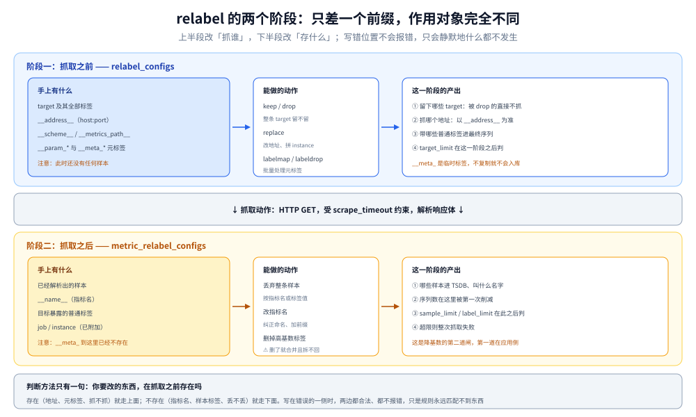

# 抓取与目标发现

> 覆盖：`scrape_config` 只管三件事（抓谁 / 怎么抓 / 抓回来怎么改）、五种目标来源、**relabel 的两个阶段为什么不能互换**、抓取失败的五种形态怎么区分，以及从 Pushgateway 抓取时必须改的那一个字段。
>
> 不覆盖：指标本身怎么写出来见 [手写Prometheus导出器.md](../../../../../01-编程语言/go/可观测性/手写Prometheus导出器.md)；样本入库后的存储见 [数据模型与存储.md](数据模型与存储.md)；K8s 集群内的部署形态不在本册（本册只讲 SD 机制）。
>
> 内容整理自个人学习笔记。⚠️ **本篇未做本机实测**：字段默认值与 relabel 阶段划分取自官方 Configuration 文档，失败形态的报错文本按官方文档与源码措辞归纳，**未逐条制造过这些失败**。

---

## 一、一句话定位：抓取配置只管三件事

**本节要点**：一份 `scrape_config` 无论多长，拆开只有三段——**抓谁（目标来源）、怎么抓（连接参数）、抓回来怎么改（两处 relabel）**。分不清这三段，就会出现「把丢弃指标写进了 relabel_configs」这类错位。

| 段 | 字段 | 作用对象 | 时机 |
|---|---|---|---|
| **抓谁** | `static_configs` / `file_sd_configs` / `*_sd_configs` | 目标列表 | 抓之前，持续刷新 |
| **怎么抓** | `scrape_interval` / `scrape_timeout` / `metrics_path` / `scheme` / `params` | 单次 HTTP 请求 | 每次抓 |
| **抓之前改目标** | `relabel_configs` | target 与其元标签 | 抓之前 |
| **抓之后改样本** | `metric_relabel_configs` | 已解析出的样本 | 抓之后、入库前 |

⭐ 记住这条因果：**上面四段的顺序就是执行顺序**，所以 `relabel_configs` 里看不到样本，`metric_relabel_configs` 里也改不了 `__address__`。

---

## 二、`scrape_config` 的字段与默认值

**本节要点**：默认值决定了「什么都不配」时的行为，而大部分抓取事故都发生在「以为配了、其实是默认值」的地方。

| 字段 | 默认值 | 说明 |
|---|---|---|
| `job_name` | 无（必填） | ⚠️ 在**所有** scrape 配置里必须唯一；它直接成为 `job` 标签 |
| `scrape_interval` | 继承 `global`，默认 `1m` | 生产多用 `15s`，但这是选择不是默认 |
| `scrape_timeout` | 继承 `global`，默认 `10s` | ⚠️ **不能大于 `scrape_interval`**，配大了加载时就报错 |
| `metrics_path` | `/metrics` | 字段名是复数 `metrics_path`，不是 `metric_path` |
| `scheme` | `http` | 改 `https` 时要一并处理证书校验项 |
| `params` | 无 | URL 查询参数，`map[string][]string`；会变成 `__param_<name>` |
| `honor_labels` | **`false`** | ⭐ 冲突时把目标的标签改名为 `exported_<name>`，服务端标签优先 |
| `honor_timestamps` | **`true`** | 目标自带时间戳时以目标为准；改 `false` 则用抓取时刻 |
| `sample_limit` | `0`（不限） | 超过则**整次抓取失败** |
| `label_limit` | `0`（不限） | 任一 `样本` 超限则**整次抓取失败** |

⭐ `honor_labels` 是唯一一个「默认值错了也不报错、只让标签悄悄改名」的字段。它的两种取值差异：

| 取值 | 冲突时 | 典型用途 |
|---|---|---|
| `false`（默认） | 目标给的标签被改名成 `exported_instance` / `exported_job`，服务端的 `job` / `instance` 保留 | 普通抓取（希望 `instance` 是真实地址） |
| `true` | **保留目标给的标签**，服务端标签被忽略 | ⭐ 抓 **Pushgateway**、抓**联邦端点**——否则 `instance` 会变成 Pushgateway 自己的地址 |

⚠️ `honor_timestamps` 默认 `true` 有个副作用：目标如果把旧时间戳写在响应里，Prometheus 会接受——于是出现「`up=1` 但查不到数据」的经典症状（样本太旧，落在保留期外或与已有样本乱序）。

---

## 三、目标从哪来：五种来源

**本节要点**：目标来源的唯一职责是「产出一批带 `__meta_*` 元标签的 target」，**怎么来的不影响后续处理**——所以换 SD 不需要改抓取与 relabel 逻辑。

| 来源 | 怎么给 | 适合 | 注意 |
|---|---|---|---|
| `static_configs` | 配置里直接列 `targets` | 少量固定目标 | 改配置要重载，无法自动跟随扩缩容 |
| `file_sd_configs` | 外部程序生成 JSON/YAML 文件，Prometheus 定时读 | ⭐ 自建 CMDB 或脚本产目标 | 文件变更自动生效，**不需要重载**（默认 5 分钟轮询） |
| `dns_sd_configs` | 按 SRV / A 记录取 | 简单服务发现 | 只能拿到 IP 与端口，没有业务标签 |
| `kubernetes_sd_configs` | 按 Pod / Service / Endpoints / Node / Ingress 等角色 | K8s 环境 | 元标签极多，必须靠 `labelmap` 转出需要的 |
| 云与注册中心（EC2 / Consul / Consul / 等） | 调 API 拉实例列表 | 多云 | 权限与限流要单独评估 |

⭐ 所有 SD 产出的元标签都以 `__meta_` 开头，**它们是临时标签**：只在 `relabel_configs` 阶段可见，**不写进最终序列**。要用就得显式转成普通标签（`labelmap` 或 `replace` 到 `target_label`）。

⚠️ 一个高频困惑：「为什么 `__meta_kubernetes_pod_name` 在查询里查不到？」——因为它根本没入库。想让 Pod 名成为标签，必须 `labelmap` 或 `replace` 复制出来。

---

## 四、relabel 的两个阶段

**本节要点**：⭐ 这是全篇最容易搞错的一处。两个字段名只差一个前缀，但**作用对象、可改字段、后果全不同**——写错位置不会报错，只会静默地什么都不发生。

图里上半段是「抓之前」，能看到 `__meta_*` 与 `__address__`；下半段是「抓之后」，只剩下真正的样本——**两条路不交叉**。

| | `relabel_configs` | `metric_relabel_configs` |
|---|---|---|
| 执行时机 | 抓取**之前** | 抓取**之后**、入库之前 |
| 作用对象 | target 及其标签（含 `__meta_*`、`__address__`） | 已解析出的样本（指标名 + 标签） |
| 能改什么 | 是否抓、抓哪个地址、用什么协议与路径、加哪些普通标签 | 指标名、标签值、是否丢弃这条样本 |
| 典型用途 | 按标签筛掉整个 target、用元标签拼 `instance`、切 `https` | 丢高基数指标、删无用标签、把指标改名 |
| 写错的后果 | 目标凭空消失（`keep` 写反）或全部保留（`drop` 无效），⚠️ **都不报错** | 指标名或标签「莫名其妙」变了，或者指标整批不见 |
| 与限额的关系 | `target_limit` 在它之后判 | `sample_limit` / `label_limit` 在它之后判 |

⭐⭐ 一句判据：**改「抓谁」用 `relabel_configs`，改「存什么」用 `metric_relabel_configs`**。判断方法很简单——**你要改的东西，在抓取之前存在吗？**

`relabel_config` 本身的字段固定六个（加一个动作）：

| 字段 | 作用 |
|---|---|
| `source_labels` | 取哪些标签的值（多个则用 `separator` 拼接） |
| `separator` | 拼接分隔符，默认 `;` |
| `regex` | 对拼接结果做匹配（默认 `(.*)`） |
| `target_label` | 结果写到哪个标签（`replace` 用） |
| `replacement` | 替换模板，可用 `$1` 引用捕获组 |
| `action` | `replace`（默认）/ `keep` / `drop` / `labelmap` / `labeldrop` / `labelkeep` / `hashmod` |

⭐ 两个必须记住的动作：**`keep` / `drop` 是「整条 target 留不留」**，不是「某个标签留不留」；**`labelmap` 是 K8s 场景把一整批 `__meta_*` 转成普通标签的唯一实用手段**（手写 `replace` 要一条条列）。

⚠️ `replace` 的默认 `regex` 是 `(.*)`，意味着**不写 `regex` 时任何值都会匹配**——所以一条「只想匹配某个值」的规则如果漏了 `regex`，会把 `target_label` 覆盖成 `replacement`，且不报错。

---

## 五、抓取失败的形态：`up` 只告诉你「失败」，不告诉你「为什么」

**本节要点**：⭐ 六种失败形态里有五种在 `up` 上完全一样（都是 `0`），**只有 `/targets` 的 `last error` 与 `scrape_samples_scraped` 能区分**；而第六种最坑——`up` 还是 `1`，但数据没进去。

| 形态 | `last error` 大意 | `up` | 会留下样本吗 |
|---|---|---|---|
| 连不上 | `connection refused` / `no route to host` | `0` | 否 |
| 超时 | `context deadline exceeded` | `0` | 否 |
| HTTP 非 2xx | `server returned HTTP status 404 Not Found` | `0` | 否 |
| 响应体解析失败 | `expected a valid start token` 一类 | `0` | 否 |
| 样本数超限 | `sample limit exceeded` | `0` | 否 |
| ⚠️ **入库失败**（乱序 / 重复时间戳） | 无（`up` 仍为 `1`） | `1` | **部分或全部丢弃** |

⭐ 第六种必须单独记：`out of order sample` 与 `duplicate sample for timestamp` 是**存储层拒绝写入**，抓取本身成功了，所以 `up=1`、`scrape_samples_scraped` 也正常，只有目标数据缺一块。常见原因：目标自己带时间戳（配合 `honor_timestamps: true`）、同一份数据被两个 job 抓、或时钟回拨。

区分「拿到了但没指标」与「压根没拿到」：

| `up` | `scrape_samples_scraped` | 含义 |
|---|---|---|
| `1` | `0` | 抓取成功但 `/metrics` 是空的 —— 目标没暴露任何指标（不是 Prometheus 的问题） |
| `1` | `>0` | 正常 |
| `0` | `0` | 上面五种抓取失败之一，看 `last error` |

---

## 六、从 Pushgateway 抓取：必须改的那一个字段

**本节要点**：Pushgateway 是唯一一种「抓取仍然成立、但语义变了」的目标——它把「推送方」伪装成「被抓方」，所以 `instance` / `job` 的来源要手动纠正。

| 问题 | 原因 | 处理 |
|---|---|---|
| 所有实例的 `instance` 都是 Pushgateway 的地址 | 服务端会附加自己的 `instance`（=`__address__`） | ⭐ 配 `honor_labels: true`，保留推送方写入的 `job` / `instance` |
| 推完不删，指标永久残留 | Pushgateway **不会自动清理**，同组名复用会覆盖成旧值 | 任务结束后显式 `DELETE` 对应分组 |
| 用它转发常规指标 | 它没有 `up` 语义，也不做超时 | ❌ 不要这么用，短命批处理 job 之外都该走 Push 模型的正规通道（`remote_write` / OTLP） |

⚠️ `honor_labels: true` 一旦开启，**冲突时目标侧永远赢**。如果推送方自己写的 `job` 是脏的，服务端无法纠正——所以这个开关的正确用法是「确认推送方标签干净」之后再开。

---

## 七、接一群目标的三种组织方式

**本节要点**：目标数量上去之后，问题不再是「怎么配」，而是「配置本身怎么维护」。三种方式的分界是**目标列表的变化频率**。

| 方式 | 目标变化频率 | 维护成本 | 适合 |
|---|---|---|---|
| **静态列举** | 几乎不变 | 改配置 + 重载 | 基础设施组件（自己、Alertmanager、数据库主库） |
| **`file_sd`** | 分钟级 | 写个脚本产 JSON，无需重载 | ⭐ 自建资产表、非 K8s 的自动化部署 |
| **真 SD**（K8s / Consul / 云） | 秒级 | 一次配好，靠 relabel 收敛 | 弹性伸缩、多集群 |

⭐ 一条实践判据：**能用 `file_sd` 就别上真 SD**。它的失败模式是「脚本没跑，文件旧了」——可观测（文件时间戳），而真 SD 的失败模式是「权限/限流/元标签变了」，排查面大得多。

⚠️ 无论哪种方式，**`job_name` 都必须在整个配置里唯一**。多个 job 抓同一批目标时，重复数据会以 `duplicate sample` 的形式被拒——`up` 仍是 1，但数据缺块（回到第五节的第六种形态）。

---

## 校验口径

| 内容 | 状态 |
|---|---|
| `scrape_config` 各字段默认值（`1m` / `10s` / `/metrics` / `http` / `honor_labels=false` / `honor_timestamps=true` / 两个 `limit=0`） | ⚠️ 官方 Configuration 文档原话，**未在实例上逐项验证** |
| `scrape_timeout` 不得大于 `scrape_interval` 的约束 | ⚠️ 官方文档明文，**未故意配错验证报错** |
| `honor_labels` 的 `exported_<name>` 改名行为 | ⚠️ 按官方 `relabel_config` 章节陈述，**未实跑对照** |
| relabel 两阶段的划分与可改字段 | ⚠️ 按官方 Configuration 文档陈述，**未实跑** |
| `__meta_*` 为临时标签、不写入序列 | ⚠️ 按官方文档陈述，**未验证** |
| 五种抓取失败与一种入库失败的区分 | ⚠️ 报错措辞按官方文档与源码归纳，**未逐条制造**；`out of order` / `duplicate sample` 的 `up=1` 行为属机制推断，**未实测确认** |
| Pushgateway 的「不自动清理」与 `honor_labels: true` | ⚠️ 按官方文档与既有导出器篇的结论陈述；导出器篇有三轮推送实测，本篇**不重复引用其读数** |
| `file_sd` 默认约 5 分钟轮询、无需重载 | ⚠️ 官方文档口径，**未实跑** |

---

## 延伸追问

- **relabel 写错了为什么一点提示都没有？** → 因为它作用在「目标集合」上，`drop` 掉全部目标时 Prometheus 认为这是合法的空集合。唯一的自检手段是看 `/targets` 页的目标数是否符合预期，或者用 `promtool check config` 做静态校验（它只查语法与引用，不查语义）。
- **`instance` 到底该是什么？** → 默认就是 `host:port`，含义是「这次抓取打到哪」。想让它变成「服务名 + 序号」，就在 `relabel_configs` 里用元标签拼出来；⚠️ 一旦手改，多实例的聚合键也跟着变，面板与告警规则要一起改。
- **同一个目标被两个 job 抓会怎样？** → 两条序列的 `job` 不同，所以身份不同，**不会互相覆盖**，但会重复占存储。真正会被拒的是「同一条序列同一时间戳两次写入」——那发生在 `job` 也相同的时候。
- **`metric_relabel_configs` 能用来降基数吗？** → 能，而且是**第二道闸**（第一道是应用侧少暴露标签）。丢了高基数标签等于把所有序列合并，⚠️ 但合并之后就再也拆不开了，所以只丢「确定无用」的。
- **抓取周期该按服务分还是全局统一？** → 分服务。核心交易链路 15s，后台报表服务 60s 完全不亏——**周期是成本旋钮**，不是一致性问题（同一规则内的 `rate()` 窗口只受该 job 的周期影响）。
- **目标在欧洲、Prometheus 在亚洲，抓取超时怎么定？** → 先量 RTT 再定 `scrape_timeout`，并把它控制在 `scrape_interval` 的一半以内，否则一次抖动就会挤掉下一次抓取。跨地域更合适的做法是**就地部署 Prometheus 再 `remote_write` 汇总**。

---

## 关联

- [README.md](README.md) — 本册导读：六篇分工与读序
- [定位与架构.md](定位与架构.md) — **上游**：抓取七步在全链路里的位置，本篇是第 ①~⑥ 步的展开
- [数据模型与存储.md](数据模型与存储.md) — **下游**：样本入库后的身份规则，`metric_relabel_configs` 直接决定序列数
- [PromQL求值机制.md](PromQL求值机制.md) — **下游**：抓取周期决定 `rate()` 窗口能取到几个点
- [运维与排障.md](运维与排障.md) — **排障**：`scrape_*` 系列指标怎么读、失败率怎么看
- [手写Prometheus导出器.md](../../../../../01-编程语言/go/可观测性/手写Prometheus导出器.md) — **上游生产端**：`/metrics` 那一侧的输出格式与基数控制
