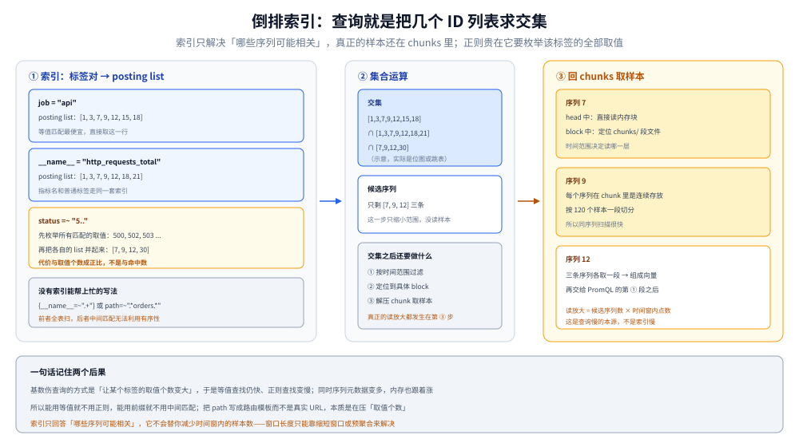
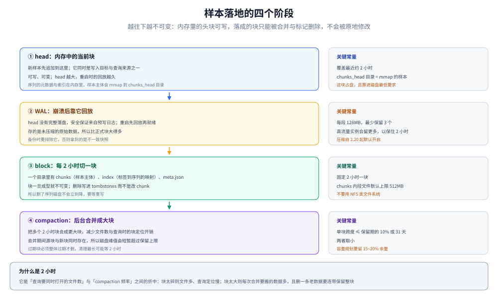

# 数据模型与存储

> 覆盖：series 的身份为什么由**标签全集**决定、指标名为什么只是 `__name__` 标签、倒排索引怎么把「标签条件」变成「序列集合」、样本如何从 head 走到 block、容量公式怎么推导，以及四种指标类型在磁盘上各占几条序列。
>
> 不覆盖：四种类型的业务语义与选择判据见 [指标选型对比.md](../指标选型对比.md) 第五节；导出器里怎么声明这些类型见 [手写Prometheus导出器.md](../../../../../01-编程语言/go/可观测性/手写Prometheus导出器.md) 第三节；时序引擎的横向对比见 [时序数据库选型对比.md](../../../../数据存储/时序数据库/时序数据库选型对比.md)。
>
> 内容整理自个人学习笔记。⚠️ **本篇未做本机实测**：磁盘布局、WAL 分段大小、保留期默认值与压缩上限均取自官方 Storage 文档，容量算例是**本篇算术**（非本机读数）。

---

## 一、一句话定位：series 的身份来自标签全集

**本节要点**：Prometheus 里没有「表」和「行」，只有 **series**。一条 series 的身份是「指标名 + 全部标签值」的组合，**少一个标签、多一个标签、改一个标签值，都是另一条序列**。

```text
http_requests_total{service="order", method="GET", status="200"}
http_requests_total{service="order", method="GET", status="500"}   ← 另一条序列
http_requests_total{service="order", method="GET", status="200", path="/orders"}  ← 又是另一条
```

⭐ 由此推出一条铁律：**序列数不是标签数的函数，是所有标签取值组合数的函数**。10 个标签各 5 个取值，理论上就是 5¹⁰ 条——实际能不能到这个量级，取决于目标真正暴露了哪些组合。

一句话记住它的后果：**基数（活跃序列数）决定了内存、索引大小、查询速度，而这三个都会在基数爆掉时同时恶化**。

⚠️ 一个常被忽略的区别：**基数 ≠ 样本数**。100 万条序列每秒各来 1 个样本，与 1 万条序列每秒各来 100 个样本，前者的样本数一样，但内存与索引开销完全不同——**伤人的是序列数，不是写入速率**。

---

## 二、数据模型：四个层次

**本节要点**：从「一个数字」到「一条序列」是四层抽象，每一层都有它的约束。

| 层 | 长什么样 | 约束 |
|---|---|---|
| **sample** | `(timestamp, float64)` | 时间戳是**毫秒整数**；值是 float64（⚠️ 没有 string、没有 bool、没有 null） |
| **label** | `name="value"`，两边都是字符串 | 名字须匹配 `[a-zA-Z_][a-zA-Z0-9_]*`（3.x 起放宽至 UTF-8，见第七节） |
| **metric** | 一组样本的语义名 | ⚠️ **它不独立存在，就是 `__name__` 这个标签** |
| **series** | `(__name__ + 全部 label) → 样本流` | 身份一旦确定，后续样本只能追加，不能改标签 |

⭐ 三个必须记住的细节：

1. **值是 float64**，所以「状态」不能直接存成字符串。要表达状态就编码成数值（`status="200"` 放标签，`1/0` 放值），或者用 `up` 这类约定。
2. **`NaN` 是一个合法值**，表示「这个时间点算不出来」——它参与的聚合与 `0` 参与的聚合结果不同，这是 `rate()` 返回 `NaN` 而不是 `0` 的原因。
3. **标签值必须是字符串**，数值型标签（比如把 `port` 当标签）在查询时按字符串比较，`port > 1000` 这种数值比较不成立，只能枚举或用正则。

⚠️ 顺序问题：**标签的书写顺序不影响身份**（`{a="1",b="2"}` 与 `{b="2",a="1"}` 是同一条）；但**标签值的大小写敏感**，`Status="200"` 与 `status="200"` 是两个不同的标签名，前者还会因为大写字母而成为「非规范命名」。

---

## 三、指标名只是 `__name__` 标签：它换来了什么

**本节要点**：把指标名降格成标签，是 Prometheus 数据模型里最关键的一个决定——它换来了跨指标的批量选择与聚合，代价是没有「表」这一层保护。

| 写法 | 含义 |
|---|---|
| `up` | 等价于 `{__name__="up"}` |
| `{__name__=~"node_cpu_.*"}` | 一次选出所有以该前缀开头的指标 |
| `sum by (__name__) ({__name__=~".+"})` | ⚠️ 跨全部指标做聚合（极贵，只用于诊断） |
| `{__name__="up", job="api"}` | 名字与标签混在一个选择器里 |

它换来的能力：

- **批量选择**：想一次看所有 `*_errors_total`，不需要知道有多少个指标名。
- **统一处理**：`sum by (job)` 可以跨任意指标名做聚合，命名体系不必参与运算。
- **索引统一**：指标名与标签走同一套倒排索引，没有「表索引 + 行索引」两套结构。

它带来的代价：

- **没有 schema**：`http_requests_total` 与 `http_request_total`（少个 s）是两条完全无关的指标，系统不会提示拼错。
- **没有类型约束**：同名指标可以由不同目标暴露不同标签集，查询时需要 `sum by` 才能对齐。
- **命名靠约定**：所以才有 `_total` / `_sum` / `_count` / `_bucket` 这套后缀规范——**它不是装饰，是让工具能推断类型**。

---

## 四、倒排索引：查询是怎么找到序列的

**本节要点**：Prometheus 的索引是「标签对 → 序列 ID 列表」的倒排表，查询就是**若干个 ID 列表求交集**。理解这一点，就理解了「正则查询为什么贵」。



图里左边是索引（label → posting list），中间是集合运算，右边是从 chunks 取样本——**求交集只缩小了候选集，真正的样本还在 chunks 里**。

| 条件类型 | 索引怎么处理 | 成本 |
|---|---|---|
| `label="value"`（等值） | 直接取该值对应的 posting list | 最便宜 |
| `label!="value"`（不等） | 取全集减去该值的 posting list | 中（全集可能很大） |
| `label=~"regex"` | ⚠️ **枚举所有匹配的 label 值**，再把各自的 list 并起来 | 与「该标签的不同取值个数」成正比 |
| `{__name__="x"}` | 同等值，走 `__name__` 这个标签的索引 | 便宜 |
| 无任何标签条件（`{__name__=~".+"}`） | 全表扫 | 最贵，慎用 |

⭐ 这就是「高基数伤查询」的真正机制：**不是数据量大，而是正则要在「该标签的所有取值」上逐个匹配**。一个 `path` 标签有 5 万个取值时，`path=~"/api/orders/.*"` 要枚举 5 万个值——哪怕最后只命中 10 个。

⚠️ 由此推出一条实践规则：**能用等值就不要用正则，能用前缀匹配就不要用中间匹配**（`.*` 在中间时无法利用有序性）。这一条在 [PromQL求值机制.md](PromQL求值机制.md) 第七节还会回到查询代价上看一次。

---

## 五、落盘：head / WAL / block / tombstone

**本节要点**：样本不是「写一行入库」，而是先在内存攒、再用 WAL 兜底、每 2 小时切成一块、后台再合并。四个阶段的失败模式完全不同。



图里最上面是内存中的 head，往下是 WAL（保证崩溃可回放），再往下是按 2 小时切出的 block，最底层是压缩后的大块——**越往下越不可变**。

| 阶段 | 形态 | 关键常量 | 说明 |
|---|---|---|---|
| **head** | 内存中的当前块 | 覆盖最近约 2 小时 | 新样本先追加到这里；查询也要读它 |
| **WAL** | `wal/` 下的分段文件 | 每段 `128MB`，**最少保留 3 个** | 崩溃后回放；高流量实例会保留更多，以保证至少 2 小时原始数据 |
| **block** | 一个目录：`chunks/` + `index` + `meta.json` + `tombstones/` | **固定 2 小时**起点切分 | `chunks/` 里的段文件默认上限 `512MB` |
| **compaction** | 2h 块合并成更大的块 | 单块跨度 ≤ **保留期的 10% 或 31 天，取小** | 跨度过大时，删一条老数据要连带保留整块 |

⚠️ 四个容易误判的现象，全部来自上表：

1. **删了序列，磁盘不降**：删除写的是 `tombstones/` 里的标记，chunk 文件不会立刻重写。要真正回收得等 compaction 重写该块。
2. **磁盘峰值可能超过 `retention.size`**：compaction 期间**源块与新块同时存在**，官方明确说过这一点；所以容量规划要留 15~20% 余量（官方建议 `retention.size` 取磁盘的 80~85%）。
3. **过期数据不会立刻消失**：过期块清理是后台行为，官方说可能需要**长达 2 小时**，而且**块必须整体过期才会被删**。
4. **启动慢是 WAL 回放**：非正常退出后重启，要先回放 WAL 才能 `/ready`。head 越大回放越久。

⭐ 一条备份铁律（官方口径）：**备份要排除 `chunks_head/`、`wal/`、`wbl/`**，否则拿到的是不一致的快照；或者直接用 snapshot API。NFS 类文件系统官方**明确不支持**（非 POSIX 语义会造成不可恢复的损坏）。

---

## 六、容量：三个数算出磁盘

**本节要点**：容量永远按「每秒样本数 × 保留秒数 × 每样本字节数」算，**不按目标数、不按磁盘上现有的文件大小反推**。

官方给的粗算公式与常量：

```text
所需磁盘 ≈ 保留秒数 × 每秒新增样本数 × 每样本字节数
                                   ↑ 官方口径：平均 1~2 字节
```

**算例（本篇算术，不是本机读数）**：假设 100 万条活跃序列，15 秒抓一次。

| 步骤 | 计算 | 结果 |
|---|---|---|
| 每秒新增样本 | 1 000 000 ÷ 15 | 约 66 667 样本/秒 |
| 保留 15 天的样本总数 | 66 667 × 86 400 × 15 | 约 8.64 × 10¹⁰ |
| 按 1.5 字节/样本折算 | 8.64 × 10¹⁰ × 1.5 | 约 130 GB |

⚠️ 这个数要打两个折扣才接近现实：**不是所有序列每个周期都有样本**（稀疏指标会低很多）；**WAL 与 head 的 mmap chunks 也占盘**，官方说磁盘最低要求是「`wal` + `chunks_head` 的峰值占用」。

⭐ 三个能直接降低容量的旋钮，按性价比排序：

| 旋钮 | 效果 | 副作用 |
|---|---|---|
| **减序列数**（砍标签、丢指标） | 最有效——同一条序列内的样本压缩率最高，减少序列比拉长周期更省 | 排障维度永久变少 |
| **拉长 `scrape_interval`** | 线性减少样本数 | `rate()` 的时间分辨率变粗，短故障可能采不到 |
| **缩短保留期** | 线性减少 | 长周期趋势看不到，应改用预聚合而不是硬留原始点 |

⚠️ 官方另一个容易忽略的默认值：**时间保留期不设时默认 `15d`，而大小保留期默认 `0`（禁用）**。两个都设时**谁先触发谁生效**——所以「同时配了 `15d` 和 `50GB`」在写满 50GB 后就会开始删，比预期早。

---

## 七、四种指标类型在存储上长什么样

**本节要点**：四种类型在**暴露端**都只是一个名字，在**存储端**却占不同数量的序列——这是「Histogram 比 Counter 贵」的真正原因。

| 类型 | 暴露的名字 | 实际落成几条序列 | 存储上的特征 |
|---|---|---|---|
| **Counter** | `http_requests_total` | **1** | 单调递增；重置点会被 `rate()` 内部修正 |
| **Gauge** | `queue_depth` | **1** | 任意值；无重置语义 |
| **Histogram** | `http_duration_seconds` | **1 + 桶数 + 2**（`_bucket` × 桶数、`_sum`、`_count`） | ⚠️ 桶越多序列越多，**基数按桶数倍增** |
| **Summary** | `rpc_duration_seconds` | **1 + 分位个数 + 2**（分位、`_sum`、`_count`） | 分位在客户端算好，**跨实例不可聚合** |

举例：一个「10 个桶的 Histogram」带 5 个其他标签、每个 4 个取值，序列数不是 `5×4=20`，而是 `(10+2)×5×4=240`。**这是前缀后缀型指标最容易低估的地方**。

⚠️ 3.x 引入的 **native histogram** 改变的就是这一条：整个直方图作为**一条序列里的一种特殊样本**存储，而不是拆成 N 条 `_bucket`。它的好处正是「桶多了也不炸基数」。⚠️ 但它长期处于实验状态，开启需要显式配置，且下游（远端存储、查询前端）都要支持——**迁移前先确认全链路兼容**，不要只看 Prometheus 一端。

⭐ 记住这条因果链：**桶边界越多 → 序列越多 → 内存与索引越大 → 查询越慢**。所以桶边界该按 SLO 阈值定，不是按等比数列铺满（选择判据见 [指标选型对比.md](../指标选型对比.md) 第五节）。

---

## 校验口径

| 内容 | 状态 |
|---|---|
| series 唯一性、指标名即 `__name__` 标签 | ⚠️ 按官方 Storage 与 Querying basics 文档陈述，**未实跑验证** |
| 倒排索引的 posting list 与集合运算 | ⚠️ 按官方文档对索引的描述归纳，**未读 TSDB 索引文件、未做查询耗时对比** |
| `2h` 块、`chunks/` 段文件 `512MB` 上限、WAL `128MB` 分段与「最少 3 个」 | ⚠️ 官方 Storage 文档原话 |
| 压缩后单块跨度「保留期的 10% 或 31 天，取小」 | ⚠️ 官方 Storage 文档原话 |
| `retention.time` 默认 `15d`、`retention.size` 默认 `0`、两者谁先触发谁生效 | ⚠️ 官方 Storage 文档原话 |
| 平均 `1~2 字节/样本`、`retention.size` 建议取磁盘 `80~85%`、不支持 NFS | ⚠️ 官方 Storage 文档原话 |
| 容量算例（100 万序列 / 15s / 15 天 → 约 130 GB） | ✅ **本篇算术**，输入是假设值，非本机读数 |
| Histogram 序列数 `(桶数+2)×其他标签组合` | ✅ 本篇算术（按 `_bucket`/`_sum`/`_count` 的展开规则推导） |
| native histogram 存储形态与实验状态 | ⚠️ 按官方文档与发行说明陈述，**未开启、未验证相容性** |
| **全篇** | ⚠️ **未实测**：本篇零本机读数，上表默认值与机制均取自文档；容量算例与序列数推导是算术，不是跑出来的 |

---

## 延伸追问

- **为什么值是 float64，不能存字符串？** → 因为指标体系要能算术聚合，字符串无法参与 `sum`/`rate`。需要「状态」就编码成标签（低基数）或数值（`0/1`）。真要存文本，那是日志的职责。
- **`NaN` 和「没有样本」有什么区别？** → `NaN` 是**存在但无效**的样本（参与聚合会传染），「没有样本」是**该时间点不存在**（在 `sum` 里相当于缺席）。这是 `rate()` 在样本不足时返回空而不是 `0` 的原因。
- **删除一批序列后磁盘为什么没降？** → 删除写的是 tombstone 标记，chunk 文件不重写。要回收得等 compaction 重写那个块，或者用 `promtool tsdb clean-tombstones` 之类的离线手段（需停机）。
- **`retention.time` 和 `retention.size` 该配哪个？** → 两个都配，取小生效。只配时间会在写入量涨上来后把磁盘打满；只配大小会在数据变稀疏后保留过久。
- **Histogram 桶太多会怎样？** → 序列数按桶数倍增，直接推高内存与索引；查询侧 `histogram_quantile` 也变慢。所以桶边界按 SLO 定，一般 8~15 个足够。
- **一次查询同时读 head 和 block 会不会不一致？** → 会存在短暂重叠（一个刚完成的块与 head 交界处），查询层按时间戳去重合并，表现为「同一时刻不会出现两个值」。这属于存储层的细节，正常使用感知不到。

---

## 关联

- [README.md](README.md) — 本册导读：六篇分工与读序
- [定位与架构.md](定位与架构.md) — **上游**：五模块与两条数据路径，本篇是写入路径那一侧的展开
- [抓取与目标发现.md](抓取与目标发现.md) — **上游**：`metric_relabel_configs` 在样本入库前执行，是控制序列数的第一道闸
- [PromQL求值机制.md](PromQL求值机制.md) — **下游**：查询在 head 与 block 上求值，选择器的代价由本篇的索引结构决定
- [指标选型对比.md](../指标选型对比.md) — **上游选型**：成本 = 活跃序列数 × 保留时长 的完整推导
- [时序数据库选型对比.md](../../../../数据存储/时序数据库/时序数据库选型对比.md) — **对照**：块存储、压缩与索引在不同引擎里的不同取舍
