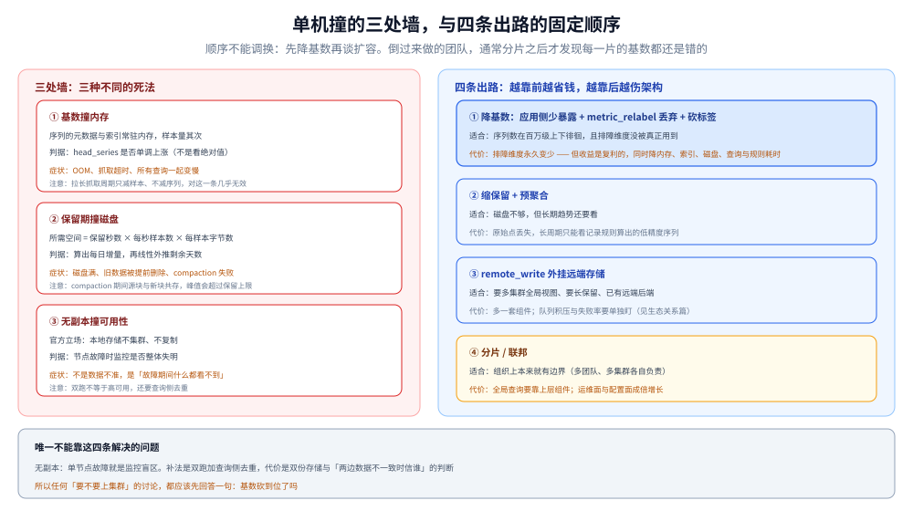

# 运维与排障

> 覆盖：Prometheus 自己的运维只归三件事、真正该动的启动参数、⭐ **四组必看的自带指标**、五个高频故障的定位顺序、磁盘涨了怎么算、热重载的边界，以及单机撞墙后的判断顺序。
>
> 不覆盖：`remote_write` 协议与长期存储选型见 [与Prometheus生态的关系.md](../../../../数据存储/时序数据库/VictoriaMetrics/与Prometheus生态的关系.md)；扩容三条路的完整对比见 [指标选型对比.md](../指标选型对比.md) 第六节；抓取配置怎么写见 [抓取与目标发现.md](抓取与目标发现.md)。
>
> 内容整理自个人学习笔记。⚠️ **本篇未做本机实测**：启动参数默认值与指标名取自官方文档与 Metrics reference，**没有读过任何一条 `prometheus_*` 指标的真实数值**，因此本篇不含任何读数。

---

## 一、一句话定位：它的运维只归三件事

**本节要点**：Prometheus 没有「中间件那一套」运维——没有分片、没有副本、没有元数据服务。要盯的只有三件事，**每件事对应一个模块，出问题的表现也各自不同**。

| 事 | 归哪个模块 | 判断依据 | 出手方式 |
|---|---|---|---|
| **保留什么** | TSDB | 磁盘增速、block 数量 | 缩保留期、降基数、`retention.size` |
| **抓没抓到** | retrieval | `up`、`scrape_*` 指标 | 看 `/targets` 的 `last error` |
| **算得快不快** | rule + query | 求值耗时、查询耗时 | 记录规则预计算、收窄选择器 |

⭐ 一句话：**它不需要「集群运维」，但需要「容量运维」**——所有事故最终都能归到「序列太多」「磁盘不够」「规则太慢」这三类。

---

## 二、启动参数里真正要动的那几个

**本节要点**：Prometheus 的 flag 有一百多个，但**日常只需要改四五个**；其余默认值大多数团队一辈子不用碰。

| 参数 | 默认 | 什么时候必须改 |
|---|---|---|
| `--storage.tsdb.path` | `data/` | 容器部署时改成挂载点（`/prometheus`） |
| `--storage.tsdb.retention.time` | `15d` | 磁盘不够或需长期保留时 |
| `--storage.tsdb.retention.size` | `0`（禁用） | ⭐ 与上一条**同时**配，谁先触发谁生效 |
| `--storage.tsdb.wal-compression` | 默认开启（2.20 起） | ⚠️ 一旦开启，降级到 2.11 之前要删 WAL |
| `--query.lookback-delta` | `5m` | ⚠️ 改了会影响**全部**瞬时查询语义，非必要不动 |
| `--web.enable-lifecycle` | `false` | 要热重载就必须开 |
| `--web.enable-admin-api` | `false` | 要用删除序列 / snapshot 接口时才开（⚠️ 危险面） |

⭐ 两个判断：

- **`retention.time` 与 `retention.size` 必须一起配**。只配时间，写入量涨上来后磁盘会先满；只配大小，数据变稀疏后会保留远超预期的时间。
- **`--web.enable-admin-api` 不要常开**。它包含删除序列、创建快照这类破坏性接口，开了之后任何能访问 9090 的人都能删数据。

⚠️ 一个常见误配：把 `retention.size` 设成磁盘容量。官方建议取 **80~85%**，因为 compaction 期间源块与新块会同时存在，需要余量。

---

## 三、它自己的指标：四组必看

**本节要点**：Prometheus 抓自己（`job: prometheus`）是零成本接入，`prometheus_*` 与 `scrape_*` 指标直接回答上面那三件事。

| 组 | 关键指标 | 回答什么 |
|---|---|---|
| **抓取** | `up`、`scrape_duration_seconds`、`scrape_samples_scraped`、`scrape_samples_post_metric_relabeling` | 有没有抓成功、单次多慢、抓了多少、**砍完还剩多少** |
| **TSDB** | `prometheus_tsdb_head_series`、`prometheus_tsdb_symbol_table_size_bytes`、`prometheus_tsdb_compactions_total`、`prometheus_tsdb_wal_*` | 序列数（内存主因）、标签值字典大小、压缩频次、WAL 状态 |
| **规则** | `prometheus_rule_group_last_duration_seconds`、`prometheus_rule_evaluations_total`、`prometheus_rule_evaluation_failures_total` | 求值多久、跑了多少次、失败多少次 |
| **远程写** | `prometheus_remote_storage_samples_in_total`、`prometheus_remote_storage_samples_failed_total`、`prometheus_remote_storage_queue_length` | 发出多少、失败多少、**积压多少** |

⭐ 最值得单独用的一条：**`scrape_samples_scraped` 减去 `scrape_samples_post_metric_relabeling`**，差值就是 `metric_relabel_configs` 砍掉的样本数。这个差值如果一直在涨，说明「入口在丢数据」——要么丢掉的是垃圾，要么丢掉的是排障时最需要的那部分，必须定期回看。

⚠️ `prometheus_tsdb_head_series` 是**内存的先行指标**：序列数上去之后内存才跟着涨，监控它比监控 RSS 早一个身位。

---

## 四、五个高频故障与定位顺序

**本节要点**：五个故障里最容易被误判的是第 ③ 个——`up` 是 `1`，但数据在入库时被拒了；它看起来像「抓取失败」，实际是存储层问题。

| # | 故障 | 典型症状 | 先查什么 |
|---|---|---|---|
| ① | **内存持续上涨 / 容器被 OOM 杀** | RSS 稳步涨、重启后短时间又涨回去 | `prometheus_tsdb_head_series` 是否同步上涨；`/api/v1/status/tsdb` 里 top 序列的指标名 |
| ② | **删了数据磁盘不降** | 保留期到了、序列删了，磁盘占用不变 | tombstone 未回收（等 compaction）、块未整体过期（可能等 2 小时） |
| ③ | ⚠️ **`up=1` 但数据缺块** | 面板数据有洞，`/targets` 一切正常 | `out of order sample` / `duplicate sample for timestamp`；目标是否自带时间戳、是否有两个 job 抓同一目标 |
| ④ | **查询平时快、偶尔很慢** | 单条查询耗时抖动，不是全表慢 | 基数是否刚涨（新上线的服务带了新标签） |
| ⑤ | **规则不触发** | 面板数据正常，告警一直不动 | `/api/v1/rules` 看规则是否加载；`for` 是否满足；`evaluation_interval` 是否被组内覆盖 |

⭐ 定位顺序的通用原则：**先分辨「数据没进来」还是「进来了但算错了」**。

| 判据 | 说明 |
|---|---|
| `/targets` 有 `last error`、`up=0` | 数据没进来 → 抓取问题（见 [抓取与目标发现.md](抓取与目标发现.md) 第五节） |
| `up=1`、`scrape_samples_scraped>0`，但查不到 | ⚠️ 入库被拒或选择器写错 → 先看 ③，再看标签有没有被 relabel 改掉 |
| 数据在、结果不对 | 计算问题 → 回到 [PromQL求值机制.md](PromQL求值机制.md) 第七节的五个坑 |

---

## 五、容量与磁盘：涨了怎么定位

**本节要点**：不要靠「看目录大小」猜，先算**每日增量**，再算**剩余天数**——两个数出来，要不要出手就清楚了。

三步：

| 步 | 做什么 | 得到什么 |
|---|---|---|
| ① | 用 `prometheus_tsdb_head_samples_appended_total` 之类的累计量算每日增量 | 每天涨多少字节 / 多少样本 |
| ② | 用 `predict_linear` 对磁盘占用做线性外推 | 还有几天写满 |
| ③ | 对照保留期与 `retention.size` | 是「保留期太长」还是「基数太大」 |

⭐ 磁盘由三部分组成，定位时要分开看：**`block` 目录**（已压缩的历史，最大的那块）、**`wal` 目录**（最近约 2 小时的原始数据，分段 `128MB`、最少 3 个）、**`chunks_head`**（head 的 mmap chunks）。官方明确说过：**磁盘最低要求是 `wal` + `chunks_head` 的峰值占用**——也就是说哪怕保留期设成 0，这两个目录也一定占那么多。

⚠️ 两个容易被当成故障的正常现象：

- **磁盘峰值超过 `retention.size`**：compaction 期间源块与新块共存，官方文档明确说会短暂超限。
- **过期数据不立刻消失**：过期块清理是后台行为，可能需要长达 2 小时，且块必须整体过期。

---

## 六、配置变更：热重载的边界

**本节要点**：热重载只覆盖「配置类」变更，**存储类参数一律要重启**——分不清就会反复 reload 然后怀疑是 bug。

| 改了什么 | 能热重载吗 |
|---|---|
| `scrape_configs` / `rule_files` / `alerting` | ✅ 能（需开 `--web.enable-lifecycle`） |
| 规则文件内容 | ✅ 能（重载即重新加载） |
| `--storage.tsdb.retention.*` | ❌ 要重启 |
| `--query.lookback-delta` 等查询参数 | ❌ 要重启 |
| `global.scrape_interval` / `evaluation_interval` | ✅ 能（属于配置，不是 flag） |

三个边界要知道：

1. **`POST /-/reload` 失败时保留旧配置**（语法错误会被拒），所以「reload 成功」不代表「改对了」——`rule_files` 指向的文件里如果有语义错误，加载会通过、但规则跑不出结果。
2. **没有 `--web.enable-lifecycle` 时，reload 接口直接 404**，而不是「调用了但没生效」。
3. **配置里的 `global` 段与 flag 的关系**：能写进配置的用配置（可热加载），只能做 flag 的必须重启。

---

## 七、单机撞墙后的判断顺序

**本节要点**：⭐ 顺序是固定的——**先降基数，再缩保留，再外挂，最后才分片**。倒过来做的团队，通常会在分片完成后发现「每一片的基数都还是错的」。

图里左边是三处墙（基数、磁盘、无副本），右边是四条出路，中间的数字是推荐尝试顺序——**越靠前越省钱，越靠后越伤架构**。

| 顺序 | 动作 | 适合 | 代价 |
|---|---|---|---|
| ① | **降基数**（应用侧少暴露 / `metric_relabel_configs` 丢弃 / 砍标签） | 序列数在百万级上下徘徊 | 排障维度永久变少 |
| ② | **缩保留 + 预聚合**（`retention` 缩短，长周期用记录规则出低精度序列） | 磁盘不够但查询需求不变 | 原始点丢失，只能看趋势 |
| ③ | **`remote_write` 外挂**（远端存长期、本地只留近期） | 要多集群全局视图、要长保留 | 多一套组件，协议与队列要调 |
| ④ | **分片 / 联邦**（按业务或集群拆多个实例） | 组织上本来就有边界 | 全局查询靠上层，运维面成倍 |

⚠️ 唯一不能靠上面四条解决的问题是**无副本**：单节点故障就是监控盲区。补法是「双跑 + 查询侧去重」，代价与实现见 [指标选型对比.md](../指标选型对比.md) 第六节，协议细节见 [与Prometheus生态的关系.md](../../../../数据存储/时序数据库/VictoriaMetrics/与Prometheus生态的关系.md)。

⭐ 一条容易被忽略的顺序依据：**降基数的收益是复利的**——它同时降低内存、索引大小、磁盘增量、查询耗时、规则求值耗时。其余三条只解决其中一两项。所以任何「要不要上集群」的讨论，都应该先回答「基数砍到位了吗」。

---

## 校验口径

| 内容 | 状态 |
|---|---|
| 启动参数默认值（`data/`、`15d`、`size=0`、WAL 压缩默认开、`lookback-delta 5m`、`enable-lifecycle false`、`enable-admin-api false`） | ⚠️ 官方 Storage 文档与 `--help` 口径陈述，**本机未启动实例验证** |
| `retention.size` 建议取磁盘 `80~85%`、compaction 期间磁盘峰值超限 | ⚠️ 官方 Storage 文档原话 |
| 四组 `prometheus_*` / `scrape_*` 指标名与含义 | ⚠️ 按官方 Metrics reference 陈述，**未读过任何真实值** |
| `scrape_samples_scraped` 与 `scrape_samples_post_metric_relabeling` 的差值含义 | ⚠️ 按两个指标的定义归纳，**未实跑对照** |
| 五个高频故障的症状与排查顺序 | ⚠️ 机制归纳 + 官方文档口径；其中 ③（`up=1` 但入库被拒）属**机制推断**，未制造过 |
| 热重载的能力边界（哪些能、哪些要重启） | ⚠️ 官方文档口径，**未实跑 `/-/reload`** |
| 磁盘三部分构成与「最低要求 = WAL + chunks_head 峰值」 | ⚠️ 官方 Storage 文档原话 |
| 四条出路的判断顺序（降基数 → 缩保留 → 外挂 → 分片） | ✅ **本篇判据**，与 [指标选型对比.md](../指标选型对比.md) 第六节的结论一致 |
| **全篇** | ⚠️ **未实测**：本篇零本机读数，参数默认值、指标名与故障形态均取自文档与机制归纳 |

---

## 延伸追问

- **内存到底是被什么吃掉的？** → 主要是**序列的元数据与索引**（head 里的 series 与 label 集合），不是样本本身的数值。所以「砍序列」比「拉长抓取周期」对内存有效得多，后者只减样本不减序列。
- **`prometheus_tsdb_head_series` 多少算高？** → 没有绝对阈值，它取决于内存与标签长度。可用的经验判据是「它是否在持续单调上涨」——稳态应该有起伏，单边上涨说明有高基数维度在泄漏。
- **能不能只删某一批序列腾空间？** → 能（admin API 的 delete series），但**磁盘不会立刻降**，因为删除写的是 tombstone；真正回收要等 compaction 重写那个块。急着腾空间只能靠删整个块（按时间）或调小保留期。
- **规则求值慢怎么办？** → 先看是不是在一条规则里做了多次全量聚合，改成记录规则分步预计算；再看 `groups[].interval` 是否设得过密。⚠️ 组内规则是串行的，一个组塞 30 条规则必然排队。
- **两个 Prometheus 抓同一批目标，会不会重复？** → 会各存一份（这是 HA 的代价）。查询时要靠「任选一个实例」或上层去重（Thanos Querier / 前端双源），⚠️ 不要在两边都查再手动合并。
- **升级要注意什么？** → 三个点：大版本升级前读迁移说明（3.0 有若干不兼容变更）；`--storage.tsdb.wal-compression` 开过之后不能随便降级；LTS 与最新的取舍见 [README.md](README.md) 第一节。

---

## 关联

- [README.md](README.md) — 本册导读：六篇分工与读序
- [定位与架构.md](定位与架构.md) — **上游**：五模块与单机三条边界，本篇是它们在日常运维里的表现
- [数据模型与存储.md](数据模型与存储.md) — **上游**：block / WAL / compaction 的机制，本篇第五节是它的操作面
- [抓取与目标发现.md](抓取与目标发现.md) — **排障分工**：抓取侧的失败形态在那篇第五节，本篇只管存储与规则侧
- [告警与规则.md](告警与规则.md) — **对照**：规则不触发的完整排查在那边第四节
- [指标选型对比.md](../指标选型对比.md) — **上游选型**：扩容三条路与成本模型
- [与Prometheus生态的关系.md](../../../../数据存储/时序数据库/VictoriaMetrics/与Prometheus生态的关系.md) — **下游长期化**：`remote_write` 协议与替代路线
