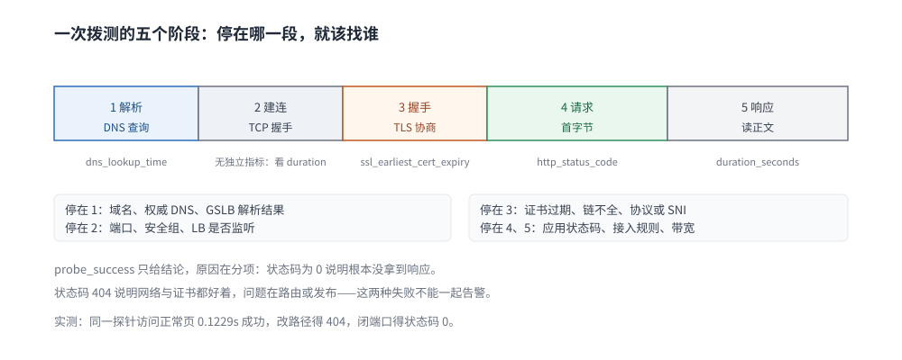

# 合成监控与拨测

> 覆盖：从外部主动发起的探测补的是哪一段可见性、一次探测由哪几段耗时组成、Blackbox Exporter 的模块怎么配（HTTP / TCP / TLS / DNS）、证书到期怎么盯，以及拨测结果怎么接进告警与 SLO。
>
> 不覆盖：服务端指标与基数控制见 [指标选型对比.md](指标选型对比.md)；SLO 与错误预算怎么定见 [SLO与错误预算.md](../告警与响应/SLO与错误预算.md)；告警规则与抑制见 [告警规则与阈值设计.md](../告警与响应/告警规则与阈值设计.md)；DNS 解析链路本身见 [DNS解析.md](../../../../02-计算机基础/网络/网络层与寻址/DNS解析.md)。
>
> 内容整理自个人学习笔记。**实测环境**：`prom/blackbox-exporter:v0.27.0` + `nginx:alpine`（Docker Desktop），探测点与被测目标分处两个容器，读数见第四节，校验范围见 `## 校验口径`。

---

## 一、拨测补的是哪一段可见性？

**本节要点**：服务端指标只能证明「进程处理了多少」，证明不了「用户有没有拿到」。拨测是从**链路之外**发一次真实请求，把 DNS、证书、LB、CDN 这些「不经过你的进程」的环节纳入观测。

### 1.1 服务端 SLI 的三个盲区

| 盲区 | 典型故障 | 服务端指标的表现 |
|---|---|---|
| **解析与路由** | DNS 配错、GSLB 把流量打到坏机房 | 一切正常（根本没到） |
| **传输与证书** | 证书过期、TLS 版本不兼容、SNI 配错 | 一切正常（握手就失败） |
| **接入层** | LB 健康检查误摘、CDN 回源 5xx、WAF 拦截 | 请求量下降，但错误率可能是 0 |

⭐ 结论：**只有服务端指标的团队，会在「内部 99.99%、用户打不开」时找不到方向**。拨测是成本最低的那一路外部视角。

### 1.2 拨测能测什么、不能测什么

| 能 | 不能 |
|---|---|
| 「从某地能否完成一次完整请求」 | 真实用户的分布与长尾（探测点是小样本） |
| 「失败发生在哪一段」（DNS / 连接 / 握手 / 状态码） | 页面渲染、交互卡顿（要 RUM） |
| 证书剩余天数、响应头、重定向链 | 业务正确性（只能断言约定好的契约） |
| 多地域、多运营商的差异 | 内部调用链的耗时归因（要链路追踪） |

⚠️ **拨测的断言是「契约」不是「业务」**：探针只知道「返回 200 且正文含 OK」，不知道订单有没有真的创建。所以拨测适合做**可达性与合规性**，不适合做业务正确性。

## 二、一次探测由哪几段组成？

**本节要点**：`probe_success` 只给结论，原因藏在分项耗时与状态码里。先看分项，再决定往哪个方向查。



图上从左到右是探针发起的五个阶段：解析、建连、TLS 握手、请求与首字节、响应体读取。每一段都有独立指标，**停在哪一段决定了该找谁**——解析停在 DNS 团队，握手停在证书或协议，状态码不对才是应用层。

### 2.1 五个阶段与指标

| 阶段 | 指标 | 失败时说明 |
|---|---|---|
| DNS 解析 | `probe_dns_lookup_time_seconds` | 解析失败或超时：域名、权威 DNS、GSLB |
| TCP 建连 | `probe_duration_seconds` 的低值 + `probe_success=0` | 端口不通、安全组、LB 未监听 |
| TLS 握手 | `probe_ssl_earliest_cert_expiry`、`probe_tls_version_info` | 证书过期、链不全、协议不兼容 |
| 请求与首字节 | `probe_http_status_code` | 4xx/5xx：应用或接入层规则 |
| 响应体读取 | `probe_duration_seconds` 的整体值 | 慢但成功：带宽、压缩、大响应 |

### 2.2 一个关键区分：`probe_success=0` 有两种含义

| 现象 | 含义 | 下一步 |
|---|---|---|
| `probe_success=0` 且 `probe_http_status_code=0` | **没拿到 HTTP 响应**（解析/连接/握手失败） | 看 DNS 与 TLS 指标 |
| `probe_success=0` 且 `probe_http_status_code=404` | 拿到了响应，是**断言不通过**（内容或状态码不符） | 看模块的 `valid_status_codes` 与路径 |

⚠️ 把这两种混为一谈是拨测告警最常见的误判：404 说明网络与证书都好着，问题在路由或发布。

## 三、探针形态怎么选

| 形态 | 优点 | 缺点 | 适用 |
|---|---|---|---|
| **Blackbox Exporter**（拉模式） | 与 Prometheus 天然配套，模块化，指标统一 | 需要 Prometheus 主动抓 | 已有 Prometheus 的团队 |
| 云厂商拨测 | 多地域、多运营商开箱即用 | 数据在云上，按次计费 | 对外服务、需要真实多地域 |
| 自建多地域探针 | 可控、可自定义断言 | 运维成本高 | 强合规或内网场景 |
| 合成事务（浏览器级） | 能测页面与交互 | 重、慢、贵 | 关键业务流程 |

⭐ 判据：**内部服务用 Blackbox 就够，对外服务至少要有一路「不在自己机房」的探测点**。单机房拨测只能测出「本机房到目标」这一段，测不出运营商与地域差异。

## 四、模块怎么配：HTTP / TCP / TLS / DNS

**本节要点**：Blackbox 的配置单位是「模块」——每个模块是一种探测方式加一套断言。默认配置够用，但凡涉及证书与自定义状态码，都要自己写模块。

### 4.1 实测：四种探测的读数

| 探测 | 目标 | 结果 | 读数 |
|---|---|---|---|
| HTTP 正常 | nginx 首页 | ✅ | `probe_success 1`、`probe_http_status_code 200`、`probe_http_version 1.1`、`probe_duration_seconds 0.1229` |
| HTTP 路径错误 | `/nope` | ❌ | `probe_success 0`、`probe_http_status_code 404` |
| TCP 建连 | 同主机端口 | ✅ | `probe_success 1`、`probe_duration_seconds 0.0024` |
| HTTPS + 证书 | 自签证书 30 天 | ✅ | `probe_success 1`、`probe_ssl_earliest_cert_expiry` 换算为 **2026-11-22 10:09 UTC** |

⚠️ 第一个和第四个的耗时差了 50 倍（0.123s vs 0.0024s），差的不是网络，而是**请求与响应体**这一段：TCP 只握手不传数据。

### 4.2 一个自定义模块（HTTPS + 忽略自签）

```yaml
modules:
  https_2xx:
    prober: http
    timeout: 5s
    http:
      preferred_ip_protocol: ip4
      tls_config:
        insecure_skip_verify: true
```

⚠️ **0.27.0 里没有 `http.tls_verify` 这个字段**，写了会直接启动失败：

```text
Error loading config: error parsing config file:
yaml: unmarshal errors:
  line 6: field tls_verify not found in type config.plain
```

正确的写法是 `tls_config.insecure_skip_verify`（同上）。这类字段名错误**只在加载配置时报**，运行时不会提示——与 [AGENTS 校验顺序](../../../../AGENTS.md) 里「先 validate 再 analyze」是同一类问题。

### 4.3 DNS 模块要自己加

默认配置里**没有** `dns` 模块（`probe?module=dns` 返回 `Unknown module "dns"`）。要测解析，得显式定义：

```yaml
modules:
  dns_a:
    prober: dns
    timeout: 5s
    dns:
      query_name: "api.example.com"
      query_type: "A"
      valid_rcodes: ["NOERROR"]
```

⭐ 单独的 DNS 拨测价值在于：**把「解析慢」和「连接慢」分开**。HTTP 拨测的总耗时里包含解析，出问题时分不清是谁慢。

### 4.4 证书到期怎么盯

`probe_ssl_earliest_cert_expiry` 是一个 Unix 时间戳，到期告警用减法：

```promql
(probe_ssl_earliest_cert_expiry - time()) / 86400 < 14
```

⚠️ 它取的是**证书链里最早到期的那张**，所以中间证书过期也能提前发现——这正是「浏览器正常、部分客户端报错」的常见根因。

## 五、多地域与出口

| 问题 | 单地域拨测的表现 | 做法 |
|---|---|---|
| 运营商差异 | 看不到 | 至少三家运营商各一个探针 |
| 地域 DNS 解析差异 | 看不到（GSLB 按来源返回不同 IP） | 探针所在区域要与用户分布一致 |
| CDN 节点故障 | 可能完全看不到 | 多个探针点，且不要都放在同一云 |
| 内网服务 | 外网探针打不到 | 内网探针 + 与外部探针分开告警 |

⚠️ **探测点本身也会成为单点**：所有探针从一个机房出，就会把「这个机房的出口故障」误报成「服务挂了」。规则里要能区分「单点失败」与「多点同时失败」。

## 六、拨测怎么接进告警与 SLO

### 6.1 从 `probe_success` 到外部 SLI

拨测天然是「好事件 / 有效事件」结构：每次探测是一个事件，成功与否是分子。滚动窗口的成功率就是外部可用性 SLI：

```promql
avg_over_time(probe_success[5m])          # 5 分钟成功率
avg_over_time(probe_success[30d])         # 30 天外部可用性
```

⚠️ 拨测的 SLI **不能直接当业务 SLO**：探针每分钟一次，样本量远小于真实请求，一次失败就会让 5 分钟成功率掉到 99% 以下。它适合做**低水位兜底告警**，不适合做精细的预算记账（口径见 [SLO与错误预算.md](../告警与响应/SLO与错误预算.md) 1.3 节）。

### 6.2 告警怎么不双报

| 规则 | 表达什么 | 抑制关系 |
|---|---|---|
| `probe_success == 0`（连续 2 分钟） | 外部确实打不开 | 若同时有内部错误率告警，**保留拨测、抑制内部**（拨测更接近用户） |
| 证书剩余 < 14 天 | 未来的故障 | 与可用性告警无关，单独走工单通道 |
| 单点失败 / 多点失败 | 探针机房问题 vs 服务问题 | 单点失败降级为工单，多点失败才 page |

⭐ 抑制方向的口径：**外部视角优先**。内部指标正常但拨测失败，说明故障在进程之外；两者同时告警时，值班的人应该先看拨测那条。

## 应用场景

| 场景 | 探什么 | 断言 |
|---|---|---|
| 对外网站 | 首页 + 登录页 | 状态码 2xx，正文含关键字 |
| 开放 API | 健康检查端点 | 2xx 且响应体含 `status: ok` |
| 内部微服务 | 服务端口 | TCP 建连 + gRPC 健康检查 |
| 证书治理 | 所有对外域名 | 剩余天数 > 14 |
| DNS 治理 | 关键域名 | A 记录存在且解析耗时 < 100ms |
| 第三方依赖 | 供应商 API | 2xx + 响应时间阈值 |

## 具体使用

### 7.1 Prometheus 抓取配置

```yaml
scrape_configs:
  - job_name: blackbox-http
    metrics_path: /probe
    params:
      module: [http_2xx]
    static_configs:
      - targets:
          - https://www.example.com/
          - https://api.example.com/health
    relabel_configs:
      - source_labels: [__address__]
        target_label: __param_target
      - source_labels: [__param_target]
        target_label: instance
      - target_label: __address__
        replacement: blackbox:9115
```

⭐ 三段 relabel 的作用：把目标地址塞进 `?target=`、让 `instance` 显示被测地址（而不是探针地址）、把抓取地址指向探针。**漏掉第二段，所有告警的 `instance` 都会是探针自己**，分不清是哪个站点挂了。

### 7.2 告警与记录规则

```yaml
groups:
  - name: blackbox
    rules:
      - alert: ProbeFailed
        expr: probe_success == 0
        for: 2m
        labels:
          severity: page
        annotations:
          summary: "{{ $labels.instance }} 拨测连续失败"
          runbook: "先看 probe_http_status_code 与 probe_dns_lookup_time 区分是解析、连不上还是返回码不对"
      - alert: CertExpiringSoon
        expr: (probe_ssl_earliest_cert_expiry - time()) / 86400 < 14
        for: 1h
        labels:
          severity: ticket
        annotations:
          summary: "{{ $labels.instance }} 证书剩余不足 14 天"
      - record: job:probe_success:ratio5m
        expr: avg_over_time(probe_success[5m])
```

`promtool check rules` 实测通过：

```text
$ promtool check rules probe_rules.yml
Checking probe_rules.yml
  SUCCESS: 3 rules found
```

### 7.3 验证探测真的在跑

| 判据 | 看哪里 |
|---|---|
| 探针可达目标 | `/probe?target=...&module=...` 直接返回 `probe_success 1` |
| Prometheus 抓到了 | 指标里 `instance` 是被测 URL，不是 `blackbox:9115` |
| 抓取本身没失败 | `up{job="blackbox-http"} == 1` |
| 探测耗时是否合理 | `probe_duration_seconds` 与业务 RT 同量级 |

## 校验口径

| 部分 | 状态 | 依据 |
|---|---|---|
| HTTP / TCP / HTTPS 读数（4.1） | ✅ 实跑 | blackbox v0.27.0，`probe_success`、状态码、耗时逐项读出 |
| 404 与连接失败的区别（2.2） | ✅ 实跑 | 同一探针，`/nope` 得 404，闭端口得状态码 0 |
| 证书到期读数（4.1、4.4） | ✅ 实跑 | 30 天自签证书，`probe_ssl_earliest_cert_expiry` 换算为 2026-11-22 |
| 模块字段错误（4.2） | ✅ 实跑 | `field tls_verify not found in type config.plain` |
| 默认无 `dns` 模块（4.3） | ✅ 实跑 | `probe?module=dns` 返回 `Unknown module "dns"` |
| 告警与记录规则（7.2） | ✅ 实跑 | `promtool check rules`：SUCCESS，3 rules found |
| 多地域与多运营商（五） | ⚠️ 未实测 | 本机只有单机 Docker，无跨地域探针 |
| 拨测 SLI 与抑制（6.1、6.2） | 经验归纳 | 按值班实践整理，无长期读数 |

## 延伸追问

- **拨测和链路追踪是什么关系？** → 拨测回答「从外面能不能用」，链路回答「内部哪一跳慢」。拨测失败时，先看拨测分项（是不是根本没到服务），再看链路（到了之后慢在哪）。
- **为什么探针容器访问 `127.0.0.1:18080` 失败，换成 `host.docker.internal` 就通了？** → 容器里的 `127.0.0.1` 是容器自己，不是宿主机。跨容器探测要么用同一网络里的服务名，要么走宿主机映射地址。本机实测两次结果分别是 `probe_success 0`（状态码 0）与 `1`。
- **`probe_success=1` 但业务仍投诉，可能是什么？** → 拨测只覆盖脚本化的路径。用户走的路径、参数、地域、登录态都可能不同；也可能是前端渲染或 CDN 缓存问题。
- **证书告警为什么用 14 天而不是 7 天？** → 要留出「发现 → 申请 → 审批 → 灰度替换」的时间。内部 CA 可短一些，第三方证书（需要 DNS 验证）宜 14 天以上。
- **拨测频率多少合适？** → 对外服务 30~60 秒；内部服务 1~5 分钟。频率越高，误报越容易被 1 次抖动触发，所以 `for: 2m` 这类连续失败判定比提高频率更有效。
- **能不能用拨测替代健康检查？** → 不能。健康检查在集群内部、决定是否摘流量；拨测在外部、决定是否叫人。两者一个管「摘不摘」，一个管「用户能不能用」。

## 关联

- **上游/总纲**：[可观测性选型对比.md](../可观测性选型对比.md) — 三支柱与告警工具的全景
- **下游/度量**：[SLO与错误预算.md](../告警与响应/SLO与错误预算.md) — 外部视角的 SLI，与拨测互补
- **下游/告警**：[告警规则与阈值设计.md](../告警与响应/告警规则与阈值设计.md) — 抑制与分组，避免拨测与内部指标双报
- **上游/指标**：[指标选型对比.md](指标选型对比.md) — `probe_success` 这类 gauge 的语义与基数
- **对照/互补**：[日志采集管道.md](../日志系统/日志采集管道.md) — 采集侧的另一种「看不见的失败」
- **下游机制**：[DNS解析.md](../../../../02-计算机基础/网络/网络层与寻址/DNS解析.md) — 拨测第一段失败的根因排查
- **下游机制**：[数字证书与PKI.md](../../../../06-工程实践/安全/密码学与密钥/数字证书与PKI.md) — 证书链、有效期与续期
