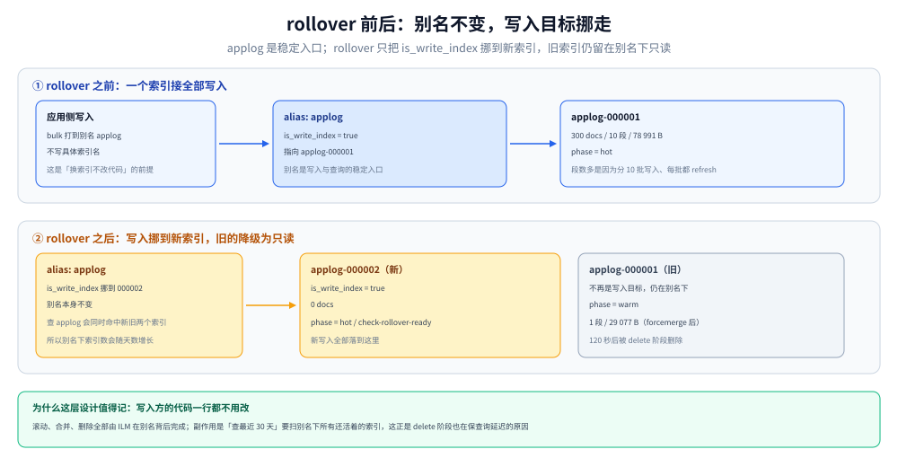

# Elasticsearch ILM 与调优

> 覆盖：ILM 怎么把「一直写热索引 → 合并降温 → 到期删除」变成一条不需要人管的流水线。重点是三个最容易搞错的时点——`min_age` 从哪个时刻起算、rollover 什么时候才会被评估、forcemerge 到底换到了什么，以及本机 8.19.0 上踩到的四个静默坑（内置 `logs` 模板拦索引、alias 不存在走 auto-create、通配删除被拒、poll 间隔默认 10 分钟）。
>
> 不覆盖：字段映射与查询 DSL 见 [日志查询语言与排障方法论.md](../查询与排障/日志查询语言与排障方法论.md)；采集端怎么把日志写进 ES 见 [日志采集管道.md](../日志采集管道.md)；该不该选 ES 见 [日志系统选型对比.md](../日志系统选型对比.md)；ILM 之外的通用调优（分片数、堆、线程池）见 [集群与运维.md](../../../../数据存储/搜索与分析/Elasticsearch/集群与运维.md)。
>
> 内容整理自个人学习笔记。实测环境 Elasticsearch **8.19.0**（单节点、Lucene 9.12.2、`xpack.security.enabled=false`、`ES_JAVA_OPTS=-Xms512m -Xmx512m`），全部读数来自本轮容器实跑，口径见第九节。

---

## 一、一句话定位：ILM 解决的不是「删除」，是「让每个索引在正确的时间处于正确的形态」

**本节要点**：日志索引的问题从来不是「太占地方」这一件事，而是**三类需求同时存在且互相冲突**——写的时候要快（索引要小、刷新要慢）、查的时候要快（段要少、索引要大）、存的时候要省（要压缩、要降副本、要迁到便宜介质）。ILM 把这三种形态按索引年龄自动切换，删除只是最后一步。

| 需求 | 冲突点 | ILM 用什么动作解决 |
| --- | --- | --- |
| 写入快 | 索引越大，refresh 与 merge 越重 | `rollover`：把写入切到新索引，旧索引不再接写 |
| 查询快 | 段（segment）越多，查询要扫的文件越多 | `forcemerge`：把只读索引的段强行合成 1 个 |
| 存储省 | 热节点贵、副本占双倍空间 | `shrink`（缩分片）+ `allocate`（迁节点）+ 改 `number_of_replicas` |
| 不无限增长 | 人工删容易漏、容易删错 | `delete`：按阶段年龄自动删 |

⭐ 一条判据：**如果你的日志索引还需要人工「定期清理」，那不是运维习惯问题，是 ILM 没配或者配了没生效。** 而「配了没生效」在 ES 里几乎全是静默的——本篇第八节列的四个坑，没有一个会给出明确报错。

---

## 二、核心概念：四个对象与它们的绑定关系

**本节要点**：ILM 由四个对象拼成，**任何一层没接上，整条流水线都不会动，而且大多不报错**。

| 对象 | 是什么 | 接不上的表现 |
| --- | --- | --- |
| **策略（policy）** | 一张「阶段 → 动作」表，本身不绑定任何索引 | 建了但没人引用，ES 不会提示 |
| **模板（index template）** | 把 `lifecycle.name` 与 `rollover_alias` 写进新索引的 `settings` | 模板 `index_patterns` 不匹配 → 新索引无策略，静默 |
| **引导索引（bootstrap index）** | 第一个实体索引（如 `applog-000001`），带 alias 且 `is_write_index: true` | 只建 alias 不建实体索引 → 第一次写入 auto-create 出与 alias 同名的普通索引（见 8.2） |
| **别名（alias）** | 写入与查询的稳定入口，rollover 时把 `is_write_index` 挪到新索引 | 别名指向多个索引且没有一个 `is_write_index` → 写入报错 |

四者的关系是**单向引用**：策略 ← 模板 ← 引导索引。反过来改（先建索引后改模板）不会回溯生效，因为模板只在**建索引那一刻**被读取。

| 阶段 | 允许的动作 | 本机用到的 |
| --- | --- | --- |
| `hot` | `rollover` / `set_priority` / `forcemerge` / `shrink` | `rollover`（`max_docs` + `max_age`） |
| `warm` | `forcemerge` / `shrink` / `allocate` / `set_priority` / `readonly` | `forcemerge: 1` + `set_priority: 50` |
| `cold` | `searchable_snapshot` / `allocate` / `freeze`（旧版） | 未用 |
| `delete` | `delete` / `wait_for_snapshot` | `delete` |
| `frozen` | 部分版本为 `cold` 的子阶段 | 未用 |

⚠️ `hot` 是**唯一可以没有 `min_age` 的阶段**：它的进入条件是「索引刚被创建」，没有「等多久」这回事。后面每个阶段都必须写 `min_age`，不写默认 `0ms`（立即进入）。

---

## 三、整体架构：一次 rollover 前后，索引与别名怎么变



图上半是 rollover 之前：别名 `applog` 的 `is_write_index` 指向 `applog-000001`，所有写入都进它。下半是 rollover 之后：新索引 `applog-000002` 建出来并接管写入，旧索引**留在别名下但不再是写入目标**——所以「查最近七天」这类走别名的查询仍然能查到它，直到 `delete` 阶段把它整个删掉。

这条设计带来一个常被忽略的后果：**别名下的索引数量会随时间增长**，查询 `applog` 时要扫的索引是「所有还没被删的」。这正是 ILM 的 `delete` 阶段不只是省磁盘、也在保查询延迟的原因。

| 时刻 | 实体索引 | 别名 `is_write_index` | 旧索引状态 |
| --- | --- | --- | --- |
| 建引导索引后 | `applog-000001` | `applog-000001` | — |
| 写入 300 条（`max_docs 1000` 未满） | 不变 | 不变 | 仍在 `hot` |
| 手动 rollover | 新增 `applog-000002` | `applog-000002` | `hot` 的 `complete` |
| 距 rollover 15 秒 | 不变 | 不变 | 进 `warm`，段数 10 → 1 |
| 距 rollover 120 秒 | 只剩 `applog-000002` | 不变 | 被删，`_ilm/explain` 里不再出现 |

---

## 四、部署：最小可运行的 ILM 配置

**本节要点**：一个能跑的最小配置是「调小 poll 间隔 → 建策略 → 建模板 → 建引导索引」四步，**顺序不能反**：模板必须在建索引之前存在，否则引导索引导不进 `lifecycle.name`。

**第一步，把 poll 间隔调小。** ILM 的默认轮询间隔是 10 分钟——这是生产上合适的值，但做实验时会让「等 15 秒的 `min_age`」变成「等 10 分钟才知道有没有生效」：

```bash
curl -X PUT "localhost:9200/_cluster/settings" -H 'Content-Type: application/json' -d '{
  "persistent": { "indices.lifecycle.poll_interval": "1s" }
}'
```

⚠️ 默认 `10m` 是官方文档值，本机**没有等满 10 分钟去验证**这个默认值；改成 `1s` 后立即生效（返回 `acknowledged: true`）。

**第二步，建策略。** 三个阶段：`hot` 靠 `max_docs` 触发滚动、`warm` 合并到 1 段、`delete` 到期删除：

```json
{
  "policy": {
    "phases": {
      "hot":  { "actions": { "rollover": { "max_docs": 1000, "max_age": "1h" } } },
      "warm": { "min_age": "15s",
                "actions": { "forcemerge": { "max_num_segments": 1 },
                             "set_priority": { "priority": 50 } } },
      "delete": { "min_age": "120s", "actions": { "delete": {} } }
    }
  }
}
```

**第三步，建模板。** `rollover_alias` 必须与引导索引里的别名一字不差：

```json
{
  "index_patterns": ["applog-*"],
  "template": {
    "settings": {
      "number_of_shards": 1,
      "number_of_replicas": 0,
      "lifecycle": { "name": "logs-ilm-lab", "rollover_alias": "applog" }
    },
    "mappings": {
      "properties": {
        "@timestamp": { "type": "date" },
        "level":      { "type": "keyword" },
        "service":    { "type": "keyword" },
        "message":    { "type": "text" }
      }
    }
  }
}
```

**第四步，建引导索引并绑定别名。** 索引名必须以 `-000001` 结尾，这是 rollover 递增的起点：

```json
PUT applog-000001
{ "aliases": { "applog": { "is_write_index": true } } }
```

四步做完后，`GET applog-*/_ilm/explain` 应能看到每个索引的 `phase` / `action` / `step`。看不到就是某一步没接上，先查第八节的四个坑，不要先怀疑策略写错。

---

## 五、使用一：`min_age` 从哪个时刻起算

**本节要点**：`min_age` 算的是**「在当前阶段待了多久」**，不是「索引创建了多久」。对 `rollover` 之后的索引，计时起点是 **rollover 时刻**；没有 rollover 的索引（`hot` 阶段不滚动的那种）才按索引创建时间算。

本机读数（`min_age: 15s`，rollover 后进入 `warm`）：

| 量 | 值 | 怎么得到的 |
| --- | --- | --- |
| 索引创建时刻 | `1792821270650` | `_ilm/explain` 的 `index_creation_date_millis` |
| 进入 `warm` 的时刻 | `1792821337740` | 同上，`phase_time_millis` |
| 差值 | **67.09 秒** | 7740 − 0650 = 67 090 ms |
| 15 秒从哪算 | rollover 时刻 ≈ 67.09 − 15 = **52.09 秒** | 反推 |

也就是说：如果 `min_age` 从索引创建算，`warm` 应该在第 15 秒就到；实际到第 67 秒才到。差的那 52 秒正好是「写完数据 + 手动 rollover」花掉的时间。

⭐ 这条判据的实用价值：**要让「热数据留 3 天」，`warm.min_age` 就写 `3d`，不用去猜索引创建时间**。反过来，如果误以为从创建算，又给 `hot` 配了很长的 `max_age`，实际冷却时间会变成「`max_age` + `3d`」，比预期晚整整一个周期。

⚠️ 另一个更容易踩的：`hot` 阶段的 `rollover.max_age` 也是**从索引创建（或上次 rollover）算**，但它只在 **rollover 被评估的那一刻**才检查。两者叠加的结果是：`rollover.max_age: 1h` 并不保证「1 小时后一定滚」，只保证「1 小时后第一次评估时满足条件就滚」。

---

## 六、使用二：rollover 什么时候才会被评估

**本节要点**：rollover 有三个触发入口——**ILM 的 poll 周期、写请求经过别名、手动调用 `_rollover`**。生产上主要靠前两个，实验里第三个最可控。三者评估的是同一组条件，但**第一个入口不要求有写入**。

本机对照：

| 场景 | 调用 | 返回 | 结果 |
| --- | --- | --- | --- |
| 条件未满足 | `POST applog/_rollover` + `{"conditions":{"max_docs":1000}}` | `rolled_over: false`，`new_index: applog-000002` | 新索引建了但**未切换**写入 |
| 不带条件 | `POST applog/_rollover`（无 body） | `rolled_over: true` | 立即滚动 |
| ILM 自动 | 写入到 `max_docs` 后等 poll | 不返回，看 `_cat/indices` | 400 条时自动滚出 `000002` |

第二条是最容易误读的：`rolled_over: false` 时响应里**照样有 `new_index` 字段**，看起来像「已经滚了」。实际 `new_index` 只是「如果滚，会滚到哪个名字」，此时 `_cat/indices` 里没有这个索引。

⭐ 一个反直觉事实：**没有新写入时，ILM 的 poll 也能触发 rollover**。本机把 `max_docs` 设成 200、写完 300 条后不再写，5 秒内就在 `_cat/indices` 里看到了 `000002`（此时 `000001` 的 `_ilm/explain` 是 `action=complete`）。原因是 rollover 条件里的 `max_docs` 是**已索引文档数**，不是「本次写入触发」——只要 poll 时条件成立就滚。

⚠️ 但 `max_age` 例外：它只看时间，不看写入量，所以「一天只有 10 条日志的服务」到期也会滚，滚出来的是个几乎空的索引。日志量小的场景应改用 `max_primary_shard_size`，避免滚出一堆空索引。

---

## 七、使用三：forcemerge 换到了什么，又付出了什么

**本节要点**：`forcemerge` 把只读索引的段合并成 1 个，换来**更少的段、更小的存储、更快的查询**，代价是**一次性的 IO 与 CPU 峰值**，所以它必须放在 `warm`（索引已经不再写入）而不是 `hot`。

本机实测（同一份 300 条数据，分 10 批写入、每批 refresh，模拟「每天多批写入」的段形态）：

| 指标 | forcemerge 之前 | forcemerge 之后 | 变化 |
| --- | --- | --- | --- |
| 段数 | **10** | **1** | −90% |
| 主分片大小 | 78 991 B | 29 077 B | **−63.2%** |
| 文档数 | 300 | 300 | 不变 |
| 所处阶段 | `hot`（`complete`） | `warm`（`complete`） | — |

段数从 10 掉到 1 是设计使然（`max_num_segments: 1`）；**体积掉 63.2%** 是附带收益——每批写入产生的段各自带一套词典与前缀，合并后词典只留一份。

⚠️ 三条代价，写进策略前必须想清楚：

1. **forcemerge 是重 IO 操作**，对正在承载查询的节点会造成明显抖动，通常安排在低峰或单独节点。
2. **合到 1 段之后，这个索引就再也不会有新段了**——如果索引还在接写，forcemerge 是白做（下一次写入又产生新段）。这是它必须放 `warm` 的根本原因。
3. **`max_num_segments: 1` 对大索引可能耗时几小时**，且中途不可中断取消（只能等或重启节点）。分片大于 50 GB 时，业内常见做法是合到 `max_num_segments: 1` 但只对「确定不再写」的索引做。

---

## 八、验证与排查：四个静默坑

**本节要点**：这四个坑都在本机复现过，共同点是**当时都没有明确报错指向真正的原因**。

### 8.1 坑一：`logs-*` 开头的索引建不出来

ES 8.x 自带一个名为 `logs` 的托管模板，它的 `index_patterns` 是 **`logs-*-*`**（三段）。任何形如 `logs-<项目>-<序号>` 的索引名都会匹配它，而这个模板建的是**数据流（data stream）**，于是建普通索引直接被拒：

```json
{
  "error": {
    "type": "illegal_argument_exception",
    "reason": "cannot create index with name [logs-lab-000001], because it matches with template [logs] that creates data streams only, use create data stream api instead"
  },
  "status": 400
}
```

⚠️ 注意报错说的是「用 create data stream api」，**不是「名字冲突」**——很多人会去改模板优先级，结果白改。用 `GET _index_template/logs` 能看到它的全貌：

| 字段 | 值 |
| --- | --- |
| `index_patterns` | `["logs-*-*"]` |
| `composed_of` | `logs@mappings` / `logs@settings` / `logs@custom` / `ecs@mappings` |
| `priority` | 100 |
| `data_stream` | `{"hidden": false, "allow_custom_routing": false}` |
| `_meta.managed` | `true` |

**两条出路**：改前缀避开 `logs-*-*`（本篇用 `applog-*`），或者干脆走数据流——ES 8 的日志标准形态本来就是数据流，ILM 绑在数据流的后备索引上。

### 8.2 坑二：alias 不存在时，bulk 会静默建出同名的普通索引

引导索引没建、只把 `_index` 写成别名 `applog` 就发 bulk，ES 不会报「别名不存在」，而是走 **auto-create**，建出一个**名字就叫 `applog` 的普通索引**，300 条全落进去：

| 现象 | 读数 |
| --- | --- |
| bulk 返回 | `{"took": 1407, "errors": false}` |
| `_cat/indices` | `applog  300 docs  39.2kb` |
| `_ilm/explain` | 没有 `applog` 这个索引的策略信息（它不在模板覆盖范围内） |

结果就是「日志在写、数据在涨、ILM 完全不管」——**直到磁盘满才会被发现**。

⭐ 判据：**bulk 成功不代表写对了地方。** 上线前必须核对 `_cat/indices` 里的索引名与模板的 `index_patterns` 能对上，且 `_ilm/explain` 里每个索引都有 `phase`。

### 8.3 坑三：通配符删除被拒

```json
{ "error": { "reason": "Wildcard expressions or all indices are not allowed" }, "status": 400 }
```

这是 `action.destructive_requires_name` 默认 `true` 的效果。清理实验数据必须写全索引名：

```bash
curl -X DELETE "localhost:9200/applog-000001,applog-000002,applog-000003"
```

⚠️ 副作用很隐蔽：删除失败时如果脚本没检查 HTTP 状态码，后面的实验会在**旧数据还在**的基础上继续跑，读数全部失真。本机第一次跑 ILM 实验就是这样——`000001` 上的 300 条是上一轮的，新写入被分到了 `000002`/`000003`，段数与文档数全对不上。

### 8.4 坑四：poll 间隔 10 分钟，让「等 15 秒」变成「等 10 分钟」

`indices.lifecycle.poll_interval` 默认 `10m`。做 ILM 实验时如果不先把它调小，`min_age: 15s` 的迁移会看起来「根本没发生」：`_ilm/explain` 停在 `step=check-rollover-ready` 不动，日志里没有任何报错。

| 项 | 默认 | 实验时 | 判据 |
| --- | --- | --- | --- |
| `poll_interval` | `10m`（文档值，本机未等满验证） | `1s` | 改完 5 秒内能看到阶段变化 |
| `_ilm/explain` 的 `step` | `check-rollover-ready` | `complete` | 停在 `check-` 开头说明还没评估 |

⭐ 排查顺序：**先看 `_ilm/explain` 的 `step`，再看 `phase`**。`step` 停在 `check-` 说明「轮询没到或条件不满足」，`step=complete` 且 `phase` 是预期阶段才说明动作做完了。

---

## 九、校验口径

| 结论 | 状态 | 依据 |
| --- | --- | --- |
| 内置 `logs` 模板拦截 `logs-*-*` 索引 | ✅ 真跑 | 建 `logs-lab-000001` 返回 400 原文；`GET _index_template/logs` 读到 `index_patterns: ["logs-*-*"]` |
| alias 不存在时 bulk auto-create | ✅ 真跑 | `logs-lab` 索引 300 docs / 39.2kb，bulk `errors: false` |
| 通配删除被拒 | ✅ 真跑 | `Wildcard expressions or all indices are not allowed` |
| 条件未满足时 `rolled_over: false` 但返回 `new_index` | ✅ 真跑 | `{"rolled_over":false,...,"new_index":"applog-000002"}` |
| 无 body 的 `_rollover` 立即滚动 | ✅ 真跑 | `{"rolled_over":true,...,"new_index":"applog-000002"}` |
| 无写入时 poll 也能触发 rollover | ✅ 真跑 | `max_docs:200`、写完 300 条后静置，5 秒内出现 `applog-000002` |
| forcemerge：10 段 → 1 段，78 991 B → 29 077 B | ✅ 真跑 | `_stats` 前后各取一次 `primaries.segments.count` 与 `store.size_in_bytes` |
| `min_age` 从 rollover 起算 | ✅ 真跑 | `phase_time_millis − index_creation_date_millis = 67.09s`，而 `min_age` 是 `15s` |
| `delete` 阶段到期删除 | ✅ 真跑 | rollover 后 120 秒，`applog-000001` 从 `_cat/indices` 消失 |
| `poll_interval` 默认 10 分钟 | ⚠️ 未实测 | 官方文档值；本机直接改成 `1s`，没有等满 10 分钟观察 |
| `shrink` / `allocate` / `searchable_snapshot` | ⚠️ 未实测 | 单节点无冷热分层，无法验证分片迁移 |
| 数据流（data stream）+ ILM | ⚠️ 未实测 | 本篇走的是普通索引 + 别名路线；数据流路径未跑 |
| 大索引 forcemerge 的耗时与 IO 峰值 | ⚠️ 未实测 | 本机只有 300 条、79 KB，量级不足以反映真实代价 |

实验脚本在 `.workbuddy/tmp/es-lab/`（`ilm_policy.json` / `ilm_template.json` / `ilm_b.sh` / `state.sh`），容器 `es-lab`（`elasticsearch:8.19.0`，端口映射 `19200:9200`）。

---

## 延伸追问

**Q：为什么 ILM 不直接用一个「保留 N 天」的全局参数，而要分四个阶段？**

因为四个阶段解决的是**四种互相冲突的需求**（写入快 / 查得快 / 存得省 / 不无限涨），它们的最佳形态不同，且切换成本很高（forcemerge 要做重 IO、shrink 要搬分片、allocate 要跨节点复制）。用「保留 N 天」只能解决最后一种，其余三种要么一直不优化，要么靠人工在业务低峰去跑。

**Q：日志场景到底该用数据流还是索引 + 别名？**

如果用的是 ES 8 自带模板那套（`logs-*-*` + `data_stream`），数据流更省事：不用手动建引导索引、不用管 alias 的 `is_write_index` 挪动、ILM 直接绑后备索引。如果已经有既存的索引 + 别名体系（比如从 7.x 升上来、或者应用侧写死了索引名），继续用别名更平滑。**两者不要混用**——数据流的写入入口是 `POST <stream>/_doc`，对索引名的写入会被拒。

**Q：`forcemerge` 合到 1 段之后，查询能快多少？**

本机没有做查询耗时对照（300 条数据的段数差异不足以体现），所以这里不给倍数。机制上的收益来自三点：段数少 → 需要打开的文件句柄少；词典只有一份 → FST 查找范围小；删除标记被物理清除 → 不用在查询时过滤已删文档。真实收益取决于「合并前有多少段、段里有多少删除文档」，**段数从几十降到 1 时收益明显，从 3 降到 1 时几乎测不出来**。

**Q：`max_age` 和 `max_primary_shard_size` 该以哪个为主？**

看日志量是否稳定。量稳定的服务用 `max_primary_shard_size`（比如 `50gb`），滚出来的是**大小一致的索引**，forcemerge 与查询的代价可预测；量波动大（有突发流量、有静默期）的服务用 `max_age` 为主、`max_primary_shard_size` 兜底，否则会出现「一周的索引只有 3 MB」和「一天的索引 80 GB」并存。

---

## 关联

- **上游/总纲**：[日志系统选型对比.md](../日志系统选型对比.md) — 该不该选 ES、索引模型能支撑哪种查询
- **对照**：[Loki_存储架构与调优.md](Loki_存储架构与调优.md) — 另一条路线：不建倒排索引，只索引标签，靠压缩与时间分块省钱
- **互补**：[日志采集管道.md](../日志采集管道.md)（数据怎么进来、在哪一段丢）、[日志查询语言与排障方法论.md](../查询与排障/日志查询语言与排障方法论.md)（写进来之后怎么查）、[敏感数据脱敏与合规.md](../治理与规范/敏感数据脱敏与合规.md)（`redact` processor 需要白金许可，脱敏只能放在采集端）
- **下游机制**：[集群与运维.md](../../../../数据存储/搜索与分析/Elasticsearch/集群与运维.md) — 分片、堆、线程池这些 ILM 之外的调优
