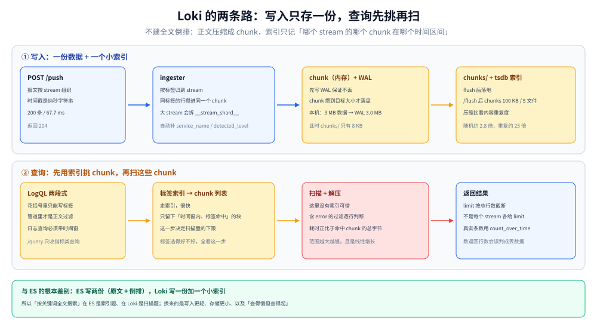

# Loki 存储架构与调优

> 覆盖：Loki 凭什么比 ES 便宜——它**不做全文倒排索引**，只索引标签，正文压缩后按时间块存；由此带来的一整套后果：标签设计直接决定查询代价、chunk 什么时候才落盘、压缩比由什么决定、限流与单行上限卡在哪、以及本机 3.5.0 上摸到的三个反直觉行为（日志查询不支持即时查询、`detected_level` 看着像标签却选不中、`limit` 是按总行数截断）。
>
> 不覆盖：LogQL 语法与排障方法论见 [日志查询语言与排障方法论.md](../查询与排障/日志查询语言与排障方法论.md)；采集端怎么推给 Loki 见 [日志采集管道.md](../日志采集管道.md)；Loki / ES / ClickHouse 三家怎么选见 [日志系统选型对比.md](../日志系统选型对比.md)。
>
> 内容整理自个人学习笔记。实测环境 Loki **3.5.0**（单机单进程、`auth_enabled: false`、filesystem 存储、tsdb 索引、schema v13），全部读数来自本轮容器实跑，口径见第九节。

---

## 一、一句话定位：Loki 用「只索引标签」换来了成本，代价是「查之前必须先圈定范围」

**本节要点**：ES 存两份东西——原始文档 + 倒排索引（后者往往比前者还大）；Loki 只存两份东西——压缩后的日志块 + **标签的索引**。日志正文里写了什么，Loki 在写入时完全不知道也不关心。

这条取舍把所有问题都推到了两个地方：

| 取舍 | 换来什么 | 代价是什么 |
| --- | --- | --- |
| 不建全文索引 | 写入极轻、存储约为原始大小的几分之一 | 任何「正文搜索」都要**扫描范围内的所有日志**，范围越大越慢 |
| 只索引标签 | index 体积与「标签组合数」成正比，与日志量无关 | 标签设计错了（高基数），索引爆炸、查询变慢 |
| 按时间切 chunk | 查询天然可以「只扫时间窗内的块」 | 跨大时间窗的查询代价随窗口线性增长 |
| 不解析正文结构 | 写入侧不需要 schema，任何格式都能进 | 结构化查询要靠查询期的 `| json` / `| logfmt` 现场解析 |

⭐ 一条判据：**「按 trace_id 精确找一条日志」Loki 做不到快，它只擅长「某个服务的某段时间里含某关键词的日志」。** 如果你的排障习惯是从链路跳到日志，Loki 侧通常要靠「标签带 trace_id」或「先用指标定位时间窗」来弥补。

---

## 二、核心概念：stream 是索引单位，chunk 是存储单位

**本节要点**：Loki 的数据模型只有三层，理解这三层就能解释后面所有的性能现象。

| 概念 | 是什么 | 本机读数/形态 |
| --- | --- | --- |
| **stream（流）** | 一组**标签完全相同**的日志序列，是索引与查询的最小单位 | 推入 2 个标签组合，查出 **4 个 stream**（见 5.3 的分片） |
| **chunk（块）** | 一个 stream 在一段时间内的日志，压缩后落盘的文件 | 落盘后单个 chunk 约 1.1 KB ~ 17.9 KB |
| **index（索引）** | 记录「哪个 stream 的哪个 chunk 在哪个时间区间」 | tsdb 格式，`schema: v13`、`period: 24h` |
| **tenant（租户）** | 多租户隔离单位，`auth_enabled: false` 时统一叫 `fake` | 落盘路径 `/loki/chunks/fake/...` |

⭐ 关键推论：**stream 的数量 = 标签组合的数量**。标签里放 `user_id`、`request_id`、`trace_id` 这类高基数字段，stream 数量会随用户数线性增长，索引随之爆炸——这就是 Loki 文档反复强调「标签要低基数」的根因。

---

## 三、整体架构：写入三段、查询两段



图上半是写入路径：日志先按标签归到 stream，在内存里攒成 chunk，同时写 WAL 保证不丢；chunk 达到目标大小或空闲超时后才 flush 到对象存储/filesystem，索引由 tsdb-shipper 定期上传。

图下半是查询路径：**先查索引**——用标签选择器找出「哪些 chunk 落在时间窗内」，再**只扫这些 chunk 的正文**。所以查询代价可以用一句话估算：`扫描量 ≈ 命中 chunk 的总字节数`，而命中 chunk 的数量由**标签选择性与时间窗**共同决定。

本机落盘结构（`docker exec loki-lab find /loki -maxdepth 2 -type d`）：

| 目录 | 作用 | 本机大小 |
| --- | --- | --- |
| `/loki/chunks` | 真正的日志块（压缩后） | 100 KB（5 个文件） |
| `/loki/wal` | 写入预写日志，chunk flush 前先落这里 | 3.0 MB |
| `/loki/tsdb-shipper-active` | 当前活跃的 tsdb 索引，含 `wal/` `scratch/` `uploader/` `per_tenant/` `multitenant/` | 36 KB |
| `/loki/tsdb-shipper-cache` | 下载过的索引缓存 | 12 KB |
| `/loki/compactor` | 压缩与保留期执行的暂存区 | 4 KB |
| `/loki/rules`、`/loki/rules-temp` | 告警规则与临时目录 | 4 KB 各 |

⚠️ 一眼能看出的结构事实：**WAL 比 chunks 大 30 倍**（3.0 MB vs 100 KB）。这不是异常——chunk 是压缩后的，WAL 是未压缩的写入缓冲。判断「Loki 有没有在正常工作」不能看 WAL 大小，要看 chunks 有没有增长。

---

## 四、部署：最小可运行的单机配置

**本节要点**：Loki 3.x 镜像自带 `/etc/loki/local-config.yaml`，直接 `docker run` 就能跑，这份默认配置已经把「单机、filesystem、tsdb 索引」配好了。真正需要改的是**保留期**与**限流**。

| 配置项 | 默认值（本机实测读到） | 含义 |
| --- | --- | --- |
| `auth_enabled` | `false` | 单租户，所有数据落在 `fake` 租户下 |
| `common.path_prefix` | `/loki` | 所有数据根目录 |
| `storage` | `filesystem`（`chunks_directory: /loki/chunks`） | 单机用本地盘，生产换 S3/OSS |
| `schema_config.store` | `tsdb` | v13 schema 用 tsdb 索引（旧版是 `boltdb-shipper`） |
| `schema_config.object_store` | `filesystem` | 索引也落本地盘 |
| `schema_config.index.period` | `24h` | 索引按天切分 |
| `replication_factor` | `1` | 单副本 |

启动与验证：

```bash
docker run -d --name loki-lab -p 13100:3100 grafana/loki:3.5.0
curl -s http://127.0.0.1:13100/ready
```

⚠️ `/ready` 在启动后十几秒内会返回 **`Ingester not ready: waiting for 15s after being ready`**——这是正常状态，不是故障。它表示 ingester 已经起来了但在等一个 15 秒的宽限期，避免刚启动就被判定为「可服务」。

**写入**是 `POST /loki/api/v1/push`，报文按 stream 组织，时间戳必须是**纳秒字符串**：

```json
{
  "streams": [
    { "stream": { "service": "svc-a", "env": "lab" },
      "values": [["1792821742000000000", "level=info msg=\"request handled\""]] }
  ]
}
```

本机推 200 条（2 个 stream）返回 **204**，耗时 **67.7 ms**。

---

## 五、使用一：标签是唯一的索引，所以标签设计就是查询成本

**本节要点**：Loki 的查询分两步——**标签选择器圈范围 → 正文过滤**。第一步走索引（快），第二步是纯扫描（与范围内字节数成正比）。所以「标签选得好不好」直接等于「要扫多少字节」。

### 5.1 三步查询的结构差异

| 查询 | 走哪一步 | 本机读数 |
| --- | --- | --- |
| `{service="svc-a"}` | 索引定范围，返回整段正文 | 2 个 stream / 100 行 |
| `{service="svc-a"} |= "error"` | 索引 + **逐行扫描** | 2 个 stream / 20 行 |
| `sum by (service) (count_over_time({env="lab"}[1h]))` | 索引 + 计数，**不取正文** | 5 个 service，合计 10 200 行 |

第三条是关键：`count_over_time` 这类聚合**不需要把正文传回来**，只在 chunk 上累加计数，所以它比「取出日志再自己数」便宜一个量级。

### 5.2 高基数标签的代价

| 标签 | 基数 | 后果 |
| --- | --- | --- |
| `env` | 个位数 | 安全 |
| `service` | 与微服务数量同阶 | 安全 |
| `level` | 5~7 | 可以，但**已经能从正文里过滤**，加进来意义不大 |
| `trace_id` | 每条日志一个 | 💀 stream 数 = 日志条数，索引直接爆 |
| `user_id` / `path` 带 ID | 与用户/请求数同阶 | 💀 同上，且几乎必然触发 stream 上限 |

⭐ 判据：**「这个标签的取值会不会随请求增长？」会，就不要放进标签**，改成用 `|=` / `| json` 在正文里过滤，或者用 `structured metadata`（Loki 3.x 的新特性）。

### 5.3 一个反直觉读数：一个标签组合会查出多个 stream

本机推入的是 2 个标签组合（`svc-a` / `svc-b`），但用 `{env="lab"}` 查出 **4 个 stream**，其中 `svc-bulk` 被拆成两个：

| stream 标签 | 行数 |
| --- | --- |
| `{service="svc-repeat", ...}` | 2 000 |
| `{service="svc-random", ...}` | 2 000 |
| `{service="svc-bulk", __stream_shard__="0", ...}` | 500（被 limit 截断） |
| `{service="svc-bulk", __stream_shard__="1", ...}` | 500（被 limit 截断） |

两个额外字段都不是我们传的：

- **`__stream_shard__`**：Loki 3.x 的**流分片**——单个 stream 数据量太大时按分片拆开写，查询侧自动合并，用户不需要感知。它的存在说明「一个逻辑 stream 在存储层可能是多个物理 stream」。
- **`service_name`**：Loki 3.x 的 `discover_service_name` 自动补的标签（从 `service` 或 OTel 的 `service.name` 推导），目的是让 OTel 生态的查询能直接用在 Loki 上。

---

## 六、使用二：chunk 什么时候落盘，压缩比由什么决定

**本节要点**：写完 push 返回 204 **不代表数据已经落成 chunk**。数据先进 WAL 与内存，chunk 要满足「达到目标大小」或「空闲超时」才 flush。所以「刚写完去查」和「等一会儿再查」看到的是两条不同的路径。

本机读数（三批各约 1 MB，共 3 MB 原始数据）：

| 时刻 | `chunks/` | `wal/` | 说明 |
| --- | --- | --- | --- |
| push 完 3 批 | 8 KB（1 个文件） | **3.0 MB** | 数据几乎全在 WAL，chunk 只有此前那批 |
| `POST /flush` 后 | **100 KB（5 个文件）** | 3.0 MB | 强制 flush 把内存 chunk 落盘 |

单个 chunk 文件大小：`1 176 / 1 176 / 17 907 / 18 072 / 17 923` 字节。

⭐ 三个可操作的结论：

1. **`POST /flush` 是实验与排查的利器**——不用等空闲超时就能把数据落盘，验证「写入链路是否真的到了存储层」。
2. **WAL 大小不能当容量指标**——它是未压缩的写入缓冲，chunk 落盘后并不会立刻缩小（WAL 由 checkpoint 回收）。
3. **`chunk_target_size` 决定「多久落一次盘」**，默认 1.5 MB。调大有好处（chunk 更大、压缩率更高、索引条目更少）也有代价（内存中攒得更久、flush 峰值更猛）。

### 6.1 压缩比强烈依赖内容重复度

同一套流程，两种内容各推约 0.3 MB，按 `chunks/` 目录增量估算：

| 内容类型 | push 字节 | chunk 增量 | 压缩比 |
| --- | --- | --- | --- |
| 随机串（模拟 trace_id、URL 这类高熵内容） | 299 877 | ≈ 108 KB | **约 2.8 : 1** |
| 高度重复（同一行带相同填充） | 284 078 | ≈ 11 KB | **约 25 : 1** |

⚠️ 这两个数是**按目录增量粗算**（含索引开销、受前序 chunk 影响），不是精确的单条记账。但它们指向的结论是稳的：**「Loki 存日志能省 10 倍」这句话只在日志高度重复时成立**。带大量 ID、堆栈、JSON 的日志，压缩比会掉到 3 倍左右——做容量规划时按自己的样本估，不要按厂商给的倍数估。

---

## 七、使用三：限流与保留（三条会直接拒写的红线）

**本节要点**：Loki 的限流不是「攒着慢慢写」，而是**直接返回 429 让客户端重试**。三条红线都在 `limits_config` 里，默认值很保守。

| 红线 | 默认值（本机读到） | 触发时的返回 |
| --- | --- | --- |
| 摄取速率 | **4 194 304 字节/秒**（4 MB/s） | `429` + `Ingestion rate limit exceeded` |
| 单条大小 | **262 144 字节**（256 KB） | `400` + `Max entry size ... exceeded` |
| 保留期 `retention_period` | 本机默认配置**未设**（即不删） | — |

本机实测两条：

```text
一次推 11.97 MB（20000 行）：
429  Ingestion rate limit exceeded for user fake (limit: 4194304 bytes/sec)
     while attempting to ingest '20000' lines totaling '11928890' bytes

单行 307 200 字节：
400  Max entry size '262144' bytes exceeded for stream '{env="lab", service="svc-big", ...}'
     while adding an entry with length '307200' bytes
```

⭐ 两条判据：

1. **429 的报错里带着「多少行、多少字节、限值多少」，可以直接反推需要把客户端拆成几批**。本机 11.97 MB / 4 MB/s ≈ 需要 3 秒摊开，或按 4 MB 一批分 3 批。
2. **单行超限是 400 而不是 429**，客户端重试再多次也不会成功——这类日志必须**在采集端截断**（几十 KB 的堆栈或大 JSON 是常见来源），不要指望后端接收。

⚠️ **保留期必须显式配**：本机默认配置里没有 `retention_period`，也就是「永不删除」。生产上要同时做三件事——`limits_config.retention_period` 设天数、`compactor` 的 `retention_enabled: true` 打开删除、`compactor.delete_request_store` 配好（单机 filesystem 可以省）。三者缺一个，日志就永远不删。

---

## 八、验证与排查：三个反直觉行为

### 8.1 坑一：日志查询不能用即时查询接口

```text
GET /loki/api/v1/query?query={service="svc-a"}
400  log queries are not supported as an instant query type,
     please change your query to a range query type
```

`/query` 只接受**指标类查询**（`count_over_time`、`sum by` 之类返回 vector 的），要取日志正文必须用 `/query_range` 并带 `start` / `end`。这与 ES 的 `_search` 完全不同——ES 的即时查询不需要时间范围。

| 查询类型 | `/query`（即时） | `/query_range`（范围） |
| --- | --- | --- |
| `{service="svc-a"}` | ❌ 400 | ✅ streams |
| `count_over_time({env="lab"}[5m])` | ✅ vector | ✅ matrix |
| `sum by (service) (...)` | ✅ vector | ✅ matrix |

### 8.2 坑二：`detected_level` 看着像标签，却选不中

Loki 3.x 会自动从日志正文里**猜级别**，并在查询结果里附上 `detected_level` 字段：

```text
labels = {'detected_level': 'info', 'env': 'lab', 'service': 'svc-repeat', 'service_name': 'svc-repeat'}
```

但把它当标签选择器用，**查不到任何数据**：

| 查询 | 结果 |
| --- | --- |
| `count_over_time({detected_level="info"}[1h])` | **series = 0，total = 0** |
| `count_over_time({service="svc-a"}[1h])` | series = 2，total = 100 |

原因：`detected_level` 是**查询结果上的展示字段**（给 Grafana 上色与筛选用的），不在索引里。要用它，只能写在管道后做结果过滤（`{env="lab"} | detected_level="error"` 这类），不能用它缩小扫描范围。**这是「展示标签 ≠ 索引标签」的一个具体例子，也是用 Loki 时最容易误判代价的地方。**

### 8.3 坑三：`limit` 按总行数截断，不是按 stream

本机 `limit=5000` 查 `{env="lab"}`，返回 4 个 stream 共 6 500 行里的 5 000 行——于是 `svc-bulk` 的两个分片各只返回 500 行，看起来像「这个 stream 只有 500 条」。实际它共有 6 000 条（`count_over_time` 读到 6 000）。

⭐ 判据：**要看真实条数就用 `count_over_time`，不要数 `query_range` 返回的行数**。后者永远 ≤ `limit`，且截断按时间/流顺序，不是均匀分配。

### 8.4 语法错误的报错位置要看 `col`

```text
GET /loki/api/v1/query?query=count_over_time("foo"[5m])
400  parse error at line 1, col 17: syntax error: unexpected STRING, expecting NUMBER or { or (
```

Loki 的解析器报「期望 `{` 或 `(`」，说明**日志选择器必须以花括号开头**——`count_over_time("foo"[5m])` 少了一层 `{...}`。这类报错定位很准（给出行列），比 ES 的 DSL 解析错误好读。

---

## 九、校验口径

| 结论 | 状态 | 依据 |
| --- | --- | --- |
| 单机默认配置是 tsdb + filesystem + schema v13 | ✅ 真跑 | `cat /etc/loki/local-config.yaml` 读到 `store: tsdb`、`schema: v13`、`period: 24h`、`replication_factor: 1` |
| push 200 条返回 204、67.7 ms | ✅ 真跑 | 2 个 stream × 100 行 |
| 日志查询不能走 `/query` | ✅ 真跑 | 400 原文 `log queries are not supported as an instant query type` |
| 指标类查询可以走 `/query` | ✅ 真跑 | `count_over_time` → vector；`sum by` → 2/5 series |
| `detected_level` 不能当选择器 | ✅ 真跑 | 选择器查 0 条，`{service="svc-a"}` 同一写法查 100 条 |
| 一个标签组合会查出多个 stream | ✅ 真跑 | `svc-bulk` 出现 `__stream_shard__` 0/1 两个物理 stream |
| 3 MB 数据先落 WAL（3.0 MB），`/flush` 后 chunks 100 KB | ✅ 真跑 | `du -sh` 前后各一次 + `find /loki/chunks -type f` |
| 压缩比：随机 ≈2.8:1、重复 ≈25:1 | ⚠️ 粗算 | 按 `chunks/` 目录增量估算，含索引开销，非精确记账 |
| 429 限流阈值 4 MB/s | ✅ 真跑 | 推 11.97 MB 得 429，报错含 `limit: 4194304 bytes/sec` |
| 单行上限 256 KB | ✅ 真跑 | 推 307 200 字节得 400，报错含 `262144` 与 `307200` |
| 保留期删除链路 | ⚠️ 未实测 | 默认配置无 `retention_period`；未配 compactor 与删除请求验证 |
| 对象存储（S3/OSS）后端 | ⚠️ 未实测 | 本机只有 filesystem |
| 多副本与 ingester 一致性 | ⚠️ 未实测 | 单机 `replication_factor: 1` |
| 高基数标签的真实索引膨胀 | ⚠️ 未实测 | 未构造 `trace_id` 级基数的实验 |

实验脚本在 `.workbuddy/tmp/es-lab/`（`loki_exp.sh` / `loki_q.py` / `loki_c.py` / `loki_ratio.py` / `loki_streams.py`），容器 `loki-lab`（`grafana/loki:3.5.0`，端口映射 `13100:3100`）。

---

## 延伸追问

**Q：既然 Loki 查正文要全扫，为什么还比 ES 便宜还够用？**

因为它把「全扫」的范围压得很小。日志查询的典型形态是「某个服务 + 最近 30 分钟 + 含某个关键词」，标签能把范围压到几十个 chunk，正文扫描的量级是几十 MB，现代磁盘顺序读几十 MB 是毫秒到百毫秒级。真正贵的查询是「跨所有服务、跨一天、模糊匹配」——这种在 ES 上也很贵，只是贵的方式不同（ES 是索引扫描 + 结果合并，Loki 是暴力解压）。

**Q：`structured metadata` 能不能替代高基数标签？**

能解决「想按 `trace_id` 过滤但不想让它进索引」的问题：它把字段存成独立的元数据列，可过滤但不进 stream 标签，索引体积不随它增长。代价是多一层存储格式、且旧版本与部分工具链支持不完整。**判断标准是「这个字段会不会成为查询的起点」**：会，就放标签；只是「偶尔想按它筛一下」，就放 structured metadata。

**Q：chunk 越大越省，那能不能把 `chunk_target_size` 调到很大？**

不能无限调。chunk 在内存里攒着，调大到 50 MB 意味着每个活跃 stream 最多占 50 MB 内存；同时 flush 时的写入放大与「查询要等 chunk 关闭才能读到」的延迟都会变大。常见折中是默认的 1.5 MB 上下，配合 `max_chunk_age`（默认 2 小时）保证「即使量小也会定期落盘」。

**Q：为什么本机的 WAL 比 chunks 大 30 倍？**

WAL 是写入预写日志，**未压缩**且按「最近一段时间的写入」滚动；chunks 是压缩后的成品。3 MB 原始文本压成 100 KB 是压缩比在起作用（本机样本高重复）。判断健康度应该看两件事：chunks 是否持续增长、WAL 是否在 checkpoint 后被回收——而不是比较两者大小。

---

## 关联

- **上游/总纲**：[日志系统选型对比.md](../日志系统选型对比.md) — 索引模型决定「能查什么」，Loki 是「标签 + 暴力扫」这一格的代表
- **对照**：[Elasticsearch_ILM与调优.md](Elasticsearch_ILM与调优.md) — 另一条路线：全文倒排 + ILM 分层，贵在索引与合并
- **互补**：[日志查询语言与排障方法论.md](../查询与排障/日志查询语言与排障方法论.md)（LogQL 的用法与三种查询形态）、[日志风暴与限流降级策略.md](../治理与规范/日志风暴与限流降级策略.md)（429 之前应该在哪一层拦住）
- **下游机制**：[日志采集管道.md](../日志采集管道.md) — 标签在采集端怎么提取，决定了本篇说的「stream 数量」
