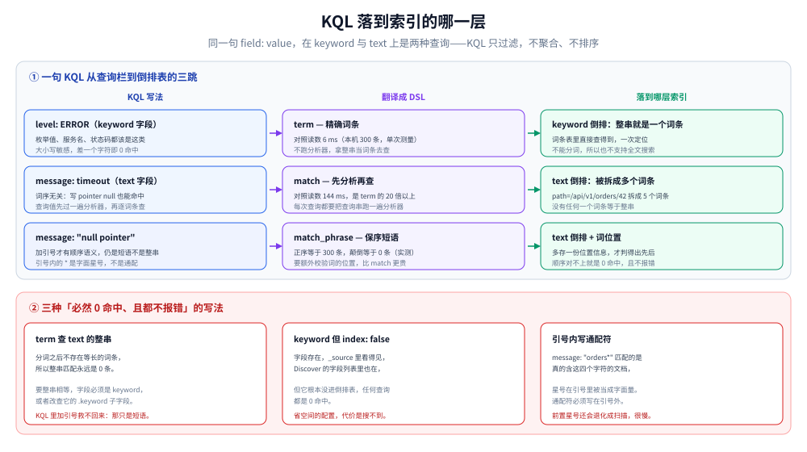

# Kibana 查询语法实战

> Kibana 的查询栏里写的是 **KQL**，不是 ES 的 Query DSL。两者长得像、能做的事却差得远——最要命的是 `field: value` 在 `text` 字段上**会走分析器**，于是「Kibana 里查得到、代码里查不到」成了日常。本篇按 KQL 的条件类型逐类拆，每条都给出它翻译成 DSL 的样子，以及代价。
>
> 内容整理自个人学习笔记。⚠️ **本篇的 KQL 语义按 Elastic 官方 KQL 语法参考（8.x / 9.x 通用）陈述，未在本机 Kibana 实例上验证**——本机只跑了 ES 8.19.0 的 DSL 侧，所以凡带耗时的读数都是 **DSL 侧实测**，KQL 侧只给「会不会走分析器 / 会不会退化成扫」的定性判断。逐条口径见第八节。
>
> 不覆盖：索引为什么这样建（倒排、`doc_values`、字段类型选择）见 [索引原理.md](../../../../../数据存储/搜索与分析/Elasticsearch/索引原理.md)；ILM 与索引滚动见 [ES_ILM与索引调优.md](ES_ILM与索引调优.md)；什么情况该收窄时间窗、怎么四段排障见 [日志查询方法论.md](../../日志查询方法论.md)。

---

## 一、一句话定位：查询栏给的是「筛选」，不是「查询」

KQL 只做一件事：**过滤出满足条件的文档**。它不聚合、不变换、不排序——官方的说法是「KQL only filters data」。所以「按 `service` 分组统计错误数」这类需求，KQL 做不到，得换 Lens / ES|QL / 直接 DSL 聚合。

认清这条能省掉很多尝试：**查询栏里做不到聚合，不是你不会写，是语言不支持**。

| 想做的事 | 在哪做 | 语言 |
| --- | --- | --- |
| 筛出某个服务的错误日志 | Discover 查询栏 | KQL |
| 按小时看错误数趋势 | Lens / Dashboard | 可视化层的聚合 |
| 一次算多个分位数、还要自定义脚本 | Dev Tools → `_search` | DSL |
| 类 SQL 的分析查询 | Discover（ES\|QL 模式） | ES\|QL |

---

## 二、KQL 的六种条件

**本节要点**：KQL 只有六种条件形态。**记住「值的写法决定语义」这一条，比记语法更重要**——同一个字段，值加不加引号、带不带 `*`，走的是完全不同的查询路径。

| 目的 | 语法 | 示例 | 翻译成 DSL 大致是 |
| --- | --- | --- | --- |
| 字段存在 | `field: *` | `trace_id: *` | `exists` 查询（含空字符串） |
| 精确/分词匹配 | `field: value` | `level: ERROR` | keyword 上 `term`；text 上 `match` |
| 短语（保序） | `field: "value"` | `message: "null pointer"` | text 上 `match_phrase` |
| 范围 | `<` `<=` `>` `>=` | `@timestamp < now-2w` | `range` |
| 通配 | `*`（唯一支持的通配符） | `service: svc-*` | `wildcard` |
| 取反 / 组合 | `NOT` / `AND` `OR` `( )` | `NOT level: DEBUG` | `bool.must_not` / `must` / `should` |

再加两种「多」的写法：

| 目的 | 语法 | 示例 |
| --- | --- | --- |
| 一个字段多个值 | `field: (v1 OR v2)` | `level: (ERROR OR FATAL)` |
| 多个字段同值 | `field.*: value` | `biz.*: order`（⚠️ 匹配到的字段类型不同会直接报错） |

---

## 三、`field: value` 在 text 与 keyword 上是两件事

这是整篇最重要的一节，也是「Kibana 查得到、代码查不到」的根源。

| 字段类型 | `field: value` 的行为 | 后果 |
| --- | --- | --- |
| `keyword` / 数值 / 日期 / 布尔 | **精确匹配**，含标点与大小写 | 差一个字符就 0 命中，且不报错 |
| `text` | **走分析器**：先分词再匹配，**词序无关** | `message: null pointer` 与 `pointer null` 都能命中 |
| `text` + 引号 | **短语匹配**，保留词序 | `message: "null pointer"` 才要求顺序 |

三条实用推论：

1. **`level: ERROR` 能不能命中，取决于 `level` 是 keyword 还是 text**。是 keyword 就要求大小写完全一致；是 text 就会被小写成 `error`，于是 `level: ERROR` 仍然命中（因为查询值也被小写化）。**同一句 KQL，在两种 mapping 下含义不同**——这是排查时最该先确认的一件事。
2. **在 `text` 字段上想要「精确等于整串」，KQL 做不到**。加引号只是短语匹配，仍然过了分析器。真要精确整串，必须查 `.keyword` 子字段，或者退回 DSL 的 `term`。而 DSL 侧实测过：`term` 查 `text` 字段的整串**必然 0 命中**（`path=/api/v1/orders/42` 被拆成 `path`、`api`、`v1`、`orders`、`42`，没有任何词条等于整串）。
3. **引号内 `*` 是字面星号，不是通配符**。`message: "orders*"` 匹配的是真的含 `orders*` 这四个字符的文档。要通配必须写在引号外。

### 3.1 一个真实会踩的 mapping

日志里 `message` 常常是 `text`（为了能全文搜）+ `message.keyword` 子字段（为了能精确过滤和聚合）。两种查法：

| 写法 | 走哪个字段 | 语义 |
| --- | --- | --- |
| `message: timeout` | `text`（分析后） | 含 `timeout` 这个词就命中 |
| `message.keyword: "connection timeout"` | `keyword` | **整串完全相等**才命中 |
| `message.keyword: *timeout*` | `keyword` | 前缀/子串通配，慢 |

⚠️ 如果建索引时为了省空间把 `message.keyword` 设成 `index: false`，那么**这个字段永远搜不到**——字段在 `_source` 里看得见、在 Discover 的字段列表里也在，但任何查询都 0 命中。DSL 侧实测确认过这一点。

---

## 四、三个界面入口，三种代价

同一个 KQL，在不同界面里跑的东西不一样。搞清楚这一点，「为什么 Dashboard 慢」就不再是玄学。

| 入口 | 你写什么 | 它实际做什么 | 主要代价 |
| --- | --- | --- | --- |
| Discover 查询栏 | KQL | 过滤 + 取前 N 条（默认按时间倒序） | 时间窗 × 过滤精度 |
| Dashboard 的筛选条 | KQL / 可视化自带的 filter | **每个图表各自跑一次** | 图表数 × 单图代价 |
| Discover 的字段统计 | 点字段看 Top values | 对该字段做一次聚合 | 高基数字段上很贵 |
| Dev Tools → `_search` | DSL | 完全可控 | 取决于你写的 DSL |

⭐ Dashboard 慢的最常见原因不是查询写错，而是**一个 Dashboard 上挂了 12 个图表，每个都扫同一个大时间窗**。这时候优化单个 KQL 收效有限，正确动作是给每个图表收窄时间范围、或者改用预聚合（Transform / 物化视图）。

### 4.1 时间范围的默认值

Discover 与 Dashboard 都有一个**全局时间选择器**，KQL 的 `@timestamp` 条件是在它的基础上再叠加的。两者的关系是「与」：时间选择器已经限定了范围，你在 KQL 里再写 `@timestamp > now-1h` 只会在那个范围内再收窄——**不会扩大**。所以「明明选了 7 天却查不到昨天以前的」这类问题，先看时间选择器，再看 KQL。

---

## 五、从 KQL 到 DSL：什么时候必须离开查询栏

| 需求 | KQL 能做吗 | 该怎么办 |
| --- | --- | --- |
| 多个条件作用于**同一个数组元素** | ⚠️ 做不到 | 用 DSL 的 `nested` 查询 |
| 「一个值同时满足 `>300` 且 `<400`」 | ❌ 做不到 | DSL 的 `range`（KQL 会分别测数组里的不同值） |
| 精确计数（超过 10000 条） | ⚠️ 默认只给下界 | `track_total_hits: true` 或 `_count` |
| 聚合、脚本、自定义评分 | ❌ | DSL / ES\|QL / Lens |
| 大小写不敏感的 keyword 匹配 | ❌ Kibana 查询栏不支持 | DSL 的 `kql` 子句带 `case_insensitive` |

⭐ 倒数第二条值得展开：KQL 在**多值字段**（数组）上，每个条件独立地对数组里的每个值求值。所以 `number > 300 AND number < 400` 能匹配 `"number": [500, 10]`——500 满足前一个条件，10 满足后一个，但它们不是同一个值。**要「同一个值同时满足两个条件」，KQL 表达不了**，只能写 DSL 的 `range`。这个坑在多值标签、多副本状态这类字段上很常见。

### 5.1 同名语言，两套优先级

这是最容易静默出错的一条：

| 环境 | `a: 1 AND b: 2 OR c: 3` 的实际含义 |
| --- | --- |
| **Kibana 查询栏** | `(a: 1 AND b: 2) OR c: 3` —— `NOT` > `AND` > `OR` |
| **DSL 的 `kql` 子句 / ES\|QL 的 `KQL()` 函数** | `a: 1 AND (b: 2 OR c: 3)` —— `AND` 与 `OR` **同优先级，从右往左分组** |

同一句话，在两个地方结果不同。**唯一安全的写法是把括号写全**——写好括号，两边都按你的意思执行。

---

## 六、代价：哪些写法把「查」变成了「扫」

| 写法 | 走索引吗 | 代价 | 建议 |
| --- | --- | --- | --- |
| `level: ERROR`（keyword） | ✅ 精确词条 | 最低 | 枚举值一律这样写 |
| `level: ERROR`（text） | ✅ 分析后词条 | 低 | 但语义变了（大小写被抹平） |
| `message: timeout`（text） | ✅ 分析后词条 | 中 | 词序无关，容易多命中 |
| `message: "null pointer"`（text） | ✅ 短语 | 中偏高 | 比单关键词贵，但仍是索引定位 |
| `service: svc-*` | ✅ 通配（前缀） | 中 | 前缀通配还能走索引 |
| `service: *-api*` | ⚠️ 前置通配 | 高 | 前置 `*` 退化成扫，Kibana 可用 `query:allowLeadingWildcards` 关掉 |
| 裸词 `timeout`（不带字段） | ⚠️ 扫默认字段集 | 高 | 默认字段多时很贵，优先带字段名 |
| 数字/日期字段上用 `*` 通配 | ❌ 直接报错 | — | KQL 只在字符串类字段支持通配 |

**DSL 侧的对照读数（ES 8.19.0，300 条数据集，单次测量）**——用来感受「分析器 vs 词条」的量级差：

| 查询 | 耗时 |
| --- | --- |
| `term` 查 keyword 词条 | 6 ms |
| `match` 查同一段文本（每次跑分析器） | 144 ms |
| `wildcard` 前置 `*` | 79 ms |

⭐ 把这三行翻译成 KQL：`level: ERROR` 走的是第一行，`message: "一段话"` 走的是第二行，`service: *-api*` 走的是第三行。**所以「Kibana 慢」通常不是集群慢，是查询写成了第二或第三行。**

---

## 七、验证与排查：Kibana 查得到、代码查不到

| 现象 | 最可能的原因 | 怎么确认 |
| --- | --- | --- |
| Kibana 有结果，DSL `term` 是 0 | KQL 的 `field: value` 在 text 上走的是 `match`，`term` 查整串必然 0 | 看 mapping 里该字段是 `text` 还是 `keyword` |
| Kibana 有结果，DSL `term` 是 0（keyword 字段） | 字段 `index: false` | 查 mapping，或看该字段能否聚合 |
| Kibana 有结果，DSL 是 0（时间对不上） | 时区：Kibana 用 `dateFormat:tz` 高级设置，直连 DSL 用 UTC | 把 DSL 的时间范围前后各放宽 8 小时试一次 |
| Kibana 有结果，代码里查的是另一个字段名 | 字段名漂移（`trace_id` / `traceId` / `tid`） | 做一次全量字段统计，见 [应用侧日志规范与SDK设计.md](../../治理与规范/应用侧日志规范与SDK设计.md) |
| 两边条数差一个数量级 | KQL 默认总数字段是「≥10000」的下界 | 显式 `track_total_hits: true` |

⭐ 第三条（时区）在日志场景里出现频率极高，而且**不报错**：Kibana 显示的时间是你浏览器时区，DSL 收到的是 UTC。查「今天凌晨 2 点的日志」时，两边会差 8 小时。

### 7.1 一个排查顺序

1. 先在 Discover 里用**最宽的条件**（只留时间选择器）确认**有没有数据**；
2. 加 `level: ERROR`，看条数是否合理；
3. 把这一步的 KQL 用 Dev Tools 手写成 DSL，**核对命中数是否一致**；
4. 不一致 → 按上表逐条排；一致 → 问题在查询之外（采集、写入、保留期）。

---

## 八、校验口径

| 结论 | 状态 | 依据 |
| --- | --- | --- |
| KQL 只过滤、不聚合 | ✅ 官方文档 | KQL 语法参考开篇「KQL only filters data」 |
| `field: value` 在 keyword 上精确、在 text 上走分析器 | ✅ 官方文档 | KQL 语法参考「Match documents by value」原文 |
| 引号内 `*` 是字面星号 | ✅ 官方文档 | KQL 语法参考「Escape special characters」 |
| `AND`/`OR` 在 Kibana 与 DSL `kql` 子句里优先级不同 | ✅ 官方文档 | KQL 语法参考「Combine multiple queries」的差异表 |
| 数字/日期字段上用通配符报错 | ✅ 官方文档 | KQL 语法参考「Match documents using wildcards」 |
| 多值字段上两个条件可命中不同元素 | ✅ 官方文档 | KQL 语法参考「Match documents within a range」 |
| `term` 查 text 整串 0 命中 | ✅ 真跑（DSL 侧） | ES 8.19.0，300 条：`term message="path=/api/v1/orders/42"` = 0，`term message=orders` = 300 |
| `match` 比 `term` 慢一个数量级 | ✅ 真跑（DSL 侧） | 144 ms vs 6 ms（单次测量） |
| 前置 `*` 的 `wildcard` 退化成扫 | ✅ 真跑（DSL 侧） | 79 ms，比 `term` 慢 13 倍 |
| `index: false` 的 keyword 字段永远 0 命中 | ✅ 真跑（DSL 侧） | `message_kw` 整串查询 0 命中 |
| `track_total_hits: true` 更慢 | ✅ 真跑（DSL 侧） | 20 ms vs 4 ms |
| **KQL 在 Kibana 实例上的实际行为** | ⚠️ **未实测** | 本机无 Kibana 实例；全部语义按官方文档陈述 |
| Kibana 界面操作（Discover 字段统计、Lens 聚合） | ⚠️ **未实测** | 只按官方文档描述入口与代价，未截图、未量化 |
| 时区差异的具体偏移 | ⚠️ **未实测** | 按 `dateFormat:tz` 设置机制陈述，未做两实例对照 |

实验脚本在 `.workbuddy/tmp/es-lab/query.sh`。

---

## 延伸追问

**Q：既然 KQL 在 text 上走分析器，那我把 `level` 建成 text 不是更宽松、更不容易查不到吗？**

短期是，长期是灾难。`level` 建 text 意味着 `ERROR`、`error`、`Error` 都命中，看起来「容错」，实际上**你无法表达「只要 ERROR，不要 error」**，也没法对它做精确聚合（text 字段不能聚合）。枚举类字段（`level`、`service`、`env`、`status`）一律 keyword；只有真的要全文检索的自由文本才用 text。这条在 [索引原理.md](../../../../../数据存储/搜索与分析/Elasticsearch/索引原理.md) 第三节讲字段类型时有完整的判据。

**Q：为什么同一个 KQL 在 Kibana 和 DSL 里结果不一样？**

三个已知差异：① `AND`/`OR` 优先级不同（Kibana 是 `NOT > AND > OR`，DSL `kql` 子句是 `AND`/`OR` 同优先级从右到左）；② 省略字段名时查的默认字段集来源不同（Kibana 读 `index.query.default_field`，DSL 可用 `default_field` 覆盖）；③ 时区来源不同。**规避办法统一是：括号写全、字段名写全、时间写绝对时间。**

**Q：Discover 里那个「字段统计」为什么会卡住？**

它对该字段做一次全量聚合。高基数字段（`trace_id`、`user_id`、`request_id`）在一个大时间窗上聚合，等于把整个窗口的 `doc_values` 全扫一遍。**低基数字段（`level`、`service`、`status_code`）随便点，高基数字段先收窄时间窗。**

**Q：日志场景里最该用 KQL 做的三件事是什么？**

① 按 `level` 去噪（`level: ERROR`）；② 按服务圈定（`service: svc-a`）；③ 按 `trace_id` 收口（`trace_id: 4bf9...`）。三件事都建立在「这三个字段是 keyword」这个前提上——所以字段设计其实决定了查询栏好不好用，见 [应用侧日志规范与SDK设计.md](../../治理与规范/应用侧日志规范与SDK设计.md)。

---

## 关联

- **上游/总纲**：[日志查询方法论.md](../../日志查询方法论.md) — 四段收窄与「查不到的五种原因」，本篇是它在 ES 侧的操作面
- **对照**：[LogQL查询与排障实战.md](../Loki/LogQL查询与排障实战.md) — Loki 只有标签能当第一步，所以查询结构完全不同
- **互补（引擎原理）**：[索引原理.md](../../../../../数据存储/搜索与分析/Elasticsearch/索引原理.md) — 为什么 keyword 与 text 的行为差这么多
- **互补（存储侧）**：[ES_ILM与索引调优.md](ES_ILM与索引调优.md) — 索引滚过之后，查询要跨多少个索引
- **上游机制**：[应用侧日志规范与SDK设计.md](../../治理与规范/应用侧日志规范与SDK设计.md) — 字段类型与命名在采集前就定了，查询时改不了
