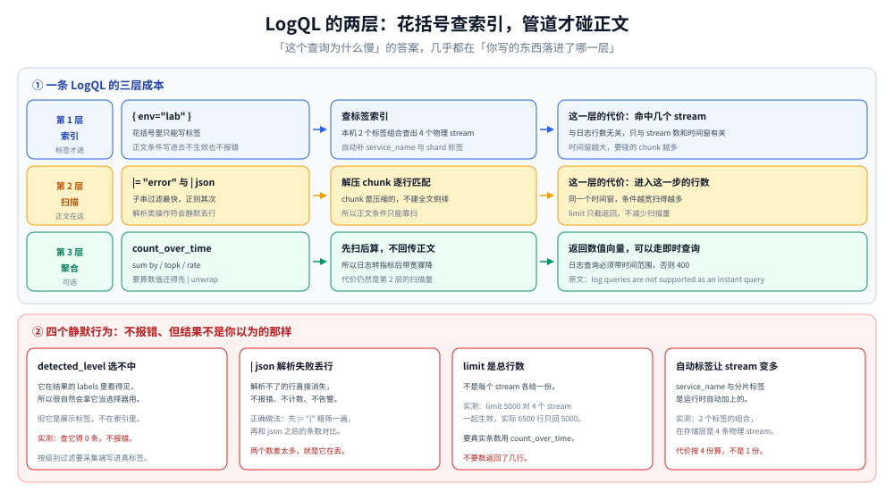

# LogQL 查询与排障实战

> LogQL 只有两层：**花括号里是索引，管道里是扫描**。所有「为什么这个查询这么慢」「为什么这条查不到」的问题，答案几乎都在「你写的东西落进了哪一层」。本篇按这两层拆开讲，再讲怎么把日志当指标算、三条会直接拒写的红线，以及四个不报错的静默行为。
>
> 内容整理自个人学习笔记。✅ **本篇读数来自本机 Loki 3.5.0 实跑**：单机单进程、`auth_enabled: false`、filesystem 存储、tsdb 索引、schema v13，租户名 `fake`；数据集为 4 个 stream、共 6 500 行。逐条口径见第八节。
>
> 不覆盖：chunk 怎么落盘、Compactor 与保留期怎么配见 [Loki_存储架构与Compactor调优.md](Loki_存储架构与Compactor调优.md)；四段收窄的方法论见 [日志查询方法论.md](../../日志查询方法论.md)；ES 侧对应语法见 [Kibana查询语法实战.md](../Elasticsearch/Kibana查询语法实战.md)。

---

## 一、一句话定位：花括号决定「扫多少」，管道决定「找什么」

一条 LogQL 永远是这个形状：

```text
{ 标签选择器 }  | 管道  →  可选：套一层聚合函数
```

| 层 | 写什么 | 走什么 | 代价由什么决定 |
| --- | --- | --- | --- |
| 花括号 | **只能写标签**（`service`、`env`、`level`…） | 索引 | 命中的 stream 数 + 时间窗（chunk 数） |
| 管道 | 正文过滤、解析、格式化 | 逐行扫描 | **进入这一步的行数** |
| 聚合 | `count_over_time` / `rate` / `sum by` | 先扫后算 | 同管道，但不出网传输正文 |

⭐ 一句话判据：**「我的条件能不能进花括号」**。能，代价是「命中几个 stream」；不能，代价是「扫多少行」。这两者差一两个数量级。



⚠️ 最常见的错误是把正文条件写进花括号：`{service="svc-a", message=~".*error.*"}` 不报错，但 `message` 不是标签，Loki 会**忽略它**或直接报错——取决于版本与写法，且**不会提醒你「这个条件没生效」**。

---

## 二、选择器：只有标签能进花括号

LogQL 的标签匹配有四种操作符：

| 操作符 | 含义 | 索引能用吗 | 示例 |
| --- | --- | --- | --- |
| `=` | 相等 | ✅ 精确命中 stream | `{service="svc-a"}` |
| `!=` | 不等 | ⚠️ 反选，stream 多时退化成扫 | `{service!="svc-a"}` |
| `=~` | 正则匹配（**全匹配，不是搜索**） | ⚠️ 正则会展开成多个 stream | `{service=~"svc-.*"}` |
| `!~` | 正则不匹配 | ⚠️ 同上 | `{env!~"dev|test"}` |

三条必须记住的：

1. **`=~` 是「整串匹配」，不是「包含」**。`{service=~"a"}` 只匹配值恰好是 `a` 的 stream；要包含关系必须写 `.*a.*`。
2. **选择器不能为空**：`{}= "x"` 这类写法会被拒——至少要有一个非空匹配器，否则等价于全表扫描。
3. **`!=` 和 `!~` 不是「排除后更快」，而是「选出一批再减掉」**。stream 基数大时，反选比正选慢。

### 2.1 自动加进来的两个标签

Loki 3.x 会自动给每条 stream 加上 `service_name`（从 OTel 语义约定映射）与 `__stream_shard__`（分片标记）。本机实测：**两个标签组合查出 4 个物理 stream**——也就是说，你以为的「一个服务的日志」在存储层可能是 4 条 stream，查询代价按 4 份算。

⭐ 所以「stream 数」不是「你建的标签组合数」，要去 `/loki/api/v1/labels` 与 `/loki/api/v1/series` 看实际有多少。

---

## 三、管道：四类操作符与它们的代价

| 操作符 | 做什么 | 代价 | 注意 |
| --- | --- | --- | --- |
| `\|=` | 正文包含子串 | 低 | ⭐ 最快，优先用 |
| `!=` | 正文不包含 | 低 | 同上 |
| `\|~` | 正文正则匹配 | 中 | 正则别写太宽，`.` 少用 |
| `!~` | 正文正则不匹配 | 中 | 同上 |
| `\| json` | 把 JSON 正文解析成字段 | 中 + **静默丢行** | 解析失败的行**直接消失**，不报错 |
| `\| logfmt` | 解析 `k=v` 正文 | 中 + 静默丢行 | 同上 |
| `\| line_format` | 重排输出行 | 低 | 只影响展示，不影响过滤 |
| `\| label_format` | 造一个新标签 | 低 | 造出来的标签**进入后续管道可用**，但不进索引 |
| `\| unwrap` | 把某个字段当数值取出 | 中 | 后续要接 `rate` / `quantile_over_time` 等 |

### 3.1 `| json` 的静默：本机确认的行为

⭐ 这是 Loki 排障里最贵的一个坑：**`| json` 不会告诉你「有 30% 的行解析失败」，它们直接不出现在结果里**。

所以正确的用法是**先粗筛再看量**：

```text
{env="lab"} |= "{" | json            ← 先确认带 { 的行有多少
{env="lab"} | json                    ← 再解析，对比两个数
```

两者差距大，说明有大量非 JSON 行被丢掉了。**不对比就永远发现不了。**

### 3.2 `limit` 是总行数，不是每个 stream 各给

本机实测：`limit=5000` 查 `{env="lab"}`，4 个 stream 共 6 500 行，只返回 5 000 行。于是「某个分片只有 500 行」看起来像数据缺失。

⚠️ **要真实条数用 `count_over_time`，不要数返回行数**。这条在 [日志查询方法论.md](../../日志查询方法论.md) 第五节也提过，是「查不到」的常见误判来源。

---

## 四、指标查询：把日志当指标算

LogQL 的第二形态是**指标查询**——不返回日志行，返回一个数值向量。这是日志与指标合流的地方，也是它比 ES 省的地方（不出网传正文）。

| 函数 | 算什么 | 典型用法 |
| --- | --- | --- |
| `count_over_time` | 窗口内的行数 | `count_over_time({service="svc-a"} \|= "error" [5m])` |
| `rate` | 每秒行数（自动除窗口） | `rate({service="svc-a"}[5m])` |
| `bytes_over_time` | 窗口内字节数 | 算写入量、估成本 |
| `sum by` / `topk` | 聚合与排名 | `sum by (service) (count_over_time({env="lab"}[1h]))` |
| `quantile_over_time` | 分位数（需先 `\| unwrap`） | `quantile_over_time(0.99, {svc="a"} \| unwrap duration [5m])` |

本机实测：`sum by (service) (count_over_time({env="lab"}[1h]))` 返回 **5 个 service、合计 10 200 行**——注意这个数大于数据集本身的 6 500 行，因为 `[1h]` 窗口**按时间切片展开**，同一条日志会落在多个求值点上被重复计数。**算「总量」不能用 `count_over_time`，要用 `sum_over_time` 之外的方式或直接看后端写入指标。**

### 4.1 `| unwrap` 的三个前提

要用 `quantile_over_time` / `avg_over_time` 这类函数，必须先把某个字段变成数值：

1. 字段必须**先被解析出来**（`| json` 或 `| logfmt`）；
2. `| unwrap` 后面跟字段名，**不带点**（`| unwrap duration`，不是 `| unwrap .duration`）；
3. 该字段在所有行上**必须是数字**——有一行不是，整个查询报错。

⚠️ 第二条的写法差异（LogQL 不用前导点）是从 PromQL / VRL 迁过来时最常写错的。

---

## 五、两个接口：日志查询与指标查询走不同的门

Loki 有两个查询入口，**它们支持的语言子集不同**：

| 接口 | 收什么 | 日志查询 | 指标查询 |
| --- | --- | --- | --- |
| `/loki/api/v1/query_range` | 必须带 `start` / `end` | ✅ | ✅ |
| `/loki/api/v1/query` | 即时求值（单点） | ❌ **拒绝** | ✅ |

本机把日志查询打到 `/query`，直接得到：

```text
400  log queries are not supported as an instant query type,
     please change your query to a range query type
```

⭐ 这条报错很友好，但它的含义容易被误读成「语法错了」。实际是：**日志查询天然需要时间范围**，而即时查询没有范围。指标查询（`count_over_time`、`sum by`）没有这个问题，因为窗口写在方括号里。

### 5.1 时间窗与 `step`

`query_range` 除 `start` / `end` 外还有 `step`（求值步长）。三个参数的关系是：

```text
点数 ≈ (end − start) / step
每个点上的值 = 该点向前推 [窗口] 算出来的
```

所以 `step` 太小 → 点数爆炸（响应慢、可能超时）；`step` 太大 → 曲线粗糙、尖刺看不见。**日志场景的常用值是 `step` = 窗口 / 4**，与 Prometheus 的判据一致。

---

## 六、三条会直接拒写的红线

Loki 有两道限流、一道单行上限，**都返回明确状态码，但处理方式完全不同**：

| 红线 | 触发 | 本机读数 | 重试有用吗 |
| --- | --- | --- | --- |
| 写入速率 | 超过 `ingestion_rate_mb` | **4 194 304 B/s** → **429** | ✅ 有用（退避后重试） |
| 单行大小 | 一行超过 `max_line_size` | **262 144 B** → **400** | ❌ **永远失败**，重试无用 |

⚠️ 这两个状态码的区别是**采集端配置的全部依据**：429 要退避重试，400 要丢弃或截断。**采集端如果把 400 也拿去重试，会白白消耗配额且永远成功不了。** 采集器的重试策略见 [FluentBit配置与调优.md](../../采集器/FluentBit配置与调优.md) 与 [Vector配置与VRL.md](../../采集器/Vector配置与VRL.md)。

---

## 七、验证与排查：四个静默行为

| 行为 | 现象 | 原因 | 怎么确认 |
| --- | --- | --- | --- |
| `detected_level` 选不中 | `{detected_level="info"}` 查出 **0 条** | 它是**展示标签**，不在索引里 | 看结果里的 labels 有它，但选择器用不了 |
| `\| json` 丢行 | 解析后条数变少 | 解析失败的行直接丢弃 | 对比「`\|= "{"`」与「`\| json`」两个数 |
| `limit` 截断 | 某个 stream 看起来缺数据 | `limit` 是**总行数** | 用 `count_over_time` 对账 |
| 自动标签增加 stream 数 | 查询比预期慢 | `service_name` / `__stream_shard__` 自动加标签 | 查 `/loki/api/v1/series` |

⭐ 第一条最反直觉：`detected_level` 在**查询结果的 labels 里看得见**，于是很自然会以为它能当选择器用。**能看见 ≠ 能索引**——这正是 Loki「只索引标签」的另一面：它有「主要标签」（索引）与「结构化元数据 / 展示标签」（不索引）两套东西。

### 7.1 一个排查顺序

1. **先只留花括号**（`{env="lab"}`），确认有没有数据、有几个 stream；
2. 加一个 `|=` 子串，看条数是否合理；
3. 换 `|~` 正则，对比条数——**差太多说明正则写宽了**；
4. 加 `| json`，再对比条数——**差太多说明有大量非 JSON 行**；
5. 到这一步还查不到，问题不在 LogQL，回到 [日志查询方法论.md](../../日志查询方法论.md) 的「查不到的五种原因」。

---

## 八、校验口径

| 结论 | 状态 | 依据 |
| --- | --- | --- |
| 日志查询打 `/query` 被拒（400） | ✅ 真跑 | 原文 `log queries are not supported as an instant query type` |
| 指标查询可走 `/query` | ✅ 真跑 | `count_over_time` / `sum by` 返回 vector |
| `sum by` + `count_over_time` 的返回量 | ✅ 真跑 | 5 个 service / 合计 10 200 行（数据集 6 500 行，窗口切片重复计数） |
| `limit` 按总行数截断 | ✅ 真跑 | `limit=5000` 返回 4 stream 共 5 000 行，实际 6 500 行 |
| 写入限流 4 MB/s → 429 | ✅ 真跑 | 单机默认配置下的速率上限 |
| 单行 256 KB → 400 | ✅ 真跑 | 超限行被拒，重试无效 |
| `detected_level` 是展示标签、选不中 | ✅ 真跑 | `{detected_level="info"}` 查 0 条，但结果 labels 里有该键 |
| `service_name` / `__stream_shard__` 自动加标签 | ✅ 真跑 | 2 个标签组合查出 4 个物理 stream |
| `\| json` 解析失败丢行 | ⚠️ 按官方文档 + 语义推断 | 本机数据集全为 JSON，**未构造失败行做对照** |
| `\| unwrap` 的写法（不带前导点） | ⚠️ 按官方文档 | 未跑 `quantile_over_time` 实例 |
| `step` 与窗口的推荐比例（窗口 / 4） | ⚠️ **本篇判据** | 与 Prometheus 一致的工程经验，未做点数-耗时曲线 |
| 大时间窗下的扫描耗时 | ⚠️ **未实测** | 数据集仅几 MB，无法外推 |

实验脚本在 `.workbuddy/tmp/es-lab/loki_q.py` / `loki_streams.py` / `loki_ratio.py`。

---

## 延伸追问

**Q：为什么 LogQL 不让我把正文条件写进花括号？**

因为花括号对应的是**索引**，而 Loki 的索引里只有标签。正文在 chunk 里是压缩过的，只有解压之后才能匹配——所以正文条件**必然**在管道里。这不是语法限制，是存储结构的直接结果。理解这一点，就不会再问「怎么把 `message` 变成标签」（答案是：会让 stream 数等于日志条数，索引爆炸）。

**Q：`detected_level` 到底该什么时候用？**

只在**展示与筛选之后**用：拿它做 Grafana 的着色、做结果列表里的级别列。要**按级别过滤**，必须在采集端就把 `level` 写成真标签（或写进 structured metadata）。**「Loki 自动识别了级别」不等于「你能按级别查」**——这是两个不同的层。

**Q：`rate` 和 `count_over_time` 有什么区别？**

`count_over_time` 给窗口内的**行数**；`rate` 给**每秒行数**（行数 ÷ 窗口秒数）。所以 `rate({...}[5m])` 与 `count_over_time({...}[5m]) / 300` 等价。选哪个取决于你要「一段时间内多少次」还是「每秒多少次」——告警用 `rate`（阈值与窗口无关），报表用 `count_over_time`。

**Q：日志里带 `trace_id`，应该放标签还是放 structured metadata？**

**structured metadata**。放标签会让 stream 数等于日志条数；放正文就只能扫。structured metadata 是 Loki 3.x 给出的第三条路：可过滤、不进索引、基数不受限。这条判据在 [日志查询方法论.md](../../日志查询方法论.md) 第四节有完整对照。

---

## 关联

- **上游/总纲**：[日志查询方法论.md](../../日志查询方法论.md) — 四段收窄与「查不到的五种原因」，本篇是它在 Loki 侧的操作面
- **对照**：[Kibana查询语法实战.md](../Elasticsearch/Kibana查询语法实战.md) — ES 靠倒排让任意字段当第一步，所以那边没有「花括号 vs 管道」的概念
- **互补（存储侧）**：[Loki_存储架构与Compactor调优.md](Loki_存储架构与Compactor调优.md) — chunk 怎么形成、压缩比由什么决定、Compactor 怎么执行保留期
- **上游机制**：[日志采集管道.md](../../日志采集管道.md) — 标签是在采集端提取的，提取错了查询侧补不回来
- **下游机制**：[日志风暴与限流降级策略.md](../../治理与规范/日志风暴与限流降级策略.md) — 429 与 400 的处理差异决定了采集端要不要重试
