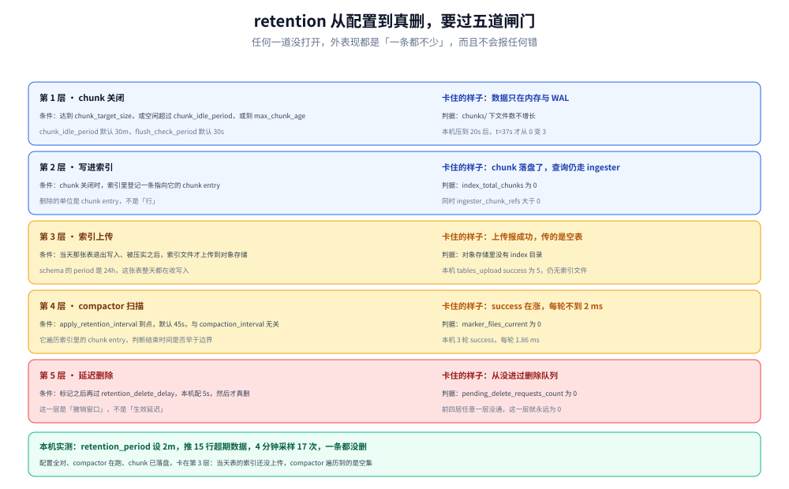
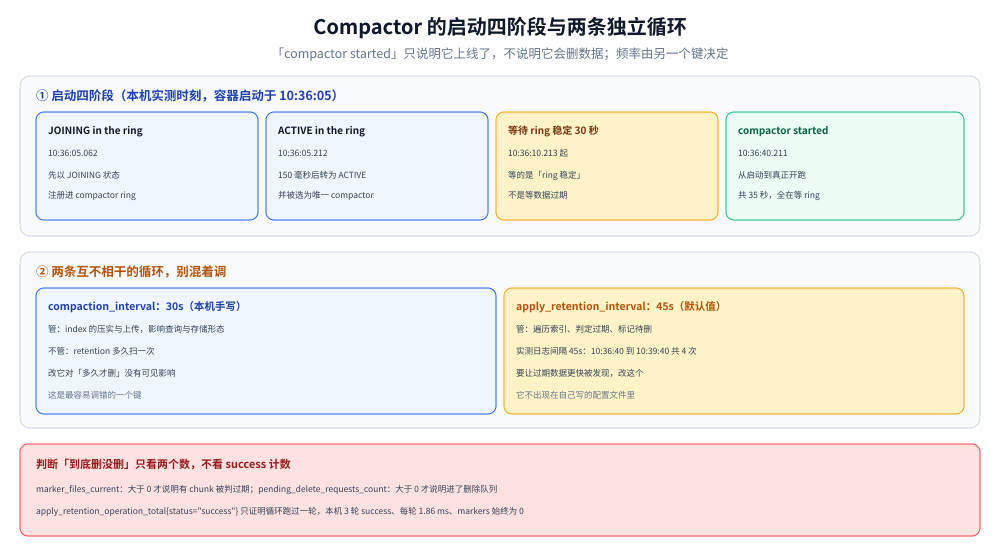

# Loki 存储架构与 Compactor 调优

> 覆盖：Loki 凭什么比 ES 便宜——它**不做全文倒排索引**，只索引标签，正文压缩后按时间块存；由此带来的一整套后果：标签设计直接决定查询代价、chunk 什么时候才落盘、压缩比由什么决定、限流与单行上限卡在哪、以及本机 3.5.0 上摸到的三个反直觉行为（日志查询不支持即时查询、`detected_level` 看着像标签却选不中、`limit` 是按总行数截断）。
>
> 不覆盖：LogQL 语法与排障见 [LogQL查询与排障实战.md](LogQL查询与排障实战.md)；采集端怎么推给 Loki 见 [日志采集管道.md](../../日志采集管道.md)；Loki / ES / ClickHouse 三家怎么选见 [日志系统选型对比.md](../../日志系统选型对比.md)。
>
> 内容整理自个人学习笔记。实测环境 Loki **3.5.0**（单机单进程、`auth_enabled: false`、filesystem 存储、tsdb 索引、schema v13），全部读数来自本轮容器实跑，口径见第十节。

---

## 一、一句话定位：Loki 用「只索引标签」换来了成本，代价是「查之前必须先圈定范围」

**本节要点**：ES 存两份东西——原始文档 + 倒排索引（后者往往比前者还大）；Loki 只存两份东西——压缩后的日志块 + **标签的索引**。日志正文里写了什么，Loki 在写入时完全不知道也不关心。

这条取舍把所有问题都推到了两个地方：

| 取舍 | 换来什么 | 代价是什么 |
| --- | --- | --- |
| 不建全文索引 | 写入极轻、存储约为原始大小的几分之一 | 任何「正文搜索」都要**扫描范围内的所有日志**，范围越大越慢 |
| 只索引标签 | index 体积与「标签组合数」成正比，与日志量无关 | 标签设计错了（高基数），索引爆炸、查询变慢 |
| 按时间切 chunk | 查询天然可以「只扫时间窗内的块」 | 跨大时间窗的查询代价随窗口线性增长 |
| 不解析正文结构 | 写入侧不需要 schema，任何格式都能进 | 结构化查询要靠查询期的 `| json` / `| logfmt` 现场解析 |

⭐ 一条判据：**「按 trace_id 精确找一条日志」Loki 做不到快，它只擅长「某个服务的某段时间里含某关键词的日志」。** 如果你的排障习惯是从链路跳到日志，Loki 侧通常要靠「标签带 trace_id」或「先用指标定位时间窗」来弥补。

---

## 二、核心概念：stream 是索引单位，chunk 是存储单位

**本节要点**：Loki 的数据模型只有三层，理解这三层就能解释后面所有的性能现象。

| 概念 | 是什么 | 本机读数/形态 |
| --- | --- | --- |
| **stream（流）** | 一组**标签完全相同**的日志序列，是索引与查询的最小单位 | 推入 2 个标签组合，查出 **4 个 stream**（见 5.3 的分片） |
| **chunk（块）** | 一个 stream 在一段时间内的日志，压缩后落盘的文件 | 落盘后单个 chunk 约 1.1 KB ~ 17.9 KB |
| **index（索引）** | 记录「哪个 stream 的哪个 chunk 在哪个时间区间」 | tsdb 格式，`schema: v13`、`period: 24h` |
| **tenant（租户）** | 多租户隔离单位，`auth_enabled: false` 时统一叫 `fake` | 落盘路径 `/loki/chunks/fake/...` |

⭐ 关键推论：**stream 的数量 = 标签组合的数量**。标签里放 `user_id`、`request_id`、`trace_id` 这类高基数字段，stream 数量会随用户数线性增长，索引随之爆炸——这就是 Loki 文档反复强调「标签要低基数」的根因。

---

## 三、整体架构：写入三段、查询两段


图上半是写入路径：日志先按标签归到 stream，在内存里攒成 chunk，同时写 WAL 保证不丢；chunk 达到目标大小或空闲超时后才 flush 到对象存储/filesystem，索引由 tsdb-shipper 定期上传。

图下半是查询路径：**先查索引**——用标签选择器找出「哪些 chunk 落在时间窗内」，再**只扫这些 chunk 的正文**。所以查询代价可以用一句话估算：`扫描量 ≈ 命中 chunk 的总字节数`，而命中 chunk 的数量由**标签选择性与时间窗**共同决定。

本机落盘结构（`docker exec loki-lab find /loki -maxdepth 2 -type d`）：

| 目录 | 作用 | 本机大小 |
| --- | --- | --- |
| `/loki/chunks` | 真正的日志块（压缩后） | 100 KB（5 个文件） |
| `/loki/wal` | 写入预写日志，chunk flush 前先落这里 | 3.0 MB |
| `/loki/tsdb-shipper-active` | 当前活跃的 tsdb 索引，含 `wal/` `scratch/` `uploader/` `per_tenant/` `multitenant/` | 36 KB |
| `/loki/tsdb-shipper-cache` | 下载过的索引缓存 | 12 KB |
| `/loki/compactor` | 压缩与保留期执行的暂存区 | 4 KB |
| `/loki/rules`、`/loki/rules-temp` | 告警规则与临时目录 | 4 KB 各 |

⚠️ 一眼能看出的结构事实：**WAL 比 chunks 大 30 倍**（3.0 MB vs 100 KB）。这不是异常——chunk 是压缩后的，WAL 是未压缩的写入缓冲。判断「Loki 有没有在正常工作」不能看 WAL 大小，要看 chunks 有没有增长。

---

## 四、部署：最小可运行的单机配置

**本节要点**：Loki 3.x 镜像自带 `/etc/loki/local-config.yaml`，直接 `docker run` 就能跑，这份默认配置已经把「单机、filesystem、tsdb 索引」配好了。真正需要改的是**保留期**与**限流**。

| 配置项 | 默认值（本机实测读到） | 含义 |
| --- | --- | --- |
| `auth_enabled` | `false` | 单租户，所有数据落在 `fake` 租户下 |
| `common.path_prefix` | `/loki` | 所有数据根目录 |
| `storage` | `filesystem`（`chunks_directory: /loki/chunks`） | 单机用本地盘，生产换 S3/OSS |
| `schema_config.store` | `tsdb` | v13 schema 用 tsdb 索引（旧版是 `boltdb-shipper`） |
| `schema_config.object_store` | `filesystem` | 索引也落本地盘 |
| `schema_config.index.period` | `24h` | 索引按天切分 |
| `replication_factor` | `1` | 单副本 |

启动与验证：

```bash
docker run -d --name loki-lab -p 13100:3100 grafana/loki:3.5.0
curl -s http://127.0.0.1:13100/ready
```

⚠️ `/ready` 在启动后十几秒内会返回 **`Ingester not ready: waiting for 15s after being ready`**——这是正常状态，不是故障。它表示 ingester 已经起来了但在等一个 15 秒的宽限期，避免刚启动就被判定为「可服务」。

**写入**是 `POST /loki/api/v1/push`，报文按 stream 组织，时间戳必须是**纳秒字符串**：

```json
{
  "streams": [
    { "stream": { "service": "svc-a", "env": "lab" },
      "values": [["1792821742000000000", "level=info msg=\"request handled\""]] }
  ]
}
```

本机推 200 条（2 个 stream）返回 **204**，耗时 **67.7 ms**。

---

## 五、使用一：标签是唯一的索引，所以标签设计就是查询成本

**本节要点**：Loki 的查询分两步——**标签选择器圈范围 → 正文过滤**。第一步走索引（快），第二步是纯扫描（与范围内字节数成正比）。所以「标签选得好不好」直接等于「要扫多少字节」。

### 5.1 三步查询的结构差异

| 查询 | 走哪一步 | 本机读数 |
| --- | --- | --- |
| `{service="svc-a"}` | 索引定范围，返回整段正文 | 2 个 stream / 100 行 |
| `{service="svc-a"} |= "error"` | 索引 + **逐行扫描** | 2 个 stream / 20 行 |
| `sum by (service) (count_over_time({env="lab"}[1h]))` | 索引 + 计数，**不取正文** | 5 个 service，合计 10 200 行 |

第三条是关键：`count_over_time` 这类聚合**不需要把正文传回来**，只在 chunk 上累加计数，所以它比「取出日志再自己数」便宜一个量级。

### 5.2 高基数标签的代价

| 标签 | 基数 | 后果 |
| --- | --- | --- |
| `env` | 个位数 | 安全 |
| `service` | 与微服务数量同阶 | 安全 |
| `level` | 5~7 | 可以，但**已经能从正文里过滤**，加进来意义不大 |
| `trace_id` | 每条日志一个 | 💀 stream 数 = 日志条数，索引直接爆 |
| `user_id` / `path` 带 ID | 与用户/请求数同阶 | 💀 同上，且几乎必然触发 stream 上限 |

⭐ 判据：**「这个标签的取值会不会随请求增长？」会，就不要放进标签**，改成用 `|=` / `| json` 在正文里过滤，或者用 `structured metadata`（Loki 3.x 的新特性）。

### 5.3 一个反直觉读数：一个标签组合会查出多个 stream

本机推入的是 2 个标签组合（`svc-a` / `svc-b`），但用 `{env="lab"}` 查出 **4 个 stream**，其中 `svc-bulk` 被拆成两个：

| stream 标签 | 行数 |
| --- | --- |
| `{service="svc-repeat", ...}` | 2 000 |
| `{service="svc-random", ...}` | 2 000 |
| `{service="svc-bulk", __stream_shard__="0", ...}` | 500（被 limit 截断） |
| `{service="svc-bulk", __stream_shard__="1", ...}` | 500（被 limit 截断） |

两个额外字段都不是我们传的：

- **`__stream_shard__`**：Loki 3.x 的**流分片**——单个 stream 数据量太大时按分片拆开写，查询侧自动合并，用户不需要感知。它的存在说明「一个逻辑 stream 在存储层可能是多个物理 stream」。
- **`service_name`**：Loki 3.x 的 `discover_service_name` 自动补的标签（从 `service` 或 OTel 的 `service.name` 推导），目的是让 OTel 生态的查询能直接用在 Loki 上。

---

## 六、使用二：chunk 什么时候落盘，压缩比由什么决定

**本节要点**：写完 push 返回 204 **不代表数据已经落成 chunk**。数据先进 WAL 与内存，chunk 要满足「达到目标大小」或「空闲超时」才 flush。所以「刚写完去查」和「等一会儿再查」看到的是两条不同的路径。

本机读数（三批各约 1 MB，共 3 MB 原始数据）：

| 时刻 | `chunks/` | `wal/` | 说明 |
| --- | --- | --- | --- |
| push 完 3 批 | 8 KB（1 个文件） | **3.0 MB** | 数据几乎全在 WAL，chunk 只有此前那批 |
| `POST /flush` 后 | **100 KB（5 个文件）** | 3.0 MB | 强制 flush 把内存 chunk 落盘 |

单个 chunk 文件大小：`1 176 / 1 176 / 17 907 / 18 072 / 17 923` 字节。

⭐ 三个可操作的结论：

1. **`POST /flush` 是实验与排查的利器**——不用等空闲超时就能把数据落盘，验证「写入链路是否真的到了存储层」。
2. **WAL 大小不能当容量指标**——它是未压缩的写入缓冲，chunk 落盘后并不会立刻缩小（WAL 由 checkpoint 回收）。
3. **`chunk_target_size` 决定「多久落一次盘」**，默认 1.5 MB。调大有好处（chunk 更大、压缩率更高、索引条目更少）也有代价（内存中攒得更久、flush 峰值更猛）。

### 6.1 压缩比强烈依赖内容重复度

同一套流程，两种内容各推约 0.3 MB，按 `chunks/` 目录增量估算：

| 内容类型 | push 字节 | chunk 增量 | 压缩比 |
| --- | --- | --- | --- |
| 随机串（模拟 trace_id、URL 这类高熵内容） | 299 877 | ≈ 108 KB | **约 2.8 : 1** |
| 高度重复（同一行带相同填充） | 284 078 | ≈ 11 KB | **约 25 : 1** |

⚠️ 这两个数是**按目录增量粗算**（含索引开销、受前序 chunk 影响），不是精确的单条记账。但它们指向的结论是稳的：**「Loki 存日志能省 10 倍」这句话只在日志高度重复时成立**。带大量 ID、堆栈、JSON 的日志，压缩比会掉到 3 倍左右——做容量规划时按自己的样本估，不要按厂商给的倍数估。

---

## 七、使用三：限流与保留（三条会直接拒写的红线）

**本节要点**：Loki 的限流不是「攒着慢慢写」，而是**直接返回 429 让客户端重试**。三条红线都在 `limits_config` 里，默认值很保守。

| 红线 | 默认值（本机读到） | 触发时的返回 |
| --- | --- | --- |
| 摄取速率 | **4 194 304 字节/秒**（4 MB/s） | `429` + `Ingestion rate limit exceeded` |
| 单条大小 | **262 144 字节**（256 KB） | `400` + `Max entry size ... exceeded` |
| 保留期 `retention_period` | 本机默认配置**未设**（即不删） | — |

本机实测两条：

```text
一次推 11.97 MB（20000 行）：
429  Ingestion rate limit exceeded for user fake (limit: 4194304 bytes/sec)
     while attempting to ingest '20000' lines totaling '11928890' bytes

单行 307 200 字节：
400  Max entry size '262144' bytes exceeded for stream '{env="lab", service="svc-big", ...}'
     while adding an entry with length '307200' bytes
```

⭐ 两条判据：

1. **429 的报错里带着「多少行、多少字节、限值多少」，可以直接反推需要把客户端拆成几批**。本机 11.97 MB / 4 MB/s ≈ 需要 3 秒摊开，或按 4 MB 一批分 3 批。
2. **单行超限是 400 而不是 429**，客户端重试再多次也不会成功——这类日志必须**在采集端截断**（几十 KB 的堆栈或大 JSON 是常见来源），不要指望后端接收。

⚠️ **保留期必须显式配**：本机默认配置里没有 `retention_period`，也就是「永不删除」。生产上要同时做三件事——`limits_config.retention_period` 设天数、`compactor` 的 `retention_enabled: true` 打开删除、`compactor.delete_request_store` 配好。

⭐ 但这三件只是**必要条件，不是充分条件**。本机把三者全部配齐、`retention_period: 2m`、推了 15 行超期数据、观察 4 分钟，**一条都没删**，而且全程无任何报错。原因为什么，见下一节。

---

## 八、使用四：retention 配好了为什么还不删——从配置到真正删除隔着五层

**本节要点**：`retention_period` 只回答「多久算旧」，不负责「到点就删」。从数据进来到真的被抹掉，Loki 要依次走过「chunk 关闭 → 写进索引 → 索引上传 → compactor 扫描 → 延迟删除」五步，任何一步没到位，外表现都是**一条都不少、一句报错也没有**。



五道闸门是串联的：上面任何一层没打开，下面几层的判据就永远是 0。本机卡在第三层——当天那张表的索引还没上传，compactor 遍历到的是空集。

### 8.1 先把配置配到「理论上应该删」

本机配置（只列相关项）：

```yaml
limits_config:
  retention_period: 2m
compactor:
  compaction_interval: 30s
  retention_enabled: true
  retention_delete_delay: 5s
  retention_delete_worker_count: 10
  delete_request_store: filesystem
```

`retention_period: 2m` 已经是极端激进的取值——超过 2 分钟的数据都该消失。但光看自己的配置文件看不出问题，要让 Loki 把**生效配置**打出来（`-verify-config -print-config-stderr`），才知道真正决定节奏的是哪几个键：

| 配置键 | 本机取值 | 来源 | 管什么 |
| --- | --- | --- | --- |
| `retention_period` | `2m` | 手写 | 多久算旧 |
| `apply_retention_interval` | **`45s`** | 默认值 | **retention 的扫描节拍** |
| `compaction_interval` | `30s` | 手写 | 只压实 index，不管 retention 频率 |
| `retention_delete_delay` | `5s` | 手写 | 标记之后还要再等多久才真删 |
| `retention_table_timeout` | `0s` | 默认值 | 表要空闲多久才允许处理（0 = 不等） |
| `retention_deletes_enabled` | `false` | 默认值 | 这是 `/delete` 接口的开关，与 retention 无关 |
| `retention_delete_worker_count` | `10` | 手写 | 删除并发 |

⭐ 第一个反直觉点就在这张表里：**改 `compaction_interval` 不会改变 retention 的扫描频率**。本机设 30s，实测 compactor 的日志间隔稳定是 **45 秒**（10:36:40 → 10:37:25 → 10:38:10 → 10:38:55 → 10:39:40），因为 retention 走的是独立的 `apply_retention_interval`，默认 45s。想让它更快发现过期数据，该改的是这个键。

### 8.2 日志里那个 `1792838080` 不是「期限」，是「边界时刻」

compactor 每轮打一行：

```text
level=info caller=expiration.go:81 msg="overall smallest retention period 1792838080.21, default smallest retention period 1792838080.21"
```

第一眼会读成「保留期 = 17.9 亿秒（约 56 年）」，然后怀疑配置根本没生效。换算一下：

```text
$ date -u -d @1792838080 '+%Y-%m-%dT%H:%M:%SZ'
2026-10-24T10:34:40Z
```

而这一行是 **10:36:40** 打出来的，正好「当前时刻 − 2 分钟」。所以它打的是**过期边界的绝对时间戳**：比这个时刻旧的数据就算过期，下一轮变成 `1792838125`（+45s），边界跟着时间往前走。

⭐ 判据：**看小数位**。`1792838080.21` 的小数部分 `.210813299` 与日志时间 `10:36:40.210813299` 完全相同——它就是个 `time.Time` 的 Unix 秒，不是时长。

### 8.3 第一层：chunk 还没关，compactor 就看不见

Loki 的删除单位是 **chunk**，不是行。chunk 满足下面任一条件才关闭并落成文件：达到 `chunk_target_size`、空闲超过 `chunk_idle_period`、存活超过 `max_chunk_age`，或收到 `POST /flush`。

本机把 `chunk_idle_period: 20s`、`max_chunk_age: 1m`（默认分别是 **30m** 和 **2h**）压到很短后，`chunks/` 目录的变化：

| 时刻 | `chunks/` 文件数 | 说明 |
| --- | --- | --- |
| push 完成（t=7s） | **0** | 数据还在内存与 WAL |
| t=22s | **0** | 未到关闭条件 |
| t=37s | **3** | 三个 stream 各关一个 chunk |

`flush_check_period` 默认 **30s**——ingester 每 30 秒才检查一次「有没有 chunk 该关」，所以即使 `chunk_idle_period` 设 20s，实际也要等到下一个检查点才动手。默认配置下 `chunk_idle_period` 是 30 分钟，意味着**写入后半小时内，retention 根本没有对象可看**。

### 8.4 第二层：chunk 落了盘，不等于进了索引

这一层最容易被忽略。chunk 文件出现在 `chunks/` 是一回事，**索引里出现指向它的 chunk entry 是另一回事**——而 compactor 只遍历索引。

本机在同一时刻的五个读数：

| 读数 | 值 | 说明 |
| --- | --- | --- |
| `chunks/` 下的 chunk 文件 | 3 个 | 数据确实落盘了 |
| `data/index` 目录 | **不存在** | 索引一个文件都没上传到对象存储 |
| `loki_tsdb_shipper_tables_upload_operation_total{status="success"}` | **5** | 上传操作「成功」跑了 5 次，传的是空表 |
| 查询指标 `index_total_chunks` | **0** | 查询没从索引里读到任何 chunk |
| 查询指标 `ingester_chunk_refs` | **1** | 数据是从 ingester 侧读出来的 |

⭐ 五个读数放在一起，指向同一个结论：**数据在 ingester 和 chunk 存储里，但没进索引**。而 compactor 的 retention 就是「遍历索引里的 chunk entry，判断其结束时间是否早于边界」——索引空着，它就无事可做。

本机 schema 是 `tsdb` + `period: 24h`，当天这张表（`index_20750`）**整天都在接收写入**，它的索引文件要等表退出写入、被压实并上传之后，才会出现在对象存储里。所以在单机 filesystem 上，**当天的数据天然不可能被 retention 处理**，无论 `retention_period` 配得多短。

### 8.5 第三层：compactor 在跑，但标记数是 0



从启动到真正执行 retention 之间还有 35 秒的 ring 等待，而「压实索引」与「扫描过期」是两条各自独立的循环，节奏互不影响。

判断 compactor 是否真干了活，不看它有没有启动，看这几个数：

| 指标 | 本机读数 | 含义 |
| --- | --- | --- |
| `loki_compactor_apply_retention_operation_total{status="success"}` | **3**（4 分钟内） | retention 循环跑过 3 轮 |
| `loki_compactor_apply_retention_operation_duration_seconds` | **0.00186**（1.86 ms） | 每轮只花 1.86 毫秒——几乎没有活干 |
| `loki_boltdb_shipper_retention_sweeper_marker_files_current` | **0** | 从启动到现在没标记过任何 chunk |
| `loki_compactor_pending_delete_requests_count` | **0** | 没有待删除请求 |
| `compactor/retention/<store>/markers/` 目录 | **空** | 与上面一致 |

「成功跑了 N 轮」和「真的删了东西」是两件事：**1.86 毫秒的 `success` 等价于空转**。

### 8.6 实测时间线：15 行超期数据，4 分钟一条没少

第一轮推三组，其中两组的时间戳超出 `retention_period: 2m`：

| 组 | stream | 时间戳 | 行数 |
| --- | --- | --- | --- |
| A | `{job="lab", batch="old"}` | 10 分钟前 | 3 |
| B | `{job="lab", batch="new"}` | 现在 | 3 |
| C | `{job="lab"}` | 3 行 10 分钟前 + 3 行现在 | 6 |

从 push 完成起每 15 秒查一次，连续 **247 秒**：

```text
t(s)   行数   分组                     chunks  index
7      12     C=6 new=3 old=3          0       无
37     12     C=6 new=3 old=3          3       无
97     12     C=6 new=3 old=3          3       无
247    12     C=6 new=3 old=3          3       无
```

第二轮在此基础上再推一组 `{job="lab", batch="yesterday"}`，时间戳 **25 小时前**（落在昨天那张已关闭的表上），3 行，总行数变 15。再连续观察 **243 秒**：

```text
t(s)   分组                                       index 表
0      C=6 new:3 old:3                          无 index 目录
46     C=6 new:3 old:3 yesterday:3               无 index 目录
243    C=6 new:3 old:3 yesterday:3               无 index 目录
```

结论很硬：**A 组是独立 stream、整块 chunk 全是过期数据，一样没删；D 组落在 25 小时前那张表上，也没删**。`POST /flush` 返回 204 之后仍然如此。

### 8.7 五个判据：卡在哪一层，看哪个数

排查「配了不删」时按这个顺序看，从上往下，第一个不满足的就是卡点：

| 层 | 检查什么 | 本机读数 | 不满足时的表现 |
| --- | --- | --- | --- |
| 1 | `apply_retention_interval` 是不是你以为的那个值 | 默认 45s | 改 `compaction_interval` 却毫无变化 |
| 2 | `chunks/` 下有没有新文件 | 有（t=37s 起 3 个） | 数据还在内存与 WAL |
| 3 | 对象存储里有没有 index 文件 | **没有** | compactor 遍历到空集 |
| 4 | `marker_files_current` 是否大于 0 | **0** | 没有任何 chunk 被判过期 |
| 5 | `pending_delete_requests_count` 是否大于 0 | **0** | 根本没进删除队列 |

⭐ 一句话判据：**`apply_retention` 的成功计数在涨、但 `duration` 只有毫秒级、`markers` 是 0，说明 retention 在空转，问题不在 retention 配置，而在「索引里没有它能看见的数据」**。

### 8.8 那生产上到底怎么让它删

本机实测能确认的只有一条：**数据得先进入一张已经关闭的索引表**。落到操作上：

1. **别用分钟级 retention 做验证**。想验证删除，要么把 `chunk_idle_period` 与 `max_chunk_age` 压到秒级再等索引上传，要么直接等「表的一个周期过去」（本机 `period: 24h`，即跨天）。用 2 分钟 retention 测 10 分钟前的数据、等 4 分钟看不到变化，是正常现象。
2. **`retention_period` 的实际单位是天级**。生产上 7 天、30 天是常态，这个量级下「索引表跨天关闭 → compactor 下一轮扫描」的滞后完全可以接受，也不会产生「配了不删」的错觉。
3. **`compaction_interval` 与 `apply_retention_interval` 分开调**：前者管索引压实（影响查询与上传），后者管 retention 扫描。把两者混为一谈，会一直调不到点上。
4. **filesystem 后端下 `POST /flush` 只能强制 chunk 落盘，不能强制索引上传**——它解决的是第 2 层，不是第 3 层。

⚠️ 跨天之后 compactor 是否真的删掉这些数据，本机**没有等到那一天**，属未实测。校验口径见篇末。

---

## 九、验证与排查：三个反直觉行为

### 9.1 坑一：日志查询不能用即时查询接口

```text
GET /loki/api/v1/query?query={service="svc-a"}
400  log queries are not supported as an instant query type,
     please change your query to a range query type
```

`/query` 只接受**指标类查询**（`count_over_time`、`sum by` 之类返回 vector 的），要取日志正文必须用 `/query_range` 并带 `start` / `end`。这与 ES 的 `_search` 完全不同——ES 的即时查询不需要时间范围。

| 查询类型 | `/query`（即时） | `/query_range`（范围） |
| --- | --- | --- |
| `{service="svc-a"}` | ❌ 400 | ✅ streams |
| `count_over_time({env="lab"}[5m])` | ✅ vector | ✅ matrix |
| `sum by (service) (...)` | ✅ vector | ✅ matrix |

### 9.2 坑二：`detected_level` 看着像标签，却选不中

Loki 3.x 会自动从日志正文里**猜级别**，并在查询结果里附上 `detected_level` 字段：

```text
labels = {'detected_level': 'info', 'env': 'lab', 'service': 'svc-repeat', 'service_name': 'svc-repeat'}
```

但把它当标签选择器用，**查不到任何数据**：

| 查询 | 结果 |
| --- | --- |
| `count_over_time({detected_level="info"}[1h])` | **series = 0，total = 0** |
| `count_over_time({service="svc-a"}[1h])` | series = 2，total = 100 |

原因：`detected_level` 是**查询结果上的展示字段**（给 Grafana 上色与筛选用的），不在索引里。要用它，只能写在管道后做结果过滤（`{env="lab"} | detected_level="error"` 这类），不能用它缩小扫描范围。**这是「展示标签 ≠ 索引标签」的一个具体例子，也是用 Loki 时最容易误判代价的地方。**

### 9.3 坑三：`limit` 按总行数截断，不是按 stream

本机 `limit=5000` 查 `{env="lab"}`，返回 4 个 stream 共 6 500 行里的 5 000 行——于是 `svc-bulk` 的两个分片各只返回 500 行，看起来像「这个 stream 只有 500 条」。实际它共有 6 000 条（`count_over_time` 读到 6 000）。

⭐ 判据：**要看真实条数就用 `count_over_time`，不要数 `query_range` 返回的行数**。后者永远 ≤ `limit`，且截断按时间/流顺序，不是均匀分配。

### 9.4 语法错误的报错位置要看 `col`

```text
GET /loki/api/v1/query?query=count_over_time("foo"[5m])
400  parse error at line 1, col 17: syntax error: unexpected STRING, expecting NUMBER or { or (
```

Loki 的解析器报「期望 `{` 或 `(`」，说明**日志选择器必须以花括号开头**——`count_over_time("foo"[5m])` 少了一层 `{...}`。这类报错定位很准（给出行列），比 ES 的 DSL 解析错误好读。

---

## 十、校验口径

| 结论 | 状态 | 依据 |
| --- | --- | --- |
| 单机默认配置是 tsdb + filesystem + schema v13 | ✅ 真跑 | `cat /etc/loki/local-config.yaml` 读到 `store: tsdb`、`schema: v13`、`period: 24h`、`replication_factor: 1` |
| push 200 条返回 204、67.7 ms | ✅ 真跑 | 2 个 stream × 100 行 |
| 日志查询不能走 `/query` | ✅ 真跑 | 400 原文 `log queries are not supported as an instant query type` |
| 指标类查询可以走 `/query` | ✅ 真跑 | `count_over_time` → vector；`sum by` → 2/5 series |
| `detected_level` 不能当选择器 | ✅ 真跑 | 选择器查 0 条，`{service="svc-a"}` 同一写法查 100 条 |
| 一个标签组合会查出多个 stream | ✅ 真跑 | `svc-bulk` 出现 `__stream_shard__` 0/1 两个物理 stream |
| 3 MB 数据先落 WAL（3.0 MB），`/flush` 后 chunks 100 KB | ✅ 真跑 | `du -sh` 前后各一次 + `find /loki/chunks -type f` |
| 压缩比：随机 ≈2.8:1、重复 ≈25:1 | ⚠️ 粗算 | 按 `chunks/` 目录增量估算，含索引开销，非精确记账 |
| 429 限流阈值 4 MB/s | ✅ 真跑 | 推 11.97 MB 得 429，报错含 `limit: 4194304 bytes/sec` |
| 单行上限 256 KB | ✅ 真跑 | 推 307 200 字节得 400，报错含 `262144` 与 `307200` |
| 三者配齐后 4 分钟未删除任何数据（12 行基线不变） | ✅ 真跑 | `retention_period: 2m` + `retention_enabled: true` + `delete_request_store: filesystem`，247 秒内采样 17 次，A/B/C 组行数恒为 12 |
| 25 小时前的数据（昨天表）同样未删 | ✅ 真跑 | 追加 `batch="yesterday"` 3 行，243 秒内采样 17 次，总行数恒为 15 |
| `apply_retention_interval` 默认 45s，与 `compaction_interval` 无关 | ✅ 真跑 | `-print-config-stderr` 读到 `apply_retention_interval: 45s`；compactor 日志间隔实测 45s（10:36:40 → 10:39:40 共 4 次） |
| `overall smallest retention period` 是绝对时间戳 | ✅ 真跑 | `date -u -d @1792838080` = 10:34:40，等于该行打印时刻 10:36:40 减 2 分钟 |
| `apply_retention` 报成功但在空转 | ✅ 真跑 | `operation_total{status="success"}=3`、`duration=0.00186`、`marker_files_current=0`、`pending_delete_requests_count=0` |
| chunk 到 t≈37s 才落盘 3 个 | ✅ 真跑 | `chunk_idle_period: 20s` + `flush_check_period: 30s`，`chunks/` 文件计数 0 → 0 → 3 |
| chunk 已落盘但索引未上传 | ✅ 真跑 | `find data -maxdepth 4` 无 index 目录；`tsdb_shipper_tables_upload_operation_total{status="success"}=5` 却无索引文件 |
| 保留期真正执行删除（跨天、表关闭之后） | ⚠️ 未实测 | 观察窗口仅 4 分钟，未跨天；对象存储为 filesystem |
| 对象存储（S3/OSS）后端 | ⚠️ 未实测 | 本机只有 filesystem |
| 多副本与 ingester 一致性 | ⚠️ 未实测 | 单机 `replication_factor: 1` |
| 高基数标签的真实索引膨胀 | ⚠️ 未实测 | 未构造 `trace_id` 级基数的实验 |

实验脚本在 `.workbuddy/tmp/es-lab/`（`loki_exp.sh` / `loki_q.py` / `loki_c.py` / `loki_ratio.py` / `loki_streams.py`），容器 `loki-lab`（`grafana/loki:3.5.0`，端口映射 `13100:3100`）。

第八节的 retention 实验另建了一套：脚本在 `.workbuddy/tmp/loki-lab2/`（`restart.sh` / `restart2.sh` / `ret_split.py` / `ret_timeline.py` / `ret_yesterday.py`），配置为 `loki-retention.yaml` 与 `loki-retention2.yaml`，容器 `loki-ret`（端口映射 `13200:3100`）。每轮实验前的数据目录改名保留为 `data-bak-*` / `data-bak2-*`，没有直接删除。

---

## 延伸追问

**Q：既然 Loki 查正文要全扫，为什么还比 ES 便宜还够用？**

因为它把「全扫」的范围压得很小。日志查询的典型形态是「某个服务 + 最近 30 分钟 + 含某个关键词」，标签能把范围压到几十个 chunk，正文扫描的量级是几十 MB，现代磁盘顺序读几十 MB 是毫秒到百毫秒级。真正贵的查询是「跨所有服务、跨一天、模糊匹配」——这种在 ES 上也很贵，只是贵的方式不同（ES 是索引扫描 + 结果合并，Loki 是暴力解压）。

**Q：`structured metadata` 能不能替代高基数标签？**

能解决「想按 `trace_id` 过滤但不想让它进索引」的问题：它把字段存成独立的元数据列，可过滤但不进 stream 标签，索引体积不随它增长。代价是多一层存储格式、且旧版本与部分工具链支持不完整。**判断标准是「这个字段会不会成为查询的起点」**：会，就放标签；只是「偶尔想按它筛一下」，就放 structured metadata。

**Q：chunk 越大越省，那能不能把 `chunk_target_size` 调到很大？**

不能无限调。chunk 在内存里攒着，调大到 50 MB 意味着每个活跃 stream 最多占 50 MB 内存；同时 flush 时的写入放大与「查询要等 chunk 关闭才能读到」的延迟都会变大。常见折中是默认的 1.5 MB 上下，配合 `max_chunk_age`（默认 2 小时）保证「即使量小也会定期落盘」。

**Q：为什么本机的 WAL 比 chunks 大 30 倍？**

WAL 是写入预写日志，**未压缩**且按「最近一段时间的写入」滚动；chunks 是压缩后的成品。3 MB 原始文本压成 100 KB 是压缩比在起作用（本机样本高重复）。判断健康度应该看两件事：chunks 是否持续增长、WAL 是否在 checkpoint 后被回收——而不是比较两者大小。

---

## 关联

- **上游/总纲**：[日志系统选型对比.md](../../日志系统选型对比.md) — 索引模型决定「能查什么」，Loki 是「标签 + 暴力扫」这一格的代表
- **对照**：[ES_ILM与索引调优.md](../Elasticsearch/ES_ILM与索引调优.md) — 另一条路线：全文倒排 + ILM 分层，贵在索引与合并
- **互补**：[LogQL查询与排障实战.md](LogQL查询与排障实战.md)（选择器与管道、四个静默行为）、[日志查询方法论.md](../../日志查询方法论.md)（四段收窄）、[日志风暴与限流降级策略.md](../../治理与规范/日志风暴与限流降级策略.md)（429 之前应该在哪一层拦住）
- **下游机制**：[日志采集管道.md](../../日志采集管道.md) — 标签在采集端怎么提取，决定了本篇说的「stream 数量」
