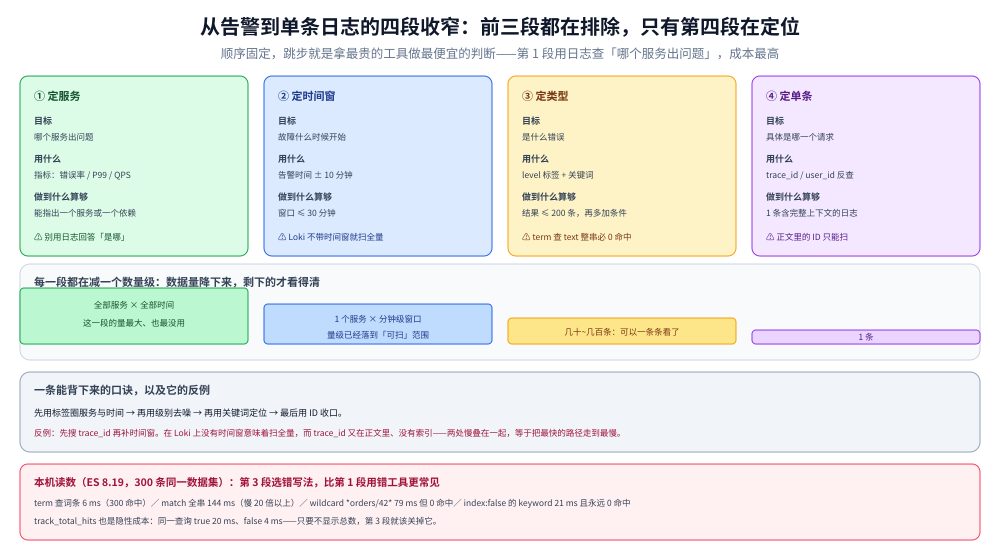

# 日志查询方法论

> 本篇讲**与后端无关**的那一半：拿到一条告警之后，怎么一步一步收窄到那一条日志。四段路径、每段的判据、以及「查不到」时的五种判别顺序——这些内容换成任何一个日志后端都成立，所以不放在产品篇里。
>
> 内容整理自个人学习笔记。与同目录 [日志采集管道.md](日志采集管道.md) 是一对：**那篇讲日志怎么进去、在哪一段会静默丢；本篇讲日志怎么查出来、在哪一步该收窄**。
>
> 不覆盖产品语法：[Kibana查询语法实战.md](日志后端/Elasticsearch/Kibana查询语法实战.md) 管 ES 的 `term` / `match` / KQL 与 Kibana 界面；[LogQL查询与排障实战.md](日志后端/Loki/LogQL查询与排障实战.md) 管 Loki 的选择器与管道。索引模型与后端选型见 [日志系统选型对比.md](日志系统选型对比.md)。
>
> ⚠️ **本篇不含新的实跑读数**：引用的时间与条数均转引自两篇产品篇的本机实测（ES 8.19.0 / Loki 3.5.0），出处标在第七节。方法论部分（四段顺序、判别顺序）是**判据**，不依赖具体版本。

---

## 一、查得快不快，取决于「第一步能排除多少」

**本节要点**：所有日志系统的查询都分两步——**缩小范围**与**在范围内找**。区别只在于第一步靠什么：ES 靠倒排索引，任意字段都能当第一步；Loki 只有标签能当第一步，正文只能靠扫。

| 系统 | 第一步（缩小范围） | 第二步（范围内找） | 耗时的真正来源 |
| --- | --- | --- | --- |
| Elasticsearch | 倒排索引（任意字段） | 由索引定位到文档 | 查询复杂度、聚合、翻页深度 |
| Loki | 标签索引（**仅标签**） | 顺序扫描 + 解压 chunk | 时间窗 × 命中 chunk 数 |
| ClickHouse | 主键/分区裁剪 + 跳数索引 | 列扫描 + 向量化 | 扫描的列数与行数 |

⭐ 一条判据：**先问「这个查询在第一步能不能排除 99% 的数据」**。能，就是毫秒级；不能，耗时就跟数据量成正比——**跟语法写得多漂亮无关**。

这也解释了为什么「同一个查询换到另一个后端就慢 100 倍」：不是那个后端差，而是**它的第一步用不上你的条件**。Loki 上把正文关键词写进花括号、ES 上对 `text` 字段用 `term` 查整串，都是「以为在缩小范围、其实没有」。

---

## 二、四段收窄：从告警到单条日志

四段的顺序是固定的，**跳步会浪费大量时间**：

| 段 | 目标 | 用什么收窄 | 收窄后的量级 |
| --- | --- | --- | --- |
| 1 定服务 | 哪个服务出问题 | 指标（错误率、延迟、QPS） | 1 个服务 |
| 2 定时间窗 | 故障什么时候开始 | 告警时间 ± 前后 10 分钟 | 分钟级窗口 |
| 3 定类型 | 什么错误 | 标签/级别 + 关键词 | 几十 ~ 几百条 |
| 4 定单条 | 具体哪个请求 | `trace_id` / `user_id` | 1 条 |

⭐ 第 1 段**不要用日志做**：「哪个服务出问题」用指标判断比用日志快一个数量级。日志适合回答「为什么」，不适合回答「是哪」——拿日志当指标用，是成本最高的用法。

⚠️ 最常见的错误是**从第 4 段开始**：拿一个 `trace_id` 直接去搜。在没有时间窗的情况下，Loki 会扫全量 chunk，ES 会扫全部命中分片——本来是「定位一条」，变成了「扫描一整天」。

---

## 三、每段的动作与判据

**本节要点**：每一段都有「做到什么程度算够」的量化标准。不设标准，就会在第 3 段一直翻页——翻页本身比查询还慢。

| 段 | 动作 | 判据（做到什么程度算够） |
| --- | --- | --- |
| 1 定服务 | 看指标：错误率、P99、QPS 突降 | 能指出**一个**服务或**一个**依赖 |
| 2 定时间窗 | 看告警时间与指标拐点 | 窗口 ≤ 30 分钟（再大就退化成扫描） |
| 3 定类型 | 按 `level` + 关键词过滤 | 结果 ≤ 200 条（再多必须加条件） |
| 4 定单条 | 拿 `trace_id` 反查全链路 | 找到 1 条带完整上下文的日志 |

两条容易忽略的：

- **第 2 段的窗口是「够用就停」，不是「越大越保险」**。窗口放大一倍，Loki 的扫描量翻倍；ES 上则可能翻出几个完整的旧索引。
- **第 3 段的结果条数是硬指标**。到了几百条还在翻页找，说明前面某一段没做够——回去补时间窗或补标签，比继续翻页快。

---

## 四、第 4 段的两种做法：ID 在索引里还是在正文里

| 做法 | 前提 | 速度 | 代价 |
| --- | --- | --- | --- |
| `trace_id` 是**索引字段** | ES 上是 keyword 字段；Loki 上是标签或 structured metadata | 快（索引定位） | 要提前在管道里提取 |
| `trace_id` 只在**正文**里 | 无 | 慢（扫描全文） | 只能靠 `\|=` 碰运气 |

⭐ 这一格把「字段设计决定查询能力」讲透了：

- 放正文 → 能查，但每次都扫；
- 放 Loki 标签 → 快，但 **stream 数会等于日志条数**（每条 trace 一个 stream，索引爆炸）；
- Loki 的折中是 **structured metadata**（可过滤、不进索引、基数不受限）；
- ES 的折中是**单独建一个 `trace_id` keyword 字段**（不进 `_all`、不做分词）。

所以在规范阶段就要定：`trace_id` 必须是**一等字段**，不能是「正文里顺便打一下」。这条判据在 [应用侧日志规范与SDK设计.md](治理与规范/应用侧日志规范与SDK设计.md) 的字段表里对应 `trace_id` 那一行。

### 4.1 一条可以背下来的收窄口诀

> **先用标签圈服务与时间，再用级别去噪，再用关键词定位，最后用 ID 收口。**

反过来（先搜 ID、再补时间窗）在 Loki 上代价极高，因为没时间窗就是扫全量；在 ES 上也不便宜，因为 ID 查询通常不带时间范围，会命中所有历史索引的分片。

---

## 五、查不到的五种原因

**本节要点**：查不到时，先判断是「没打、没发、还是查询写错」——这三类的排查路径完全不同，混着查是排障里最大的时间黑洞。

| 原因 | 怎么快速判别 | 典型现象 |
| --- | --- | --- |
| ① 日志根本没打 | 换一个肯定有数据的条件（放宽到 `*`） | 什么都查不到 |
| ② 打了但没被采集 | 看采集器自己的指标与日志 | 其他服务有、这个服务没有 |
| ③ 采集了但没写进后端 | 看后端写入指标、429 / 400 计数 | 后端有别的索引在涨，这个没有 |
| ④ 写进去了但查询条件写错 | 放宽条件逐步还原（`term` 换 `match`、花括号换管道） | 换个写法就有了 |
| ⑤ 写进去了但被采样 / 丢弃 | 对比采样率与总量 | 有日志但条数明显偏少 |

⭐ 判别顺序就是**从上往下**，因为每一步的代价递增：第 ① 步只需一次查询，第 ③ 步要去翻采集端和后端的指标，第 ⑤ 步要回溯整条链路的采样配置。

两个高频具体错误：

1. **字段类型不匹配**：`term` 查 `text` 字段的整串、`term` 查 `index: false` 的字段——**两者都是「命中 0 且不报错」**，见 [Kibana查询语法实战.md](日志后端/Elasticsearch/Kibana查询语法实战.md)。
2. **字段名漂移**：`trace_id` / `traceId` / `tid` 混用。这类问题**只能靠一次全量字段统计发现**，查一次日志是看不出来的，见规范篇的字段清单。

⚠️ 还有一类不算「查不到」但常被误判：**结果条数被截断**。Loki 的 `limit` 是**总行数**，不是每个 stream 各给一份；ES 的 `hits.total.value` 默认可能只是「≥10000」的下界。要真实条数，前者用 `count_over_time`，后者显式开 `track_total_hits`。

---

## 六、这套方法论什么时候不适用

**本节要点**：四段收窄假设「你知道大概是什么时候、哪个服务」。有些场景不满足这个前提。

| 场景 | 为什么不适用 | 该怎么做 |
| --- | --- | --- |
| 用户报障但无告警 | 没有第 2 段的时间锚点 | 从用户操作时间反推，配合访问日志的 `user_id` |
| 慢故障（几天内逐渐劣化） | 30 分钟窗口看不出趋势 | 先看指标的周级趋势，再回到日志找拐点 |
| 日志被大面积丢弃 | 第 ① ② ③ 步全部「有数据」，但缺的恰好是关键段 | 先查丢日志的指标（采集端 `paused`、后端 429） |
| 只追加不保留（保留期 < 故障窗口） | 日志已经不在了 | 只能靠指标与链路，日志侧无解 |

⭐ 最后一行是最该提前算的一笔账：**保留期必须 ≥ 最长排障窗口**。保留 3 天、故障平均 5 天后才被发现，这套方法论再对也用不上——这条属于 [日志系统选型对比.md](日志系统选型对比.md) 的成本账。

---

## 校验口径

| 结论 | 状态 | 依据 |
| --- | --- | --- |
| 三种索引模型的「第一步 / 第二步」划分 | ✅ **判据** | 由 ES 倒排与 Loki 标签机制的差异推出，不依赖版本 |
| 四段收窄的顺序与判据（第 2 段 ≤30 分钟、第 3 段 ≤200 条） | ✅ **本篇判据** | 经验阈值，非实测；与告警篇的窗口语义一致 |
| 第 1 段应用指标而非日志 | ✅ **判据** | 见 [指标选型对比.md](../指标/指标选型对比.md) 第七节 |
| `term` 整串 0 命中、`match` 慢一个数量级 | ✅ 转引实测 | ES 8.19.0，见 [Kibana查询语法实战.md](日志后端/Elasticsearch/Kibana查询语法实战.md) |
| Loki 的 `limit` 按总行数截断 | ✅ 转引实测 | Loki 3.5.0，见 [LogQL查询与排障实战.md](日志后端/Loki/LogQL查询与排障实战.md) |
| `hits.total.value` 默认是下界 | ✅ 转引实测 | ES 8.19.0，同上 |
| 「结果 ≤200 条」这类阈值 | ⚠️ **未实测** | 经验值，未做「翻页耗时 vs 加条件耗时」的对照实验 |
| 大时间窗下的扫描耗时曲线 | ⚠️ **未实测** | 本机数据量仅几 MB，无法外推 |

---

## 延伸追问

**Q：四段收窄能不能压成两段？**

能，但要看你手上有什么。有完整链路追踪时，第 1 段与第 3 段可以由 trace 视图直接给出（服务名 + 错误 span 已经选好了），你只剩「定时间窗 → 拿 `trace_id`」两步。**前提是 trace 采样率足够高、且日志里带 `trace_id`**——这两条不成立，还是得回到四段。

**Q：为什么第 3 段的判据是「≤200 条」而不是「≤1000 条」？**

因为第 3 段之后是靠人眼扫。200 条是「能在一屏列表里看出规律」的量级（同一个错误重复、还是多种错误交错）。超过这个数，正确动作是回第 2 段缩窗口或第 1 段确认服务，而不是加大页长——**翻页是在把查询成本转成人的成本**。

**Q：日志被采样过，怎么判断缺失的是「采样丢的」还是「真没有」？**

看两个数：① 采样配置里的采样率（比如 1/100）；② 同时间窗内**未被采样的信号**（指标里的请求数、trace 里的 span 数）。用 ② 乘 ① 应该约等于你查到的日志条数。对不上，就不是采样的问题，回到第三节的 ①②③ 继续查。

**Q：保留期该按什么定？**

按**最长排障窗口**定，不是按成本定。先算「故障从发生到被发现，历史中位数是多少天」，保留期 ≥ 这个数 × 2。反过来做（先按磁盘容量砍保留期）的后果是：排障方法论全对，但数据已经过期删掉了。

---

## 关联

- **上游/总纲**：[日志系统选型对比.md](日志系统选型对比.md) — 索引模型决定「能查什么」，本篇是它的操作面
- **对照**：[日志采集管道.md](日志采集管道.md) — 一篇管「怎么进去」，一篇管「怎么查出来」；丢日志的排查在第 ② ③ 步交汇
- **互补（产品语法）**：[Kibana查询语法实战.md](日志后端/Elasticsearch/Kibana查询语法实战.md) — ES 侧的三种查询形态与 KQL；[LogQL查询与排障实战.md](日志后端/Loki/LogQL查询与排障实战.md) — Loki 侧的选择器与管道
- **上游机制**：[应用侧日志规范与SDK设计.md](治理与规范/应用侧日志规范与SDK设计.md) — 字段设计决定了这里能不能写出高效查询
- **下游机制**：[日志风暴与限流降级策略.md](治理与规范/日志风暴与限流降级策略.md) — 查不到时，先确认是不是被主动丢过
