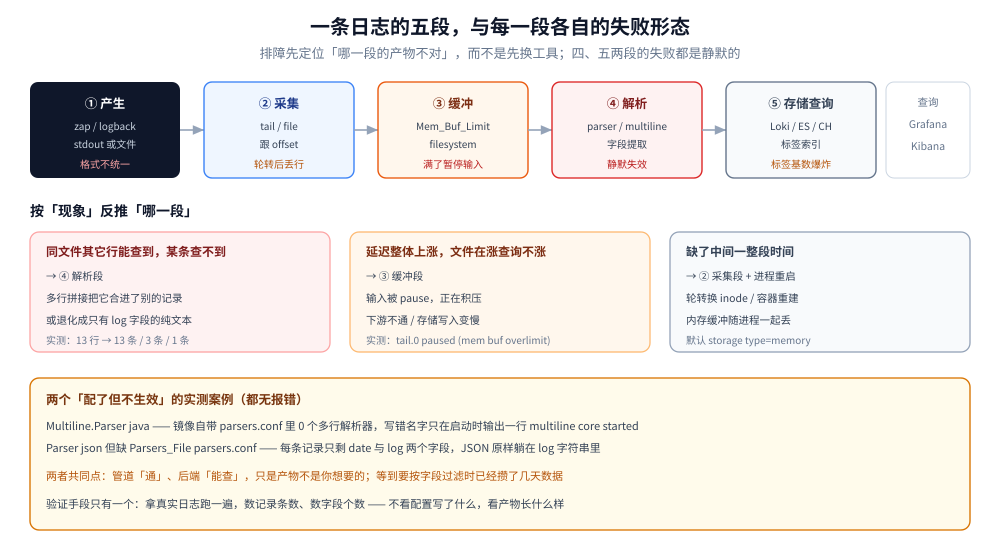
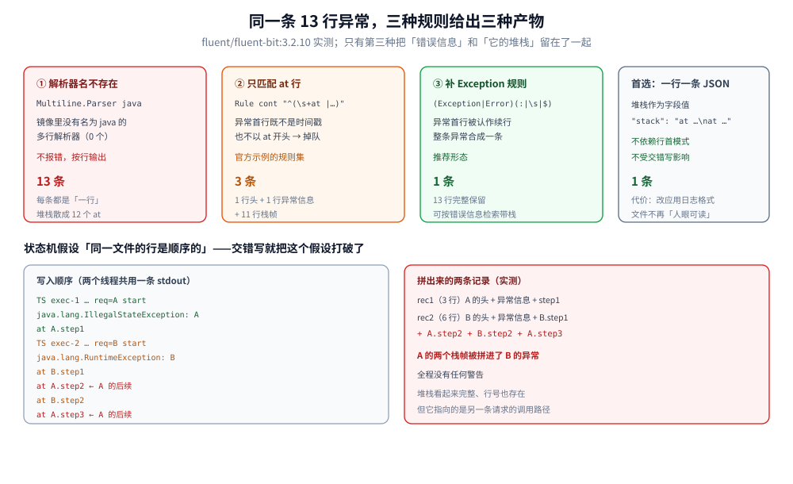
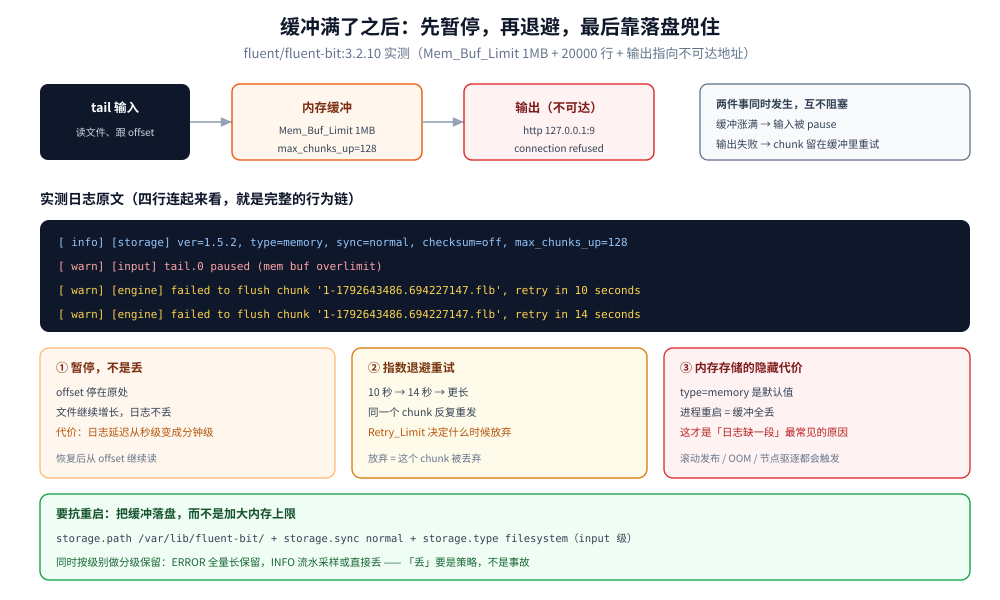

# 日志采集管道

> 一条日志从**写进文件**到**能被查询**之间要经过五段：采集 → 缓冲 → 解析 → 存储 → 查询。
> 本篇讲每一段在做什么、用什么、以及**在哪一段会静默丢东西**——重点是最容易被忽略的两段：**多行拼接**与**背压**。
>
> 内容整理自个人学习笔记。**日志该选哪个后端**（ELK / Loki / ClickHouse / 云日志）属于选型面，
> 见同目录的 [日志系统选型对比.md](日志系统选型对比.md)，本篇不重复；日志与链路的字段缝合在
> [OpenTelemetry与关联分析.md](../OpenTelemetry/OpenTelemetry与关联分析.md) 第四节与
> [协议与数据模型.md](../链路追踪/Skywalking/协议与数据模型.md) 各有一节。
>
> ✅ **本篇的核心结论为本机实跑**：`fluent/fluent-bit:3.2.10` 单容器 + 5 个真实日志文件（Java 堆栈、交错写、JSON、
> 20000 行批量），实测多行拼接条数、JSON 解析静默失效、缓冲上限暂停输入三组行为。
> Vector / Filebeat / OTel Collector 的对比、K8s 三种采集形态、Loki 标签基数**未实测**，按官方文档陈述。

先说最反直觉的一条：**日志管道里最危险的不是「采集器挂了」，而是「采集器正常工作和静默出错时，产物长得一模一样」**——都是每条日志一个记录，看不出区别。第一节先建立分段的坐标系。

## 一、一条日志要经过五段

**本节要点**：把"日志系统"当成五个独立可替换的段，才能判断故障发生在哪一段。绝大多数事故都可以归到**具体的某一段**。

| 段 | 做什么 | 典型组件 | 这一段的失败形态 |
|---|---|---|---|
| **① 产生** | 应用写 stdout / 文件 | 日志框架（zap / logback / monolog） | 格式不统一；堆栈多行；字段名各写各的 |
| **② 采集** | 发现文件、跟 offset、读新行 | Fluent Bit `tail`、Vector `file`、Filebeat | 轮转后丢行；容器重启后重读或漏读 |
| **③ 缓冲** | 在内存 / 磁盘排队，抗下游抖动 | Fluent Bit `Mem_Buf_Limit`、Vector buffer | 满了**暂停输入**；进程重启**内存里的全丢** |
| **④ 解析** | 结构化：JSON 展开、多行拼接、字段提取 | parser / multiline parser / VRL / processor | **静默失效**（配置写了但没生效，且不报错） |
| **⑤ 存储与查询** | 建索引、压缩、按标签检索 | Loki / ES / ClickHouse | 标签基数爆炸；查询扫全量 |

⭐ 一个判据：**出问题时先问"哪一段的产物不对"**。

- 后端查不到某条日志，但同文件其它行能查到 → ④ 解析段（多行拼接把几行合成了一条，或者被当成畸形行丢掉字段）
- 后端整体延迟增长、文件在涨但查询不涨 → ③ 缓冲段（输入被 pause 了，正在积压）
- 后端收到的日志缺了中间一段时间 → ② 采集段（文件轮转 / inode 变化）



上方把五段串成一条线，每段下面直接标它自己的失败形态：采集段是轮转丢行、缓冲段是满了暂停、解析段是静默失效、存储段是标签基数爆炸。下方三格是反向使用的排障表——"同文件其它行能查到、某条查不到"指向解析段，"文件在涨但查询不涨"指向缓冲段，"缺了中间一整段时间"指向采集段加进程重启，这比一上来就怀疑后端要快得多。

## 二、采集端怎么选：四个产品的边界

**本节要点**：四个产品不是"性能排序"，而是**定位不同**——一个采集器、一个流水线、一个生态组件、一个协议转换器。

| | Fluent Bit | Vector | Filebeat | OTel Collector |
|---|---|---|---|---|
| **语言 / 体积** | C，约 1 MB 级 | Rust，单二进制 | Go | Go |
| **定位** | 轻量**采集器**（边缘 / 节点 agent） | 完整**流水线**（采集 + 转换 + 路由） | ELK 生态的**采集器** | **协议转换与路由**（collector） |
| **转换能力** | 有限（parser + filter + Lua） | 强（VRL 表达式语言） | 弱（processor + `drop_event`） | 中（`transform` processor / OTTL） |
| **缓冲** | 内存 / 文件系统（`storage.type`） | 内存 / 磁盘 buffer（可持久化） | 内部队列 + 输出重试 | 内存队列（`sending_queue`） |
| **典型位置** | 每节点一个 DaemonSet | 节点 agent **或**中心聚合层 | 每节点一个 | 网关层 / 每节点 |
| **适合什么** | 资源敏感、只需要"采集 + 简单解析" | 需要复杂改写与多路分发 | 已经在 ELK 里 | 已经在 OTel 生态里（trace/metrics/logs 统一） |

几条容易踩的边界：

- **Fluent Bit 的"轻"是有代价的**：转换能力靠 parser 与少量 filter，复杂改写要么写 Lua，要么上 Vector。**多行解析器的规则表达能力就是它的短板**（第四节实测）。
- **Vector 适合放在聚合层而不是每节点**：VRL 很强，但每个节点跑一份 Rust 二进制的资源占用比 Fluent Bit 高。
- **Filebeat 的能力上限受 ELK 生态约束**：离开 ES / Logstash 后，它的转换能力基本只是"加字段 + 简单条件"。
- **OTel Collector 不是"更强的 Filebeat"**：它的价值是**统一协议**（OTLP 进、多种后端出）与**统一 trace/metrics/logs 的处理模型**。用它单纯做日志采集，配置复杂度高于 Fluent Bit。

⚠️ 一个常见误配：**同一条链路上串了两个采集器**（Fluent Bit 采集 → Vector 转换 → 又过一层 Collector），每多一层就多一次"缓冲满了暂停"和"字段被改名"的机会。**能一层解决就不要两层**，除非确实需要跨团队边界（节点侧归平台、转换逻辑归业务）。

## 三、标签怎么设计：哪些进索引、哪些留正文

**本节要点**：**索引字段是有成本的，正文不是**。把高基数字段放进索引，是日志系统最贵的错误。

### 3.1 基数量级对照

| 字段 | 取值数量级 | 该放哪 |
|---|---|---|
| 服务名、环境、集群、namespace | 10 ~ 100 | ✅ 索引 / 标签 |
| Pod 名、实例 ID | 100 ~ 10000 | ✅ 标签（但要在 Loki 里注意 `max streams`） |
| HTTP 路径模板（`/order/{id}`） | 100 ~ 1000 | ⚠️ 谨慎：**模板化之后**才可入标签 |
| 用户 ID、订单号、**traceId** | 与请求量同阶（百万 ~ 十亿） | ❌ **只留正文**，靠检索而非索引 |
| 原始 URL（含 query） | 无上限 | ❌ 只留正文 |

⭐ 判据一句话：**"这个字段的取值数量会不会随流量线性增长"**——会，就绝对不能进索引。
`traceId` 是最典型的例子：每条日志一个唯一值，当标签等于"给每条日志建一个索引条目"。

### 3.2 两种后端的代价不同，规则却一样

- **Loki** 只索引标签，正文压缩后放对象存储。**好处**是便宜；**代价**是标签基数直接决定索引大小与查询的分片数，标签一旦爆炸（每个 traceId 一个 stream），查询会从"按标签缩小范围"退化成"扫全量"。
- **ES** 默认所有字段都可检索，基数字段会导致倒排索引膨胀、段合并压力大。做法是显式把高基数字段设成 `index: false`（仍可 `_source` 取回）或用 `keyword` + `ignore_above`。

⚠️ 两边的规则殊途同归：**先把"能定位一批日志"的字段做索引（服务、环境、级别），再用"能定位一条日志"的字段做过滤（traceId、订单号）**。前者是标签，后者是查询条件。

## 四、多行日志：为什么必须在采集端拼

**本节要点**：一条 Java 异常的堆栈有 13 行，**松散成 13 条记录后，日志系统就只能按行检索了**——你想找的是"这次异常"，拿到的却是"这一行 `at`"。拼接必须在**进入存储之前**完成。

### 4.1 一个反直觉的事实：镜像里没有内置的 Java 多行解析器

网上大量教程直接写：

```ini
[INPUT]
    Name             tail
    Path             /logs/java.log
    Multiline.Parser java
```

但 `fluent/fluent-bit:3.2.10` 镜像自带的 `parsers.conf` 里 **没有任何 `[MULTILINE_PARSER]` 段**（实测：138 行配置、16 个普通 `[PARSER]`，`0` 个多行解析器）。更麻烦的是：**写了不存在的名字不会报错**——启动日志只有一行 `multiline core started`，运行时按行输出。

```text
=== 配了 Multiline.Parser java（实际不存在）===
记录数: 13
  rec1: 1 行, 首行='2026-10-22 10:00:01.001 ERROR [http-nio-8080-exec-3] c.e.ord'
  rec2: 1 行, 首行='java.lang.NullPointerException: Cannot invoke "Order.getId()'
  rec3: 1 行, 首行='\tat com.example.order.PayService.pay(PayService.java:88)'
  ...（共 13 条）
```

⭐ 这类"配置写了、不生效、不报错"的失败模式，是日志管道最难查的一类问题：**管道没有异常，只是产物不是你想要的**。

### 4.2 官方示例的规则会漏掉异常首行

自己定义多行解析器时，官方示例的规则集长这样（只匹配 `^\s+at`）：

```ini
[MULTILINE_PARSER]
    Name          java_stack
    Type          regex
    Flush_Timeout 1000
    Rule   "start_state"  "/^\d{4}-\d{2}-\d{2} \d{2}:\d{2}:\d{2}/"              "cont"
    Rule   "cont"         "/^(\s+at |\s*\.\.\.|Caused by:|\s+Suppressed:)/"      "cont"
```

实测结果**不是 1 条，是 3 条**：

```text
=== 只匹配「时间戳开头」+「at 行」===
记录数: 3
  rec1: 1 行   ← 时间戳那行（被判为新记录的开始）
  rec2: 1 行   ← java.lang.NullPointerException: ...（既不是时间戳、也不以 at 开头 → 单独成条）
  rec3: 11 行  ← 后面的 11 个 at 帧被正确拼成一条
```

原因：真实的 Java 堆栈结构是

```text
2026-10-22 10:00:01.001 ERROR ... pay failed          ← ① 日志头（时间戳开头）
java.lang.NullPointerException: Cannot invoke ...     ← ② 异常首行（既不匹配 ①，也不匹配 at）
	at com.example.order.PayService.pay(PayService.java:88)   ← ③ 帧（以 at 开头）
```

② 那行掉在规则外面，于是**"错误信息"和"它的堆栈"被拆成了两条记录**——查询时按 level=ERROR 能查到 ②，但它没有堆栈；按 `at` 能查到 ③，但它没有错误信息。

补一条规则即可（把"类名以 Exception / Error 结尾"也算进续行）：

```ini
    Rule   "cont"  "/^[A-Za-z_$][A-Za-z0-9_.$]*(Exception|Error)(:|\s|$)/"      "cont"
```

```text
=== 补齐异常首行规则后 ===
记录数: 1
  rec1: 13 行
```

⚠️ 这里要记住的是方法而不是这条正则：**判断多行规则是否配对，唯一可靠的办法是拿真实日志跑一遍，数记录条数**。规则写得再像，也要对着"一条完整异常"验证 `13 行 → 1 条`。

### 4.3 交错写会把两个请求的堆栈拼在一起

多行拼接靠"状态机 + 行首模式"，它假设**同一个文件里的行是顺序的**。一旦两个线程（或多个进程）往同一个文件里交错写，这个假设就破了：

```text
2026-10-22 10:00:02.001 ERROR [exec-1] c.e.A - req=A start     ← A 的日志头
java.lang.IllegalStateException: A failed                       ← A 的异常首行
	at com.example.A.step1(A.java:11)                            ← A 的帧
2026-10-22 10:00:02.002 ERROR [exec-2] c.e.B - req=B start     ← B 的日志头（另一个线程插进来）
java.lang.RuntimeException: B failed                            ← B 的异常首行
	at com.example.B.step1(B.java:21)                            ← B 的帧
	at com.example.A.step2(A.java:12)                            ← ⚠️ A 的后续帧
	at com.example.B.step2(B.java:22)
	at com.example.A.step3(A.java:13)
```

实测产物：

```text
=== 交错写 + 同一个多行解析器 ===
记录数: 2
--- rec1 (3 行)
    2026-10-22 10:00:02.001 ERROR [exec-1] c.e.A - req=A start
    java.lang.IllegalStateException: A failed
    	at com.example.A.step1(A.java:11)
--- rec2 (6 行)
    2026-10-22 10:00:02.002 ERROR [exec-2] c.e.B - req=B start
    java.lang.RuntimeException: B failed
    	at com.example.B.step1(B.java:21)
    	at com.example.A.step2(A.java:12)      ← A 的帧被拼进 B 的异常
    	at com.example.B.step2(B.java:22)
    	at com.example.A.step3(A.java:13)      ← 同上
```

**rec2 里混进了 A 的两个栈帧，而且整个过程没有任何警告**。这类污染在排障时最坑：堆栈看起来完整、行号也存在，但它指向的是另一条请求的调用路径。

三条应对，按推荐度排序：

| 做法 | 机制 | 代价 |
|---|---|---|
| **一行一条 JSON（首选）** | 应用把堆栈作为一个字段值（`"stack": "..."`）序列化进 JSON | 改应用日志格式；日志文件不可读（但本来也不该直接读） |
| **每容器 / 每进程单独文件** | 拆分文件，让"一个文件只有一个写者"成立 | 容器里 stdout 是共享的，需要额外重定向 |
| **仍用多行解析 + 接受风险** | 靠 `Flush_Timeout` 限制污染范围 | 只能降低概率，无法消除 |

⭐ 容器环境里这条尤其重要：**同一个 Pod 的 stdout 是所有容器的汇聚点**（实际是 `/var/log/pods/.../<container>/0.log`，按容器分开，但应用内的多线程共享一个 stdout）。所以"多行拼接"在 K8s 里天然比在单机文件里更脆弱。



上排四格是同一条 13 行异常的四种结局：解析器名不存在时原样拆成 13 条，只匹配 `at` 行时变成 3 条（错误信息与它的堆栈被分开），补上 `Exception|Error` 规则后才合成 1 条，而首选方案是一行一条 JSON、把堆栈当成字段值。下排演示交错写的后果：两个线程共用一条 stdout 时，A 的两个栈帧会被拼进 B 的异常记录里，全程没有任何警告。

## 五、结构化的两个静默坑

**本节要点**：JSON 解析配错时**不会报错**，只会让你拿到一堆"只有 `log` 字段"的记录。

### 5.1 忘了 `Parsers_File`，`Parser json` 等于没写

```ini
[INPUT]
    Name   tail
    Path   /logs/app.json
    Parser json          # ← 以为这样就展开了
```

实测产物（`Format json_lines` 输出）：**每条记录只有 `date` + `log` 两个字段，`log` 是原始 JSON 字符串**，没有任何报错。

补一行就好：

```ini
[SERVICE]
    Parsers_File   parsers.conf     # ← 默认的 json / docker / cri 等解析器都在这里
```

```text
=== 加上 Parsers_File 之后 ===
{"date":1792643444.476758,"ts":"2026-10-22T10:00:03.001+08:00","level":"INFO","svc":"order",
 "traceId":"4bf92f3577b34da6a3ce929d0e0e4736","spanId":"00f067aa0ba902b7","msg":"create order ok",
 "order_id":"SO-1001","cost_ms":12}
```

⭐ 这个坑的隐蔽性在于：**日志"有"、管道"通"、后端"能查"，只是所有字段都埋在 `log` 字符串里**。等到要按 `level` 过滤、按 `traceId` 关联链路时才会发现，而那时已经积累了几天的数据。

### 5.2 混合格式的文件：非 JSON 行静默退化成一条纯文本

同一个文件里如果混进一行非 JSON（老组件、某个库直接 `print`），结果是这样：

```text
=== 4 行输入中第 3 行是纯文本 ===
rec1  字段数  9   {"ts":..., "level":"INFO",  "traceId":"4bf92f...", ...}
rec2  字段数  9   {"ts":..., "level":"ERROR", "traceId":"4bf92f...", ...}
rec3  字段数  2   {"date":..., "log":"[2026-10-22 10:00:03] WARNING: legacy component ..."}
rec4  字段数  9   {"ts":..., "level":"INFO",  "traceId":"5bf92f...", ...}
```

rec3 **没有 `level`、没有 `traceId`**——它不会报错，只是"少了一批字段"。后果很具体：

- 按 `level="ERROR"` 过滤的告警漏掉它（它连 `level` 字段都没有）；
- 按 `traceId` 关联链路时它不在结果里；
- 日志量统计里它算一条，但**是一条查不到内容的记录**。

⭐ 应对：**别在同一条管道里混两种格式**。要么应用统一输出 JSON（推荐），要么给纯文本单独一条 `Path` + 单独的 parser，出问题时一眼能看出是哪条支路漏了。

## 六、K8s 下的三种采集形态

**本节要点**：三种形态的差别是"**谁来读容器的日志文件**"，不是"用哪个工具"。

| 形态 | 做法 | 优点 | 代价 |
|---|---|---|---|
| **DaemonSet + 节点日志目录** | 每节点一个 agent，挂 `hostPath: /var/log/pods`，按路径规则提取 namespace / pod / container | 资源省、部署一次全集群生效 | 多租户隔离弱（agent 能读所有 Pod 的日志）；路径规则要跟容器运行时对齐 |
| **Sidecar** | 每个 Pod 一个采集容器，读共享的 `emptyDir` | 隔离好、可按业务定制解析 | 每 Pod 一份资源开销；Pod 数量大时成本显著 |
| **应用直推** | SDK 直接把日志发到后端 / Collector | 无节点依赖、字段最完整 | 应用要处理缓冲与失败重试；**后端挂了会拖慢业务** |

⭐ 多数集群的答案是 **DaemonSet 为主 + 少数关键业务用 sidecar**，而不是三选一。

两个 K8s 特有的坑：

- **日志轮转与 `max_container_log_line_size`**：容器运行时会截断超长单行（kubelet 默认约 16 KB），**一条超长堆栈可能被截成多行、且不带标记**——这部分内容在多行拼接时会被当成"无法识别的行"。
- **CRI 格式前缀**：`/var/log/pods` 下的文件由容器运行时写成 CRI 格式（`时间戳 stdout F 内容`），采集器必须用 `cri` 解析器去掉前缀，否则后续所有正则都从"时间戳"开始对不上。

## 七、背压与丢日志：什么时候允许丢

**本节要点**：日志管道**不能无限缓冲**，所以"丢"是一个必须显式设计的动作，而不是事故。

### 7.1 缓冲满了会怎样：暂停输入，不是丢

本机实测（`Mem_Buf_Limit 1MB` + 20000 行日志 + 输出指向不可达地址）：

```text
[ info] [storage] ver=1.5.2, type=memory, sync=normal, checksum=off, max_chunks_up=128
[warn] [input] tail.0 paused (mem buf overlimit)
[error] [output:http:http.0] no upstream connections available to 127.0.0.1:9
[warn] [engine] failed to flush chunk '1-1792643486.694227147.flb', retry in 10 seconds
[error] [output:http:http.0] no upstream connections available to 127.0.0.1:9
[warn] [engine] failed to flush chunk '1-1792643486.694227147.flb', retry in 14 seconds
```

三个行为同时可见：

1. **输入被 pause**（`paused (mem buf overlimit)`）——采集器停止读文件，**文件继续增长，offset 停在原处**；
2. **输出失败按指数退避重试**（`retry in 10 seconds` → `retry in 14 seconds`）；
3. **`storage type=memory`**——缓冲全在内存里，**进程重启 = 缓冲全丢**。

⚠️ 第 3 条是"日志丢失"最常见的原因：**不是管道丢的，是重启丢的**。滚动发布、OOM Kill、节点驱逐都会触发。要抗这个，得开文件系统缓冲：

```ini
[SERVICE]
    storage.path              /var/lib/fluent-bit/
    storage.sync              normal
    storage.backlog.mem_limit 5M

[INPUT]
    Name   tail
    ...
    storage.type  filesystem    # 缓冲落盘，重启后可恢复
```



中间那四行是本机抓到的原始日志，连起来就是完整的行为链：`type=memory` 决定了缓冲所在的位置，缓冲涨满后 `tail.0 paused (mem buf overlimit)` 让输入停下来而文件继续增长，输出失败让同一个 chunk 按 10 秒、14 秒的间隔反复重试。下方三格分别解释这三种行为的后果，落点在第三格——真正让日志"缺一段"的不是丢弃策略，而是内存缓冲跟着进程一起消失。

### 7.2 分级保留：把"丢"变成策略

日志是可观测性成本的最大头（常占 50% 以上），所以**必须允许一部分日志被丢**：

| 级别 | 采样 / 保留 | 理由 |
|---|---|---|
| ERROR / FATAL | 全量 + 长保留（30 天以上） | 排障必需 |
| WARN | 全量 + 中保留（7~14 天） | 趋势与容量判断 |
| INFO（业务关键点，如订单状态变更） | 全量 + 短保留（3~7 天） | 审计与对账 |
| INFO / DEBUG（逐请求流水） | **采样**（1% ~ 10%）或直接关 | 量最大、价值最低 |
| 健康检查 / 探针日志 | **直接丢**（采集端 `grep` 排除） | 纯噪声，能占一半以上 |

⭐ 采样与"分级"要在**采集端**做（Fluent Bit filter / Vector VRL），不要在后端做——后端做的意思是"先付完带宽和存储的钱，再删掉"。

⚠️ 一条纪律：**被丢掉的日志要能被知道**。采集端保留 `input_records_total` / `output_dropped_records_total` 这类计数并做监控，否则"日志少了"永远查不出是采样、丢弃还是管道故障。

## 八、一条完整的落地链

**本节要点**：典型微服务的日志链路是"**应用 stdout → 节点 agent → 缓冲 → 结构化 → 后端**"，每一跳都有明确的产物形态。

```text
应用（zap / logback，一行一条 JSON，堆栈作为字段值）
   │  stdout
   ▼
容器运行时（写入 /var/log/pods/<ns>_<pod>_<uid>/<container>/0.log，CRI 前缀）
   │
   ▼
Fluent Bit DaemonSet
   ├── tail（Parser=cri 去前缀，再 Parser=json 展平）
   ├── filter（加 namespace / pod / node 字段；drop 探针日志）
   ├── 缓冲（storage.type filesystem + Mem_Buf_Limit + storage.total_limit_size）
   ▼
聚合层（可选：Kafka 削峰 / Vector 做转换与分流）
   │
   ▼
Loki（按标签索引，正文进对象存储）或 ClickHouse（按 traceId 精查）
   │
   ▼
Grafana / Kibana 查询；traceId 与 Jaeger / SkyWalking 互跳
```

关键配置项对照（Fluent Bit 口径）：

| 环节 | 配置 | 取值建议 |
|---|---|---|
| 去 CRI 前缀 | `Parser cri` | K8s 必配 |
| 结构化 | `Parser json` + `Parsers_File parsers.conf` | 忘了 `Parsers_File` 就静默失效（5.1） |
| 多行 | `Multiline.Parser <自定义名>` | 镜像里没有 `java`，必须自带（4.1） |
| 缓冲上限 | `Mem_Buf_Limit` + `storage.total_limit_size` | 超限会 pause 输入（7.1） |
| 持久化 | `storage.type filesystem` + `storage.path` | 不加则重启丢缓冲 |
| 重试 | `Retry_Limit` | `false` 表示无限重试；有上限时超限丢 chunk |
| 噪声过滤 | `filter` 的 `grep` / `exclude` | 探针、健康检查在入口就排除 |

⚠️ 一个顺序陷阱：**`Parser cri` 与 `Parser json` 不能同时配在同一个 input 上**（`Parser` 只接受一个）。要去前缀又展平 JSON，得用 `tail` 的 `Parser cri` 拿到 `log` 字段，再用 `filter parser` 对 `log` 字段做一次 `json` 解析——两段式。

## 校验口径

| 结论 | 状态 | 依据 |
|---|---|---|
| 镜像 `parsers.conf` 无任何 `[MULTILINE_PARSER]`（16 个普通 parser，0 个多行） | ✅ 实跑 | `docker cp` 取出 `fluent/fluent-bit:3.2.10:/fluent-bit/etc/parsers.conf`，138 行 |
| `Multiline.Parser java` 不报错、13 行拆成 13 条 | ✅ 实跑 | 启动日志仅 `multiline core started`，输出 13 条记录 |
| 只匹配 `^\s+at` 的规则 → 13 行变 **3 条**（异常首行掉队） | ✅ 实跑 | 自定义 `java_stack` 解析器，逐条打印行数 |
| 补 `(Exception\|Error)` 规则 → 13 行合成 **1 条** | ✅ 实跑 | 同上，`rec1: 13 行` |
| 交错写时 A 的栈帧被拼进 B 的异常（6 行记录） | ✅ 实跑 | `interleaved.log`，2 条记录，无警告 |
| 缺 `Parsers_File` 时 `Parser json` 静默不生效（字段数=2） | ✅ 实跑 | 同一份 `app.json`，加/不加该行对比 |
| 混合格式中非 JSON 行退化为只有 `log` 字段（字段数=2） | ✅ 实跑 | 4 行输入 → rec3 仅 `date`+`log` |
| `Mem_Buf_Limit` 超限 → `tail paused (mem buf overlimit)`；chunk 按 10s→14s 退避重试 | ✅ 实跑 | 20000 行 + 不可达 http 输出，日志原文 |
| `storage type=memory` 为默认，重启丢缓冲 | ✅ 实跑（类型）+ ⚠️ 推理（丢缓冲） | 启动日志 `type=memory`；丢缓冲由"内存存储"语义推出，未做 kill 实验 |
| Vector / Filebeat / OTel Collector 的能力与缓冲模型 | ⚠️ 按文档未实测 | 未起对应容器 |
| K8s DaemonSet / sidecar / 直推三种形态 | ⚠️ 按文档未实测 | 本机无可用集群 |
| `max_container_log_line_size` 约 16 KB 截断 | ⚠️ 按文档未实测 | kubelet 默认值，未在集群验证 |
| Loki 标签基数与 `max streams` 的代价 | ⚠️ 按文档未实测 | 未起 Loki |

实验台：`.workbuddy/tmp/flb-lab/`（`no_ml.conf` / `with_ml.conf` / `json.conf` / `bulk.conf` + `custom_parsers.conf` + 5 个日志样本，容器已停）。

---

## 延伸追问

- **为什么多行堆栈一定要在采集端拼，不能在后端拼？** → 因为后端只看到"行"，不知道哪些行属于同一条异常。采集端有**上下文**（连续读同一个文件的行），后端没有。后端即便有"按时间窗口聚合"的能力，也无法在交错写的情况下正确归组。
- **Fluent Bit 的性能优势从哪来？** → C 实现 + 固定内存池 + 单进程事件驱动，没有 GC 停顿；代价是转换能力弱（复杂改写要靠 Lua 或换 Vector）。这也解释了为什么它适合做**节点 agent**而不是**中心聚合层**。
- **`Parser` 和 `Multiline.Parser` 有什么区别？** → `Parser` 作用于**每一行**（把一行解析成多个字段）；`Multiline.Parser` 作用于**多行的归组**（把 N 行合成 1 条记录）。两者解决的是不同问题，可以同时用（先归组，再解析归组后的内容）。
- **日志要不要打时间戳？容器不是已经有时间戳了吗？** → 要打，而且是**应用产生日志的时刻**。容器时间戳是"被 runtime 写入文件的时刻"，两者在缓冲、`stdout` 阻塞、重启补读时能差出几秒；跨服务对时依赖的是应用时间戳。
- **Loki 为什么"便宜"却"查得慢"？** → 它只索引标签、正文压缩后放对象存储，查询靠"先用标签缩小到少量 stream，再暴力扫正文"。所以标签选得对就快，标签爆炸就慢——**成本被转移到了标签设计上**，没有消失。
- **Sidecar 采集既然隔离好，为什么不全都用？** → 每个 Pod 多一个容器就多一份 CPU / 内存开销，几百个 Pod 就是几百份。它适合**少数需要定制解析或强隔离**的业务，不适合做默认形态。
- **日志采样会不会把关键错误丢掉？** → 会，所以**采样只能按级别做，不能整体随机**。ERROR / FATAL 必须全量；只有 INFO / DEBUG 这类"逐请求流水"才适合按比例采。
- **应用直推日志到后端有什么问题？** → 三个：应用要自己实现缓冲与重试（否则后端抖动会拖慢业务）、日志与业务争抢网络、无法统一加集群元数据。所以常见做法是推到本地 Collector，而不是直推存储。

---

## 关联

- **上游/总纲**：[日志系统选型对比.md](日志系统选型对比.md) — 同目录的选型篇：日志放哪个后端、三种索引模型各能干什么、四板斧降本；与本篇的分工是「选存储 vs 建管道」
- **上游/总纲**：[可观测性选型对比.md](../可观测性选型对比.md) — 跨三大支柱的总账：日志在可观测性成本里为什么是最大头
- **上游/总纲**：[Skywalking/UI与排障.md](../链路追踪/Skywalking/UI与排障.md) — LAL 如何从日志里提取 traceId，与日志采集是同一件事的两端
- **对照/互补**：[OpenTelemetry与关联分析.md](../OpenTelemetry/OpenTelemetry与关联分析.md) — 日志为什么必须带 trace_id、以及头部采样后「有 ID 无链路」的实测比例
- **对照/互补**：[Jaeger/集成与生态.md](../链路追踪/Jaeger/集成与生态.md) — OTLP logs 通道与「日志走 OTel 还是走采集器」的边界
- **对照/互补**：[倒排索引.md](../../../../02-计算机基础/数据结构/高级数据结构/倒排索引.md) — 为什么"给所有字段建索引"是 ES 的默认行为、也是它的成本来源
- **下游机制**：[日志与错误规范.md](../../../../01-编程语言/go/工程实践/日志与错误规范.md) — 本篇的输入端：应用该怎么打日志（一行一条 JSON、堆栈作为字段）
- **下游机制**：[定位与适用场景.md](../../../数据存储/列式数据库/ClickHouse/定位与适用场景.md) — 高基数日志按 traceId 精查时为什么选列式存储
- **下游机制**：[K8s部署与生命周期面试题.md](../../../../06-工程实践/部署/k8s/K8s部署与生命周期面试题.md) — DaemonSet 部署形态与容器日志目录
- **下游机制**：[灰度发布与流量路由.md](../../../../06-工程实践/部署/灰度发布与流量路由.md) — 灰度期用日志定位「哪个版本出的错」
