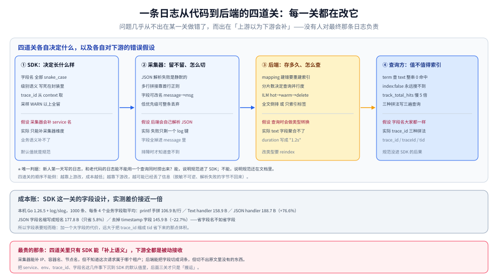

# 应用侧日志规范与SDK设计

> 覆盖：日志规范真正落地的地方不是 wiki 文档，而是**SDK 的默认行为**——字段名、级别语义、上下文注入、错误包装、默认采样，五件事只要有一件靠「开发者自觉」，半年后一定走形。本篇给出这五件事的判据、一份可执行的字段表，以及字段设计的成本实测（JSON 比手拼大 77%，而字段名缩写只省 5.8%）。
>
> 不覆盖：日志写到哪个后端见 [日志系统选型对比.md](../日志系统选型对比.md)；采集端怎么解析与多行拼接见 [日志采集管道.md](../日志采集管道.md)；敏感字段怎么脱敏见 [敏感数据脱敏与合规.md](敏感数据脱敏与合规.md)；Go 侧的日志库选型与错误包装细节见 [日志与错误规范.md](../../../../../01-编程语言/go/工程实践/日志与错误规范.md)。
>
> 内容整理自个人学习笔记。体积读数为本机 Go **1.26.5** + `log/slog` 实测（每条日志 4 个业务字段、1000 条取平均），口径见第九节。

---

## 一、一句话定位：规范写进文档会失效，写进 SDK 才会生效

**本节要点**：一条日志最终长什么样，由**最靠近开发者那一层的默认值**决定。如果 SDK 的默认 handler 就是 JSON、默认字段名就是 `trace_id`、默认级别语义就写死在封装里，那么「规范」是不需要教育的；反之，规范再详细，也会有 30% 的调用点用 `fmt.Printf` 绕过它。

| 做法 | 半年后的状态 | 原因 |
| --- | --- | --- |
| 规范写在 wiki，靠 code review 抓 | 字段名三种拼法并存（`trace_id` / `traceId` / `tid`） | review 会漏，且新人不知道有这条 |
| 提供 SDK，但级别、字段都可自由传 | 级别语义漂移（`Error` 里打业务校验失败） | 每个人对「error」的理解不同 |
| **SDK 把默认值定死，只开放必要的口子** | 结构性一致，差异只剩业务字段 | 默认值就是规范 |

⭐ 一条判据：**「新人第一天写的日志，和老代码的日志能不能用一个查询同时捞出来？」** 能，说明规范进了 SDK；不能，说明规范还在文档里。

---

## 二、核心概念：五件必须定死的事

**本节要点**：日志规范的争议几乎全部集中在这五件事上。每一件都要给「默认值 + 例外口子」，只给原则等于没给。

| 事 | 定死什么 | 推荐默认 | 例外口子 |
| --- | --- | --- | --- |
| **字段名** | 一组保留字段的拼写与类型 | 见 2.1 的表，全部 `snake_case` | 业务自定义字段必须加前缀（`biz_*`） |
| **级别语义** | 什么情况用哪个级别 | 见 2.2 的四条判据 | 无（级别不允许自定义扩展） |
| **上下文** | 每条日志自动带哪些字段 | `service` / `env` / `trace_id` / `span_id` / `timestamp` | 高频日志可关掉 `trace_id`（有代价） |
| **错误包装** | 错误怎么进日志 | `err` 一个字段，值为字符串；堆栈单独一个字段 | 敏感错误脱敏后再进 |
| **默认采样** | 哪些级别默认全留 | `WARN` 及以上全留，`INFO` 可采样，`DEBUG` 默认关 | 排障期临时开 |

### 2.1 保留字段表

| 字段 | 类型 | 谁写 | 说明 |
| --- | --- | --- | --- |
| `timestamp` | RFC3339 或 Unix 纳秒 | SDK | 不要用本地时间字符串，跨时区无法排序 |
| `level` | 小写枚举 | SDK | `debug/info/warn/error/fatal`，不要 `WARNING` / `ERR` 混用 |
| `service` | 字符串 | SDK 启动时 | 与部署单元一致（不是仓库名） |
| `env` | 字符串 | SDK 启动时 | `dev/test/prod`，与配置中心一致 |
| `trace_id` / `span_id` | 32 / 16 hex | SDK（从 context 取） | 取不到就留空，**不要造假 ID** |
| `msg` | 字符串 | 调用方 | 一句话说「发生了什么」，不要拼变量 |
| `err` | 字符串 | 调用方 | 错误文本或错误码，堆栈放 `stack` |
| `duration_ms` | 数字 | 调用方 | 耗时一律毫秒数字，不要 `"1.2s"` 字符串 |

⚠️ `duration_ms` 与 `status` 这类**要参与聚合的字段必须是数字/枚举**。写成字符串后，后端要么聚合不了（ES 的 `text` 字段），要么要额外做类型转换（Loki 的 `| json` 之后 `unwrap`）。

### 2.2 级别语义的四条判据

| 级别 | 判据 | 反例 |
| --- | --- | --- |
| `ERROR` | **需要人介入**，且当前请求已经失败 | 用户输错密码（业务预期内） |
| `WARN` | 请求成功了，但有异常情况值得关注 | 重试后成功、降级到缓存 |
| `INFO` | 关键业务事件与状态变更 | 每个 HTTP 请求的进出（量太大） |
| `DEBUG` | 排障时才需要，生产默认关闭 | 把 `INFO` 的内容降级成 `DEBUG` 来「省量」 |

⭐ 最常被破的一条：**把「业务校验失败」打成 `ERROR`**。判断标准是「这条 `ERROR` 出现时，值班的人要不要起来看」——不要，就该是 `INFO` 或 `WARN`。

---

## 三、整体架构：一条日志从代码到后端的四道关



四道关的分工是：**SDK 决定「长什么样」，采集器决定「留不留、怎么切」，后端决定「存多久、怎么查」，查询方决定「值不值得为它加索引」**。每一关都可能改变日志，而问题往往出在「上游以为下游会补」的地方：

| 关卡 | 常见假设 | 实际情况 |
| --- | --- | --- |
| SDK | 「采集器会补 service 名」 | 采集器只能补**采集器维度**的元数据，业务语义补不了 |
| 采集器 | 「后端会解析 JSON」 | 解析失败是静默的，字段会掉到只剩一个 `log` 键 |
| 后端 | 「查询时会做类型转换」 | ES 的映射一旦建错，改要重建索引 |
| 查询 | 「字段名大家都一样」 | 三套拼法并存时，查询要写三遍 |

---

## 四、部署：SDK 该封哪几层

**本节要点**：不是所有团队都需要自研 SDK。判据是「有没有超过 3 个服务」且「日志要被跨服务查询」——满足这两条，薄封装就有回报。

```go
// 薄封装的三个要点：默认 JSON、自动注入上下文、级别语义收口
type Logger struct{ inner *slog.Logger }

func New(cfg Config) *Logger {
    h := slog.NewJSONHandler(os.Stdout, &slog.HandlerOptions{
        Level: cfg.Level,
        ReplaceAttr: func(groups []string, a slog.Attr) slog.Attr {
            if a.Key == slog.TimeKey {  // 时间格式统一成 RFC3339
                return slog.String("timestamp", a.Value.Time().UTC().Format(time.RFC3339Nano))
            }
            return a
        },
    })
    // service / env 在这里固定，调用方改不了
    return &Logger{inner: slog.New(h).With("service", cfg.Service, "env", cfg.Env)}
}

// 上下文由这一层注入，业务代码不需要自己摸 trace_id
func (l *Logger) Info(ctx context.Context, msg string, args ...any) {
    sc := trace.SpanContextFromContext(ctx)
    if sc.IsValid() {
        args = append(args, "trace_id", sc.TraceID().String(), "span_id", sc.SpanID().String())
    }
    l.inner.InfoContext(ctx, msg, args...)
}
```

三处设计值得解释：

| 设计 | 为什么 |
| --- | --- |
| `service` / `env` 在构造函数里 `With` 死 | 调用方无法传错，也无法漏传 |
| `trace_id` 从 `ctx` 取而不是入参 | 漏传是必现的，取不到就空着比造假好 |
| 方法签名强制第一个参数是 `ctx` | 让「不带上下文打日志」在代码层面别扭，而不是靠约定 |

⚠️ **不要包一层 `Debugf(format, args...)` 的老式接口**。格式化字符串会把字段结构毁掉（`fmt.Sprintf` 出来的是一条字符串，后端无法按字段查），而且 `Debugf` 的参数在关闭 `DEBUG` 时仍会被求值（`slog` 的 `Debug` 会先判级别，`Debugf` 通常不会）。

---

## 五、使用一：字段设计的成本账

**本节要点**：「字段名统一、语义清晰」几乎不需要付出体积代价；真正的体积成本来自**结构符号**与**每条都带的上下文**，不来自字段名长短。

本机实测（Go `log/slog`，1000 条，每条 4 个业务字段：服务名、路径、状态码、32 位 trace_id）：

| 形态 | 每行字节 | 相对手拼 |
| --- | --- | --- |
| `printf` 手工拼 `k=v` | **106.9 B** | 基线 |
| `slog` TextHandler（`k=v`） | 158.9 B | +48.6% |
| `slog` JSONHandler | **188.7 B** | **+76.6%** |
| JSON，字段名缩成 2~5 字符 | 177.8 B | +66.3% |
| JSON，去掉 `time` 字段 | 145.9 B | +36.5% |

三条可操作结论：

1. **字段名缩写几乎不省钱**：`trace_id` → `tid`、`status` → `code`，只省 **10.9 B/行（5.8%）**，但可读性与可查询性大幅下降。**不要为了省空间缩写字段名。**
2. **结构符号才是大头**：JSON 比 `k=v` 多 29.8 B/行（18.8%），全是 `{"` `":"` `","` 这些符号。但 JSON 让后端能直接解析，这笔钱值得花。
3. **时间戳占比不小**：去掉 `time` 省 42.8 B/行（22.7%）。这也是「为什么采集器侧的时间戳更划算」——正文里不带时间，由采集器统一打（代价是失去应用侧的真实事件时间，见管道篇的多行拼接问题）。

⭐ 判据：**体积优化的正确顺序是「先砍日志条数与字段数，再砍格式，最后才考虑字段名」**。反过来做（先把 `trace_id` 缩成 `tid`）收益不到 6%，却把可读性赔进去了。

---

## 六、使用二：级别语义与「什么不该打」

**本节要点**：日志量的问题 90% 不是「级别配错」，而是**在循环里打日志**、**把请求参数整包打出来**、**重复打同一个错误**。前两件靠 SDK 拦不住，只能靠规范与评审；第三件可以靠 SDK 拦。

| 反模式 | 量级影响 | 怎么拦 |
| --- | --- | --- |
| 循环里 `INFO` | 一次批量操作放大 1000 倍 | 改成循环外汇总一条（带 `count` / `failed`） |
| 整包打印请求体 | 单条从几百字节变成几十 KB | SDK 提供 `Truncate(body, 2KB)`，超长截断并标记 |
| 同一错误在每层都打 | 一条错误变 5 条日志 | **只在错误被处理的那一层打**，中间层只 `return err` |
| 用日志做审计 | 量级不可控且不可篡改要求做不到 | 审计走独立通道，不进日志系统 |

⭐ 一条可以写进评审清单的判据：**「这条日志如果一天出现 100 万次，我还能接受吗？」** 不能，就降级、加条件、或改成指标。

---

## 七、使用三：`trace_id` 怎么进日志（与 OTel 衔接）

**本节要点**：`trace_id` 进日志不是「加个字段」，而是**在正确的层注入**——在业务代码里到处 `logger.With("trace_id", ...)` 一定会有漏的，正确位置是日志封装的入口，从 `context` 里取。

| 位置 | 可行性 | 问题 |
| --- | --- | --- |
| 业务代码手工传 | 差 | 漏传是必现的，且新代码容易忘 |
| 日志封装从 `ctx` 取 | **推荐** | 要求所有打日志处都传 `ctx`（靠签名强制） |
| 采集器从正文正则提取 | 差 | 正文格式一变就断，且提取成本在采集器 |
| 后端从链路数据反查 | 差 | 需要日志与链路在同一后端，且要额外 join |

⚠️ 一个必须接受的现实：**被采样的链路，日志里的 `trace_id` 仍然存在，但链路数据不存在**。这时候日志能查，链路查不到，看起来像「链路丢了」。这是采样策略的必然结果，不是日志的 bug（见 [采样策略.md](../../OpenTelemetry/采样策略.md) 第四节）。处理办法是**日志侧按 `trace_id` 采样要和链路保持一致**，或者干脆在日志里标记 `sampled=false`。

---

## 八、验证与排查：三条可执行的检查

| 检查 | 怎么做 | 不合格的表现 |
| --- | --- | --- |
| 字段一致性 | 对生产日志做一次 `SELECT field, count(*)`（或 Loki 的 `| json` 后按标签统计） | 同一个语义出现多个字段名 |
| 级别分布 | 统计各 `level` 占比 | `ERROR` 占比 > 1%（说明级别语义漂了） |
| 单条体积 | 取 P99 单条字节数 | P99 超过 4 KB（说明整包打印没做） |

⭐ 第三条的阈值不是拍脑袋：Loki 的单行上限是 **256 KB**（本机实测 `Max entry size '262144' bytes exceeded`），ES 的 `http.max_content_length` 默认 100 MB 但单条过大同样拖慢 `_bulk`。**单条日志超过 4 KB，一般说明打的是「一整坨 JSON」而不是「一件事」。**

---

## 九、校验口径

| 结论 | 状态 | 依据 |
| --- | --- | --- |
| JSON 比 `k=v` 手拼大 76.6% | ✅ 真跑 | Go 1.26.5 + `slog`，1000 条：188.7 B vs 106.9 B |
| `slog` Text 比 JSON 小 15.8% | ✅ 真跑 | 158.9 B vs 188.7 B |
| 字段名缩写只省 5.8% | ✅ 真跑 | `trace_id`→`tid` 等 4 个字段全缩：177.8 B vs 188.7 B |
| 去时间戳省 22.7% | ✅ 真跑 | 145.9 B vs 188.7 B |
| Loki 单行上限 256 KB | ✅ 真跑 | 见 [Loki_存储架构与调优.md](../后端运维/Loki_存储架构与调优.md) 第七节的 400 报错 |
| SDK 封装示例可编译 | ✅ 真跑 | 单个文件 `go build` 通过（示例代码在本机 Go 1.26.5 下编译验证） |
| 各语言 SDK 的一致字段实现 | ⚠️ 未覆盖 | 只验了 Go；Java / PHP 侧写法差异未验证 |
| 「ERROR 占比 > 1%」这条阈值 | ⚠️ 经验值 | 不是本机读数，来自常见线上分布，按自己系统校准 |
| 单条 4 KB 阈值 | ⚠️ 经验值 | 推导自 Loki 的 256 KB 上限与 ES 的 `_bulk` 实践，非实测拐点 |

---

## 延伸追问

**Q：有了 OpenTelemetry 的日志信号，还需要自研 SDK 吗？**

需要的那一层会变薄。OTel Logs SDK 已经能做「JSON 输出 + 从 context 取 trace_id」，但它**不管字段命名规范**（语义约定给了建议字段，不强制）也不管级别语义。所以自研的部分从「输出格式」转移到「默认字段与级别收口」。**判据：如果团队已经在用 OTel 的 trace，日志应该走同一个 Provider，避免 trace_id 从两个通道进来而格式不一致。**

**Q：日志里能不能直接打结构体？**

能，但要小心两件事：一是**字段名会跟着代码里的 tag 走**（改个 struct tag 就改了日志字段，查询会断）；二是**可能打出不该打的东西**（新增一个 `Password` 字段，日志立刻泄露）。推荐做法是显式挑字段（`slog.String("user_id", u.ID)`），而不是 `slog.Any("user", u)`。

**Q：`DEBUG` 日志在生产关闭，那线上排障怎么办？**

两条路：一是**动态调级别**（`slog.LevelVar` 可以在运行时改，不用重启），配合「改完 5 分钟自动降回」；二是**把关键的 `DEBUG` 提升为带条件的 `INFO`**（比如只在 `status>=500` 时打请求体）。前者适合「偶发问题要现场抓」，后者适合「已知高价值场景」。

---

## 关联

- **上游/总纲**：[日志系统选型对比.md](../日志系统选型对比.md) — 日志为什么最贵、四板斧降本从哪下手
- **对照**：[敏感数据脱敏与合规.md](敏感数据脱敏与合规.md) — 规范管「打成什么样」，脱敏管「哪些不能打」
- **互补**：[日志风暴与限流降级策略.md](日志风暴与限流降级策略.md)（级别语义是限流策略的前提）、[日志采集管道.md](../日志采集管道.md)（SDK 输出的格式决定采集端能不能解析）
- **下游机制**：[日志查询语言与排障方法论.md](../查询与排障/日志查询语言与排障方法论.md) — 字段约定决定了查询能不能写、写得快不快
