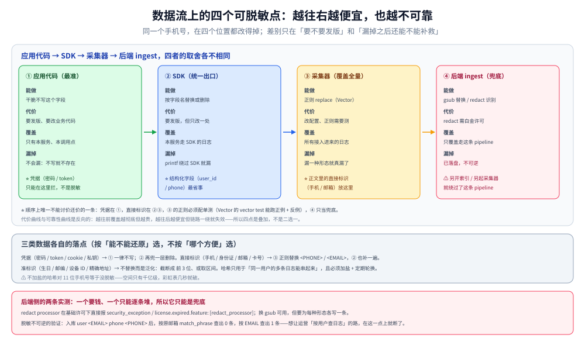

# 敏感数据脱敏与合规

> 覆盖：脱敏真正的难点不是「写对正则」，而是**决定在哪一侧做**——应用侧、采集侧、后端侧三条路里，本机实测证明后端侧在开源版 ES 上直接走不通（`redact` processor 报 `current license is non-compliant for [redact_processor]`），而这一步一旦漏掉就是**不可逆**的数据泄露。本篇给出四个脱敏点的取舍、三种可落地的实现，以及「脱敏之后还想按原值查」这个矛盾的三种解法。
>
> 不覆盖：日志该打哪些字段见 [应用侧日志规范与SDK设计.md](应用侧日志规范与SDK设计.md)；采集器的配置模型见 [FluentBit配置与调优.md](../采集器/FluentBit配置与调优.md) 与 [Vector配置与VRL.md](../采集器/Vector配置与VRL.md)；ES 侧的索引与 ILM 见 [ES_ILM与索引调优.md](../日志后端/Elasticsearch/ES_ILM与索引调优.md)。
>
> 内容整理自个人学习笔记。实测环境 Elasticsearch **8.19.0**（基础许可）+ Vector **0.44.0**，全部读数来自本轮容器实跑，口径见第九节。

---

## 一、一句话定位：脱敏是「在还能改的地方改」，越往后越贵也越难

**本节要点**：一条日志从产生到落库，能改它的位置有四个：**应用代码 → SDK → 采集器 → 后端 ingest**。越往前，改的代价越高（要发版）、但覆盖越彻底；越往后，改的代价越低（改配置）、但**一旦漏掉就不可逆**——因为后端一旦收下原文，它就在磁盘上了。

| 位置 | 改动代价 | 覆盖范围 | 漏掉的后果 |
| --- | --- | --- | --- |
| 应用代码 | 发版 | 精确（知道哪个字段是手机号） | 改漏一处就泄露 |
| SDK | 发版（一次） | 全量（所有走 SDK 的日志） | 绕过 SDK 的日志（`fmt.Printf`）漏掉 |
| 采集器 | 改配置 | 全量（所有经过它的日志） | 正则不准 → 误伤或不中 |
| 后端 ingest | 改配置 | 只有进这个 pipeline 的索引 | **原文可能已进别的索引/别的副本** |

⭐ 一条判据：**「这段日志在磁盘上的那一刻，里面还有没有明文手机号？」** 这个问题的答案决定了合规是否成立，而不是「我们的方案里有脱敏这一步」。

---

## 二、核心概念：三类数据、四种手法、一个不可逆性

**本节要点**：先分清「要处理的是什么」，再选手法。混用会导致「以为脱敏了、其实可还原」。

| 数据类型 | 例子 | 合规要求（常见口径） |
| --- | --- | --- |
| **直接标识** | 手机号、身份证、邮箱、银行卡、姓名 | 必须移除或不可逆替换 |
| **准标识** | 出生日期、邮编、设备 ID、精确地址 | 需泛化（截断、取区间）或移除 |
| **凭据** | 密码、token、cookie、API key、私钥 | **一律不得进日志**，不是脱敏是禁止 |

| 手法 | 做法 | 可逆性 | 适用 |
| --- | --- | --- | --- |
| **删除** | 整个字段不写 | 不可逆 | 凭据、整包请求体 |
| **掩码** | 保留部分（`138****8000`） | 不可逆但**可缩小范围** | 需要人工核对的场景 |
| **替换** | 换成固定占位符（`<PHONE>`） | 不可逆 | 最常见，本篇实测用这个 |
| **哈希** | `sha256(salt + value)` 取前 N 位 | **不可逆但可关联** | 需要「同一用户的多条日志能串起来」 |

⭐ 哈希那一行是最容易被误用的：**不加盐的哈希对手机号等于没脱敏**（11 位数字的空间只有千亿级，彩虹表几秒就破）。要可用就必须「盐存在别处 + 定期轮换」，并且只用于关联、不用于还原。

---

## 三、整体架构：四个可脱敏点与它们的顺序



图里从左到右四个位置，越往右越「便宜但越不可靠」。三条实践结论：

1. **凭据必须在应用侧拦**——采集器的正则会漏（token 形态千变万化），后端更晚。
2. **直接标识可以放在采集侧**——格式稳定（手机号 11 位、身份证 18 位、邮箱有 `@`），正则够用。
3. **后端 ingest 只能当「最后一道兜底」**，不能当主方案：它需要额外许可（见第五节），且一旦某条数据走了另一条链路（另一个 pipeline、另一个索引、另一个采集器），就绕过了。

---

## 四、部署：三个位置的实现

**本节要点**：三个位置各有适用的配置形态。选哪个看「能不能发版」和「日志格式是否统一」。

| 位置 | 实现 | 一行结论 |
| --- | --- | --- |
| 应用侧 | SDK 里对特定字段做替换/删除 | 最准，但要发版；适合凭据与结构化字段 |
| 采集侧 | Vector 的 `remap` + `replace` / Fluent Bit 的 `lua` filter | 覆盖全量，正则要测；适合正文里的标识 |
| 后端 | ES ingest pipeline 的 `gsub` / `redact` | `redact` 需白金；`gsub` 基础版可用但只能逐条写 |

---

## 五、使用一：后端侧为什么不可行（实测）

**本节要点**：ES 有两个看起来能脱敏的 processor，**一个要钱、一个只能逐条堆**。本机在基础许可下把两种情况都跑了一遍。

### 5.1 `redact` processor：基础许可直接拒

```json
{
  "pipeline": { "processors": [ { "redact": { "field": "message", "patterns": ["1[3-9][0-9]{9}"] } } ] },
  "docs": [ { "_source": { "message": "phone=13800138000" } } ]
}
```

返回：

```json
{"docs":[{"error":{"root_cause":[{"type":"security_exception",
 "reason":"current license is non-compliant for [redact_processor]",
 "license.expired.feature":"redact_processor"}}]}]}
```

⚠️ 注意报错措辞是 **`security_exception` + `license.expired.feature`**，它不会说「你需要升级」，只会说「当前许可不符合」。在自建集群上，这条错误经常被误读成「权限问题」。

### 5.2 `gsub` processor：基础版可用，但要一条条堆

```json
{
  "pipeline": {
    "processors": [
      { "gsub": { "field": "message", "pattern": "1[3-9][0-9]{9}", "replacement": "<PHONE>" } },
      { "gsub": { "field": "message", "pattern": "[A-Za-z0-9._%+-]+@[A-Za-z0-9.-]+\\.[A-Za-z]{2,}", "replacement": "<EMAIL>" } }
    ]
  },
  "docs": [
    { "_source": { "message": "login ok phone=13800138000 mail=alice@example.com" } },
    { "_source": { "message": "no pii, order=42" } }
  ]
}
```

`_simulate` 结果：

```text
doc0: login ok phone=<PHONE> mail=<EMAIL>
doc1: no pii, order=42
```

第二条是关键：**没有命中正则的日志原样通过**，不会被误伤成空串。

### 5.3 脱敏之后，按原值还查得到吗

真实入库一条，然后两种查法：

| 查询 | 命中数 |
| --- | --- |
| `match_phrase: {"message": "alice@example.com"}` | **0** |
| `match_phrase: {"message": "EMAIL"}` | **1** |

落地内容是 `user <EMAIL> phone <PHONE> logged in`。

⭐ 这就是「不可逆」的具体形态：**脱敏之后再也没法按用户邮箱反查他的日志**。如果业务上确实需要「按用户查日志」，只有三条路（见第七节），且都要在**脱敏之前**想清楚。

### 5.4 后端脱敏的三个硬伤

| 硬伤 | 说明 |
| --- | --- |
| 许可 | `redact` 需白金；基础版只能用 `gsub` 逐条堆 |
| 覆盖 | 只覆盖「经过这个 pipeline 的写入」；绕过 pipeline 的写入（`_bulk` 不带 `?pipeline=`）不脱敏 |
| 时序 | 数据先到 ES 才脱敏，**在途与副本里仍是明文**；如果开了慢日志、审计日志，它们记的是原文 |

---

## 六、使用二：采集侧怎么做

**本节要点**：采集侧是**性价比最高**的一层——不需要发版、覆盖全量、能对正文做处理。它的弱点是「只能靠正则认内容」，所以正则必须带单测。

### 6.1 Vector：`replace` + 单测

```yaml
transforms:
  mask:
    type: remap
    inputs: ["demo"]
    source: |
      .msg = to_string(.message) ?? ""
      .msg = replace(.msg, r'1[3-9]\d{9}', "<PHONE>")
      .msg = replace(.msg, r'[A-Za-z0-9._%+-]+@[A-Za-z0-9.-]+\.[A-Za-z]{2,}', "<EMAIL>")
```

配套单测（本机 `vector test` 两个用例全部 `passed`）：

```yaml
tests:
  - name: mask phone and email
    inputs:
      - insert_at: mask
        type: log
        log_fields:
          message: "user alice@example.com phone 13800138000"
    outputs:
      - extract_from: mask
        conditions:
          - type: vrl
            source: |
              assert_eq!(.msg, "user <EMAIL> phone <PHONE>")

  - name: no pii passes through
    inputs:
      - insert_at: mask
        type: log
        log_fields:
          message: "order 42 shipped"
    outputs:
      - extract_from: mask
        conditions:
          - type: vrl
            source: |
              assert_eq!(.msg, "order 42 shipped")
```

⭐ **两条用例缺一不可**：第一条证明「该改的改了」，第二条证明「不该动的没动」。只写第一条的团队，往往在正则写宽了之后（把订单号当手机号替换掉）几个月才发现——因为那时已经没人查得到订单号了。

### 6.2 Fluent Bit：`lua` filter 或 `modify`

`modify` 只能整字段替换，做不了正则；要做正文级脱敏得用 `[FILTER] lua`：

```ini
[FILTER]
    Name    lua
    Match   *
    script  mask.lua
    call    mask
```

```lua
function mask(tag, timestamp, record)
    local m = record["message"] or ""
    m = string.gsub(m, "1[3-9]%d%d%d%d%d%d%d%d%d", "<PHONE>")
    m = string.gsub(m, "[%w%.%%%+%-_]+@[%w%.%-]+%.[%a]+", "<EMAIL>")
    record["message"] = m
    return 1, timestamp, record
end
```

⚠️ Lua 的模式匹配不是正则（`%d` 而非 `\d`，没有 `{n}` 计数），复杂的模式容易写错且**写错不报错**——只会「什么都没替换」。这类 filter 必须配一条「已知样本进、预期样本出」的验证脚本。

### 6.3 采集侧的三个注意点

| 注意点 | 说明 |
| --- | --- |
| 脱敏要在**多行拼接之后** | 堆栈里可能带参数值；先拼接再脱敏，才能覆盖跨行的内容 |
| 脱敏要在**截断之前** | 先截断会把 `@` 或部分数字切掉，正则就认不出来了 |
| 脱敏后**不能再做「按原文 grok」** | 后续 filter 依赖原值的，顺序要调整 |

---

## 七、使用三：应用侧与「可逆指纹」

**本节要点**：应用侧是唯一能「精确知道哪个字段是敏感数据」的地方。它的代价是要发版，所以只适合**结构化的敏感字段**（`user.phone`、`order.card_no`），不适合正文里随手拼进去的内容。

### 7.1 三种「脱敏后还想按用户查」的解法

| 解法 | 做法 | 代价 |
| --- | --- | --- |
| **保留一个哈希指纹** | 额外写 `user_hash = sha256(salt + uid)[:16]`，脱掉原值 | 要管盐与轮换；只能关联不能还原 |
| **掩码保留检索能力** | 写 `138****8000`，按前缀查 | 检索粒度变粗（只能按前 3 后 4） |
| **敏感字段外置** | 日志里只放 `user_ref`，真值存到有权限的另一个系统 | 要多一次跳转，排障体验变差 |

⭐ 三种都要在**设计阶段**定，事后补不了——因为日志已经写进去了，而脱敏不可逆。

### 7.2 应用侧的典型实现

```go
// 只对已知的敏感字段做处理，不做正文正则
attrs := []any{
    "user_hash", hashID(cfg.Salt, user.ID),   // 可关联
    "phone_mask", maskTail(user.Phone, 4),    // 138****8000
}
// 注意：不要把整个 user 结构体打进来
```

---

## 八、验证与排查

| 检查 | 怎么做 | 不合格表现 |
| --- | --- | --- |
| 落库内容抽检 | 对生产索引/流随机取 100 条，grep 手机号/邮箱正则 | 命中任何一条即失败 |
| 正则单测 | Vector 的 `vector test`（正例 + 反例） | 只有正例，没有「不该动」的用例 |
| 绕过路径审计 | 统计「不经过脱敏 pipeline 的写入」 | `_bulk` 不带 `?pipeline=` 的调用 |
| 慢日志与审计日志 | 检查 ES 的 slowlog、搜索请求体是否记录原文 | 搜索条件里带明文手机号 |
| 副本与快照 | 检查快照是否包含脱敏前的历史数据 | 脱敏上线前的快照仍可还原 |

⚠️ 最后一条最容易被忽略：**脱敏上线不等于历史数据合规**。上线前的索引、快照、备份里都还是明文，需要单独评估「要不要重写历史索引」或「到期删除」。

---

## 九、校验口径

| 结论 | 状态 | 依据 |
| --- | --- | --- |
| ES `redact` processor 基础许可不可用 | ✅ 真跑 | `security_exception: current license is non-compliant for [redact_processor]` |
| ES `gsub` 基础许可可用，正例脱敏、反例不误伤 | ✅ 真跑 | `_simulate` 两条：`phone=<PHONE> mail=<EMAIL>` / `no pii, order=42` |
| 脱敏后按原值搜不到、按占位符搜得到 | ✅ 真跑 | `match_phrase alice@example.com` = 0；`match_phrase EMAIL` = 1 |
| Vector `replace` 脱敏逻辑正确 | ✅ 真跑 | `vector test` 两用例 `passed` |
| 反例断言会失败、退出码 78 | ✅ 真跑 | 故意写错期望值，报 `E000 assertion failed` 并打印实际值 |
| Fluent Bit `lua` filter 的脱敏 | ⚠️ 未实测 | 只给了配置形态；本机没有跑 Lua 脚本验证 |
| 身份证、银行卡、姓名等其他类型的正则 | ⚠️ 未实测 | 只实测了手机号与邮箱两类 |
| 哈希指纹的可关联性 | ⚠️ 未实测 | 只讨论方案，未做盐管理与碰撞验证 |
| 历史索引重写与快照清理 | ⚠️ 未实测 | 属于运维流程，本机无历史数据 |

实验脚本在 `.workbuddy/tmp/logs-lab/`（`vector_mask.yaml` / `vector_test.yaml` / `vector_test_bad.yaml`）与 `.workbuddy/tmp/es-lab/`（`redact2.sh`）。

---

## 延伸追问

**Q：把所有日志都整体加密，是不是比脱敏更彻底？**

日志系统没法用密文——查询、聚合、告警全都要读原文，加密后这些东西全部失效。真要做「静态加密」，正确的层次是**存储加密**（磁盘/对象存储的 SSE），它防的是「拿到磁盘的人」，不是「有查询权限的人」。**脱敏防的是后者，两者不能互相替代。**

**Q：正则脱敏会不会把正常业务数据误伤？**

会，而且很常见。手机号正则 `1[3-9]\d{9}` 会命中 11 位的订单号、时间戳、流水号；邮箱正则会命中 URL 里的 userinfo。**唯一有效的手段是「反例单测」**：收集一批「长得像但不是」的真实样本，断言它们不被替换。这也是为什么第六节强调两条用例缺一不可。

**Q：日志平台已经收了明文，能事后批量脱敏吗？**

ES 可以用 `_update_by_query` 重写字段，Loki **不能改已写入的 chunk**（不可变存储）。所以这件事必须先做对，再谈补救。如果已经泄露，正确顺序是「停写入 → 评估范围 → 重写/删除历史 → 轮换凭据」，而不是先写脚本改数据。

**Q：合规要求「保留 6 个月」，但敏感数据不能留 6 个月，怎么同时满足？**

两条数据分开存：**审计与访问日志**（含用户标识，存 6 个月，严格权限）与**运行日志**（脱敏后存 6 个月）。前者是合规对象、后者是排障对象，混在一个索引里必然两头不讨好。

---

## 关联

- **上游/总纲**：[应用侧日志规范与SDK设计.md](应用侧日志规范与SDK设计.md) — 规范决定「打成什么样」，脱敏决定「哪些不能打」
- **对照**：[日志风暴与限流降级策略.md](日志风暴与限流降级策略.md) — 另一类「数据治理」：控量与保关键，与脱敏共用「按重要性分级」的思路
- **互补**：[Vector配置与VRL.md](../采集器/Vector配置与VRL.md)（脱敏的推荐落点与单测）、[FluentBit配置与调优.md](../采集器/FluentBit配置与调优.md)（Lua filter 的写法与坑）
- **下游机制**：[ES_ILM与索引调优.md](../日志后端/Elasticsearch/ES_ILM与索引调优.md) — 历史索引重写与到期删除的承载机制
