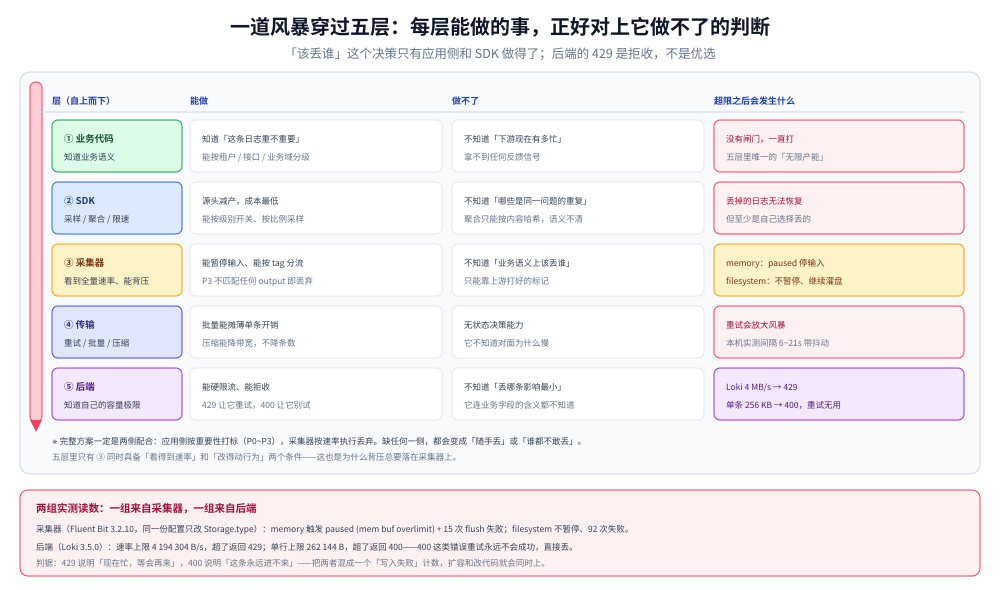

# 日志风暴与限流降级策略

> 覆盖：日志风暴的本质是**写入速率超过下游吸收速率**，不是「日志变多了」。沿着应用 → 采集器 → 后端三层，每一层都有一道闸门，而这三道闸门的默认行为往往互相掩护：采集器把内存撑爆、后端开始返回 429、最终谁在丢数据没人说得清。本篇给出三层闸门的位置、三种降级的取舍，以及两组本机实测（Fluent Bit 的 `paused (mem buf overlimit)` 与 Loki 的 4 MB/s 硬限）。
>
> 不覆盖：日志该打多少见 [应用侧日志规范与SDK设计.md](应用侧日志规范与SDK设计.md)；采集器的配置模型见 [FluentBit配置与缓冲.md](../采集器/FluentBit配置与缓冲.md)；Loki 的限流参数细节见 [Loki_存储架构与调优.md](../后端运维/Loki_存储架构与调优.md)；跨支柱的成本账见 [可观测性选型对比.md](../../可观测性选型对比.md)。
>
> 内容整理自个人学习笔记。实测环境 Fluent Bit **3.2.10** + Loki **3.5.0**，全部读数来自本轮容器实跑，口径见第九节。

---

## 一、一句话定位：风暴的判据是「速率比」，不是「总量」

**本节要点**：同样的日志量，摊在 24 小时里是正常负载，砸在 30 秒里就是风暴。所以判断要不要限流，看的是**峰值写入速率 ÷ 下游处理速率**这个比值，而不是「今天日志是不是变多了」。

| 场景 | 总量 | 峰值速率 | 结果 |
| --- | --- | --- | --- |
| 日常 | 每小时 10 GB | 3 MB/s | 后端轻松吸收 |
| 一次发布 | 30 分钟 10 GB | 5.5 MB/s | 接近 Loki 默认上限（4 MB/s），开始 429 |
| 故障循环重试 | 3 分钟 10 GB | **55 MB/s** | 采集器缓冲打满 → 内存涨 → OOM 或丢弃 |
| 上线 `DEBUG` 忘关 | 一天 500 GB | 6 MB/s 持续 | 不触发限流，但**账单爆** |

⭐ 一条判据：**「限流」和「降本」是两件事**。限流保的是可用性（别把采集器和后端打死），降本保的是账单。第四行那种「速率不高但总量巨大」的情况，限流救不了，只有级别治理能救。

---

## 二、核心概念：三道闸门与三种降级

**本节要点**：每层闸门的**默认行为**决定了风暴时的第一现场在哪。搞清默认值，才能在事故里快速判断「谁在丢」。

| 层 | 闸门 | 本机实测的默认行为 | 满了之后 |
| --- | --- | --- | --- |
| 应用 | 级别 / 采样 / 限速 | 不设（全打） | 无 |
| 采集器 | `Mem_Buf_Limit` / `max_chunks_up` / `Retry_Limit` | `memory` 模式会 **pause input**；`filesystem` 模式溢到磁盘不 pause | 暂停或丢 |
| 后端 | 速率限制 / 单条上限 | Loki：**4 MB/s**、**单条 256 KB** | 429 或 400 |

| 降级手法 | 做法 | 丢什么 | 适合 |
| --- | --- | --- | --- |
| **丢弃** | 超限直接扔 | 全部（包括重要的） | 最后手段 |
| **采样** | 按比例/按条件留 | 部分信息 | `INFO` 级别的常规日志 |
| **聚合** | 相同内容合成一条带 `count` | 单条明细 | 循环报错、重试风暴 |
| **降级级别** | 临时关 `DEBUG` / 降 `INFO` | 细节 | 风暴期应急 |

⭐ 优先级：**聚合 > 采样 > 降级级别 > 丢弃**。前三种都能事后恢复部分信息，丢弃不能。

---

## 三、整体架构：一道风暴穿过五层



五层从上到下是：**业务代码 → SDK → 采集器 → 传输 → 后端**。每一层的「能做的事」与「做不了的判断」是一一对应的：

| 层 | 能做 | 做不了 |
| --- | --- | --- |
| 业务代码 | 知道「这条日志重不重要」 | 不知道「下游现在有多忙」 |
| SDK | 能采样、能聚合、能限速 | 不知道「哪些是同一个问题的重复」 |
| 采集器 | 能看到全量速率、能背压 | 不知道「业务语义上该丢谁」 |
| 传输 | 能重试、能批量、能压缩 | 无状态决策能力 |
| 后端 | 知道自己的容量极限 | 不知道「丢哪条影响最小」 |

⭐ 关键结论：**「该丢谁」这个决策只能在应用侧或 SDK 做**，因为只有那里知道业务语义。后端的 429 是「拒收」，不是「优选」。所以完整的方案一定是**两侧配合**：应用侧按重要性标记，采集器侧按速率执行丢弃。

---

## 四、部署：三层限流的配置位置

| 层 | 配置项 | 作用 | 本机是否实测 |
| --- | --- | --- | --- |
| SDK | 级别开关、采样率、每秒上限 | 源头减产 | 未实测（机制层见规范篇） |
| Fluent Bit | `Mem_Buf_Limit` + `Storage.type` + `Retry_Limit` | 背压与暂停 | ✅ 实测 |
| Vector | 内部缓冲上限 + `filter` 按字段丢 | 按语义过滤 | ⚠️ 未实测 |
| Loki | `limits_config.ingestion_rate_mb` / `max_line_size` | 硬限流 | ✅ 实测 |
| ES | `_bulk` 的并发与批量大小 | 客户端自限 | ⚠️ 未实测 |

---

## 五、使用一：采集侧背压——内存还是磁盘，决定了「会不会暂停」

**本节要点**：同一份配置只改 `Storage.type`，风暴时的行为完全相反。这是本机最有价值的一组对照：**`Mem_Buf_Limit` 在 `filesystem` 模式下根本不生效**。

### 5.1 实验设置

`[INPUT] dummy` 以每秒 8 000 条生成日志，`[OUTPUT] http` 指向一个不存在的端口（`127.0.0.1:19999`），`Mem_Buf_Limit 1M`，跑 22 秒。

### 5.2 两种存储模式的对照

| `Storage.type` | 是否暂停 input | `failed to flush` 次数 | 关键日志 |
| --- | --- | --- | --- |
| `filesystem` | **否** | **92** | 只有 `no upstream connections available` |
| `memory` | **是** | **15** | `[warn] [input] dummy.0 paused (mem buf overlimit)` |

读法：

- `filesystem` 下，超出的数据**溢到磁盘**（`Storage.path`），所以内存永远到不了 1 MB，`Mem_Buf_Limit` 形同虚设；input 继续猛写，flush 失败次数一路涨到 92。
- `memory` 下，内存到顶后 **input 被暂停**，于是新日志不再产生，`failed to flush` 只有 15 次（都是暂停前积压的）。

⭐ 两条实践判据：

1. **要「不丢」就选 `filesystem`，但要盯磁盘**——它不会暂停，只会一直写盘，磁盘满了才是终点。
2. **要「不炸」就选 `memory`**——它会暂停源头，代价是**数据真的丢了**（暂停期间产生的日志没有进缓冲）。

### 5.3 重试间隔不是固定值

失败的 chunk 会重试，间隔实测（前 10 次）：**9 / 7 / 10 / 6 / 9 / 21 / 16 / 19 / 20 / 13 秒**。

| 观察 | 含义 |
| --- | --- |
| 有抖动 | 指数退避 + jitter，两次运行序列不同 |
| 上限不确定 | 本机 22 秒内没跑到上限，不能断言「最大多少秒」 |
| 报错措辞 | `no upstream connections available`（不是 `connection refused`） |

⚠️ 做容量估算时按「退避上限」算，不要按某次读到的秒数算。如果 `Retry_Limit` 是 `False`（无限重试），缓冲会一直涨——这正是 `filesystem` 模式打满磁盘的路径。

---

## 六、使用二：后端限流——429 是拒收，400 是永不成功

**本节要点**：Loki 的两条红线性质完全不同：**429 可以靠重试/拆批解决，400 重试多少次都没用**。分不清这两类，客户端会陷入「无限重试一个永远失败的请求」。

### 6.1 速率限制：429

一次推 11.97 MB（20 000 行）：

```text
429  Ingestion rate limit exceeded for user fake (limit: 4194304 bytes/sec)
     while attempting to ingest '20000' lines totaling '11928890' bytes,
     reduce log volume or contact your Loki administrator to see if the limit can be increased
```

| 读数 | 值 |
| --- | --- |
| 状态码 | 429 |
| 限值 | 4 194 304 字节/秒（4 MB/s） |
| 本次载荷 | 11 928 890 字节 |
| 耗时 | 1 411 ms（服务端先读了请求体再判定） |

⭐ 报错里带了「行数 + 字节数 + 限值」三个数，可以直接算要拆几批：`11.93 MB ÷ 4 MB ≈ 3 批`。这比「看到 429 就把批量减半」高效得多。

### 6.2 单条上限：400

```text
400  Max entry size '262144' bytes exceeded for stream '{env="lab", service="svc-big", ...}'
     while adding an entry with length '307200' bytes
```

| 读数 | 值 |
| --- | --- |
| 状态码 | 400（**不是 429**） |
| 单行上限 | 262 144 字节（256 KB） |
| 本次单条 | 307 200 字节 |

⚠️ **400 重试永远失败**。这类日志必须在采集端截断（几十 KB 的堆栈、整包 JSON 是常见来源），否则客户端会一直重试，把别的日志也堵死。

### 6.3 两类错误的处置对照

| 状态码 | 含义 | 客户端动作 | 是否需要采集端改配置 |
| --- | --- | --- | --- |
| 429 | 速率超限 | 退避后重试、拆批 | 否 |
| 400 | 单条超限 | **不要重试**，丢弃并计数 | **是**（加截断） |
| 500 / 503 | 后端故障 | 退避重试 | 否 |
| 204 | 成功 | — | — |

---

## 七、使用三：丢弃优先级——风暴时先丢谁

**本节要点**：限流只是「丢多少」，真正难的是「丢哪个」。没有优先级时，后果是**重要的错误日志和被 `DEBUG` 冲掉**——这是风暴事故里最常见的二次伤害。

### 7.1 一个可执行的四级分类

| 级别 | 内容 | 风暴时 |
| --- | --- | --- |
| P0 | 错误、审计、安全事件、变更记录 | **永不丢**，宁可暂停上游 |
| P1 | 慢请求、降级、重试 | 保留，可采样 |
| P2 | 业务关键事件（下单、支付） | 采样（如 1/10） |
| P3 | 访问日志、`DEBUG`、健康检查 | **最先丢**，风暴时直接关 |

### 7.2 怎么让采集器「知道」优先级

采集器不知道业务语义，所以要**在应用侧打标**——一个 `prio` 或 `level` 字段就够，采集侧按它分支：

```ini
# Fluent Bit：P3 直接丢（不匹配任何 output）
[FILTER]
    Name    grep
    Match   *
    Exclude level debug

# 或者按字段条件路由到不同 output（P0 走可靠通道，P3 走可丢通道）
[OUTPUT]
    Name    http
    Match   *
    ...
    Retry_Limit 3
```

⚠️ `grep` 的 `Exclude` 是**在过滤阶段丢**，此时数据已经在缓冲里，省不了采集端之前的那段链路的量。要真的省，得在 SDK 层就不产生。

### 7.3 三种降级的取舍

| 手法 | 保留了什么 | 丢了什么 | 本机可验证性 |
| --- | --- | --- | --- |
| 按级别丢 | 高优级别完整 | 低优级别全部 | Fluent Bit `grep` 可测 |
| 采样 | 分布形态、错误率 | 单条明细（无法追某个请求） | 需另配 |
| 聚合 | 条数、模式 | 每条的具体参数 | 需另配 |

⭐ 一条经验判据：**「排障时会不会需要看单条？」会 → 不能聚合；「会不会需要按 ID 追一个请求？」会 → 不能采样。** 两条都「会」的日志，只能靠控量不能靠降级。

---

## 八、验证与排查

| 症状 | 第一现场 | 怎么确认 |
| --- | --- | --- |
| 采集器内存持续涨 | 缓冲模式 | 看启动日志 `storage_strategy` 与 `max_chunks_up` |
| 采集器 CPU 高但数据没出去 | output 失败重试 | 数 `failed to flush` 与 `retry in N seconds` |
| 数据「突然断了」但进程还在 | input 被暂停 | 找 `paused (mem buf overlimit)` |
| 后端写入报 429 | 速率超限 | 用报错里的行数/字节数算拆批 |
| 后端写入报 400 | 单条超限 | 找最长的那条日志，加采集端截断 |
| 日志量正常但账单涨 | 总量而非速率 | 看级别分布与字段数，不是看峰值 |

⭐ 排查顺序：**先看采集器有没有暂停，再看后端有没有 429/400，最后才看应用打了多少**。反过来的顺序会让你在应用侧白找很久——因为应用侧可能完全正常，问题在采集器把内存撑爆了。

---

## 九、校验口径

| 结论 | 状态 | 依据 |
| --- | --- | --- |
| `memory` 模式触发 `paused (mem buf overlimit)` | ✅ 真跑 | 1 条 warn 原文；`failed to flush` 15 次 |
| `filesystem` 模式不暂停、持续 flush 失败 | ✅ 真跑 | 同配置仅改存储：92 次失败、无 paused |
| 重试间隔带抖动 | ✅ 真跑 | 9/7/10/6/9/21/16/19/20/13 秒 |
| 重试报错措辞是 `no upstream connections available` | ✅ 真跑 | output 指向未监听端口 |
| Loki 速率上限 4 MB/s → 429 | ✅ 真跑 | 推 11.97 MB，报错含 `limit: 4194304 bytes/sec` |
| Loki 单条上限 256 KB → 400 | ✅ 真跑 | 推 307 200 字节单行，报错含 `262144` / `307200` |
| `Retry_Limit` 的退避上限 | ⚠️ 未实测 | 22 秒内未跑到上限 |
| Vector 侧按字段过滤与丢弃 | ⚠️ 未实测 | 只验证了 `remap` 与 `test`，未做丢弃实验 |
| ES 侧 `_bulk` 的并发自限 | ⚠️ 未实测 | 本机只用单线程 bulk |
| 采样与聚合的实际降级效果 | ⚠️ 未实测 | 只讨论方案，未做量级对照 |

实验脚本在 `.workbuddy/tmp/logs-lab/fb_storm.conf`、`.workbuddy/tmp/es-lab/loki_c.py`。

---

## 延伸追问

**Q：为什么采集器不直接「按重要性排序后再丢」？**

因为它不知道重要性，而且**排序本身需要缓冲**——在内存紧张时做排序，等于用更多内存换一个不确定的收益。工程上的折中是「两三条通道」：高优走一条不丢的（小容量、可靠）、低优走一条可丢的（大容量、尽力而为）。Fluent Bit 用多个 `[OUTPUT]` 按 tag 分流就能做到。

**Q：`Retry_Limit False`（无限重试）是不是更安全？**

只对「下游临时故障」安全；对「下游永久拒绝」（400、配置错、权限错）是灾难——会永久占住缓冲，把后面的日志全堵死。**正确做法是区分错误类型**：429/5xx 无限重试，4xx 直接丢并计数。多数采集器没这么细，所以更实际的做法是设一个有限值（如 10 次）并配告警。

**Q：风暴过去之后，积压的数据会自己消化掉吗？**

会，但要看缓冲类型。`filesystem` 模式下积压数据在磁盘上，output 恢复后会持续 flush，消化速度取决于下游写入能力；`memory` 模式下**暂停期间的日志根本没进来**，所以没有「积压」这回事——数据是真丢了。这也是「两种模式不是容量差异，而是语义差异」的意思。

**Q：要不要给日志加「熔断」？**

要，但熔断的粒度应该是**单个服务/单个日志源**，不是整个采集器。原因：一个服务刷日志不该影响其他服务的可观测性。实现上就是「按标签分通道 + 每通道独立限额」，而不是全局一刀切。

---

## 关联

- **上游/总纲**：[应用侧日志规范与SDK设计.md](应用侧日志规范与SDK设计.md) — 级别的定义是限流策略的前提，级别语义漂了就没法按优先级丢
- **对照**：[敏感数据脱敏与合规.md](敏感数据脱敏与合规.md) — 另一类数据治理：控量保可用 vs 控内容保合规
- **互补**：[FluentBit配置与缓冲.md](../采集器/FluentBit配置与缓冲.md)（背压三道闸门的配置细节）、[Loki_存储架构与调优.md](../后端运维/Loki_存储架构与调优.md)（429 与 400 背后的参数）
- **下游机制**：[日志查询语言与排障方法论.md](../查询与排障/日志查询语言与排障方法论.md) — 丢过数据之后，怎么判断「查不到」是没打、没发、还是丢了
