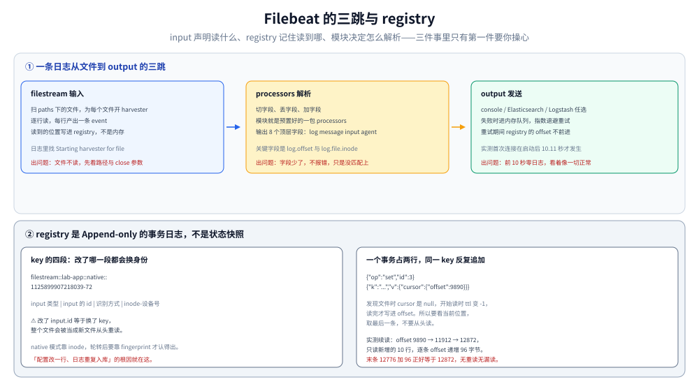

# Filebeat 配置与模块化

> Filebeat 和 Fluent Bit / Vector 的根本差别不在配置语法，而在**它替你记着「读到哪了」**——`registry` 是 Append-only 的事务日志，进程重启、容器重建都不会重读或漏读。第二个差别是**模块**：55 个内置模块把「某个产品的日志长什么样、该怎么解析、该映射到哪些 ECS 字段」预先写好了。
>
> 内容整理自个人学习笔记。✅ **本篇读数来自本机实跑**：`elastic/filebeat:8.19.0`（libbeat 8.19.0，Go 1.24.4，容器内 Ubuntu 24.04.2），单容器 + 一个 100 行 / 9 890 字节的日志文件，`output.console` 输出，`path.data` 挂宿主机目录。逐条口径见第七节。
>
> 不覆盖：多行拼接、JSON 解析静默失效、背压的三层形态是**采集器的共同机制**，见 [日志采集管道.md](../日志采集管道.md)（机制主篇）；Fluent Bit 的缓冲与 tag 路由见 [FluentBit配置与调优.md](FluentBit配置与调优.md)；Vector 的 VRL 与校验见 [Vector配置与VRL.md](Vector配置与VRL.md)。三者的选型判据在 [日志系统选型对比.md](../日志系统选型对比.md)。

---

## 一、一句话定位：input 声明「读什么」，registry 记住「读到哪」，模块决定「怎么解析」

| 问题 | Filebeat 的答案 | 换个说法 |
| --- | --- | --- |
| 读哪些文件 | `filebeat.inputs` 里的 `paths` | 你声明 |
| 读到第几字节 | `path.data/registry/filebeat/log.json` | **它自己记** |
| 怎么切字段 | 手写 processors，或用模块 | 模块是「预置的 processors 包」 |
| 输出失败怎么办 | 内存队列 + 指数退避重试 | 不丢，但会堵 |

⭐ 三件事里只有第一件要你操心。**registry 是 Filebeat 的核心资产**——它决定了「重启会不会重读」「容器重建会不会重复入库」。这两件事在日志系统里是最难排查的一类问题（重复日志会污染统计，漏日志会丢证据）。

---

## 二、核心概念：filestream 与 log 是两个世代

8.x 有**两种文件输入**，这是必须分清的第一件事：

| input | 状态 | 日志里的措辞 | 位置记录 | 建议 |
| --- | --- | --- | --- | --- |
| `log` | **已废弃** | `DEPRECATED: Log input. Use Filestream input instead.`；`Harvester started for paths: [...]` | 有 | 不要再用 |
| `filestream` | 现役 | `Starting harvester for file` | 有，且支持 fingerprint 抗 inode 变化 | 一律用这个 |

实测确认：配 `type: log` 启动会打出上面那条 `DEPRECATED` 警告——**它不是静默的**，这一点比很多产品的「软废弃」友好。判据也很简单：看日志里是 `for paths`（log）还是 `for file`（filestream）。

⚠️ 两者的参数名**不通用**：`log` 用 `close_inactive`，`filestream` 用 `close.on_state_change.inactive`。把旧配置直接搬过来不会报错，但参数被忽略——这是升级时最常见的「配置没生效」。

### 2.1 模块：55 个预置配方，默认全部关闭

```text
filebeat modules list
→ Enabled:   （空）
→ Disabled:  activemq / apache / auditd / aws / ... / zeek / zookeeper / zoom    共 55 个
```

模块的价值不是「省配置行数」，而是**它内置了一份别人踩过坑的解析规则**：nginx 的 access log 有十几种格式、Java 堆栈有七八种开头、K8s 的 CRI 格式带部分行标记。这些规则写错了不会报错，只会让字段少几个——所以「用现成模块」比自己手写 `processors` 更不容易静默出错。

代价是：模块会**顺带做 ILM 与索引模板的 setup**（`filebeat setup`），这会动到 ES 的索引结构。⚠️ 在已有 ILM 策略的集群上，这一步可能覆盖你的模板——见 [ES_ILM与索引调优.md](../日志后端/Elasticsearch/ES_ILM与索引调优.md)。

---

## 三、整体架构：一条日志的三跳



三跳的每一跳都有代价：

| 跳 | 做什么 | 出问题时的现象 |
| --- | --- | --- |
| ① input（filestream） | 扫文件、开 harvester、逐行读 | 文件不读 = 路径/权限/被 close 参数关掉 |
| ② processor | 切字段、丢字段、加字段 | 字段少 = 解析器没匹配上，**不报错** |
| ③ output | 发到 console / ES / Logstash | 连不上 = 前 10 秒完全静默，然后指数退避 |

---

## 四、部署：最小可运行配置，以及启动前必须跨过的三个坑

```yaml
filebeat.inputs:
  - type: filestream
    id: lab-app
    paths:
      - /logs/app.log

path.data: /data

output.console:
  enabled: true

logging.level: info
logging.to_stderr: true
```

⚠️ **最后一行不是可选的**：Filebeat 默认把日志写文件而不是 stderr，在容器里跑时 `docker logs` 会一片空白——**看起来像没启动**。

### 4.1 三个启动前必跨的坑（本机逐个撞过）

| # | 现象（原文） | 原因 | 解法 |
| --- | --- | --- | --- |
| ① | `Exiting: error loading config file: config file ("/cfg/fb.yml") can only be writable by the owner but the permissions are "-rwxrwxrwx"` | Filebeat **拒绝加载组/其他人可写的配置** | 容器内 `chmod go-w`。⚠️ Docker Desktop on Windows 的 bind mount **在容器里恒为 777，宿主侧 `chmod 644` 无效**——必须先 `cp` 进容器再改 |
| ② | `Exiting: error setting default paths: failed to create data path /data: mkdir /data: permission denied` | 容器以非 root 用户运行，建不了 `/data` | 先把宿主目录挂上去（目录存在就不会 mkdir） |
| ③ | `Exiting: /data/filebeat.lock: data path already locked by another beat` | 上一个实例没优雅退出，锁文件残留 | 删 `filebeat.lock`。⭐ **`timeout docker run` 只杀 docker 客户端、容器还在跑**，锁就被它占着 |

第 ① 条的教训值得单独记：**三个 `Exiting:` 全都是退出码 1，但如果你用 `docker ... \| cat` 或 `\| tail` 收输出，拿到的 `$?` 是管道最后那个命令的**——本机第一次就是这么把失败看成 `EXIT=0` 的。判据是看 `Exiting:` 字样，不是看退出码。

### 4.2 停止：SIGTERM 会清锁，SIGKILL 不会

| 停止方式 | 退出码 | `filebeat.lock` |
| --- | --- | --- |
| `docker stop -t 15`（准时退出） | — | **被清理** |
| `docker stop -t 15` 超时后 SIGKILL | **137** | **留下 0 字节文件** |
| 容器被强杀 | 137 | 留下 |

⭐ 实测两种都出现过：一次 `stop` 后锁消失，一次退出码 137 且锁留下。**排障时先看锁文件在不在，比看日志快。**

---

## 五、使用一：registry 记的是什么，续读为什么值得信

`path.data/registry/filebeat/log.json` 是 **Append-only 的 JSON Lines 事务日志**，不是最终状态快照。本机一个文件读完后的全部内容只有 10 行：

```text
{"op":"set","id":1}
{"k":"filestream::lab-app::native::1125899907218039-72","v":{"updated":[...],"cursor":null,"meta":{"source":"/logs/app.log","identifier_name":"native"},"ttl":0}}
{"op":"set","id":2}
{"k":"...","v":{"ttl":-1,"updated":[...],"cursor":null,...}}
{"op":"set","id":3}
{"k":"...","v":{"ttl":-1,"updated":[...],"cursor":{"offset":9890},...}}
```

五条能直接用的：

1. **一个事务占两行**：`{"op":"set","id":N}` + 一条 `{"k":...,"v":...}`。10 行 = 5 个事务。
2. **同一个 key 会被反复追加**：`cursor: null`（发现文件）→ `ttl: -1`（开始读）→ `cursor: {offset: 9890}`（读完记位置）。**要看当前位置，取最后一条**，不要从头读。
3. **key 的格式是 `input类型::input的id::identifier_name::inode-设备号`**。⚠️ 改了 `id` 就等于换了身份，**会从头重读整个文件**——这是「配置改了一行，日志整个重复入库」的根因。
4. **`identifier_name: native`** 表示用 inode 识别文件。文件被轮转（rename + 新建）后 inode 变了，靠 `fingerprint` 才能认出来是同一个。
5. **`ttl` 从 `0` 变 `-1`** 表示这个 state 从「待确认」变成「活跃」。

### 5.1 续读的实测：只读新增，不重读

| 时刻 | 文件大小 | registry `cursor.offset` | event 数 |
| --- | --- | --- | --- |
| 首次读完 100 行 | 9 890 B | 9 890 | — |
| 追加 20 行 | 11 912 B | 11 912 | — |
| 追加 10 行后重启 | 12 872 B | 12 872 | **10**（正好 10 条） |

⭐ 这 10 条 event 的 `log.offset` 是 `11912, 12008, 12104, …, 12776`——**从上次停下的字节开始，逐行递增，末条 12 776 + 96 = 12 872 = 文件大小**。没有重读、没有漏读、没有重复。

每条 event 8 个顶层字段：`@timestamp`、`@metadata`、`log`、`message`、`input`、`agent`、`ecs`、`host`。其中 `log.offset` 与 `log.file.inode` 是排查「这条日志到底读没读」的关键。

---

## 六、使用二：harvester 的关闭比配置的晚

`close.on_state_change.inactive`（旧的 `log` input 里叫 `close_inactive`）的语义是「文件多久没有新内容就关掉读取句柄」。本机实测它**不是定时器**：

| 配置 | 实测从 `Starting harvester` 到 `Reader was closed` |
| --- | --- |
| `inactive: 3s` | **6.032 s** |
| `inactive: 6s` | **14.046 s** |
| `inactive: 3s` + `prospector.scanner.check_interval: 1s` | **6.060 s**（无变化） |

三条结论：

1. **实际关闭时刻约是配置值的 2~2.3 倍**，不是等于。
2. **与扫描间隔无关**——把 `check_interval` 从默认降到 1s，结果不变（6.032 → 6.060）。
3. 所以这个参数该理解成「**至少闲置这么久**」，而不是「闲置这么久就关」。要精确控制句柄数，得算上这个倍数。

⚠️ 这条对容量的影响是间接的：句柄不关，`open_files` 就下不来。文件数上万时，按 2~2.5 倍预算才不会撞 `ulimit`。

---

## 七、使用三：output 连不上时的静默期

本机把 `output.elasticsearch.hosts` 指向一个没人监听的端口（`127.0.0.1:19999`），时间线如下：

| 相对时刻 | 事件 |
| --- | --- |
| +0.102 s | `Input 'filestream' starting` —— 输入侧完全正常 |
| **+10.110 s** | `Connecting to backoff(elasticsearch(http://127.0.0.1:19999))` —— **第一次连接尝试** |
| +10.111 s | `Error dialing dial tcp 127.0.0.1:19999: connect: connection refused` |
| +12.035 s | `Failed to connect ... with 1 reconnect attempt(s)` —— 间隔 1.924 s |
| +15.442 s | `Failed to connect ... with 2 reconnect attempt(s)` —— 间隔 3.406 s |

⭐ **最值得记的是第一行到第二行之间的 10 秒**：输入侧一切正常、日志里没有任何错误，但**一条数据都发不出去**。这 10 秒里如果运维只看「Filebeat 起来了吗」，答案是「起来了」。

三条推论：

1. **探活不能只看进程在不在**，要看 output 侧有没有成功的 publish（或看 ES 里索引有没有在涨）。
2. **重试是指数退避**（1.92s → 3.41s），不是固定间隔。对比 Fluent Bit 的 6~21s 带抖动、Loki 的 429 立即拒绝——三家的退避语义完全不同，选型时对齐这一点比对齐功能表更有用。
3. **报错措辞是 `connect: connection refused`**，不是 Fluent Bit 的 `no upstream connections available`。搜日志时用对关键词。

---

## 八、验证与排查：五个半静默行为

| # | 行为 | 为什么不报错 | 怎么发现 |
| --- | --- | --- | --- |
| ① | `States Loaded from registrar: 0` 但实际续读成功 | 这个计数不统计 filestream 的 state | 看 `Active transaction id=N` 与 registry 最后一条 offset |
| ② | output 不通的前 10 秒零日志 | backoff 还没开始尝试 | 看 ES 里索引有没有涨，不要只看进程 |
| ③ | `close.on_state_change.inactive` 不按配置值生效 | 语义是「至少」，还有检查周期 | 按 2~2.5 倍预算 |
| ④ | 改了 `input.id` 导致整个文件重读 | registry 的 key 含 id，等于换了身份 | 重复数据出现时，先比对 `log.file.path` + offset |
| ⑤ | 只配 console output 时的警告 | `unable to load the ingest pipelines ... because the Elasticsearch output is not configured/enabled` | 这条是 warn，不影响运行，但会误导人以为配错了 |

### 8.1 一个排查顺序

1. **容器起来了吗**——`docker logs` 有没有内容？没有就看 `logging.to_stderr` 是不是漏了。
2. **有没有 `Exiting:`**——三个启动坑（配置权限 / data 目录 / 锁）全在这一行里。
3. **input 起来了吗**——找 `Input 'filestream' starting` 与 `Starting harvester for file`。
4. **registry 的 offset 动了吗**——不动说明没读到新内容（不是 output 的问题）。
5. **offset 动了但 ES 没数据**——问题在 output，看 `backoff` 与 `connect`。

---

## 校验口径

| 结论 | 状态 | 依据 |
| --- | --- | --- |
| 版本与运行时 | ✅ 真跑 | `filebeat version` → 8.19.0 / libbeat 8.19.0 / Go 1.24.4 / Ubuntu 24.04.2 |
| 配置权限过宽直接拒绝加载 | ✅ 真跑 | 原文 `can only be writable by the owner ... "-rwxrwxrwx"`，退出码 1 |
| Windows bind mount 在容器内恒为 777 | ✅ 真跑 | 宿主 `chmod 644` 后容器内仍报 777 |
| `path.data` 不可写时报 `permission denied` | ✅ 真跑 | 原文 `mkdir /data: permission denied` |
| 锁残留导致启动失败 | ✅ 真跑 | 原文 `data path already locked by another beat` |
| 优雅退出清锁、SIGKILL 留锁 | ✅ 真跑 | 一次 `stop` 后锁消失；一次退出码 137 且锁留下 |
| registry 是 Append-only 事务日志 | ✅ 真跑 | 10 行 = 5 个 `{"op":"set","id":N}` + 5 条 `{"k":...}` |
| 续读只读新增（10 条 event / offset 不变） | ✅ 真跑 | offset 序列 11912→12776，末条 +96 = 12872 = 文件大小 |
| `close.on_state_change.inactive` 实际约 2 倍 | ✅ 真跑 | 3s→6.032s；6s→14.046s；加 `check_interval: 1s` 为 6.060s |
| output 首次连接在启动后 10.11s | ✅ 真跑 | `Connecting to backoff(...)` 的时间戳 |
| 重试间隔指数递增 | ✅ 真跑 | 1.924s → 3.406s（两次 attempt） |
| `log` input 打出 DEPRECATED | ✅ 真跑 | 原文 `DEPRECATED: Log input. Use Filestream input instead.` |
| 内置模块 55 个、默认全禁用 | ✅ 真跑 | `filebeat modules list` → Enabled 0 / Disabled 55 |
| `States Loaded from registrar` 计数不可信 | ✅ 真跑 | 报 0，但 registry 有 state 且续读正确 |
| ⚠️ 容器内 `"containerized": false` | ✅ 真跑 | Host info 里该字段为 false，与「跑在容器里」矛盾，成因未追 |
| 吞吐 / 内存 / CPU 基准 | ⚠️ **未实测** | 只验行为，未做压测 |
| `filebeat setup` 对 ILM 模板的实际影响 | ⚠️ **未实测** | 未连真 ES 跑 setup，按官方文档陈述 |
| 模块的解析正确性（nginx / system 等） | ⚠️ **未实测** | 只列了清单，未逐个启用验证字段 |
| fingerprint 模式对文件轮转的识别 | ⚠️ **未实测** | 用 `native`（inode）模式，未构造轮转场景 |

实验脚本在 `.workbuddy/tmp/beat-lab/`（`fb_min.yml` / `fb_close*.yml` / `fb_badout.yml` / `run_detached.sh`）。

---

## 延伸追问

**Q：registry 会不会无限增长？**

不会。它对同一个 key 是「追加后由 compaction 合并」——`registry/filebeat/meta.json` 记录着一个递增的事务 id（本机从 0 涨到 16），旧事务在 checkpoint 后被裁掉。所以文件大小稳定在「活跃文件数 × 常数」。**但如果文件数一直在涨（比如按小时建文件名、旧的又不删），registry 也会跟着涨**——这是「日志轮转策略」与「采集端状态」之间容易被忽略的耦合。

**Q：为什么改了 `input.id` 会导致整个文件重读？**

因为 registry 的 key 是 `filestream::<id>::native::<inode-device>`。id 变了 = key 变了 = 一个「从未读过的新文件」。Filebeat 没有任何办法知道这两个 id 指的是同一个文件。**所以 `id` 一旦上线就不要改**，要改必须先算清楚会重读多少数据。

**Q：模块和手写 processors 怎么选？**

判断标准是「这个产品的日志格式有没有公开且稳定的规范」。有（nginx、MySQL 慢查询、K8s CRI、AWS 各类日志）→ 用模块，它内置了格式变体和边界情况；没有（自研业务日志）→ 手写 processors 更可控。⚠️ 模块会带 `filebeat setup`，在已有索引模板的集群上要格外小心。

**Q：Filebeat 会不会丢日志？**

设计上不丢：output 失败时数据留在内存队列，靠 backoff 一直重试，registry 的 offset 也不前进（所以重启会重读）。**代价是内存**——队列满之后的行为要看 `queue.mem.events` 与 `flush` 配置。⚠️ 这一点本篇未压测，只说方向：**「不丢」换的是「内存 + 延迟」**，与 Fluent Bit 的「暂停输入」、Vector 的「磁盘缓冲」是三种不同的取舍。

---

## 关联

- **上游/总纲**：[日志系统选型对比.md](../日志系统选型对比.md) — 四个采集端的边界与「什么时候该用模块化采集器」
- **上游机制（必读）**：[日志采集管道.md](../日志采集管道.md) — 多行拼接、JSON 静默失效、背压形态，本篇不再复述
- **对照**：[FluentBit配置与调优.md](FluentBit配置与调优.md) — 五段配置与 tag 路由、`Mem_Buf_Limit` 在 filesystem 下失效；[Vector配置与VRL.md](Vector配置与VRL.md) — VRL 的编译期校验与三道校验强度
- **下游机制**：[ES_ILM与索引调优.md](../日志后端/Elasticsearch/ES_ILM与索引调优.md) — `filebeat setup` 会动到的 ILM 策略与索引模板
- **互补**：[日志查询方法论.md](../日志查询方法论.md) — 日志明明采到了却查不到时，回到「查不到的五种原因」按顺序判
