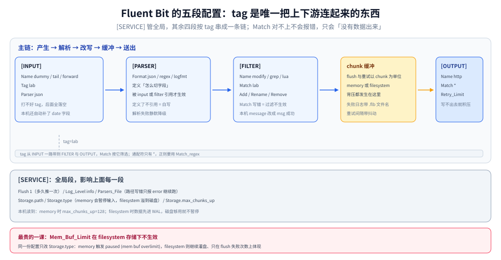

# Fluent Bit 配置与缓冲

> 覆盖：Fluent Bit 的配置到底由几段拼成、tag 与 `Match` 的路由是怎么生效的、缓冲的三层（memory / filesystem / `max_chunks_up`）分别管什么、以及 `Mem_Buf_Limit` 在什么情况下**根本不会生效**。本机 3.2.10 实测到三类静默行为：`Parsers_File` 路径写错只报 error 继续跑、`filesystem` 存储下内存上限被绕过、重试间隔不是固定值。
>
> 不覆盖：多行堆栈该怎么拼、JSON 解析为什么会静默只剩少数字段、K8s 下的三种采集形态，见 [日志采集管道.md](../日志采集管道.md)（本题材的机制主篇）；该选哪个采集器见 [日志系统选型对比.md](../日志系统选型对比.md)；与 Vector 的配置对照见 [Vector配置与转换.md](Vector配置与转换.md)。
>
> 内容整理自个人学习笔记。实测环境 Fluent Bit **3.2.10**（`fluent/fluent-bit:3.2`，distroless 镜像、无 shell），全部读数来自本轮容器实跑，口径见第九节。

---

## 一、一句话定位：Fluent Bit 的配置是「五段一条链」，出问题几乎都在链的接缝上

**本节要点**：Fluent Bit 的配置文件不是一堆并列的开关，而是**五段按固定顺序串起来的流水线**：`[SERVICE]` 定全局，`[INPUT]` 产数据并打 tag，`[PARSER]` 定义怎么切字段，`[FILTER]` 按 tag 改数据，`[OUTPUT]` 按 `Match` 收数据。**tag 是唯一把上下游连起来的东西**，接缝写错不会报错，只会「没有数据出来」。

| 段 | 作用 | 写错的典型症状 |
| --- | --- | --- |
| `[SERVICE]` | 全局：`Flush` 间隔、日志级别、`Parsers_File`、`Storage.*` | 路径写错只报 error，进程照常启动（见 8.1） |
| `[INPUT]` | 数据源，必须给 `Tag` | 忘写 tag → 后续 `Match` 全落空 |
| `[PARSER]` | 正文怎么切字段（正则 / JSON / logfmt / 多行） | 解析失败 → 字段少、只剩 `log` 一个键 |
| `[FILTER]` | 改字段、改 tag、采样、加元数据，用 `Match` 选作用域 | `Match` 写错 → 过滤静默不生效 |
| `[OUTPUT]` | 目的地，用 `Match` 选来源 | `Match` 写错 → 数据在缓冲里堆到丢 |

⭐ 一条判据：**「配置改完没效果」先查 `Match` 与 `Tag` 是否对得上，再查 `Flush` 是否真的在跑**。这两件事都不会报错。

---

## 二、核心概念：tag、路由与缓冲三层

**本节要点**：Fluent Bit 有三个概念必须先分清——**tag（数据的身份）**、**chunk（缓冲的最小单位）**、**storage（chunk 放哪）**。三者决定了背压时会发生什么。

| 概念 | 是什么 | 本机读数/形态 |
| --- | --- | --- |
| **Tag** | 每条 record 自带的字符串标识，由 `[INPUT]` 打上 | 本机用 `lab` / `storm` |
| **Match** | `[FILTER]` / `[OUTPUT]` 接受哪些 tag，支持 `*` 通配 | `Match *` 收全部 |
| **Chunk** | 缓冲里一批 record 的容器，**flush 与重试都以 chunk 为单位** | 失败日志里形如 `1-1792821771.873747150.flb` |
| **storage 后端** | chunk 落在内存还是磁盘，由 `Storage.type` 决定 | `memory` / `filesystem`，本机两种都跑过 |
| **`max_chunks_up`** | 允许同时「在内存里活着」的 chunk 数上限 | `memory` 时默认 **128**；`filesystem` 时本机读到 **20** |

⭐ 关键区分：**`Mem_Buf_Limit` 管的是「单个 input 的内存预算」，`max_chunks_up` 管的是「整个 storage 在内存里的 chunk 数」**。前者是「这个输入最多占多少」，后者是「全局最多压多少个块在内存」。两者不是一回事，配错就管不住。

---

## 三、整体架构：一条日志在 Fluent Bit 里的三跳



图里的三跳是：**input 产生 record 并打 tag → filter 按 tag 改写 → output 按 tag 收走并 flush**。中间那个「chunk 缓冲」不在主链上，但它是所有背压问题的发生地——output 写不出去时，chunk 不会消失，会先重试，重试期间新数据继续进缓冲。

本机最小配置的输出形态（`[INPUT] dummy` → `[FILTER modify]` → `[OUTPUT] stdout`）：

```json
{"date":1792821742.269326,"msg":"GET /api/v1/orders 200","level":"info","service":"svc-a","env":"lab"}
{"date":1792821743.273051,"msg":"GET /api/v1/orders 200","level":"info","service":"svc-a","env":"lab"}
{"date":1792821744.27306,"msg":"GET /api/v1/orders 200","level":"info","service":"svc-a","env":"lab"}
```

三行对应 `Samples 3`，间隔约 1 秒（`Flush 1`）。能读出的四件事：

| 现象 | 说明 |
| --- | --- |
| 多了 `date` 字段 | Fluent Bit 自动加的**事件时间**，浮点秒；不是日志正文里的时间 |
| `message` 变成 `msg` | `[FILTER] modify` 的 `Rename` 生效 |
| 多了 `env: lab` | 同一个 filter 的 `Add` 生效 |
| 字段顺序固定 | JSON 输出按内部 map 顺序，不保证与配置书写顺序一致 |

---

## 四、部署：最小可运行配置

**本节要点**：一个能跑的最小配置只需要 `[SERVICE]` + `[INPUT]` + `[OUTPUT]` 三段。`[PARSER]` 与 `[FILTER]` 都是可选的，但一旦涉及「解析正文」或「改字段」就必须写。

```ini
[SERVICE]
    Flush        1
    Log_Level    info

[INPUT]
    Name    dummy
    Tag     lab
    Dummy   {"message":"GET /api/v1/orders 200","level":"info","service":"svc-a"}
    Samples 3

[FILTER]
    Name    modify
    Match   lab
    Add     env lab
    Rename  message msg

[OUTPUT]
    Name    stdout
    Match   *
    Format  json_lines
```

启动：

```bash
docker run -d --name fb-lab \
  -v /path/to/conf:/cfg:ro \
  fluent/fluent-bit:3.2 -c /cfg/fb_min.conf
docker logs fb-lab
```

⚠️ 两个部署层面的坑，与配置无关但一样会让人卡住：

1. **官方 3.x 镜像是 distroless，没有 `sh`**。`docker exec fb-lab sh -c "ls /tmp"` 会报 `exec: "sh": executable file not found in $PATH`。要进容器看文件只能用 `docker cp` 拷出来，或者把 `Storage.path` 挂到宿主目录。
2. **`-c` 的相对路径是相对容器内工作目录**。`Parsers_File parsers.conf` 在挂载场景下会被解析成「相对配置文件所在目录」，而配置文件在 `/cfg/`，于是去 `/cfg/parsers.conf` 找——找不到（见 8.1）。

---

## 五、使用一：tag 与 `Match` 的路由

**本节要点**：`Tag` 是 producer 打的，`Match` 是 consumer 收的，两者用**通配**匹配。路由错了不会有任何报错，只是数据流不到该去的地方。

| 写法 | 含义 | 容易错在哪 |
| --- | --- | --- |
| `Tag lab` + `Match lab` | 精确匹配 | 大小写敏感，`Lab` ≠ `lab` |
| `Tag kube.*` + `Match kube.*` | 前缀通配 | 只有 `*` 是通配符，正则要写 `Match_regex` |
| `Match *` | 全收 | 多输出时会把同一份数据发多处（不是分流） |
| `Match a*b` | 中间通配 | 能匹配 `axxb`，不是「a 或 b」 |

⭐ 一个实用模式：**用 tag 做「分流开关」**。给 `[INPUT]` 打 `app.<服务名>`，再用多个 `[OUTPUT]` 各 `Match app.order.*` 之类——这样「哪个服务的日志去哪里」在配置里一眼可见，不用在 filter 里写条件。

⚠️ 反模式：用 `[FILTER] rewrite_tag` 做分流。它会**改变 tag 并重新进入路由**，容易写出「A 改成 B、B 又匹配回 A」的循环。Fluent Bit 有循环保护（record 带 hop 计数），但日志上看不出原因。

---

## 六、使用二：缓冲三层与背压的三个闸门

**本节要点**：背压发生在「output 写不出去」的时候。Fluent Bit 的应对顺序是：**先重试（chunk 留着）→ 内存到顶了暂停 input → 暂停也顶不住就丢**。三个闸门分别是 `Mem_Buf_Limit`、`Storage.type`、`max_chunks_up`，而**第一个在第二种存储模式下会被绕过**。

### 6.1 闸门一：output 失败后的重试

本机把 output 指向一个不存在的端口（`127.0.0.1:19999`），日志立刻开始刷：

```text
[error] [output:http:http.0] no upstream connections available to 127.0.0.1:19999
[warn] [engine] failed to flush chunk '1-1792821771.873747150.flb', retry in 6 seconds: task_id=0, ...
```

| 观察项 | 读数 |
| --- | --- |
| 报错措辞 | `no upstream connections available`（**不是** `connection refused`） |
| 重试间隔（前 10 次） | 9s / 7s / 10s / 6s / 9s / 21s / 16s / 19s / 20s / 13s |
| 18 秒内失败次数 | `failed to flush` 共 51 次 |

⭐ 重试间隔**不是固定值也不是严格指数**：它在指数退避的基础上加了随机抖动（jitter），所以同一份配置两次跑出来的序列不同。做容量估算时按「上限」算，不要按某一次读到的具体秒数算。

### 6.2 闸门二：`Storage.type` 决定内存上限生不生效

同一份配置只改 `Storage.type`，行为完全不同：

| `Storage.type` | `Mem_Buf_Limit 1M` | 实测行为 | 失败次数 |
| --- | --- | --- | --- |
| `filesystem` | 设了 | **不暂停**，数据继续进缓冲并溢到磁盘 | 92 |
| `memory` | 设了 | 触发 **`[warn] [input] dummy.0 paused (mem buf overlimit)`** | 15 |

原因：`Mem_Buf_Limit` 是「内存里的上限」，`filesystem` 模式下超出的部分会落到 `Storage.path`，内存永远不会到顶，所以**这个参数看起来配了、实际没起作用**。`filesystem` 模式下真正管住内存的是 `Storage.max_chunks_up`。

| 场景 | 该用哪个闸门 |
| --- | --- |
| 内存敏感、允许丢日志 | `Storage.type memory` + `Mem_Buf_Limit` |
| 不允许丢、磁盘够用 | `Storage.type filesystem` + `Storage.max_chunks_up` + `Storage.total_limit_size` |
| 两者都要 | `filesystem` 兜底 + 给 output 配 `Retry_Limit` 上限，超限后主动丢弃 |

### 6.3 闸门三：`max_chunks_up` 与 backlog

本机 `filesystem` 模式下读到两行启动日志：

```text
[storage] ver=1.5.2, type=memory+filesystem, sync=normal, checksum=off, max_chunks_up=20
[input:storage_backlog:storage_backlog.1] queue memory limit: 95.4M
```

- `max_chunks_up=20` 来自配置里的 `Storage.max_chunks_up 20`；
- `queue memory limit: 95.4M` 是**自动创建的 `storage_backlog` 输入**的内存队列上限（约为容器可用内存的一定比例），它不是配置项，是运行时算出来的。

⚠️ `storage_backlog` 是 Fluent Bit 在 `filesystem` 模式下自动加的「第二级输入」：主 input 暂停后，backlog 会继续把已经落到磁盘的数据往 output 送。**它会让「input 已暂停」看起来仍然在发数据**，排查时容易误判。

---

## 七、使用三：解析与多行（只讲配置位置，原理见管道篇）

**本节要点**：`[PARSER]` 里定义的东西要被 `[INPUT]` 的 `Parser` 或 `[FILTER]` 的 `parser` 引用才生效；**定义了但没被引用不会报错**。多行拼接的机制与三类失败形态见 [日志采集管道.md](../日志采集管道.md)，这里只说配置该落在哪。

| 需求 | 配置放在哪 | 注意 |
| --- | --- | --- |
| 一行 JSON 切成字段 | `[PARSER] Name json Format json` + `[INPUT] Parser json` | 解析失败会静默降级，字段变少 |
| 正则切分 | `[PARSER] Format regex` + `Regex` | 正则不匹配时整行进 `log` 键 |
| 多行堆栈合成一条 | `[MULTILINE_PARSER]` + `[INPUT] Multiline.Parser` | 镜像**自带 0 个** `MULTILINE_PARSER`，必须自己写 |
| 采集后再解析 | `[FILTER] parser` | filter 里的解析失败行为与 input 侧不同，见管道篇 |

---

## 八、验证与排查：三个静默坑

### 8.1 坑一：`Parsers_File` 路径写错，只报 error 继续跑

```text
[error] [/src/fluent-bit/src/config_format/flb_cf_fluentbit.c:289 errno=2] No such file or directory
[error] file=/cfg/parsers.conf
[ info] [fluent bit] version=3.2.10, ...
```

进程**照常启动、照常收数据、照常输出**——只是所有依赖 parser 的解析都退化成「整行进 log 键」。日志里那两行 error 往往被后面的启动 banner 淹没。

⭐ 判据：**启动日志里出现 `[error]` 就当成「配置没生效」处理，不要因为服务看起来正常就跳过**。

### 8.2 坑二：`filesystem` 模式下 `Mem_Buf_Limit` 静默失效

见 6.2 的对照表。这个坑的危险在于它**不是报错，而是「保护机制没启用」**：平时看不出来，等内存真的涨起来才发现上限从来没起过作用。

### 8.3 坑三：镜像没有 shell，`docker exec` 排查手段失效

```text
OCI runtime exec failed: exec: "sh": executable file not found in $PATH
```

官方 3.x 镜像是 distroless。要看 `Storage.path` 下的文件，必须把它挂到宿主目录，或者用 `docker cp` 拷出来。

---

## 九、校验口径

| 结论 | 状态 | 依据 |
| --- | --- | --- |
| 版本 3.2.10、distroless 无 shell | ✅ 真跑 | banner 打印版本；`docker exec fb-lab sh -c ...` 报 `executable file not found` |
| 最小配置输出 3 条，字段含 `date/msg/level/service/env` | ✅ 真跑 | `docker logs` 抓 3 行 JSON，`grep -c '"msg"'` = 3 |
| `Parsers_File` 路径错只报 error 继续启动 | ✅ 真跑 | 两行 `[error]` 之后 `[info] [fluent bit] version=...` 正常打印并有数据输出 |
| `memory` 模式触发 `paused (mem buf overlimit)` | ✅ 真跑 | 1 条 warn 原文，`failed to flush` 15 次 |
| `filesystem` 模式不触发暂停 | ✅ 真跑 | 同一配置仅改 `Storage.type`，`failed to flush` 92 次、无 paused |
| 重试间隔带抖动 | ✅ 真跑 | 前 10 次间隔 6/7/9/9/10/13/16/19/20/21 秒，两次运行序列不同 |
| `max_chunks_up` 默认值随存储模式变化 | ✅ 真跑 | `memory` 时启动日志 `max_chunks_up=128`；`filesystem` 且显式配 20 时为 20 |
| 多行拼接的三类失败形态 | ⚠️ 见管道篇 | 本篇只给配置位置，机制与读数在 [日志采集管道.md](../日志采集管道.md) |
| 吞吐上限（每秒能处理多少条） | ⚠️ 未实测 | 本机只做了背压行为，没有做限速吞吐基准 |
| `filesystem` 下的磁盘用量上限（`total_limit_size`） | ⚠️ 未实测 | 未构造磁盘打满场景 |
| K8s 下的采集形态 | ⚠️ 未实测 | 无集群，见管道篇 |

实验脚本在 `.workbuddy/tmp/logs-lab/`（`fb_min.conf` / `fb_storm.conf`），容器名 `fb-lab`（`fluent/fluent-bit:3.2`，配置文件挂载到 `/cfg`）。

---

## 延伸追问

**Q：`Flush 1` 是不是越小越好？**

不是。`Flush` 是「多久把缓冲推给 output 一次」，调小会让 chunk 变小、请求变多。日志场景常见取值是 1~5 秒：太大会让「刚写的日志查不到」，太小会放大 output 的请求数与网络开销。真正的批量点在 output 侧（HTTP 的 gzip 与批量体），不是靠 `Flush` 硬调。

**Q：`no upstream connections available` 和 `connection refused` 有什么区别？**

后者是 TCP 层明确被拒（端口没开、防火墙 REJECT）；前者是 Fluent Bit 自己的 upstream 连接池拿不到可用连接，可能因为目标端口完全不可达、DNS 解析失败、或者连接池被并发占满。**排查顺序是反的**：先 `nc -zv host port` 确认连通性，再看是不是并发把池打满。

**Q：为什么 `storage_backlog` 会自己冒出来？**

它是 `filesystem` 模式下的「兜底输入」：当主 input 因为背压暂停时，backlog 负责把已经落盘但没送出去的数据继续往 output 推。它的内存队列上限（本机 95.4 MB）是运行时按可用内存算的，配不了。如果不希望它存在，就用 `memory` 模式。

**Q：`Modify` 与 `Record Modifier` 两个 filter 有什么区别？**

`modify` 是新版统一入口（Add / Rename / Remove / Copy / Set / Hash），`record_modifier` 是旧版，功能是它的子集。新配置一律用 `modify`；`record_modifier` 只在兼容老配置时保留。两者都不做类型推断——加进去的都是字符串。

---

## 关联

- **上游/总纲**：[日志采集管道.md](../日志采集管道.md) — 采集管道的机制主篇：五段管道、多行拼接、JSON 静默失效、背压形态
- **对照**：[Vector配置与转换.md](Vector配置与转换.md) — 另一条路线：把转换做成有类型的 VRL 脚本，配置可编译期校验
- **互补**：[日志系统选型对比.md](../日志系统选型对比.md)（采集器怎么选）、[日志风暴与限流降级策略.md](../治理与规范/日志风暴与限流降级策略.md)（背压之前该在哪一层拦）
- **下游机制**：[Elasticsearch_ILM与调优.md](../后端运维/Elasticsearch_ILM与调优.md)、[Loki_存储架构与调优.md](../后端运维/Loki_存储架构与调优.md) — 数据发出去之后落在谁手里
