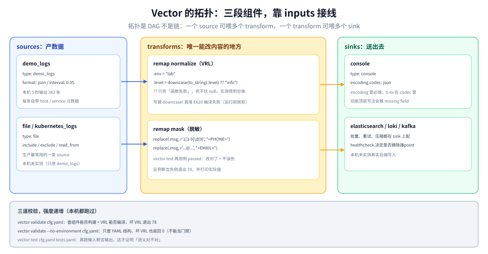

# Vector 配置与 VRL

> 覆盖：Vector 与其它采集器最根本的差别不在「支持多少 source」，而在于**把转换做成了一门有类型、可编译期校验、可单测的语言（VRL）**。本篇讲清三段组件的接线方式、VRL 的错误处理语义（`!` 只能用在会失败的函数上）、脱敏该怎么写并验证，以及本机 0.44.0 上摸到的三个坑：`??` 兜不住 null、`validate --no-environment` 会跳过 VRL 检查、`test` 的退出码才是真门禁。
>
> 不覆盖：多行拼接、JSON 解析静默失效、背压形态等跨采集器的通用问题见 [日志采集管道.md](../日志采集管道.md)；Fluent Bit 的配置对照见 [FluentBit配置与调优.md](FluentBit配置与调优.md)；该选哪个采集器见 [日志系统选型对比.md](../日志系统选型对比.md)。
>
> 内容整理自个人学习笔记。实测环境 Vector **0.44.0**（`timberio/vector:0.44.0-debian`），全部读数来自本轮容器实跑，口径见第九节。

---

## 一、一句话定位：Vector 把「转换」从配置项变成了程序

**本节要点**：Fluent Bit 的转换靠一组固定的 filter（`modify` / `grep` / `lua`），能做的事被 filter 的功能表限死；Vector 只给一个 `remap` transform，里面写 VRL 脚本——**能做的事由语言决定，而且写错的脚本在启动前就会被拒绝**。

| 维度 | 固定 filter 路线 | VRL 路线 |
| --- | --- | --- |
| 能做什么 | filter 功能表的并集 | 语言能表达的都可以（分支、类型转换、正则、嵌套字段） |
| 写错了什么时候知道 | 运行时静默（字段没改、过滤没生效） | **编译期报错**（`error[E620]` 之类） |
| 能不能单测 | 不能 | `vector test` 可以断言输入→输出 |
| 学习成本 | 低（背参数） | 中（学一门小语言） |
| 复杂逻辑 | 很快变成多条 filter 串联 + lua 兜底 | 一个脚本内解决 |

⭐ 判据：**如果你的日志处理里出现过「filters 串了七八条还是搞不定，最后上 lua」这种经历，那 Vector 的收益就成立。**；如果只是「加个字段、删个字段」，固定 filter 更省事。

---

## 二、核心概念：三段组件与一个事件模型

**本节要点**：Vector 的拓扑只有三种组件，数据在它们之间单向流动，**每个组件的 `inputs` 决定它接谁**——这是唯一需要背的接线规则。

| 组件 | 作用 | 本机用到 |
| --- | --- | --- |
| **source** | 产数据（文件、socket、k8s、demo、prometheus…） | `demo_logs`（`format: json`、`interval: 0.05`） |
| **transform** | 改数据（`remap` 写 VRL、`filter`、`sample`、`aggregate`…） | `remap`（字段归一、脱敏） |
| **sink** | 送出去（ES、Loki、Kafka、console…） | `console`（`encoding.codec: json`） |

数据模型是 **event**，有三种形态：`log`（一组键值）、`metric`、`trace`。`remap` 对三者都能操作，但 VRL 里访问字段的语法不同（log 用 `.field`，metric 用 `.tags` 之类）。日志场景绝大多数是 log。

⭐ 一条接线规则：**`inputs` 是数组，所以一个 transform 可以接多个 source，一个 sink 也可以接多个 transform**（此时会合并）。这比 Fluent Bit 的 `Match` 通配更显式——「谁接谁」写在配置里，不用靠 tag 猜。

---

## 三、整体架构：数据在拓扑里怎么流



图里每个方框是一个组件实例，箭头是 `inputs` 声明的连线。三条性质值得注意：

1. **拓扑是 DAG 不是链**：一个 source 可以同时喂给多个 transform，一个 transform 也可以喂给多个 sink（同一份数据写两处不用复制 source）。
2. **组件之间有内部缓冲**，所以「sink 慢」不会立刻阻塞 source——但缓冲有上限，满了仍然会背压到 source。
3. **`remap` 是唯一能改数据内容的组件**，其余 transform 只做「过或不过」「采样」「聚合」。

本机最小配置跑 5 秒的输出（`demo_logs` → `remap` → `console`）：

```json
{"env":"lab","host":"localhost","level":"","msg":"{\"host\":\"111.38.243.2\",\"method\":\"HEAD\",\"status\":\"550\",...}","service":"vector","source_type":"demo_logs"}
```

三件事能直接读出来：

| 现象 | 含义 |
| --- | --- |
| 多了 `env: lab` | `remap` 里的 `.env = "lab"` 生效 |
| `msg` 是**一个 JSON 字符串**而不是嵌套对象 | `demo_logs` 的 `format: json` 把整条 sample 放进了 `message` 字段，`to_string` 后仍是字符串 |
| `level: ""` | **`?? "info"` 没兜住**，见 5.2 |
| `service` / `source_type` / `host` | Vector 自动加的来源元数据，不是我们写的 |

5 秒内输出 **343 条**（`interval: 0.05` 名义上是 20 条/秒，实际有突发）。

---

## 四、部署：最小可运行配置

**本节要点**：Vector 用 YAML（也支持 TOML/JSON），最小配置是「一个 source + 一个 sink」，`data_dir` 建议显式指定以便控制磁盘缓冲位置。

```yaml
data_dir: /var/lib/vector

sources:
  demo:
    type: demo_logs
    format: json
    interval: 0.05

transforms:
  normalize:
    type: remap
    inputs: ["demo"]
    source: |
      .env = "lab"
      .level = downcase(to_string(.level) ?? "info")
      .msg = to_string(.message) ?? ""
      del(.message)

sinks:
  out:
    type: console
    inputs: ["normalize"]
    encoding:
      codec: json
```

启动与验证：

```bash
docker run -d --name vec-lab -v /path/to/conf:/cfg:ro \
  timberio/vector:0.44.0-debian --config /cfg/vector_min.yaml
docker logs vec-lab
```

⚠️ `encoding` 是 sink 的**必填字段**（本机漏写时报 `missing field 'encoding' in 'sinks.out'`），但它在不同版本里的位置变过（早期是顶层 `encoding`，0.4x 在 `encoding.codec`）。照着旧版本博客抄配置，最容易在这里卡住。

---

## 五、使用一：VRL 的类型与错误处理

**本节要点**：VRL 的每个函数都带「会不会失败」的标记，`!` 是「失败就中止这条 event」的语法糖，**只能加在会失败的函数上**。加在不会失败的函数上会直接编译失败——这是它与「什么都能试、错了运行时才知道」的脚本语言最大的区别。

### 5.1 `!` 用错会编译期报错

把 `downcase`（不会失败）写成 `downcase!`：

```text
error[E620]: can't abort infallible function
  ┌─ :2:10
  │
2 │ .level = downcase!(to_string(.level) ?? "info")
  │          ^^^^^^^^- remove this abort-instruction
  │
  = this function can't fail
```

| 报错码 | 含义 | 处理 |
| --- | --- | --- |
| `E620` | 对不会失败的函数用了 `!` | 去掉 `!` |
| `E000` | 运行时函数调用失败（如 `assert_eq` 断言不成立） | 看实际值与期望值 |
| `E110` / 类型相关 | 参数类型不对 | 用 `to_string()` / `to_int()` 显式转换 |

反过来，**会失败的函数不加 `!` 就必须自己处理失败**（用 `??` 兜底或用 `if` 判断），否则同样编译不过。

### 5.2 坑一：`??` 兜不住「值为空」，只兜「函数失败」

```vrl
.level = downcase(to_string(.level) ?? "info")
```

字段 `.level` 不存在时，期望得到 `"info"`，实际得到 **`""`**——因为 `to_string(null)` **是成功的**，它返回空串，于是 `??` 的右侧根本不会执行。

| 写法 | 字段不存在时 | 字段为 `null` 时 |
| --- | --- | --- |
| `to_string(.x) ?? "d"` | `""` | `""` |
| `to_string(.x) ?? "d"` + `!exists(.x)` 分支 | `"d"` | `"d"` |
| `if exists(.x) && !is_null(.x) { ... } else { .x = "d" }` | `"d"` | `"d"` |

⭐ 判据：**`??` 是「函数失败」的兜底，不是「值为空」的兜底。** 想给缺省值，要显式判 `exists` 或 `is_null`。

### 5.3 三类常用操作

| 需求 | VRL 写法 | 注意 |
| --- | --- | --- |
| 改字段名 | `.msg = to_string(.message) ?? ""` + `del(.message)` | `del` 必须单独一行，不能链式 |
| 正则替换 | `.msg = replace(.msg, r'1[3-9]\d{9}', "<PHONE>")` | 正则用 `r'...'` 字面量，普通字符串不转义 |
| 条件分支 | `if .status >= 500 { .level = "error" } else { .level = "info" }` | `.status` 是字符串时要先 `to_int!` |

---

## 六、使用二：脱敏与字段归一（含可执行单测）

**本节要点**：脱敏必须发生在**写入后端之前**——ES 的 `redact` processor 需要白金许可（见 [敏感数据脱敏与合规.md](../治理与规范/敏感数据脱敏与合规.md)），Loki 侧的日志一旦写入就**不可逆**。Vector 的 `replace` 是基础功能，且能用 `vector test` 把「改了没有」变成断言。

### 6.1 脱敏脚本

```yaml
transforms:
  mask:
    type: remap
    inputs: ["demo"]
    source: |
      .msg = to_string(.message) ?? ""
      .msg = replace(.msg, r'1[3-9]\d{9}', "<PHONE>")
      .msg = replace(.msg, r'[A-Za-z0-9._%+-]+@[A-Za-z0-9.-]+\.[A-Za-z]{2,}', "<EMAIL>")
      .env = "lab"
```

### 6.2 单测：把「脱敏有没有生效」变成断言

```yaml
tests:
  - name: mask phone and email
    inputs:
      - insert_at: mask
        type: log
        log_fields:
          message: "user alice@example.com phone 13800138000"
    outputs:
      - extract_from: mask
        conditions:
          - type: vrl
            source: |
              assert_eq!(.msg, "user <EMAIL> phone <PHONE>")

  - name: no pii passes through
    inputs:
      - insert_at: mask
        type: log
        log_fields:
          message: "order 42 shipped"
    outputs:
      - extract_from: mask
        conditions:
          - type: vrl
            source: |
              assert_eq!(.msg, "order 42 shipped")
              assert_eq!(.env, "lab")
```

```bash
vector test /cfg/vector_mask.yaml /cfg/vector_test.yaml
```

本机输出：

```text
Running tests
test mask phone and email ... passed
test no pii passes through ... passed
```

**两个用例分别守住两件事**：第一条证明「该改的改了」，第二条证明「不该动的没动」——后者常被忽略，但脱敏正则写宽了（比如 `\d{11}` 匹配到订单号）会静默毁数据。

### 6.3 反例自证：故意写错断言，确认门禁真的会拦

把断言改成「期望原值」：

```text
test wrong expectation should fail ... failed
  condition[0]: source execution failed:
  error[E000]: function call error for "assert_eq" at (0:60):
  assertion failed: "user <EMAIL> phone <PHONE>" == "user alice@example.com phone 13800138000"
```

退出码 **78**。注意报错里带的是**实际值**——这既证明断言有效，也顺带证明了脱敏确实执行了。

---

## 七、使用三：三级校验，别只做第一级

**本节要点**：Vector 有三道校验，强度递增：`validate`（组件 + VRL 编译）、`validate --no-environment`（只查 YAML 结构）、`test`（真跑数据）。**最危险的组合是「只用 `--no-environment` 且把它当门禁」**——它对 VRL 错误完全放行。

| 命令 | 查什么 | 坏 VRL 的退出码 | 坏 YAML 的退出码 |
| --- | --- | --- | --- |
| `vector validate cfg.yaml` | 组件能否构建 + **VRL 能否编译** | **78** | **78** |
| `vector validate --no-environment cfg.yaml` | 只查 YAML 结构，不构建组件 | **0**（放行！） | 78 |
| `vector test cfg.yaml tests.yaml` | 真跑输入、断言输出 | 78 | 78 |

本机实测：

```text
# 坏 VRL（downcase! 用错）
vector validate /cfg/vector_bad.yaml
→ Component errors  + error[E620] ...       EXIT=78

# 同一个坏配置，加 --no-environment
vector validate --no-environment /cfg/vector_bad.yaml
→ √ Loaded [...]     Validated               EXIT=0
```

⭐ 两条落进 CI 的判据：

1. **必须用不带 `--no-environment` 的 `validate`**，否则 VRL 错误会一路带到运行时。
2. **`validate` 过了不代表逻辑对**——它只证明「能编译」。脱敏、字段改名这类**语义正确性**只有 `test` 能证明。

```bash
vector validate /etc/vector/vector.yaml && vector test /etc/vector/vector.yaml /tests/logs.yaml
```

---

## 八、验证与排查：三个坑

### 8.1 坑一：`--no-environment` 让门禁形同虚设

见第七节。这个参数的本意是「在没有目标环境（连不上 ES、没有 K8s）时也能做静态检查」，代价是跳过组件构建与 VRL 编译。**把它写进 CI 的默认命令，等于放弃了 Vector 最大的一项优势。**

### 8.2 坑二：`??` 不兜 null（见 5.2）

`to_string(null)` 返回 `""` 而不是失败，所以 `?? "info"` 永远不触发。表现是「配了默认值但字段还是空的」。

### 8.3 坑三：`encoding` 字段的位置随版本变

```text
Failed to load ["/cfg/v_badyaml.yaml"]
x missing field `encoding` in `sinks.out`
```

0.4x 里 console sink 的编码配置是 `encoding: {codec: json}`。老配置（顶层 `encoding: json`）会报缺字段或类型错误。**升级 Vector 时配置要做一次 diff，不要假设向后兼容。**

### 8.4 排查顺序

| 症状 | 先查 |
| --- | --- |
| 启动失败、报 `Component errors` | VRL 报错码（E620 / E000 / 类型相关），不是 YAML 问题 |
| 启动成功但没输出 | sink 的 `inputs` 是否指向了正确的 transform 名 |
| 输出字段不符合预期 | 用 `vector test` 写一条断言，看实际值 |
| 转换「看起来没生效」 | 是否被后面另一个 `remap` 覆盖了同名字段 |

---

## 九、校验口径

| 结论 | 状态 | 依据 |
| --- | --- | --- |
| 版本 0.44.0，最小配置 5 秒输出 343 条 | ✅ 真跑 | `grep -c '^{'` = 343；启动日志 `Vector has started ... version="0.44.0"` |
| `downcase!` 报 `E620 can't abort infallible function` | ✅ 真跑 | 启动日志完整报错块 |
| `to_string(.level) ?? "info"` 得到空串 | ✅ 真跑 | 输出 JSON 里 `"level":""` |
| `validate` 对坏 VRL 退出 78、报 `Component errors` | ✅ 真跑 | 输出重定向到文件后取 `$?` |
| `validate --no-environment` 对坏 VRL 退出 0 | ✅ 真跑 | 同一文件加参数后 `Validated` / EXIT=0 |
| YAML 缺 `encoding` 退出 78 | ✅ 真跑 | `missing field 'encoding' in 'sinks.out'` |
| `test` 两用例通过、反例失败退出 78 | ✅ 真跑 | `passed` ×2；反例输出 `E000 assertion failed` 并打印实际值 |
| 脱敏正则对手机号与邮箱生效 | ✅ 真跑 | 单测断言 `"user <EMAIL> phone <PHONE>"` |
| 脱敏正则的误伤率（订单号、时间戳等被误替换） | ⚠️ 未实测 | 只测了两条正例与一条无反例，未构造边界样本 |
| 吞吐上限与 CPU 占用 | ⚠️ 未实测 | 只跑 `demo_logs` 5 秒，未做限速基准 |
| 磁盘缓冲与背压行为 | ⚠️ 未实测 | 未构造 sink 阻塞场景，机制部分参考 Fluent Bit 篇的对照 |
| 各 sink（ES / Loki / Kafka）的批量与重试参数 | ⚠️ 未实测 | 本机只用了 `console` |

实验配置与测试文件在 `.workbuddy/tmp/logs-lab/`（`vector_min.yaml` / `vector_bad.yaml` / `vector_mask.yaml` / `vector_test.yaml` / `vector_test_bad.yaml`）。

---

## 延伸追问

**Q：VRL 值不值得学？团队只有两三个人维护日志管道。**

看「一年内要改几次转换逻辑」。每季度都要改字段、加脱敏、调过滤，那 VRL 的编译期检查与单测能省掉大量「改完看不出对不对」的时间；如果配置一年不动一次，固定 filter 的学习成本更划算。经验分界是：**转换逻辑超过 20 行、或者需要按字段值分支，就该上 VRL 了。**

**Q：`vector test` 能不能直接测整个拓扑（source → sink）？**

不能。`test` 的模型是「把一条人造 event 从某个 transform 插进去，在某个输出点断言」，source 与 sink 不参与。这是有意为之——source/sink 涉及外部系统，不该进单测。要测端到端，只能起真实容器跑。

**Q：`remap` 里能用 `abort` 丢掉整条日志吗？**

可以（`abort`），而且它是「过滤」的一种实现方式。但更推荐用 `filter` transform 表达过滤意图——`abort` 混在转换脚本里，半年后没人看得懂这条 pipeline 到底在丢什么。**判据：丢日志是业务决策，应该独立成一个组件，而不是藏在某个脚本的分支里。**

**Q：Vector 与 Fluent Bit 能同时用吗？**

能，而且常见形态是「Fluent Bit 在节点上当 DaemonSet 收文件，Vector 在中间层做转换与分流」。理由是 Fluent Bit 资源占用更低、更适合每节点铺开；Vector 的转换能力强、更适合集中处理。代价是多一跳，且两层的缓冲参数要一起算。

---

## 关联

- **上游/总纲**：[日志采集管道.md](../日志采集管道.md) — 采集管道的机制主篇：多行、解析、背压这些跨采集器的问题
- **对照**：[FluentBit配置与调优.md](FluentBit配置与调优.md) — 固定 filter 路线：配置更短、学习更快，但复杂逻辑会退化成 lua
- **互补**：[敏感数据脱敏与合规.md](../治理与规范/敏感数据脱敏与合规.md)（脱敏点为什么必须在采集端）、[应用侧日志规范与SDK设计.md](../治理与规范/应用侧日志规范与SDK设计.md)（字段该长什么样，决定这里要归一什么）
- **下游机制**：[日志系统选型对比.md](../日志系统选型对比.md) — 数据发出去之后，标签与索引模型反过来决定这里该提取哪些字段
