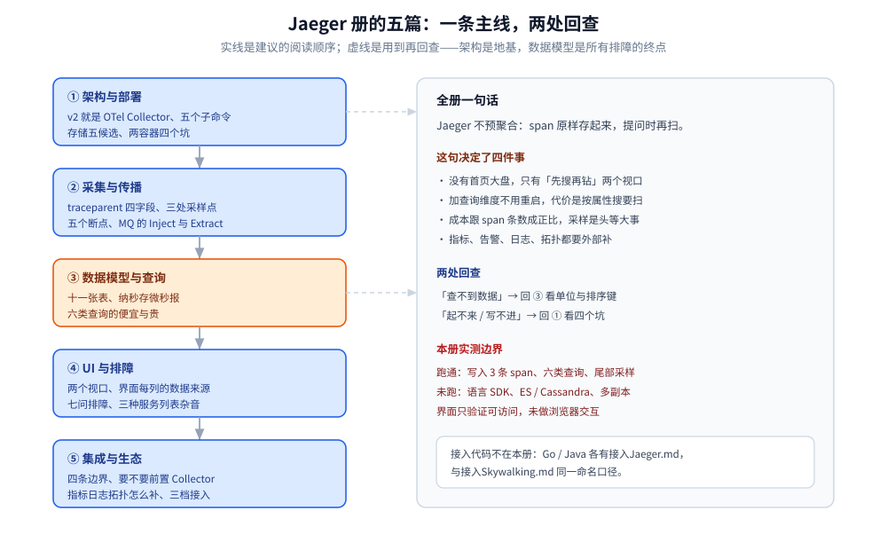

# Jaeger 链路追踪（册导读）

> Jaeger 是**只存原始 span、查询时再算**的链路追踪后端。本册五篇零件按「架构 → 采集 → 数据 → 界面 → 集成」切开：**它为什么长成 OTel Collector 的样子**、**埋点与传播怎么才不断链**、**落库的数据模型决定了哪些查询便宜哪些贵**、**面板上能看出什么**、**和 Collector / Prometheus / SkyWalking 怎么分工**。
>
> 内容整理自个人学习笔记。**本文件只给定位、阅读路线与实测坐标**——每篇的知识点描述见 [目录.md](../../../../../目录.md)，本册不重复；接入代码按语言分册，见第四节。

Jaeger 是 Uber 开源的**分布式链路追踪系统**，2017 年捐赠给 CNCF，2019 年毕业（Graduated）：一次请求经过了哪些服务、每个服务做了什么、耗时卡在哪一跳、失败发生在哪个环节。

⭐ 这一册的分水岭只有一句：**Jaeger 不预聚合，它把你送来的 span 原样存起来，等你提问时再扫**。所有「为什么 UI 没有大盘」「为什么按 traceId 查很快、按标签查很贵」「为什么加查询条件不用重启」的答案，都在这一句里。

## 一、与 SkyWalking 的定位差（先建立坐标系）

| 维度 | **Jaeger（本册）** | **SkyWalking**（[另一册](../Skywalking/README.md)） |
|---|---|---|
| 入库数据 | 原始 span，基本不预聚合 | 原始 segment **+** 聚合指标 **+** 拓扑边 |
| 打开界面第一眼 | 先有检索条件，再看到单条链路 | 直接有大盘、拓扑、Apdex |
| 想加一个新维度 | 直接拼检索条件，**不用重启** | 得改 OAL 脚本并重启 OAP |
| 存储压力 | 高（全量 span 落盘） | 低（分钟级聚合先行压缩） |
| 埋点方式 | OTel SDK / OTel Agent（自己写） | Agent 字节码增强（几乎零改码） |

⭐ 判据：**「临时问题优先」选 Jaeger，「大盘优先」选 SkyWalking**。两者的接入代码都是 OTel 生态，差别在「谁来聚合」这一层，详见 [集成与生态.md](集成与生态.md) 第七节。

## 二、核心概念速览

| 概念 | 说明 | 在本册哪篇展开 |
|---|---|---|
| **Trace** | 一条完整调用链，`trace_id` 全局唯一（16 字节 / 32 位十六进制） | [数据模型与查询.md](数据模型与查询.md) 第一节 |
| **Span** | 一次操作，含 `span_id`、起止时间、`parent_span_id`、status | 同上 |
| **SpanContext** | 跨进程传播的最小信息集，W3C 用 `traceparent` 承载 | [采集与传播.md](采集与传播.md) 第二节 |
| **OTLP** | OTel 的传输协议，gRPC `4317` / HTTP `4318` | [架构与部署.md](架构与部署.md) 第三节 |
| **Sampler** | 头部采样（父子一致）与尾部采样（按整条链路判定） | [采集与传播.md](采集与传播.md) 第四节 |
| **Collector 配置三段** | `receivers / processors / exporters`，Jaeger v2 的运行时就是它 | [架构与部署.md](架构与部署.md) 第二节 |
| **Badger / ClickHouse / ES** | 存储后端，决定「按 ID 精查」与「按属性检索」的代价 | [数据模型与查询.md](数据模型与查询.md) 第四节 |

## 三、五篇的阅读路线

```text
① 架构与部署.md ── v2 就是 Collector、存储与启动顺序、四个坑
        ↓
② 采集与传播.md ── traceparent 四字段、三处采样点、断链四个断点
        ↓
③ 数据模型与查询.md ── 十一张表、微秒坑、六类查询的代价
        ↓
④ UI与排障.md ─────── 两个视口、检索语义、七问排障
        ↓
⑤ 集成与生态.md ───── 与 Collector / Prometheus / SkyWalking 的分工与三档接入
```



图里实线是「建议先读」、虚线是「用到再回查」：架构篇是全册地基，数据模型篇是所有排障的终点——界面上能看到的每一列、每一种「查不到」，背后都是表和排序键的取舍。

| 篇 | 回答什么 | 建议先读 |
|---|---|---|
| [架构与部署.md](架构与部署.md) | v2 的进程里到底跑着什么、存储怎么选、容器怎么起、起不来长什么样 | 无（本册地基） |
| [采集与传播.md](采集与传播.md) | 谁产生 span、`traceparent` 怎么传、采样在哪一层做、链路在哪断 | 架构与部署.md |
| [数据模型与查询.md](数据模型与查询.md) | 一条 span 落库后变成什么、API 返回什么单位、哪类查询贵 | 架构与部署.md 第四节 |
| [UI与排障.md](UI与排障.md) | 界面上的两个视口怎么读、查不到数据从哪查起 | 数据模型与查询.md |
| [集成与生态.md](集成与生态.md) | 和 Collector、Prometheus、Grafana、SkyWalking 的边界与三档接入路线 | 架构与部署.md |

## 四、语言分册（接入代码不在本册）

本册只讲**组件本体**，接入手册按语言拆在 `01-编程语言/` 下，与 `接入Skywalking.md` 同一命名口径：

| 语言 | 分册 | 覆盖内容 |
|---|---|---|
| Go | [接入Jaeger.md](../../../../../01-编程语言/go/可观测性/接入Jaeger.md) | OTel SDK 初始化、Gin / GORM / NATS / xxl-job 四类埋点、context 传播三条铁律、trace_id 关联日志与响应、优雅退出、[photography-server](https://github.com/Eleven-26/photography-server) 落地映射 |
| Java | [接入Jaeger.md](../../../../../01-编程语言/java/可观测性/接入Jaeger.md) | OTel Java Agent 无侵入路线、Spring Boot 3 + Micrometer Tracing、日志 MDC 与响应头、跨线程传播、从 `jaeger-client` 迁移 |

> ⚠️ `jaeger-client-go` / `jaeger-client-java` **均已归档**，新项目一律用 OTel SDK + OTLP，不要再用私有客户端与私有 `uber-trace-id` 头。

## 五、本轮实测坐标

**跑起来的这套**（Docker Desktop / Windows amd64 / 2026-10-21）：

| 项 | 读数 |
|---|---|
| 镜像 | `jaegertracing/jaeger:2.20.0`（commit `d65f951`，build `2026-07-20`）+ `clickhouse/clickhouse-server:26.3-alpine` |
| 拓扑 | 两容器：ClickHouse（`9000` native / `8123` HTTP）+ Jaeger v2（`16686` 查询 HTTP、`16685` 查询 gRPC、`4317`/`4318` OTLP、`9411` Zipkin） |
| 启动 | 日志 `Everything is ready. Begin running and processing data.`；`create_schema: true` 自动建表 **11 张** |
| 写入 | 自造 OTLP/HTTP JSON 三条 span → `POST /v1/traces` 200 → `spans` 表 3 行，纳秒完整保留 |
| 查询 | `/api/services`、`/api/operations`、`/api/traces/{id}`、`/api/traces?...&tags=...` 全部 200 且返回真实数据 |
| 采样 | Collector 侧 `tail_sampling` + `status_code: [ERROR]`：正常链路丢弃、错误链路落库，**两端 POST 都返回 200** |
| 兼容 | Zipkin `POST /api/v2/spans` → 202，落库 `kind` 为空字符串（Zipkin 模型没有 kind） |

**没跑到的**（本册对应位置一律标「按文档陈述」）：

| 未实测 | 原因 |
|---|---|
| 任何语言 OTel SDK / Java Agent 真上报 | 本轮只手工构造 OTLP 报文，未起业务进程 |
| Elasticsearch / Cassandra / Badger 后端 | 只起 ClickHouse；这三种的表结构与检索代价按官方文档陈述 |
| 多副本 Collector、多租户（`multi_tenancy`） | 单机两容器形态 |
| UI 界面交互（点击、图形化检索） | 只验证 `/` 返回 200（5975 字节）与全部查询 API，未做浏览器操作 |
| SPM（`/api/metrics/calls`） | 未配 metrics 后端，接口返回 `501 trace metrics are currently disabled` |

## 六、本册的边界

| 本册收 | 不收（在哪） |
|---|---|
| Jaeger 组件本体：进程形态、存储 schema、查询 API、界面读法 | **各语言接入代码** → `01-编程语言/{go,java}/可观测性/接入Jaeger.md` |
| OTLP / Zipkin 落到 Jaeger 后的字段差异 | **OTel 规范本身**（SDK 内部、Exporter 语义）→ 只讲到「够判断链路断在哪」为止 |
| `traceparent` 的字段级传播规则 | **服务网格侧的无埋点观测** → [服务网格](../../../服务网格/README.md) |
| 与 SkyWalking / Tempo / Zipkin 的分工判据 | **存储引擎原理**（MergeTree 怎么排序合并）→ [定位与适用场景.md](../../../../数据存储/列式数据库/ClickHouse/定位与适用场景.md) |
| 采样在 Collector 侧的配置形态 | **告警与值班流程** → 属流程而非知识，本册不写 |

## 延伸追问

- **Jaeger v2 为什么要「变成」OTel Collector？** → 它不再维护自己的接收/导出协议栈：一个 `jaeger` 进程 = Collector（收 OTLP / Zipkin / Kafka）+ Query（查）+ 内置 UI，配置就是 Collector 的 `receivers / processors / exporters`。代价是版本节奏跟着 Collector 走，见 [架构与部署.md](架构与部署.md) 第二节。
- **为什么按 traceId 查很快、按 `http.status_code=500` 查却慢？** → 取决于存储的排序键：ClickHouse 的 `spans` 表按 `(service_name, name, start_time)` 排序，`trace_id` 的定位靠另一张 `trace_id_timestamps` 小表。见 [数据模型与查询.md](数据模型与查询.md) 第五节。
- **本地跑通的 compose，上线要注意什么？** → 三件：`--feature-gates=storage.clickhouse` 不能漏、存储别用内存或 Badger、`depends_on` 必须带健康检查（连不上存储会直接退出，不重试）。见 [架构与部署.md](架构与部署.md) 第六节。
- **要不要在前面再挂一层 OTel Collector？** → 只有当你要「一处管所有信号」或「出口要多路分发」时才需要；单后端单信号时 Jaeger 自己就是 Collector。判据见 [集成与生态.md](集成与生态.md) 第二节。
- **采样设成 5% 后，错误请求还会不会丢？** → 会。头部采样只按比例判、不看结果；要「错误全留」必须做尾部采样，而尾部采样得等整条链路到齐，只能放在 Collector 侧。见 [采集与传播.md](采集与传播.md) 第四节。
- **为什么界面服务列表里多出一个 `jaeger`？** → `jaeger_query` 默认 `enable_tracing: true`，查询面自己的请求也被记成 span 写进同一份存储（本机实测）。看数据时把它排除。见 [UI与排障.md](UI与排障.md) 第二节。
- **和 SkyWalking 能不能同时上？** → 技术上能（Jaeger 收 OTLP，SkyWalking 也有 OTel receiver），但**不要双报**：同一入口两份 span、指标翻倍、`trace_id` 还未必一致。见 [集成与生态.md](集成与生态.md) 第七节。

## 关联

- **上游/总纲**：[可观测性选型对比.md](../../可观测性选型对比.md) — 为什么选这条路线、存储与采样在选型里的权重
- **对照/互补**：[README.md](../Skywalking/README.md) — 「写时聚合」的另一条主线（探针式 APM 册导读）
- **下游机制**：[架构与部署.md](架构与部署.md)、[采集与传播.md](采集与传播.md)、[数据模型与查询.md](数据模型与查询.md)、[UI与排障.md](UI与排障.md)、[集成与生态.md](集成与生态.md) — 本册五篇零件
- **落地代码**：[接入Jaeger.md](../../../../../01-编程语言/go/可观测性/接入Jaeger.md)、[接入Jaeger.md](../../../../../01-编程语言/java/可观测性/接入Jaeger.md) — Go / Java 两侧的接入手册
- **存储侧**：[定位与适用场景.md](../../../../数据存储/列式数据库/ClickHouse/定位与适用场景.md) — Jaeger 官方推荐的明细存储选型
